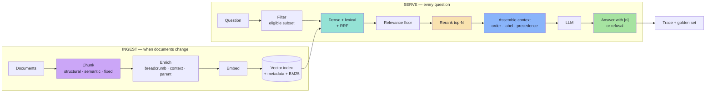

# Lecture 12 — Advanced RAG: Improving Retrieval Quality

> **Lecture theme:** Lecture 11 built the pipeline — documents → chunks → embeddings → top-K → grounded answer. This lecture asks the harder question: **the answer is still wrong, so which stage owns the fix?** Starting from a customer asking *"can I return my damaged headphones after 10 days?"*, it walks the five upgrade layers of a retrieval system: chunking, retrieval tuning and filtering, hybrid search with RRF, reranking, and context engineering — each one measurable, each one with a distinct failure it repairs.
>
> The reference implementation in the source lecture is **Spring AI on Pinecone**; these notes keep the architecture and express all snippets as **TypeScript-style pseudo-code**.

---

## Chapter Index

| # | Chapter | Core Question Answered |
|---|---|---|
| [01](./01_Why_Basic_RAG_Breaks.md) | Why Basic RAG Breaks | Is this a retrieval failure or a generation failure? |
| [02](./02_Fixed_Size_Chunking_and_Overlap.md) | Fixed-Size Chunking and Overlap | Where does the text get cut, and what does overlap really buy? |
| [03](./03_Structural_Semantic_and_Contextual_Chunking.md) | Structural, Semantic and Contextual Chunking | How do I keep a rule and its exception in one retrievable unit? |
| [04](./04_Top_K_and_Similarity_Thresholds.md) | Top-K and Similarity Thresholds | How much evidence, and how good must it be? |
| [05](./05_Metadata_Filtering.md) | Metadata Filtering | Which documents are even eligible — and who decides? |
| [06](./06_Hybrid_Search_and_RRF.md) | Hybrid Search and RRF | Why does the exact SKU lose, and how do I fuse two rankings? |
| [07](./07_Reranking_Two_Stage_Retrieval.md) | Reranking and Two-Stage Retrieval | Right document, wrong position — what now? |
| [08](./08_Context_Engineering.md) | Context Engineering | All the evidence is in the prompt, so why the wrong answer? |
| [09](./09_Evaluation_and_Production_Playbook.md) | Evaluation and Production Playbook | How do I prove it works, and keep it working? |
| [**Complete**](./Lecture_12_Complete_Notes.md) | **Complete Consolidated Notes** | All nine chapters condensed: cheat sheet, formula card, glossary, self-check |

> 📄 **Prefer a single document?** Read the **[Lecture 12 — Complete Consolidated Notes](./Lecture_12_Complete_Notes.md)**. It keeps the load-bearing ideas, numbers and decision tables, and links back to the chapters for full reasoning and pseudo-code.

---

## 💻 Companion Code

Every claim in these notes is implemented and measured in a runnable TypeScript codebase — no
framework, five dependencies, and **no API key required**:

| Artefact | What it is |
| :--- | :--- |
| 🏭 **[Advanced RAG codebase](../code/advanced-rag/README.md)** | fixed/structural/semantic chunkers, offline + OpenAI embeddings, pre-filtering store with ACL and `asOf` rules, BM25 + RRF, joint reranker with a calibrated gate, context assembly, ablation matrix, HTTP API |
| 🛠️ **[Implementation guide (00 → 10)](../code/implementations%20guide/README.md)** | the same code, chapter by chapter: full source, block-by-block explanation, and the real command output that proves each chapter |

The measured headline from `npm run cli -- ablation` (14 golden cases, offline):

```text
preset      chunks  recall  mrr    ndcg   refusal  falseRef  ctx tok  p50
naive       31      0.571   0.399  0.442  0.000    0.000     725      4ms
structural  27      0.643   0.488  0.528  1.000    0.167     348      2ms
hybrid      27      0.750   0.548  0.595  0.000    0.000     756      4ms
rerank      27      0.821   0.586  0.640  1.000    0.000     566      7ms
full        27      0.821   0.586  0.640  1.000    0.000     865      10ms
full-wide   27      0.821   0.586  0.640  1.000    0.000     918      13ms
```

Chunking raises recall and halves the context; hybrid search buys recall and *stops refusing*;
the reranker restores refusal and adds the rest of the recall at a lower token cost. Chapter 10
of the guide reads the table line by line.


---

## The Big Idea in One Diagram



---

## How to Read These Notes

1. **Chapter 01 is the diagnosis.** Two failure classes, seven symptoms, and the baseline-inspection habit everything else depends on.
2. **Chapters 02–03 are the ceiling.** Chunking decides what can ever be found; enrichment gives chunks back their context.
3. **Chapters 04–05 are the gate.** K, threshold and filters decide what is eligible to reach the model — including who is authorised.
4. **Chapters 06–07 are the ranking.** Hybrid fixes exact terms; reranking fixes ordering.
5. **Chapter 08 is the interpretation.** When evidence competes, the prompt must referee.
6. **Chapter 09 is the discipline.** Metrics per stage, an ablation order, and the runbook.

---

## Conventions Used in This Lecture

| Convention | Meaning |
|---|---|
| **Mermaid** | Every structural diagram is Mermaid (`flowchart`, `sequenceDiagram`). |
| **TypeScript-style pseudo-code** | Snippets describe data flow and contracts for a JS/TS environment. They are **not** runnable production code. |
| **Framework references** | Spring AI calls (`SearchRequest.builder().topK(5)`, `TokenTextSplitter`, `filterExpression`) appear as inline references and tables of meaning, not as code to copy. |
| **Illustrative numbers** | Latency, cost and score figures are "typical" or "illustrative", never universal constants. |
| **Beyond the lecture** | Sections marked *beyond the lecture* add material the script only gestures at (parent-child retrieval, contextual retrieval, late chunking, calibration, evaluation harnesses). |
| **Board references** | Passages described as *from the board* reproduce the hand-drawn `Excalidraw-Notes.svg`. |

---

## Sources

- 📄 [`Notes.pdf`](./Notes.pdf) — *Advanced RAG: Improving Retrieval Quality in Spring AI* (20 pages): why basic RAG is not enough, chunking strategies, Top-K / threshold / metadata filtering, hybrid search and RRF, reranking with a Pinecone Inference reranker, and an introduction to context engineering.
- 🖼️ [`Excalidraw-Notes.svg`](./Excalidraw-Notes.svg) — the lecture board: simple vs advanced RAG, the three chunking families with the `v1`/`v2` overlap windows, the adjacency-similarity table (0.92 · 0.87 · 0.31 · 0.94 · 0.88), the Top-K and threshold examples, metadata filtering, BM25 + RRF with `k = 60`, and the two-stage reranking flow.
- 📚 Prior lectures — [Lecture 10](../../Lecture%2010/notes/Lecture_10_Complete_Notes.md) (vector databases, ANN, BM25/RRF, reranking), [Lecture 11](../../Lecture%2011/notes/Lecture_11_Complete_Notes.md) (the base RAG pipeline, grounding, evaluation).

---

## One-Line Summaries

| Chapter | One-line summary |
|---|---|
| 01 | Advanced RAG is the engineering of one assumption: the retrieved chunks contain everything needed. |
| 02 | A chunk is a promise that this text can be found, cited and reasoned about on its own; overlap is insurance, structure is the fix. |
| 03 | Cut where the document says to cut, then give the chunk back the context the cut removed. |
| 04 | Top-K is a budget, the threshold is a promise — and without a floor, a grounded system can never say "I don't know". |
| 05 | Filters express eligibility, not preference — and they are the authorisation boundary, not a relevance feature. |
| 06 | Dense answers "what does this mean?", lexical answers "what does this say?"; RRF compares positions because scores are incomparable. |
| 07 | Retrieval earns the right to be considered; reranking decides who is heard — over a candidate set it cannot enlarge. |
| 08 | Retrieval decides what is available; context engineering decides what is salient. |
| 09 | Advanced RAG is a chain of narrow guarantees, each with its own metric — and a trace, or it is folklore. |
