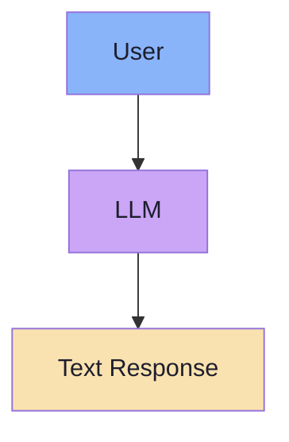
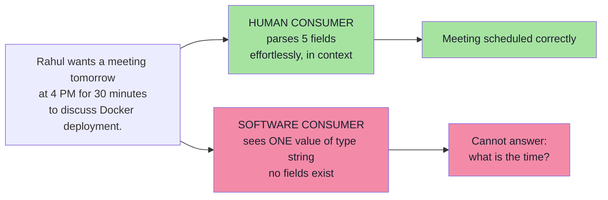
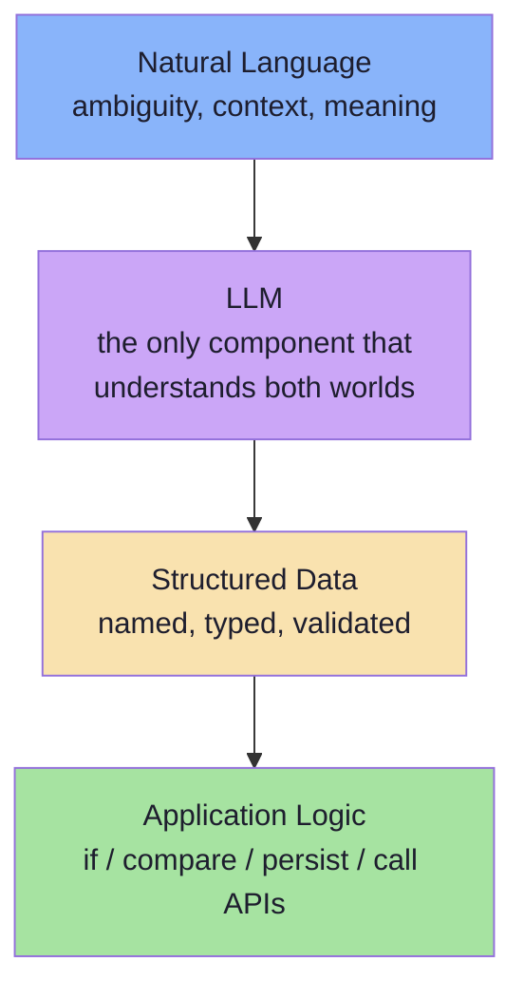
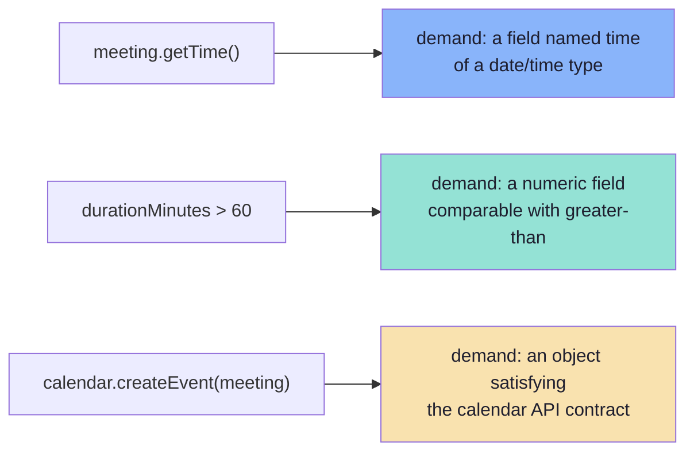
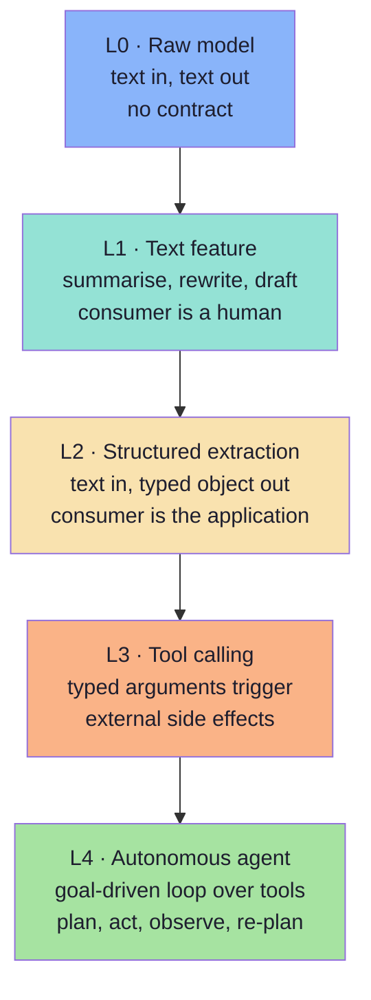
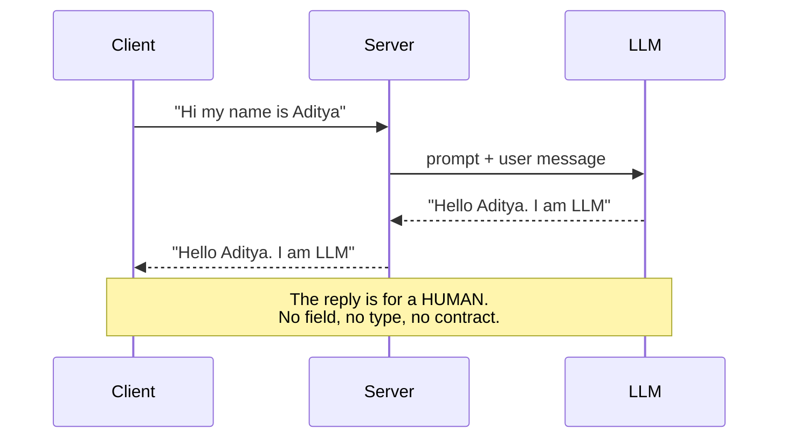
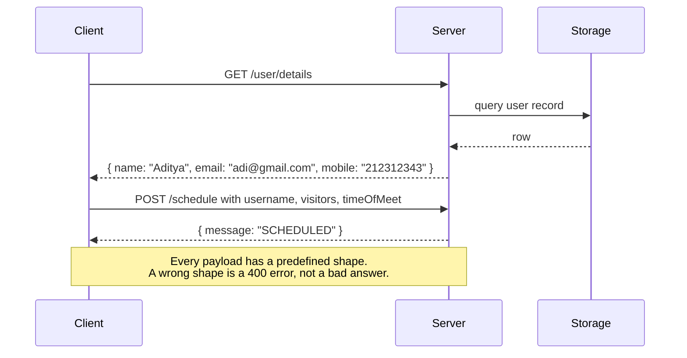
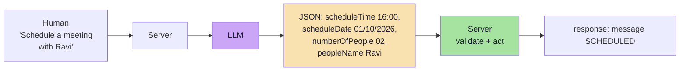
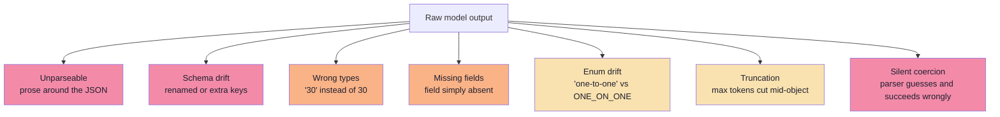
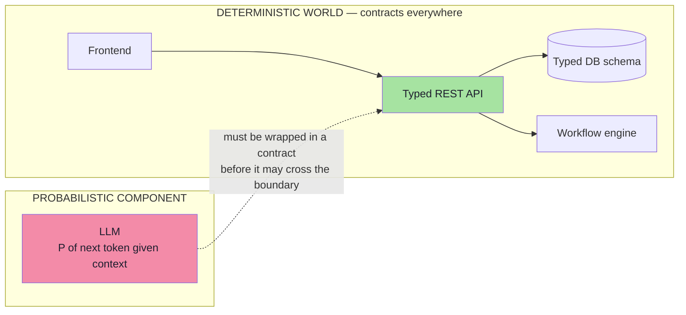

# Chapter 01: Why Plain Text Is Not Enough — The Integration Gap

> **Chapter Goal:** Establish the problem this entire lecture exists to solve. An LLM that answers beautifully in prose is a **finished product for a human** and an **unfinished input for a program**. Structured output is the bridge between those two worlds — and the bridge has a shape, a contract and a failure mode.
>
> At the end of this chapter you should be able to answer: *why does a chatbot that works perfectly in a demo fail the moment it becomes a feature inside an application?*

---

## 1.1 The Flow Every GenAI Application Starts With

Almost every GenAI application begins with the same three-box pipeline:



In a JS/TS environment the call looks like this:

```ts
// pseudo-code — the simplest possible integration
const response: string = await chatClient.prompt()
  .user("Explain Docker")
  .call()
  .content();
```

And the model returns something like:

```text
Docker is a platform that allows developers to package applications
into containers so they run consistently across environments...
```

For a chatbot this is **correct, complete and finished**. The final consumer is a human, and humans are extraordinarily good at reading unstructured information. Nothing about the response needs to change.

The problem appears the moment we ask a *program* — not a person — to consume that same response.

---

## 1.2 The Final Consumer Decides the Format

Read this sentence:

> **"Rahul wants a meeting tomorrow at 4 PM for 30 minutes to discuss Docker deployment."**

A human extracts five facts instantly and effortlessly:

| Field | Value |
|---|---|
| Person | Rahul |
| Date | Tomorrow |
| Time | 4 PM |
| Duration | 30 minutes |
| Topic | Docker deployment |

A Java or TypeScript application extracts **nothing**. From the application's point of view, the entire response is:

```ts
const response: string = "Rahul wants a meeting tomorrow at 4 PM for 30 minutes to discuss Docker deployment.";
```

One value. One type. `string`. There is no `person`, no `date`, no `time` — because a string has no fields.



The human's advantage is not intelligence. It is that the human **has a model of the world** in which a meeting has an attendee, a date, a time and a duration. The program has no such model — unless we give it one explicitly.

---

## 1.3 Human-Readable vs Machine-Usable

The distinction the lecture makes is one sentence long, and it is the thesis of this entire lecture:

> **Humans prefer meaning. Software prefers structure.**

Consider the same information written for a person:

```text
The meeting with Rahul is scheduled for tomorrow at 4 PM
and should last for approximately 30 minutes.
```

Now consider the same information written for a program:

```ts
const attendee: string  = "Rahul";
const date: string      = "2026-10-02";
const time: string      = "16:00";
const duration: number  = 30;   // minutes
```

The second version is uglier to read and *immediately useful* to a program: every value can participate in logic, comparison, arithmetic and database writes without a single line of string parsing.

The types applications actually work with are **not** prose:

| Application type | Example | Why prose cannot carry it |
|---|---|---|
| Object | `MeetingRequest` | Needs named, typed fields |
| Array | `attendees: string[]` | Needs a countable, iterable collection |
| Number | `durationMinutes: 30` | Needs arithmetic, not the word "thirty" |
| Boolean | `isRecurring: true` | Needs a truth value, not "yes, every week" |
| Enum | `MeetingType.INTERVIEW` | Needs a closed, known set of values |
| Date / time | `2026-10-02T16:00:00+05:30` | Needs a sortable, comparable instant |
| Identifier | `meetingId: "mtg_8f21"` | Needs an exact opaque token |

This is why the bridge looks like this:



**That bridge is structured output.**

---

## 1.4 What "Understanding" Means to a Program

A common confusion: *"the model understood the sentence, so why can't my app use it?"*

Because a program never *understands* — it **dereferences**. When the application wants the meeting time it must execute something like:

```ts
meeting.getTime();          // a field must EXIST, with a known type
```

and then use it in logic:

```ts
if (meeting.durationMinutes > 60) {
  requireApproval();        // comparison requires a number, not "about an hour"
}
```

and eventually hand it to another system:

```ts
await calendar.createEvent(meeting);   // the callee has its own typed contract
```

Every one of those three lines is a **type-level demand**:



### The "stringly typed" trap

When the LLM's output stays a `string`, engineers do the only thing available: they **write parsers**.

```ts
// pseudo-code — the anti-pattern this lecture is designed to remove
const match = response.match(/at (\d{1,2})\s*(AM|PM)/i);
const hour = match ? Number(match[1]) : null;      // silently wrong if AM/PM missing
const dateGuess = response.includes("tomorrow")
  ? addDays(today(), 1)
  : null;                                          // "next Tuesday" => null, silently
```

This code has three properties, and all three are bad:

1. **It is invisible business logic.** The rules of "what a meeting is" now live in regexes spread across the codebase.
2. **It fails silently.** `null` propagates; the meeting is created with a wrong time or no time.
3. **It is unmaintainable.** Every new phrasing ("the day after tomorrow", "in half an hour") requires a new regex.

> **Rule of thumb:** if your application has a `parseXFromText()` function, you have discovered a place where a schema belongs.

---

## 1.5 The Five Levels of LLM Integration

It helps to place structured output on a ladder, because it is not the destination — it is the **hinge** between talking and acting.



| Level | Input | Output | Who consumes the output | Guarantee available |
|---|---|---|---|---|
| L0 Raw model | text | text | nobody (research) | none |
| L1 Text feature | text | text | a human | readability |
| **L2 Structured extraction** | text | **typed object** | **the application** | **schema validity** |
| L3 Tool calling | text | typed arguments + effect | an external system | schema validity + authorisation |
| L4 Agent | goal | sequence of actions | the environment | all of the above + loop bounds |

**Level 2 is where most enterprise GenAI work actually happens.** Ticket triage, invoice extraction, meeting scheduling, sentiment routing, résumé parsing, log classification, CRM enrichment — all of them are "unstructured input, structured output". Levels 3 and 4 are simply Level 2 plus *permission to act* (Chapter 07).

> Cross-reference: [Lecture 05 — AI Agents](../../Lecture%2005/notes/README.md) builds levels 3 and 4 in detail; [Lecture 03](../../Lecture%2003/notes/README.md) builds level 1.

---

## 1.6 The Board: A Chatbot and an API Are Different Programs

The lecture board (`Excalidraw-Notes.svg`) draws **two different systems side by side**, and the comparison is the whole point of this chapter.

### Flow A — the chatbot (free-form text)



### Flow B — the API (structured contract)



### Flow C — the meeting scheduler (where the LLM is inserted)

This is the board's third sketch, and it is the architecture of this entire lecture:



The board also sketches the **pre-LLM version** of the same feature — a `MeetingDetails` form with fixed slots:

```text
scheduleTime   : __________
scheduleDate   : __________
numberOfPeople : __________
peopleName     : __________
```

That form is a **schema**. The LLM's job is to fill the form from a sentence instead of from a UI. This is the single most useful mental image in the lecture, and Chapter 02 builds on it directly.

> **Board observation:** the hand-drawn JSON contains typos — `meetingTming`, `meetinfgDate`, `mesage`. That is exactly the point. Free-form JSON is *suggested* text; a schema is *enforced* structure. A typo in a schema is a build-time error; a typo in free-form JSON is a runtime incident at 2 a.m.

---

## 1.7 The Failure Taxonomy of Free-Form Output

If you ask a model for "JSON" and parse the string, you have signed up for a specific and well-known list of failures. Every one of them is a bug in *your* system, not in the model.



| Failure | Typical cause | What the app experiences | Detected by a schema? |
|---|---|---|---|
| **Unparseable output** | Preamble, markdown fences, trailing commas, comments | `JSON.parse` throws | ✅ (as a parse error) |
| **Schema drift** | The model "improves" your field names | `meeting.attendee` is `undefined` | ✅ |
| **Wrong types** | `"30"`, `"4 PM"`, `"02/10/2026"` | Arithmetic and comparisons misbehave | ✅ |
| **Missing fields** | The model omits what it cannot find | `undefined` deep in the call stack | ✅ (if `required`) |
| **Enum drift** | Free-text synonym chosen instead of the allowed value | `switch` falls through to default | ✅ |
| **Truncation** | `max_tokens` reached mid-object | Half an object, or a parse error | ⚠️ only if you notice |
| **Silent coercion** | A permissive parser fills defaults | Wrong data, no error, no alert | ❌ — the dangerous one |
| **Confident nonsense** | All fields valid, values wrong | Business decision made on garbage | ❌ — needs semantic evaluation (Ch. 09) |

The last two rows are why "the JSON parsed" is **not** a success criterion. A syntactically perfect object can be semantically wrong; Chapters 06 and 09 handle those two distinct problems.

---

## 1.8 Why This Is a Forward-Deployed Engineer Problem

Enterprise systems are **contracts**: typed REST APIs, database schemas, message queues with versioned payloads, workflow engines with typed inputs. Dropping a probabilistic text generator into the middle of that system breaks the type system at exactly one point.



The Forward Deployed Engineer's job at this seam is **not** to make the model deterministic — that is impossible. It is to:

1. **Define the contract** the surrounding system requires (Chapters 02, 04).
2. **Enforce** that contract as early and as cheaply as possible (Chapter 05).
3. **Verify** that the model's output satisfies it before any other code trusts it (Chapter 06).
4. **Never let unvalidated model output touch a side effect** (Chapters 07, 08).
5. **Measure** how often the guarantee holds in production (Chapter 09).

> This is the same discipline as [Lecture 04's guardrails](../../Lecture%2004/notes/06_Engineering_Defenses_RAG_Guardrails_and_Verification.md) and [Lecture 12's retrieval floors](../../Lecture%2012/notes/README.md), applied to the *shape* of the output instead of the *truth* of the content.

---

## 1.9 Pseudo-code: The Naive Bridge and Why It Breaks

Here is the code almost everyone writes first, and the reason it is not enough.

```ts
// pseudo-code — the naive bridge
type MeetingRequest = {
  title: string;
  attendee: string;
  date: string;
  time: string;
  durationMinutes: number;
};

async function extractMeeting(userText: string): Promise<MeetingRequest> {
  const raw = await chatClient.prompt()
    .system("Extract the meeting details. Return JSON.")
    .user(userText)
    .call()
    .content();                      // <-- a STRING, not a MeetingRequest

  const json = raw.substring(
    raw.indexOf("{"),
    raw.lastIndexOf("}") + 1
  );                                  // <-- hoping braces are balanced

  const parsed = JSON.parse(json) as MeetingRequest;   // <-- unchecked cast
  return parsed;
}
```

Three things are wrong, and none of them is the model's fault:

| Line | Assumption | Reality |
|---|---|---|
| `.content()` | The response is exactly the JSON | It may be `"Sure! Here is the JSON:"` plus the JSON |
| `substring(indexOf("{"), lastIndexOf("}"))` | Braces are balanced and singular | Nested braces, or none at all, break it |
| `as MeetingRequest` | The shape is correct | `as` is a **compile-time lie**; at runtime `attendee` may be `undefined` |

The corrected version of this function appears in Chapter 06; the contract it needs is defined in Chapter 02 and enforced in Chapter 05.

---

## 1.10 Common Mistakes at This Stage

| Mistake | Why it hurts | Correct habit |
|---|---|---|
| Treating the LLM response as "just text, I'll parse it" | Every parse site becomes untested business logic | Define a schema first, then a prompt |
| Assuming a valid JSON object is a valid object | `JSON.parse` proves syntax, never shape or meaning | Validate against a schema at the boundary |
| Judging quality from one successful demo | Demos sample the happy path; production samples the tail | Keep a golden set with adversarial inputs (Ch. 09) |
| Letting the model choose field names | Contract drift; frontend and backend disagree silently | The schema is owned by the application, not the model |
| Skipping the "what does the consumer need?" question | You extract 12 fields when the app needs 4 | Design the output from the caller's perspective |
| Mixing "the LLM is smart" with "the LLM is reliable" | Capability is not a guarantee | Assume failure, then measure its rate |

---

## 1.11 Chapter Summary

| Idea | Statement |
|---|---|
| The starting pipeline | User → LLM → **text** is complete for a human and unusable for a program. |
| The core distinction | Humans prefer **meaning**; software prefers **structure**. |
| Why prose fails | A program dereferences fields; a `string` has no fields. |
| The bridge | Natural language → LLM → **structured data** → application logic. |
| The board's insight | An LLM-filled form and a hand-filled form produce the *same* object. |
| The five levels | L0 raw → L1 text feature → **L2 structured extraction** → L3 tool calling → L4 agent. |
| The failure taxonomy | Unparseable, drift, wrong types, missing fields, enum drift, truncation, silent coercion, confident nonsense. |
| The FDE obligation | Wrap the probabilistic component in a contract at the boundary — then measure it. |

> **Final mental model:** structured output is not a formatting preference. It is the **interface** between a probabilistic component and a deterministic system. Everything that follows — schemas, enforcement, validation, tools — exists to make that interface trustworthy.

---

## Where This Goes Next

- **[Chapter 02](./02_What_Structured_Output_Is_Schema_Contract_And_Types.md)** — what a schema *is*, and why the target is a typed object rather than "JSON".
- **[Chapter 03](./03_Why_Just_Ask_For_JSON_Fails.md)** — the exact failure modes of prompt-only JSON, and the three layers of enforcement that replace hope with a guarantee.
- Foundations: [Lecture 01 — Introduction to FDE](../../Lecture%2001/notes/README.md) for why enterprise AI must be grounded, [Lecture 03](../../Lecture%2003/notes/README.md) for the application-to-LLM call itself, [Lecture 05](../../Lecture%2005/notes/README.md) for tools and agents.

---

**Back to:** [Lecture 13 — Chapter Index](./README.md) · [Complete Consolidated Notes](./Lecture_13_Complete_Notes.md)
