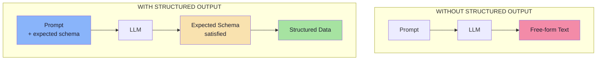
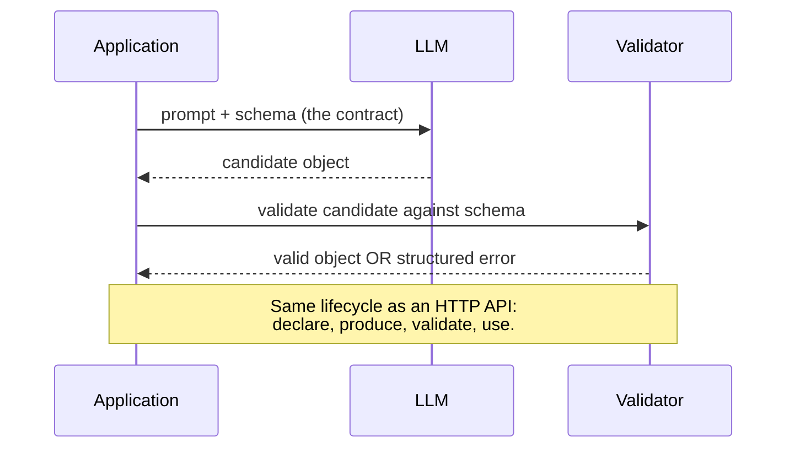
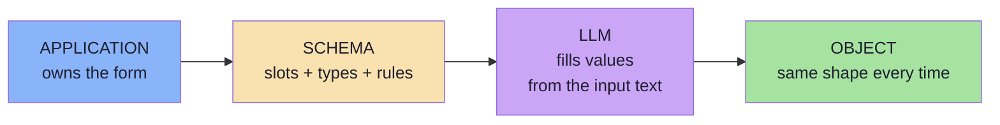
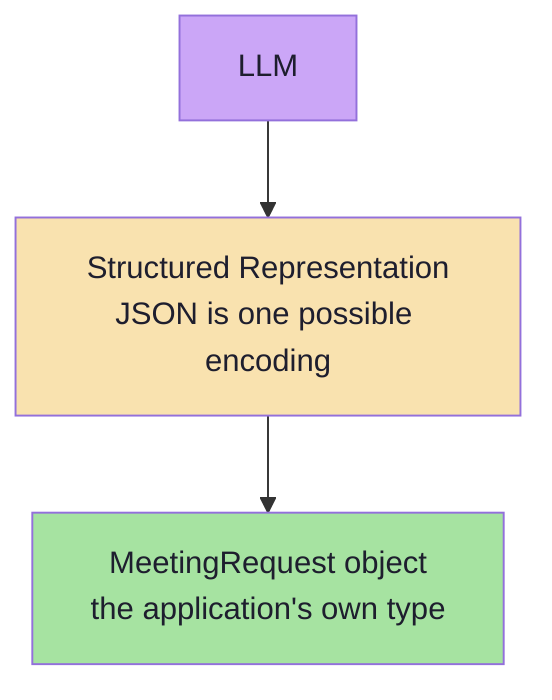
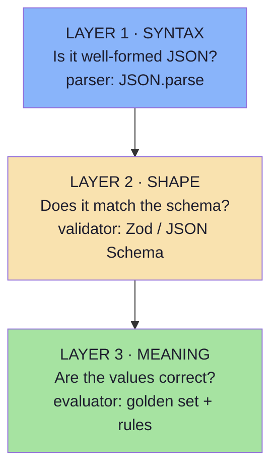
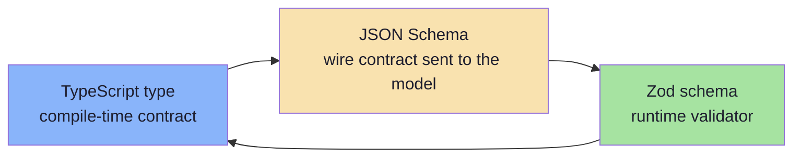
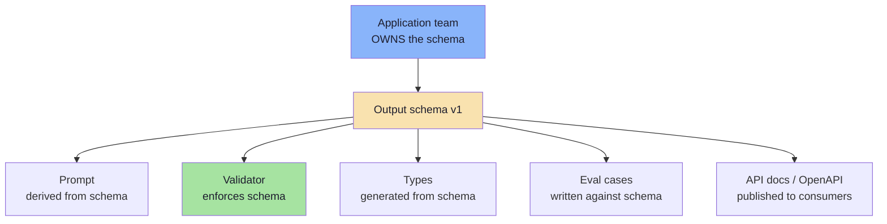
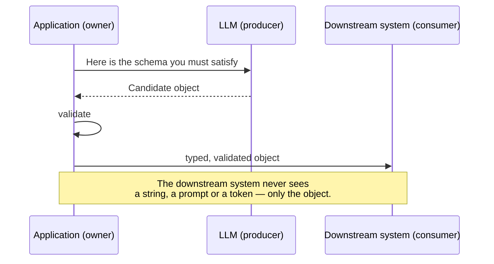
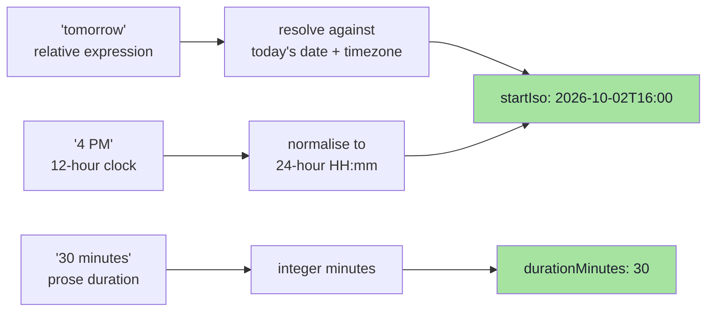

# Chapter 02: What Structured Output Is — Schema, Contract and Types

> **Chapter Goal:** Turn the informal idea of "the model should return JSON" into an engineering definition. Structured output means the model produces information in a **predefined structure that the application can reliably consume** — and the artifact that defines that structure is a **schema**. This chapter establishes the vocabulary (schema, contract, type, validation) that every later chapter uses.
>
> At the end of this chapter you should be able to answer: *what exactly am I asking the model to produce, and what am I promising my application it will receive?*

---

## 2.1 The Definition

> **Structured output** means asking the model to produce information in a **predefined structure** that our application can reliably consume.

Three words in that sentence carry all the weight:

| Word | What it demands | What it excludes |
|---|---|---|
| **Predefined** | The shape exists *before* the request, decided by the application | The model inventing a shape |
| **Structure** | Named, typed fields — objects, arrays, enums, numbers | Prose, headings, bullet lists |
| **Reliably consume** | The consumer can index, validate and trust it | "Looks right in the playground" |



The difference is **not** "JSON instead of prose". The difference is that in the second flow, a structure was declared *in advance* and the model was made accountable to it.

---

## 2.2 The REST API Analogy

To understand structured output, look at how a normal API already works. Instead of returning:

```text
The user's name is Rahul.
He is 28 years old and his email is rahul@gmail.com.
```

we normally return:

```json
{
  "name": "Rahul",
  "age": 28,
  "email": "rahul@gmail.com"
}
```

The second response follows a structure, and by publishing it we have effectively defined a **contract** for the response. Consumers of that API do not parse sentences; they read fields.

Structured output applies the same idea to an LLM:



| REST API concept | LLM equivalent |
|---|---|
| Endpoint path | The prompt / task definition |
| Request body schema | The **input** contract (usually plain text) |
| Response body schema | The **output** schema — structured output |
| OpenAPI document | The published schema the model is asked to satisfy |
| 400 Bad Request | A validation failure (Chapter 06) |
| Versioned API (`/v2`) | A versioned output schema (Chapter 09) |

> **Key reframing:** the LLM is not a text generator you hope behaves. It is a **service with an untyped output** that you wrap in a schema — exactly as you would wrap a third-party API.

---

## 2.3 The Form Analogy: Slots and Values

The lecture's most memorable analogy: **a schema is a form.**

Without a schema, the request is:

```text
Tell me about yourself.
```

The person can write anything. That is free-form output.

With a form:

```text
Name:  __________
Age:   __________
Email: __________
```

the expected structure has already been defined. The person still provides the values:

| Slot | Value |
|---|---|
| Name | Rahul |
| Age | 28 |
| Email | rahul@gmail.com |

But the **available fields are predetermined**.

> **Structured output works on the same principle: we define the slots; the LLM fills the values.**



Three consequences follow immediately, and they are the reason this analogy is so useful:

1. **The model cannot invent a new field** — there is no blank line for it.
2. **The model cannot skip a mandatory field** — the form says "required".
3. **The application knows the shape in advance** — it wrote the form.

---

## 2.4 Structured Output Is Not Just JSON

A common misunderstanding, stated plainly by the lecture:

> *"Structured output means making the LLM return JSON."* — **This is wrong.**

JSON is a **common representation**, but it is not the core idea. The deeper concept is:

> **The model's output follows a predefined structure understood by our application.**

In Java, the ultimate target might be a record:

```java
public record MeetingRequest(
    String title,
    String attendee,
    String date,
    String time,
    int durationMinutes
) {}
```

In TypeScript, the same target:

```ts
// pseudo-code — the real target of structured output
type MeetingRequest = {
  title: string;
  attendee: string;
  date: string;            // ISO 8601 date
  time: string;            // 24h "HH:mm"
  durationMinutes: number;
};
```

Conceptually:



**JSON may exist somewhere in between, but the application ultimately wants an object.** JSON is a transport format. XML, YAML, a typed array or a protocol buffer would serve the same purpose. What matters is that the *structure* is predefined and *enforced*.

> **Interview-quality distinction:** "JSON mode" is a **serialization** feature. "Structured output" is a **contract** feature. You can have the first without the second — and that is precisely the failure Chapter 03 dissects.

---

## 2.5 The Three Layers: Syntax, Shape, Meaning

Structured output is often discussed as one thing. It is actually **three independent guarantees**, and confusing them is the source of most production bugs.



| Layer | Question | Guaranteed by | Fails how | Fixed in |
|---|---|---|---|---|
| **Syntax** | Is it parseable? | `JSON.parse` / provider JSON mode | Trailing commas, prose wrappers, truncation | Ch. 03, 05 |
| **Shape** | Does it match the schema? | JSON Schema validation, constrained decoding | Wrong types, missing fields, enum drift | Ch. 04, 05, 06 |
| **Meaning** | Are the values right? | Evaluation set, business rules, cross-checks | Hallucinated values, wrong attendee, impossible dates | Ch. 06, 09 |

A pipeline can be at Layer 3 and still fail: `{ "date": "2026-02-31" }` is syntactically valid, schema-valid (it is a string), and **semantically impossible**. That is why Chapter 06 separates *syntactic validity* from *semantic validity*, and Chapter 09 measures both.

---

## 2.6 From Schema to Code: JSON Schema ↔ TypeScript ↔ Zod

The practical question is: *where does the schema live?* In a JS/TS environment, the same contract is expressed in three places, and the best practice is to derive them from **one** source of truth.



| Concept | JSON Schema | TypeScript | Zod (runtime) |
|---|---|---|---|
| Object | `"type": "object"` | `type X = { ... }` | `z.object({ ... })` |
| Field type | `"type": "string"` | `string` | `z.string()` |
| Number | `"type": "integer"` | `number` | `z.number().int()` |
| Required | `"required": ["a"]` | field not marked `?` | property without `.optional()` |
| Optional | absent from `required` | `a?: string` | `z.string().optional()` |
| Nullable | `"type": ["string","null"]` | `string \| null` | `z.string().nullable()` |
| Closed set | `"enum": [...]` | union of literals | `z.enum([...])` |
| List | `"type": "array", "items": {...}` | `T[]` | `z.array(...)` |
| Nested object | nested `properties` | nested type | `z.object` nested |
| Extra keys | `"additionalProperties": false` | not representable | `.strict()` |
| Description | `"description": "..."` | JSDoc comment | `.describe("...")` |
| Format hint | `"format": "date-time"` | template-literal type | `.datetime()` |

### One source of truth (the sane pattern)

```ts
// pseudo-code — define once, derive everything
const MeetingRequestSchema = z.object({
  title: z.string().describe("Short meeting title derived from the topic"),
  attendee: z.string().describe("Full name of the other participant"),
  date: z.string().describe("ISO 8601 date, YYYY-MM-DD"),
  time: z.string().describe("24-hour time, HH:mm"),
  durationMinutes: z.number().int().positive(),
  type: z.enum(["ONE_ON_ONE", "INTERVIEW", "TEAM", "OTHER"]),
}).strict();

type MeetingRequest = z.infer<typeof MeetingRequestSchema>;  // compile-time type

const jsonSchema = zodToJsonSchema(MeetingRequestSchema);    // wire contract
const validated = MeetingRequestSchema.parse(modelOutput);   // runtime guarantee
```

This single declaration gives you three things the lecture's meeting example needs: a type the compiler checks, a schema the model receives, and a validator that runs before any business logic.

> **Design principle:** the schema is **application-owned**. The model is a *client* of your contract, never its author. If the model could choose field names, you would have an untyped API that changes without a version bump.

---

## 2.7 The Contract Mindset

A schema is not documentation. It is an **executable interface**, and interfaces have owners, versions and consumers.



What a schema buys you, stated as engineering outcomes:

| Benefit | Concrete effect |
|---|---|
| **Predictability** | `meeting.time` exists with the same type on every call |
| **Compile-time safety** | The type is generated from the schema; renaming a field breaks the build, not production |
| **A single validation point** | One `parse()` at the boundary instead of scattered `if (!x)` checks |
| **Testability** | Fixtures can be written as valid/invalid objects |
| **Self-documentation** | Field `description`s are the API docs *and* part of the prompt |
| **Auditability** | Every stored object has a known shape, so it can be diffed and versioned |
| **Cheaper repairs** | A validation error is machine-readable, so repair prompts can be targeted (Ch. 06) |

### The three-way contract

A structured-output call is a **three-party contract**, not two:



The reason this matters: **the model is the only party allowed to be unreliable.** The schema exists so that unreliability cannot leak downstream.

---

## 2.8 What Structured Output Is Not

| Misconception | Correction |
|---|---|
| "It means returning JSON." | It means satisfying a **predefined structure**. JSON is the common encoding. |
| "It guarantees correct values." | It guarantees **shape**, never truth. `{"age": 999}` is valid. |
| "It replaces validation." | It **requires** validation. Enforcement reduces failures; it does not eliminate them. |
| "It removes the need for a prompt." | The prompt still carries the task, the rules and the ambiguity resolution. |
| "It is the same as tool calling." | Structured output is the **final result**; tool calling produces **arguments for an action** (Chapter 07). |
| "It is only useful for extraction." | It is also used for classification, routing, scoring, planning, summarising into fields and grading. |
| "A strict schema is always better." | Over-constrained schemas make the model *fail more often* — a refusal is worse than an approximation. |
| "Once it works in the playground, it works." | Playground prompts are clean; production inputs are messy (Chapter 09). |

---

## 2.9 Worked Example: Schema-First Design

Take the lecture's input:

> **"Schedule a Docker discussion with Rahul tomorrow at 4 PM for 30 minutes."**

### Step 1 — ask what the *consumer* needs, not what the text contains

The consumer is a calendar service. It needs a start instant, a duration, a participant and a title. It does **not** need the raw sentence, the word "tomorrow", or the topic phrased as prose.

### Step 2 — declare the schema

```json
{
  "type": "object",
  "additionalProperties": false,
  "required": ["title", "attendee", "startIso", "durationMinutes", "type"],
  "properties": {
    "title":           { "type": "string", "description": "Short meeting title" },
    "attendee":        { "type": "string", "description": "Other participant's full name" },
    "startIso":        { "type": "string", "description": "ISO 8601 local date-time, e.g. 2026-10-02T16:00" },
    "durationMinutes": { "type": "integer", "minimum": 1, "maximum": 480 },
    "type":            { "type": "string", "enum": ["ONE_ON_ONE", "INTERVIEW", "TEAM", "OTHER"] },
    "location":        { "type": ["string", "null"], "description": "null when not stated" }
  }
}
```

### Step 3 — the model fills the form

```json
{
  "title": "Docker Deployment Discussion",
  "attendee": "Rahul",
  "startIso": "2026-10-02T16:00",
  "durationMinutes": 30,
  "type": "ONE_ON_ONE",
  "location": null
}
```

### Step 4 — the application consumes an object, not a string

```ts
// pseudo-code — application logic on a validated object
const meeting = MeetingRequestSchema.parse(raw);

if (meeting.durationMinutes > 60) requireApproval(meeting);
if (meeting.type === "INTERVIEW") attachInterviewKit(meeting);
await calendar.createEvent(meeting);       // the downstream contract is satisfied
```

### Step 5 — where "tomorrow" and "4 PM" were resolved



Note what the schema forced: **normalisation**. Relative dates and 12-hour times are unusable to a calendar API; the schema's `description` fields instructed the model to normalise them, and the validator verified the *type* while a semantic check verified the *value*.

> **The pattern in one line:** *declare the schema the consumer needs → instruct the model in the schema's own language → validate before use.*

---

## 2.10 Common Mistakes at This Stage

| Mistake | Why it hurts | Correct habit |
|---|---|---|
| Designing the schema from the input text instead of the consumer's needs | You extract fields nobody uses and miss the one that matters | Start from the downstream call signature |
| Treating the schema as documentation | Docs drift; schemas must be executed | Derive the validator and types from the same source |
| Leaving `additionalProperties` open | The model adds plausible fields; downstream code silently ignores or breaks | Close the object (`.strict()`) unless you truly need flexibility |
| Making everything required | Missing information becomes a hard failure instead of a `null` | Mark genuinely optional fields optional or nullable |
| Using a free-text `string` where an enum exists | Unbounded vocabulary; downstream `switch` never matches | Use `enum` for any closed set |
| Encoding structure inside a string (`"Rahul, 30 min"`) | You recreated the parsing problem inside a field | One field, one meaning |
| Versioning by editing in place | Old stored objects no longer validate | Add a version field; evolve additively (Ch. 09) |

---

## 2.11 Chapter Summary

| Idea | Statement |
|---|---|
| Definition | Structured output = the model produces information in a **predefined structure** the application can consume. |
| The analogy | A schema is a **form**: the application defines the slots, the model fills the values. |
| Not just JSON | JSON is an encoding; the real target is a **typed application object**. |
| The contract | The schema is an executable interface with an owner (you), a producer (the model) and consumers (your code). |
| Three layers | **Syntax** (parseable) → **shape** (schema-valid) → **meaning** (correct values). |
| One source of truth | Declare once; derive the TypeScript type, the JSON Schema wire contract and the runtime validator. |
| Schema-first design | Start from the consumer's requirements, not from the sentence you were given. |
| The boundary rule | Nothing downstream should ever touch unvalidated model output. |

> **Final mental model:** structured output is a **typed API boundary** with the LLM on the producer side. Design the response contract the way you would design any API response — then enforce it.

---

## Where This Goes Next

- **[Chapter 03](./03_Why_Just_Ask_For_JSON_Fails.md)** — why the naive "please return JSON" instruction fails, and the three layers of enforcement that fix it.
- **[Chapter 04](./04_JSON_Schema_And_Schema_Design_For_LLMs.md)** — the schema-design craft: which keywords models honour, and which ones break them.
- Related: [Lecture 05, Chapter 02](../../Lecture%2005/notes/02_The_Tool_Calling_Protocol_and_Wire_Architecture.md) uses the same JSON Schema vocabulary for tool definitions.

---

**Back to:** [Lecture 13 — Chapter Index](./README.md) · [Complete Consolidated Notes](./Lecture_13_Complete_Notes.md)
