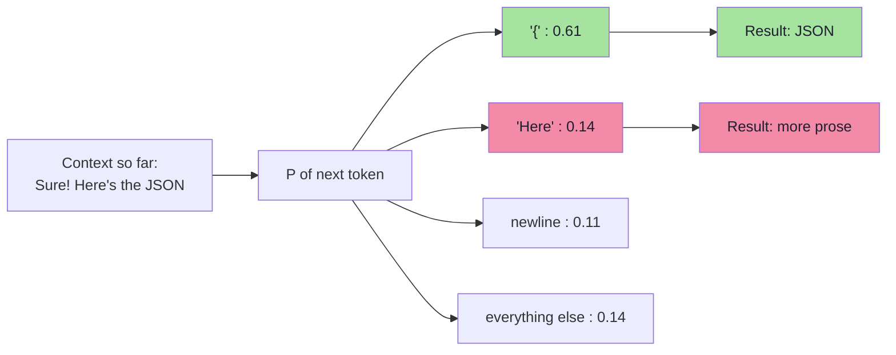
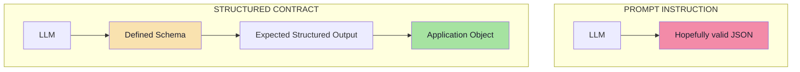
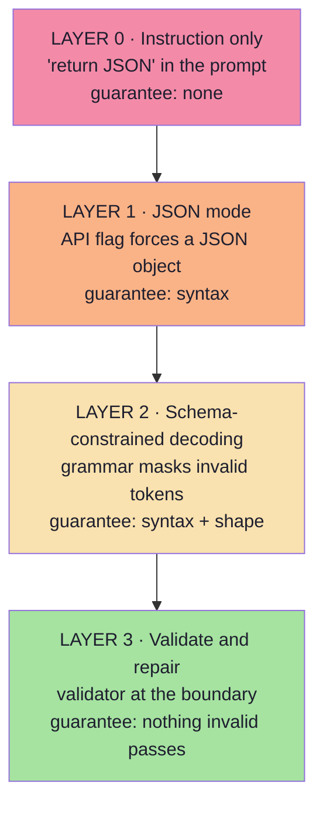
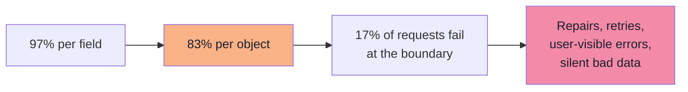
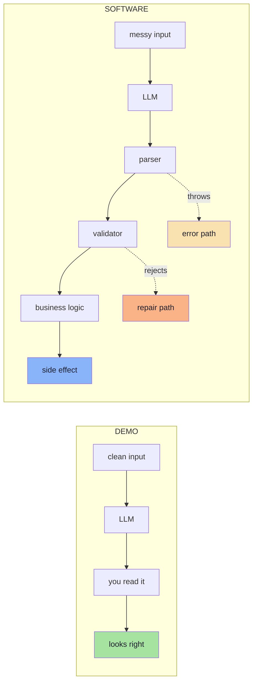
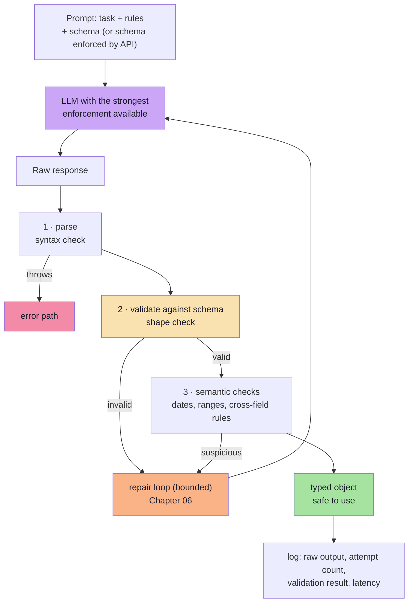

# Chapter 03: Why "Just Ask for JSON" Fails — Instruction vs Contract

> **Chapter Goal:** Explain precisely why prompt-only JSON extraction works in a demo and fails in production, and introduce the **three layers of enforcement** that replace hope with a guarantee. This chapter is the diagnosis; Chapter 05 is the cure.
>
> At the end of this chapter you should be able to answer: *my prompt says "return JSON" — what is the probability my parser succeeds on the millionth call, and what do I do about it?*

---

## 3.1 The Experiment Everyone Runs First

The natural question, and the one the lecture raises directly:

> *Why do we need structured output? Can't we simply tell the model to return JSON?*

For small experiments, this works. The prompt:

```text
Extract the meeting information.

Return JSON in the following format:

{
  "attendee": "",
  "date": "",
  "time": ""
}
```

And the model returns:

```json
{
  "attendee": "Rahul",
  "date": "2026-10-02",
  "time": "16:00"
}
```

For a demo this is sufficient. The problem becomes important when moving from:

```text
Demo   →   Software
```

Because the same prompt, on a different day, with a different temperature, a longer input, or a slightly different phrasing, returns something else.

---

## 3.2 The Exact Failure Modes

The lecture gives the canonical example of the chatty response:

```text
Sure! Here's the JSON you requested:

{
  "attendee": "Rahul",
  "date": "2026-10-02",
  "time": "16:00"
}
```

> **A human can easily ignore the first sentence. A JSON parser may not.**

That single example generalises into a catalogue of real production failures:

```mermaid
flowchart TD
    RAW["Model output for 'return JSON'"] --> A["Chatty preamble"]
    RAW --> B["Markdown fences"]
    RAW --> C["Trailing commas / comments"]
    RAW --> D["Single quotes"]
    RAW --> E["Schema drift: extra or renamed keys"]
    RAW --> F["Wrong types: '30', '4 PM'"]
    RAW --> G["Missing fields"]
    RAW --> H["Hallucinated enum values"]
    RAW --> I["Truncated at max_tokens"]
    RAW --> J["Two objects instead of one"]

    style RAW fill:#cba6f7,color:#1e1e2e
    style A fill:#f38ba8,color:#1e1e2e
    style B fill:#f38ba8,color:#1e1e2e
    style C fill:#fab387,color:#1e1e2e
    style D fill:#fab387,color:#1e1e2e
    style E fill:#f38ba8,color:#1e1e2e
    style F fill:#fab387,color:#1e1e2e
    style G fill:#fab387,color:#1e1e2e
    style H fill:#f9e2af,color:#1e1e2e
    style I fill:#f9e2af,color:#1e1e2e
    style J fill:#f9e2af,color:#1e1e2e
```



| # | Failure | What the model actually emits | What breaks |
|---|---|---|---|
| 1 | **Chatty preamble** | `Sure! Here's the JSON:` plus the JSON | `JSON.parse` throws on `S` |
| 2 | **Markdown fence** | a fenced ```` ```json ```` block | Parser sees backticks |
| 3 | **Trailing comma** | `{ "a": 1, }` | Strict JSON parsers throw |
| 4 | **Single quotes** | `{ 'a': 'b' }` | Invalid JSON (it is JavaScript, not JSON) |
| 5 | **Comments** | `{ /* note */ "a": 1 }` | Invalid JSON |
| 6 | **Schema drift** | Adds `durationInMinutes`, drops `durationMinutes` | `undefined` in business logic |
| 7 | **Wrong type** | `"durationMinutes": "30"` or `"time": "4 PM"` | Arithmetic and comparison bugs |
| 8 | **Missing field** | Field simply absent | `undefined` propagates |
| 9 | **Enum drift** | `"type": "one-to-one"` instead of `ONE_ON_ONE` | `switch` falls to `default` |
| 10 | **Hallucinated value** | `"date": "2026-10-03"` (off by one) | Valid schema, wrong business decision |
| 11 | **Truncation** | Object cut mid-string at `max_tokens` | Parse error or silent data loss |
| 12 | **Multiple objects** | Two JSON objects concatenated | Parser returns only the first |

Every one of these is a **system failure**, not a model failure. The model did what it was asked: it generated plausible text that looks like JSON. The system failed to define what "valid" means and to enforce it.

---

## 3.3 Why It Happens: Generation Is Probabilistic

An LLM does not "produce a JSON document". It produces **the next token, repeatedly**, sampling from a probability distribution over its vocabulary.



Three properties of that process explain every failure in §3.2:

| Property | Consequence for structured output |
|---|---|
| **Sampling is stochastic** | The same prompt can produce prose today and JSON tomorrow |
| **The model has no post-hoc validator** | It cannot "notice" that its own output is unparseable; there is no parse step inside the model |
| **Training data contains conversational JSON** | "Sure! Here's the JSON" is a *likely* continuation because it is what humans write |

The instruction "return JSON" is therefore a **soft preference over the next-token distribution**. It shifts probabilities. It does not remove the possibility of the wrong token.

> **The core insight:** you cannot *ask* a probabilistic system for a guarantee. You have to **remove the possibility** of the wrong token (constrained decoding) or **reject the result** when it occurs (validation). Chapter 05 does the former; Chapter 06 does the latter. Good systems do both.

---

## 3.4 Prompt Instruction vs Structured Contract

This is the key distinction of the lecture. When we say:

```text
Please return JSON.
```

we are giving the model an **instruction**:

> *"Please behave like this."*

Structured output instead focuses on defining what the application expects:

> *"This is the structure the application expects."*



> **This is much closer to how normal software systems are designed.**

| Dimension | Prompt instruction | Structured contract |
|---|---|---|
| Where the shape lives | Inside prose in the prompt | In a machine-readable schema |
| Enforcement | None (a request) | Decoding constraints and/or validation |
| Failure behaviour | Silent; discovered downstream | Explicit, at the boundary |
| Who owns the shape | The prompt author, informally | The application, versioned |
| Testability | "Does the answer look right?" | Valid/invalid fixture objects |
| Change management | Edit the prompt text | Version the schema |

---

## 3.5 The Three Layers of Enforcement

There is a spectrum, and it is worth naming each rung because the trade-offs differ.



| Layer | Mechanism | What it guarantees | What it does **not** guarantee | Cost |
|---|---|---|---|---|
| **0 · Instruction** | Prose in the prompt | Nothing | Anything | Free, unreliable |
| **1 · JSON mode** | `response_format: { type: "json_object" }` and equivalents | Output is *some* valid JSON object | Your fields, your types, your enums | Free, still drifts |
| **2 · Schema-constrained** | `json_schema` with `strict`, grammar/FSM decoding | The object matches **your schema** | Correct values; provider support limits | Small latency and prompt overhead |
| **3 · Validate + repair** | Zod / JSON Schema validation, repair loop | **Nothing invalid reaches business logic** | Semantic correctness | One validation pass; occasional retry |

> **The professional rule:** use the strongest enforcement your provider supports **and** keep Layer 3 anyway. Enforcement reduces the failure rate; validation bounds the blast radius. Neither is a substitute for the other.

Layer 2 is only available where the provider or runtime supports it — Chapter 05 gives the provider-by-provider landscape.

---

## 3.6 Compounding Reliability: The Math That Kills Prompt-Only

Suppose your prompt-only extraction is 97% correct per field. That sounds excellent. Now measure the *object*.

If a valid object requires 6 fields and each field is independently correct with probability `p`:

```text
P(object valid) = p^6

p = 0.99  →  0.94
p = 0.97  →  0.83
p = 0.95  →  0.74
p = 0.90  →  0.53
```



Add a list field with 5 items and you are multiplying again. Add a retry-free path and every one of those failures becomes either an exception or — far worse — **silently wrong data**.

Three conclusions follow:

1. **Per-field accuracy is not system accuracy.** Always measure at the object level.
2. **Nested and repeated structures multiply the failure rate.** Depth is expensive (Chapter 04).
3. **A small enforcement improvement is worth a large prompt improvement**, because it removes whole failure classes rather than reducing one.

> Illustrative numbers: real rates depend on model, task and schema complexity. The point is the *multiplicative structure*, not the specific values.

---

## 3.7 The Demo-to-Software Gap

| Dimension | Demo | Software |
|---|---|---|
| **Inputs** | 3 clean examples you wrote | Real user text: typos, emoji, mixed languages, pasted tables |
| **Failure tolerance** | None needed; you re-run it | A failure is an incident ticket |
| **Number of calls** | Tens | Millions |
| **Shape stability** | You eyeball it | Downstream code assumes it |
| **Silent errors** | You would notice | Nobody notices until a customer complains |
| **Change** | Prompt edited freely | Schema change is an API change |
| **Success metric** | "It worked" | Schema-validity rate, semantic accuracy, p95 latency (Ch. 09) |



The demo has one box where the software has four. **The extra three boxes are the entire subject of this lecture.**

---

## 3.8 The Parsing-Heuristics Trap

The instinct after the first parse failure is to write a "robust" extractor. Here is what that looks like, and why it is a trap:

```ts
// pseudo-code — the heuristic parser that slowly becomes unmaintainable
function extractJson(raw: string): unknown {
  let s = raw.trim();

  // 1. strip markdown fences
  s = s.replace(/^```(?:json)?/i, "").replace(/```$/, "").trim();

  // 2. drop any prose before the first brace
  const start = s.indexOf("{");
  if (start > 0) s = s.slice(start);

  // 3. drop any prose after the last brace
  const end = s.lastIndexOf("}");
  if (end !== -1) s = s.slice(0, end + 1);

  // 4. repair trailing commas
  s = s.replace(/,\s*([}\]])/g, "$1");

  // 5. single quotes -> double quotes (breaks on apostrophes inside values!)
  s = s.replace(/'/g, '"');

  return JSON.parse(s);
}
```

Each step is a bet, and every bet has a counterexample:

| Step | Fails when |
|---|---|
| Strip fences | The model used `~~~` or indented code, or the JSON itself contains a fence in a string |
| Slice from first `{` | A string value contains `{` earlier in the preamble |
| Slice to last `}` | Two objects were emitted, or a `}` appears inside a string value |
| Remove trailing commas | A comma inside a string value is followed by `]` (e.g. `"a, ]"`) |
| Quote replacement | Any apostrophe inside a value (`"it's 4 PM"`) becomes invalid JSON |

> **The lesson:** every regex you add is a **silent correctness risk** that only triggers on rare inputs — exactly the inputs production will eventually send you. The alternative is not a better regex. It is to stop relying on the raw string in the first place (Layer 2) and to fail loudly and safely when it is wrong (Layer 3).

---

## 3.9 What "JSON Mode" Fixes — and What It Does Not

Many providers offer a flag that forces the output to be *valid JSON*.

```ts
// pseudo-code — JSON mode is syntax-only enforcement
const res = await client.chat.completions.create({
  model: "…",
  messages: [{ role: "user", content: prompt }],
  response_format: { type: "json_object" },   // "must be valid JSON"
});
```

| It fixes | It does not fix |
|---|---|
| Chatty preambles and markdown fences | Missing or renamed fields |
| Trailing commas, single quotes, comments | Wrong types (`"30"` instead of `30`) |
| Unbalanced braces and truncation-at-brace-level (usually) | Enum drift and hallucinated values |
| The need for fence-stripping heuristics | Nested-shape errors |
| | Whether the JSON is the *right* JSON |

JSON mode guarantees you can call `JSON.parse` successfully. It says nothing about whether the resulting object matches your schema.

> **Rule:** JSON mode is a *parser* guarantee. A schema is a *contract* guarantee. They solve different problems; confusing them is the most common misunderstanding in this subject.

---

## 3.10 The Correct Flow

Putting the pieces together, the production shape of a structured call is:



Compared with §3.1's demo flow, this has four properties the demo lacks:

1. **A schema exists before the call.**
2. **A validator exists between the model and the business logic.**
3. **A bounded repair path exists for the failures that will happen.**
4. **Every attempt is logged**, so the failure rate is measurable rather than anecdotal.

---

## 3.11 Common Mistakes at This Stage

| Mistake | Why it hurts | Correct habit |
|---|---|---|
| Treating "return JSON" as a guarantee | It is a preference over token probabilities | Use provider-level schema enforcement (Ch. 05) |
| Adding regex repairs to a fragile output | Each regex is a latent correctness bug | Fix enforcement, not parsing |
| Confusing JSON mode with schema enforcement | You get valid JSON of the wrong shape | Validate against the schema (Ch. 06) |
| Measuring per-field accuracy | Object validity compounds multiplicatively | Measure object-level validity rate |
| Assuming temperature 0 means determinism | Greedy decoding is still not a contract, and providers are not bit-stable | Still validate |
| Letting the model pick field names | Contract drift breaks downstream code silently | Application owns the schema |
| Retrying the identical prompt after a failure | Same input, same distribution, same failure | Change something: include the error, lower temperature, or fall back (Ch. 06) |
| Ignoring `max_tokens` | Truncation produces unparseable or partial objects | Size `max_tokens` for the schema, and detect `finish_reason: length` |

---

## 3.12 Chapter Summary

| Idea | Statement |
|---|---|
| The naive approach | "Return JSON" in the prompt works for demos and fails at scale. |
| Why | Generation is probabilistic; there is no validator inside the model. |
| The canonical example | `Sure! Here's the JSON:` — a human ignores it, a parser throws. |
| Twelve failure modes | Preamble, fences, commas, quotes, drift, types, missing fields, enums, hallucination, truncation, multiples, comments. |
| The key distinction | **Prompt instruction** ("behave like this") vs **structured contract** ("this is the structure expected"). |
| Three enforcement layers | Instruction → JSON mode (syntax) → schema-constrained decoding (shape) → validation (nothing invalid passes). |
| The math | Object validity = per-field validity **multiplied**; depth and lists compound it. |
| The rule | Enforce as strongly as possible **and** validate anyway. |

> **Final mental model:** "just ask for JSON" delegates your contract to a probability distribution. Structured output takes the contract back and enforces it — first at the decoder, then at the boundary.

---

## Where This Goes Next

- **[Chapter 04](./04_JSON_Schema_And_Schema_Design_For_LLMs.md)** — how to write a schema a model can actually satisfy.
- **[Chapter 05](./05_Enforcement_Mechanisms_And_Provider_Landscape.md)** — Layer 2 in detail: constrained decoding and provider-native structured outputs.
- **[Chapter 06](./06_Validation_Repair_And_Failure_Handling.md)** — Layer 3 in detail: validation, repair and fallbacks.
- Related: [Lecture 05, Chapter 01](../../Lecture%2005/notes/01_From_Token_Prediction_to_Tool_Augmentation.md) documents the same "naive Return-JSON" failure from the tool-calling angle.

---

**Back to:** [Lecture 13 — Chapter Index](./README.md) · [Complete Consolidated Notes](./Lecture_13_Complete_Notes.md)
