# Chapter 04: JSON Schema and Schema Design for LLMs

> **Chapter Goal:** The lecture tells us *that* we need a schema. This chapter is about **how to write one a model can actually satisfy**. A schema is simultaneously (a) a contract for your application, (b) an instruction for the model, and (c) an input to a decoder. Bad schemas fail on all three fronts at once.
>
> At the end of this chapter you should be able to answer: *given a task, what is the smallest, flattest, most constrained schema that captures it — and which keywords will break my provider?*

---

## 4.1 What a Schema Is, Formally

A **schema** defines what the structured data should look like. The industry-standard vocabulary for that definition is **JSON Schema**, which is also what tool/function definitions use ([Lecture 05, Ch. 02](../../Lecture%2005/notes/02_The_Tool_Calling_Protocol_and_Wire_Architecture.md)).

For the lecture's meeting example, the schema may contain:

```text
title             → text
attendee          → text
date              → text
time              → text
durationMinutes   → number
```

A more precise version of that same idea:

```json
{
  "$schema": "https://json-schema.org/draft/2020-12/schema",
  "title": "MeetingRequest",
  "type": "object",
  "additionalProperties": false,
  "required": ["title", "attendee", "startIso", "durationMinutes"],
  "properties": {
    "title":           { "type": "string", "minLength": 1, "maxLength": 120 },
    "attendee":        { "type": "string", "minLength": 1 },
    "startIso":        { "type": "string", "format": "date-time" },
    "durationMinutes": { "type": "integer", "minimum": 1, "maximum": 480 },
    "type":            { "type": "string", "enum": ["ONE_ON_ONE", "INTERVIEW", "TEAM", "OTHER"] },
    "location":        { "type": ["string", "null"] }
  }
}
```

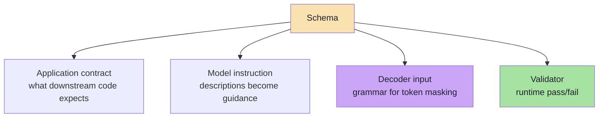

That triple role is why schema design is a *design* activity, not a typing exercise.

---

## 4.2 The Core Keyword Vocabulary

| Keyword | Meaning | Typical use |
|---|---|---|
| `type` | The JSON type: `object`, `array`, `string`, `number`, `integer`, `boolean`, `null` | Every field |
| `properties` | Named fields of an object | Object shape |
| `required` | Which properties must be present | Mandatory fields |
| `additionalProperties` | Whether extra keys are allowed (`false` closes the object) | Contract enforcement |
| `enum` | A closed set of allowed values | Categories, statuses, routing labels |
| `const` | Exactly one allowed value | Discriminators, fixed versions |
| `items` | Schema for each element of an array | Lists |
| `minItems` / `maxItems` | Array length bounds | Capping cost and drift |
| `minimum` / `maximum` | Numeric bounds | Durations, scores, quantities |
| `minLength` / `maxLength` | String length bounds | Titles, summaries |
| `pattern` | Regular expression constraint | IDs, codes, postcodes |
| `format` | Semantic hint: `date-time`, `date`, `email`, `uri`, `uuid` | Normalised values |
| `description` | Human-readable intent — **part of the prompt** | Every field, always |
| `default` | Value to use when absent | Optional fields |
| `$defs` / `$ref` | Reusable named sub-schemas | Shared nested shapes |
| `anyOf` / `oneOf` / `allOf` | Unions and intersections | **Restrictively supported** — see §4.10 |

> **The single highest-value keyword is `description`.** Models are far more likely to produce the right value when the field explains itself ("ISO 8601 date, YYYY-MM-DD") than when it relies on a good name alone.

---

## 4.3 Types: The Four Decisions

Every field forces four decisions, and each one is a place where a wrong choice causes silent bugs.

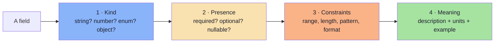

| Decision | Good choice | Bad choice | Consequence of the bad choice |
|---|---|---|---|
| Kind | `enum` for a closed set | `string` with "one of: …" in the description | Unbounded vocabulary; `switch` never matches |
| Kind | `integer` for a count | `string` `"30 minutes"` | Arithmetic requires parsing |
| Presence | `null` allowed when unknown | `required` with a sentinel like `""` or `"N/A"` | Two ways to say "unknown"; both leak into logic |
| Constraints | `minimum: 1, maximum: 480` | Unbounded integer | Hallucinated 1440-minute meetings |
| Meaning | Units in the name: `durationMinutes` | `duration` | The 30-vs-1800 ambiguity |
| Meaning | `format: date-time` plus a description with an example | Bare `"date"` | Locale-ambiguous strings |

---

## 4.4 Enums: The Highest-Leverage Constraint

If a field has a closed set of valid values, **say so**. This is the cheapest, most effective schema improvement available.

```json
{ "type": "string", "enum": ["LOW", "MEDIUM", "HIGH", "CRITICAL"] }
```

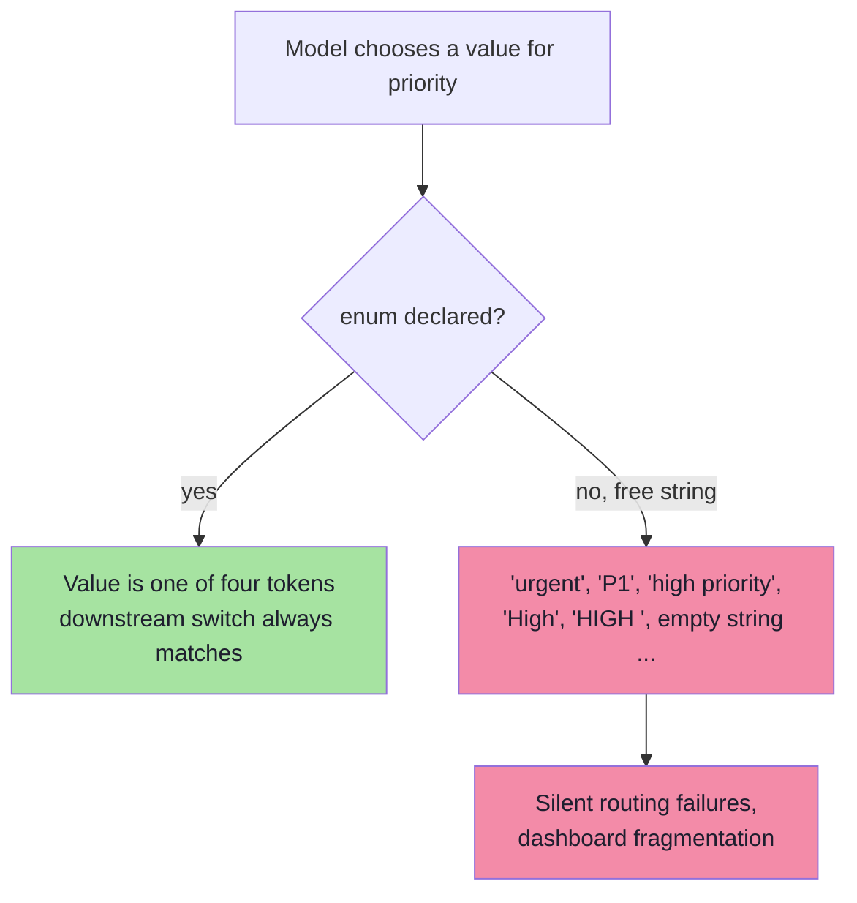

Three practical rules for enums:

1. **Use machine-friendly literals** — `ONE_ON_ONE`, not `"one-to-one"`. Enum values are identifiers, not display text; map them to human labels in the UI.
2. **Include an escape hatch** — an `OTHER` or `UNKNOWN` member. Without one, the model must lie when the input does not fit, and it will pick the nearest wrong value.
3. **Keep the set small** — beyond roughly 10–15 members, models start confusing adjacent categories; consider a two-step classification instead.

> `const` is the degenerate case: an enum of size one. It is useful for schema versioning — `"schemaVersion": { "const": "meeting.v2" }`.

---

## 4.5 Objects, Required Fields and Closure

```json
{
  "type": "object",
  "additionalProperties": false,
  "required": ["attendee", "startIso"],
  "properties": {
    "attendee": { "type": "string" },
    "startIso": { "type": "string" },
    "notes":    { "type": ["string", "null"] }
  }
}
```

| Setting | Effect on the model | Effect on your code |
|---|---|---|
| `additionalProperties: false` | Cannot emit keys outside the list | You can trust the object has exactly these keys |
| `additionalProperties: true` (default) | Free to add "helpful" fields | Extra keys appear in storage and break equality checks |
| `required: [...]` | Must emit those keys, even as `null` if allowed | No `undefined` checks needed |
| Absent from `required` | May omit the key entirely | Every read site must handle `undefined` **and** `null` |

**Recommendation for LLM schemas:** prefer **required + nullable** over **optional**. "This key is always present; its value may be `null`" is a single, testable rule, whereas "this key may not exist" forces defensive code everywhere.

### Nesting

Nesting is legitimate (an address, a line item) but it is not free:

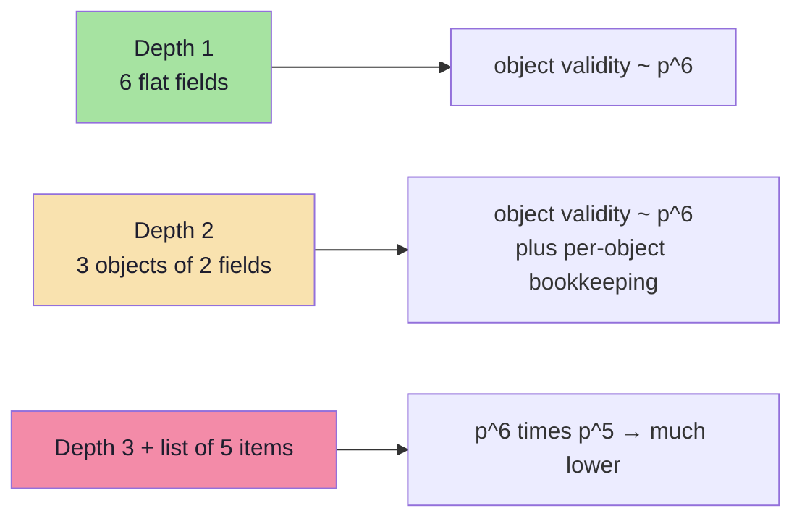

Rule of thumb: **flatten until nesting buys you something**. Group fields only when the group is a real domain concept that travels together (an address, a monetary amount with a currency) or when it is optional as a unit.

---

## 4.6 Arrays and Lists

Lists are where "mostly works" becomes "sometimes catastrophically wrong". Four constraints to always consider:

| Constraint | Why it matters |
|---|---|
| `maxItems` | Bounds cost, latency and blast radius; prevents the model from inventing 200 items |
| `minItems` | Prevents an empty list when the task requires at least one |
| `items` schema | Without it, element types drift; with it, each element is validated |
| Element `description` | Explains *what one item is*, which is the commonest source of confusion |

```json
{
  "type": "array",
  "minItems": 1,
  "maxItems": 10,
  "items": {
    "type": "object",
    "additionalProperties": false,
    "required": ["name", "role"],
    "properties": {
      "name": { "type": "string", "description": "Full name of the attendee" },
      "role": { "type": "string", "enum": ["ORGANISER", "PARTICIPANT", "OPTIONAL"] }
    }
  }
}
```

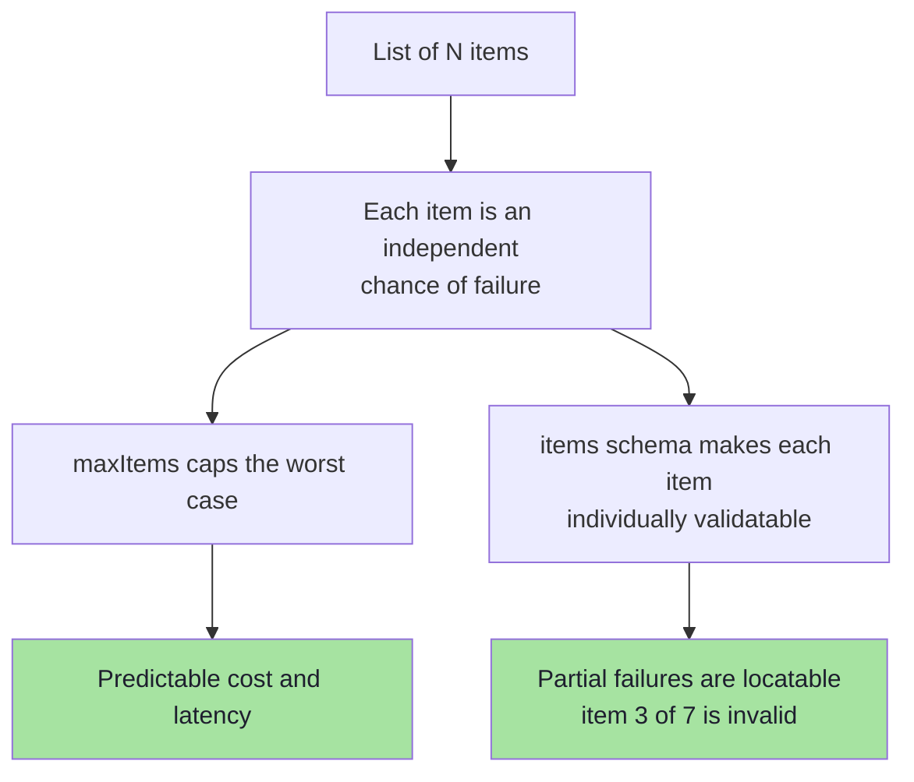

> **Practical warning:** a long list is often better modelled as **N independent calls**, one per item. It is more requests, but each is independently retryable, cacheable and measurable — and a failure loses one item instead of the whole response.

---

## 4.7 Strings: Normalisation Is a Schema Responsibility

Most extraction bugs are string-format bugs. The schema is the right place to fix them, because the `description` is instruction and `format`/`pattern` is verification.

| Domain | Wrong (ambiguous) | Right (normalised) |
|---|---|---|
| Dates | `"tomorrow"`, `"02/10/2026"` | `"2026-10-02"` with `"format": "date"` |
| Times | `"4 PM"` | `"16:00"` (24h) or full ISO date-time |
| Durations | `"half an hour"` | `durationMinutes: 30` with `minimum: 1` |
| Money | `"$1,200.50"` | `{ "amountMinor": 120050, "currency": "USD" }` |
| Phone | `"(212) 312-3430"` | E.164 `"+12123123430"` with `pattern` |
| Booleans | `"yes"`, `"maybe"` | `true` / `false` / `null` |
| Language | `"English"`, `"eng"` | BCP-47 `"en-US"` |
| IDs | `"#1234"` | `"1234"` with `pattern: "^[0-9]+$"` |

```json
{
  "amountMinor": {
    "type": "integer",
    "minimum": 0,
    "description": "Amount in the smallest currency unit, e.g. cents. 12.50 USD is 1250."
  }
}
```

**Money is the canonical example of why this matters.** Floating-point currency is a defect; an integer minor unit plus a currency code is the only schema that survives arithmetic.

---

## 4.8 Numbers and Booleans

| Rule | Rationale |
|---|---|
| Use `integer` for counts, durations, quantities | Floats invite `29.999999` |
| Use `number` only for genuine measurements and scores | — |
| Always add `minimum` / `maximum` | Turns "impossible value" into "validation error" |
| Prefer `exclusiveMinimum` / `exclusiveMaximum` when zero is invalid | `"exclusiveMinimum": 0` beats `minimum: 1` for "positive" |
| Never use a number to encode a category | `1 = urgent` is an untyped enum |
| Prefer `boolean` + `null` over string tri-states | `"maybe"` is not a truth value |
| Put units in the field name | `durationMinutes`, `weightGrams`, `distanceKm` |

---

## 4.9 Nullability vs Optionality

These are **not** the same thing, and conflating them is a frequent source of bugs.

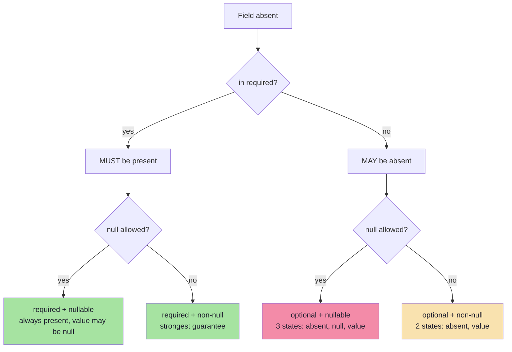

**Guidance:**

- `required + non-null` → for facts that always exist in the input.
- `required + nullable` → for facts that may not exist in the input ("the user did not mention a location"). **This is the default you should reach for.**
- `optional + *` → avoid unless the field genuinely represents "this concept is not applicable". Three states (absent, null, value) is a state machine nobody wants to debug.

---

## 4.10 Provider Subsets: The "Strict Mode" Reality

The full JSON Schema specification is enormous. **No decoder implements all of it**, because grammar-constrained decoding needs a schema that can be compiled into a finite-state machine. Providers therefore publish a *supported subset* — often called "strict mode".

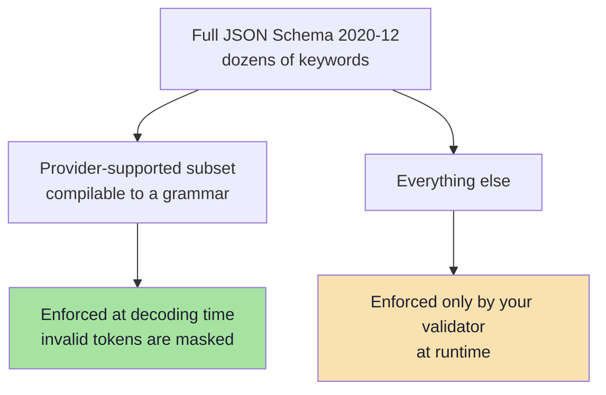

Patterns that are **widely shared** across strict implementations:

| Constraint in strict mode | Why |
|---|---|
| Every property must appear in `required` | The grammar must know exactly which keys follow |
| Optionality is expressed as **nullable + required** | Removes the "key may be absent" branch from the grammar |
| `additionalProperties: false` is mandatory | The grammar must know when the object ends |
| `oneOf` is usually **not** supported; `anyOf` sometimes is | `oneOf` requires global validation, not a local grammar decision |
| `$ref` / `$defs` are supported but recursion needs care | Deep or cyclic refs explode the grammar |
| Validation keywords (`minLength`, `pattern`, `format`, `minimum`) may be **accepted but not enforced by the decoder** | The decoder enforces *structure*, not value predicates |
| Unsupported keywords are sometimes rejected with an API error | Always test the schema against the provider before shipping |

> **Two consequences for engineers:**
> 1. **A "strict" schema is not a semantically strict schema.** `minimum`, `pattern` and `format` may be silently ignored by the grammar — so your runtime validator is still the only guarantee for those (Chapter 06).
> 2. **Portability is a real cost.** A schema tuned to one provider's subset may be rejected or degraded on another. Keep the canonical schema provider-neutral and generate the provider-specific variant (Chapter 05).

---

## 4.11 The Reasoning-Field Pattern

A well-known and highly effective design: put a short natural-language reasoning field **before** the answer fields in the schema.

```json
{
  "type": "object",
  "additionalProperties": false,
  "required": ["reasoning", "priority", "category", "needsHuman"],
  "properties": {
    "reasoning": {
      "type": "string",
      "description": "One or two sentences explaining which evidence in the input drives the classification. Keep it under 40 words."
    },
    "priority":  { "type": "string", "enum": ["LOW", "MEDIUM", "HIGH", "CRITICAL"] },
    "category":  { "type": "string", "enum": ["BILLING", "TECHNICAL", "ACCOUNT", "OTHER"] },
    "needsHuman":{ "type": "boolean" }
  }
}
```

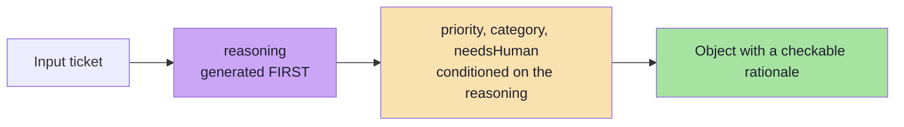

Why it works:

1. **Autoregressive conditioning.** Because the reasoning tokens are generated before the label tokens, the labels are conditioned on an explicit analysis rather than being a reflex.
2. **Auditability.** Every classification ships with a rationale a human can review — essential for regulated workflows.
3. **Cheaper evaluation.** A wrong label with a *good* rationale points at the schema or the prompt; a wrong label with a *bad* rationale points at the input or the model.
4. **Better repair prompts.** When validation fails, the reasoning explains *why* the model chose a value.

**Costs and cautions:**

| Cost | Mitigation |
|---|---|
| Extra output tokens → higher latency and cost | Cap the field: "under 40 words" |
| The rationale can be post-hoc and plausible rather than causal | Do not treat it as ground truth; use it as a debugging aid |
| It can leak into downstream systems that only expect the answer | Keep the reasoning field at the edge; strip it before persistence if needed |
| It is not a substitute for chain-of-thought when the task needs *exploration* | For hard reasoning, consider a two-call design: think freely, then extract |

---

## 4.12 The Token Cost of a Schema

Schemas are not free. In most APIs the schema is serialised into the request, so it consumes **input tokens on every call** and, in strict mode, may also affect prompt caching.

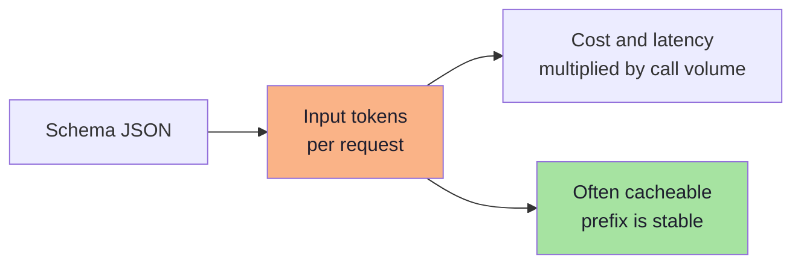

Practical budgeting rules:

| Rule | Rationale |
|---|---|
| Keep schemas **shallow and narrow** | Fewer tokens, fewer failure modes |
| Prefer **one schema per task** over one mega-schema | A mega-schema costs tokens on every call and increases confusion |
| Shorten `description`s to what changes behaviour | A description that repeats the field name is pure cost |
| **Cache** the schema-bearing prefix where supported | Stable prefixes are usually cacheable |
| Measure `input_tokens` with and without the schema | Know the real overhead before scaling |

> **Rule of thumb (illustrative):** a well-designed extraction schema costs on the order of a few hundred input tokens; a careless one costs thousands. At a million calls a month, that difference is a line item.

---

## 4.13 Twelve Rules for LLM-Friendly Schemas

```mermaid
flowchart TD
    R["Schema design rules"] --> S1["1 · One schema, one task"]
    R --> S2["2 · Start from the consumer"]
    R --> S3["3 · Flatten by default"]
    R --> S4["4 · Enum every closed set"]
    R --> S5["5 · Required + nullable"]
    R --> S6["6 · Close every object"]
    R --> S7["7 · Constrain numbers and lists"]
    R --> S8["8 · Normalise strings"]
    R --> S9["9 · Describe every field"]
    R --> S10["10 · Avoid unions"]
    R --> S11["11 · Bound the output size"]
    R --> S12["12 · Version the schema"]

    style R fill:#f9e2af,color:#1e1e2e
    style S5 fill:#a6e3a1,color:#1e1e2e
    style S10 fill:#f38ba8,color:#1e1e2e
```

| # | Rule | Because |
|---|---|---|
| 1 | **One schema per task** | Mixing extraction, classification and summarisation in one call confuses all three |
| 2 | **Design from the consumer's requirements** | You extract what the downstream call needs, not everything the text mentions |
| 3 | **Flatten by default** | Depth compounds the failure rate (§4.5) |
| 4 | **Enum every closed set** | Removes an unbounded vocabulary (§4.4) |
| 5 | **Required + nullable over optional** | One rule instead of two states (§4.9) |
| 6 | **Close every object** | `additionalProperties: false` everywhere |
| 7 | **Constrain numbers and lists** | `minimum` / `maximum` / `maxItems` convert nonsense into validation errors |
| 8 | **Normalise strings in the schema** | Dates, times, money, phones, IDs (§4.7) |
| 9 | **Describe every field** | Descriptions are instructions and the highest-leverage token spend |
| 10 | **Avoid unions (`oneOf` / `anyOf`)** | Poorly supported in strict mode and hard for the model to discriminate |
| 11 | **Bound the output size** | `maxLength`, `maxItems`, "under 40 words" — cost and latency are yours to control |
| 12 | **Version the schema** | Add `schemaVersion: { const: "task.v1" }` so stored objects remain interpretable |

### Rule 10 in detail: why unions hurt

A union forces the model to make a *type* decision, which is harder than making a *value* decision.

| Instead of | Do this |
|---|---|
| `attendee: string OR object` | Two fields: `attendeeName: string` + `attendeeEmail: string \| null` |
| `date: string OR null` plus `dateText: string OR null` | One field `startIso: string` + one `dateUncertain: boolean` |
| `result: { type: "ok", data } OR { type: "error", message }` | One object with `ok: boolean`, `data: object \| null`, `errorMessage: string \| null` |
| `items: A OR B` | Discriminate first in a separate call, or add `kind: enum` to a common shape |

> The general principle: **prefer a wide, flat, mostly-nullable object over a narrow union.** The model fills slots far more reliably than it selects types.

---

## 4.14 Anti-Patterns

| Anti-pattern | Symptom | Fix |
|---|---|---|
| **The mega-schema** | 40 fields for three different tasks | Split into three calls/schemas |
| **The free-text blob** | `"summary": "everything important"` | Extract the fields you actually act on |
| **The nested-in-nested** | 4 levels deep, lists of lists | Flatten; split into two calls |
| **The untyped enum** | `"priority": "urgent-ish"` | `enum` with machine literals |
| **The sentinel value** | `"date": "N/A"`, `"duration": -1` | `null` for unknown, with `required` |
| **The ambiguous number** | `"duration": 30` (minutes? days?) | `durationMinutes` |
| **The floating money** | `"amount": 12.5` | `amountMinor: integer` + `currency` |
| **The everything-optional schema** | Every read site checks `undefined` | Required + nullable |
| **The unconstrained list** | Model returns 200 items | `maxItems`, or one call per item |
| **The prompt-only contract** | Schema exists only as prose | Machine-readable schema + validator |

---

## 4.15 Worked Example: Evolving a Schema Without Breaking It

Real schemas change. The rule is **additive evolution**: never rename, never repurpose, never tighten a field that existing stored objects already violate.

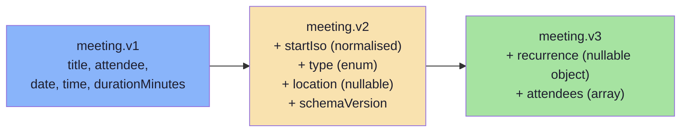

```json
{
  "schemaVersion": { "const": "meeting.v2" },
  "title":           { "type": "string" },
  "attendee":        { "type": "string" },
  "startIso":        { "type": "string", "format": "date-time" },
  "durationMinutes": { "type": "integer", "minimum": 1, "maximum": 480 },
  "type":            { "type": "string", "enum": ["ONE_ON_ONE","INTERVIEW","TEAM","OTHER"] },
  "location":        { "type": ["string", "null"] },
  "legacyDate":      { "type": ["string", "null"], "description": "Deprecated: prefer startIso" }
}
```

| Change | Safe? | Why |
|---|---|---|
| **Add** a new nullable field | ✅ Safe | Old objects remain valid; new ones carry the field |
| **Add** a new enum member | ✅ Usually safe | Consumers must tolerate unknown members (write them defensively) |
| **Widen** a constraint (`maxLength` up) | ✅ Safe | Nothing that was valid becomes invalid |
| **Narrow** a constraint (`maxLength` down) | ❌ Breaking | Stored objects now fail validation |
| **Rename** a field | ❌ Breaking | Consumers break silently |
| **Repurpose** a field's meaning | ❌ Dangerous | Same shape, different semantics — the worst kind of bug |
| **Remove** a field | ❌ Breaking | Consumers reading it get `undefined` |

> **Practice:** keep both versions in the schema for one release, populate the new field, mark the old one deprecated, and only then remove it. This is exactly how you would migrate a REST API — because it *is* a REST API.

---

## 4.16 Common Mistakes at This Stage

| Mistake | Why it hurts | Correct habit |
|---|---|---|
| Writing the schema in the prompt as prose only | No validation, no types, no reuse | Machine-readable schema as the source of truth |
| Ignoring the provider's supported subset | The schema is rejected or silently degraded | Test the schema against the provider early |
| Assuming strict mode enforces `pattern`/`format`/`minimum` | Those may not be compiled into the grammar | Validate them at runtime (Ch. 06) |
| Deep nesting "for tidiness" | Failure probability compounds per level | Flatten unless the group is a real concept |
| Optional fields everywhere | Three states per field; defensive code everywhere | Required + nullable |
| Free-text fields for closed sets | Unbounded vocabulary | `enum` |
| Sending a 2,000-token schema for a 100-token task | Cost and latency per call | Trim descriptions and split schemas |
| No `schemaVersion` | Stored objects become uninterpretable after a change | `const` version field |

---

## 4.17 Chapter Summary

| Idea | Statement |
|---|---|
| Schema roles | Contract for the app, instruction for the model, grammar for the decoder, check for the validator. |
| Highest-leverage keywords | `description`, `enum`, `required` + `nullable`, `additionalProperties: false`. |
| Four decisions per field | Kind, presence, constraints, meaning. |
| Normalisation | Dates, times, durations, money, phones, IDs are the schema's job. |
| Nullability ≠ optionality | Prefer required + nullable; avoid tri-state fields. |
| Depth costs | Each level and each list element multiplies the failure probability. |
| Strict-mode reality | Providers support a *subset*; validation keywords may not be enforced by the decoder. |
| Reasoning field | A short rationale before the answer improves labels and auditability. |
| Evolution | Additive, versioned, never repurpose. |

> **Final mental model:** a schema is a **compression of the task** into a shape the model, the decoder and your code can all agree on. Every field you add is a slot to fill and a way to fail; every constraint you add is a failure converted into a detectable error.

---

## Where This Goes Next

- **[Chapter 05](./05_Enforcement_Mechanisms_And_Provider_Landscape.md)** — how schemas become guarantees: constrained decoding and provider-native structured outputs.
- **[Chapter 06](./06_Validation_Repair_And_Failure_Handling.md)** — what to do when the schema is violated anyway.
- Related: [Lecture 05, Ch. 02](../../Lecture%2005/notes/02_The_Tool_Calling_Protocol_and_Wire_Architecture.md) for the same JSON Schema vocabulary applied to tool parameters.

---

**Back to:** [Lecture 13 — Chapter Index](./README.md) · [Complete Consolidated Notes](./Lecture_13_Complete_Notes.md)
