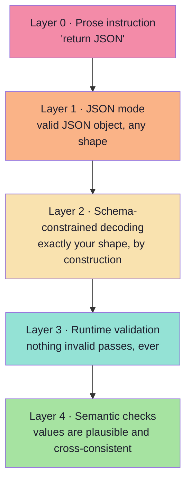
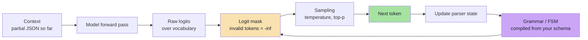
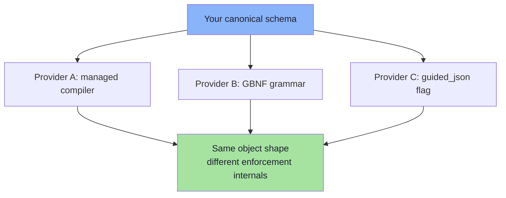
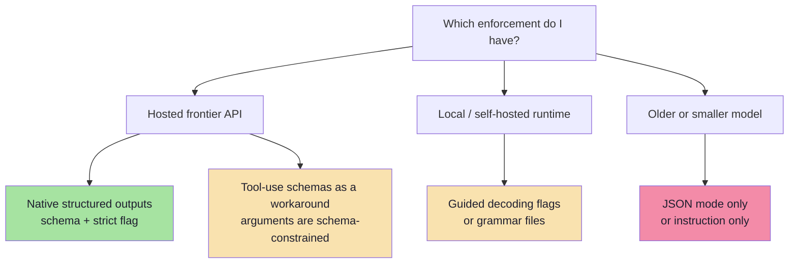
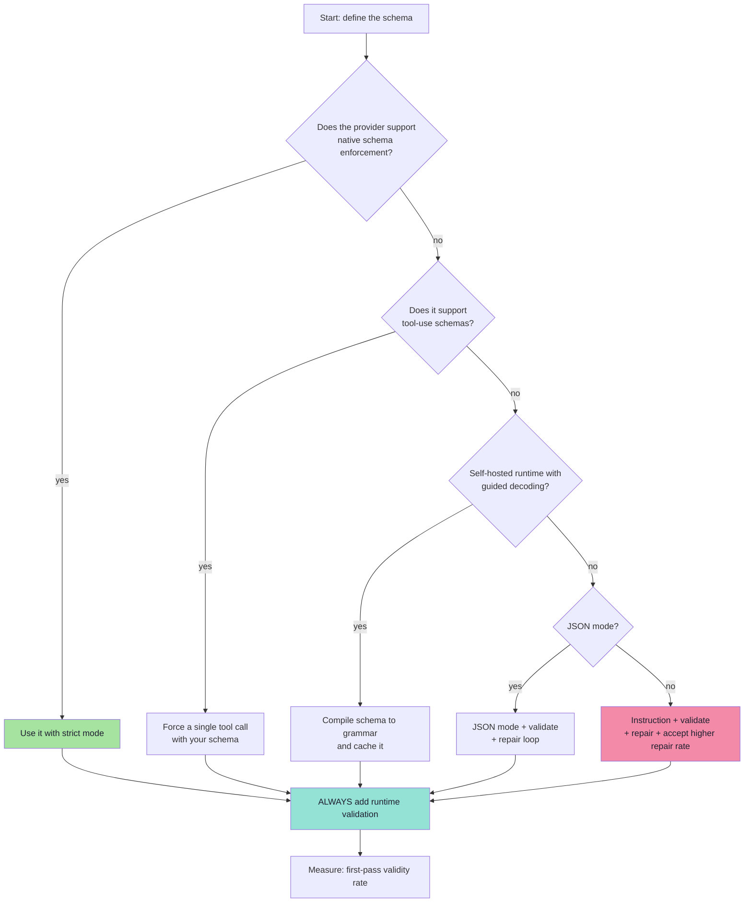
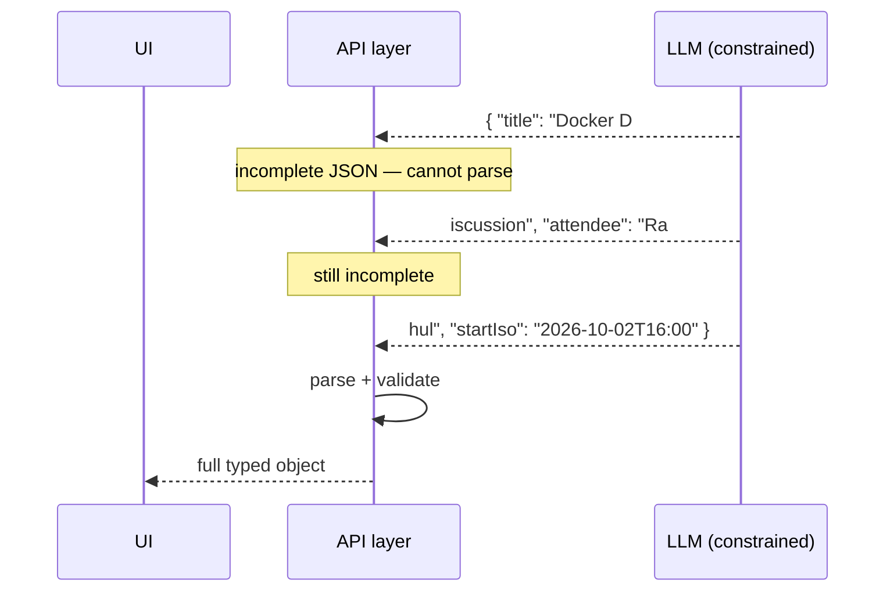
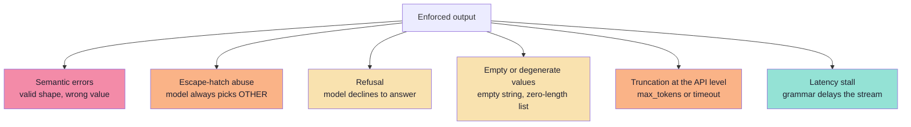

# Chapter 05: Enforcement Mechanisms and the Provider Landscape

> **Chapter Goal:** Chapter 03 established that "asking" is not "enforcing". This chapter shows **how enforcement actually works** — token masking and grammars — and what each provider offers. The goal is to be able to choose the strongest available guarantee for a given model, and to know exactly what that guarantee still leaves unprotected.
>
> At the end of this chapter you should be able to answer: *for this model and this schema, what is enforced by the decoder, what is enforced only by my validator, and what is not enforced at all?*

---

## 5.1 The Enforcement Spectrum, Restated



Layers 0–2 are **prevention**; layers 3–4 are **detection**. This chapter is about layers 1–2. Chapter 06 covers 3–4.

---

## 5.2 How Constrained Decoding Works

The model's final layer produces a **logit** (score) for every token in the vocabulary. Normally the sampler applies temperature, top-k, top-p and then samples. Constrained decoding inserts one step before sampling:

> **Mask the logits of every token that would make the output invalid, then sample from the rest.**



The key idea is the **incremental parser state**. After each emitted token, the runtime updates where it is in the grammar:

```text
state: expecting object start
emit  {           → state: expecting key or }
emit  "attendee"  → state: expecting :
emit  :           → state: expecting string value
emit  "Rahul"     → state: expecting , or }
```

At every step, only tokens that keep the grammar satisfiable are allowed. **It is impossible to emit an unparseable document**, because the tokens that would break it were never candidates.

| Concept | Meaning |
|---|---|
| **Logit mask** | A vector that sets disallowed tokens to negative infinity |
| **Grammar / FSM** | A state machine derived from the schema describing all valid token sequences |
| **Grammar compilation** | The (sometimes expensive) step that turns a schema into a state machine |
| **Grammar cache** | Cached compiled grammars keyed by schema — critical for latency |
| **Guided / structured / constrained decoding** | Three names for this same mechanism |

### What this guarantees — and what it does not

| Guaranteed | Not guaranteed |
|---|---|
| Well-formed JSON | That the JSON is the *right* JSON |
| Every `required` key present | That values are semantically correct |
| No extra keys (if closed) | That `pattern`, `format`, `minimum` were enforced — depends on the compiler |
| Enum values come from the set | That the chosen enum is the correct one |
| No truncation *within* the grammar (the grammar completes) | That the model had enough budget/attention to answer well |

> **The single most important sentence in this chapter:** constrained decoding guarantees the **shape** of the output, never the **meaning**. A perfectly shaped object can still be wrong.

---

## 5.3 From Schema to Grammar

The compilation step is provider-specific, but the families are stable:

| Approach | How it works | Typical use |
|---|---|---|
| **JSON Schema compiler** | Schema → FSM/grammar internally, fully managed | Provider-native structured outputs |
| **GBNF grammars** | A hand-written grammar syntax for local runtimes | llama.cpp-family servers |
| **Regex grammars** | A regex constrains the whole output | Simple fixed formats |
| **CFG libraries** | Context-free grammar engines compiled from schemas | Self-hosted serving stacks |
| **Outlines / XGrammar / llguidance-style engines** | Libraries that compile schemas/grammars and mask logits | vLLM, SGLang, local stacks |



**Portability advice:** keep the canonical schema provider-neutral, and generate the provider-specific form at call time. Do not hand-edit a GBNF grammar and a JSON Schema independently — they will drift.

---

## 5.4 The Provider Landscape

Provider APIs change frequently; treat the table below as **categories with concrete examples**, and always verify against current documentation before shipping.



| Capability | What it means | Typical API surface |
|---|---|---|
| **Instruction only** | The prompt asks for JSON | No dedicated parameter |
| **JSON mode** | Output must be a valid JSON object | `response_format: { type: "json_object" }` or equivalent |
| **Native structured outputs** | Schema is passed to the API and enforced during decoding | `response_format: { type: "json_schema", json_schema: { name, schema, strict: true } }` |
| **Tool-use schema** | The schema of a function's *arguments* is enforced; the model "calls" the function | `tools: [{ type: "function", function: { name, parameters } }]` |
| **Guided decoding (self-hosted)** | A schema or grammar is compiled by the serving engine | `guided_json`, `grammar`, or a response-format flag on local servers |
| **Native response schema (other providers)** | A schema is passed alongside a MIME type | `responseSchema` plus `responseMimeType: application/json` |

### The tool-use trick

Before native structured outputs existed, the standard workaround was to define a **single tool** whose parameters *are* your schema, and force the model to call it:

```ts
// pseudo-code — schema enforcement via a forced tool call
const res = await client.chat.completions.create({
  model: "…",
  messages: [{ role: "user", content: prompt }],
  tools: [{
    type: "function",
    function: {
      name: "emit_meeting_request",
      description: "Return the extracted meeting request.",
      parameters: MEETING_JSON_SCHEMA,     // your schema, enforced on the arguments
    },
  }],
  tool_choice: { type: "function", function: { name: "emit_meeting_request" } },
});

const args = res.choices[0].message.tool_calls?.[0].function.arguments;  // JSON string
```

This works because providers constrain tool-call arguments to the declared parameter schema. The catch: you receive a **JSON string** that still needs parsing, the semantics look like an action even though nothing executes, and refusals surface as "no tool call" rather than a schema error.

> This is the historical bridge between structured output and tool calling — and the reason Chapter 07 insists on keeping the two concepts mentally separate.

---

## 5.5 Choosing an Enforcement Level



---

## 5.6 Streaming Structured Outputs

Streaming and structured output interact badly unless you plan for it. A JSON object is only parseable **when it is complete** — but users expect tokens immediately.



Three strategies, each with a trade-off:

| Strategy | Mechanism | Trade-off |
|---|---|---|
| **Wait for completion** | Buffer the whole response, then parse | Simplest and safest; no progressive UI |
| **Incremental / partial parsing** | A streaming JSON parser emits fields as they complete | Better UX; more moving parts; partial values can mislead |
| **Field-order design** | Put user-visible fields first in the schema | Early fields can render while later ones arrive |

| Concern | Guidance |
|---|---|
| **Validation timing** | Validate the **final** object. Do not act on partially parsed fields. |
| **Field ordering** | Schema property order influences emission order; use it deliberately. |
| **Cancellation** | A user aborting mid-stream leaves a partial object — discard it, never persist it. |
| **Observability** | Log the completion event, not each chunk; chunk-level logs are noise. |

> **Rule:** stream for *perception*, validate for *action*. Never let a partially parsed object reach a side effect.

---

## 5.7 The Cost of Enforcement

Constrained decoding is not free, and the costs are not where people expect them.

| Cost | Cause | Mitigation |
|---|---|---|
| **Grammar compilation** | Turning a schema into an FSM can take milliseconds to seconds for large schemas | Compile once per schema and cache; never per request |
| **Cache invalidation** | Any schema change invalidates the compiled grammar and prompt cache | Version schemas; batch changes |
| **Per-token overhead** | Masking and parser updates on every token | Usually small; measure p95, not mean |
| **First-token latency** | Grammar setup can delay the first token | Keep schemas small; warm the cache |
| **Schema tokens** | The schema occupies input tokens | Trim descriptions; use prompt caching |
| **Reduced flexibility** | The model cannot "explain its way out" of a field | Pair with a `reasoning` field (Ch. 04 §4.11) |

> **Practical rule:** treat the compiled grammar as a **deployable artifact**. Build it in CI, warm it at boot, and alert if compilation fails for a new schema version.

---

## 5.8 Edge Cases That Survive Enforcement

Even with Layer 2 active, these remain:



| Edge case | Detection | Response |
|---|---|---|
| Semantic error | Cross-field rules, golden set (Ch. 06, 09) | Flag for review; consider a second-pass verifier |
| Escape-hatch abuse | Track the distribution of `OTHER` / `UNKNOWN` | Investigate the prompt; possibly split the enum |
| Refusal | Empty content, a refusal field, or no tool call | Treat as a first-class outcome, not an exception (Ch. 06) |
| Degenerate values | `minLength`, `minItems`, non-empty checks | Add constraints; validate |
| Truncation | `finish_reason` indicates length | Raise the budget or shrink the schema |
| Latency stall | p95 latency monitoring | Simplify the grammar; check cache warmth |

---

## 5.9 Pseudo-code: A Provider-Agnostic Structured Call

The engineering pattern is to hide provider differences behind **one adapter** that always ends with validation.

```ts
// pseudo-code — one contract, many providers, always validated
type StructuredResult<T> =
  | { ok: true;  value: T; attempts: number; provider: string }
  | { ok: false; reason: "refused" | "invalid" | "timeout" | "truncated"; raw: string };

async function structuredCall<T>(
  schema: ZodType<T>,
  prompt: string,
  opts: { model: string; maxAttempts?: number }
): Promise<StructuredResult<T>> {
  const jsonSchema = zodToJsonSchema(schema);
  const attempts = opts.maxAttempts ?? 2;

  for (let attempt = 1; attempt <= attempts; attempt++) {
    const raw = await callProvider({
      model: opts.model,
      prompt,
      // strongest enforcement the provider supports:
      //   native schema  >  tool-use schema  >  JSON mode  >  instruction
      enforcement: pickEnforcement(opts.model),
      jsonSchema,
    });

    if (raw.refused)   return { ok: false, reason: "refused",   raw: raw.text };
    if (raw.truncated) return { ok: false, reason: "truncated", raw: raw.text };

    const parsed = schema.safeParse(safeJsonParse(raw.text));
    if (parsed.success) {
      return { ok: true, value: parsed.data, attempts: attempt, provider: opts.model };
    }

    // repair path: pass the validation error, not the raw text (Ch. 06)
    prompt = buildRepairPrompt(prompt, raw.text, parsed.error);
  }

  return { ok: false, reason: "invalid", raw: "" };
}
```

Four properties worth noticing:

1. **The schema is the argument**, not a string buried in the prompt.
2. **Enforcement is chosen per provider**, so the caller never thinks about it.
3. **Validation happens on every path**, including the successful one.
4. **Refusal and truncation are typed outcomes**, not exceptions to be swallowed.

---

## 5.10 Common Mistakes at This Stage

| Mistake | Why it hurts | Correct habit |
|---|---|---|
| Believing "strict" means "semantically validated" | `format`, `pattern`, `minimum` may be ignored by the grammar | Validate those at runtime |
| Compiling the grammar per request | Seconds of latency for zero benefit | Compile once, cache, version |
| Switching providers without re-testing the schema | The new provider's subset may reject or ignore keywords | Keep a schema conformance test per provider |
| Acting on partially streamed objects | Half an object can look complete | Validate the final object only |
| Using tool-use as "just structured output" | You inherit tool-call semantics and a JSON string | Use native structured outputs where available |
| Ignoring refusal as a possible outcome | Empty or non-conforming responses look like bugs | Model refusal explicitly (Ch. 06) |
| No measurement of first-pass validity | You cannot tell whether enforcement is working | Track validity rate per schema version |

---

## 5.11 Chapter Summary

| Idea | Statement |
|---|---|
| The mechanism | Constrained decoding masks logits so invalid tokens cannot be sampled. |
| The guarantee | Shape, by construction. **Never meaning.** |
| The compilation | Schema → grammar/FSM, compiled once and cached; treat it as a build artifact. |
| The landscape | Instruction → JSON mode → tool-use schema → native schema enforcement → self-hosted guided decoding. |
| The tool-use trick | A forced single tool call with your schema as its parameters — the historical bridge to tool calling. |
| Streaming | Stream for perception, validate for action; never persist a partial object. |
| Costs | Grammar compilation, cache invalidation, schema tokens, first-token latency. |
| Surviving edge cases | Semantic errors, escape-hatch abuse, refusals, degenerate values, truncation, latency stalls. |

> **Final mental model:** enforcement moves the failure boundary. Without it, malformed output is *likely*; with it, malformed output is *impossible* — but wrong output is still possible. That is why enforcement and validation are complements, not alternatives.

---

## Where This Goes Next

- **[Chapter 06](./06_Validation_Repair_And_Failure_Handling.md)** — the detection half: validation, repair loops, fallbacks and metrics.
- **[Chapter 07](./07_Structured_Output_vs_Tool_Calling.md)** — why the tool-use trick is a *workaround* and how real tool calling differs.
- Related: [Lecture 05, Ch. 02](../../Lecture%2005/notes/02_The_Tool_Calling_Protocol_and_Wire_Architecture.md) for the wire format of tool schemas.

---

**Back to:** [Lecture 13 — Chapter Index](./README.md) · [Complete Consolidated Notes](./Lecture_13_Complete_Notes.md)
