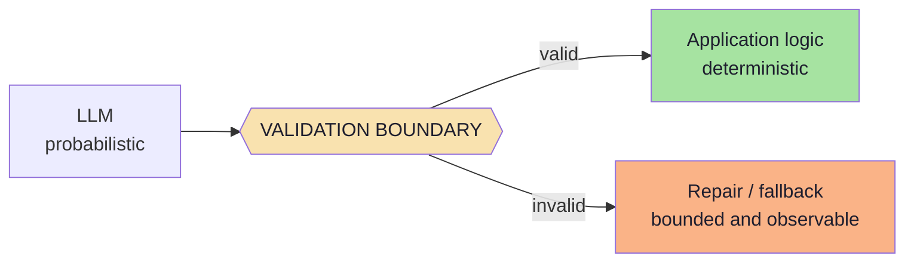
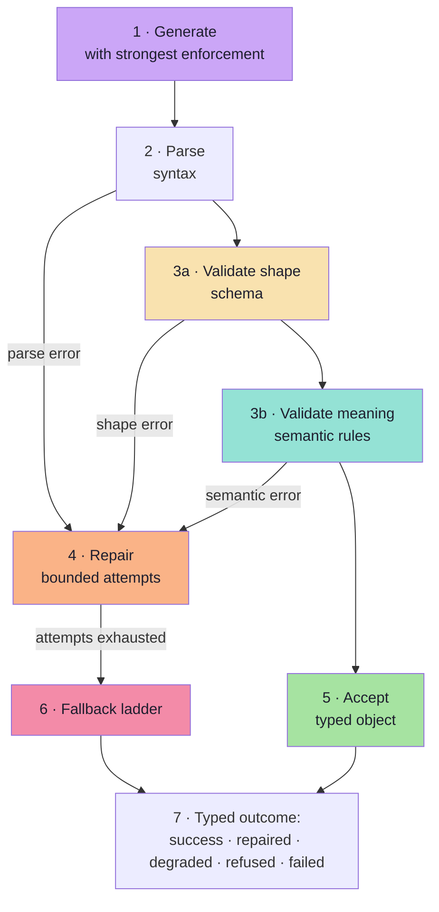
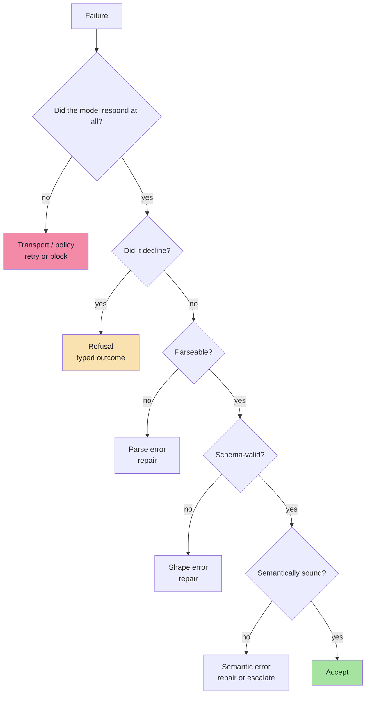
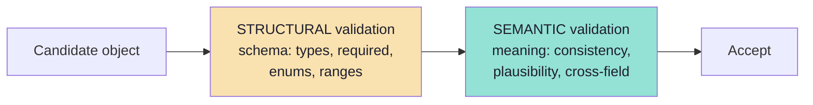
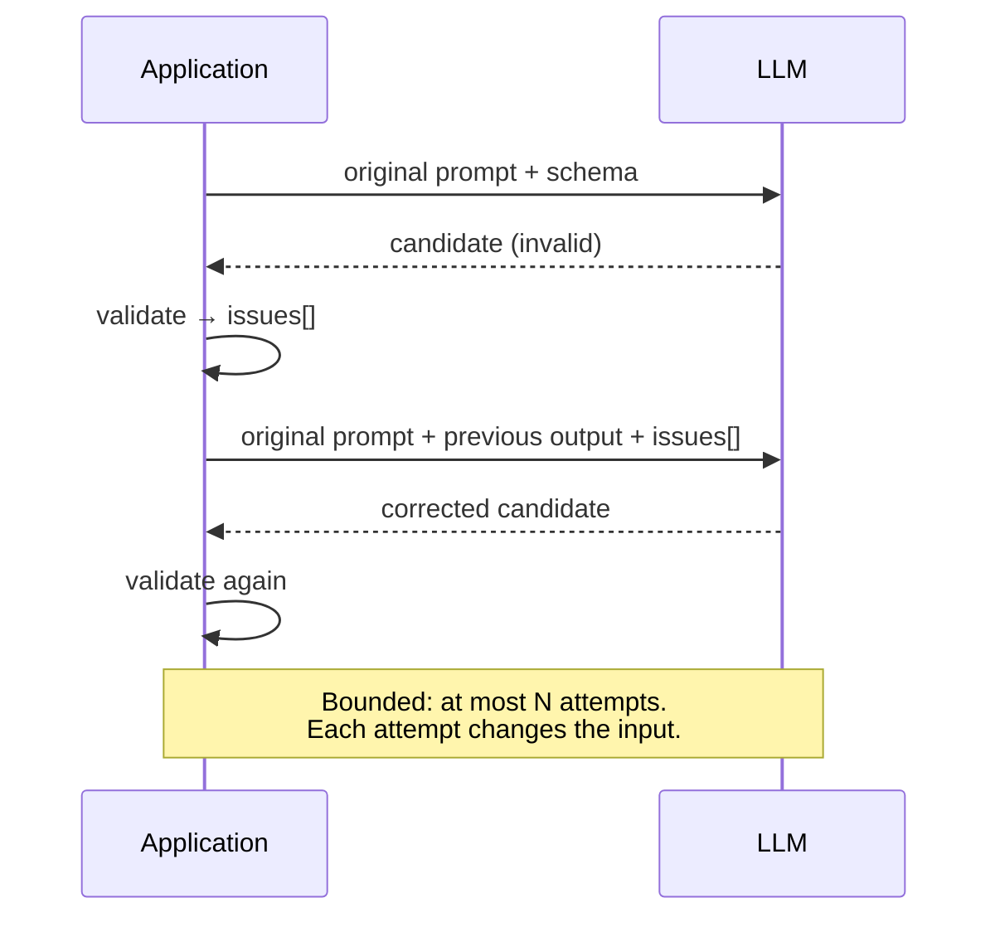
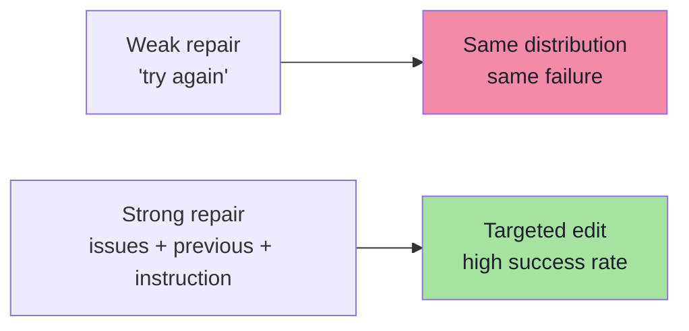
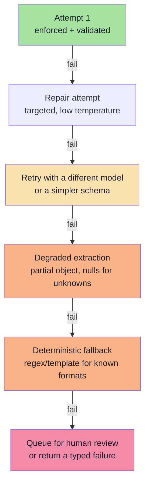
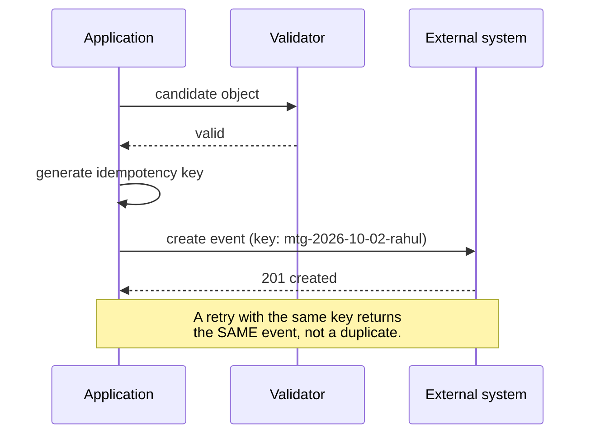

# Chapter 06: Validation, Repair and Failure Handling

> **Chapter Goal:** Enforcement reduces failures; it cannot eliminate them. This chapter builds the **detection and recovery** half of the system: how to validate at the boundary, what to do when validation fails, how to design a repair prompt, when to fall back, and how to handle refusals and truncation as first-class outcomes.
>
> At the end of this chapter you should be able to answer: *when the model returns something I cannot use, what happens next — and is that path bounded, observable and safe?*

---

## 6.1 The Boundary Rule

There is one rule from which everything in this chapter follows:

> **No unvalidated model output may cross into application logic.**



Three corollaries:

1. **The validator is not optional.** Even with strict-mode decoding, validation catches the things the grammar does not enforce.
2. **The boundary is a single place.** One `parse()` call at the edge, not scattered `if (!x)` checks deep in the code.
3. **Failure is a designed path.** "It threw an exception" is not a design.

---

## 6.2 The Reliability Loop



The loop has exactly **one** non-terminating risk — the repair loop — and it is bounded by an attempt count. Everything else is a straight line.

---

## 6.3 The Error Taxonomy

Not all failures are equal, and treating them alike is a design error. Each class has a different correct response.

| # | Class | Example | Retryable? | Correct response |
|---|---|---|---|---|
| 1 | **Transport** | Timeout, 429, 5xx | ✅ Yes | Retry with exponential backoff + jitter |
| 2 | **Parse** | Prose around the JSON, truncation | ✅ Yes | Retry, then repair with the error |
| 3 | **Shape** | Missing field, wrong type, enum drift | ✅ Yes | Repair with the validation error |
| 4 | **Semantic** | Impossible date, negative duration, inconsistent totals | ✅ Sometimes | Repair, or escalate to a human |
| 5 | **Refusal** | Model declines, empty output | ❌ No | Surface a typed refusal; do not retry blindly |
| 6 | **Capacity** | `finish_reason: length`, context overflow | ⚠️ Only with changes | Raise the budget or shrink the schema |
| 7 | **Policy** | Content filter triggered | ❌ No | Surface as a blocked outcome |
| 8 | **Schema/configuration** | Provider rejects the schema | ❌ No | Fix the schema; fail the deploy, not the request |



> **Engineering rule:** distinguish **retryable** from **non-retryable** failures *before* writing retry logic. Retrying a refusal or a bad schema wastes money and never succeeds.

---

## 6.4 Two Kinds of Validation



| Kind | Answers | Tooling | Example failure |
|---|---|---|---|
| **Structural** | "Does it match the schema?" | Zod, JSON Schema validator, generated validators | `durationMinutes` is `"30"` |
| **Semantic** | "Is it internally consistent and plausible?" | Hand-written rules, business logic, cross-checks | `startIso` is in the past, `durationMinutes` is 900 |

Structural validation is **automatic and cheap**. Semantic validation is **domain-specific** and is where the real value lives, because it catches the errors that a schema cannot express.

---

## 6.5 Structural Validation in Practice

```ts
// pseudo-code — validate at the boundary, once
import { z } from "zod";

const MeetingSchema = z.object({
  title: z.string().min(1).max(120),
  attendee: z.string().min(1),
  startIso: z.string().datetime(),
  durationMinutes: z.number().int().min(1).max(480),
  type: z.enum(["ONE_ON_ONE", "INTERVIEW", "TEAM", "OTHER"]),
  location: z.string().nullable(),
}).strict();

function parseCandidate(raw: string) {
  let json: unknown;
  try {
    json = JSON.parse(raw);
  } catch (e) {
    return { kind: "parse_error" as const, detail: String(e), raw };
  }

  const result = MeetingSchema.safeParse(json);
  if (!result.success) {
    return {
      kind: "shape_error" as const,
      // issues give a machine-readable list of path + message
      issues: result.error.issues.map(i => ({ path: i.path.join("."), message: i.message })),
      raw,
    };
  }

  return { kind: "ok" as const, value: result.data };
}
```

Two design points worth copying:

1. **Return a discriminated result, not throw.** Errors are data; they will be logged, counted and turned into repair prompts.
2. **Keep the issue list machine-readable.** `path + message` is exactly what a repair prompt needs, and what a metric can aggregate.

### Validation-failure output shape

```json
{
  "kind": "shape_error",
  "issues": [
    { "path": "durationMinutes", "message": "Expected number, received string" },
    { "path": "type", "message": "Invalid enum value. Expected ONE_ON_ONE | INTERVIEW | TEAM | OTHER, received 'one-to-one'" }
  ]
}
```

This is a *much* better repair input than the raw model output alone.

---

## 6.6 Semantic Validation: The Domain Layer

Structural validation is the same in every project. Semantic validation is unique to each, and this is where a Forward Deployed Engineer earns their salary.

| Check | Example rule | Catches |
|---|---|---|
| **Temporal** | `startIso` is in the future; not on a weekend if policy forbids | "tomorrow" resolved to yesterday |
| **Numeric plausibility** | `durationMinutes` between 5 and 480 | The 1440-minute meeting |
| **Cross-field consistency** | `type === "INTERVIEW"` implies `durationMinutes >= 30` | Internally contradictory objects |
| **Referential** | `attendee` exists in the directory | Hallucinated people |
| **Domain invariants** | `endIso > startIso`; currency matches the account | Money and time bugs |
| **Cardinality** | Sum of line items equals the stated total | Silent extraction errors |
| **Provenance** | Every extracted value appears in the source text (high-stakes fields) | Fabrication |
| **Confidence gating** | Low-confidence fields route to human review | Overconfident wrong answers |

```ts
// pseudo-code — semantic layer on top of the schema
type SemanticIssue = { path: string; message: string; severity: "block" | "review" };

function semanticChecks(m: Meeting, ctx: { now: Date; directory: Set<string> }): SemanticIssue[] {
  const issues: SemanticIssue[] = [];

  if (new Date(m.startIso) <= ctx.now)
    issues.push({ path: "startIso", message: "Meeting start is not in the future", severity: "block" });

  if (m.durationMinutes > 240)
    issues.push({ path: "durationMinutes", message: "Duration exceeds the 4-hour policy", severity: "review" });

  if (!ctx.directory.has(m.attendee))
    issues.push({ path: "attendee", message: "Attendee not found in the directory", severity: "review" });

  if (m.type === "INTERVIEW" && m.durationMinutes < 30)
    issues.push({ path: "durationMinutes", message: "Interviews must be at least 30 minutes", severity: "block" });

  return issues;
}
```

**The two severities matter:**

| Severity | Meaning | Action |
|---|---|---|
| `block` | The object is unusable or unsafe | Repair, then fall back |
| `review` | Plausible but needs a human | Accept, flag, and route to a queue |

Collapsing everything into "invalid" means either over-rejecting good data or under-rejecting bad data. Two severities solve both.

---

## 6.7 The Repair Loop

A repair is a **second call that includes what went wrong**. It is not a blind retry.



```ts
// pseudo-code — bounded repair with a targeted error message
async function extractWithRepair<T>(
  schema: ZodType<T>,
  input: string,
  maxRepairs = 2
): Promise<{ value: T; attempts: number } | { failed: true; lastError: unknown }> {
  let prompt = buildExtractionPrompt(input, schema);
  let lastError: unknown = null;

  for (let attempt = 0; attempt <= maxRepairs; attempt++) {
    const raw = await callModel(prompt, { temperature: attempt === 0 ? 0.2 : 0, schema });
    const parsed = schema.safeParse(safeJsonParse(raw));

    if (parsed.success) return { value: parsed.data, attempts: attempt + 1 };

    lastError = parsed.error;
    prompt = buildRepairPrompt({ input, previous: raw, issues: flatten(parsed.error) });
  }

  return { failed: true, lastError };
}
```

### Design rules for the repair loop

| Rule | Why |
|---|---|
| **Bound the attempts** (1–2 is usually enough) | Unbounded loops cost money and delay the failure |
| **Change the input every attempt** | A blind retry samples the same distribution |
| **Include the validation error, not just "try again"** | The error tells the model *which* field and *why* |
| **Lower the temperature on repair** | You want determinism, not creativity |
| **Include the previous output** | So the model edits rather than regenerates |
| **Do not include the schema twice** | It is already in the system prompt; duplication wastes tokens |
| **Log every attempt** | Repair rate is a production metric (Ch. 09) |
| **Never repair a refusal** | A refusal is an answer, not a bug |

---

## 6.8 Designing the Repair Prompt

The repair prompt is a small, high-leverage artifact. Compare:

**Weak (do not do this):**

```text
That was not valid JSON. Try again.
```

**Strong:**

```text
Your previous output failed validation against the required schema.

Validation errors:
- durationMinutes: Expected number, received string ("30")
- type: Invalid enum value. Received "one-to-one".
        Expected one of: ONE_ON_ONE, INTERVIEW, TEAM, OTHER

Previous output:
{ "title": "...", "attendee": "Rahul", "durationMinutes": "30", "type": "one-to-one" }

Fix ONLY the fields listed above. Do not add, remove or rename any fields.
Return the corrected object only.
```



Four ingredients of an effective repair prompt:

1. **The machine-readable issues** (path + expected vs received).
2. **The previous output** so the model edits rather than regenerates.
3. **A scoping instruction** ("fix only these fields").
4. **A format instruction** ("return the object only").

> **Anti-pattern:** sending the *original input text* again in full. It is already in the conversation; repeating it dilutes attention and doubles the cost. Reference it, do not restate it.

---

## 6.9 The Fallback Ladder

When repair is exhausted, the system must still behave sensibly. Each rung trades quality for availability.



| Rung | Mechanism | When it is right |
|---|---|---|
| 1 · Repair | Second call with the error | The failure looks like a slip (types, enum casing) |
| 2 · Different model / simpler schema | A stronger model, or fewer fields | The task is near the model's capability edge |
| 3 · Degraded object | Fill unknowns with `null`, mark `confidence: "low"` | Downstream can tolerate partial data |
| 4 · Deterministic fallback | A regex/template path for a known input format | The input has structure the LLM was overkill for |
| 5 · Human queue / typed failure | Route to review, or return an explicit error | The action is high-stakes and unverified data is unacceptable |

**Which rung to use is a product decision, not a technical one.** Extracting a meeting title can degrade; transferring money cannot.

---

## 6.10 Refusals, Truncation and Empty Output

These are **outcomes**, not exceptions. Model them explicitly.

| Outcome | Signal | Handling |
|---|---|---|
| **Refusal** | Empty content, a refusal field, "I can't help with that" | Return `refused`; do **not** retry; surface to the user or queue |
| **Truncation** | `finish_reason` indicates length; unparseable tail | Raise the budget or shrink the schema; never silently accept a partial object |
| **Empty content** | Zero-length response | Treat as a failure; log; retry once with a smaller schema |
| **Policy block** | Content filter triggered | Surface as blocked; do not attempt workarounds |
| **Malformed but complete** | Parse error with a full response | Repair path |

```ts
// pseudo-code — model outcomes explicitly
type Outcome<T> =
  | { kind: "ok";        value: T }
  | { kind: "refused";   reason: string }
  | { kind: "truncated"; raw: string }
  | { kind: "invalid";   issues: Issue[] }
  | { kind: "failed";    error: string };
```

> **Why this matters:** a system that only has "success" and "exception" cannot report *why* it failed, cannot route failures differently, and cannot measure anything except a single error rate. Typed outcomes are what make Chapter 09's metrics possible.

---

## 6.11 Idempotency and Side Effects

The most dangerous bug in a structured-output pipeline is a **side effect that happens before validation**, or one that happens twice after a retry.



Three rules:

1. **Validate first, act second.** Always. No exceptions.
2. **Use an idempotency key** derived from the object's semantics (attendee + start + title hash), so a retry after a timeout does not duplicate the action.
3. **Make the action resumable** — if the process dies between validation and action, a queue should be able to complete it exactly once.

> This is where structured output stops being a data problem and becomes a **distributed systems** problem — which is precisely what Chapter 08 is about.

---

## 6.12 Metrics for This Stage

| Metric | Definition | Why it matters |
|---|---|---|
| **First-pass validity rate** | Valid on attempt 1 / total calls | Measures the schema + prompt + enforcement combination |
| **Repair rate** | Calls requiring at least one repair / total | If high, fix the schema or prompt, not the loop |
| **Final failure rate** | Calls failing after all attempts / total | The number your users actually experience |
| **Refusal rate** | Refusals / total | Detects over-strict prompts or policy conflicts |
| **Truncation rate** | Length-limited responses / total | Detects an undersized budget or an oversized schema |
| **Issue distribution** | Counts per `path` and error type | Points directly at the worst-designed field |
| **Repair latency p95** | Added latency from repairs | The cost of reliability |
| **Semantic flag rate** | Objects flagged `review` / total | Domain-quality signal, separate from schema validity |

> **The most useful single chart** is the issue distribution: it turns "the model is unreliable" into "`durationMinutes` is a string 4% of the time" — a fixable problem.

---

## 6.13 Common Mistakes at This Stage

| Mistake | Why it hurts | Correct habit |
|---|---|---|
| No validator at all | Bad objects reach business logic | Validate once, at the boundary |
| Retrying the identical prompt | Same distribution, same failure | Change the input: add the error |
| Unbounded repair loops | Cost and latency blow up | Cap attempts at 1–2 |
| Treating all failures as retryable | Wasted calls on refusals and bad schemas | Classify before retrying |
| Only structural validation | Semantically impossible objects pass | Add domain rules with two severities |
| Throwing exceptions instead of typed outcomes | Cannot measure or route failures | Return discriminated results |
| Acting before validating | Corrupted external state | Validate → key → act |
| Repairing a refusal | It will never succeed | Model refusal as a terminal outcome |
| Not logging the raw output on failure | You cannot debug what you did not keep | Log raw + issues + attempt count (mind PII) |

---

## 6.14 Chapter Summary

| Idea | Statement |
|---|---|
| The boundary rule | Nothing unvalidated crosses into application logic. |
| Two validations | **Structural** (schema) is cheap and automatic; **semantic** (domain rules) is where value lives. |
| Error taxonomy | Transport, parse, shape, semantic, refusal, capacity, policy, configuration — each with its own response. |
| Repair | A bounded, error-informed second call with the previous output and the machine-readable issues. |
| Severities | `block` vs `review` prevents over- and under-rejection. |
| Fallback ladder | Repair → model/schema change → degraded object → deterministic path → human. |
| Refusals and truncation | First-class typed outcomes, never exceptions. |
| Side effects | Validate first, use idempotency keys, act exactly once. |
| Metrics | First-pass validity, repair rate, final failure rate, issue distribution. |

> **Final mental model:** enforcement makes malformed output unlikely; validation makes it *harmless*. A production structured-output system is judged by its **failure path**, not its happy path.

---

## Where This Goes Next

- **[Chapter 07](./07_Structured_Output_vs_Tool_Calling.md)** — what changes when the validated object is allowed to trigger an action.
- **[Chapter 09](./09_Production_Playbook_Evaluation_And_Checklist.md)** — turning these metrics into a monitoring and evaluation plan.
- Related: [Lecture 04, Ch. 06](../../Lecture%2004/notes/06_Engineering_Defenses_RAG_Guardrails_and_Verification.md) for the same verify-before-trust pattern in RAG.

---

**Back to:** [Lecture 13 — Chapter Index](./README.md) · [Complete Consolidated Notes](./Lecture_13_Complete_Notes.md)
