# Chapter 07: Structured Output vs Tool Calling

> **Chapter Goal:** The lecture's central clarification. Structured output and tool calling both involve structured data, which is exactly why they get confused. They solve **different problems**: one is about the *format of the result*, the other is about *deciding to act*. This chapter draws the line precisely, then shows how the two compose into an action pipeline.
>
> At the end of this chapter you should be able to answer: *should this feature return an object, or should it call a function — and if both, in what order?*

---

## 7.1 Why the Confusion Exists

Both techniques involve:
- a JSON Schema,
- a model producing a JSON object,
- application code consuming that object.

The difference is **not** in the encoding. It is in the **purpose**.

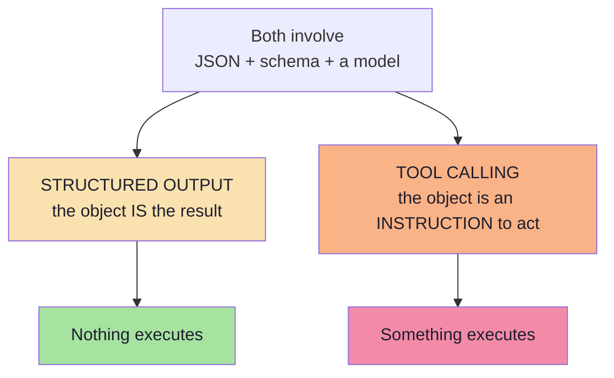

---

## 7.2 Structured Output: The Format of the Final Result

> **Structured output is about the format of the model's final result.**

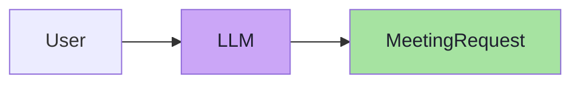

The result may represent:

```json
{
  "title": "Docker Discussion",
  "attendee": "Rahul",
  "date": "2026-10-02",
  "time": "16:00",
  "durationMinutes": 30
}
```

**Nothing has been executed.** The structured object itself is the result we wanted.

The application may then do whatever it likes with it — display it, store it, validate it, ask a human to confirm it, or hand it to a *different* system. The model has done its job the moment the object exists.

---

## 7.3 Tool Calling: The Model Decides to Invoke Something

> **Tool calling is about the model deciding to invoke an external function or action.**

Suppose the user asks:

> *"What is the weather in Delhi?"*

The flow is fundamentally longer:

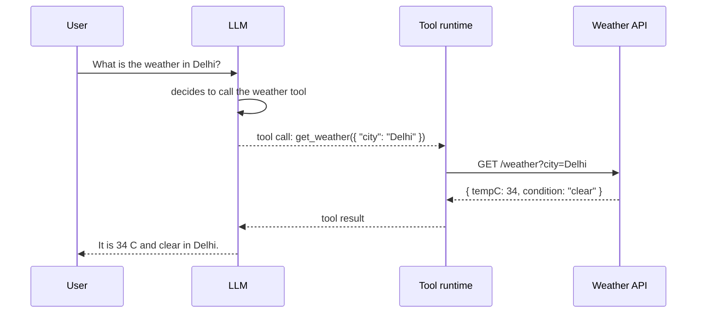

The model may generate arguments such as:

```json
{ "city": "Delhi" }
```

> **This data is structured, but its purpose is different. It exists so that a tool can be executed.**

Note the three consequences:

1. **The result is not the answer** — the tool result comes back and the model must produce a *final* response.
2. **The model does not execute anything.** It emits a *request*; your runtime executes it.
3. **There are now two outputs**: the tool call (arguments) and the final text answer.

---

## 7.4 The Core Difference

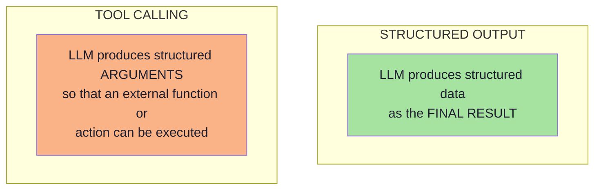

| Dimension | Structured output | Tool calling |
|---|---|---|
| **Purpose** | Describe a result | Request an action |
| **Who executes** | Nobody | Your runtime |
| **Final output** | The object | The model's post-tool text response |
| **Schema role** | Shape of the result | Shape of the arguments |
| **Model decides** | What values to fill | *Whether* to act, and with what arguments |
| **Side effects** | None, by definition | Possible, by definition |
| **Failure risk** | Wrong data | Wrong data **and** wrong action |
| **Typical use** | Extraction, classification, routing, scoring | Search, calculation, database reads/writes, API calls |
| **Safety concern** | Data quality | Authorisation and blast radius |

> **The crisp formulation:** structured output answers *"what does this mean?"*; tool calling answers *"what should I do about it?"*

---

## 7.5 The Tool-Calling Wire Protocol

Cross-referencing [Lecture 05, Ch. 02](../../Lecture%2005/notes/02_The_Tool_Calling_Protocol_and_Wire_Architecture.md), the protocol is a five-step loop:

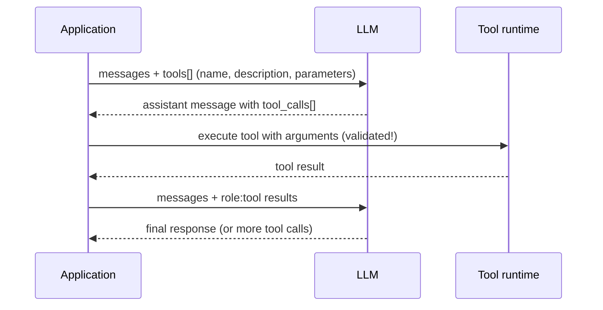

| Step | What travels | Who owns it |
|---|---|---|
| 1 | Tool definitions (JSON Schema) | Application |
| 2 | `tool_calls[]` with arguments | Model |
| 3 | Execution | Application runtime |
| 4 | Tool result message | Application runtime |
| 5 | Final natural-language answer | Model |

The loop can repeat — that is what turns a tool-using assistant into an agent ([Lecture 05, Ch. 03](../../Lecture%2005/notes/03_Multi_Step_Tool_Chaining_and_Execution_Loops.md)).

---

## 7.6 Anatomy of a Tool Definition

```json
{
  "type": "function",
  "function": {
    "name": "create_calendar_event",
    "description": "Create a calendar event. Use only after the user has confirmed the details.",
    "parameters": {
      "type": "object",
      "additionalProperties": false,
      "required": ["title", "startIso", "durationMinutes", "attendee"],
      "properties": {
        "title":           { "type": "string", "description": "Short event title" },
        "startIso":        { "type": "string", "description": "ISO 8601 date-time" },
        "durationMinutes": { "type": "integer", "minimum": 1, "maximum": 480 },
        "attendee":        { "type": "string", "description": "Participant email address" }
      }
    }
  }
}
```

| Field | Role | Failure if bad |
|---|---|---|
| `name` | How the model refers to the tool | Ambiguous names → wrong tool selected |
| `description` | **When** to use it (the routing signal) | The model uses it too often, or never |
| `parameters` | JSON Schema for arguments | Wrong or unsafe arguments |
| `required` | Which arguments must be present | Missing arguments at execution time |

> **The `description` is a routing contract, not documentation.** It is the primary signal the model uses to choose between tools — and the primary place where a badly written tool description causes production incidents.

---

## 7.7 `tool_choice` Policies

| Policy | Meaning | When to use |
|---|---|---|
| `auto` | The model may call a tool or answer directly | General assistants |
| `none` | The model must answer without tools | Forcing a text answer |
| `required` | The model **must** call some tool | The task is always an action |
| **specific tool** | The model must call *this* tool | Deterministic pipelines; also the structured-output workaround (Ch. 05 §5.4) |

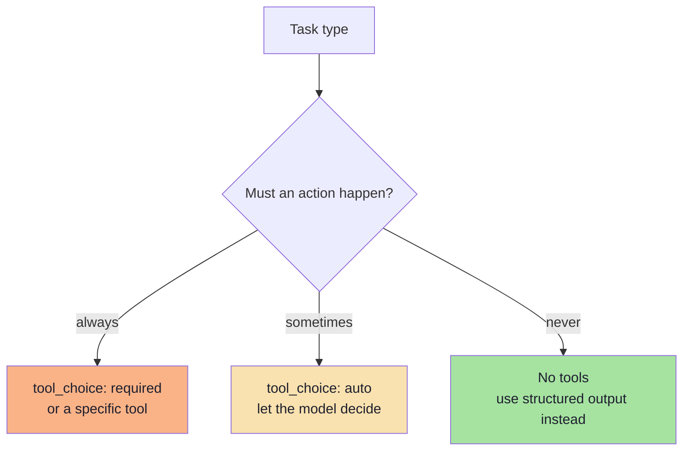

> **Design tip:** if a pipeline always needs the same single tool, you probably do not need the model to *decide* anything — you need structured output. Using `tool_choice: required` with one tool is the tool-calling way of saying "just give me the object", which is exactly what Chapter 05 §5.4 described.

---

## 7.8 Parallel and Multi-Step Tool Calls

| Pattern | Description | Example |
|---|---|---|
| **Single call** | One tool, one execution | Get the weather |
| **Parallel calls** | Several independent calls in one turn | Weather in Delhi **and** currency for 100 USD |
| **Sequential chaining** | The output of one call feeds the next | Currency conversion → then arithmetic |
| **Loop / agentic** | Repeat until the goal is met or a bound is hit | Plan → act → observe → re-plan |

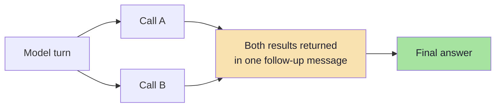

Two engineering requirements for any multi-step loop:

1. **A hard iteration bound** — never let the loop run unbounded.
2. **A cost/token budget** — every iteration adds tokens to the conversation.

> **Failure mode to watch for:** a "parallel" tool call that is not actually independent. If call B depends on call A's output, executing them concurrently produces a confidently wrong answer. Model the dependency, or force sequencing.

---

## 7.9 Tool Arguments Are Untrusted Input

This is the single most important safety point in this chapter.

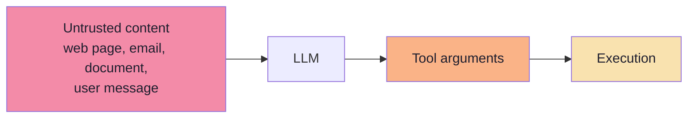

Tool arguments are produced by a probabilistic model that may have been influenced by **untrusted text it read**. Treat them exactly like an HTTP request body from an untrusted client:

| Control | Why |
|---|---|
| **Schema validation** | The first gate; reject malformed arguments |
| **Semantic validation** | Ranges, ownership, referential integrity |
| **Authorisation** | Does *this user* have the right to perform *this action* on *this resource*? |
| **Least privilege** | The tool's credentials should permit only what the tool needs |
| **Allow-lists** | Paths, domains, tables, commands |
| **Confirmation for high impact** | Human-in-the-loop for irreversible or costly actions |
| **Rate and blast-radius limits** | Caps per user per hour; maximum records per call |
| **Audit logging** | Who asked, what was called, with what arguments, what happened |

> **Never** pass model-generated strings directly into a shell, a SQL query, a filesystem path, or a URL without validation and allow-listing. This is the same class of defect as SQL injection, with a model as the untrusted client. See [Lecture 05, Ch. 05](../../Lecture%2005/notes/05_Workspace_Sandboxing_and_Agent_Security.md).

---

## 7.10 Choosing Between Them

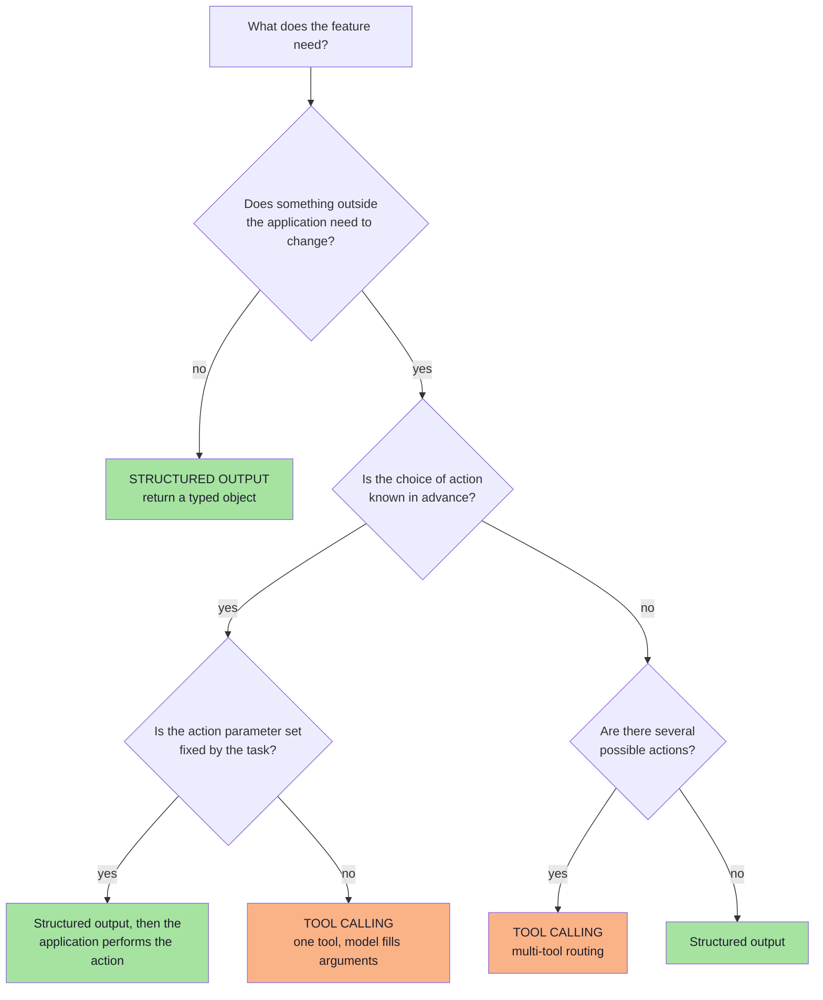

| Situation | Use |
|---|---|
| Extract fields from a document | **Structured output** |
| Classify / route / score | **Structured output** |
| The task is always the same single action with the same fields | **Structured output**, then act in code |
| The model must choose *which* of several actions to take | **Tool calling** |
| The action needs information the model does not have (live data) | **Tool calling** |
| The action is a lookup whose result must be reasoned over | **Tool calling** |
| The action is high-impact or irreversible | **Tool calling + human-in-the-loop** |
| You need a rationale a human can audit | **Structured output with a reasoning field** |
| The output feeds a *different* system | **Structured output** |

> **Rule of thumb:** if the model's job ends when the object exists, you want structured output. If the object is a *request* that something else must fulfil, you want tool calling.

---

## 7.11 They Compose: The Meeting Scheduler, End to End

This is the lecture's closing flow, assembled in full.

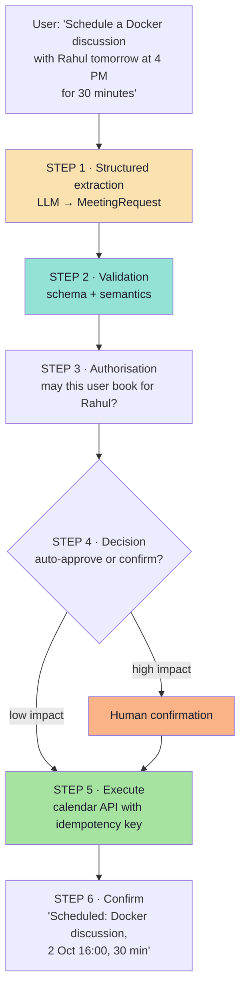

The lecture states the intermediate state precisely:

> Structured output gives us a `MeetingRequest`. **At this stage, nothing has been scheduled.** We have only converted:

```text
Human Language
      ↓
Application Data
```

And the two halves of the pipeline are cleanly separable:

| Half | Technique | Owner | Guarantee |
|---|---|---|---|
| **Understanding** | Structured output | Model + validator | The object matches the contract |
| **Acting** | Tool calling / integration | Application runtime | The action is authorised and idempotent |

> **Architectural principle:** *the model may propose; the application disposes.* Extraction is a model problem. Side effects are an application problem. Keeping them in separate layers is what makes the system testable, auditable and safe.

---

## 7.12 Human-in-the-Loop for High-Impact Actions

Not every action should be automatic. [Lecture 05, Ch. 07](../../Lecture%2005/notes/07_Human_In_The_Loop_Safety_and_Enterprise_Patterns.md) develops this in depth; here is the structured-output-shaped version.

| Tier | Examples | Policy |
|---|---|---|
| **Tier 1 — Read-only** | Search, lookup, compute | Auto-execute |
| **Tier 2 — Scoped mutation** | Create a calendar event for yourself, add a tag | Auto-execute with audit log |
| **Tier 3 — Critical** | Payment, deletion, email to a customer, permission change | **Require explicit human approval** |

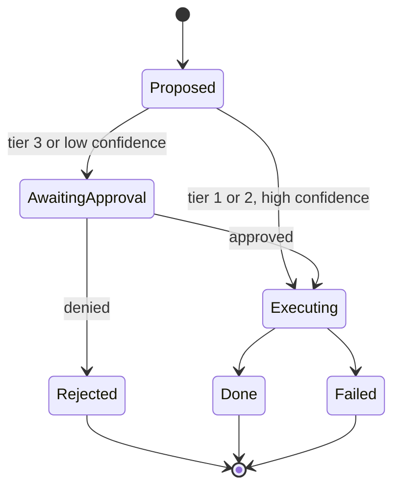

The design trick that makes this cheap: **the approval UI is just the validated object rendered as a form.** Because you already have a typed `MeetingRequest`, the confirmation step is a review screen — no new extraction, no re-prompting, no ambiguity.

---

## 7.13 Common Mistakes at This Stage

| Mistake | Why it hurts | Correct habit |
|---|---|---|
| Calling structured output "tool calling" | Conceptual drift; wrong safety posture | Separate understanding from acting |
| Using tools where the action is fixed | Unnecessary nondeterminism and cost | Structured output, then act in code |
| Letting the model execute directly | Model output becomes an unreviewed command | The runtime executes, never the model |
| Skipping argument validation | Injection and destructive actions | Validate arguments as untrusted input |
| No iteration bound on the tool loop | Runaway cost and latency | Hard cap on turns |
| Parallelising dependent calls | Confidently wrong results | Model dependencies; force sequencing |
| No confirmation for irreversible actions | One hallucination equals real damage | Tier-3 approval gates |
| Tool descriptions written as documentation | The model routes to the wrong tool | Describe *when* to use it |

---

## 7.14 Chapter Summary

| Idea | Statement |
|---|---|
| The core difference | Structured output = the **final result**; tool calling = **arguments for an action**. |
| Who executes | Nobody, versus your runtime. |
| The weather example | Tool calling produces arguments, executes, then the model answers — three stages. |
| The meeting example | Structured output produces `MeetingRequest`; **nothing has been scheduled**. |
| Composition | Understand (structured output) → validate → authorise → act (tool calling/integration). |
| The principle | The model may propose; the application disposes. |
| Safety | Tool arguments are untrusted input; tier-3 actions need approval. |
| Routing | `tool_choice` decides whether the model *may*, *must*, or *must not* call a tool. |

> **Final mental model:** structured output is a **contract with your own code**; tool calling is a **request to the outside world**. Never let the first silently become the second.

---

## Where This Goes Next

- **[Chapter 08](./08_From_Data_To_Action_Tools_Integrations_And_MCP.md)** — the missing piece: how the application actually talks to the calendar, and what MCP standardises.
- Foundations: [Lecture 05, Ch. 02](../../Lecture%2005/notes/02_The_Tool_Calling_Protocol_and_Wire_Architecture.md) (protocol), [Ch. 03](../../Lecture%2005/notes/03_Multi_Step_Tool_Chaining_and_Execution_Loops.md) (loops), [Ch. 07](../../Lecture%2005/notes/07_Human_In_The_Loop_Safety_and_Enterprise_Patterns.md) (safety tiers).

---

**Back to:** [Lecture 13 — Chapter Index](./README.md) · [Complete Consolidated Notes](./Lecture_13_Complete_Notes.md)
