# Chapter 08: From Data to Action — Tools, Integrations and MCP

> **Chapter Goal:** The lecture ends with an open question: after extraction, **"how does our application communicate with Google Calendar?"** This chapter answers it. It covers the integration layer (adapters, authorisation, idempotency) and then introduces **MCP (Model Context Protocol)** — the standard that turns a per-app integration problem into a reusable one.
>
> *Sections marked "beyond the lecture" expand material the script only gestures at.*
>
> At the end of this chapter you should be able to answer: *once I have a validated object, what is the complete, safe, idempotent path to an external side effect — and should that path be a bespoke integration or an MCP server?*

---

## 8.1 The Missing Piece

The lecture states the situation precisely. After extracting the meeting information, one important piece is still missing:

> **How does our application communicate with Google Calendar?**

At that moment, the flow is only:

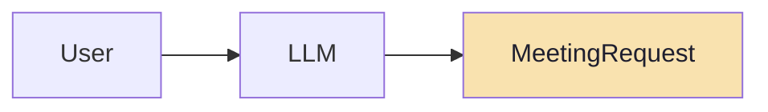

> **We have created structured data, but no external action has happened.**

The next step extends the application to:

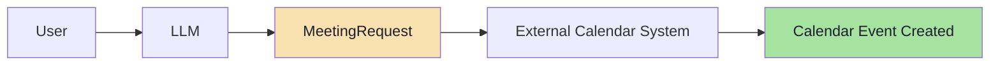

> **This is where concepts such as tools, external integrations, and MCP become relevant.**
>
> **The structured output tells our application what the user wants. The external integration is responsible for actually doing it.**

That two-sentence split is the architecture of this chapter.

---

## 8.2 Two Clean Responsibilities

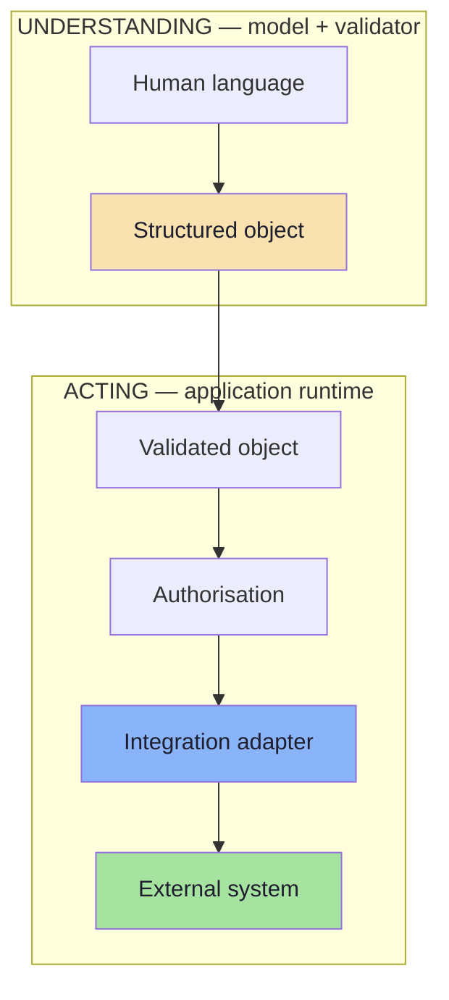

| Responsibility | Who | Failure mode if mixed |
|---|---|---|
| Understand the request | Model + validator | — |
| Decide whether to act | Application policy | The model grants itself permission |
| Perform the action | Integration adapter | Retries create duplicates |
| Report the outcome | Application | Users cannot tell what happened |

> **The single most valuable boundary in the whole lecture:** the model's output ends at the validator. Everything after that is ordinary, deterministic, testable software.

---

## 8.3 The Integration Problem: N × M

Every new assistant × every new system is a new adapter.

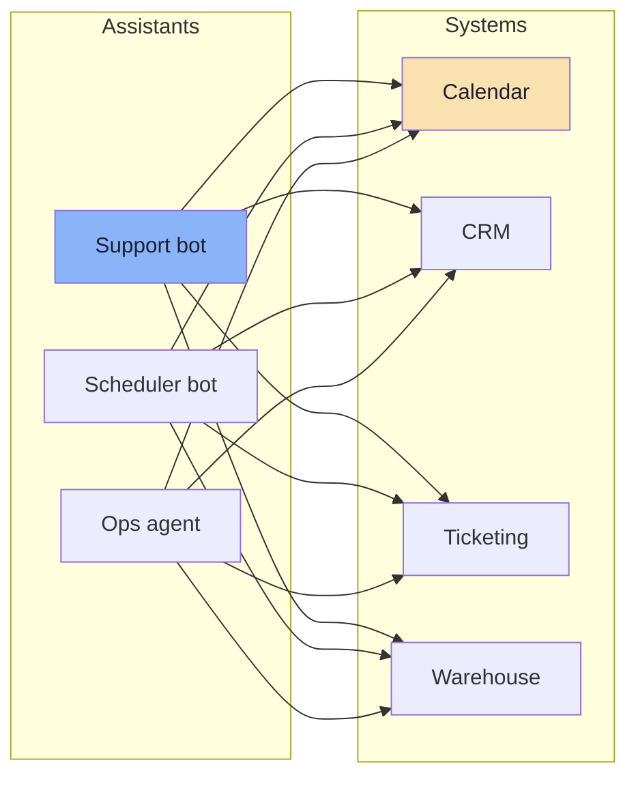

With **N** assistants and **M** systems you maintain **N × M** bespoke integrations: each with its own auth, retries, schema mapping, logging and error handling. This is the classic integration-matrix problem, and it is the reason MCP exists.

---

## 8.4 The Adapter Pattern (Anti-Corruption Layer)

Before reaching for a standard, the local answer is an **adapter**: one module per external system that translates your domain object into that system's contract.

```ts
// pseudo-code — an integration adapter hides the vendor contract
type CreateEventResult =
  | { ok: true;  externalId: string; url: string }
  | { ok: false; reason: "conflict" | "unauthorised" | "rate_limited" | "unavailable"; retryAfterMs?: number };

interface CalendarPort {
  createEvent(req: MeetingRequest, idempotencyKey: string): Promise<CreateEventResult>;
  findConflicts(req: MeetingRequest): Promise<{ id: string; startIso: string }[]>;
}

// The LLM-facing schema and the vendor-facing payload are DIFFERENT shapes.
// The adapter is where that difference is absorbed — once.
class GoogleCalendarAdapter implements CalendarPort {
  async createEvent(req: MeetingRequest, idempotencyKey: string): Promise<CreateEventResult> {
    const payload = {
      summary: req.title,
      start:   { dateTime: req.startIso, timeZone: req.timeZone ?? "UTC" },
      end:     { dateTime: addMinutes(req.startIso, req.durationMinutes) },
      attendees: [{ email: req.attendeeEmail }],
    };
    // vendor call, mapped errors, idempotency header, timeout, retry policy
    return callVendor(payload, { idempotencyKey, timeoutMs: 5000 });
  }
}
```

Why the adapter matters:

| Reason | Effect |
|---|---|
| **Domain stays vendor-free** | `MeetingRequest` does not grow Google-specific fields |
| **Errors become typed** | `conflict` / `unauthorised` / `rate_limited` instead of HTTP codes leaking upward |
| **Retry policy lives in one place** | Not scattered across the codebase |
| **Testable** | A fake adapter makes the whole pipeline unit-testable without network access |
| **Replaceable** | Swapping calendar vendors changes one file |

> **FDE pattern to internalise:** the model sees your *domain* schema; the vendor sees its own. The adapter is the only place that knows both.

---

## 8.5 The Complete Action Pipeline

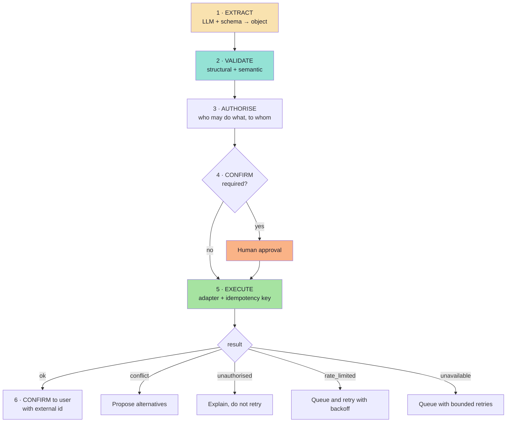

```ts
// pseudo-code — the whole pipeline, in order, with typed outcomes
async function scheduleMeeting(userText: string, actor: Actor): Promise<ScheduleOutcome> {
  // 1 · extract (Ch. 05–06)
  const extracted = await structuredCall(MeetingSchema, buildPrompt(userText));
  if (!extracted.ok) return { kind: "could_not_understand", reason: extracted.reason };

  // 2 · validate semantics (Ch. 06)
  const issues = semanticChecks(extracted.value, { now: new Date(), directory: DIRECTORY });
  if (issues.some(i => i.severity === "block")) return { kind: "needs_clarification", issues };

  // 3 · authorise — NEVER delegated to the model
  const allowed = await policy.canBook(actor, extracted.value.attendee);
  if (!allowed) return { kind: "forbidden" };

  // 4 · confirm for high-impact or low-confidence cases
  if (requiresConfirmation(extracted.value) || issues.some(i => i.severity === "review")) {
    return { kind: "awaiting_confirmation", proposal: extracted.value };
  }

  // 5 · execute with an idempotency key derived from semantics
  const key = hashOf(extracted.value);
  const result = await calendar.createEvent(extracted.value, key);

  // 6 · confirm
  return result.ok
    ? { kind: "scheduled", externalId: result.externalId, url: result.url }
    : { kind: "action_failed", reason: result.reason, retryAfterMs: result.retryAfterMs };
}
```

**Five properties this function has that a naive implementation lacks:**

| Property | Consequence |
|---|---|
| Typed outcomes for every path | The caller can route and the metrics can count |
| Authorisation **after** validation, never by the model | The model cannot escalate its own privileges |
| Idempotency key derived from the object | A retry cannot create a duplicate event |
| Confirmation as an explicit state | High-impact actions are reviewed, not hoped for |
| Vendor errors mapped to domain errors | Retry logic is precise instead of blanket |

---

## 8.6 What MCP Is *(beyond the lecture)*

> **MCP (Model Context Protocol)** is an open protocol that standardises how AI applications connect to external tools and data. Instead of every assistant writing a bespoke connector per system, both sides speak one protocol.

The roles:

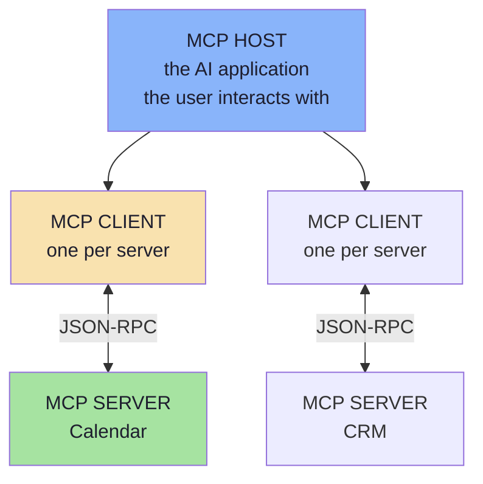

| Role | Responsibility |
|---|---|
| **Host** | The application (chat app, IDE, agent runtime). Owns the conversation, the model calls and the user consent UI |
| **Client** | A connector inside the host, one per server, managing that server's session |
| **Server** | Exposes capabilities (tools, resources, prompts) over the protocol |

> **The value proposition in one line:** the host implements the protocol *once*; each system implements a server *once*. **N × M becomes N + M.**

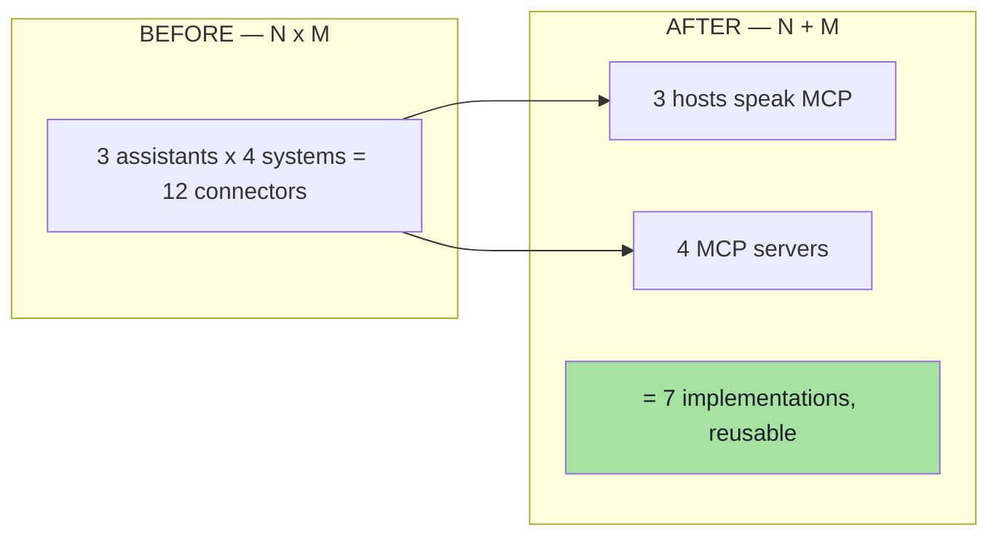

---

## 8.7 The Three MCP Primitives

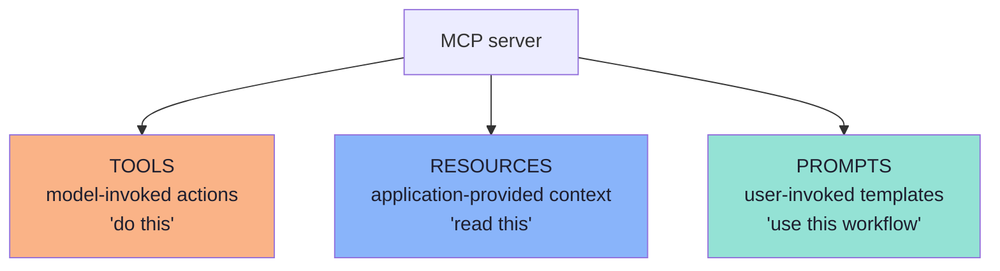

| Primitive | Controlled by | Typical example | Analogy |
|---|---|---|---|
| **Tools** | The **model** (it decides to call) | `create_event`, `search_orders` | A function call |
| **Resources** | The **application** (it decides what to inject) | A file, a database row, a document | A GET endpoint |
| **Prompts** | The **user** (they choose the template) | "Review this PR", "Summarise this ticket" | A slash command |

The distinction that matters for this lecture:

> **Tools are the action half of structured output.** A tool's `inputSchema` is exactly the schema-design problem from Chapter 04, and its invocation is exactly the "acting" half of Chapter 07 — only now the contract is standardised across applications.

---

## 8.8 Protocol and Transport *(beyond the lecture)*

| Aspect | MCP |
|---|---|
| **Message format** | JSON-RPC 2.0 (requests, responses, notifications) |
| **Local transport** | `stdio` — the server is a child process, messages over stdin/stdout |
| **Remote transport** | Streamable HTTP (with optional server-sent events for streaming) |
| **Discovery** | `initialize` handshake, then capability negotiation |
| **Naming** | Namespaced tool names to avoid collisions between servers |
| **State** | Sessions with a negotiated protocol version |

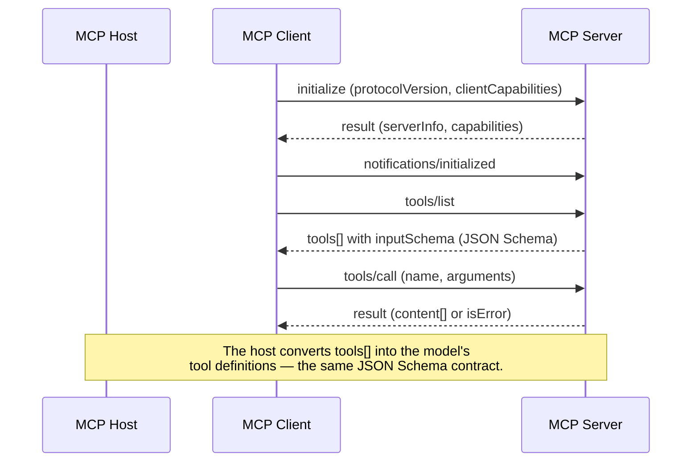

Two implications for structured-output engineers:

1. **Every MCP tool is a schema you do not control.** The host receives `inputSchema` from the server; your validation and authorisation must still apply at the boundary.
2. **Tool lists can change at runtime.** Cache them per session, and handle the case where a tool disappears between listing and calling.

---

## 8.9 MCP vs Function Calling vs Structured Output

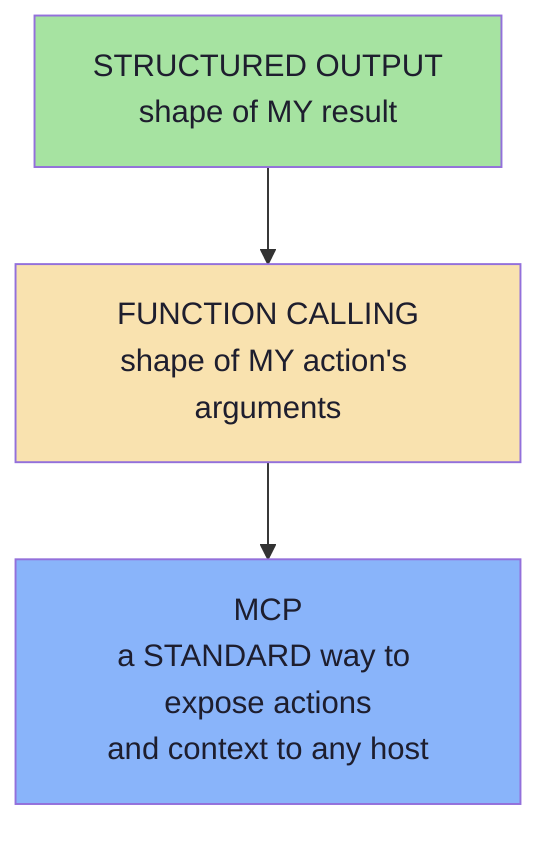

| Question | Structured output | Function calling | MCP |
|---|---|---|---|
| **What is standardised?** | The result schema | The argument schema | The *connection* to a capability provider |
| **Who defines the schema?** | Your application | Your application | The **server** (possibly a third party) |
| **Scope** | One call | One turn of a conversation | A session with a capability provider |
| **Transport** | The model API | The model API | JSON-RPC over stdio or HTTP |
| **Reuse across apps** | Low | Low | **High** — that is the point |
| **Trust model** | Your own code | Your own code | Third-party code you must vet |
| **Typical owner** | Backend engineer | Backend engineer | Platform / integration team |

> **Mental model:** structured output is a *local* contract; function calling is a *local* action; MCP is a *distributed* capability protocol. They stack, they do not compete.

---

## 8.10 Security of the Integration Layer *(beyond the lecture)*

The lecture's flow — extract, then act — creates a new attack surface. The threat model is different from RAG, and it is worth stating explicitly.

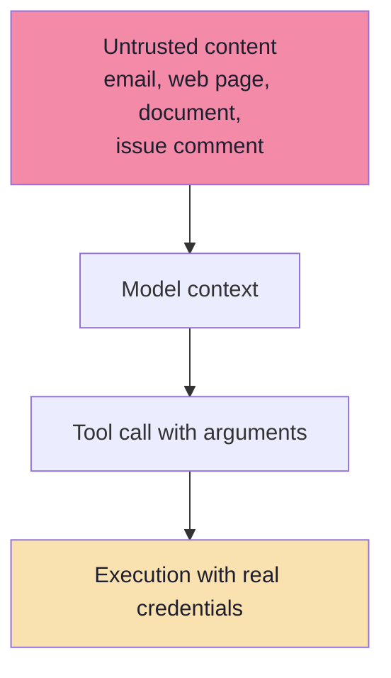

| Threat | Description | Control |
|---|---|---|
| **Prompt injection to tool abuse** | Untrusted text instructs the model to call a tool | Treat all content as data, never as instructions; constrain the tool set |
| **Tool poisoning** | A malicious MCP server's tool *description* contains hidden instructions | Vet servers; show descriptions to users; do not trust server-provided text blindly |
| **Confused deputy** | The host holds broad credentials and is tricked into using them for an attacker's goal | Per-user scoping; do not share one privileged token across users |
| **Token passthrough** | Passing a user's token to an untrusted server or a different audience | Audience-bound tokens; never forward tokens to a third party |
| **Excessive agency** | Too many tools, too much permission, no confirmation | Least privilege; tier-3 approval; blast-radius caps |
| **Data exfiltration** | A read tool plus a write-to-external tool | Egress allow-lists; separate read and write credentials |
| **Shadow capabilities** | Servers exposing tools nobody reviewed | Inventory and review every tool; pin server versions |

**Non-negotiable controls, restated:**

1. **Authorise in the application, never in the prompt.** "The system prompt says only do X" is not a security control.
2. **Validate every argument** at the boundary, including arguments from MCP servers you trust.
3. **Least privilege per user and per tool**, with separate credentials for read and write.
4. **Human approval for irreversible or high-value actions.**
5. **Full audit trail:** actor, tool, arguments, result, timestamp.
6. **Kill switch:** the ability to disable a tool or a server without a deploy.

> Cross-reference: [Lecture 05, Ch. 05](../../Lecture%2005/notes/05_Workspace_Sandboxing_and_Agent_Security.md) for sandboxing and path-traversal defences, [Ch. 07](../../Lecture%2005/notes/07_Human_In_The_Loop_Safety_and_Enterprise_Patterns.md) for HITL patterns.

---

## 8.11 When *Not* to Use MCP

MCP is infrastructure. Infrastructure has a cost, and a single internal app rarely needs it.

| Situation | Recommendation |
|---|---|
| One application, one internal system you own | A plain adapter (§8.4) is simpler and faster |
| The action is always the same | Structured output + a direct call — no protocol needed |
| You need sub-100 ms latency on a hot path | In-process code, not a protocol hop |
| The capability must be reused by several hosts or vendors | **MCP is worth it** |
| You want to consume third-party capabilities without writing connectors | **MCP is worth it** |
| You need an ecosystem of capabilities with a consistent interface | **MCP is worth it** |

> **Judgement, not fashion:** adopt MCP when the *reuse* or *ecosystem* benefit exceeds the operational cost of running and securing another service.

---

## 8.12 Common Mistakes at This Stage

| Mistake | Why it hurts | Correct habit |
|---|---|---|
| Letting the model call the vendor API directly | No validation, no auth, no audit | Model proposes; runtime executes |
| No idempotency key | Retries create duplicate events, charges or emails | Key derived from the object's semantics |
| Authorising inside the prompt | Not a security control | Authorise in code, after validation |
| One privileged credential for all users | Confused-deputy exposure | Per-user, least-privilege credentials |
| Vendor errors leaking upward as HTTP codes | Retry logic becomes guesswork | Map to typed domain errors |
| Treating MCP server descriptions as trusted | Tool-poisoning risk | Vet, display and constrain |
| Adopting MCP for a single internal call | Operational overhead for no reuse benefit | Use a plain adapter |
| No user-visible confirmation of what happened | Users cannot trust the automation | Report the external id and outcome |

---

## 8.13 Chapter Summary

| Idea | Statement |
|---|---|
| The missing piece | Structured output tells the app **what** the user wants; the integration does it. |
| The boundary | The model's output ends at the validator; everything after is ordinary software. |
| N × M | Bespoke connectors multiply; that is the integration-matrix problem. |
| Adapters | One module per system absorbs vendor contracts, errors and retries. |
| The pipeline | Extract → validate → authorise → confirm → execute → report. |
| Idempotency | Semantic keys make retries safe. |
| MCP *(beyond the lecture)* | A standard host/client/server protocol with tools, resources and prompts over JSON-RPC. |
| MCP's value | N × M becomes N + M; capabilities become reusable across hosts. |
| Security | Untrusted input → arguments → execution is the new attack surface; authorise in code. |

> **Final mental model:** the lecture's whole arc is *"AI that talks" → "AI that participates in software systems"*. Structured output is what makes participation possible; the integration layer is what makes it safe, and MCP is what makes it reusable.

---

## Where This Goes Next

- **[Chapter 09](./09_Production_Playbook_Evaluation_And_Checklist.md)** — measuring, monitoring and shipping all of this.
- Foundations: [Lecture 05](../../Lecture%2005/notes/README.md) for tools, agents and security tiers; [Lecture 12](../../Lecture%2012/notes/README.md) for the retrieval side of grounded systems.

---

**Back to:** [Lecture 13 — Chapter Index](./README.md) · [Complete Consolidated Notes](./Lecture_13_Complete_Notes.md)
