# Lecture 13: Structured Outputs in GenAI — Complete Consolidated Notes

## The Whole Lecture on One Reference

> **Course:** Forward Deployed Engineer (FDE) & Generative AI Systems
> **Lecture:** 13 — Structured Outputs in GenAI: From Plain Text to Machine-Usable Data
> **Source material:** [`Notes.pdf`](./Notes.pdf) (16-page lecture script) and [`Excalidraw-Notes.svg`](./Excalidraw-Notes.svg) (the board)
> **Scope:** Chapters [01](./01_Why_Plain_Text_Is_Not_Enough.md) → [09](./09_Production_Playbook_Evaluation_And_Checklist.md)
> **Diagram format:** Mermaid only
> **Snippet style:** TypeScript-style pseudo-code — illustrative, not production code
> **Prerequisites:** [Lecture 03](../../Lecture%2003/notes/README.md) (calling an LLM from an app) · [Lecture 05](../../Lecture%2005/notes/README.md) (tool calling and agents)

---

## How to Use This Document

This is the **map**, not the territory. Each part compresses one chapter to its load-bearing ideas and decisions, then links out. The chapters hold the full reasoning, pseudo-code, worked numbers and edge cases.

| If you want to… | Read | Time |
|---|---|---|
| Recall what the lecture was about | [Executive Summary](#executive-summary) → [The Four Layers](#cheat-sheet-the-four-layers-of-enforcement) | 8 min |
| Understand *why* prose fails a program | [Part 1](#part-1--why-plain-text-is-not-enough) | 6 min |
| Get the vocabulary right | [Part 2](#part-2--what-structured-output-is) → [Glossary](#glossary) | 8 min |
| Explain why "return JSON" is not enough | [Part 3](#part-3--why-just-ask-for-json-fails) | 8 min |
| Write a good schema today | [Part 4](#part-4--json-schema-and-schema-design) → [Schema Rules](#cheat-sheet-the-twelve-schema-rules) | 12 min |
| Know what the decoder enforces | [Part 5](#part-5--enforcement-mechanisms-and-providers) | 8 min |
| Build the failure path | [Part 6](#part-6--validation-repair-and-failure-handling) | 12 min |
| Stop confusing results with actions | [Part 7](#part-7--structured-output-vs-tool-calling) | 8 min |
| Wire it to a real system | [Part 8](#part-8--from-data-to-action) | 10 min |
| Ship it | [Part 9](#part-9--production-playbook) + [Go-Live Checklist](#go-live-checklist) | 12 min |
| Prep for an interview | [Ten Sentences](#the-lecture-in-ten-sentences), [Misconceptions](#common-misconceptions), [Self-Check](#self-check-questions) | 20 min |

> **Depth policy.** These notes say *what matters, what it costs, and when it breaks*. The chapters say *how*.

---

## Executive Summary

### The Thesis

> **A model cannot reliably feed a program prose, and it will not reliably obey a schema it was merely asked to follow. Structured output is the engineering discipline of making one component of a probabilistic system behave like a typed service — define the contract, enforce it at the decoder, verify it at the boundary, and never let unverified output touch the outside world.**

Every GenAI application starts with the same three boxes:

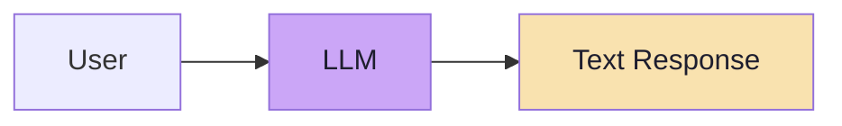

For a human consumer, that is **finished**. For a program, it is **unusable**, because a program does not read meaning — it dereferences fields, and a `string` has none.

### The Lecture in One Diagram

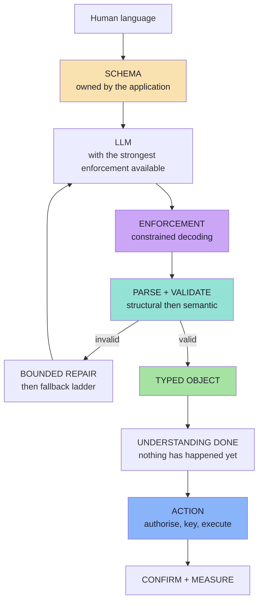

### Where Each Idea Lives

| Idea | Chapter |
|---|---|
| The integration gap; humans vs software | [01](./01_Why_Plain_Text_Is_Not_Enough.md) |
| Schema, contract, form analogy, "not just JSON" | [02](./02_What_Structured_Output_Is_Schema_Contract_And_Types.md) |
| Twelve failure modes; three enforcement layers | [03](./03_Why_Just_Ask_For_JSON_Fails.md) |
| Schema design craft; strict-mode subsets | [04](./04_JSON_Schema_And_Schema_Design_For_LLMs.md) |
| Constrained decoding; provider landscape | [05](./05_Enforcement_Mechanisms_And_Provider_Landscape.md) |
| Validation, repair, fallbacks, typed outcomes | [06](./06_Validation_Repair_And_Failure_Handling.md) |
| Result vs action; the core difference | [07](./07_Structured_Output_vs_Tool_Calling.md) |
| Integrations, idempotency, authorisation, MCP | [08](./08_From_Data_To_Action_Tools_Integrations_And_MCP.md) |
| Metrics, golden sets, versioning, checklist | [09](./09_Production_Playbook_Evaluation_And_Checklist.md) |

### The Lecture in Ten Sentences

1. **Humans prefer meaning; software prefers structure** — structured output is the bridge between the two worlds.
2. **Structured output means a predefined structure the application can consume**, not "the model returns JSON".
3. **The target is a typed object** (`MeetingRequest`), not a string, and definitely not a regex.
4. **A schema is a form**: the application defines the slots, the model fills the values.
5. **"Return JSON" is a prompt instruction, not a contract** — the model has no internal validator.
6. **Object validity is per-field validity multiplied**, so depth, lists and field count are real costs.
7. **Enforcement exists in layers**: instruction → JSON mode → schema-constrained decoding → validation.
8. **Constrained decoding guarantees shape, never meaning** — a perfectly formed object can be wrong.
9. **Structured output produces a result; tool calling produces a request to act** — the model proposes, the application disposes.
10. **Production is a chain of narrow guarantees** — each with its own metric, and a failure path that is designed rather than discovered.

---

## Part 1 — Why Plain Text Is Not Enough

> Full chapter: **[01_Why_Plain_Text_Is_Not_Enough.md](./01_Why_Plain_Text_Is_Not_Enough.md)**

Read this sentence:

> *"Rahul wants a meeting tomorrow at 4 PM for 30 minutes to discuss Docker deployment."*

A human extracts five facts instantly. A program extracts **one value of type `string`** — and a string has no `attendee`, no `time`, no `durationMinutes`.

| Consumer | Sees | Can do |
|---|---|---|
| Human | Person, date, time, duration, topic | Schedule the meeting |
| Program | One `string` | Nothing — `meeting.getTime()` has no field to read |

The board (`Excalidraw-Notes.svg`) makes the contrast concrete: it draws a **chatbot** flow (`Client → Server → LLM → "Hello Aditya"`) beside a **typed REST** flow (`GET /user/details` → `{ name, email, mobile }`), and a **meeting scheduler** where a `MeetingDetails` form with fixed slots is filled by an LLM from *"Schedule a meeting with Ravi"*.

> **The form with fixed slots is the whole lecture in one image.**

### The five levels of LLM integration

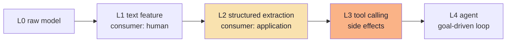

**Level 2 is where most enterprise GenAI work actually happens**: ticket triage, invoice extraction, meeting scheduling, résumé parsing, routing, scoring. Levels 3 and 4 are Level 2 **plus permission to act**.

### The failure taxonomy of free-form output

Unparseable (prose wrappers, fences) · schema drift · wrong types · missing fields · enum drift · truncation · silent coercion · confident nonsense.

The last two are why "the JSON parsed" is **not** a success criterion.

---

## Part 2 — What Structured Output Is

> Full chapter: **[02_What_Structured_Output_Is_Schema_Contract_And_Types.md](./02_What_Structured_Output_Is_Schema_Contract_And_Types.md)**

> **Structured output** means asking the model to produce information in a **predefined structure** that our application can **reliably consume**.

Three words carry the weight: **predefined** (decided before the call), **structure** (named, typed fields), **reliably** (not "looks right in the playground").

### The REST analogy

| REST API | LLM equivalent |
|---|---|
| Response body schema | The **output schema** |
| OpenAPI document | The published schema the model must satisfy |
| `400 Bad Request` | A validation failure |
| `/v2` | A versioned output schema |

### The form analogy

Without a schema the prompt is *"Tell me about yourself"* — the model may write anything. With a schema it is a form: **`Name: ____  Age: ____  Email: ____`**. The model still supplies the values, but **the available fields are predetermined**.

### Structured output is not just JSON

JSON is an *encoding*. The real target is a typed object:

```ts
// pseudo-code — the real target
type MeetingRequest = {
  title: string;
  attendee: string;
  date: string;            // ISO 8601
  time: string;            // 24h HH:mm
  durationMinutes: number;
};
```

> **Distinction worth memorising:** *JSON mode* is a **serialization** feature. *Structured output* is a **contract** feature. You can have the first without the second — that is exactly the failure Chapter 03 dissects.

### The three layers of a structured result

| Layer | Question | Fails how |
|---|---|---|
| **Syntax** | Is it parseable? | Prose wrappers, truncation |
| **Shape** | Does it match the schema? | Wrong types, missing fields |
| **Meaning** | Are the values right? | Impossible dates, hallucinated values |

`{ "date": "2026-02-31" }` is syntactically valid, schema-valid, and **semantically impossible**.

### One source of truth

Declare once, derive three things: the **TypeScript type** (compile-time), the **JSON Schema** (wire contract), the **runtime validator** (Zod/JSON Schema). The schema is **application-owned**; the model is a client of your contract, never its author.

---

## Part 3 — Why "Just Ask for JSON" Fails

> Full chapter: **[03_Why_Just_Ask_For_JSON_Fails.md](./03_Why_Just_Ask_For_JSON_Fails.md)**

The lecture's canonical failure:

```text
Sure! Here's the JSON you requested:

{ "attendee": "Rahul", "date": "2026-10-02", "time": "16:00" }
```

> **A human can easily ignore the first sentence. A JSON parser may not.**

That generalises into twelve failure modes: preamble, markdown fences, trailing commas, single quotes, comments, schema drift, wrong types, missing fields, enum drift, hallucination, truncation, multiple objects.

### Why it happens

An LLM emits **one token at a time, sampled from a distribution**. It has no internal validator. "Return JSON" merely shifts the probability mass toward `{` — it does not remove the possibility of `Sure`.

### Prompt instruction vs structured contract

| | Prompt instruction | Structured contract |
|---|---|---|
| Meaning | *"Please behave like this."* | *"This is the structure the application expects."* |
| Enforcement | None | Decoder constraints and/or validation |
| Failure | Silent, discovered downstream | Explicit, at the boundary |

### The compounding math

```text
P(object valid) = p^fields

p = 0.99  →  0.94      p = 0.95  →  0.74
p = 0.97  →  0.83      p = 0.90  →  0.53
```

Per-field accuracy is **not** system accuracy. Lists and nesting multiply again.

### What JSON mode fixes — and what it does not

| Fixes | Does not fix |
|---|---|
| Chatty preambles, fences, trailing commas | Missing or renamed fields |
| Unbalanced braces, most truncation | Wrong types, enum drift |
| The need for fence-stripping heuristics | Whether the JSON is the *right* JSON |

> **JSON mode is a parser guarantee. A schema is a contract guarantee.**

---

## Part 4 — JSON Schema and Schema Design

> Full chapter: **[04_JSON_Schema_And_Schema_Design_For_LLMs.md](./04_JSON_Schema_And_Schema_Design_For_LLMs.md)**

A schema plays **three roles at once**: the application's contract, the model's instruction, and the decoder's grammar.

### The four decisions per field

1. **Kind** — string, number, enum, object, array, boolean.
2. **Presence** — required, optional, nullable.
3. **Constraints** — range, length, pattern, format.
4. **Meaning** — description, units, example.

### Nullability vs optionality

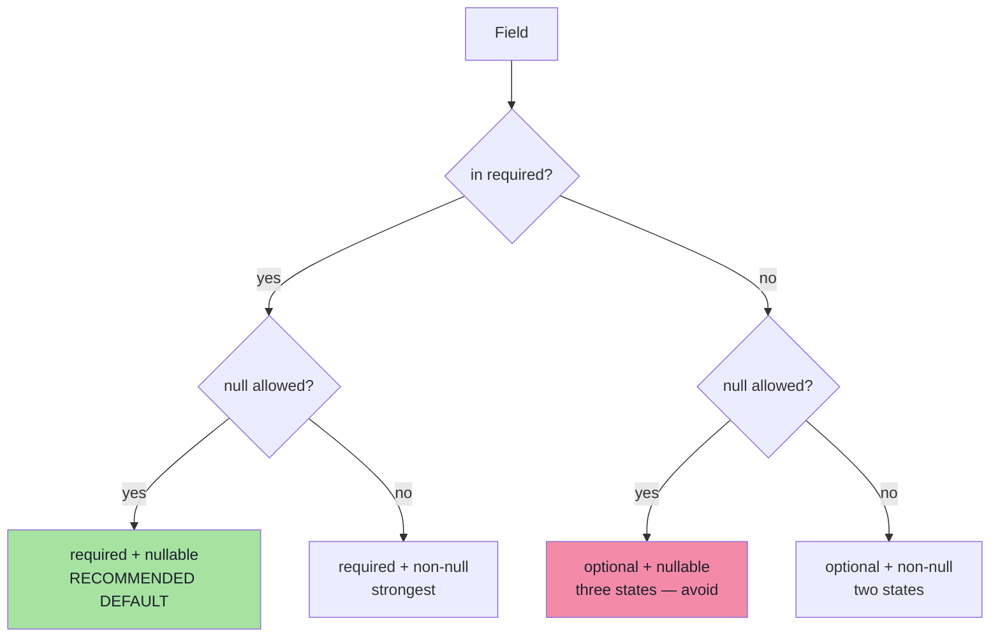

### Strict mode is a subset

Every provider compiles only a **subset** of JSON Schema into a grammar. Widely shared properties of "strict" mode:

- every property must be in `required` (optionality becomes **nullable**);
- `additionalProperties: false` is mandatory;
- `oneOf` is usually unsupported (`anyOf` sometimes supported);
- validation keywords (`pattern`, `format`, `minimum`, `minLength`) may be **accepted but not enforced by the decoder**.

> **Consequence:** your runtime validator is the only guarantee for value predicates. "Strict" is not "semantically strict".

### The reasoning-field pattern

Put a short rationale **first** in the schema. Because it is generated before the labels, the labels are conditioned on an explicit analysis — and every classification ships with an auditable rationale. Cap it ("under 40 words").

---

## Part 5 — Enforcement Mechanisms and Providers

> Full chapter: **[05_Enforcement_Mechanisms_And_Provider_Landscape.md](./05_Enforcement_Mechanisms_And_Provider_Landscape.md)**

Constrained decoding inserts one step before sampling:

> **Mask the logits of every token that would make the output invalid, then sample from the rest.**

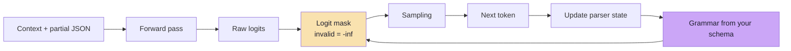

| Guaranteed | Not guaranteed |
|---|---|
| Well-formed JSON | That the JSON is the *right* JSON |
| Required keys present, no extra keys | That values are correct |
| Enum values from the set | That `pattern` / `format` / `minimum` were enforced |

### The provider ladder

Instruction only → **JSON mode** → **tool-use schema** → **native structured outputs** (`json_schema` + `strict`) → **self-hosted guided decoding** (grammar / `guided_json`).

The **tool-use trick** (one forced tool whose `parameters` are your schema) is the historical bridge — and the reason Chapter 07 insists on separating the two concepts.

### Streaming

A JSON object is only parseable when complete. **Stream for perception, validate for action.** Never persist a partially parsed object.

---

## Part 6 — Validation, Repair and Failure Handling

> Full chapter: **[06_Validation_Repair_And_Failure_Handling.md](./06_Validation_Repair_And_Failure_Handling.md)**

> **The boundary rule:** no unvalidated model output may cross into application logic.

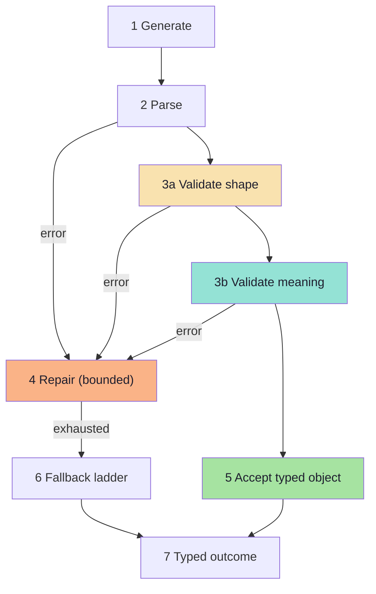

### Two kinds of validation

| Kind | Question | Example failure |
|---|---|---|
| **Structural** | Does it match the schema? | `durationMinutes` is `"30"` |
| **Semantic** | Is it consistent and plausible? | `startIso` is in the past; 900-minute meeting |

Semantic checks carry **two severities**: `block` (unusable — repair or fall back) and `review` (plausible — accept and flag). Collapsing both into "invalid" causes over- or under-rejection.

### The error taxonomy

| Class | Retryable? | Response |
|---|---|---|
| Transport (timeout, 429, 5xx) | ✅ | Backoff with jitter |
| Parse | ✅ | Retry, then repair |
| Shape | ✅ | Repair with the issue list |
| Semantic | ⚠️ | Repair, or escalate |
| **Refusal** | ❌ | Typed outcome, never retry |
| Capacity / truncation | ⚠️ | Change the budget or the schema |
| Policy block | ❌ | Surface as blocked |
| Schema/configuration | ❌ | Fix the schema; fail the deploy |

### The repair loop

A repair is **a second call that includes what went wrong** — not a blind retry.

| Rule | Why |
|---|---|
| Bound attempts (1–2) | Unbounded loops cost money and delay failure |
| Change the input each time | A blind retry samples the same distribution |
| Include the **issues** (path + expected vs received) | Tells the model which field and why |
| Include the previous output | So the model edits rather than regenerates |
| Lower the temperature | Determinism, not creativity |
| Never repair a refusal | It will never succeed |

### The fallback ladder

Repair → different model / simpler schema → degraded object (`null`s, `confidence: low`) → deterministic path → human queue / typed failure.

**Which rung is a product decision.** Extracting a meeting title can degrade; transferring money cannot.

### Idempotency

**Validate first, act second.** Derive an **idempotency key** from the object's semantics so a retry after a timeout cannot duplicate the action.

---

## Part 7 — Structured Output vs Tool Calling

> Full chapter: **[07_Structured_Output_vs_Tool_Calling.md](./07_Structured_Output_vs_Tool_Calling.md)**

Both involve JSON, a schema and a model. The difference is **purpose**:

> **Structured output** — the LLM produces structured data as the **final result**. **Nothing has been executed.**
>
> **Tool calling** — the LLM produces structured **arguments** so that an external function or action **can be executed**.

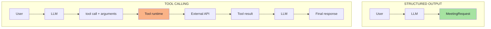

| Dimension | Structured output | Tool calling |
|---|---|---|
| Who executes | Nobody | Your runtime |
| Final output | The object | The post-tool text answer |
| Side effects | None, by definition | Possible, by definition |
| Failure risk | Wrong data | Wrong data **and** wrong action |
| Safety concern | Data quality | Authorisation and blast radius |

### The weather example (tool calling)

`User → LLM → decides to call get_weather → arguments { "city": "Delhi" } → Weather API → tool result → LLM → final answer`. The arguments are structured, but **their purpose is different: they exist so that a tool can be executed.**

### The meeting example (both)

```text
"Meet Rahul tomorrow at 4 PM for 30 minutes"
                    ↓ LLM
              MeetingRequest          ← structured output ends here
                    ↓
        Application can use the data
                    ↓
          Calendar integration later  ← tool calling / integration begins
```

### Tool arguments are untrusted input

They are produced by a model that may have read untrusted content. Validate, authorise, allow-list, cap blast radius, require approval for tier-3 actions, and audit everything.

> **The principle:** *the model may propose; the application disposes.*

---

## Part 8 — From Data to Action

> Full chapter: **[08_From_Data_To_Action_Tools_Integrations_And_MCP.md](./08_From_Data_To_Action_Tools_Integrations_And_MCP.md)**

The lecture's open question:

> **How does our application communicate with Google Calendar?**
>
> *We have created structured data, but no external action has happened.*
>
> **The structured output tells our application what the user wants. The external integration is responsible for actually doing it.**

### The complete pipeline

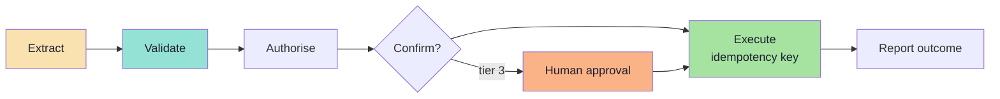

### Adapters

One module per external system translates your domain object into the vendor's contract, and maps vendor errors into **typed domain errors** (`conflict`, `unauthorised`, `rate_limited`, `unavailable`). The model sees your domain schema; the vendor sees its own; the adapter is the only place that knows both.

### MCP *(beyond the lecture)*

**N × M bespoke connectors → N + M implementations.**

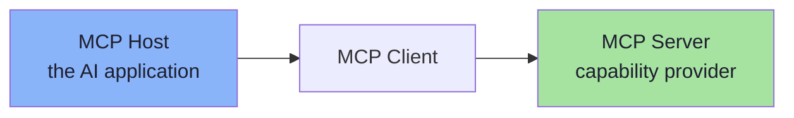

| Primitive | Controlled by | Analogy |
|---|---|---|
| **Tools** | The model | A function call |
| **Resources** | The application | A GET endpoint |
| **Prompts** | The user | A slash command |

Protocol: **JSON-RPC 2.0** over `stdio` (local) or streamable HTTP (remote), with an `initialize` handshake and capability negotiation.

| | Structured output | Function calling | MCP |
|---|---|---|---|
| Standardises | The result schema | The argument schema | The **connection** to a capability provider |
| Who defines the schema | Your app | Your app | The server (possibly third-party) |
| Reuse across apps | Low | Low | **High** |

### Integration security

| Threat | Control |
|---|---|
| Prompt injection → tool abuse | Treat content as data; constrain the tool set |
| Tool poisoning (malicious descriptions) | Vet servers; display descriptions |
| Confused deputy | Per-user, least-privilege credentials |
| Token passthrough | Audience-bound tokens; never forward |
| Excessive agency | Tiered permissions + confirmation |

> **Do not use MCP for a single internal call.** Adopt it when *reuse* or *ecosystem* benefits exceed the operational cost of another service.

---

## Part 9 — Production Playbook

> Full chapter: **[09_Production_Playbook_Evaluation_And_Checklist.md](./09_Production_Playbook_Evaluation_And_Checklist.md)**

### The production promise

> **Every object that reaches business logic satisfies the schema, and the rate at which it also satisfies the semantics is known, measured and acceptable.**

### The metric card

| Metric | Target (illustrative) |
|---|---|
| First-pass validity rate | ≥ 98% |
| Repair rate | ≤ 5% |
| Final failure rate | ≤ 0.5% |
| Per-field semantic accuracy | Task-defined |
| Truncation rate | ≈ 0 |
| p95 latency | Within the UX budget |
| Cost per extraction | Budgeted, including repairs |
| **Issue distribution by field path** | Drives the next fix |

> **The single most valuable chart:** issue distribution. It turns "the model is unreliable" into "`durationMinutes` is a string 4% of the time".

### The golden set

Clean · ambiguous · adversarial · edge · **regression (every production bug, forever)** — with **per-field scoring** and explicit `mustBeNull` / `mustRefuse` assertions. The harness must replay the **production code path**, on every prompt, schema or model change.

### Cost model

```text
expected cost = (input tokens + output tokens) × (1 + repairRate)
```

A 300-token schema on a 900-token prompt is a **25% input overhead**. A 20% repair rate is a **20% cost and latency increase**.

### Versioning

**Additive only** (new nullable fields, new enum members) · `schemaVersion` in the object · dual-write during migration · deprecate then remove · consumers tolerate unknown enums · rollback is a config change.

### Model migration

Re-run the golden set → compare per-field accuracy, validity, latency, cost → canary → roll out. **A measurement, not a gamble.**

---

## Cheat Sheet: The Four Layers of Enforcement

| Layer | Mechanism | Guarantees | Does not guarantee |
|---|---|---|---|
| **0 · Instruction** | "Return JSON" in the prompt | Nothing | Anything |
| **1 · JSON mode** | `response_format: json_object` | Valid JSON object | Your fields, types, enums |
| **2 · Schema-constrained** | `json_schema` + strict, grammars | Your **shape** | Correct values |
| **3 · Validate + repair** | Zod / JSON Schema + bounded loop | Nothing invalid passes | Semantic correctness |

> **Use the strongest enforcement available *and* keep Layer 3.**

---

## Cheat Sheet: The Twelve Schema Rules

1. One schema per task.
2. Design from the **consumer's** requirements.
3. Flatten by default.
4. **Enum** every closed set (with an `OTHER` escape hatch).
5. **Required + nullable** over optional.
6. Close every object (`additionalProperties: false`).
7. Constrain numbers and lists (`minimum`, `maximum`, `maxItems`).
8. **Normalise** strings (ISO dates, 24h times, integer minor units for money).
9. **Describe** every field.
10. Avoid unions (`oneOf` / `anyOf`).
11. Bound the output size.
12. **Version** the schema.

---

## Cheat Sheet: Structured Output vs Tool Calling

| Question | Structured output | Tool calling |
|---|---|---|
| What is produced? | The **final result** | **Arguments** for an action |
| Who executes? | Nobody | Your runtime |
| Typical use | Extraction, classification, routing, scoring | Search, calculate, read/write external systems |
| Main risk | Wrong data | Wrong data **and** wrong action |
| Key control | Validation | Authorisation + idempotency + HITL |

**Decision shortcut:** if the model's job ends when the object exists → structured output. If the object is a *request* something else must fulfil → tool calling.

---

## Cheat Sheet: Choosing an Enforcement Level

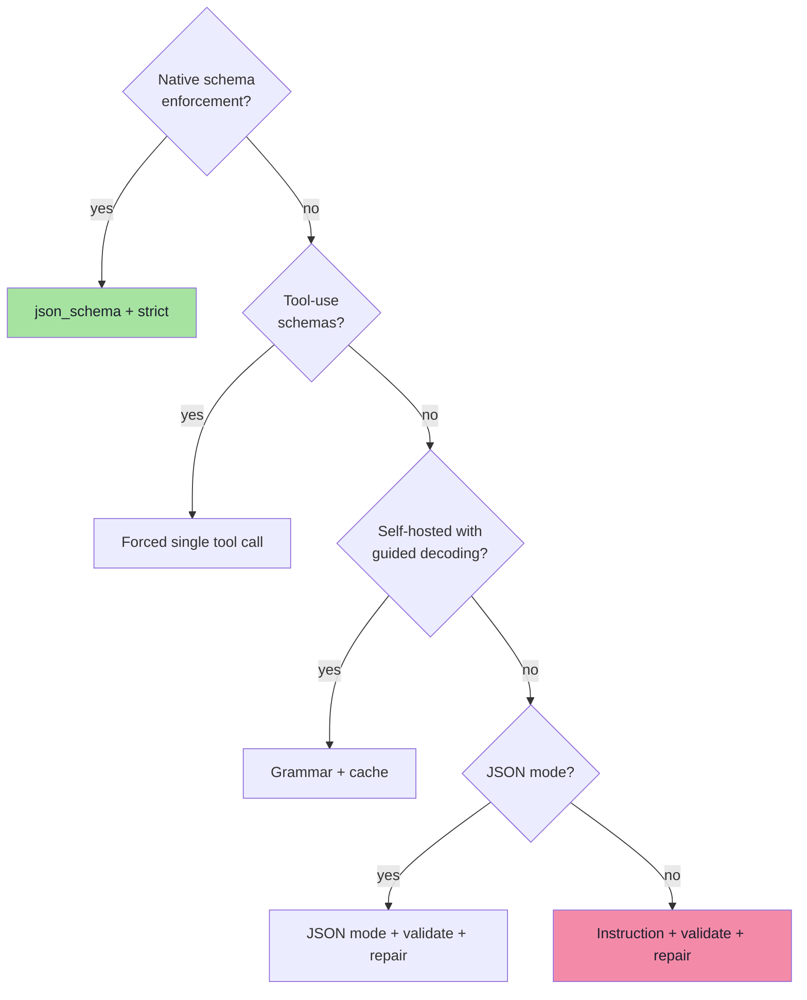

---

## The Reliability Loop (One Picture)

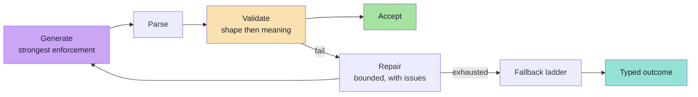

---

## Common Misconceptions

| Misconception | Reality |
|---|---|
| "Structured output means returning JSON." | It means satisfying a **predefined structure**; JSON is one encoding. |
| "It guarantees correct values." | It guarantees **shape**, never truth. |
| "JSON mode is structured output." | JSON mode is a *parser* guarantee; structured output is a *contract* guarantee. |
| "Strict mode validates `format` / `pattern` / `minimum`." | Those may be ignored by the grammar — validate them yourself. |
| "It replaces validation." | It **requires** validation. |
| "It is the same as tool calling." | One is the result; the other is a request to act. |
| "Temperature 0 makes it deterministic." | Greedy decoding is not a contract, and providers are not bit-stable. |
| "More fields / more context is better." | Object validity is **multiplicative**; every extra field is a new way to fail. |
| "Once it works in the playground, it works." | Playground inputs are clean; production inputs are not. |
| "A reasoning field proves the model is right." | Rationales can be post-hoc; they are a debugging aid, not ground truth. |

---

## Glossary

| Term | Meaning |
|---|---|
| **Structured output** | A model response that follows a predefined structure the application can consume. |
| **Schema** | The machine-readable definition of that structure (JSON Schema). |
| **Contract** | The schema treated as an executable interface with an owner and versions. |
| **JSON mode** | An API flag forcing a syntactically valid JSON object (shape not guaranteed). |
| **Constrained decoding** | Masking invalid tokens during sampling so the output cannot violate the grammar. |
| **Grammar / FSM** | The state machine compiled from a schema, used to compute the logit mask. |
| **Logit mask** | The vector setting disallowed tokens to negative infinity before sampling. |
| **Strict mode** | A provider-supported subset of JSON Schema enforced at decoding time. |
| **Structural validation** | Checking that an object matches the schema. |
| **Semantic validation** | Checking that the values are consistent and plausible. |
| **Repair loop** | A bounded second call that includes the validation errors. |
| **Fallback ladder** | The ordered degradation path when repair is exhausted. |
| **Typed outcome** | A discriminated result (`ok` / `refused` / `invalid` / `truncated` / `failed`). |
| **Reasoning field** | A short rationale placed before the answer fields in the schema. |
| **Tool calling** | The model emitting structured arguments so the runtime can execute an action. |
| **Tool schema** | The JSON Schema describing a tool's parameters. |
| **`tool_choice`** | The policy controlling whether the model may, must, or must not call a tool. |
| **MCP** | Model Context Protocol — a standard for exposing tools, resources and prompts to AI hosts. |
| **Idempotency key** | A deterministic key ensuring a retried action does not execute twice. |
| **Golden set** | A fixed evaluation set of inputs with known correct outputs. |
| **First-pass validity** | The fraction of calls whose first response satisfies the schema. |
| **Issue distribution** | Error counts grouped by field path and error type. |

---

## Self-Check Questions

1. Why is a valid JSON object not the same as a valid object?
2. What does "structured output is not just JSON" mean in practice?
3. Name five failure modes of prompt-only JSON and the enforcement layer that removes each.
4. Why does adding a sixth required field reduce reliability, and by how much?
5. What is the difference between `required + nullable` and `optional`?
6. Why can "strict mode" still let an impossible value through?
7. What exactly does a grammar-constrained decoder guarantee?
8. When does a repair loop help, and when does it waste money?
9. Give the one-sentence difference between structured output and tool calling.
10. Where does structured output end and the integration begin?
11. Why must tool arguments be treated as untrusted input?
12. What is the single most useful production metric for a structured-output system?
13. What makes a schema change a breaking change, and how do you avoid one?
14. Why must you re-run the golden set when only the *model* changes?
15. Where should validation happen, and what should happen immediately after it?

---

## Go-Live Checklist

**Contract** — versioned schema, descriptions everywhere, closed objects, enums for closed sets, provider-neutral with generated variants.

**Enforcement** — strongest available enforcement in use, grammar compiled in CI and warmed at boot, provider conformance tested.

**Validation** — structural validation at the boundary, semantic rules with `block` / `review` severities, typed outcomes for refusal and truncation, bounded repair loop, defined fallback ladder.

**Action safety** — authorisation in code, deterministic idempotency keys, tier-3 human approval, arguments validated, full audit trail.

**Measurement** — golden set with regression cases, first-pass validity and repair rate tracked, issue distribution dashboarded, latency and cost budgeted, schema and model versions traced.

**Operations** — runbook per failure mode, rollback is a config change, raw outputs in an access-controlled short-retention store, no PII in general logs.

---

## How This Lecture Connects

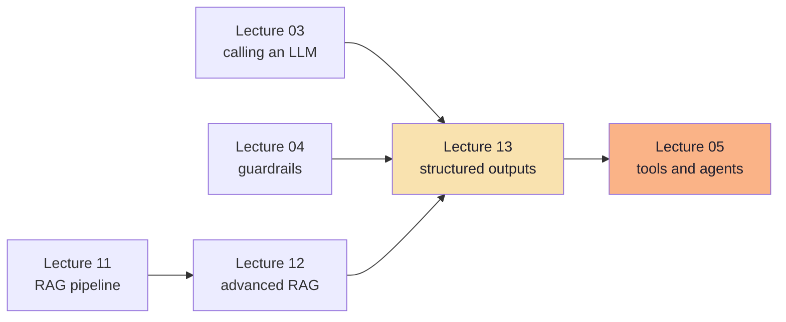

| Lecture | Connection |
|---|---|
| [03](../../Lecture%2003/notes/README.md) | The application-to-LLM call that structured output wraps |
| [04](../../Lecture%2004/notes/README.md) | Verify-before-trust guardrails — the same discipline applied to shape |
| [05](../../Lecture%2005/notes/README.md) | Tool calling, agents, HITL tiers and sandboxing — the action side |
| [11](../../Lecture%2011/notes/README.md) / [12](../../Lecture%2012/notes/README.md) | Retrieval decides what evidence is available; structured output decides what shape the answer takes |
| [09](../../Lecture%2009/notes/README.md) | Evaluation discipline reused for the golden set and metrics |

---

## Where to Go for Detail

| Topic | Chapter |
|---|---|
| The integration gap and failure taxonomy | [01](./01_Why_Plain_Text_Is_Not_Enough.md) |
| Schema, contract, three layers, one source of truth | [02](./02_What_Structured_Output_Is_Schema_Contract_And_Types.md) |
| Twelve failure modes, enforcement spectrum, compounding math | [03](./03_Why_Just_Ask_For_JSON_Fails.md) |
| JSON Schema keywords, nullability, strict subsets, versioning | [04](./04_JSON_Schema_And_Schema_Design_For_LLMs.md) |
| Logit masking, grammar compilation, provider ladder, streaming | [05](./05_Enforcement_Mechanisms_And_Provider_Landscape.md) |
| Error taxonomy, repair prompt design, fallback ladder, metrics | [06](./06_Validation_Repair_And_Failure_Handling.md) |
| Protocol steps, tool definitions, `tool_choice`, argument safety | [07](./07_Structured_Output_vs_Tool_Calling.md) |
| Adapters, the action pipeline, MCP, integration security | [08](./08_From_Data_To_Action_Tools_Integrations_And_MCP.md) |
| Golden sets, harness, cost model, versioning, runbook | [09](./09_Production_Playbook_Evaluation_And_Checklist.md) |

---

## One-Line Summaries

| Chapter | One-line summary |
|---|---|
| 01 | Humans prefer meaning, software prefers structure — structured output is the bridge, and the bridge needs a contract. |
| 02 | A schema is a form the application writes and the model fills; the target is a typed object, never "JSON". |
| 03 | "Return JSON" is a preference over a probability distribution; enforcement turns it into a guarantee. |
| 04 | A schema is a compression of the task: enum the closed sets, require or nullify every field, flatten by default, describe everything. |
| 05 | Constrained decoding makes malformed output impossible — and says nothing about whether the output is right. |
| 06 | Enforcement makes bad output unlikely; validation makes it harmless, and a typed failure path is the real deliverable. |
| 07 | Structured output is the result; tool calling is the request — the model proposes, the application disposes. |
| 08 | The model's output ends at the validator; everything after is ordinary software — adapters, idempotency keys and authorisation. |
| 09 | Ship a chain of narrow guarantees, measure each link, and let the issue distribution tell you which one to fix next. |

---

**Back to:** [Lecture 13 — Chapter Index](./README.md)
