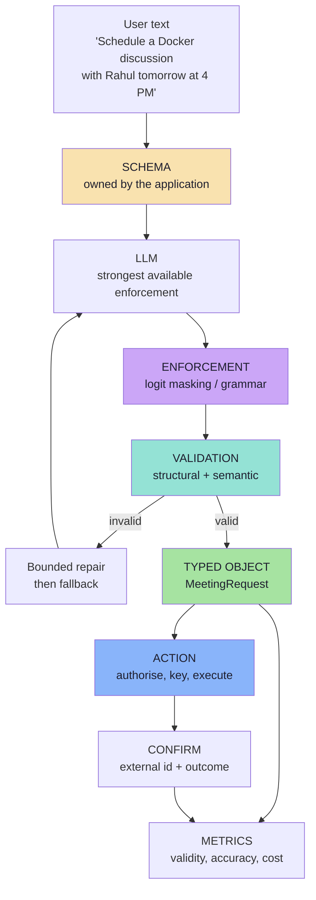

# Lecture 13 — Structured Outputs in GenAI

> **Lecture theme:** Every GenAI application starts as *prompt → LLM → text*. That is complete for a human and unusable for a program. This lecture is about the **bridge**: how to make a probabilistic model produce output that a deterministic system can trust — schemas, enforcement, validation, and the step from *data* to *action*.
>
> The reference implementation in the source lecture is **Java / Spring AI**; these notes keep the architecture and express all snippets as **TypeScript-style pseudo-code**.

---

## Chapter Index

| # | Chapter | Core Question Answered |
|---|---|---|
| [01](./01_Why_Plain_Text_Is_Not_Enough.md) | Why Plain Text Is Not Enough | Why does a chatbot that works fail the moment it becomes a feature? |
| [02](./02_What_Structured_Output_Is_Schema_Contract_And_Types.md) | What Structured Output Is: Schema, Contract and Types | What exactly am I asking the model to produce, and what am I promising my code? |
| [03](./03_Why_Just_Ask_For_JSON_Fails.md) | Why "Just Ask for JSON" Fails | My prompt says "return JSON" — why is that not a guarantee? |
| [04](./04_JSON_Schema_And_Schema_Design_For_LLMs.md) | JSON Schema and Schema Design for LLMs | How do I write a schema a model can actually satisfy? |
| [05](./05_Enforcement_Mechanisms_And_Provider_Landscape.md) | Enforcement Mechanisms and the Provider Landscape | What does the decoder enforce, and what is left to me? |
| [06](./06_Validation_Repair_And_Failure_Handling.md) | Validation, Repair and Failure Handling | When the model returns something unusable, what happens next? |
| [07](./07_Structured_Output_vs_Tool_Calling.md) | Structured Output vs Tool Calling | Should this return an object, or call a function? |
| [08](./08_From_Data_To_Action_Tools_Integrations_And_MCP.md) | From Data to Action: Tools, Integrations and MCP | How does my app actually talk to Google Calendar — safely and once? |
| [09](./09_Production_Playbook_Evaluation_And_Checklist.md) | Production Playbook: Evaluation and Go-Live | How do I prove it works, and keep it working at a million calls? |
| [**Complete**](./Lecture_13_Complete_Notes.md) | **Complete Consolidated Notes** | All nine chapters condensed: cheat sheet, decision tables, glossary, self-check |

> 📄 **Prefer a single document?** Read the **[Lecture 13 — Complete Consolidated Notes](./Lecture_13_Complete_Notes.md)**. It keeps the load-bearing ideas, numbers and decision tables, and links back to the chapters for full reasoning and pseudo-code.

---

## The Big Idea in One Diagram

Read it left to right: **the model proposes, the decoder constrains, the validator decides, the application acts.**

---

## How to Read These Notes

1. **Chapter 01 is the problem.** The integration gap: humans read meaning, software reads fields.
2. **Chapter 02 is the vocabulary.** Schema, contract, type, validation — the words everything else depends on.
3. **Chapter 03 is the diagnosis.** Twelve failure modes and the three layers of enforcement.
4. **Chapter 04 is the craft.** Designing a schema a model can satisfy.
5. **Chapter 05 is the mechanism.** Constrained decoding and what each provider offers.
6. **Chapter 06 is the safety net.** Validation, repair, fallbacks and typed outcomes.
7. **Chapter 07 is the boundary.** Result versus action — the lecture's central clarification.
8. **Chapter 08 is the last mile.** Integrations, idempotency, authorisation and MCP.
9. **Chapter 09 is the discipline.** Metrics, golden sets, versioning and the go-live checklist.

---

## Conventions Used in This Lecture

| Convention | Meaning |
|---|---|
| **Mermaid** | Every structural diagram is Mermaid (`flowchart`, `sequenceDiagram`, `stateDiagram-v2`). |
| **TypeScript-style pseudo-code** | Snippets describe data flow and contracts for a JS/TS environment. They are **not** runnable production code. |
| **Framework references** | Spring AI / Java constructs appear as inline references and tables of meaning, not as code to copy. |
| **Illustrative numbers** | Latency, cost and probability figures are "typical" or "illustrative", never universal constants. |
| **Provider APIs change** | Provider capabilities are described as *categories*; verify against current documentation before shipping. |
| **Beyond the lecture** | Sections marked *beyond the lecture* add material the script only gestures at (JSON Schema design, constrained decoding, repair loops, MCP, evaluation harnesses). |
| **Board references** | Passages described as *from the board* reproduce the hand-drawn `Excalidraw-Notes.svg`. |

---

## Sources

- 📄 [`Notes.pdf`](./Notes.pdf) — *Structured Outputs in GenAI* (16 pages): why plain text is not enough, human-readable vs machine-usable data, what structured output is, schemas, "structured output is not just JSON", why prompting for JSON fails, prompt instruction vs structured contract, structured output vs tool calling, and where MCP becomes relevant.
- 🖼️ [`Excalidraw-Notes.svg`](./Excalidraw-Notes.svg) — the lecture board: the chatbot flow (`Client → Server → LLM → "Hello Aditya"`), the typed REST flows (`/user/details`, `/schedule` with `{ username, visitors, timeOfMeet }` → `{ message: "SCHEDULED" }`), the `MeetingDetails` form with fixed slots, and the meeting-scheduler flow where the LLM fills `{ scheduleTime, scheduleDate, numberOfPeople, peopleName }` from the sentence *"Schedule a meeting with Ravi"*.
- 📚 Prior lectures — [Lecture 03](../../Lecture%2003/notes/README.md) (calling an LLM from an application), [Lecture 04](../../Lecture%2004/notes/README.md) (guardrails and verification), [Lecture 05](../../Lecture%2005/notes/README.md) (tool calling, agents, HITL and security), [Lecture 12](../../Lecture%2012/notes/README.md) (evaluation discipline and stage-local upgrades).

---

## One-Line Summaries

| Chapter | One-line summary |
|---|---|
| 01 | Humans prefer meaning, software prefers structure — structured output is the bridge, and the bridge needs a contract. |
| 02 | A schema is a form the application writes and the model fills; the target is a typed object, never "JSON". |
| 03 | "Return JSON" is a preference over a probability distribution; enforcement turns it into a guarantee. |
| 04 | A schema is a compression of the task: enum the closed sets, require or nullify every field, flatten by default, describe everything. |
| 05 | Constrained decoding makes malformed output impossible — and says nothing about whether the output is right. |
| 06 | Enforcement makes bad output unlikely; validation makes it harmless, and a typed failure path is the real deliverable. |
| 07 | Structured output is the result; tool calling is the request — the model proposes, the application disposes. |
| 08 | The model's output ends at the validator; everything after is ordinary software — adapters, idempotency keys and authorisation. |
| 09 | Ship a chain of narrow guarantees, measure each link, and let the issue distribution tell you which one to fix next. |

---

## The Lecture in One Sentence

> **An LLM cannot reliably feed a program prose, and it will not reliably obey a schema it was merely asked to follow — so define the contract, enforce it at the decoder, verify it at the boundary, and never let unverified model output touch the outside world.**
