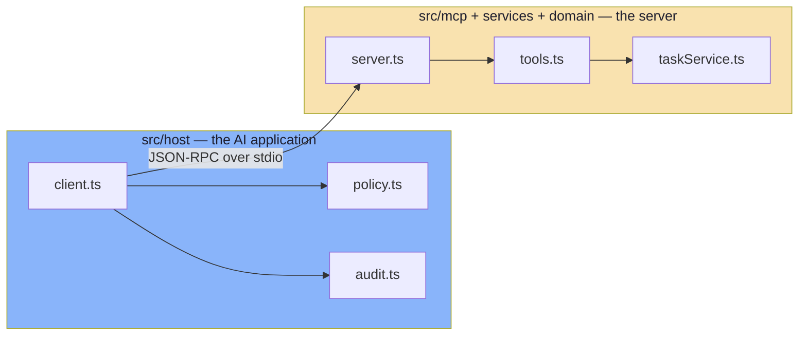

# Chapter 01: Project Structure & File Map

> **Chapter goal:** Before reading a single line of logic, know the map. This
> chapter answers three questions: *what files exist and what is each one for*,
> *which direction do dependencies point*, and *which file implements which
> lecture chapter*. Everything after this chapter is a walk through that map, in
> dependency order.

---

## 1.1 File details

| | |
| :--- | :--- |
| **Path** | the whole project (`Lecture 14/code/Production Code/`) |
| **Layer** | — (overview) |
| **Purpose** | Show the layout, the layer boundaries and the dependency direction before any single file is read |
| **Lecture sections** | [01 — The integration problem](../../../notes/01_The_Integration_Problem_and_Why_Standards_Win.md) (dependency direction), [02 — What MCP is](../../../notes/02_What_MCP_Is_Protocol_Server_and_Standard_Interface.md) (server vs application) |
| **Files covered verbatim** | `package.json`, `tsconfig.json`, `.env` / `.env.example` |

### Commands

```bash
cd "Lecture 14/code/Production Code"
npm install
npm run typecheck
```

---

## 1.2 The tree

```text
Production Code/
├── .env                              # every knob, validated at boot (gitignored)
├── .env.example                      # the template, committed
├── package.json                      # deps + 4 scripts
├── tsconfig.json                     # strict TypeScript, noUncheckedIndexedAccess
├── README.md                         # what the codebase does + how to run it
├── src/
│   ├── index.ts                      # STDIO binding + graceful shutdown
│   ├── config/
│   │   └── env.ts                    # Zod-validated environment (fail fast)
│   ├── core/                         # reusable, transport- and domain-free
│   │   ├── logger.ts                 # structured stderr logging + redaction
│   │   ├── metrics.ts                # counters + latency
│   │   ├── errors.ts                 # the two error mechanisms
│   │   └── guards.ts                 # rate limiter + timeout
│   ├── domain/
│   │   └── taskStore.ts              # state + idempotency keys
│   ├── services/
│   │   └── taskService.ts            # business rules, re-validated
│   ├── mcp/                          # the protocol surface
│   │   ├── deps.ts                   # the wiring contract
│   │   ├── server.ts                 # createServer(): the composition root
│   │   ├── tools.ts                  # Tools (the model drives)
│   │   ├── resources.ts              # Resources (the application drives)
│   │   └── prompts.ts                # Prompts (the user drives)
│   └── host/                         # the AI application — never imported by the server
│       ├── policy.ts                 # trust tiers, consent, filtering
│       ├── audit.ts                  # the record, with hashed arguments
│       └── client.ts                 # the lifecycle
└── implementations guide/            # this guide
```

**16 source files, ~1,830 lines.** Small on purpose: every file is one idea.

---

## 1.3 The layers, and why the boundaries are where they are

| Layer | Files | Knows about | Must **not** know about |
| :--- | :--- | :--- | :--- |
| **config** | `config/env.ts` | `process.env`, `core/logger` (for the level list) | anything else |
| **core** | `core/*.ts` | nothing but Node built-ins | the domain, MCP, the host |
| **domain** | `domain/taskStore.ts` | `core/errors` | MCP, the host |
| **services** | `services/taskService.ts` | `domain`, `core/errors`, `zod` | MCP, the host |
| **mcp** | `mcp/*.ts` | `config`, `core`, `services`, the MCP SDK | the host |
| **host** | `host/*.ts` | `config`, `core`, the MCP *client* SDK | the server's internals |

Two of those rows are the whole lecture:

- **`core/` imports nothing from this project.** That is what makes it testable
  and reusable, and it is why `metrics.ts` can be read in isolation.
- **`host/` never imports from `mcp/` or `services/`.** The host is a *different
  program* that happens to live in the same repository. The only thing crossing
  the boundary is JSON-RPC over a pipe.

> **Chapter 01's dependency rule, made physical:** applications depend on the
> *protocol*, servers depend on their *backend*, and the model depends on
> neither. `host/` is the application; `mcp/` + `services/` + `domain/` is the
> server. Nothing in `src/mcp/` mentions the word "host", and nothing in
> `src/host/` mentions `taskService`.

### Why the server never imports the host



If the server could import the host, the two would silently merge — and
Chapter 08's "if a capability cannot be exercised without an LLM, it is in the
wrong component" would stop being true. Keeping them in separate folders under
separate entry points makes the separation **structural rather than
aspirational**.

---

## 1.4 `package.json` — full file

```json
{
  "name": "lecture-14-mcp-server-production",
  "version": "1.0.0",
  "private": true,
  "description": "Lecture 14 — MCP Server from First Principles (Production Code): the same three primitives as Basic Code, hardened with the concerns Chapter 08 makes non-optional — validated config, structured logging, audit, rate limits, timeouts, idempotency, a real error taxonomy, resource templates, and a host that enforces consent and tool filtering.",
  "type": "module",
  "engines": {
    "node": ">=20.0.0"
  },
  "scripts": {
    "server": "tsx src/index.ts",
    "host": "tsx src/host/client.ts",
    "dev": "tsx watch src/index.ts",
    "typecheck": "tsc --noEmit"
  },
  "keywords": [
    "fde",
    "mcp",
    "model-context-protocol",
    "tools",
    "resources",
    "prompts",
    "production",
    "observability",
    "idempotency",
    "typescript"
  ],
  "author": "Forward Deployed Engineering Team",
  "license": "MIT",
  "dependencies": {
    "@modelcontextprotocol/client": "^2.3.1",
    "@modelcontextprotocol/server": "^2.3.1",
    "dotenv": "^16.4.7",
    "zod": "^4.2.0"
  },
  "devDependencies": {
    "@types/node": "^22.13.8",
    "tsx": "^4.23.15",
    "typescript": "^5.9.3"
  }
}
```

### Block by block

**`"type": "module"`**
What it does: makes every `.js` file in the project an ES module.
How it works: without it, Node treats `.js` as CommonJS and every `import` fails.
It is also why every intra-project import in this codebase ends in `.js`
(`"./config/env.js"`) even though the file on disk is `env.ts` — NodeNext
resolution maps the emitted path back to the TypeScript source.

**The four scripts**
What they do: give you one command per entry point.
How they work: `tsx` runs TypeScript directly by transpiling on the fly, so there
is no build step between you and the code.

| Script | Command | What it starts |
| :--- | :--- | :--- |
| `npm run server` | `tsx src/index.ts` | the **server** alone, waiting on stdio |
| `npm run host` | `tsx src/host/client.ts` | the **host**, which spawns the server itself |
| `npm run dev` | `tsx watch src/index.ts` | the server with auto-reload |
| `npm run typecheck` | `tsc --noEmit` | the type checker — no output files |

**The two SDK packages**
What they do: `@modelcontextprotocol/server` implements the *server* half of the
protocol; `@modelcontextprotocol/client` implements the *client* half.
How it works: they are separate packages on purpose. A server never needs the
client package, and pulling it in "just for types" is how a codebase accidentally
becomes able to call itself. This project depends on both only because it ships
both halves as two programs.

**`zod`**
What it does: one schema library used for three different jobs.
How it works: the same `z.object({...})` is (a) a runtime validator in
`services/taskService.ts`, (b) the JSON Schema the SDK publishes to the model in
`mcp/tools.ts`, and (c) the boot-time validator for environment variables in
`config/env.ts`. Learning it once pays three times.

**`dotenv`**
What it does: loads `.env` into `process.env`.
How it works: imported for its side effect as the very first line of
`config/env.ts` (`import "dotenv/config"`). Critically, dotenv **does not
override** variables that already exist — which is why
`MCP_HOST_ALLOW_DESTRUCTIVE=false npm run host` on the command line wins over the
value in `.env`, and why every branch in this guide is testable without editing
a file.

---

## 1.5 `tsconfig.json` — full file

```json
{
  "compilerOptions": {
    "target": "ES2022",
    "module": "NodeNext",
    "moduleResolution": "NodeNext",
    "lib": ["ES2022"],
    "outDir": "./dist",
    "rootDir": "./src",
    "strict": true,
    "noUncheckedIndexedAccess": true,
    "exactOptionalPropertyTypes": false,
    "esModuleInterop": true,
    "skipLibCheck": true,
    "forceConsistentCasingInFileNames": true,
    "declaration": true,
    "sourceMap": true,
    "resolveJsonModule": true
  },
  "include": ["src/**/*"],
  "exclude": ["node_modules", "dist"]
}
```

### Block by block

**`"module": "NodeNext"` + `"moduleResolution": "NodeNext"`**
What they do: make TypeScript resolve modules exactly the way Node does.
How they work: this pair is what enforces the `.js` extension on relative
imports. It is stricter than `"bundler"` resolution and it is the honest choice
for a program that Node will run directly.

**`"strict": true`**
What it does: turns on the whole strict family — `strictNullChecks`,
`noImplicitAny`, `strictFunctionTypes` and friends.
How it works: it is the difference between "the type checker found my bug" and
"the type checker agreed with my guess". Every `undefined` check in this codebase
(`if (task === undefined)`) exists because this flag demanded it.

**`"noUncheckedIndexedAccess": true`**
What it does: makes indexing — `array[0]`, `record["key"]` — return
`T | undefined` instead of `T`.
How it works: it is the flag that catches the most common production crash in
JavaScript, reading past the end of an array. You can see its effect in
`host/client.ts`:

```ts
const first = resources[0];
if (first === undefined) {
  throw new Error("the server exposed no resources");
}
```

Without the flag, `first` would be typed as always-present and that guard would
look like noise. With it, the guard is **required to compile** — the compiler
refuses to let you forget.

**`"skipLibCheck": true`**
What it does: skips type-checking of `.d.ts` files inside `node_modules`.
How it works: it keeps `npm run typecheck` fast, and it means a third-party
declaration file with a minor mismatch cannot fail your build. Your own code is
still fully checked.

**`"include": ["src/**/*"]`**
What it does: scopes the project to `src/`.
How it works: this is why the temporary probe scripts used while writing this
guide had to live outside `src/` — anything inside is type-checked, and anything
outside is invisible to `npm run typecheck`.

---

## 1.6 `.env.example` — full file

```bash
# Lecture 14 — MCP Server from First Principles (Production Code)
# Copy to `.env` (see `.env.example`) and adjust. Every value is validated at
# boot by `src/config/env.ts` — an invalid value stops the process instead of
# surfacing mid-conversation (Chapter 08).

# --- Identity (Chapter 02) -------------------------------------------------
MCP_SERVER_NAME=task-mcp-server
MCP_SERVER_VERSION=1.0.0

# --- Transport (Chapter 04) ------------------------------------------------
# stdio is the local binding: the host spawns this process and speaks
# JSON-RPC over stdin/stdout. Streamable HTTP is the remote one.
MCP_TRANSPORT=stdio

# --- Observability (Chapter 08) --------------------------------------------
MCP_LOG_LEVEL=info

# --- Execution guards (Chapter 08 — timeouts, limits, budgets) -------------
MCP_TOOL_TIMEOUT_MS=5000
MCP_RATE_LIMIT_PER_MINUTE=60
MCP_MAX_TASKS=1000

# --- Host policy (Chapter 08 §8.1 — discovery is an inventory, not a grant) -
# false  -> destructive tools are never even shown to the model
# true   -> they are shown, but still require explicit user consent
MCP_HOST_ALLOW_DESTRUCTIVE=true
MCP_HOST_REQUIRE_CONSENT=true
```

### Block by block

**The identity block**
What it does: sets the two fields a client learns at `initialize`.
How it works: `serverInfo` is the server's *only* identity in the protocol. There
is no vendor id, no model id, no API key here — which is Chapter 02's point that
an MCP server is a capability provider and needs no LLM.

**`MCP_TRANSPORT=stdio`**
What it does: names the binding.
How it works: it is validated against a one-value enum, so a typo
(`MCP_TRANSPORT=http`) fails at boot rather than silently doing nothing. The
value is currently informational — `src/index.ts` binds stdio unconditionally —
which is honest: an unused-but-validated value is better than an unvalidated one.

**The three execution guards**
What they do: bound what one call may consume.
How they work: `MCP_TOOL_TIMEOUT_MS` is the per-call budget enforced by
`withTimeout`; `MCP_RATE_LIMIT_PER_MINUTE` is the sliding window in
`RateLimiter`; `MCP_MAX_TASKS` is the board's capacity, enforced in the store.
All three are read once, at boot.

**The two policy switches**
What they do: decide the host's posture towards destructive tools.
How they work: they are read by `src/host/client.ts`, **not** by the server. That
placement is deliberate and is the chapter's sharpest point: **the server is not
responsible for deciding what it is allowed to do.** The host is. Putting these
in the server's config would be exactly the confused-deputy mistake Chapter 08
describes.

> **A trap worth naming:** these are parsed as the literal strings `"true"` and
> `"false"`, not with `z.coerce.boolean()`. That is because `Boolean("false")` is
> `true` — the single most common environment-variable bug in JavaScript, and one
> Chapter 02 of this guide walks through in detail.

---

## 1.7 Run / verify

```bash
cd "Lecture 14/code/Production Code"
npm install
npm run typecheck
```

Expected: **no output at all**, and an exit code of 0. `tsc --noEmit` prints
nothing when it is happy — silence is success.

Then confirm the map is real:

```bash
find src -name '*.ts' | sort
```

```text
src/config/env.ts
src/core/errors.ts
src/core/guards.ts
src/core/logger.ts
src/core/metrics.ts
src/domain/taskStore.ts
src/host/audit.ts
src/host/client.ts
src/host/policy.ts
src/index.ts
src/mcp/deps.ts
src/mcp/prompts.ts
src/mcp/resources.ts
src/mcp/server.ts
src/mcp/tools.ts
src/services/taskService.ts
```

And confirm the config guard fires before anything else runs:

```bash
MCP_TOOL_TIMEOUT_MS=abc npm run server
```

```text
[config] refusing to start — invalid environment:
  - MCP_TOOL_TIMEOUT_MS: Invalid input: expected number, received NaN
```

That output is the whole point of Chapter 02: the process died **at boot**, with
the offending variable named, before a single MCP message could be exchanged.

---

## 1.8 Checkpoint

1. **Dependencies point one way.** `core/` → nothing; `domain/` → `core`;
   `services/` → `domain` + `core`; `mcp/` → `services` + `core` + `config`;
   `host/` → `core` + `config` only. The host and the server share **no code** —
   only the protocol.
2. **`host/` is a separate program, not a layer of the server.** That is what
   makes Chapter 08's test — *"if a capability cannot be exercised without an
   LLM, it is in the wrong component"* — mechanically true.
3. **The two policy switches belong to the host, not the server.** A server that
   decides its own permissions has confused "discoverable" with "authorised".
4. **`strict` + `noUncheckedIndexedAccess` are load-bearing.** Every `undefined`
   guard you will read in the next sixteen chapters is there because the
   compiler refused to compile without it.

---

**Back to:** [Implementation guide index](./README.md) · [Production Code README](../README.md)

**Next:** [Chapter 02 — Config: The Validated Environment](./02_Config_Validated_Environment.md)


