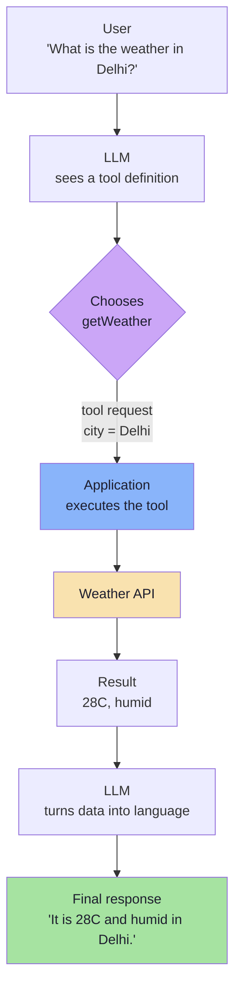
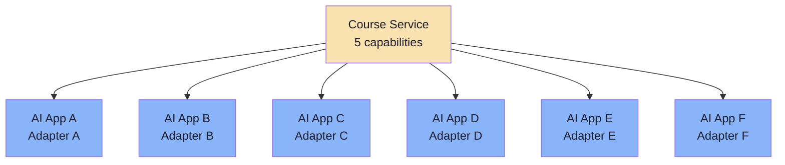
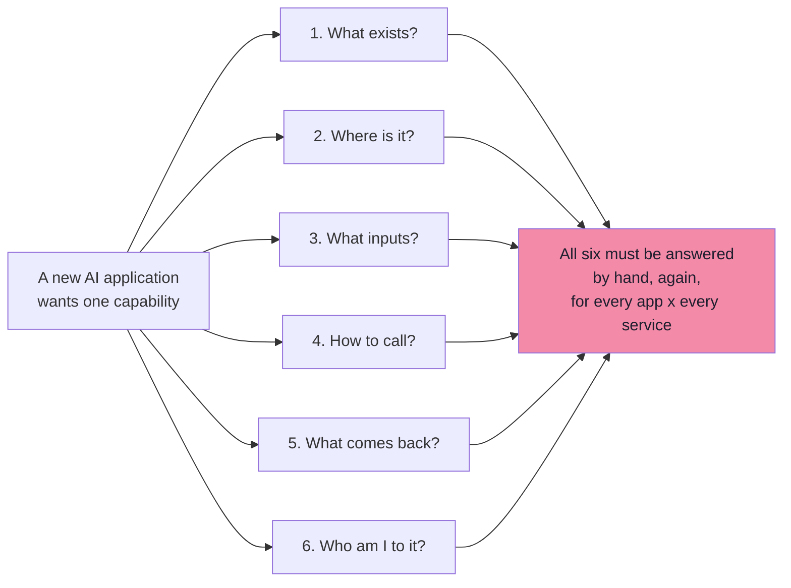
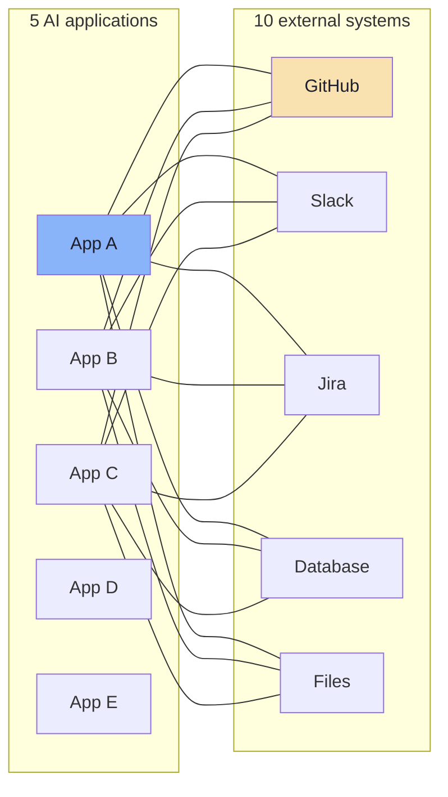
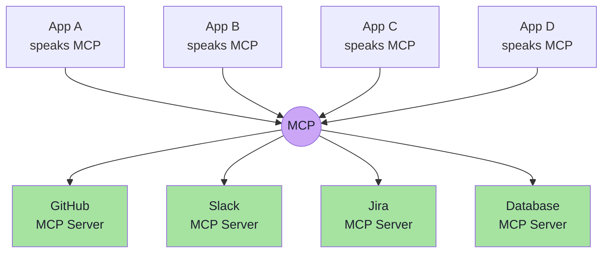
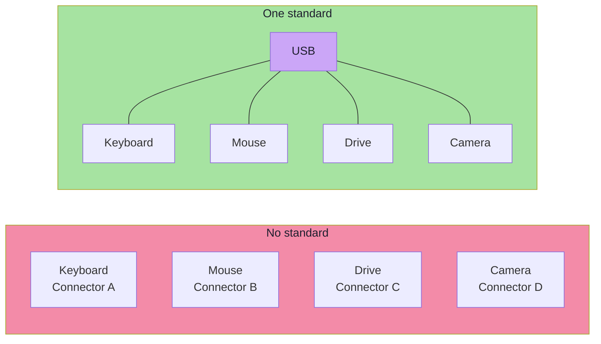
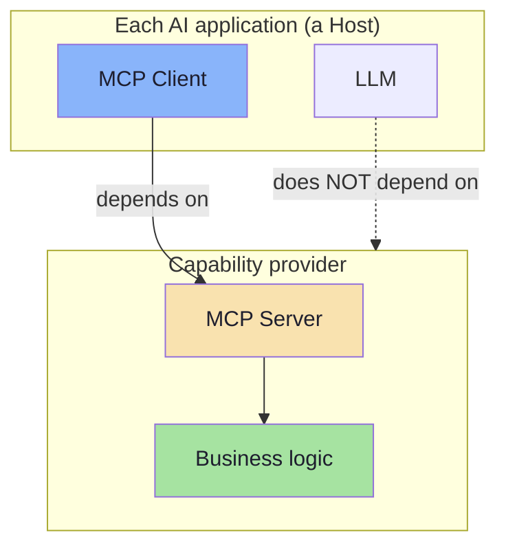

# Chapter 01: The Integration Problem and Why Standards Win

> **Chapter Goal:** Reconstruct the argument the lecture makes *before* it ever names MCP. Tool calling answered one question — *"how does a model ask for an action?"* It did not answer a different, older question: *"how does an application get access to that action in the first place?"* That second question is a plain software-integration problem, of exactly the kind USB, HTTP and JDBC already solved. MCP is that answer applied to AI applications.
>
> At the end of this chapter you should be able to answer: *given a single app where tool calling works perfectly, why does adding a second app double the work — and what precisely does a standard remove?*

---

## 1.1 Start From Something That Already Works

The lecture deliberately begins with a system that has **no problem at all**.

A user asks:

> "What is the weather in Delhi?"

A language model does not know the current weather. Its knowledge is frozen at training time, and it has no live connection to the world. So we give the application a capability — a function the model is allowed to *ask* to be run. In the lecture's Java/Spring AI source it looks like this:

```java
@Tool
public String getWeather(String city) {
    // Call weather API
}
```

The runtime then executes a loop the model participates in:



On the board, the same idea appears as a picture of *many* tools hanging off one agent — a **calculator**, a **Weather API**, a **Compiler** — with a structured payload flowing through:

```text
{ num1: 2, num2: 3, operator: "add" }   ->   tool executes   ->   5
```

This is the state of the art for a single application, and it is genuinely good. The lecture says so explicitly:

> **For a single application, this architecture works perfectly well.**

Nothing in this chapter disputes that. The problem is not in the loop. **The problem is in what happens when a second application wants the same capability.**

---

## 1.2 The Same Five Capabilities, Six Consumers

Our system provides five capabilities:

| # | Capability | What it does |
|---|---|---|
| 1 | `getCourseDetails()` | Look up a course's syllabus, price, duration |
| 2 | `searchVideos()` | Find lecture videos by topic |
| 3 | `createStudentTicket()` | Open a support ticket for a student |
| 4 | `getStudentProgress()` | Read completion %, quiz scores, streak |
| 5 | `scheduleMentorshipSession()` | Book a 1:1 with a mentor |

One AI application can integrate these directly — five functions, one codebase, one auth token, done.

Now add the consumers. The lecture lists six:

- **Coder Army Chatbot** — the public-facing assistant
- **Internal Teacher Assistant** — helps instructors answer student questions
- **VS Code AI Assistant** — coding help, but needs course context
- **Desktop AI Assistant** — an always-on local assistant
- **Support Agent** — triages tickets
- **CLI Agent** — automation and scripting

Every one of them wants *the same five capabilities*. And without a shared interface, every one of them must integrate them **again, from scratch**:



Six adapters. Six copies of the same knowledge. And — critically — **six independent opportunities to get authentication wrong.** This is the moment the lecture names the problem:

> **This creates an integration problem.**

Note what is *not* the problem. The LLM is not the problem. The capabilities are not the problem. Weather APIs and course services have been callable for twenty years. The problem is that **each AI application must independently re-derive the contract of every capability it wants to use.**

---

## 1.3 Six Questions Every Integration Must Answer

The lecture enumerates exactly what each new application has to learn. This list is worth memorising, because each item later becomes a concrete part of the MCP protocol.

| # | Question the integrator must answer | What it becomes in MCP |
|---|---|---|
| 1 | *What capabilities are available?* | `tools/list`, `resources/list`, `prompts/list` |
| 2 | *Where are they?* | an MCP endpoint / transport (stdio or Streamable HTTP) |
| 3 | *What parameters do they need?* | `inputSchema` (JSON Schema) |
| 4 | *How should they be called?* | `tools/call` with `name` + `arguments` |
| 5 | *What do they return?* | `content` blocks (+ optional `outputSchema`) |
| 6 | *How should authentication work?* | OAuth 2.1 / token handling at the transport layer |



The important observation: **these six answers are not application-specific.** They are the same six answers for the chatbot, the CLI agent and the VS Code assistant. Repeating application-independent work once per application is the definition of waste — and of drift.

---

## 1.4 The N × M Integration Matrix

The lecture later makes the arithmetic explicit (source §14). Suppose we have:

- **5 AI applications**
- **10 external systems** (GitHub, Slack, Jira, a database, files, …)

Without a shared standard, each pair needs its own integration:

```text
App A -> GitHub
App A -> Slack
App A -> Jira
App A -> Database
App A -> Files

App B -> GitHub
App B -> Slack
App B -> Jira
...
```

That is **N × M = 5 × 10 = 50 integrations.** Each one carries its own:

- authentication and token refresh
- retry and timeout policy
- schema mapping between the vendor's shapes and the app's domain types
- logging, tracing and error taxonomy
- rate-limit handling
- tests, documentation and an owner



### The linear-growth version

With one protocol in the middle, the work becomes **N + M**:



> **Clients understand MCP. Servers expose their capabilities through MCP.**
> **This creates a cleaner integration boundary.**

### The arithmetic, made concrete

| Situation | Integrations to build and maintain | At 5 apps × 10 systems |
|---|---|---|
| No standard | **N × M** | 50 |
| One protocol | **N + M** | 15 |

And the shape matters more than the number. In the N × M world, **every new app re-tests every system**, and every vendor API change breaks M places. In the N + M world, a vendor change breaks **one server**, and a new app is a client configuration, not an engineering project.

---

## 1.5 The Adapter Pattern: The Honest Local Fix

Before reaching for a standard, the correct engineering instinct is an **adapter** (or *anti-corruption layer*): one module per external system that translates your domain objects into that system's contract.

```ts
// pseudo-code — an adapter hides one vendor's contract behind our own types
type Adapter<TRequest, TResult> = {
  authenticate(): Promise<void>;
  call(request: TRequest): Promise<TResult>;
  toDomain(raw: unknown): TResult;
};
```

This is good design and you should still do it. But notice what it does **not** fix:

| Adapter solves | Adapter does not solve |
|---|---|
| Keeps vendor JSON out of business logic | Each app still writes its own adapter per vendor |
| Gives one place to add retries/timeouts | The **contract** is still agreed privately, per app |
| Makes testing easier | Discovery is still manual and out-of-band |
| Centralises auth code *within one app* | The model has no way to learn a tool's schema at runtime |

An adapter makes **N × M integrations cleaner**. It does not make them **fewer**. That distinction is the entire reason a protocol is needed rather than more discipline.

---

## 1.6 Why This Is Not a New Problem: Standards

The lecture's analogy is deliberately unglamorous, and therefore persuasive:

> Imagine every hardware device requiring a completely different type of connector:
>
> ```text
> Keyboard     -> Connector A
> Mouse        -> Connector B
> Hard Drive   -> Connector C
> Camera       -> Connector D
> ```

A common standard makes interaction dramatically simpler. And we already rely on this idea everywhere:

| Standard | The capability it makes accessible | What it fixes | What it leaves free |
|---|---|---|---|
| **USB** | Peripherals | Physical connector, power, enumeration | What the device actually does |
| **HTTP** | Resources on a network | Request/response semantics, verbs, status codes | The resource model |
| **JDBC** | Relational databases | Driver interface, `Connection`/`Statement`, error codes | SQL dialect, schema, indexes |
| **SQL** | Querying relational data | The language of the query | Storage engine, planner |
| **REST** | Service APIs | Convention for resources and verbs | Payload design, auth scheme |
| **SMTP** | Email delivery | Envelope, relay, error semantics | Spam policy, mailbox semantics |



### The sentence that defines MCP's scope

> **A standard does not necessarily provide a new capability.**
> **It provides a common way to access a capability.**

This single line is the best defence against the most common misconception in the whole subject. MCP adds **no** new power to a model. It does not make the model smarter, does not give it memory, and does not replace your tools. It standardises the **shape of the doorway** through which capabilities are discovered and invoked.

> **MCP applies the same idea to AI applications.**

---

## 1.7 What a Standard Actually Buys You

The lecture states the benefit as "standardization", but the practical returns are worth naming individually, because they are what you actually sell to a team.

### 1. Time to first integration

Without a standard: read docs → write auth → write mapping → write retries → test.
With a standard: point the host at an endpoint and let it discover the tools.

The cost of the *first* integration does not fall much — someone still has to build the server. The cost of the **second, third and tenth** integration collapses toward configuration.

### 2. One audited security surface

In the N × M world, authentication is implemented M times per app and N times per system. Every implementation is a place where a token can leak, a scope can be too broad, or a prompt-injected tool result can be trusted.

In the N + M world, the server owns its credentials, the host owns its consent UI, and there is **one place to review** each boundary. This is not a convenience feature; it is the main reason enterprises adopt MCP.

### 3. Vendor-neutrality for the model

The same server serves Claude, GPT, Gemini or a local model, because the protocol sits **below** the model choice. Swapping the model does not rewrite integrations; swapping the tool vendor does not rewrite the app.

### 4. A discoverable ecosystem

Once the interface is standard, third-party servers become reusable artefacts. You stop writing a Jira integration and start *installing* one. This is a network effect: the value of the protocol grows with the number of servers, and the cost of each new app falls with the number of existing servers.

### 5. Versioning at the boundary

A server can add a tool, deprecate one, or change a schema **behind the protocol**, and clients that only use the old tools are unaffected. Discovery makes capability changes visible instead of silent.

### 6. Testability

Because both sides speak a documented protocol, an MCP server can be driven by an inspector or a test harness with **no LLM in the loop**. You can unit-test capabilities as ordinary functions and integration-test them as protocol calls.

> **The deeper point:** a standard converts an **N × M product of bespoke work** into an **N + M sum of reusable work**, and it converts security from a per-integration habit into a per-boundary contract.

---

## 1.8 The Dependency Direction

The board (`Excalidraw-Notes.svg`) shows three applications — `App1`, `App2`, `App3` — each containing *server + LLM + MCP client*, all pointing at MCP servers. There is one more arrow on that board worth pausing on: **Dependency**.



Read the dependency arrows carefully, because they explain why the architecture is stable:

| Dependency | Direction | Consequence |
|---|---|---|
| Application → MCP protocol | **inward** | The app depends on a *specification*, not on vendors |
| MCP server → its backend | **inward** | The server absorbs vendor churn; clients never see it |
| LLM → MCP server | **none** | The model never talks to a server; the *host* does |
| Server → other servers | **none** | Servers are isolated; only the host composes them |

That last row is a security property, not a style choice. As the MCP architecture document puts it: *servers should not be able to read the whole conversation, nor "see into" other servers.* Isolation is what makes it safe to connect an untrusted third-party server at all.

**Inverting the dependency is the whole trick.** A world where every app knows every vendor is a world of coupling. A world where every app knows one protocol, and every vendor is wrapped by one server, is a world of substitutable parts.

---

## 1.9 The Counter-Argument, Stated Fairly

A good engineer should resist a new protocol by default. Here are the honest objections, and the honest answers.

| Objection | Is it valid? | The nuance |
|---|---|---|
| *"We already have REST — why not just call REST from the agent?"* | **Partly** | You can — and you should, *inside* the server. But REST describes endpoints to a programmer, not capabilities to a model. Chapter 02 draws this line precisely. |
| *"We only have one app. This is overhead."* | **Yes** | With genuinely one consumer, a direct tool integration is simpler and correct. MCP pays off at the second consumer, or when third-party capabilities are involved. |
| *"A standard is another dependency that can break."* | **Yes** | It is. That is why protocol version negotiation, deprecation windows and backwards compatibility exist — Chapter 04 and Chapter 08 cover them. |
| *"Does a standard not just move the complexity?"* | **Yes, deliberately** | It moves complexity from **N × M places** to **N + M places**, and from implicit to explicit. That is a reduction, not an elimination. |
| *"Won't a remote server add latency and a failure point?"* | **Yes** | A remote server is a network hop and can 500. Local servers over stdio avoid the network hop; either way you need timeouts, retries and a fallback path (Chapter 08). |

> **The rule of thumb:** adopt a protocol when the *second* consumer appears, or when you are **consuming** capabilities you do not own. Before that, a direct tool function is the better engineering.

---

## 1.10 Common Mistakes at This Stage

| Mistake | Why it hurts | Correct habit |
|---|---|---|
| Conflating "tool calling is hard" with "integration is hard" | You tune prompts when the real problem is a missing endpoint | Name the failure: *model choice* or *capability access*? |
| Building a bespoke adapter per app and calling it architecture | N × M maintained forever; security drift is invisible | Centralise capability behind one server; apps become clients |
| Believing a standard adds capabilities | Leads to expecting MCP to improve reasoning or accuracy | MCP standardises **access**, not intelligence |
| Treating the protocol as the product | The server's *behaviour* (auth, limits, idempotency) is what users feel | Spend the effort on the capability, not the handshake |
| Adopting MCP for a single-consumer internal tool | Pure overhead, one more process to run | Use a plain function/tool until a second consumer appears |
| Assuming the model calls the server | Wrong mental model; leads to architecture errors and mis-set trust boundaries | The **host** calls the server; the model only emits a request |
| Forgetting that "where are they?" is part of the contract | Every app hardcodes URLs and breaks together | Transport and endpoint belong to configuration, not code |

---

## 1.11 Chapter Summary

| Idea | Statement |
|---|---|
| The starting point | Tool calling works perfectly for **one** application — that is not in dispute |
| The real problem | Six consumers × five capabilities = repeated, drifting, independently-secured integrations |
| The six questions | What exists, where, what inputs, how to call, what returns, how to authenticate |
| The arithmetic | Bespoke integrations scale as **N × M**; a protocol scales as **N + M** |
| The shape | Worst case, a vendor change breaks M places; best case, **one** |
| The precedent | USB, HTTP, JDBC, SQL, REST, SMTP — all standardise *access*, never *capability* |
| The scope sentence | **A standard does not provide a new capability; it provides a common way to access one** |
| The dependency rule | Applications depend on the **protocol**, servers depend on their **backend**, and the **LLM depends on neither** |
| The adoption rule | Adopt when a **second consumer** appears, or when you **consume** capabilities you do not own |

> **Final mental model:** MCP is not a smarter tool. It is a **socket** — and sockets are valuable precisely because they are boring, identical everywhere, and let you stop thinking about them.

---

## Where This Goes Next

- **[Chapter 02](./02_What_MCP_Is_Protocol_Server_and_Standard_Interface.md)** — defines MCP, defines an MCP Server, and separates it from both REST and microservices.
- **[Chapter 03](./03_MCP_vs_Tool_Calling_Complementary_Layers.md)** — the distinction most people get wrong: tool calling and MCP are two layers, not two rivals.
- Foundations: [Lecture 05](../../Lecture%2005/notes/README.md) for tool calling and agent loops; [Lecture 13, Chapter 08](../../Lecture%2013/notes/08_From_Data_To_Action_Tools_Integrations_And_MCP.md) for the first introduction of MCP.

---

**Back to:** [Lecture 14 — Chapter Index](./README.md) · [Complete Consolidated Notes](./Lecture_14_Complete_Notes.md)


