# Chapter 02: What MCP Is — Protocol, Server and the Standard Interface

> **Chapter Goal:** Define MCP precisely, define an **MCP Server**, and draw three boundaries the lecture insists on: an MCP Server is not an LLM, MCP is not a replacement for REST, and an MCP Server is not necessarily a microservice. Getting these three boundaries wrong produces the most common architectural mistakes in the field.
>
> At the end of this chapter you should be able to answer: *what exactly is standardised by MCP, and what is deliberately left to me?*

---

## 2.1 The One-Line Definition

> **MCP stands for Model Context Protocol.**
>
> **MCP is a standard protocol through which AI applications can connect to external tools and data.**

Read that sentence slowly; every word is load-bearing.

| Word | Why it matters |
|---|---|
| **standard** | It is a published, versioned specification — not one vendor's SDK |
| **protocol** | It specifies *messages*, not code. Any language can implement it |
| **AI applications** | The client side is an AI application (a *host*), not a human's browser |
| **connect to** | It is about **access**, never about the capability itself |
| **external** | The capability lives outside the application's own process boundary |
| **tools and data** | Two different things: things you *do*, and things you *know* (Chapter 06) |

### Before and after

The lecture contrasts two topologies. **Without MCP**, every app reaches into the service with its own custom integration:

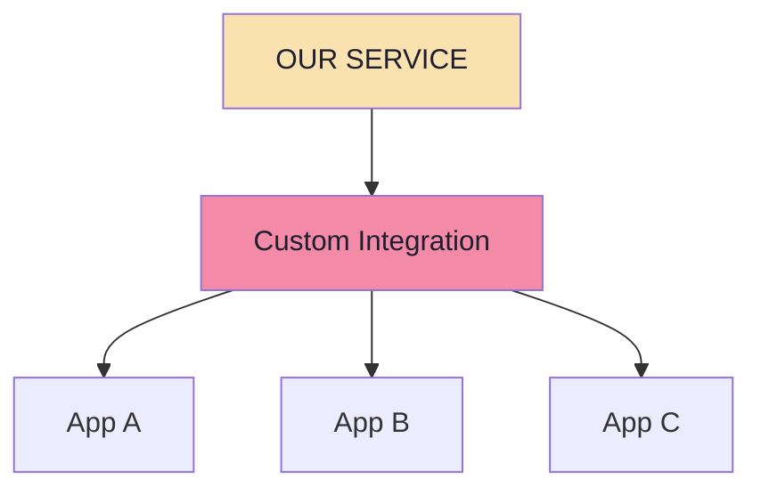

**With MCP**, the service exposes its capabilities *once*, through a server, and the apps speak the protocol:

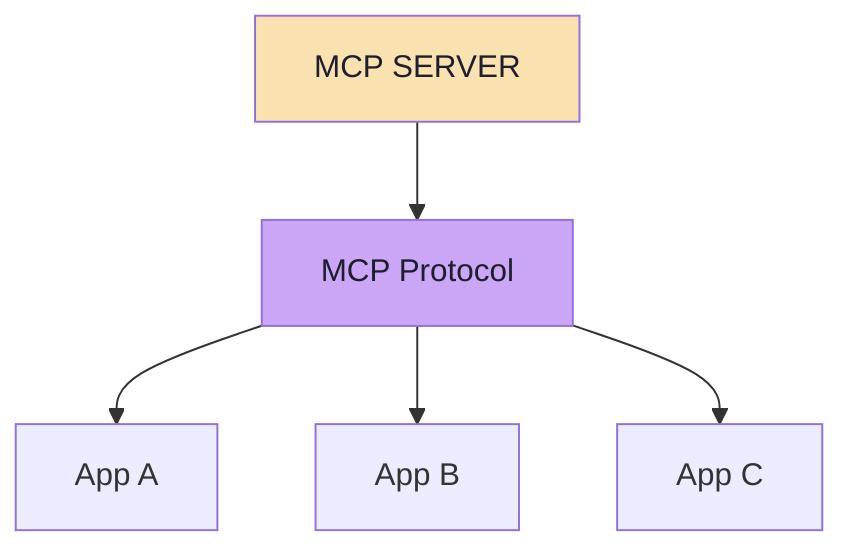

> **The important idea is standardization.**

Note the shape change, not just the count change. In the first diagram the *custom integration* is a shared chokepoint that every app's quirks leak into. In the second, the protocol is a **contract with a version number**, and the server is the only place that knows how the backend really works.

---

## 2.2 What Is an MCP Server?

> **An MCP Server is a program that exposes capabilities through the MCP protocol.**

Concretely, a **Task MCP Server** could expose three capabilities:

```text
createTask
listTasks
completeTask
```

Another application can now **discover** those capabilities. Conceptually it asks:

> "What tools do you provide?"

and the server answers with a *definition*, not just a name:

```json
{
  "name": "createTask",
  "description": "Creates a new task",
  "inputSchema": {
    "title": "string",
    "description": "string"
  }
}
```

From that single response the client learns three things:

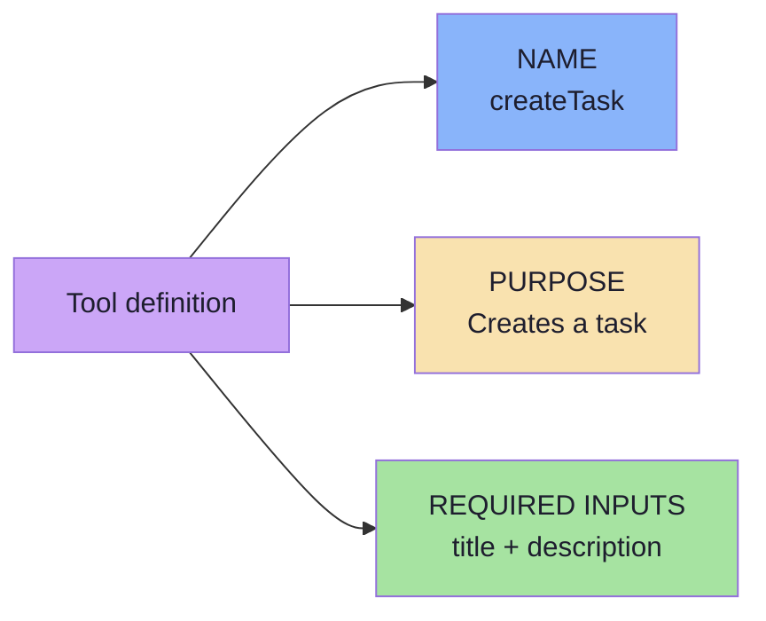

Later, the client can invoke that capability:

```text
createTask
  title       = "Record MCP Video"
  description = "Record next FDE lecture"
```

…and **the MCP Server executes the underlying business logic.** That last clause is the point: the server is where the work happens. Everything before it was description; everything after it is result.

---

## 2.3 MCP Server Does Not Mean LLM

This is the lecture's most emphatic correction, and the one people get wrong most often.

> **An MCP Server does not need an LLM.**

It does not necessarily need:

```text
OpenAI
Claude
Gemini
ChatClient
```

It could simply contain normal business logic:

```java
public Task createTask(String title) {
    Task task = new Task(title);
    tasks.add(task);
    return task;
}
```

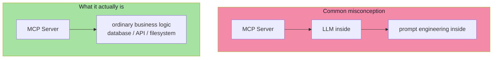

> **MCP simply makes that capability available to other applications through a standard protocol.**

### Why this matters in practice

| Consequence | Explanation |
|---|---|
| **Servers are cheap** | No model call, no token cost, no latency from generation — just your logic |
| **Servers are deterministic** | The same request gives the same result; you can unit-test them |
| **Servers are boring to secure** | Normal authz on a normal service — not "AI security" |
| **Servers are reusable by anything** | A CLI script or a test harness can call them; no LLM required to test |
| **The model stays in the host** | One place holds the model, the conversation and the user's consent |

> **A useful test:** if you cannot describe your MCP server's behaviour without mentioning an LLM, you have probably put the model in the wrong place.

---

## 2.4 Where Does the LLM Come In?

The LLM normally lives **inside the AI application**:

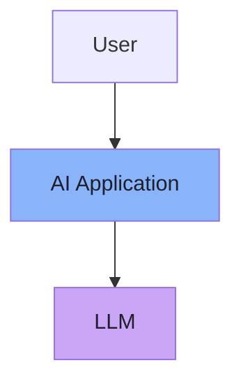

The AI application can **also** contain an MCP Client:

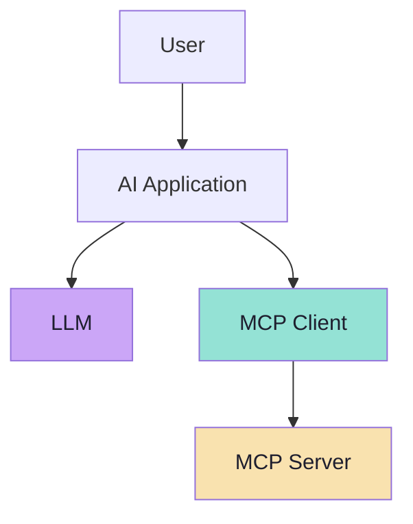

Now suppose the MCP Server exposes:

```text
createTask
listTasks
completeTask
```

The AI application **discovers** those capabilities and makes them available to the LLM. The user says:

> "Add 'Record Docker Lecture' to my tasks."

The model can decide:

> *I should use `createTask`.*

…and produce:

```text
createTask(
  title = "Record Docker Lecture"
)
```

**The AI application then uses MCP to execute the tool.** Note the division of labour precisely:

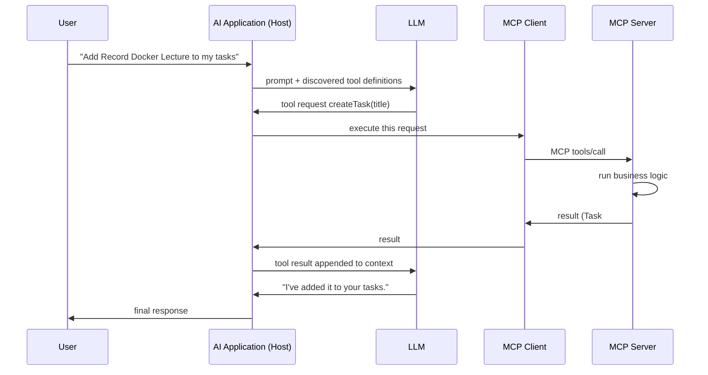

| Step | Who decides | What it is |
|---|---|---|
| *Which* capability to use, and with what arguments | **The model** | Tool calling (Chapter 03) |
| *Whether* it is allowed, and *how* to reach it | **The host** | Policy + MCP |
| *What actually happens* | **The server** | Business logic |

> **The LLM is a decider, never a transport.** It emits an intention; the host turns that intention into a protocol call.

---

## 2.5 MCP Is a Protocol, Not a Framework

This distinction is subtle but decides how you architect. A **framework** gives you code that runs your application. A **protocol** gives you a message format that two programs agree on.

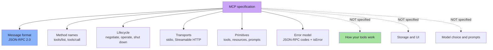

| Layer | Example | Specified by MCP? |
|---|---|---|
| Transport | stdio pipe, HTTP POST, SSE stream | **Yes** — two standard transports |
| Message envelope | `{"jsonrpc":"2.0","id":1,"method":"tools/call"}` | **Yes** |
| Method vocabulary | `tools/list`, `tools/call`, `resources/read` | **Yes** |
| Lifecycle | version + capability negotiation | **Yes** |
| Tool semantics | what `createTask` really does | **No** — yours |
| Backend | Postgres, a REST API, the filesystem | **No** — yours |
| Model | Claude, GPT, Gemini, local | **No** — the host's choice |
| User interface | how consent is shown | **No** — the host's choice |

> **Because it is a protocol and not a framework, an MCP Server can be written in TypeScript, Python, Java, Go or Rust, and a host can consume any of them.** That is the property that makes the ecosystem possible.

---

## 2.6 Why Not Just Use REST?

> **MCP does not make REST obsolete.**

Suppose we already have:

```text
POST /tasks
GET  /tasks
PUT  /tasks/{id}
```

An MCP Server can use that existing REST API **internally**:

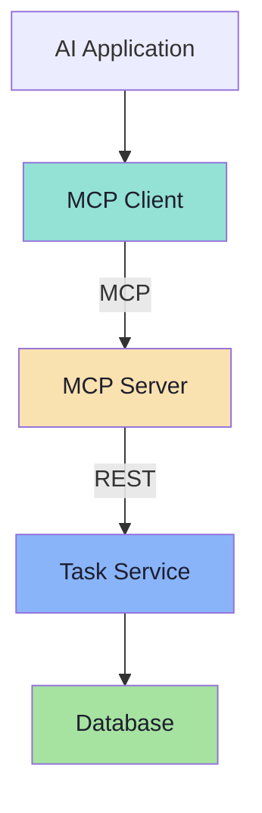

This is the *normal* production shape: MCP on the outside, REST on the inside.

### They solve different problems

| | REST API | MCP Server |
|---|---|---|
| Primary audience | **Programmers** writing clients | **Models and hosts** discovering capabilities |
| Exposes | HTTP endpoints, verbs, status codes | Tools, tool descriptions, input schemas, resources, prompts, capabilities |
| Discovery | Read the docs / an OpenAPI file | Ask the server at runtime (`tools/list`) |
| Auth model | Whatever the vendor chose | Negotiated capability + OAuth at the transport |
| Unit of meaning | A resource + a verb | A **capability** with a description the model can read |
| Versioning | URL/header versions | Protocol version + tool list changes |

> **REST and MCP solve different integration problems.**
> **A REST API primarily exposes HTTP endpoints. An MCP Server exposes AI-oriented concepts such as tools, tool descriptions, input schemas, resources, prompts and capabilities.**

### The one-line difference that matters

A REST endpoint says: *"Here is a URL. You must know what to send."*
An MCP tool says: *"Here is a capability, here is what it is for, here is the exact shape of its arguments."*

The second sentence is **written for a model to read**, and that is the entire reason MCP is not just "REST with a different name".

### They can work together

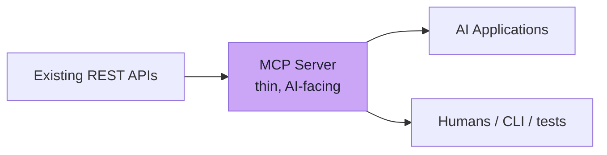

Nothing is rewritten. The REST service keeps serving its human and machine clients; the MCP server adds a **model-readable front door** on top.

---

## 2.7 An MCP Server Is Not Necessarily a Microservice

A traditional microservice may expose:

```text
POST /tasks
GET  /tasks
PUT  /tasks/{id}
```

An MCP Server exposes MCP **primitives** such as:

```text
Tools
Resources
Prompts
```

The two can coexist:

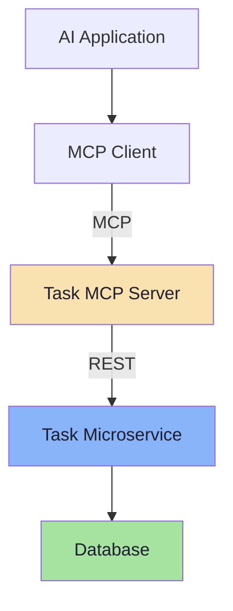

> **The MCP Server can act as an AI-friendly layer over an existing system.**

| Question | Microservice | MCP Server |
|---|---|---|
| Who calls it? | Other services, browsers, mobile apps | AI hosts (and their clients) |
| What is the interface? | HTTP routes / RPC methods | Tools, resources, prompts |
| How is it discovered? | Service registry, API docs | Runtime discovery (`tools/list`) |
| Does it need a network port? | Usually | **No** — a stdio server is a child process |
| Does it own the data? | Often | **Not necessarily** — it may be a thin adapter |
| Is it a deployment unit? | Usually | **Not necessarily** — it can live inside the app |

> **Do not create a microservice just to have an MCP server.** An MCP server can be a few hundred lines in the same repository as the service it wraps. The protocol does not require a new deployable.

---

## 2.8 One Host Can Connect to Multiple MCP Servers

> **An AI Host is not restricted to one MCP Server.**

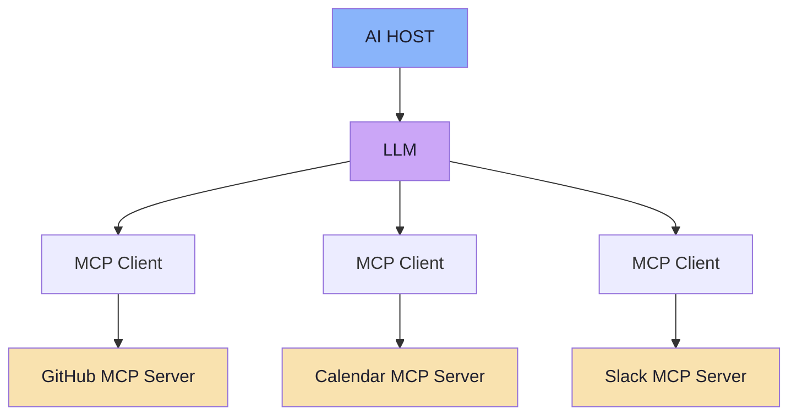

The model could then have capabilities such as:

```text
createGitHubIssue()
scheduleMeeting()
sendSlackMessage()
```

> …**without all of those implementations being built directly inside the AI application.**

This is the payoff of Chapter 01's arithmetic, now visible at the application level:

| Property | Consequence |
|---|---|
| Each client holds **one** connection to **one** server | Failures and permissions are isolated per server |
| Servers are added by **configuration**, not by code | New capability without redeploying the host |
| The host composes across servers | One user request can span GitHub + Calendar + Slack |
| The model sees a **flat tool list** | It does not know (or need to know) which server a tool came from |

> **That last row is the elegant part — and the dangerous part.** The model cannot distinguish a trusted internal server's tool from a third-party one's, which is exactly why the host must own filtering and consent. Chapter 08 returns to this.

### Namespacing and collisions *(beyond the lecture)*

When two servers both expose `createTask`, the host must disambiguate. Common conventions:

```text
github__createIssue        // prefix by server
calendar.scheduleMeeting   // dotted namespace
```

The protocol does **not** mandate a scheme; it is a host-side design decision, and it belongs in your tool-name policy. Left unhandled, two tools with the same name silently shadow each other.

---

## 2.9 What Sits Underneath: JSON-RPC and Protocol Revisions *(beyond the lecture)*

The lecture stays at the conceptual level. Two implementation facts are worth knowing because they explain the protocol's behaviour.

### JSON-RPC 2.0 message types

Every MCP message is one of four JSON-RPC shapes:

| Shape | Has `id`? | Expects a reply? | Example |
|---|---|---|---|
| **Request** | yes | yes | `{"jsonrpc":"2.0","id":1,"method":"tools/list"}` |
| **Response** | yes (matching) | — | `{"jsonrpc":"2.0","id":1,"result":{...}}` |
| **Notification** | no | no | `{"jsonrpc":"2.0","method":"notifications/tools/list_changed"}` |
| **Error** | yes (matching) | — | `{"jsonrpc":"2.0","id":2,"error":{"code":-32602,"message":"Invalid params"}}` |

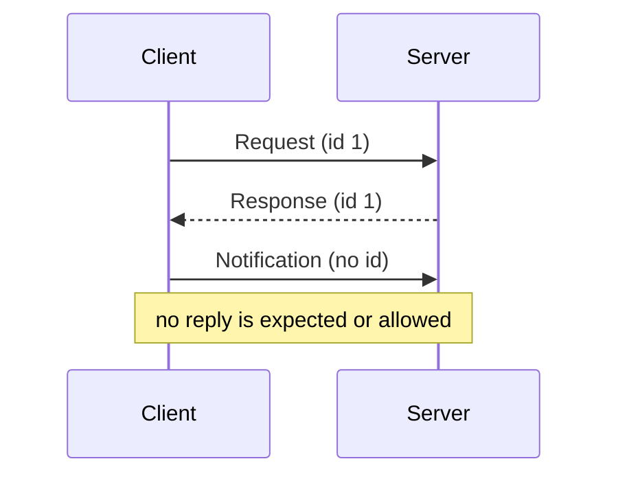

Common JSON-RPC error codes you will meet:

| Code | Meaning | Typical MCP cause |
|---|---|---|
| `-32601` | Method not found | Client called a capability the server never advertised |
| `-32602` | Invalid params | Unknown tool name, arguments failing `inputSchema` |
| `-32603` | Internal error | Server-side exception |
| `-32002` | Resource not found | `resources/read` on a missing URI |

> **Note the important nuance:** a *tool that ran and failed* is **not** a JSON-RPC error. It is a normal response with `isError: true` (Chapter 05). Protocol errors mean "the call never happened"; `isError` means "the call happened and the outcome was a failure". Conflating the two makes retries dangerous.

### Protocol revisions

MCP is versioned by **date**, in `YYYY-MM-DD` form. The version is not bumped for backwards-compatible changes.

| Revision | Highlights |
|---|---|
| **2024-11-05** | First revision. `initialize` handshake, HTTP+SSE transport |
| **2025-03-26** | **Streamable HTTP** replaces HTTP+SSE; OAuth-based authorization |
| **2025-06-18** | **Elicitation**; **structured tool output** (`outputSchema` / `structuredContent`); resource links; `MCP-Protocol-Version` header |
| **2025-11-25** | Interim revision: URL-mode elicitation, refinements to authorization and `includeContext` semantics |
| **2026-07-28** | **Stateless requests** — the `initialize` handshake and session IDs are removed; `server/discover`; `subscriptions/listen`; Multi Round-Trip Requests. **Roots, Sampling and Logging deprecated** |

> **Why this matters for these notes:** the lecture teaches the *concepts*, which have been stable across every revision — server, client, tools, discovery, invocation. The **mechanism** of negotiation has changed and will keep changing. Read Chapter 04 for both the classic handshake and the stateless model, and always check the revision your SDK targets.

---

## 2.10 Common Mistakes

| Mistake | Why it hurts | Correct habit |
|---|---|---|
| Putting an LLM inside the MCP server | Duplicates model config, costs tokens, makes the server non-deterministic and hard to test | Keep the server deterministic; the model belongs to the host |
| Treating MCP as "REST but new" | You rewrite working REST services and lose their clients | Keep REST inside; add a thin MCP layer outside |
| Creating a microservice for every server | Deployment sprawl; more network hops and failure modes | A stdio server can be a local process — no port, no deployable |
| Believing MCP replaces tool calling | Leads to expecting the protocol to choose tools | The model chooses; MCP transports |
| Assuming MCP makes the model smarter or more accurate | Wrong expectations, wrong metrics | MCP changes *access*, not *reasoning* |
| Hardcoding endpoints and tool lists in the app | Defeats discovery; every app breaks on change | Discover at runtime, cache with invalidation |
| Confusing a tool failure with a protocol error | Retrying a business-logic failure duplicates side effects | `isError: true` is a result; JSON-RPC error is a non-event |
| Forgetting that the model sees a flat, merged tool list | Name collisions and cross-server trust confusion | Namespace tools and filter by trust tier |

---

## 2.11 Chapter Summary

| Idea | Statement |
|---|---|
| The definition | **MCP is a standard protocol through which AI applications connect to external tools and data** |
| An MCP Server | A program that **exposes capabilities** through MCP — and needs **no LLM** |
| Server vs LLM | The server holds business logic; the host holds the model |
| Where the LLM lives | Inside the AI application, alongside the **MCP Client** |
| Protocol vs framework | MCP fixes messages, methods, lifecycle, transports — never your semantics |
| MCP vs REST | REST exposes endpoints to programmers; MCP exposes **capabilities to models** — and they compose |
| MCP vs microservice | An MCP server may be a thin, local, in-repo adapter; not necessarily a deployable |
| One host, many servers | Capabilities are composed by the host, added by configuration |
| Underneath | JSON-RPC 2.0 messages, date-versioned revisions, negotiated capabilities |

> **Final mental model:** an MCP Server is a **waiter**, not a **chef** and not a **customer**. It knows the menu, takes orders in a standard form, and carries them to the kitchen. The customer (the model) decides; the kitchen (your backend) cooks; the waiter is what makes the interaction repeatable.

---

## Where This Goes Next

- **[Chapter 03](./03_MCP_vs_Tool_Calling_Complementary_Layers.md)** — the two layers, side by side, and where the handoff happens.
- **[Chapter 04](./04_Host_Client_Server_Architecture.md)** — Host, Client, Server in depth, plus transports and the lifecycle.
- **[Chapter 05](./05_The_Tools_Primitive.md)** — the primitive that the lecture spends the most time on.
- Related: [Lecture 13, Chapter 07](../../Lecture%2013/notes/07_Structured_Output_vs_Tool_Calling.md) for structured output vs tool calling.

---

**Back to:** [Lecture 14 — Chapter Index](./README.md) · [Complete Consolidated Notes](./Lecture_14_Complete_Notes.md)


