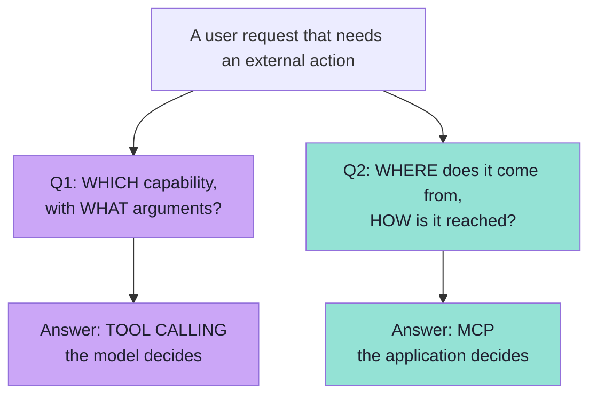
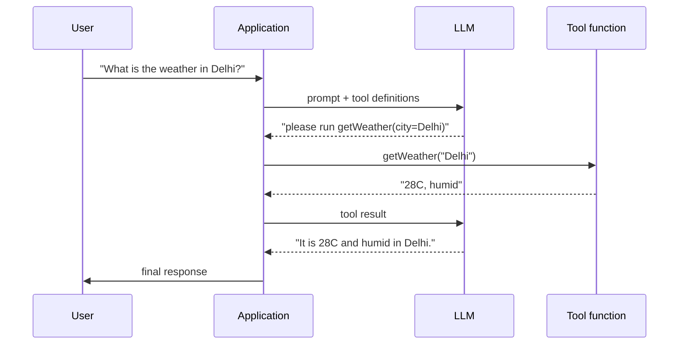
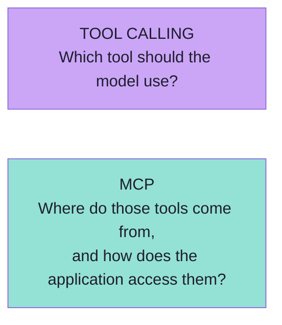
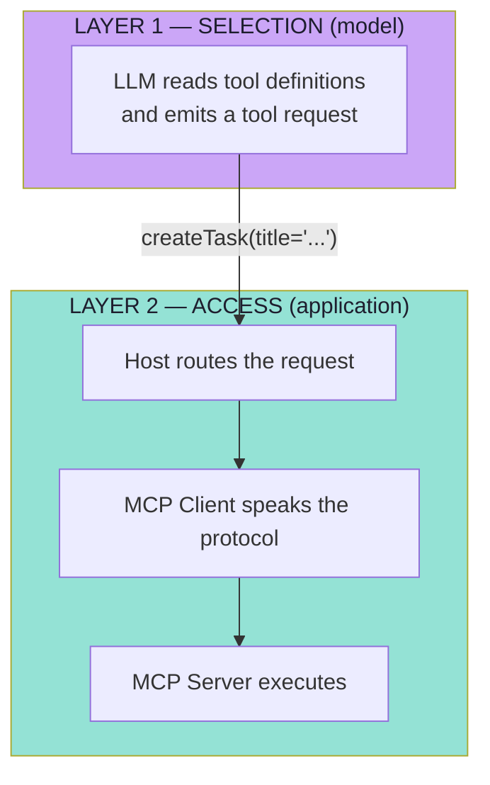
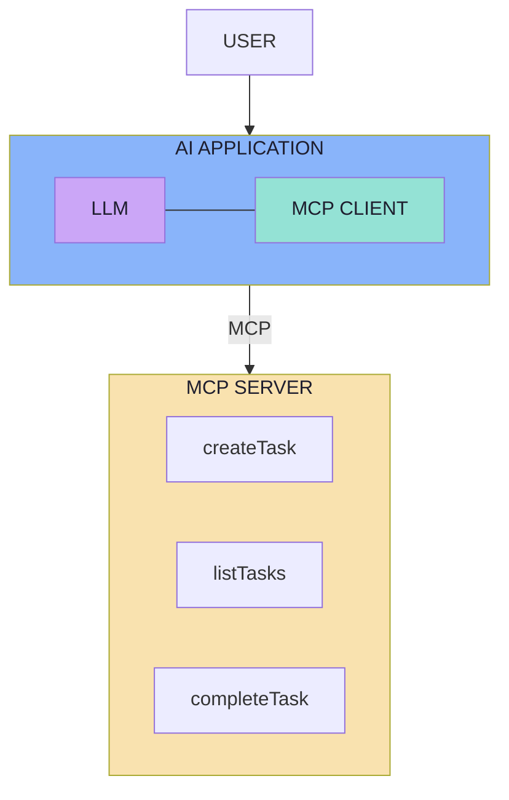
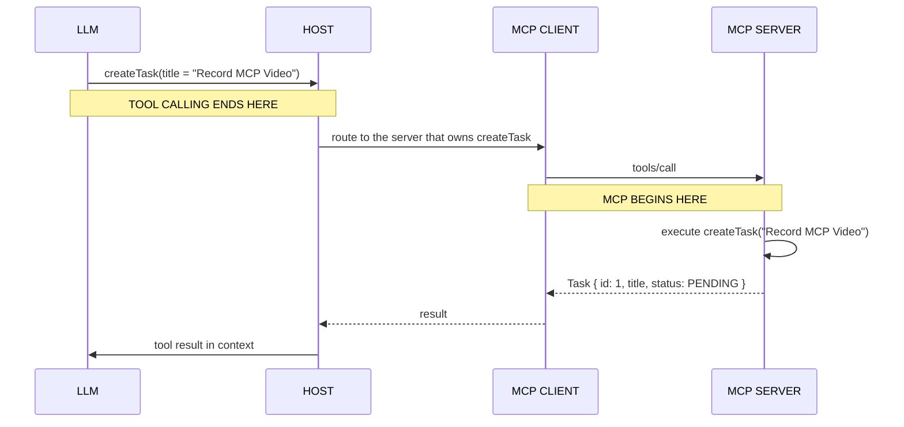
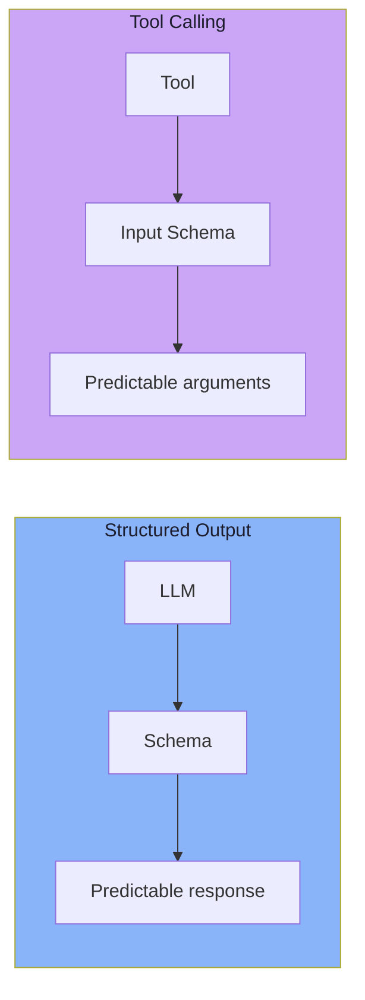
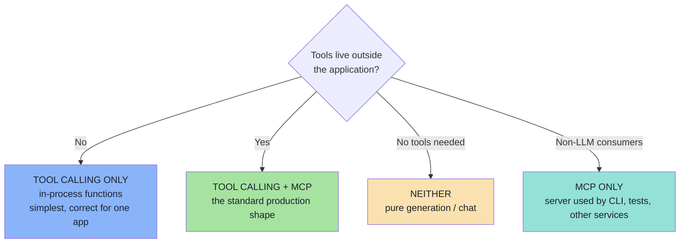
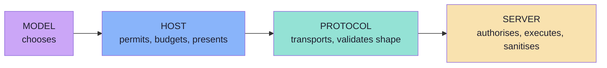

# Chapter 03: MCP vs Tool Calling — Two Complementary Layers

> **Chapter Goal:** The lecture calls this "one of the most important distinctions". Tool calling and MCP are not competitors and not alternatives — they answer two different questions at two different layers. Getting this wrong produces the two classic category errors: *"MCP replaces tool calling"* and *"we already have tool calling, so we do not need MCP."*
>
> At the end of this chapter you should be able to answer: *when a user request becomes an external side effect, which layer made each decision — and what would break if I removed one of them?*

---

## 3.1 Two Questions, Not Two Technologies

Everything in this chapter follows from two sentences:

> **Tool Calling answers:** *Which capability should the model use, and with what arguments?*
>
> **MCP answers:** *Where do those tools come from, and how does the application access them?*



One is a **decision** (made by a probabilistic model, inside a prompt). The other is a **transport** (a deterministic protocol between two programs). They cannot conflict, because they never answer the same question.

---

## 3.2 What Tool Calling Solves

Suppose the LLM knows about:

```text
getWeather(city)
```

The user asks:

> "What is the weather in Delhi?"

The model sees a tool definition similar to:

```json
{
  "name": "getWeather",
  "description": "Get current weather",
  "parameters": {
    "city": "string"
  }
}
```

It can then request:

```json
{
  "tool": "getWeather",
  "arguments": {
    "city": "Delhi"
  }
}
```

And then — the sentence the whole distinction rests on:

> **The LLM itself does not execute the function.**

It essentially says:

> *Please execute `getWeather("Delhi")`.*

**The application performs the actual execution.**



So:

> **Tool Calling answers: which capability should the model use, and with what arguments?**

### The properties of tool calling

| Property | Value |
|---|---|
| Who decides *what* to do | The **model** (probabilistic) |
| Who executes | The **application** (deterministic) |
| Where the tool lives | **Inside** the application's process |
| How the tool is known | Handed to the model in the prompt, from local code |
| How the tool is added | **Code change and redeploy** |
| Scope | One application, one tool set |

Tool calling is a **model capability**, implemented through the provider's API (Anthropic `tools`, OpenAI `tools`, Gemini `functionDeclarations`, or Spring AI's `@Tool`). It is complete and correct — for tools that live inside the app.

---

## 3.3 What MCP Solves

MCP solves a different problem:

> **How can an AI application discover and communicate with externally provided capabilities through a standard protocol?**

The tool may live in another process, another repository, another company, or another machine. The application must be able to:

1. **Ask what exists** — without reading documentation
2. **Learn the contract** — name, purpose, exact input shape
3. **Call it** — in a uniform envelope
4. **Receive a result** — in a uniform shape

So:



### The properties of MCP

| Property | Value |
|---|---|
| Who decides *what* to do | **Nobody** — MCP has no opinion about intent |
| Who executes | The **server** (in its own process) |
| Where the tool lives | **Outside** the application's process |
| How the tool is known | **Discovered** at runtime from the server |
| How the tool is added | **Server-side change** — the app may not change at all |
| Scope | Many applications, many servers, one protocol |

> **These are complementary concepts.**
> **MCP does not replace Tool Calling.**

---

## 3.4 The Two Layers, Side by Side

| Dimension | Tool Calling | MCP |
|---|---|---|
| **Question answered** | Which capability, with what arguments? | Where do tools come from, how are they accessed? |
| **Nature** | A model capability | A wire protocol |
| **Decided by** | The model | The application / host |
| **Determinism** | Probabilistic — can choose wrongly or invent arguments | Deterministic — a message either parses or it does not |
| **Location of the tool** | In-process | Out-of-process (subprocess or remote) |
| **Discovery** | Local code registration | Runtime `tools/list` |
| **Adding a tool** | Code change + redeploy | Server change; clients may need no change |
| **Failure mode** | Wrong tool chosen, wrong arguments, no tool chosen | Connection failed, unknown tool, timeout, `isError` |
| **Testing** | Requires a model (or a mock model) | Testable with no model at all |
| **Standard** | Provider-specific JSON | One open specification |
| **Layer** | Reasoning / selection | Access / transport |



> **The clean statement:** *tool calling decides; MCP delivers.*

---

## 3.5 The Combined Architecture

The lecture then shows the complete picture, and it is worth reproducing exactly, because it is the reference diagram for everything that follows.



The sequence is:

```text
MCP Server exposes tools
          |
MCP Client discovers tools
          |
AI application gives tools to LLM
          |
LLM chooses a tool
          |
Application invokes it through MCP
          |
MCP Server executes the operation
          |
Result goes back to LLM
          |
LLM generates final response
```

> **This is where MCP and Tool Calling meet.**

Notice how the eight steps partition cleanly:

| Step | Layer |
|---|---|
| 1. Server exposes tools | MCP (server side) |
| 2. Client discovers tools | MCP (client side) |
| 3. Application gives tools to the LLM | Host (glue) |
| 4. **LLM chooses a tool** | **Tool calling** |
| 5. Application invokes it through MCP | MCP |
| 6. Server executes the operation | Server business logic |
| 7. Result goes back to the LLM | MCP + host |
| 8. LLM generates the final response | Model |

**Exactly one of the eight steps is tool calling** — and it is the only step a model performs. That is the clearest possible demonstration that the two are complementary rather than competing.

---

## 3.6 The Handoff Point: MCP Takes Over After Tool Selection

The lecture names the exact moment the baton passes.

Once the LLM has decided to call `createTask(...)`, **the Host knows that this capability comes from the MCP Server.**



The MCP Client performs:

```text
tools/call
```

Conceptually:

```json
{
  "name": "createTask",
  "arguments": {
    "title": "Record MCP Video"
  }
}
```

The MCP Server receives the request and executes:

```text
createTask("Record MCP Video");
```

It might create:

```text
Task {
    id: 1
    title: "Record MCP Video"
    status: PENDING
}
```

> **The result returns to the MCP Client and then to the LLM.**
> **The LLM converts that result into a natural-language response for the user.**

### Why the handoff matters architecturally

| Before the handoff (model) | After the handoff (application) |
|---|---|
| Non-deterministic | Deterministic |
| Cannot be tested without a model | Fully testable |
| Cannot be trusted with permissions | Enforces permissions |
| Speaks in natural language + JSON | Speaks in protocol messages |
| Wrong choices are *likely* failures | Failures are *observable* exceptions |

> **Everything to the left of the handoff needs evaluation. Everything to the right needs tests.** That single sentence tells you which engineering discipline to apply where.

---

## 3.7 The Connection With Structured Output

The lecture deliberately links this to the previous lecture. Tool schemas should look familiar if you already understand **structured output**.



The same mechanism is doing the same job in both cases:

| | Structured output | Tool calling |
|---|---|---|
| What is constrained | The **response shape** | The **arguments shape** |
| What provides the shape | A response schema | The tool's `inputSchema` |
| What it buys | A machine-parseable result | Machine-parseable arguments |
| What it cannot buy | Correct *values* | Correct *choice of tool* |
| Enforcement | Constrained decoding / validation | Provider tool-use enforcement + host validation |

For example, `createTask` expects:

```json
{
  "title": "string"
}
```

So when the user says:

> "Create a task called Record MCP Video."

the model knows that it should produce something conceptually similar to:

```text
createTask(
  title = "Record MCP Video"
)
```

> **The insight:** a tool's `inputSchema` is *structured output applied to arguments*. That is why schema design rules from the structured-output lecture (flat over deep, enums over free text, required over optional, descriptions that disambiguate) transfer **directly** to MCP tool design — Chapter 05.

---

## 3.8 The Four Combinations

Once the layers are separated, it becomes obvious that you can have one without the other — and that each combination is legitimate for a different situation.



| Combination | When it is right | What it looks like |
|---|---|---|
| **Tool calling only** | Tools are in-process; one consumer; no reuse | Local functions registered with the provider API |
| **Tool calling + MCP** | Tools are external, shared, or third-party | The reference architecture of this lecture |
| **Neither** | Pure text generation, summarisation, translation | No tools at all — do not over-engineer |
| **MCP only** | The capability is also consumed by non-LLM callers | A server that a CLI, a test suite or another service uses directly |

> **The fourth row is under-appreciated.** An MCP server is a *normal program*. You can call it from a test harness with no model anywhere, which is exactly why servers are the easiest part of an AI system to test properly.

---

## 3.9 The Responsibility Matrix

If you remember one table from this chapter, make it this one. Every row is a decision that must have exactly one owner.

| Decision | Tool calling | MCP | Host | Server |
|---|---|---|---|---|
| Which tool to use | **✔** | | | |
| What arguments to pass | **✔** | | | |
| Which tools are *visible* to the model | | | **✔** | |
| Whether the call is permitted | | | **✔** | |
| How the call is transported | | **✔** | | |
| Whether the call is well-formed | | **✔** | | **✔** |
| Whether the arguments are *sane* | | | | **✔** |
| What the call actually does | | | | **✔** |
| Whether to retry after failure | | | **✔** | |
| How the result is presented | | | **✔** | |
| Whether the result is safe to show | | | **✔** | **✔** |



> **A useful diagnostic:** when something goes wrong, ask *which column should have prevented this?* If the answer is "the model", you probably have a missing control in the host or server.

---

## 3.10 Common Mistakes

| Mistake | Why it hurts | Correct habit |
|---|---|---|
| "MCP replaces tool calling" | You expect the protocol to pick tools, then blame it when it does not | The model selects; MCP delivers |
| "We have tool calling, so we do not need MCP" | True for in-process tools, false the moment a second consumer appears | Separate *selection* from *access* |
| Putting business rules in the MCP client | Logic becomes untestable and duplicated across hosts | Clients only transport; policy lives in the host |
| Letting the model validate its own arguments | The model cannot be trusted to enforce its own schema | Re-validate in the server |
| Treating a tool result as trusted text | Tool output is the classic prompt-injection channel | Sanitise and label tool results before they reach the model |
| Passing a user identity as a tool *argument* | The model can then change who it is acting as | Identity comes from the transport / host, never from model output |
| Retrying on `isError: true` | Duplicates side effects for genuinely failed operations | Retry only on transport failures, and only for idempotent tools |
| Mixing the two layers in one component | The result is untestable, unauditable, and impossible to swap | Keep the handoff at exactly one point: the host |

---

## 3.11 Chapter Summary

| Idea | Statement |
|---|---|
| Two questions | *Which capability and with what arguments?* vs *Where do tools come from and how are they reached?* |
| Tool calling | A **model capability**: the model requests, the application executes |
| MCP | A **protocol**: the application discovers and invokes out-of-process capabilities |
| The relationship | **Complementary, not competing** — MCP does not replace tool calling |
| The combined flow | Expose → discover → give to LLM → **model chooses** → invoke → execute → return → respond |
| The handoff | After selection, everything is deterministic and testable |
| Structured output link | A tool's `inputSchema` is structured output applied to **arguments** |
| The four combinations | Tool calling only, MCP only, both, or neither — each legitimate |
| Ownership | The model chooses, the host permits, the protocol transports, the server executes |

> **Final mental model:** tool calling is the **decision**, MCP is the **delivery**. A courier does not choose your order, and a customer cannot deliver it themselves.

---

## Where This Goes Next

- **[Chapter 04](./04_Host_Client_Server_Architecture.md)** — the three roles in depth, transports and lifecycle.
- **[Chapter 05](./05_The_Tools_Primitive.md)** — the primitive both layers converge on.
- **[Chapter 07](./07_Discovery_Invocation_and_Lifecycle.md)** — the full eight-step lifecycle drawn as a single sequence.
- Related: [Lecture 05](../../Lecture%2005/notes/README.md) (tool calling, agent loops) · [Lecture 13, Chapter 07](../../Lecture%2013/notes/07_Structured_Output_vs_Tool_Calling.md).

---

**Back to:** [Lecture 14 — Chapter Index](./README.md) · [Complete Consolidated Notes](./Lecture_14_Complete_Notes.md)


