# Chapter 04: Host, Client and Server — The Three Roles

> **Chapter Goal:** The lecture states that "the core architecture consists of three important components": the **Host**, the **MCP Client** and the **MCP Server**. Each has one job. Confusing them is the single most common design error in MCP work — usually by putting the model where the protocol belongs, or the protocol where the app belongs.
>
> At the end of this chapter you should be able to answer: *for any behaviour in the system — showing a confirmation dialog, holding a token, choosing a tool, running SQL — which of the three components owns it?*

---

## 4.1 The Three Components

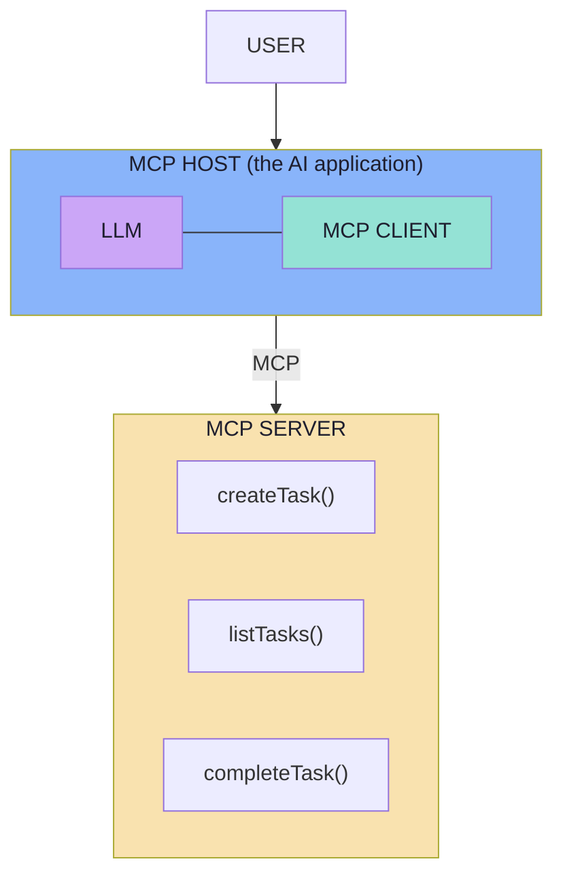

One line summary of each:

| Component | One-line job | Mental model |
|---|---|---|
| **Host** | Owns the user experience and orchestrates everything | The **conductor** |
| **Client** | Speaks the protocol to exactly one server | The **telephone** |
| **Server** | Provides the capability and does the work | The **workshop** |

---

## 4.2 The MCP Host

> **The Host is the main AI application the user interacts with.**

Examples from the lecture:

- **Claude Code**
- **Cursor**
- **VS Code AI application**
- **Desktop AI application**
- **Our own Spring AI application**

> **The Host manages the overall AI experience.**

Its responsibilities, in the lecture's order:

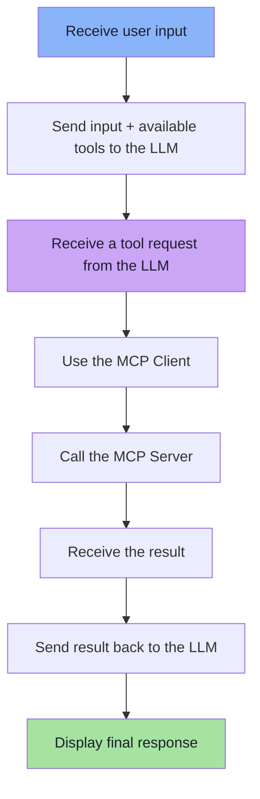

> **The Host acts as the orchestrator.**

### What "orchestrator" means concretely

The host is where **all the policy lives** — everything that is neither "reason about language" nor "execute a capability":

| Host responsibility | Why it cannot live elsewhere |
|---|---|
| Hold the conversation history | Servers must not see the whole conversation |
| Choose *which* tools to show the model | Context budget and trust filtering |
| Enforce consent and approval | The model must not authorise itself |
| Manage credentials and sessions | Servers should not receive the user's tokens |
| Aggregate results across servers | Servers are isolated from each other |
| Render the UI | Servers have no UI |
| Retry, time out, degrade | The server cannot know the user's patience |

> **Rule of thumb:** if a behaviour is about the *user experience* or *policy*, it belongs to the host.

---

## 4.3 The MCP Client

> **The MCP Client is the software component inside the Host that knows how to communicate using MCP.**

The lecture offers a comparison that makes this click immediately — **JDBC**:

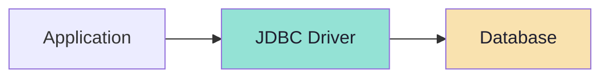

Similarly:

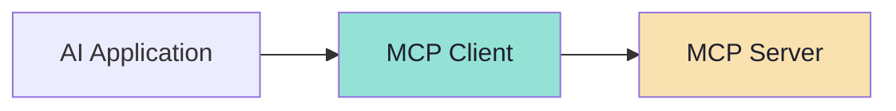

The parallel is exact and worth stating in full:

| JDBC | MCP |
|---|---|
| One driver per database | One client per server |
| Hides the vendor's wire protocol | Hides the transport (stdio / HTTP) |
| Exposes a standard Java API | Exposes standard protocol methods |
| The app does not know the dialect | The host does not know the vendor's API |
| Connection pool and lifecycle | Session and lifecycle management |

> **The MCP Client knows how to perform operations such as:**
> **Discover tools · Invoke tools · Read resources · Retrieve prompts**

### The client is not the model

The client contains **no reasoning**. It is a deterministic adapter. If you find yourself writing "if the user asks about weather, call the weather tool" inside a client, you have moved model logic into the transport layer.

---

## 4.4 The MCP Server

> **The MCP Server is the capability provider.**

For example:

```text
createTask()
listTasks()
completeTask()
```

Internally, those capabilities could communicate with almost anything:

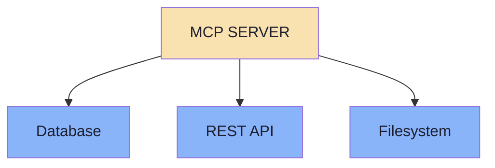

They could also interact with:

- **GitHub**
- **Google Calendar**
- **Slack**
- **Internal services**
- **Databases**
- **Files**

> **The MCP Server exposes only the capabilities and context it wants clients to access.**

That sentence is a **security control**, not a description. The server is the natural place to enforce *capability minimisation*: if a client should never be able to delete a repository, then `deleteRepository` must not exist in the server — not merely be "hidden" from the model.

### What the server is responsible for

| Responsibility | Explanation |
|---|---|
| **Expose** capabilities | Advertise them honestly via `tools/list` |
| **Validate** inputs | Never trust the model's arguments; re-validate against the schema |
| **Authorise** the caller | Identity comes from the transport, not from a tool argument |
| **Execute** deterministically | The same inputs produce the same effect |
| **Minimise** the surface | Only expose what is needed; nothing "just in case" |
| **Sanitise** outputs | Tool results are untrusted text that will enter a model's context |

> **The server is the last line of defence.** The host can be tricked by prompt injection; the server is the component that can still say *no*.

---

## 4.5 The 1:1 Rule

The architecture has one precise cardinality rule that people frequently violate:

> **A host application creates and manages multiple clients, with each client having a 1:1 relationship with a particular server.**

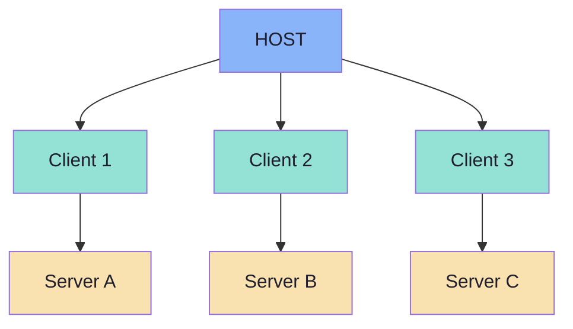

### Why 1:1 is the right design

| Property | Consequence |
|---|---|
| **Isolation** | A malicious server cannot reach another server through a shared client |
| **Independent lifecycle** | One server crashing does not kill the others |
| **Independent permissions** | Each connection carries its own auth and consent |
| **Independent capability negotiation** | Server A may support tools; Server B only resources |
| **Simple state** | No multiplexing of two vendors' semantics in one object |

> **The host is the only component that composes.** Servers never talk to servers, and clients never talk to other clients. Cross-server workflows (GitHub issue → Slack message) are orchestrated **in the host**, by the model making two sequential tool calls.

### The isolation principle, stated by the spec

Three design principles from the MCP architecture document are worth memorising because they explain *why* the boundaries are drawn here:

1. **Servers should be extremely easy to build** — the host handles orchestration complexity.
2. **Servers should be highly composable** — each provides focused functionality in isolation.
3. **Servers should not be able to read the whole conversation, nor "see into" other servers** — servers receive only the contextual information they need.

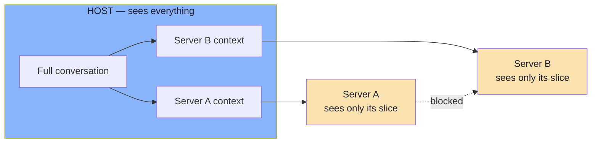

> **Least context is as important as least privilege.** A server that can see the whole conversation can leak the whole conversation.

---

## 4.6 Who Owns What: The Consolidated Matrix

Every responsibility in an MCP system maps to exactly one of the three components (plus the model). This is the reference table for architecture reviews.

| Responsibility | Host | Client | Server | Model |
|---|---|---|---|---|
| Own the conversation history | **✔** | | | |
| Hold the user's credentials and consent | **✔** | | | |
| Decide which tools reach the model | **✔** | | | |
| Render the UI and confirmations | **✔** | | | |
| Choose a tool and arguments | | | | **✔** |
| Open and maintain a connection to one server | | **✔** | | |
| Negotiate protocol version and capabilities | **✔** | **✔** | **✔** | |
| Discover capabilities (`tools/list`) | | **✔** | | |
| Declare capabilities honestly | | | **✔** | |
| Encode and decode protocol messages | | **✔** | **✔** | |
| Validate arguments against `inputSchema` | | | **✔** | |
| Authorise the caller | **✔** | | **✔** | |
| Execute the business operation | | | **✔** | |
| Sanitise outputs before they reach the model | **✔** | | **✔** | |
| Time out and retry | **✔** | **✔** | | |

> **Note the two rows with shared ownership.** Authorisation and output sanitisation are deliberately redundant: the host is a policy layer, the server is a security boundary. Defence in depth is the design, not a mistake.

---

## 4.7 Transports: stdio and Streamable HTTP *(beyond the lecture)*

The board (`Excalidraw-Notes.svg`) lists two transports under **MCP Server**: `STDIO` and `Streamable HTTP`. The lecture's flow diagrams do not specify which is in use, because the architecture is transport-agnostic — but choosing between them is one of the first real decisions you make.

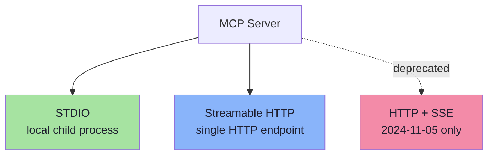

### stdio

The client **launches the server as a subprocess** and talks over pipes:

| Property | Detail |
|---|---|
| Channel | Server reads JSON-RPC from `stdin`, writes to `stdout` |
| Framing | Newline-delimited messages; a message must not contain embedded newlines |
| Logging | The server may write UTF-8 logs to `stderr`; the client may capture or ignore them |
| Hard rule | The server **must not** write anything to `stdout` that is not a valid MCP message |
| Hard rule | The client **must not** write anything to `stdin` that is not a valid MCP message |
| Network | **None** — no port, no TLS, no CORS |
| Trust model | Local: the server runs with the user's privileges |

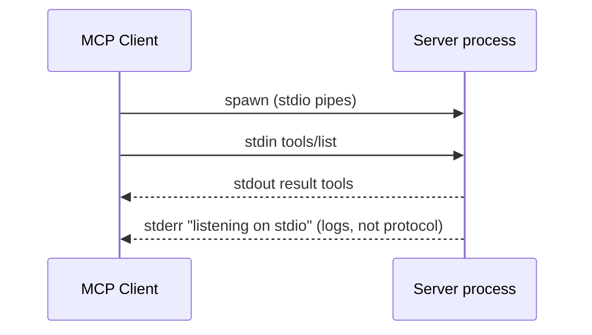

> **The classic stdio bug:** printing a banner like `Server started on port 3000` to `stdout`. The client tries to parse it as JSON-RPC and the connection dies. **Logs go to `stderr`.**

### Streamable HTTP

A single HTTP endpoint — for example `https://example.com/mcp` — that supports **both `POST` and `GET`**, and optionally uses **Server-Sent Events (SSE)** to stream multiple messages.

| Property | Detail |
|---|---|
| Endpoint | One path serving POST and GET |
| Client → server | Every message is its own `POST` with `Accept: application/json, text/event-stream` |
| Server → client | Optional SSE stream for notifications and server-initiated requests |
| Session | Historically an `Mcp-Session-Id` header returned at initialization |
| Version | `MCP-Protocol-Version` header on subsequent requests |
| Security | **Must** validate the `Origin` header (DNS-rebinding defence); **should** bind to localhost when local; **should** authenticate |

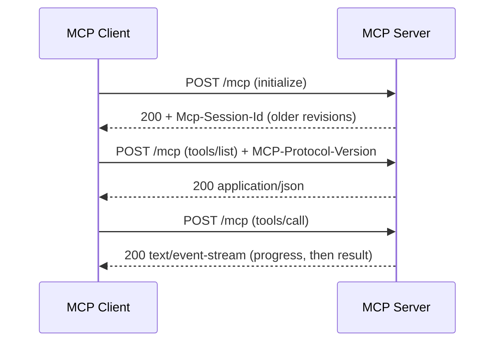

### Choosing between them

| Question | stdio | Streamable HTTP |
|---|---|---|
| Where does the server run? | Same machine | Anywhere |
| Who starts it? | The client (as a subprocess) | Independently |
| Multiple clients per server? | No — one process per client | **Yes** |
| Needs auth? | Rarely (local trust) | **Yes** — OAuth 2.1 for remote servers |
| Can it be a SaaS product? | No | **Yes** |
| Latency | Lowest (no network) | One HTTP round trip per message |
| Failure mode | Process crash | Network partition, 5xx, session expiry |
| Debugging | Easiest — logs on stderr | Needs HTTP tooling |

> **Practical rule:** start with **stdio** for anything you develop locally — it removes auth, networking and CORS from the problem. Move to **Streamable HTTP** when the server must be shared, hosted, or reached over the network.

### Transport evolution *(beyond the lecture)*

| Revision | Transport change |
|---|---|
| 2024-11-05 | **HTTP + SSE** (two endpoints) was the only remote transport |
| 2025-03-26 | **Streamable HTTP** replaces HTTP+SSE; the old transport is deprecated |
| 2026-07-28 | **Session IDs are removed** — MCP becomes stateless. Servers that need cross-call state mint explicit handles passed as ordinary tool arguments |

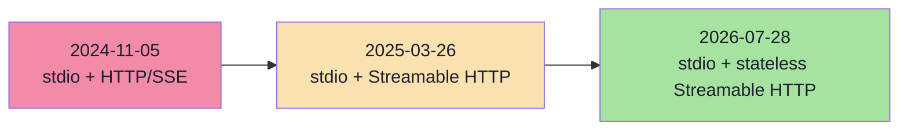

> **Design implication:** keep your server's business logic independent of session state. If it needs state, model that state as an explicit, server-minted identifier that travels as a **tool argument** — the pattern the newest revision formalises.

---

## 4.8 The Lifecycle: Negotiate, Operate, Shut Down *(beyond the lecture)*

The lecture's diagrams show the *steady state*. A real connection has a beginning and an end, and the beginning is where most integration bugs live.

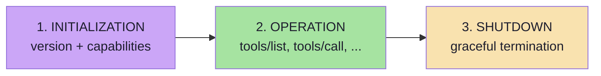

### The classic handshake (2024-11-05 → 2025-11-25)

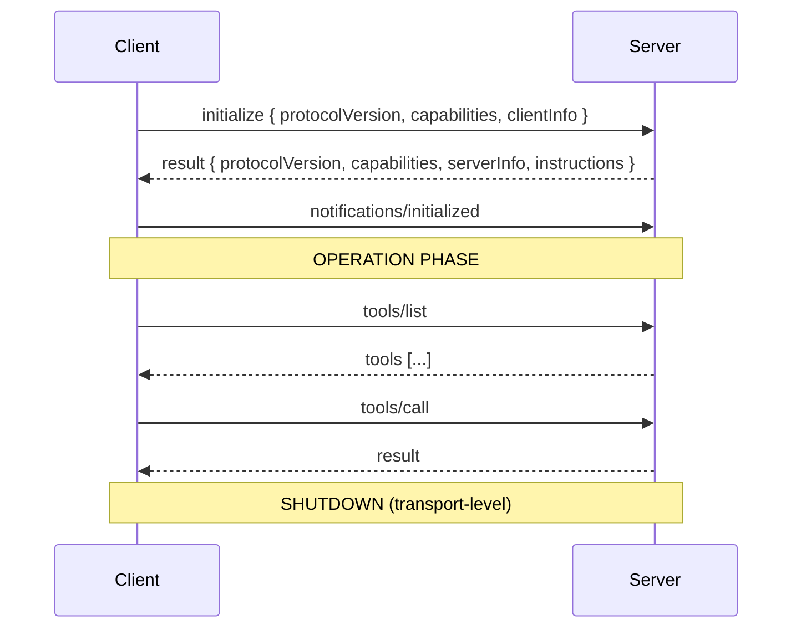

| Step | What is exchanged | Why |
|---|---|---|
| `initialize` | Protocol version, client capabilities, client identity | Both sides must agree what is legal |
| Response | Negotiated version, server capabilities, server identity, optional `instructions` | Enables/forbids features per session |
| `notifications/initialized` | Nothing — a readiness signal | The client declares it is ready for normal traffic |

**Version negotiation rules** (worth knowing because they define failure behaviour):

1. The client sends the version it supports — ideally its latest.
2. If the server supports it, it **must** echo the same version.
3. Otherwise the server **must** respond with a version it does support.
4. If the client does not support the returned version, it **should** disconnect.

**Capability negotiation** determines which optional features exist for this session:

| Category | Capability | Unlocks |
|---|---|---|
| Client | `roots` | The client can tell the server which filesystem roots it may touch |
| Client | `sampling` | The server may ask the client's LLM to generate text |
| Client | `elicitation` | The server may ask the *user* for structured input |
| Server | `prompts` | `prompts/list`, `prompts/get` |
| Server | `resources` | `resources/list`, `resources/read`, subscriptions |
| Server | `tools` | `tools/list`, `tools/call` |
| Server | `logging` | Structured log messages to the client |
| Server | `completions` | Argument autocompletion |
| Both | `experimental` | Non-standard features |

> **Capabilities are permissions, not niceties.** Calling `tools/call` on a server that never declared `tools` is a protocol violation, and the correct answer is an error — not a best-effort attempt.

### Shutdown

| Transport | Graceful shutdown |
|---|---|
| **stdio** | Client closes the child's input stream; waits; then `SIGTERM`; then `SIGKILL` if needed. The server may also exit on its own by closing its output stream |
| **HTTP** | Close the HTTP connection(s) |

**Timeouts** are mandatory in practice: implementations *should* set a timeout on every request, and on expiry *should* send a cancellation notification and stop waiting. A progress notification may reset the clock — but a **maximum** timeout must still be enforced, because a misbehaving peer can emit progress forever.

### The stateless model (2026-07-28 and later)

The newest revision removes the handshake entirely:

| Concern | Classic (handshake) | Stateless (2026-07-28+) |
|---|---|---|
| Version | Negotiated once at `initialize` | Sent on **every request** in `_meta` |
| Capabilities | Negotiated once | Declared per request in `_meta` |
| Identity | `clientInfo` / `serverInfo` once | `clientInfo` per request; `serverInfo` per result |
| Up-front discovery | `initialize` response | `server/discover` (mandatory RPC) |
| Version mismatch | Error at `initialize` | `UnsupportedProtocolVersionError` per request |
| HTTP session | `Mcp-Session-Id` header | **Removed** — stateless |
| Cross-call state | Implicit session | Explicit server-minted handle passed as a **tool argument** |
| Roots / Sampling / Logging | First-class features | **Deprecated** — migrate to tool params, direct provider APIs, and stderr/OpenTelemetry |

> **What stays the same across every revision:** servers, clients, hosts, tools, resources, prompts, discovery and invocation. **What changes:** how the two sides agree on versions and capabilities. Build your business logic so the negotiation mechanism is a thin layer you can swap.

---

## 4.9 The Whole Architecture in One Diagram

Everything in this chapter, assembled. Follow the numbers.

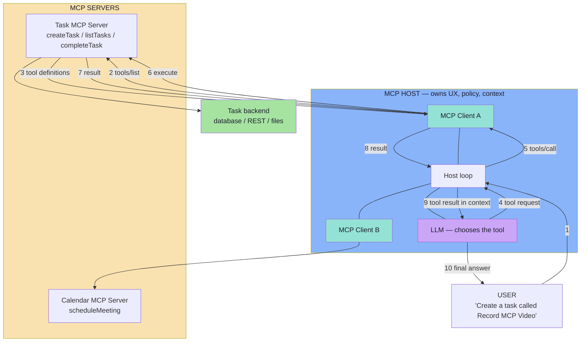

| # | Step | Component | Layer |
|---|---|---|---|
| 1 | User request enters the host | Host | UX |
| 2–3 | Capabilities discovered | Client ↔ Server | MCP |
| 4 | Tool chosen | **Model** | Tool calling |
| 5–7 | Invoked and executed | Client → Server | MCP |
| 8–9 | Result returned and appended to context | Host | Glue |
| 10 | Final answer rendered | Host | UX |

> **Read the diagram once more and note what is absent:** there is no arrow from the LLM to any server. That single missing edge is the architecture's most important property.

---

## 4.10 Common Mistakes

| Mistake | Why it hurts | Correct habit |
|---|---|---|
| Letting one client hold several servers | Destroys isolation; a bad server can affect another | One client per server |
| Giving a server the whole conversation | Violates the isolation principle; huge leak surface | Send only the slice the server needs |
| Putting consent UI in the server | Servers have no UI and no knowledge of the user | Consent belongs to the host |
| Hardcoding the transport in business logic | Blocks the local → remote migration | Keep transport behind the client abstraction |
| Writing banners to `stdout` on stdio | Corrupts the JSON-RPC stream; connection dies | Logs go to `stderr` |
| Ignoring capability negotiation | You call methods that were never agreed; opaque failures | Check declared capabilities before calling |
| Treating `Mcp-Session-Id` as durable state | Sessions can end at any time (and are gone in the newest revision) | Model state explicitly as tool arguments |
| Forgetting timeouts on `tools/call` | One hung server stalls the whole host | Per-request timeout + cancellation + maximum cap |
| Assuming the server knows who the user is | Leads to trusting a caller-supplied identity | Identity comes from the host/transport, never a tool argument |

---

## 4.11 Chapter Summary

| Idea | Statement |
|---|---|
| Three components | **Host** (orchestrator), **Client** (protocol speaker), **Server** (capability provider) |
| Host | The AI application: conversation, policy, consent, UI, composition |
| Client | One per server; a JDBC-driver analogue; discovery + invocation + resources + prompts |
| Server | Exposes only what it wants to; validates, authorises, executes, sanitises |
| The 1:1 rule | Each client ↔ exactly one server; the host is the only composer |
| Isolation | Servers see a slice, never the conversation; servers never see each other |
| Transports | **stdio** (local subprocess) and **Streamable HTTP** (remote, single endpoint) |
| Lifecycle | Initialize → negotiate → operate → shut down; the newest revision makes it **stateless** |
| Capabilities | Permissions, not niceties — call only what was declared |

> **Final mental model:** the host is the **conductor**, each client is a **telephone line**, and each server is a **workshop**. A conductor does not visit every workshop, and workshops do not call each other.

---

## Where This Goes Next

- **[Chapter 05](./05_The_Tools_Primitive.md)** — the primitive the model drives.
- **[Chapter 06](./06_Resources_and_Prompts.md)** — the primitives the application and user drive.
- **[Chapter 07](./07_Discovery_Invocation_and_Lifecycle.md)** — the complete lifecycle as one sequence.
- **[Chapter 08](./08_Security_Production_and_Practical_Architecture.md)** — the trust boundaries in depth.

---

**Back to:** [Lecture 14 — Chapter Index](./README.md) · [Complete Consolidated Notes](./Lecture_14_Complete_Notes.md)


