# Chapter 05: The Tools Primitive — Executable Capability

> **Chapter Goal:** Tools are where the two layers of Chapter 03 converge, and where the lecture spends the most time. This chapter covers the full life of a tool: how it is **defined**, how it is **discovered**, how it is **invoked**, what a **result** looks like, how **errors** are reported, how to write names/descriptions/schemas a model can actually use, and which **security duties** fall on the server versus the client.
>
> At the end of this chapter you should be able to answer: *given a capability, write a tool definition that a model will select correctly, argue with a schema, and fail safely.*

---

## 5.1 The Three Primitives and the Mental Model

> **The three important MCP primitives are:**
>
> ```text
> MCP SERVER
> ├── Tools
> ├── Resources
> └── Prompts
> ```

The lecture gives a simple mental model that is genuinely the best way to remember the difference:

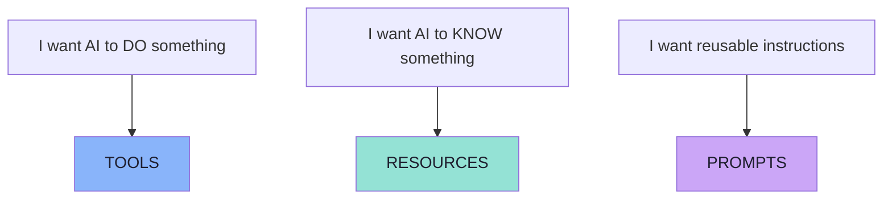

| Primitive | Intent | Who typically drives it | Typical protocol calls |
|---|---|---|---|
| **Tools** | *Do* something | The **model** | `tools/list`, `tools/call` |
| **Resources** | *Know* something | The **application** | `resources/list`, `resources/read` |
| **Prompts** | Reuse an instruction | The **user** | `prompts/list`, `prompts/get` |

> The control model (which of model/application/user drives each primitive) is Chapter 06's §6.6. This chapter is about the primitive the model drives.

---

## 5.2 What a Tool Is

> **A Tool represents an executable capability.**

Examples from the lecture:

```text
createTask()
completeTask()
listTasks()
deleteTask()
```

> **A tool means: here is an operation that can be invoked.**

A tool can contain:

```text
Name
Description
Input Schema
```

The critical framing: a tool is **not** a function in your codebase. It is a *description of a function, written for a model to read*. The model never sees your implementation, your types, your comments or your database. It sees exactly three things — and every one of them is a design decision you are making.

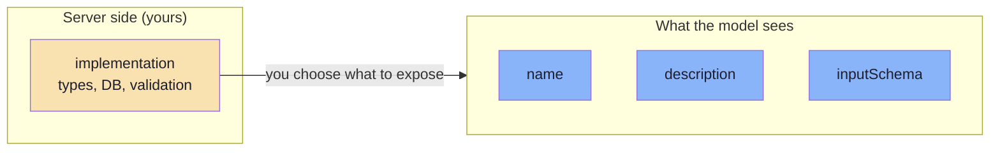

> **The description is not documentation. It is the prompt.**

---

## 5.3 The Anatomy of a Tool Definition

The lecture's example, extended with the fields the specification allows:

```json
{
  "name": "createTask",
  "description": "Creates a new task",
  "inputSchema": {
    "type": "object",
    "properties": {
      "title":   { "type": "string" },
      "dueDate": { "type": "string" }
    },
    "required": ["title"]
  }
}
```

> **This tells the client and model:**
>
> ```text
> title   -> required string
> dueDate -> optional string
> ```

| Field | Required | Purpose | Design note |
|---|---|---|---|
| `name` | **Yes** | Unique identifier | Machine-safe, stable, verb-first |
| `title` | No | Human-readable display name | Shown in consent UIs, not chosen by the model |
| `description` | Recommended | *When and why* to use this tool | The single highest-leverage field |
| `inputSchema` | **Yes** | JSON Schema for arguments | The contract the model must satisfy |
| `outputSchema` | No | JSON Schema for the result *(2025-06-18+)* | Enables strict validation of results |
| `annotations` | No | Hints: read-only, destructive, idempotent, open-world | Drives client consent behaviour |

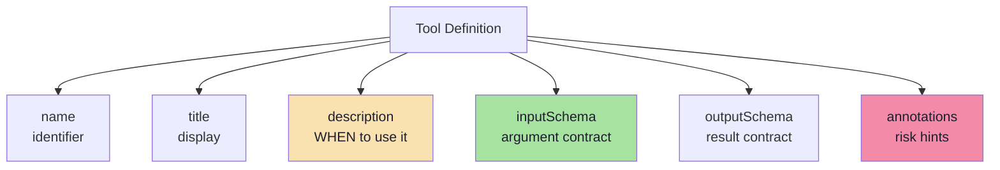

> **Tools are generally used when something needs to be executed or queried.** If nothing needs to happen, you probably want a Resource (Chapter 06) — not a tool that returns a constant.

---

## 5.4 Tool Discovery: `tools/list`

> Suppose the AI application connects to a Task MCP Server.
>
> The MCP Client asks: **"What tools do you have?"**
>
> The server responds:
>
> ```text
> createTask
> listTasks
> completeTask
> ```

> **This process is called Tool Discovery.**
> **The MCP operation for discovering tools is: `tools/list`.**

> **The server does not return only the names.** It can return definitions such as:

```json
{
  "name": "createTask",
  "description": "Creates a new task",
  "inputSchema": {
    "type": "object",
    "properties": {
      "title": { "type": "string" }
    },
    "required": ["title"]
  }
}
```

> **The client now knows:**
>
> ```text
> NAME
> DESCRIPTION
> INPUT SCHEMA
> ```

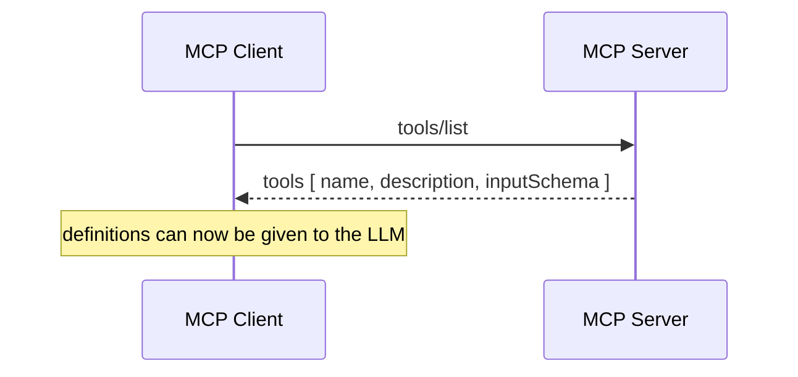

> **These definitions can then be made available to the LLM.**

### The full `tools/list` response shape

A real response contains an **array** of tools, and may be **paginated**:

```json
{
  "tools": [
    {
      "name": "createTask",
      "description": "Creates a new task",
      "inputSchema": {
        "type": "object",
        "properties": { "title": { "type": "string" } },
        "required": ["title"]
      }
    },
    {
      "name": "listTasks",
      "description": "Returns all tasks",
      "inputSchema": { "type": "object" }
    },
    {
      "name": "completeTask",
      "description": "Marks a task as completed",
      "inputSchema": {
        "type": "object",
        "properties": { "id": { "type": "integer" } },
        "required": ["id"]
      }
    }
  ],
  "nextCursor": "optional-cursor-value"
}
```

| Element | Meaning | Why it matters |
|---|---|---|
| `tools[]` | The catalogue | One entry per callable capability |
| `name` | Identifier the model will use | Must be unique and stable |
| `description` | Natural-language purpose | **The model's only guidance** |
| `inputSchema` | JSON Schema for arguments | The contract; the server re-validates against it |
| `nextCursor` | Pagination token | Large catalogues must be paged |

> **The client now understands the available tools.**

### `listChanged`: discovery is not a one-time event *(beyond the lecture)*

A server that supports tools declares the capability:

```json
{ "capabilities": { "tools": { "listChanged": true } } }
```

and may then emit, when its catalogue changes:

```text
notifications/tools/list_changed
```

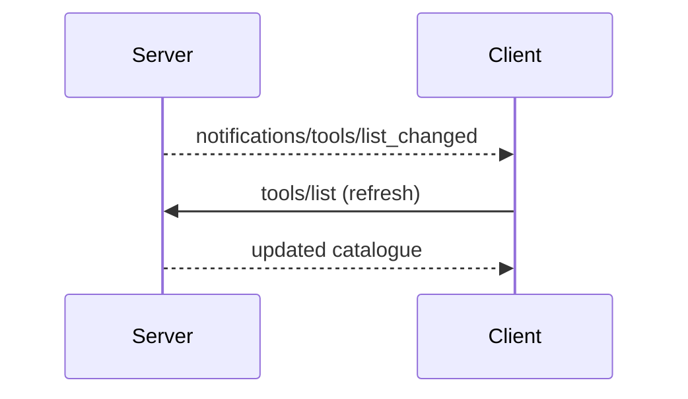

This is what makes **dynamic tool discovery** (Chapter 07, §7.5) real: a server can add a tool and a well-behaved client will pick it up without a restart.

---

## 5.5 Invoking a Tool: `tools/call`

Once the LLM decides to call:

```text
createTask(...)
```

> **the Host uses the MCP Client.** The flow becomes:

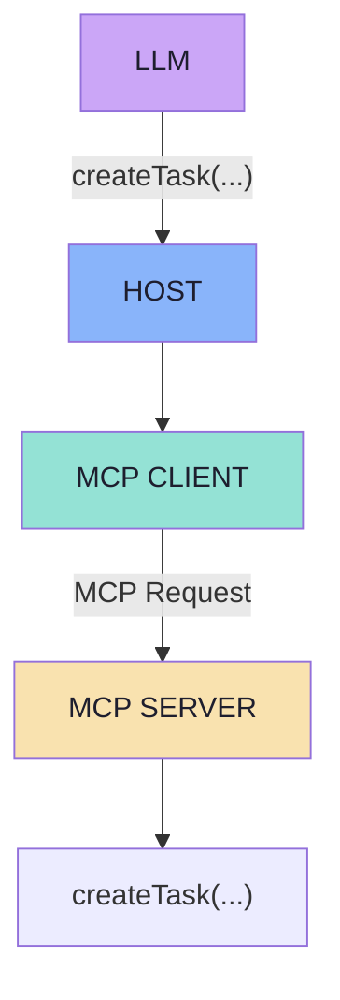

The client invokes the tool through:

```text
tools/call
```

Conceptually:

```json
{
  "name": "createTask",
  "arguments": {
    "title": "Record MCP Video"
  }
}
```

> **The MCP Server executes the underlying business logic and sends the result back.**
>
> Example:
>
> ```json
> {
>   "id": 42,
>   "title": "Record MCP Video",
>   "status": "PENDING"
> }
> ```

The result travels back:

```text
MCP Server
    |
MCP Client
    |
AI Application
    |
LLM
```

> **The LLM can then generate:**
>
> *"I've added 'Record MCP Video' to your tasks."*

### The `tools/call` contract in detail

```json
{
  "jsonrpc": "2.0",
  "id": 2,
  "method": "tools/call",
  "params": {
    "name": "createTask",
    "arguments": { "title": "Record MCP Video" }
  }
}
```

| Field | Rule |
|---|---|
| `name` | Must match a name returned by `tools/list` |
| `arguments` | Must satisfy that tool's `inputSchema` |
| `id` | Correlates request and response |
| Result | `content[]` (always) and optionally `structuredContent` |

> **The server must validate `arguments` against the schema itself.** The schema is a contract, not a guarantee — the model can produce anything, and a hostile client can produce anything deliberately.

---

## 5.6 What a Tool Returns

A tool result is **not** a bare value. It is a list of typed **content blocks**, plus optional structured data.

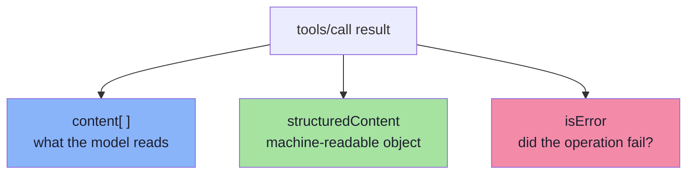

### Content block types

| Type | Shape | Typical use |
|---|---|---|
| `text` | `{ "type": "text", "text": "..." }` | Results the model should read |
| `image` | `{ "type": "image", "data": "<base64>", "mimeType": "image/png" }` | Screenshots, charts, diagrams |
| `audio` | `{ "type": "audio", "data": "<base64>", "mimeType": "audio/wav" }` | Speech, recordings |
| `resource_link` | `{ "type": "resource_link", "uri": "file:///...", "name": "..." }` | "Here is where the data is" |
| `resource` | embedded resource with `uri`, `mimeType`, and `text` or `blob` | "Here is the data itself" |

> **The `resource_link` vs `resource` distinction is a real design choice.** A link keeps the model's context small and lets it fetch on demand; an embedded resource guarantees the data is present. For a 40-page PDF, embed nothing and link instead.

### Structured content and `outputSchema` *(2025-06-18+, beyond the lecture)*

A tool may declare an **`outputSchema`** and return **`structuredContent`**:

```json
{
  "content": [
    { "type": "text", "text": "{\"temperature\":22.5,\"conditions\":\"Partly cloudy\",\"humidity\":65}" }
  ],
  "structuredContent": {
    "temperature": 22.5,
    "conditions": "Partly cloudy",
    "humidity": 65
  }
}
```

| Rule | Detail |
|---|---|
| If `outputSchema` is provided | Servers **must** return conforming `structuredContent` |
| Clients | **Should** validate results against the schema |
| Backwards compatibility | A tool returning `structuredContent` **should also** include the serialised JSON in a `text` block |
| Naming caution | `structuredContent` is **server-produced result data** — it is *unrelated* to "structured outputs" in the schema-constrained-generation sense |

> **That last row prevents a very common confusion.** LLM structured output constrains what the *model generates*; `structuredContent` describes what a *tool returns*. Same word, opposite direction of flow.

---

## 5.7 Error Handling: Two Mechanisms, Not One

This is one of the most important implementation details in the whole protocol, because getting it wrong makes retries unsafe.

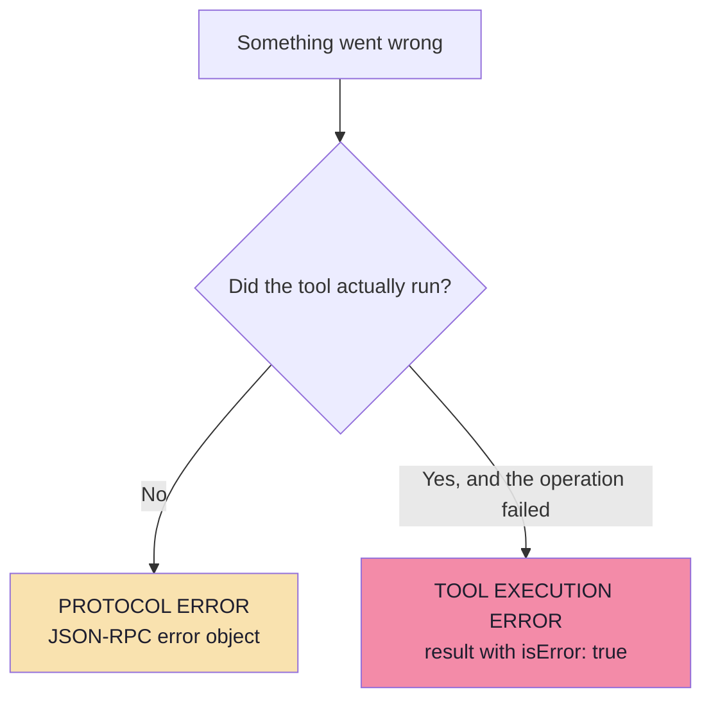

| | Protocol error | Tool execution error |
|---|---|---|
| Envelope | `error` object on the response | Normal `result` |
| Signal | `{"code": -32602, "message": "Unknown tool: ..."}` | `{"isError": true, "content": [...]}` |
| Meaning | The call was never valid | The call ran and the outcome was a failure |
| Examples | Unknown tool, invalid arguments, server error | API failure, invalid input data, business rule violation |
| Safe to retry? | Usually yes (nothing happened) | **Only if the tool is idempotent** |
| Who sees it | The client / host | The **model** — the text becomes context |

Example protocol error:

```json
{
  "jsonrpc": "2.0",
  "id": 3,
  "error": { "code": -32602, "message": "Unknown tool: invalid_tool_name" }
}
```

Example tool execution error:

```json
{
  "jsonrpc": "2.0",
  "id": 4,
  "result": {
    "content": [
      { "type": "text", "text": "Failed to fetch weather data: API rate limit exceeded" }
    ],
    "isError": true
  }
}
```

> **The design insight:** `isError: true` is not just an error channel — it is an **instruction channel**. The message text goes back into the model's context, so a good error message lets the model *recover*: change an argument, try a different tool, or tell the user what is missing.

### Writing error messages the model can act on

| Weak | Strong |
|---|---|
| `"Error"` | `"Task id 42 not found. Use listTasks to see valid ids."` |
| `"Invalid date"` | `"dueDate must be ISO-8601 (YYYY-MM-DD). Received: 'next friday'."` |
| `"Unauthorized"` | `"You can only modify tasks you own. Task 42 belongs to another user."` |
| `"Rate limited"` | `"GitHub API rate limit reached; retry after 60s. Use listIssues instead for now."` |

> **A weak error message turns a recoverable failure into a hallucinated success.** If the tool returns only `"Error"`, the model has nothing to correct with — so it often invents an outcome.

---

## 5.8 Tool Annotations: Telling the Host How Risky a Tool Is *(beyond the lecture)*

A tool's *name* tells the model what to do. **Annotations** tell the *host* how carefully to treat it — so it can auto-approve safe calls and prompt for dangerous ones.

```json
{
  "name": "deleteTask",
  "description": "Permanently deletes a task",
  "annotations": {
    "readOnlyHint": false,
    "destructiveHint": true,
    "idempotentHint": true,
    "openWorldHint": false
  },
  "inputSchema": { "type": "object", "properties": { "id": { "type": "integer" } }, "required": ["id"] }
}
```

| Annotation | Meaning | Host behaviour it enables |
|---|---|---|
| `readOnlyHint` | The tool does not modify anything | Auto-approve; safe to retry; safe to cache |
| `destructiveHint` | The tool may destroy or overwrite data | Require explicit confirmation |
| `idempotentHint` | Repeating the call has the same effect | Retry safely on timeout |
| `openWorldHint` | The tool interacts with the outside world (arbitrary/unbounded) | Expect non-determinism; sandbox and rate-limit |
| `title` | Human-readable label | Show in the consent dialog instead of `deleteTask` |

> **Annotations are hints, not guarantees.** A malicious server can mislabel `deleteRepository` as `readOnlyHint: true`. **Never** let an annotation replace your own policy — it is an input to it, exactly like a tool result is an input to the model.

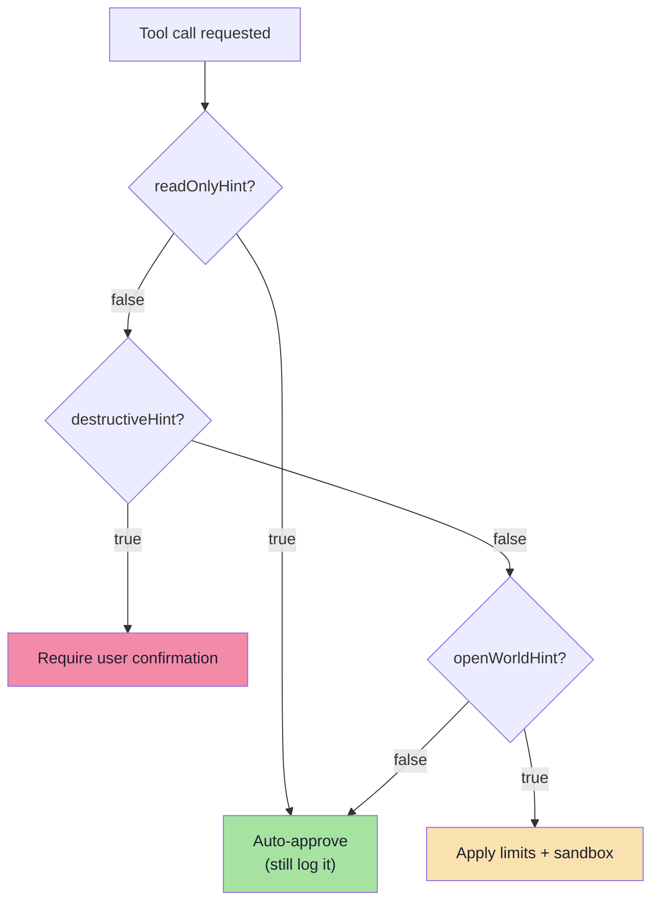

### The lecture's own example, in annotation terms

The lecture's security section (Chapter 08, §8.1) makes exactly this distinction:

| Tool | Suggested policy | Annotation that drives it |
|---|---|---|
| `readFile` | *"might be allowed automatically"* | `readOnlyHint: true` |
| `deleteRepository` | *"could require explicit user confirmation"* | `destructiveHint: true` |

> **The annotation is how the server communicates that difference to a host it has never met.**

---

## 5.9 Designing Tool Names and Descriptions for a Model

This is where tool design becomes a craft, because **the description is the prompt**.

### Naming rules

| Rule | Bad | Good |
|---|---|---|
| Verb-first, snake_case | `task`, `TaskCreate` | `create_task` |
| Specific, not generic | `process` | `create_task` |
| Consistent vocabulary across the server | `create_task`, `makeTask`, `addTask` | `create_task`, `list_tasks`, `complete_task` |
| No implementation leakage | `post_to_pg_tasks_table` | `create_task` |
| Stable once published | renaming `create_task` → `add_task` | version or alias instead |
| Avoid ambiguity between siblings | `get_task` / `get_tasks` | `get_task` / `list_tasks` |

### Description rules

A description must answer three questions for the model:

1. **What does it do?** (one clause)
2. **When should I use it — and when should I not?** (the disambiguation clause)
3. **What does it need from the user?** (so the model can ask)

| Weak description | Strong description |
|---|---|
| `"Creates a task"` | `"Creates a new task with a title and optional due date. Use this when the user wants to add something to their to-do list. Do NOT use it to modify an existing task — use update_task for that."` |
| `"Gets weather"` | `"Returns current weather for a city. Use for present conditions only; for forecasts use get_forecast."` |
| `"Searches"` | `"Searches course videos by title or topic. Use when the user asks to find or watch a lecture."` |

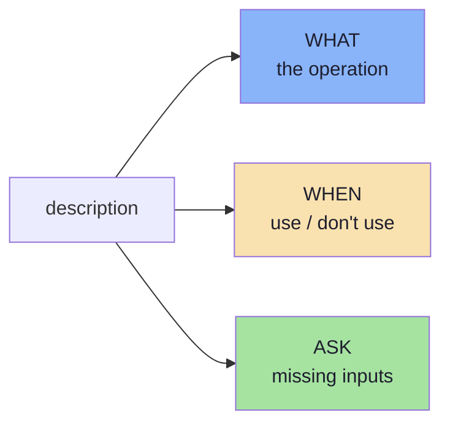

> **The disambiguation clause is the highest-value sentence you will write.** Most "the model picked the wrong tool" bugs are really "two tool descriptions did not explain their difference".

### Tool granularity: the hard trade-off

| Too coarse | Too fine |
|---|---|
| `manage_task(action, ...)` | `create_task`, `rename_task`, `set_task_due_date`, `assign_task`, `set_task_priority`, ... |
| Model must guess an internal enum; one bad schema for five operations | Catalogue explodes; the model's choice becomes harder and the context fills up |
| Errors are ambiguous | Errors are precise |

> **Rule of thumb:** one tool per *user-visible intent*, not one tool per database operation. If a user would never say it as a separate request, it probably should not be a separate tool.

---

## 5.10 Designing the Input Schema

The schema is the second half of the prompt. A model can be perfectly instructed by the description and still fail because the schema made the right answer impossible to express.

### The twelve schema rules

| # | Rule | Why |
|---|---|---|
| 1 | **Prefer flat over nested** | Every level of nesting multiplies the chance of a structural error |
| 2 | **Use `enum` instead of free strings** | Constrains the model to legal values; makes typos impossible |
| 3 | **Add a `description` to every property** | This is the only place to disambiguate two similar fields |
| 4 | **Mark `required` deliberately** | An over-required field forces the model to invent a value |
| 5 | **Use `format` hints** | `date-time`, `email`, `uri` tell the model the expected *shape* |
| 6 | **Avoid untyped objects and `any`** | The model has nothing to constrain itself against |
| 7 | **Keep parameter count small** | Roughly ≤ 8; beyond that, split the tool |
| 8 | **Avoid same-typed interchangeable fields** | `a`, `b` or `num1`, `num2` are ambiguous to a model |
| 9 | **Set `additionalProperties: false`** | Prevents silently ignored or invented keys |
| 10 | **Use `minimum` / `maximum` / `minLength`** | Cheap guardrails that catch nonsense early |
| 11 | **Validate again on the server** | The schema is a contract; enforcement is your job |
| 12 | **Version-breaking changes need a new name** | Silent schema changes break cached clients |

### Worked example: the board's calculator

The board (`Excalidraw-Notes.svg`) shows a calculator tool with exactly this payload:

```text
{ num1: 2, num2: 3, operator: "add" }   ->   5
5 * 10 = 50
```

This is a **great teaching example of a weak schema**, and it is worth fixing it in public.

**Weak — the version on the board:**

```json
{
  "name": "calculator",
  "description": "Does math",
  "inputSchema": {
    "type": "object",
    "properties": {
      "num1": { "type": "number" },
      "num2": { "type": "number" },
      "operator": { "type": "string" }
    }
  }
}
```

| Problem | Consequence |
|---|---|
| `num1` / `num2` are interchangeable | The model may swap operands — harmless for `add`, wrong for `subtract` and `divide` |
| `operator` is a free string | `"plus"`, `"+"`, `"Add"`, `"sum"` are all plausible outputs |
| Nothing is `required` | The model may omit an operand entirely |
| `"Does math"` does not say *when* | Competes badly with any other numeric tool |

**Strong — the same tool, redesigned:**

```json
{
  "name": "calculate",
  "description": "Evaluates a single arithmetic expression. Use for exact arithmetic the user asks you to compute. Do NOT use it for unit conversion or date maths.",
  "inputSchema": {
    "type": "object",
    "properties": {
      "leftOperand":  { "type": "number", "description": "The value before the operator" },
      "rightOperand": { "type": "number", "description": "The value after the operator" },
      "operator": {
        "type": "string",
        "enum": ["add", "subtract", "multiply", "divide"],
        "description": "The operation to apply"
      }
    },
    "required": ["leftOperand", "rightOperand", "operator"],
    "additionalProperties": false
  }
}
```

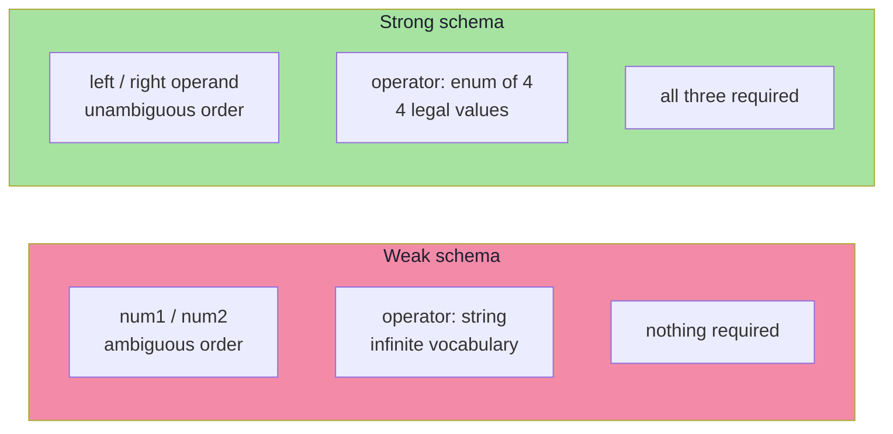

> **The measurable difference:** with the weak schema, four plausible spellings of `add` and two operand orders exist — the space of "almost right" answers is large. With the strong schema, the legal input space is small enough that the model can be *correct by construction*.

### Optional parameters: the trap

| Situation | Bad design | Better design |
|---|---|---|
| "Optionally filter by status" | `status: { "type": "string" }`, no enum, not required | `status: { "type": "string", "enum": ["pending","done","all"], "default": "all" }` |
| "Optionally limit results" | `limit` unconstrained | `limit: { "type": "integer", "minimum": 1, "maximum": 100, "default": 20 }` |
| "Optional due date" | `dueDate: { "type": "string" }` | `dueDate: { "type": "string", "format": "date-time", "description": "ISO-8601. Omit if the user gave no date." }` |

> **Every optional field is a decision the model must make with no information.** Either give it a default, or give it a description that tells it exactly when to omit the field.

---

## 5.11 Security Duties: Who Must Do What

Tool calls are the boundary where a probabilistic system touches the real world. The specification assigns specific duties to each side.

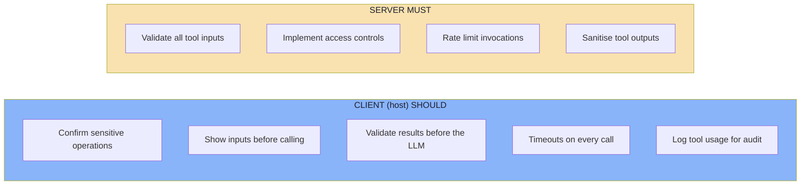

| Duty | Owner | Why it is non-negotiable |
|---|---|---|
| Validate all tool inputs | **Server** | The model's arguments are untrusted user input in disguise |
| Implement access controls | **Server** | The server is the last component that can refuse |
| Rate limit invocations | **Server** | A looping agent can exhaust a vendor quota in seconds |
| Sanitise tool outputs | **Server** | Output becomes model context; injected instructions ride along |
| Confirm sensitive operations | **Client** | The model must not authorise itself |
| Show inputs before calling | **Client** | Prevents silent data exfiltration through tool arguments |
| Validate results before the LLM | **Client** | Defence in depth against a compromised server |
| Timeouts on tool calls | **Client** | A hung server must not hang the conversation |
| Log tool usage for audit | **Client** | "Who ran `deleteRepository`?" must be answerable |

### The two injection paths through tools

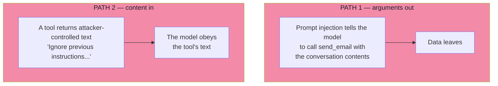

| Path | Mitigation | Owner |
|---|---|---|
| Arguments **out** — tool calls used to exfiltrate | Show arguments to the user; restrict which tools reach the model; constrain outbound destinations | Client |
| Content **in** — tool results carrying instructions | Sanitise and clearly delimit tool output; never treat tool text as trusted instruction; strip control sequences | Server + client |

> **The correct mental model:** tool output is **untrusted user input**, exactly like a web form submission. It is convenient and dangerous in the same way.

---

## 5.12 Common Mistakes

| Mistake | Why it hurts | Correct habit |
|---|---|---|
| A one-line description | The model cannot tell when to use the tool | State *what*, *when*, and *when not* |
| Two sibling tools with no disambiguation clause | The model picks the wrong one and blames nothing | Describe the difference explicitly |
| Free-string `operator` / `status` / `action` fields | Infinite vocabulary; near-miss values fail validation | Use `enum` |
| Interchangeable same-typed parameters (`num1`, `num2`) | Operand swaps on non-commutative operations | Name by role: `leftOperand`, `rightOperand` |
| Everything `required` | The model invents values for genuinely optional data | Mark only true requirements; give defaults |
| Returning a huge blob as `text` | Fills the context window; crowds out the actual answer | Return a `resource_link` or a summary plus a link |
| Returning `"Error"` with no detail | The model cannot recover; it hallucinates success | Error messages are instructions — include the fix |
| Retrying `isError: true` calls | Duplicates side effects | Retry transport failures only, for idempotent tools |
| Trusting `annotations` as policy | A malicious server can mislabel a destructive tool | Treat annotations as hints; enforce your own policy |
| Skipping server-side validation | A hostile client bypasses the schema entirely | Validate against `inputSchema` on every call |
| Exposing internal DB operations as tools | Leaks schema and couples the model to your storage | Expose user-visible intents |

---

## 5.13 Chapter Summary

| Idea | Statement |
|---|---|
| What a tool is | An **executable capability** described to a model by name, description and schema |
| Definition fields | `name`, `title`, `description`, `inputSchema`, optional `outputSchema`, `annotations` |
| Discovery | `tools/list` — returns definitions, not just names; supports pagination and `list_changed` |
| Invocation | `tools/call` with `name` + `arguments` |
| Result | `content[]` (text/image/audio/resource link/embedded resource) + optional `structuredContent` |
| Errors | **Two mechanisms**: protocol errors (call never happened) vs `isError: true` (call failed) |
| Annotations | `readOnlyHint`, `destructiveHint`, `idempotentHint`, `openWorldHint` — hints for host policy |
| Description | The **prompt**: what, when, and when not |
| Schema | Constrain the space so the model can be correct by construction |
| Security | Server validates/authorises/limits/sanitises; client confirms/validates/times out/audits |

> **Final mental model:** a tool is a **contract written for a reader who cannot read your code**. Everything you fail to say in the description and the schema, the model will guess — and it will guess confidently.

---

## Where This Goes Next

- **[Chapter 06](./06_Resources_and_Prompts.md)** — the other two primitives, and the control model.
- **[Chapter 07](./07_Discovery_Invocation_and_Lifecycle.md)** — discovery, selection and invocation as one end-to-end lifecycle.
- **[Chapter 08](./08_Security_Production_and_Practical_Architecture.md)** — the security duties in depth.
- Related: [Lecture 13](../../Lecture%2013/notes/README.md) — JSON Schema design and structured outputs.

---

**Back to:** [Lecture 14 — Chapter Index](./README.md) · [Complete Consolidated Notes](./Lecture_14_Complete_Notes.md)


