# Chapter 06: Resources and Prompts — Context and Reusable Instructions

> **Chapter Goal:** Tools are only one third of what an MCP Server can expose. This chapter covers the other two primitives — **Resources** (*what the AI can know*) and **Prompts** (*reusable instructions*) — plus the two comparisons the lecture insists on: **Tool vs Resource**, and **Resources vs RAG**. It ends with the **control model** that tells you which primitive a new capability should become.
>
> At the end of this chapter you should be able to answer: *I have something to expose to an AI application — should it be a Tool, a Resource or a Prompt, and who is allowed to invoke it?*

---

## 6.1 What an MCP Server Can Expose

> **The three important MCP primitives are:**
>
> ```text
> MCP SERVER
> ├── Tools
> ├── Resources
> └── Prompts
> ```

Chapter 05 covered Tools. Here is the whole picture in one diagram, using the lecture's own mental model:

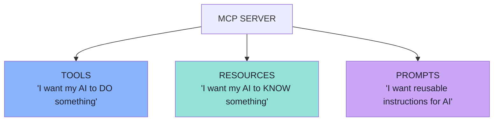

| | Tools | Resources | Prompts |
|---|---|---|---|
| Verb | **Do** | **Know** | **Reuse** |
| Driven by | The **model** | The **application** | The **user** |
| Has side effects? | Usually yes | No — read-only | No |
| Identified by | `name` | `uri` | `name` |
| Discovery call | `tools/list` | `resources/list`, `resources/templates/list` | `prompts/list` |
| Retrieval call | `tools/call` | `resources/read` | `prompts/get` |

> **A server can expose any subset.** Many servers expose only tools. That is fine — but you are then leaving two thirds of the protocol unused, and some capabilities genuinely fit the other primitives better.

---

## 6.2 Resources: Addressable Context

> **Sometimes we do not want to execute an operation. We simply want to expose information.**

The lecture's examples:

```text
company-policy.txt
employee-handbook.pdf
application configuration
repository information
customer profile
database record
```

> **These can be represented as Resources.**
>
> **A Resource is: addressable context or data exposed by an MCP Server.**

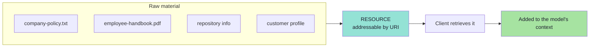

### The URI is the point

Every resource is uniquely identified by a **URI** — and that URI is what makes it *addressable* rather than merely *available*.

Examples from the lecture:

```text
company://policies/return-policy
```

or:

```text
file:///project/README.md
```

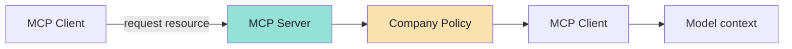

| Scheme | Meaning | Guidance |
|---|---|---|
| `file://` | Filesystem-like resources | Need not map to a real disk; may use MIME types like `inode/directory` |
| `https://` | Web resources | Use **only** when the client can fetch it directly; otherwise prefer a custom scheme |
| `git://` | Version-control integration | Repositories, revisions |
| **custom** | Your domain | e.g. `company://`, `db://`, `student://` — must follow RFC 3986 |

> **The `https://` rule is subtle and worth repeating:** use it only if the *client* can fetch the resource itself. If the server is the only thing that can reach the data, a custom scheme is more honest — and avoids the client leaking a URL it should not call.

---

## 6.3 Resource Operations

Resources have their own small method vocabulary, parallel to `tools/*`.

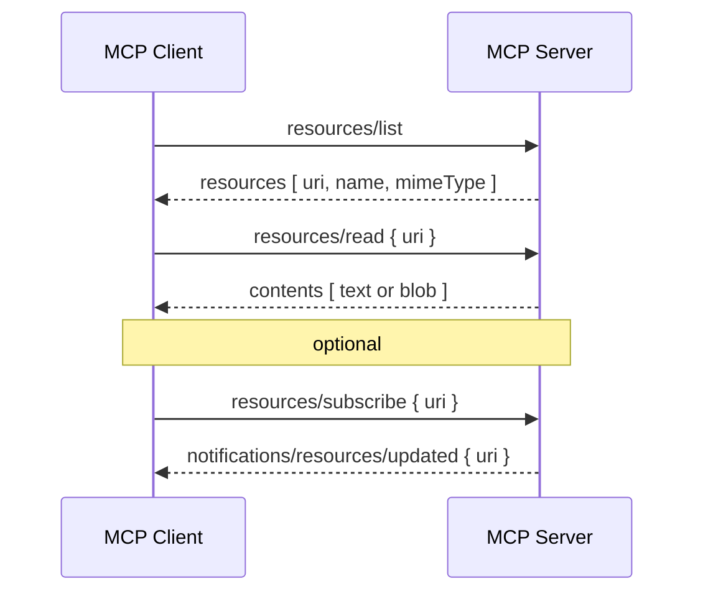

| Method | Purpose | Notes |
|---|---|---|
| `resources/list` | Discover concrete resources | Supports **pagination** (`cursor` / `nextCursor`) |
| `resources/templates/list` | Discover **parameterised** resources | e.g. `file:///{path}` |
| `resources/read` | Retrieve contents by URI | Returns an array of `contents` |
| `resources/subscribe` | Ask to be notified when one resource changes | Requires the `subscribe` capability |
| `resources/unsubscribe` | Stop notifications | — |
| `notifications/resources/list_changed` | The catalogue changed | Requires the `listChanged` capability |
| `notifications/resources/updated` | A subscribed resource changed | Fires only for subscribed URIs |

### Resource templates *(beyond the lecture)*

A **template** exposes a *family* of resources with a URI pattern rather than listing every instance:

```text
student://{studentId}/progress
company://policies/{policyName}
file:///{path}
```

This is how you expose "any student's progress" without enumerating a million students in `resources/list`. Templates pair naturally with **argument autocompletion** (`completion/complete`), which lets a host offer IDE-like suggestions while the user types a URI parameter.

### Capabilities for resources

```json
{
  "capabilities": {
    "resources": { "subscribe": true, "listChanged": true }
  }
}
```

Both sub-capabilities are optional — a server may support neither, either, or both.

---

## 6.4 Resource Contents and Annotations

### Two content shapes

```json
{ "uri": "file:///example.txt", "mimeType": "text/plain", "text": "Resource content" }
```

```json
{ "uri": "file:///example.png", "mimeType": "image/png", "blob": "base64-encoded-data" }
```

| Shape | Field | Use |
|---|---|---|
| **Text** | `text` | Markdown, source code, JSON, policies |
| **Binary** | `blob` (base64) | Images, PDFs, archives |

A resource definition also carries `name`, optional `title`, optional `description`, optional `mimeType`, and optional `size`.

### Annotations: hints for the *application* *(beyond the lecture)*

Resources — and the content blocks inside them — can carry annotations that tell the **host** how to treat the content:

| Annotation | Type | Meaning |
|---|---|---|
| `audience` | `["user"]`, `["assistant"]`, or both | Who the content is intended for |
| `priority` | `0.0` – `1.0` | Importance; `1` ≈ required, `0` ≈ optional |
| `lastModified` | ISO 8601 timestamp | Freshness; enables sorting by recency |

```json
{
  "uri": "file:///project/README.md",
  "name": "README.md",
  "title": "Project Documentation",
  "mimeType": "text/markdown",
  "annotations": {
    "audience": ["user"],
    "priority": 0.8,
    "lastModified": "2025-01-12T15:00:58Z"
  }
}
```

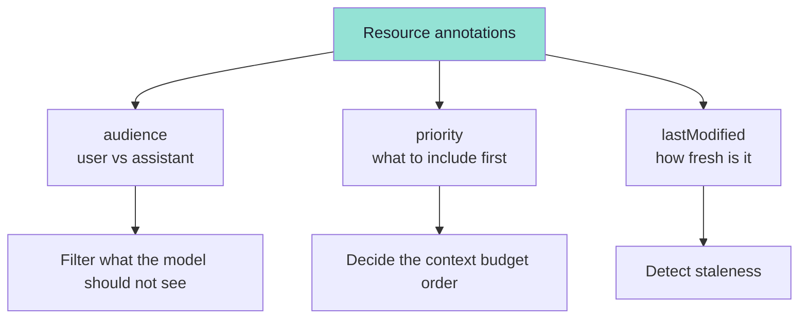

> **`audience` is a security-relevant annotation.** Content marked `["assistant"]` is not meant for a human to read; content marked `["user"]` is not necessarily something the model should reason over. A host that ignores the annotation has no way to make that distinction.

### Error handling

Servers should return standard JSON-RPC errors, most commonly:

| Code | Case |
|---|---|
| `-32002` | Resource not found (with the offending `uri` in `data`) |
| `-32603` | Internal error |

> **Security duties for resources:** validate all URIs, enforce access control per resource, encode binary data properly, and check permissions **before** reading — not after.

---

## 6.5 Tool vs Resource

> **There can be overlap.**

For example:

```text
getReturnPolicy()
```

> **could be implemented as a Tool.**
>
> But:
>
> ```text
> company://policy/returns
> ```
>
> **represents the policy itself as addressable content.**

> **A useful distinction is:**
>
> ```text
> TOOL      "What operation can I perform?"
> RESOURCE  "What information can I access?"
> ```

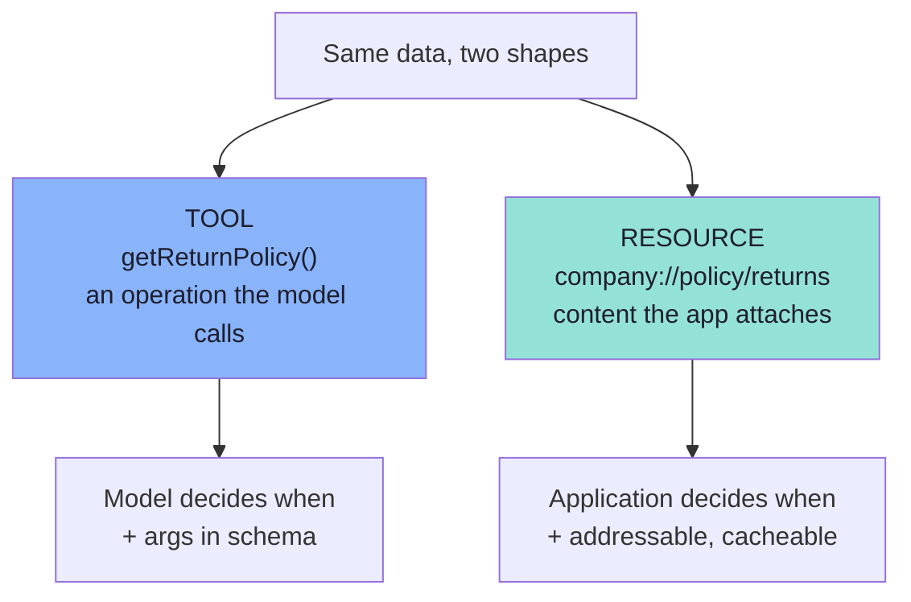

### Choosing between them

| Question | Tool | Resource |
|---|---|---|
| Is there an *operation*, or just *content*? | Operation | Content |
| Who decides when it is used? | The model | The application |
| Does it need arguments? | Usually yes — that is what `inputSchema` is for | No — the URI *is* the argument |
| Should it appear in the model's tool list? | Yes | No — it stays out of the context budget until needed |
| Is it cacheable? | Rarely (side effects / freshness) | **Often** — a URI can be cached and re-read |
| Can the user pick it explicitly? | Not usually | **Yes** — the host can show a file/resource picker |

### The practical rule

| Use a **Tool** when… | Use a **Resource** when… |
|---|---|
| The model must *decide* to fetch it | The application *already knows* it is relevant |
| The result depends on model-supplied arguments | The content is identified by a stable address |
| It is one of several steps in a plan | It is ambient context (policy, handbook, config, repo state) |
| Freshness is critical and must be fetched per call | Caching is acceptable |
| You want the model to be able to say "I don't need this" | You want to avoid burning context on unused material |

> **The deeper difference:** a tool **spends context** the moment it is advertised (its schema is in the prompt). A resource spends context only when the application decides to read it. For large corpora, that is decisive — see §6.6.

---

## 6.6 MCP Resources vs RAG

> **MCP Resources do not replace RAG.**

The lecture is explicit, and the reason is worth stating in full: they solve **different problems**.

### RAG solves a retrieval problem

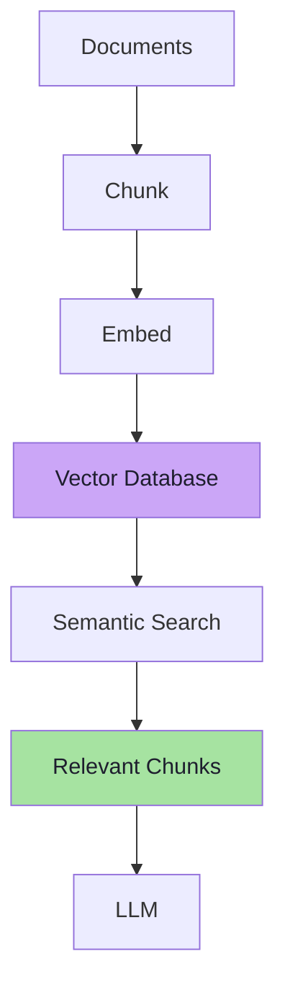

### MCP Resources expose addressable content

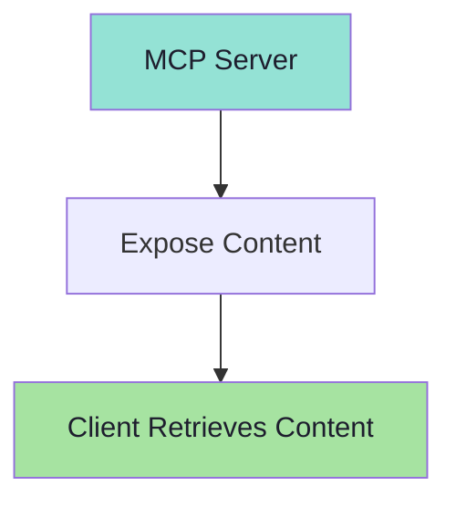

> **They solve different problems.**
> **They can also be combined.**

| Dimension | RAG | MCP Resources |
|---|---|---|
| Problem solved | *"Which of 50,000 chunks are relevant?"* | *"Where does this specific piece of content live?"* |
| Selection | Similarity ranking over a corpus | Exact addressing by URI |
| Scale assumption | Very large, unstructured, changing | Bounded, known, addressable |
| Who chooses | The retriever, on the query | The application, on context |
| Freshness | Depends on the index | Whatever the server returns *now* |
| Cost model | Embedding + index + query | A read |
| Failure mode | Missed the relevant chunk | Nothing to address |

### The combined pattern the lecture shows

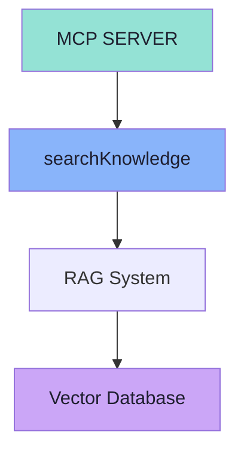

> **`searchKnowledge` could itself be an MCP Tool backed by a RAG pipeline.**

This is the resolution of the apparent conflict, and it is elegant:

| Layer | Role |
|---|---|
| **Tool** (`searchKnowledge`) | The *interface* — the model asks a question |
| **RAG pipeline** | The *retrieval engine* — embeds, searches, ranks |
| **Resource** (optional) | The *addressing* — `doc://{id}` so a retrieved chunk can be cited, re-read or opened by the user |

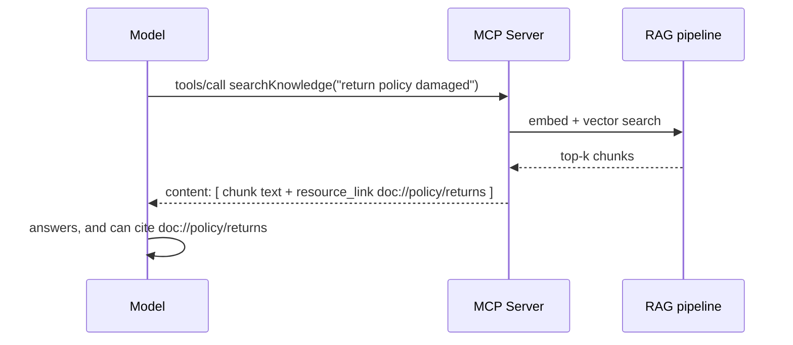

> **So the correct statement is not "Resources vs RAG" but "Resources *and* RAG, at different layers."** RAG decides *what is relevant*; resources give the result *a stable address* so it can be cited, cached and re-fetched.

---

## 6.7 Prompts: Reusable Instructions

> **An MCP Server can also expose reusable prompt templates or workflows.**

For example, a **GitHub MCP Server** could provide:

```text
review_pull_request
summarize_issue
prepare_release_notes
```

> **A reusable prompt might conceptually look like:**
>
> ```text
> review_pull_request(prNumber)
>              |
> "You are reviewing pull request {prNumber}.
>  Check for bugs, maintainability issues..."
> ```

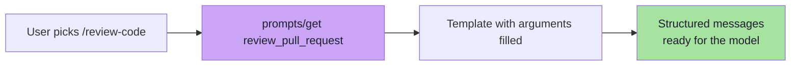

> **The client can discover these prompts and retrieve them when required.**

### The prompt method vocabulary

| Method | Purpose |
|---|---|
| `prompts/list` | Discover available prompts (paginated) |
| `prompts/get` | Retrieve a specific prompt, with arguments substituted |
| `notifications/prompts/list_changed` | The prompt catalogue changed |

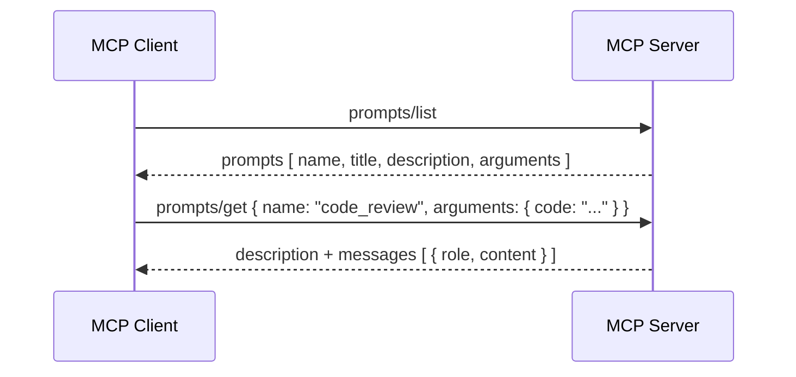

### A prompt definition

```json
{
  "name": "code_review",
  "title": "Request Code Review",
  "description": "Asks the LLM to analyze code quality and suggest improvements",
  "arguments": [
    { "name": "code", "description": "The code to review", "required": true }
  ]
}
```

### A prompt result

```json
{
  "description": "Code review prompt",
  "messages": [
    {
      "role": "user",
      "content": { "type": "text", "text": "Please review this Python code:\n def hello():\n     print('world')" }
    }
  ]
}
```

| Field | Notes |
|---|---|
| `name` | Unique identifier |
| `title` | Human-readable, shown in a menu |
| `description` | Helps the *user* choose — not the model |
| `arguments[]` | Each with `name`, `description`, `required` |
| `messages[]` | `role` is `user` or `assistant`; content may be text, image, audio, or an **embedded resource** |

### Why prompts are more than saved text *(beyond the lecture)*

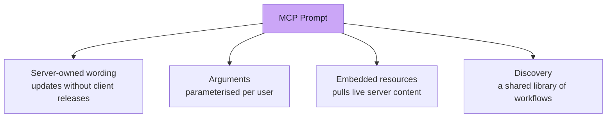

| Benefit | Explanation |
|---|---|
| **Server-owned wording** | Fix a badly performing prompt in one place; every host improves |
| **Parameterised** | `review_pull_request(prNumber)` instead of copy-pasted instructions |
| **Embedded resources** | A prompt can carry live content (the current file, the issue body) with it |
| **Discovery** | Hosts can list a *library* of workflows the server author knows are correct |
| **Autocompletion** | `completion/complete` can suggest argument values (branch names, PR numbers) |

### Error handling

| Code | Case |
|---|---|
| `-32602` | Invalid prompt name, or missing required arguments |
| `-32603` | Internal error |

> **Security:** validate all prompt inputs and outputs. A prompt is text that will be inserted into a model's context — treat it with exactly the care you would give to a tool result.

---

## 6.8 The Control Model: Who Drives Which Primitive

> **A helpful conceptual distinction is:**

| Primitive | Typically controlled by |
|---|---|
| **Tools** | **Model** |
| **Resources** | **Application** |
| **Prompts** | **User** |

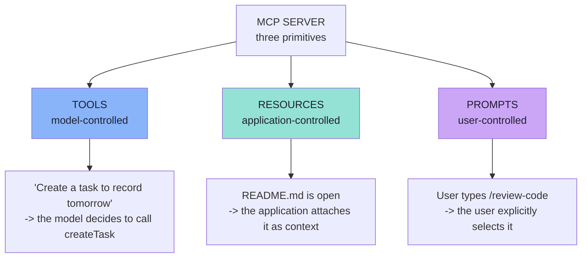

### The three examples, verbatim

**Tools — model controlled.** The user says:

> "Create a task to record tomorrow."

The model decides:

> *I should invoke `createTask`.*

**Resources — application controlled.** The application may know that the user currently has:

```text
README.md
```

open, and decide to add that file as context.

**Prompts — user controlled.** The UI may expose:

```text
/review-code
```

and the user explicitly selects it.

> **This is a useful conceptual model rather than a strict limitation on every implementation.**

### Why the model is right, not a rule

| Primitive | Control flows from | Because |
|---|---|---|
| Tools | **Model** | Choosing an action is a reasoning act; only the model has the intent |
| Resources | **Application** | The host knows the user's screen, selection, permissions and budget |
| Prompts | **User** | Wording and workflow are a human preference, and it is auditable when chosen explicitly |

> **The security reading is the useful one.** Anything model-controlled must be treated as untrusted (validate, confirm). Anything user-controlled is a deliberate human act. Anything application-controlled is your own policy. That mapping tells you exactly where to put each control.

---

## 6.9 Which Primitive Should This Be? A Decision Guide

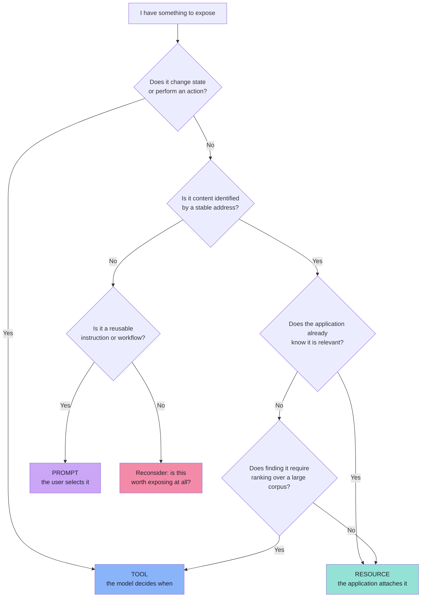

### Worked cases from the lecture's own examples

| Thing to expose | Best primitive | Why |
|---|---|---|
| `createTask`, `completeTask` | **Tool** | State changes; the model should decide |
| `getStudentProgress()` | **Tool** | Needs an argument (`studentId`); the model may need to ask |
| `searchVideos(query)` | **Tool** | Requires model-supplied arguments and ranking |
| `company-policy.txt` | **Resource** | Addressable content; the app decides relevance |
| `employee-handbook.pdf` | **Resource** | Large, addressable, cacheable |
| Application configuration | **Resource** | Ambient context |
| Customer profile | **Resource** (or Tool if lookups vary) | Addressable by id |
| `company://policies/return-policy` | **Resource** | Pure content with a stable URI |
| `searchKnowledge(query)` over a corpus | **Tool** (RAG-backed) | Ranking requires a query |
| `review_pull_request` workflow | **Prompt** | Reusable instruction the user selects |
| `/review-code` slash command | **Prompt** | User-controlled entry point |

> **A server that exposes all three well is far more useful than one that exposes fifteen tools.** The primitives exist precisely so that different kinds of capability can be governed differently.

---

## 6.10 Common Mistakes

| Mistake | Why it hurts | Correct habit |
|---|---|---|
| Making everything a Tool | Bloats the model's tool list; ambient context competes for the model's attention | Move addressable content to Resources |
| Making everything a Resource | The model cannot act; the app must know everything in advance | State-changing operations belong in Tools |
| Believing Resources replace RAG | You abandon ranking and lose recall on large corpora | Use a RAG-backed Tool, and Resources for addressing |
| Enumerating a million resources in `resources/list` | Unusable catalogue; the host cannot render it | Use **resource templates** |
| Using `https://` when only the server can fetch it | Clients attempt direct fetches and fail | Use a custom scheme |
| Ignoring `audience` annotations | Content meant for the model is shown to users, and vice versa | Honour the annotation in the host |
| Prompts as hard-coded client strings | Every host drifts; improvements need releases | Expose them from the server via `prompts/*` |
| Letting the model pick prompts | Prompts are user-controlled; the model has no notion of UI | Surface them as explicit user actions |
| No `subscribe` / `listChanged` support | Clients cache stale catalogues and stale content | Declare the capability and emit notifications |

---

## 6.11 Chapter Summary

| Idea | Statement |
|---|---|
| Three primitives | **Tools** (do), **Resources** (know), **Prompts** (reuse) |
| A Resource | **Addressable context or data** exposed by a server, identified by a **URI** |
| Resource methods | `resources/list`, `resources/templates/list`, `resources/read`, `resources/subscribe` |
| Resource content | `text` or base64 `blob`, with `audience` / `priority` / `lastModified` annotations |
| Tool vs Resource | *"What operation can I perform?"* vs *"What information can I access?"* |
| Resources vs RAG | Different problems — **and they combine**: `searchKnowledge` is a RAG-backed tool |
| A Prompt | A **reusable prompt template or workflow**; `prompts/list`, `prompts/get` |
| Control model | Tools → **model**, Resources → **application**, Prompts → **user** |
| The security reading | Model-controlled = untrusted; user-controlled = deliberate; application-controlled = your policy |

> **Final mental model:** a good MCP server is a **well-organised library**. Tools are the service desk (you ask for something to be done), Resources are the shelves (addressable, browsable, fetchable), and Prompts are the laminated "how to do this task" cards at the entrance.

---

## Where This Goes Next

- **[Chapter 07](./07_Discovery_Invocation_and_Lifecycle.md)** — the complete tool lifecycle end to end.
- **[Chapter 08](./08_Security_Production_and_Practical_Architecture.md)** — security and the practical demo architecture.
- Related: [Lecture 11](../../Lecture%2011/notes/README.md) and [Lecture 12](../../Lecture%2012/notes/README.md) for RAG; [Lecture 10](../../Lecture%2010/notes/README.md) for vector search.

---

**Back to:** [Lecture 14 — Chapter Index](./README.md) · [Complete Consolidated Notes](./Lecture_14_Complete_Notes.md)


