# Chapter 07: The Tool Lifecycle — Discovery, Selection, Invocation

> **Chapter Goal:** Assemble everything into one end-to-end lifecycle. Chapters 03–06 described the parts; this chapter runs the whole machine — discovery, selection, invocation, result, response — and then answers the practical questions: *what happens when a server adds a tool mid-session? Does `tools/list` run on every message? What breaks, and where?*
>
> At the end of this chapter you should be able to answer: *trace one user request from a sentence to a database row and back, naming the protocol call and the component at every step.*

---

## 7.1 The Lifecycle in One Diagram

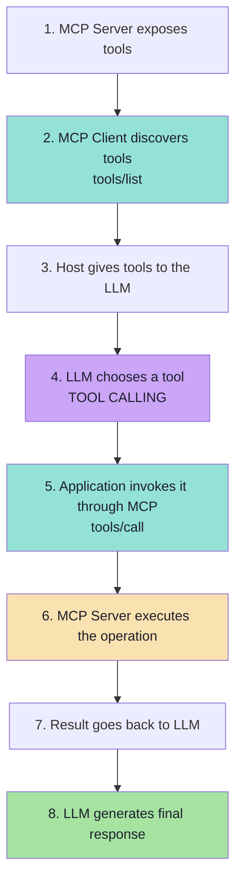

| Phase | Protocol call | Component | Deterministic? |
|---|---|---|---|
| **Discovery** | `tools/list` | Client ↔ Server | Yes |
| **Selection** | *none — a model decision* | LLM | **No** |
| **Invocation** | `tools/call` | Client → Server | Yes |
| **Execution** | *none — business logic* | Server | Yes |
| **Response** | *none — generation* | LLM + Host | **No** |

> **Two of the five phases are non-deterministic, and they are the first and the last.** Everything in the middle is ordinary, testable software. That partition is the whole engineering story of MCP.

---

## 7.2 Phase 1 — Discovery

> Suppose our application connects to a Task MCP Server.
>
> The client asks: **"What tools do you have?"**
>
> The server responds:
>
> ```text
> createTask
> listTasks
> completeTask
> ```
>
> **The MCP operation used for this is: `tools/list`.**

> **A response may conceptually contain:**

```json
{
  "tools": [
    {
      "name": "createTask",
      "description": "Creates a new task",
      "inputSchema": {
        "type": "object",
        "properties": {
          "title": { "type": "string" }
        },
        "required": ["title"]
      }
    },
    {
      "name": "listTasks",
      "description": "Returns all tasks",
      "inputSchema": { "type": "object" }
    },
    {
      "name": "completeTask",
      "description": "Marks a task as completed",
      "inputSchema": {
        "type": "object",
        "properties": {
          "id": { "type": "integer" }
        },
        "required": ["id"]
      }
    }
  ]
}
```

> **The client now understands the available tools.**

### What discovery actually produces

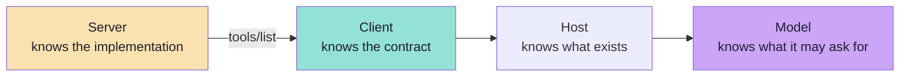

| Knowledge transferred | Not transferred |
|---|---|
| Tool names | Implementation details |
| Purposes (descriptions) | Database schema |
| Argument schemas | Credentials, endpoints |
| (Optionally) result schemas and risk annotations | Other tools the server chose to hide |

> **Discovery is a curated act.** The server decides what appears in the list. "Hidden" tools are not merely invisible — they are *absent*, and an absent tool cannot be called by a model that was never told it exists. That is the cheapest capability control in the whole architecture.

---

## 7.3 Phase 2 — From Discovery to LLM Tool Calling

> Suppose the user asks:
>
> **"Create a task called Record MCP Video."**

> **The LLM effectively receives:**

```text
USER MESSAGE

Create a task called Record MCP Video.

AVAILABLE TOOLS

createTask(title)
Creates a new task.

listTasks()
Returns existing tasks.

completeTask(id)
Marks a task as complete.
```

> **The model can infer:**

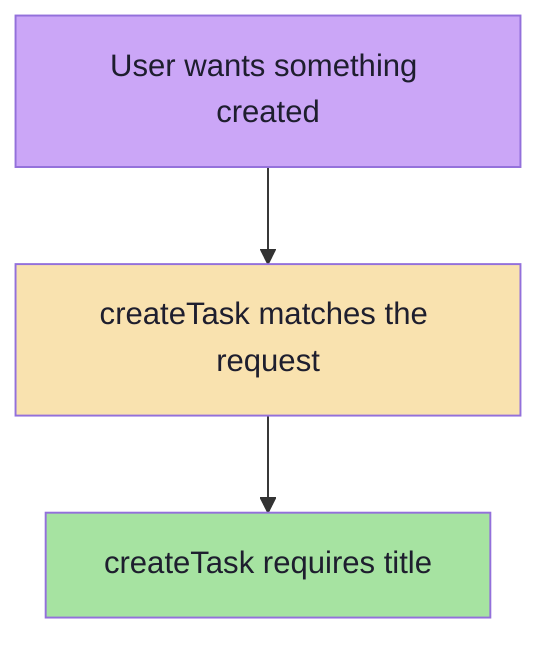

> **It then produces a tool request:**

```text
createTask(
  title = "Record MCP Video"
)
```

> **This step is Tool Calling.**

### Why this step is the fragile one

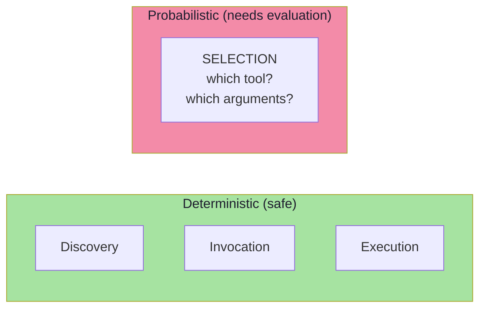

| Failure | Symptom | Where to fix |
|---|---|---|
| No tool selected | The model answers from memory instead of acting | Tool descriptions; make the tool obviously relevant |
| Wrong tool selected | It calls `update_task` when it should create | Disambiguation clauses in descriptions |
| Right tool, wrong arguments | `title` missing or invented | Schema: `required`, `enum`, defaults, per-field descriptions |
| Right call, wrong granularity | It calls `listTasks` then filters in prose | Provide a `searchTasks(query)` tool |

> **The key insight:** this is the only phase where "it usually works" is the honest description. Everything else in the lifecycle either works or throws. That asymmetry is why tool selection needs an evaluation set and not just unit tests.

---

## 7.4 Phase 3 — Invocation: MCP Takes Over

> **Once the LLM has chosen `createTask`, the Host knows that this capability comes from the MCP Server.**

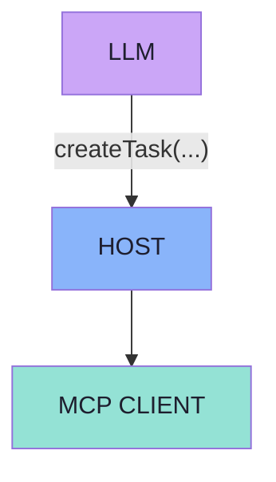

> **The MCP Client performs: `tools/call`**

> Conceptually:

```json
{
  "name": "createTask",
  "arguments": {
    "title": "Record MCP Video"
  }
}
```

> **The MCP Server receives the request and executes:**

```text
createTask("Record MCP Video");
```

> **It might create:**

```text
Task {
    id: 1
    title: "Record MCP Video"
    status: PENDING
}
```

> **The result returns to the MCP Client and then to the LLM.**
> **The LLM converts that result into a natural-language response for the user.**

### The routing problem the host solves

The model emitted `createTask(title)`. It did **not** say *which server*. The host must:

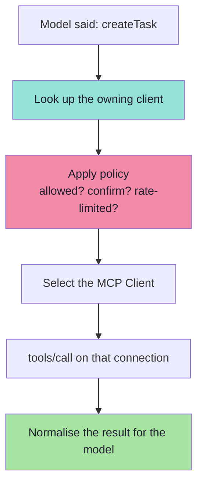

| Host responsibility at this step | Why it must be here |
|---|---|
| **Resolve** tool name → owning client | The model has no notion of servers |
| **Authorise** the call | The model cannot be trusted to gate itself |
| **Confirm** if destructive | Requires UI and user identity |
| **Rate limit** | Prevents runaway agent loops |
| **Time out** | Prevents a hung server from stalling the conversation |
| **Normalise** the result | Different servers return different shapes; the model should see one |

> **This is the "dependency inversion" of Chapter 01 made concrete:** the model depends on a *name*, the host depends on a *protocol*, and the server depends on its *backend*. Nothing depends on a vendor.

---

## 7.5 Phase 4 — Result and Response

The result of `tools/call` travels back along the same path and then becomes **context**, not just a value.

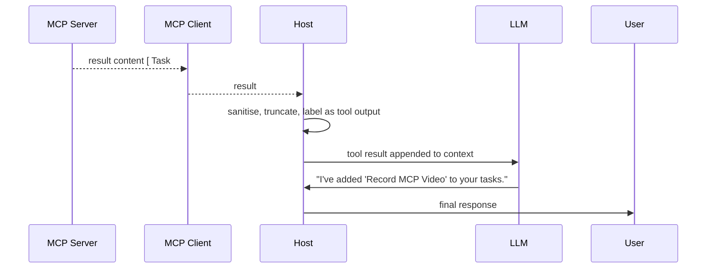

### What the host must do to the result before the model sees it

| Step | Why |
|---|---|
| **Validate** against `outputSchema` (if declared) | A malformed result poisons the context |
| **Sanitise** | The result is untrusted text that will be interpreted as instruction |
| **Delimit and label** | The model must know "this is tool output", not "this is the user" |
| **Truncate or summarise** | A 200 KB result destroys the context budget |
| **Attach provenance** | Which tool, which server, at what time — needed for citations and debugging |
| **Mark errors explicitly** | `isError: true` must reach the model *as a failure*, not as a fact |

> **The result is the second half of the injection surface.** Chapter 05's rule bears repeating: *tool output is untrusted user input*. The host is where that becomes true in practice.

---

## 7.6 The Complete MCP Tool Lifecycle

The lecture draws the whole thing as one picture (§28). Reproduced faithfully:

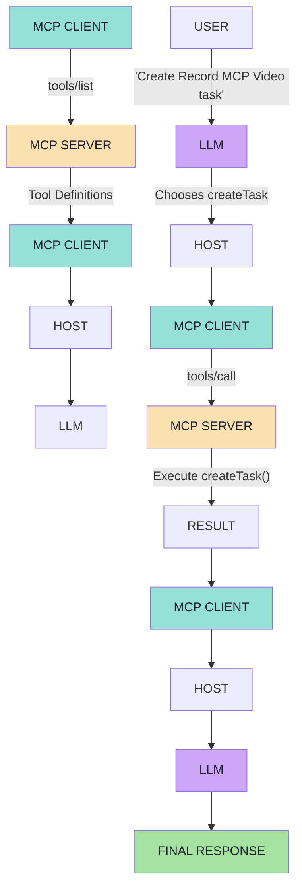

> **The key distinction remains:**
>
> ```text
> LLM chooses the tool          ->  Tool Calling
> Application invokes remote capability  ->  MCP
> ```

### The lifecycle as a state machine

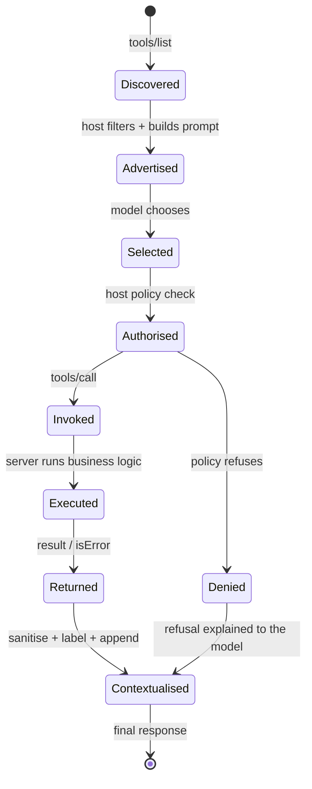

| Transition | Failure mode | Who handles it |
|---|---|---|
| Discovered → Advertised | Context budget exceeded; low-trust tools dropped | Host |
| Advertised → Selected | Wrong tool / no tool | Model (fix with descriptions) |
| Selected → Authorised | Not permitted | Host (deny + explain) |
| Authorised → Invoked | Transport failure, timeout | Host/Client (retry or degrade) |
| Invoked → Executed | Business failure | Server (`isError: true`) |
| Executed → Returned | Malformed result | Server |
| Returned → Contextualised | Injection, oversized payload | Host |

> **Every row in that table is a place a real bug will appear.** The value of the lifecycle model is that it turns "the AI is behaving strangely" into a specific transition you can instrument.

---

## 7.7 Dynamic Tool Discovery

> **One major advantage of discovery is that the AI application does not necessarily need every remote capability hardcoded into its own codebase.**

> Suppose the MCP Server initially exposes:
>
> ```text
> createTask
> listTasks
> ```
>
> Later, the server adds:
>
> ```text
> completeTask
> ```

> **The updated capability can appear in the server's advertised tool list.**
> **The AI application does not necessarily need a manually implemented local:**
>
> ```text
> completeTask(...)
> ```
>
> **method.**
>
> **This is one of the important benefits of MCP-based capability discovery.**

### The before/after, concretely

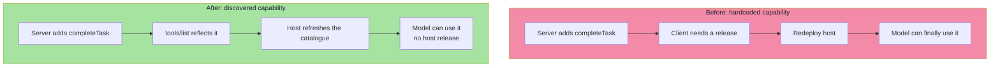

| Aspect | Hardcoded | Discovered |
|---|---|---|
| Adding a capability | Client code change + release | Server-side only |
| Model visibility | Requires redeploy | On the next refresh |
| Risk | Client and server drift | Single source of truth |
| Trust question | Implicit | Explicit — the host must decide whether to accept the new tool |

> **Dynamic discovery is also a dynamic attack surface.** If a server can add a tool at any time, a compromised server can add a tool *after* the user's consent was given. This is the **rug-pull** class from Chapter 08: dynamic discovery is why you must re-validate the catalogue, not merely refresh it.

### The mechanisms that make it work

| Mechanism | Role |
|---|---|
| `notifications/tools/list_changed` | The server tells the client the catalogue changed |
| `tools/list` re-query | The client fetches the new definitions |
| Host policy re-evaluation | The host decides whether the new tool is admissible |
| Cache invalidation | Stale definitions must not linger |

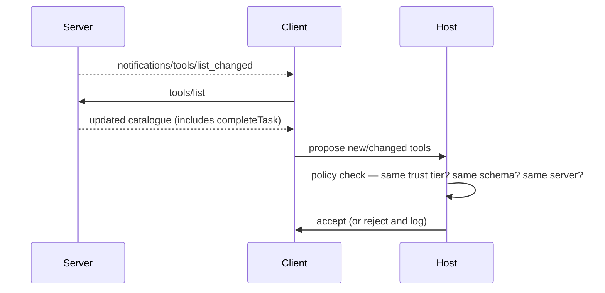

---

## 7.8 Does `tools/list` Run for Every User Message?

> **Not necessarily.**
>
> **If the available tool catalogue has not changed, the Host or MCP Client can reuse previously discovered information.**
>
> Conceptually:
>
> ```text
> Discover tools
>        |
> Cache available definitions
>        |
> Reuse when appropriate
> ```

> **Operations such as:**
>
> ```text
> tools/list
> resources/list
> prompts/list
> ```
>
> **represent discovery of these capabilities.**

### The caching policy

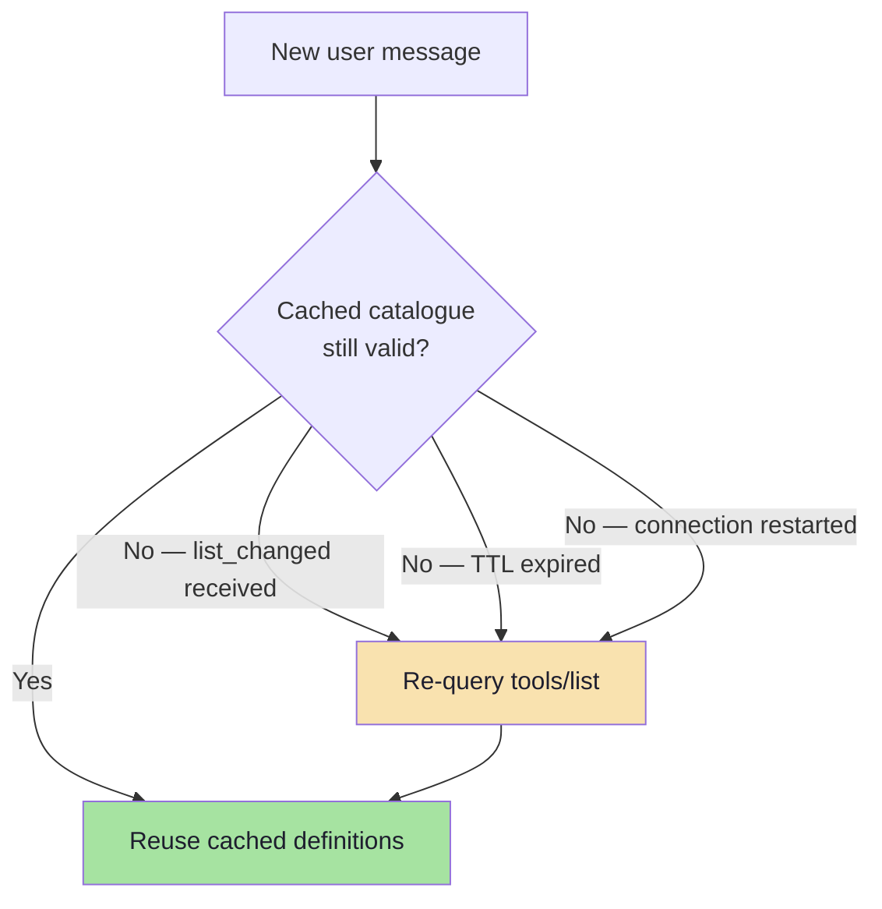

| Cache key | Invalidate when |
|---|---|
| Server identity + transport | Connection drops or restarts |
| Protocol version | Version renegotiated |
| Catalogue version / ETag | `list_changed` received |
| TTL | A configured freshness window expires |

| Why cache | Why still refresh |
|---|---|
| `tools/list` is a round trip — latency on every message is wasteful | A stale catalogue means the model cannot use a new capability |
| Definitions are large; re-fetching burns bandwidth | A **changed** definition is a security event (rug pull) |
| It is deterministic — the answer rarely changes | Consent must be re-evaluated when a definition changes |

> **The correct mental model:** discovery is a **cache with an invalidation signal**, not a per-request call. Treat a *changed* definition as a re-authorisation event, not just a refresh.

---

## 7.9 The Context-Budget Problem *(beyond the lecture)*

Discovery has a cost that is easy to ignore until it bites: **every discovered tool definition is text in the model's prompt.**

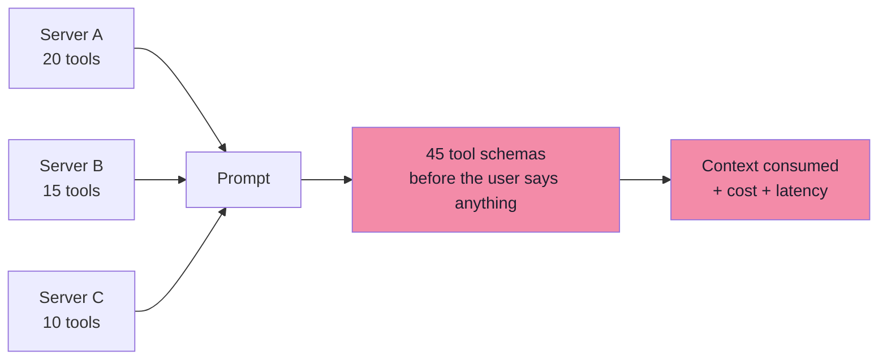

### Illustrative arithmetic

| Items | Assumption | Total |
|---|---|---|
| Tools advertised | 45 | — |
| Average schema + description | ~150 tokens | **≈ 6,750 tokens** |
| Plus system prompt, history, resources | — | tens of thousands more |
| Cost per call | proportional to input tokens | paid on **every** turn |

> **Numbers are illustrative, but the shape is not.** Tool schemas are a fixed tax on every request in a session, paid whether or not the tool is used.

### The symptoms

| Symptom | Mechanism |
|---|---|
| The model "forgets" a tool that exists | Attention diluted across too many similar definitions |
| Latency creeps up | Larger prompts are slower to prefill |
| Cost rises without more usage | Fixed token tax per turn |
| Wrong tool chosen more often | More near-duplicates competing |
| The model stops using tools entirely | It answers from memory instead |

### The mitigations, in order of preference

| # | Mitigation | How |
|---|---|---|
| 1 | **Only connect the servers you need** | Disable unused servers per session or per workspace |
| 2 | **Filter by trust tier and task** | The host chooses which tools enter the prompt |
| 3 | **Namespace and prune duplicates** | Two servers both exposing `search` → keep one |
| 4 | **Write tight descriptions** | Cut marketing prose; keep the disambiguation clause |
| 5 | **Split large servers** | One server per domain, connected on demand |
| 6 | **Two-stage tool selection** *(beyond)* | Expose a small `find_tools(query)` meta-tool, then load the matches |
| 7 | **Prefer Resources for context** | Resources cost nothing until read (Chapter 06) |

> **The counter-intuitive conclusion:** *more discoverable tools make a system worse, not better.* Discovery is a capability, and every capability you advertise has a price. Curate the catalogue the way you would curate a public API.

---

## 7.10 Failure Modes and a Diagnostic Runbook

The lifecycle gives you a place to look for every symptom. This is the table worth keeping next to your logs.

| Symptom | Most likely phase | Diagnostic | Fix |
|---|---|---|---|
| The model answers from memory instead of acting | **Selection** | Is the tool in the prompt at all? Is the description relevant to the phrasing? | Fix the description; check the tool is advertised |
| The model calls a tool that does not exist | **Selection** | Compare the emitted name to `tools/list` output | Names must be exact; avoid near-duplicates |
| Arguments fail validation | **Selection** | Log the emitted arguments against `inputSchema` | Tighten the schema; add defaults and enums |
| "Unknown tool" error | **Invocation** | Was the catalogue refreshed after `list_changed`? | Invalidate the cache; re-query `tools/list` |
| Connection resets mid-session | **Invocation** | stdio server writing to `stdout`? HTTP session expired? | Logs to `stderr`; handle 404 by re-initialising |
| The call hangs | **Invocation** | Is there a per-request timeout? | Add timeout + cancellation + maximum cap |
| The tool ran but nothing changed | **Execution** | Server logs; idempotency keys; transaction boundaries | Fix server logic; add idempotency |
| The tool ran twice | **Invocation / Execution** | Retry policy on a non-idempotent tool | Retry only idempotent tools; use idempotency keys |
| The model reports success when it failed | **Response** | Was `isError: true` surfaced to the model as a failure? | Mark errors explicitly; improve error text |
| The model follows instructions it was not given | **Response** | Inspect the tool output for injected text | Sanitise and delimit tool output |
| Costs and latency climbed | **Discovery** | Count the tool definitions in the prompt | Prune the catalogue (§7.9) |
| A new tool appeared without review | **Discovery** | Did the host re-evaluate policy on `list_changed`? | Treat changes as re-authorisation events |

### The five-step diagnostic order

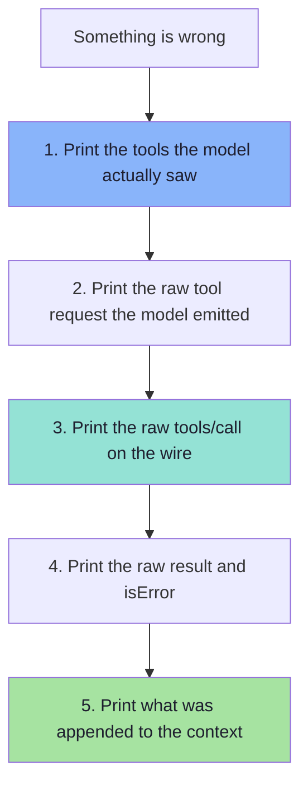

> **Almost every MCP bug is visible in one of those five print statements.** The reason teams struggle is that they debug the *final answer* instead of the *handoff* — and the handoff is exactly where the five print statements live.

---

## 7.11 Common Mistakes

| Mistake | Why it hurts | Correct habit |
|---|---|---|
| Calling `tools/list` on every message | Wasted round trips; latency on every turn | Cache with an invalidation signal (§7.8) |
| Never refreshing the catalogue | The model cannot use new tools; stale definitions linger | Handle `list_changed` and re-evaluate policy |
| Trusting a changed tool definition | The rug-pull attack | Treat a definition change as a re-authorisation event |
| Letting the model see a tool it may not call | It will call it, and you will deny it — wasting a turn | Filter the catalogue *before* the prompt, not after the call |
| Denying a call with no explanation | The model retries or hallucinates an outcome | Deny with a message the model can act on |
| No per-request timeout | One hung server stalls the conversation | Timeout + cancellation + maximum cap |
| Retrying non-idempotent tools | Duplicate side effects | Retry only read-only/idempotent tools |
| Passing tool results to the model unlabelled | Injection; the model treats data as instruction | Delimit, label and sanitise tool output |
| Advertising 50 tools "just in case" | Context tax, worse selection, higher cost | Curate the catalogue; prefer Resources |
| Debugging the final answer | The bug is at the handoff, not in the prose | Use the five-step diagnostic order (§7.10) |
| Assuming the model routes to the right server | The model does not know servers exist | The host resolves names to clients |

---

## 7.12 Chapter Summary

| Idea | Statement |
|---|---|
| The eight steps | Expose → discover → give to LLM → **choose** → invoke → execute → return → respond |
| Discovery | `tools/list` returns **definitions**; the catalogue is a curated act |
| Selection | **Tool calling** — the only probabilistic step, and the only one needing evaluation |
| Invocation | `tools/call` — the host resolves the name, authorises, confirms, limits and times out |
| Execution | Server business logic; deterministic and unit-testable |
| Response | The result becomes **context**: validate, sanitise, delimit, truncate, mark errors |
| Dynamic discovery | Servers can add capabilities; clients learn them without a release |
| Caching | `tools/list` is a **cache with an invalidation signal**, not a per-message call |
| Context budget | Every advertised tool costs tokens on every turn — curate ruthlessly |
| Diagnostics | Five print statements explain almost every MCP bug |

> **Final mental model:** the lifecycle is a **relay race with exactly one probabilistic runner**. Discovery, invocation, execution and return are hand-offs you can test exhaustively; the model's choice is the one leg you must *measure* rather than prove.

---

## Where This Goes Next

- **[Chapter 08](./08_Security_Production_and_Practical_Architecture.md)** — security, production concerns and the practical demo architecture.
- **[Chapter 05](./05_The_Tools_Primitive.md)** — tool definitions, schemas and error handling in depth.
- **[Chapter 04](./04_Host_Client_Server_Architecture.md)** — transports, lifecycle and capability negotiation.
- Related: [Lecture 06](../../Lecture%2006/notes/README.md) for streaming and SSE; [Lecture 05](../../Lecture%2005/notes/README.md) for agent loops and multi-step tool chaining.

---

**Back to:** [Lecture 14 — Chapter Index](./README.md) · [Complete Consolidated Notes](./Lecture_14_Complete_Notes.md)


