# Chapter 08: Security, Production and a Practical Architecture

> **Chapter Goal:** Close the lecture where it ends — with the boundary that matters. The lecture's security section contains one sentence that carries the whole chapter: **"MCP standardizes communication. It does not remove the application's responsibility for security and authorization."** This chapter covers that responsibility in depth, the two-application demo architecture the lecture prescribes for learning, and the production concerns that a real deployment adds.
>
> At the end of this chapter you should be able to answer: *who is allowed to run this tool, on whose authority, with whose credentials — and how do I prove it after the fact?*

---

## 8.1 Security Still Belongs to the Host

> **Discovering a tool does not mean the model should automatically be allowed to execute everything.**

This is the single most important sentence in the security discussion. Discovery is an **inventory**, not a **grant**.

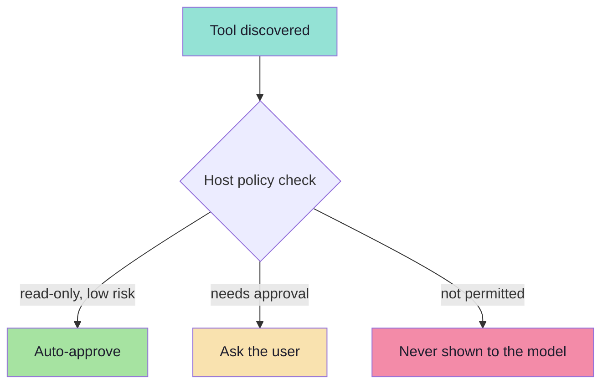

> **The Host can still apply:**

```text
Permissions
User Approval
Tool Filtering
Authentication
Security Policies
```

### The lecture's own example

> For example:
>
> ```text
> readFile
> ```
>
> **might be allowed automatically.**
>
> But:
>
> ```text
> deleteRepository
> ```
>
> **could require explicit user confirmation.**

| Tool | Risk class | Host behaviour |
|---|---|---|
| `readFile` | Read-only, bounded | Auto-approve; log it |
| `deleteRepository` | Destructive, irreversible | Explicit confirmation, every time |
| `sendEmail` | Outbound, exfiltration risk | Confirm recipient + body preview |
| `executeCommand` | Arbitrary code | Confirm, sandbox, and rate-limit |

> **MCP standardizes communication.**
> **It does not remove the application's responsibility for security and authorization.**

---

## 8.2 The Threat Model: What Can Actually Go Wrong

Security advice without a threat model is just anxiety. Here are the concrete attack classes against MCP deployments, in the order they usually bite.

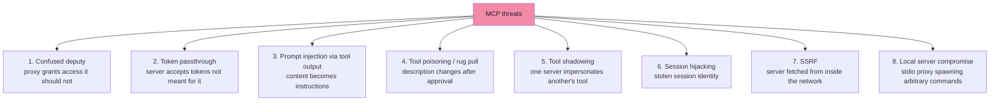

### The eight classes

| # | Threat | How it works | Primary mitigation |
|---|---|---|---|
| 1 | **Confused deputy** | An MCP proxy server uses a **static client ID** with a third-party authorization server, so a malicious client can obtain authorization codes **without proper user consent** — the proxy, not the attacker, is "deputised" | Bind consent to the *specific* client; never share one client ID across all clients; validate redirect URIs; require per-client consent |
| 2 | **Token passthrough** | The MCP server forwards a token it received to a downstream API, or accepts a token that was **not issued for it** — breaking audience binding | **Never** accept tokens not issued for your server; **never** forward a client's token downstream; obtain your own |
| 3 | **Prompt injection via tool output** | A tool returns attacker-controlled text ("ignore previous instructions…"), and the model treats it as instruction | Sanitise and delimit tool output; never treat tool text as trusted; keep humans in the loop for consequential calls |
| 4 | **Tool poisoning / rug pull** | A tool's *description* contains hidden instructions; or a server changes a tool's behaviour **after** the user approved it | Show descriptions in consent UIs; pin/verify server versions; re-consent on change |
| 5 | **Tool shadowing** | A malicious server exposes a tool whose name or description impersonates a trusted server's tool, capturing its calls | Namespace tools by server; show the originating server in the UI; filter by trust tier |
| 6 | **Session hijacking** | An attacker obtains a session identifier and impersonates the user; a shared queue can also deliver a prompt-injected response to the wrong client | Treat session IDs as secrets; bind sessions to the authenticated user; never share a response queue across users |
| 7 | **SSRF** | The server fetches a URL supplied by the model, reaching internal metadata endpoints | Allow-list outbound destinations; block private ranges; never fetch model-supplied URLs blindly |
| 8 | **Local server compromise** | A client-side XSS compromises the proxy that owns **stdio spawning**, letting an attacker run any command the proxy can run | Sandbox/containerise spawned servers; restrict filesystem access; require authorisation for dangerous commands; apply CSP |

### The two that are specific to MCP, and therefore most often missed

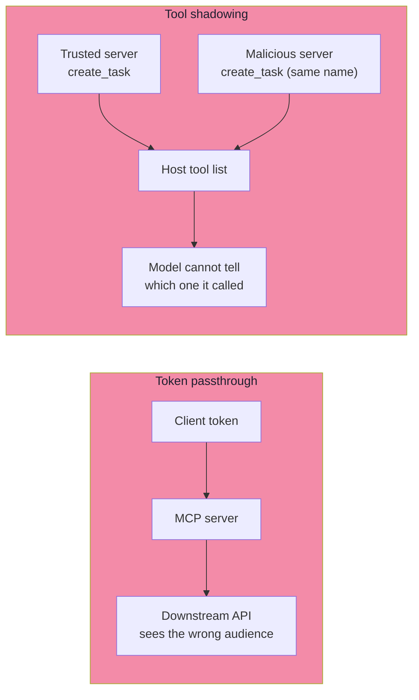

> **Both are consequences of the same design property:** the model sees a **flat, merged view** of capabilities from many servers with different trust levels. The host is the only component that knows the difference — so the host must be the component that enforces it.

---

## 8.3 Authorization: Remote Servers Are OAuth Resource Servers *(beyond the lecture)*

For a **local** server over stdio, the trust boundary is the operating system: the server runs as the user, with the user's privileges. There is no token and no OAuth.

For a **remote** server over Streamable HTTP, the picture changes completely, and the specification is strict:

> **A remote MCP server must be treated as an OAuth 2.1 resource server, and must not be used as an authorization server.**

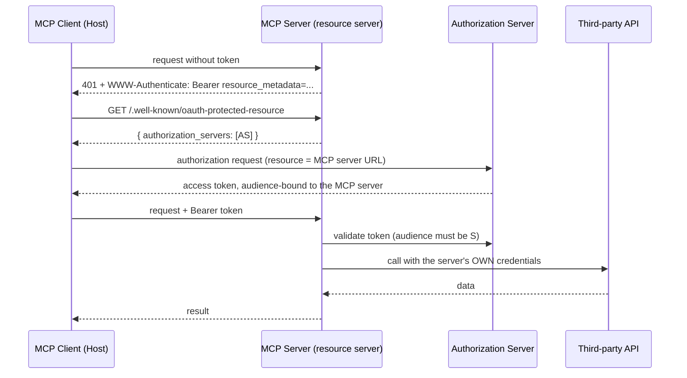

### The rules that prevent the classic attacks

| Rule | Prevents |
|---|---|
| Tokens **must** be audience-bound to the MCP server (Resource Indicators, RFC 8707) | Token passthrough; a token for service A being replayed at service B |
| The server **must not** accept a token that was not issued for it | Audience confusion |
| The server **must not** forward the client's token downstream; it uses its **own** credentials | Confused deputy; privilege escalation |
| The client discovers the authorization server from **protected resource metadata** (RFC 9728) rather than guessing | Malicious authorization-server redirection |
| Consent must be **per client**, not per static shared client ID | Confused deputy |
| Authorization URLs must be **validated** before opening | Phishing / open-redirect |

### Scope minimisation: least privilege for tokens

The failure mode is a token with `files:*`, `db:*`, `admin:*` granted up front, because the server published every scope it *could* support and the client requested them all.

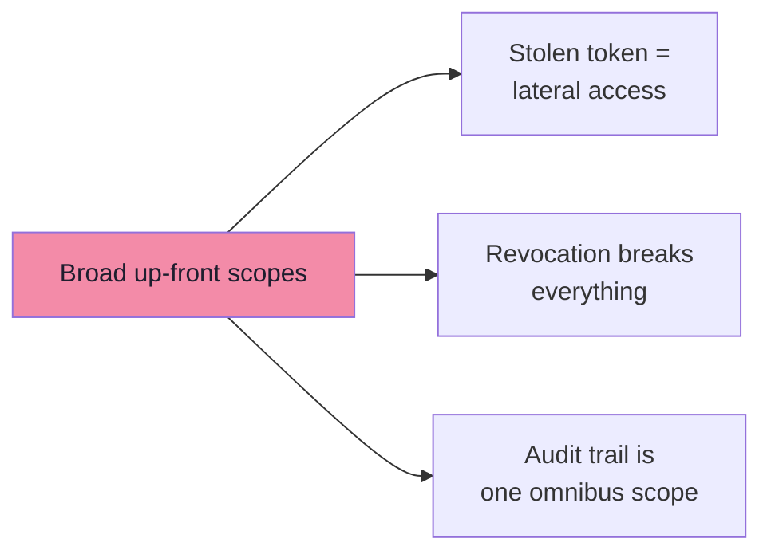

| Do | Don't |
|---|---|
| Start with a minimal set (e.g. `mcp:tools-basic`) | Publish all possible scopes in `scopes_supported` |
| Elevate **incrementally** via targeted `WWW-Authenticate scope="…"` challenges | Use wildcard or omnibus scopes (`*`, `all`, `full-access`) |
| Accept **down-scoped** tokens (a subset of what was requested) | Bundle unrelated privileges to pre-empt future prompts |
| Log every elevation with a correlation ID | Return the entire scope catalogue in every challenge |
| Version scope semantics when they change | Change a scope's meaning silently |

> **The pattern is called *progressive least privilege*:** ask for discovery and read operations first, and request a privileged scope only at the moment a privileged tool is actually invoked. The user then sees a consent dialog **in context**, which is both better security and better UX.

### What this means for the host

| Host duty | Detail |
|---|---|
| Store tokens securely | Never in logs, prompts or tool arguments |
| Bind tokens to the user, not the process | A shared token across users is a cross-tenant leak |
| Re-authenticate on 401 | Refresh or re-consent; do not silently degrade |
| Show the requesting server | The user must know *who* is asking |
| Never let the model see tokens | Credentials are host-side infrastructure, not context |

### Where a server actually runs: the four deployment paths *(beyond the lecture)*

§8.3 is about *authorising* a remote server. The prior question is which of four shapes the server is, because that
choice decides the transport, the auth story, and how a user installs it.

| Path | Transport | Auth | Fits when |
|---|---|---|---|
| **Local (stdio)** | stdin/stdout; the client spawns it as a child process | none — it runs with the user's own permissions | the server must touch the user's machine: local files, desktop apps, localhost services |
| **Remote (Streamable HTTP)** | HTTP; one deployment serves everyone | OAuth 2.0 as a resource server (§8.3) | it wraps a cloud API — zero install friction, and redirects/token storage work properly |
| **Bundled (MCPB)** | stdio, packaged with its own runtime | none | same as local, but the user should not have to install Node or Python first |
| **Prototype (local stdio)** | stdio | none | you are still iterating; plan the upgrade path to one of the above |

The ordering is a progression of *who pays the cost*:

- **Local stdio** costs the user an install and a config file. The client spawns the server itself — which is why a
  stdio server must never write to stdout (§8.5, observability): **stdout is the protocol channel.**
- **Remote HTTP** costs you a deployment and an auth implementation, and costs the user nothing. That trade is why it
  is the default for anything wrapping a cloud API.
- **MCPB** keeps a local server's power without making the user a developer.

#### Configuring a local server

A local server is wired up by declaring it to the client — name, command, arguments — in the client's own config file.
For Claude Desktop that file is `claude_desktop_config.json`:

```json
{
  "mcpServers": {
    "filesystem": {
      "command": "npx",
      "args": ["-y", "@modelcontextprotocol/server-filesystem", "/Users/username/Desktop"]
    }
  }
}
```

Four things to read out of it, because each is a place people go wrong:

| Field | Meaning | Common mistake |
|---|---|---|
| the key (`"filesystem"`) | the friendly name the client shows | renaming it later and expecting saved settings to follow |
| `command` | the executable the client spawns | a relative path — it must be absolute, or resolvable on `PATH` |
| `args` | arguments, usually including the **absolute** path to the server | relative paths, which resolve against the *client's* working directory, not yours |
| `env` | extra environment variables | assuming the client inherits your shell's environment — it does not |

> **The security rule that falls straight out of this file:** the server runs **with the user's permissions**, so the
> paths in `args` are an access-control boundary. Grant a directory and you have granted everything inside it.

#### Configuring a remote server

A remote server is added by **URL** rather than by command, through the client's connector UI — and the interesting
half is the handshake that follows:

1. The client POSTs to the server's MCP endpoint.
2. The server answers `401` with a `WWW-Authenticate` challenge naming its **protected-resource metadata**.
3. The client fetches that metadata, discovers the authorization server, and runs the OAuth flow.
4. Tokens are stored by the **client**, scoped to that server — and the model never sees them (§8.3).

That is §8.3 compressed into a sequence, and it is why a remote server can be added with a URL and a consent click
instead of a config file and a restart. It is also why **the URL is itself a trust decision**: the client is about to
send it credentials.

#### The debugging tool to reach for first

Whatever the transport, the **MCP Inspector** speaks the protocol directly — no LLM, no host — so it is the fastest way
to separate *my server is wrong* from *my host is wrong*.

```bash
# stdio server, with the UI
npx @modelcontextprotocol/inspector npx tsx src/index.ts

# one method, no UI
npx @modelcontextprotocol/inspector --cli npx tsx src/index.ts --method tools/list
```

> **Which protocol era is it testing?** The Inspector defaults to the **legacy** era, which exercises the 2025-era
> `initialize` handshake. To exercise a `2026-07-28` client — the stateless model with `server/discover` — pass
> `--protocol-era modern`:
>
> ```bash
> npx @modelcontextprotocol/inspector --cli npx tsx src/index.ts --protocol-era modern --method tools/list
> ```
>
> Running both is the useful habit while the ecosystem is mid-migration: `legacy` proves you still serve the clients
> that exist today, `modern` proves you serve the ones arriving.

---

## 8.4 The Practical Demo Architecture

> **To understand MCP clearly, build two separate applications.**

The lecture is prescriptive here, and the prescription is the point: **the separation is the lesson.**

```text
1. TASK MCP SERVER

   No LLM
   No OpenAI

   Exposes:
   createTask
   listTasks
   completeTask
```

and:

```text
2. AI APPLICATION

   Contains the LLM
   Contains an MCP Client

   Connects to Task MCP Server
   Discovers its capabilities
   Makes those tools available to the LLM
```

> **Architecture:**

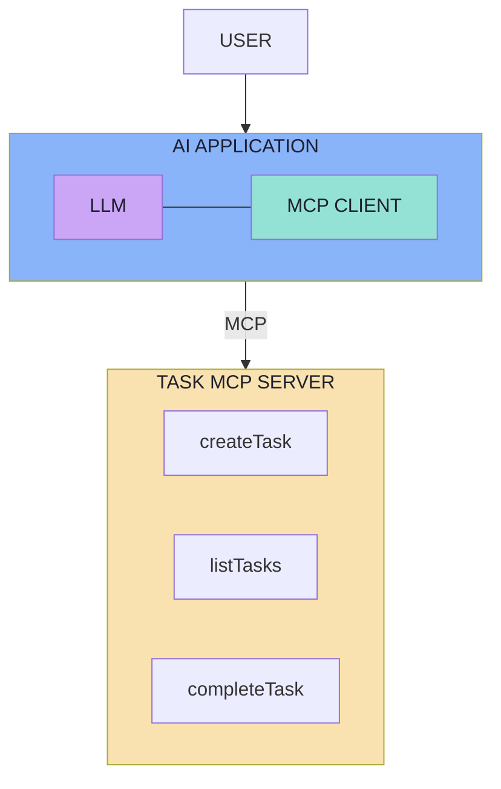

> **This separation makes one thing very clear:**

```text
MCP SERVER
    ≠
LLM Application
```

> **The MCP Server provides capabilities.**
> **The AI application contains the intelligence that decides when those capabilities should be used.**

### Why building them separately is the right pedagogy

| If you build them together | If you build them separately |
|---|---|
| You cannot tell where the AI ends and the capability begins | The boundary is physically enforced by a process/network edge |
| Testing requires a model | The server is testable with a CLI or a test suite |
| The server silently grows model logic | The server cannot see the conversation at all |
| Swapping the model is a rewrite | Swapping the model touches only the host |
| You never feel the protocol | You implement the protocol, so you learn it |

> **The strongest argument for the split is the third row.** When the server is a separate process, it *cannot* accidentally depend on conversation history — isolation becomes structural rather than aspirational.

### A minimal way to verify the split

The first thing to build is not the AI application. It is the server, exercised **without any model**:

```text
# pseudo-code — drive the server with no LLM anywhere
list  -> expect [createTask, listTasks, completeTask]
call  -> createTask(title: "Record MCP Video")
      -> expect { id, title, status: "PENDING" }
list  -> expect the new task to appear
call  -> completeTask(id)
      -> expect status: "DONE"
```

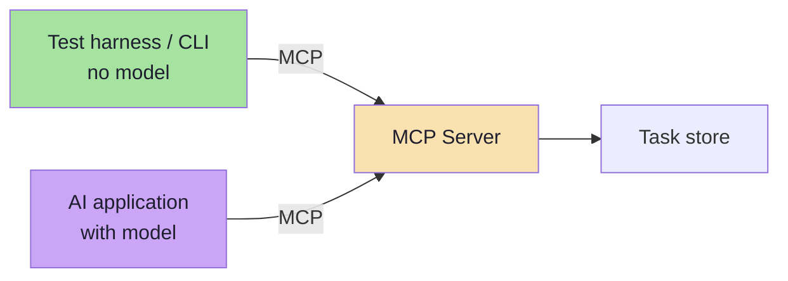

> **If a capability cannot be exercised without an LLM, it is in the wrong component.** That is the single most useful test in this whole lecture.

### Observing the protocol

Two practical aids worth knowing about:

| Tool | What it gives you |
|---|---|
| **MCP Inspector** | An interactive client for a server: lists tools, calls them, shows raw JSON-RPC |
| **Raw logging** | stdio servers log to `stderr`; HTTP servers log requests/responses |
| **A proxy in the middle** | Watch both directions of the stream — the fastest way to see the handoff |

> **Watch the wire once.** Seeing `tools/list` return and `tools/call` go out makes the whole architecture obvious in a way that diagrams cannot.

---

## 8.5 Production Concerns *(beyond the lecture)*

The lecture's demo architecture is two applications and a happy path. Production adds a specific set of concerns — each one a well-known distributed-systems problem wearing new clothes.

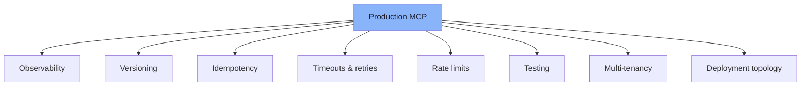

### 1. Observability

| What to record | Why |
|---|---|
| Every `tools/list` and `tools/call` (name, args hash, duration, outcome) | The audit trail: "who ran what, when" |
| The full lifecycle trace: discovered → selected → authorised → invoked → returned | Turns "the AI is weird" into a specific transition |
| The **tool catalogue version** used for each turn | Reproducibility; a catalogue change explains a behaviour change |
| Token/scope used per call | Answers "on whose authority did this happen?" |
| Prompt token cost of the tool catalogue | Catches the §7.9 budget problem early |

> **Never log raw tokens or full tool arguments.** Arguments frequently contain PII or secrets. Log a hash plus a redacted preview.

### 2. Versioning

| Layer | How to version |
|---|---|
| Protocol revision | Negotiated; declared per request in newer revisions |
| Server version | `serverInfo.version`; visible in discovery |
| Tool contract | **Add** tools freely; **never** silently change an existing tool's schema |
| Breaking tool change | New name (`create_task_v2`), deprecate the old one, keep both during migration |
| Prompt templates | Versioned alongside the server; a changed template is a behaviour change |

> **The one rule to remember:** a tool's name + schema is a published contract. Clients cache it, models learn it, and consent was granted against it. Change it the way you would change a public API.

### 3. Idempotency

Every side-effecting tool will eventually be called twice — because of a retry, a timeout, or an agent loop.

```ts
// pseudo-code — idempotency at the tool boundary
async function createTask(args, ctx) {
  const key = ctx.idempotencyKey ?? hash(args);   // caller-supplied or derived
  const existing = await store.findByKey(key);
  if (existing) return existing;                  // replay, not duplicate
  return store.insert({ ...args, idempotencyKey: key });
}
```

| Tool class | Retry policy |
|---|---|
| `readOnlyHint: true` | Retry freely |
| `idempotentHint: true` | Retry on transport failure |
| `destructiveHint: true` and not idempotent | **Never** auto-retry; require explicit user intent |

### 4. Timeouts, retries and circuit breaking

| Control | Suggested shape |
|---|---|
| Per-call timeout | A few seconds for local, longer for remote; **always** a maximum |
| Cancellation | Send a cancellation notification on timeout; stop waiting |
| Retry | Only on transport errors, only for idempotent tools, exponential backoff with jitter |
| Circuit breaker | After N consecutive failures, stop calling and tell the model the tool is unavailable |
| Graceful degradation | The model should be told "this capability is temporarily unavailable" — not left to guess |

### 5. Rate limits and quotas

| Where | What to limit |
|---|---|
| Server | Invocations per tool, per caller, per minute |
| Host | Total tool calls per turn (agent loop guard) |
| Downstream vendor | Respect their limits; surface `429` as `isError` with retry guidance |

> **Agent loops are the specific hazard.** A model that keeps retrying a failing tool can generate hundreds of calls in a minute. A per-turn call budget is not optional.

### 6. Testing

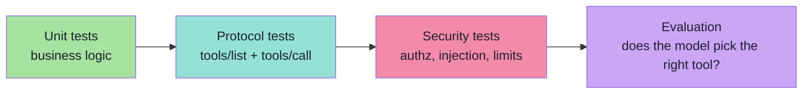

| Layer | What it proves | Needs a model? |
|---|---|---|
| Unit | The capability is correct | No |
| Protocol | The server speaks MCP correctly | No |
| Security | Authz, validation and limits hold under abuse | No |
| **Evaluation** | The model selects correctly and often enough | **Yes** |

> **Three of the four layers need no model at all.** This is the practical payoff of the lecture's insistence that an MCP server is not an LLM application: most of your testing gets dramatically cheaper.

### 7. Multi-tenancy

| Concern | Requirement |
|---|---|
| Identity | Never infer the user from a tool argument; derive from the transport/session |
| Credentials | One credential set per user/tenant; never a shared service account across tenants |
| Caching | Cache keys must include the tenant — a shared tool result is a cross-tenant leak |
| Resources | Resource URIs must be scoped and authorised per tenant |
| Consent | Consent is per user and per server; never inherit another user's approval |

### 8. Deployment topology

| Option | When | Trade-off |
|---|---|---|
| **stdio, in the app's process tree** | Desktop/IDE assistants, single user | Simplest; no network; not shareable |
| **stdio, launched per session** | Multi-user local tooling | Isolation per session; process overhead |
| **Remote Streamable HTTP, one server many clients** | Shared capability, SaaS | Needs OAuth, rate limits, tenancy |
| **MCP gateway in front of many servers** | Enterprise: many teams, many servers | Central policy and audit; one more component to run |

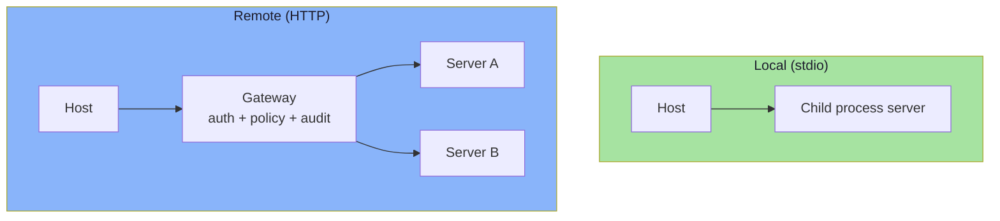

> **The gateway pattern is the enterprise answer** to the flat-tool-list problem: one place to apply trust tiers, namespacing, scopes and audit — because the host should not have to trust every server it is configured with.

---

## 8.6 A Build Order for a First MCP Server

The lecture's demo architecture, turned into an order of work. Each step is verifiable before the next begins.

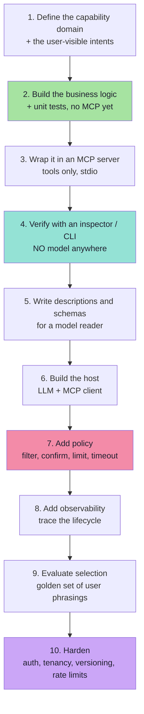

| Step | Deliverable | How you know it is done |
|---|---|---|
| 1 | A list of intents (not DB operations) | You can name each in the user's words |
| 2 | Plain functions + tests | Tests pass with no protocol involved |
| 3 | A stdio server exposing tools | `tools/list` returns the expected catalogue |
| 4 | A scripted exercise of every tool | Every tool runs, succeeds and fails correctly |
| 5 | Descriptions with disambiguation clauses; enums; required lists | A reviewer can tell which tool to call for 10 phrasings |
| 6 | A host that discovers and calls | The model completes one end-to-end task |
| 7 | Policy layer | Destructive tools prompt; unknown tools never reach the model |
| 8 | Lifecycle traces | You can answer "what happened" for any turn |
| 9 | A golden set of ~20–50 phrasings | Selection accuracy is a number you can track |
| 10 | Hardened deployment | Auth, scopes, limits, versioning documented and tested |

> **Steps 2 and 4 are the ones teams skip, and they are the two that make everything else cheap.** Build the capability and prove it works *before* adding a model to the loop.

---

## 8.7 Common Mistakes

| Mistake | Why it hurts | Correct habit |
|---|---|---|
| Treating discovery as authorisation | Every discovered tool becomes callable | Discovery is an inventory; policy is a separate grant |
| Auto-approving everything to reduce friction | One destructive call destroys trust permanently | Classify by `destructiveHint`; confirm the dangerous ones |
| Passing the user's token to a downstream API | Token passthrough — breaks audience binding | The server uses its **own** credentials |
| Accepting tokens not issued for your server | Audience confusion; replay across services | Validate the audience; reject foreign tokens |
| Sharing one OAuth client ID across all clients | Confused-deputy vulnerability | Per-client consent; no static shared client ID |
| Requesting all scopes up front | Blast radius of a stolen token; consent fatigue | Progressive least privilege |
| Trusting a tool description blindly | Tool poisoning and rug pulls | Show descriptions in consent; re-consent on change |
| Letting the model see a flat list of untrusted tools | Tool shadowing; the model cannot tell servers apart | Namespace and filter by trust tier |
| Not sanitising tool output | Prompt injection via returned content | Sanitise and delimit; label as untrusted |
| Fetching model-supplied URLs | SSRF into internal networks | Allow-list destinations; block private ranges |
| Assuming a stdio server is harmless | It runs with the user's privileges | Sandbox spawned processes; restrict filesystem |
| No per-turn call budget | A retry loop can exhaust a vendor quota | Rate limit at the host and the server |
| No audit trail | You cannot answer "who ran this and on whose authority" | Log every call with identity and catalogue version |
| Silently changing a tool's schema | Cached clients and granted consent become invalid | New name; deprecate; migrate |
| Logging raw arguments | PII and secrets land in your log store | Hash plus redacted preview |

---

## 8.8 Chapter Summary

| Idea | Statement |
|---|---|
| The governing sentence | **MCP standardizes communication; it does not remove the application's responsibility for security and authorization** |
| Discovery vs authority | Discovery is an inventory; the host decides what may actually run |
| Host controls | Permissions, user approval, tool filtering, authentication, security policies |
| The lecture's example | `readFile` auto-approved; `deleteRepository` requires explicit confirmation |
| The threat model | Confused deputy, token passthrough, injection via output, tool poisoning/rug pull, shadowing, session hijacking, SSRF, local compromise |
| Authorization | Remote servers are **OAuth 2.1 resource servers**; tokens are audience-bound; the server uses its own credentials |
| Scopes | Progressive least privilege — minimal initial scope, incremental elevation |
| The demo architecture | **Two applications**: a Task MCP Server with no LLM, and an AI application with LLM + MCP Client |
| The separation | `MCP SERVER ≠ LLM Application` — capabilities vs the intelligence that uses them |
| Production | Observability, versioning, idempotency, timeouts, rate limits, testing, tenancy, topology |
| The build order | Business logic → server → **model-free verification** → descriptions → host → policy → traces → evaluation → hardening |

> **The architecture in one line:** the **server** provides capabilities, the **host** decides when they are used, and the **model** only proposes.

---

## Final Mental Model

> The easiest way to remember everything is:
>
> ```text
> Tool Calling
> =
> The LLM decides which capability to use.
>
> MCP
> =
> The AI application gets access to external
> capabilities through a standard protocol.
> ```

> **And the complete flow is:**
>
> ```text
> MCP Server exposes capabilities
>              |
> MCP Client discovers capabilities
>              |
> Host gives relevant tools to LLM
>              |
> LLM selects a tool
>              |
> MCP Client invokes it
>              |
> MCP Server executes it
>              |
> Result returns to the LLM
>              |
> User gets the final response
> ```

---

## Key Takeaways

The lecture's own summary, reproduced:

- **MCP** stands for **Model Context Protocol**.
- MCP provides a **standard way for AI applications to connect with external capabilities and context**.
- An **MCP Server does not need an LLM**.
- The **Host** manages the AI experience.
- The **MCP Client** communicates using MCP.
- The **MCP Server** exposes capabilities.
- MCP Servers can expose **Tools, Resources, and Prompts**.
- `tools/list` is used for **tool discovery**.
- `tools/call` is used to **invoke a tool**.
- **Tool Calling and MCP are complementary, not competing concepts.**
- Tool Calling decides **what capability to use**.
- MCP standardizes **how the application accesses that external capability**.
- MCP can **coexist with REST APIs, databases, RAG systems, files, and existing backend services**.
- The real benefit becomes clear when the **same external capabilities need to be reused by multiple AI applications**.

---

## The Lecture in Ten Sentences

1. **Tool calling solves a single application**; the moment capabilities are shared, you have an integration problem.
2. **The integration problem is N × M** — five apps and ten systems is fifty integrations to own.
3. **A standard does not add capability; it adds a common way to access one** — MCP is a socket, not a smarter tool.
4. **MCP is a standard protocol through which AI applications connect to external tools and data.**
5. **An MCP Server is a capability provider and needs no LLM** — it is ordinary, testable business logic behind a standard door.
6. **The architecture has three roles**: Host (orchestrates), Client (speaks the protocol, one per server), Server (does the work).
7. **A server can expose three primitives**: Tools (do), Resources (know), Prompts (reuse).
8. **Tool calling decides *which* capability and with what arguments; MCP decides *where it comes from* and *how it is reached*.**
9. **The lifecycle is**: expose → discover → give to the model → model chooses → invoke → execute → return → respond.
10. **Security stays with the host and the server** — discovery is not permission, and standardised communication is not standardised safety.

---

## Where This Goes Next

- **[Chapter 01](./01_The_Integration_Problem_and_Why_Standards_Win.md)** — why a protocol exists at all.
- **[Chapter 04](./04_Host_Client_Server_Architecture.md)** — the three roles, transports and lifecycle.
- **[Chapter 07](./07_Discovery_Invocation_and_Lifecycle.md)** — the end-to-end lifecycle and its diagnostics.
- Related: [Lecture 05](../../Lecture%2005/notes/README.md) (tool calling, agents) · [Lecture 13](../../Lecture%2013/notes/README.md) (structured outputs, tools and MCP introduction) · [Lecture 12](../../Lecture%2012/notes/README.md) (RAG, for the Resources-vs-RAG comparison).

---

**Back to:** [Lecture 14 — Chapter Index](./README.md) · [Complete Consolidated Notes](./Lecture_14_Complete_Notes.md)


