# Lecture 14: MCP Server from First Principles — Complete Consolidated Notes

## The Whole Lecture on One Reference

> **Course:** Forward Deployed Engineer (FDE) & Generative AI Systems
> **Lecture:** 14 — MCP Server from First Principles
> **Source material:** [`Notes.pdf`](./Notes.pdf) (38-page lecture script) and [`Excalidraw-Notes.svg`](./Excalidraw-Notes.svg) (the board)
> **Scope:** Chapters [01](./01_The_Integration_Problem_and_Why_Standards_Win.md) → [08](./08_Security_Production_and_Practical_Architecture.md)
> **Diagram format:** Mermaid only
> **Snippet style:** TypeScript-style pseudo-code — illustrative, not production code
> **Prerequisites:** [Lecture 05](../../Lecture%2005/notes/README.md) (tool calling and agents) · [Lecture 13](../../Lecture%2013/notes/README.md) (structured outputs)

---

## How to Use This Document

This is the **map**, not the territory. Each part compresses one chapter to its load-bearing ideas and decisions, then links out. The chapters hold the full reasoning, protocol messages, worked examples and edge cases.

| If you want to… | Read | Time |
|---|---|---|
| Recall what the lecture was about | [Executive Summary](#executive-summary) → [The Three Roles](#cheat-sheet-the-three-roles) | 6 min |
| Explain why a protocol is needed | [Part 1](#part-1--the-integration-problem) | 5 min |
| Define MCP precisely | [Part 2](#part-2--what-mcp-is) → [Glossary](#glossary) | 6 min |
| Stop confusing MCP with tool calling | [Part 3](#part-3--mcp-vs-tool-calling) | 6 min |
| Understand the architecture | [Part 4](#part-4--host-client-and-server) | 7 min |
| Write a good tool | [Part 5](#part-5--the-tools-primitive) → [Tool Rules](#cheat-sheet-the-tool-definition-rules) | 10 min |
| Choose the right primitive | [Part 6](#part-6--resources-and-prompts) → [Primitive Chooser](#cheat-sheet-which-primitive-should-this-be) | 8 min |
| Debug a broken call | [Part 7](#part-7--the-tool-lifecycle) → [Diagnostic Order](#the-five-step-diagnostic-order) | 8 min |
| Ship it safely | [Part 8](#part-8--security-and-production) + [Go-Live Checklist](#go-live-checklist) | 12 min |
| Prep for an interview | [Ten Sentences](#the-lecture-in-ten-sentences), [Misconceptions](#common-misconceptions), [Self-Check](#self-check-questions) | 20 min |

> **Depth policy.** These notes say *what matters, what it costs, and when it breaks*. The chapters say *how*.

---

## Executive Summary

### The Thesis

> **Tool calling solved how a model asks for an action. It did not solve how an application gets access to that action at all. MCP is a standard protocol that turns an N × M integration problem into an N + M one — and it does so without adding a single new capability to the model. It standardises the doorway, not the intelligence behind it.**

The lecture begins with something that already works perfectly:

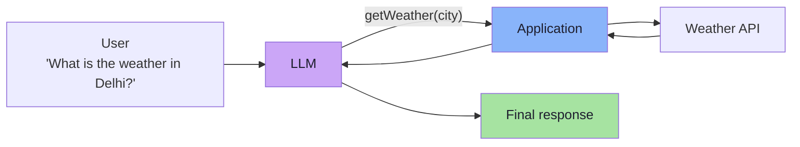

> **For a single application, this architecture works perfectly well.**

The problem appears at the **second application** — and becomes arithmetic at the sixth.

### The Lecture in One Diagram

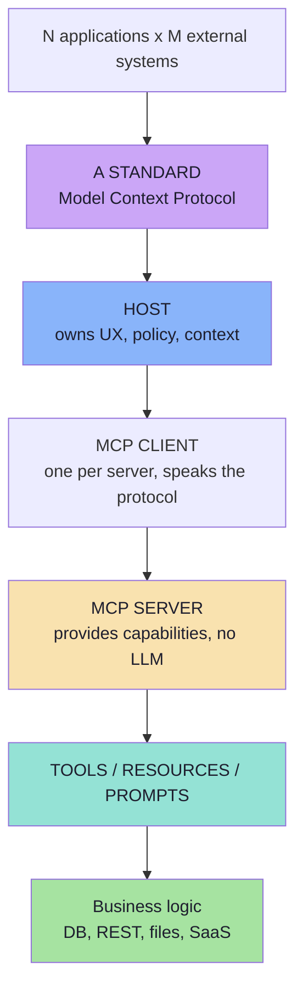

Read it top to bottom: **a shared problem becomes a shared protocol, which becomes three clean roles, which becomes a standard surface over ordinary software.**

### Where Each Idea Lives

| Idea | Chapter |
|---|---|
| Tool calling recap; the six consumers; N × M; standards | [01](./01_The_Integration_Problem_and_Why_Standards_Win.md) |
| MCP definition; MCP Server; no-LLM rule; MCP vs REST; vs microservice | [02](./02_What_MCP_Is_Protocol_Server_and_Standard_Interface.md) |
| The two layers; the handoff; structured output connection; combined flow | [03](./03_MCP_vs_Tool_Calling_Complementary_Layers.md) |
| Host/Client/Server; the 1:1 rule; transports; lifecycle | [04](./04_Host_Client_Server_Architecture.md) |
| Tool anatomy; discovery; invocation; results; errors; schema craft | [05](./05_The_Tools_Primitive.md) |
| Resources; Tool vs Resource; Resources vs RAG; Prompts; control model | [06](./06_Resources_and_Prompts.md) |
| The eight-step lifecycle; dynamic discovery; caching; diagnostics | [07](./07_Discovery_Invocation_and_Lifecycle.md) |
| Security in the host; threat model; OAuth; demo architecture | [08](./08_Security_Production_and_Practical_Architecture.md) |

### The Lecture in Ten Sentences

1. **Tool calling works perfectly for one application** — and that is not in dispute.
2. **The problem begins at the second consumer**: six AI applications × five capabilities = repeated, drifting, independently-secured integrations.
3. **The integration problem scales as N × M** (5 apps × 10 systems = 50); a standard makes it N + M (15).
4. **A standard does not necessarily provide a new capability; it provides a common way to access one.**
5. **MCP stands for Model Context Protocol** — a standard protocol through which AI applications connect to external tools and data.
6. **An MCP Server is a capability provider and needs no LLM** — it is ordinary business logic behind a standard interface.
7. **The architecture has three roles**: the **Host** (orchestrates), the **MCP Client** (speaks the protocol, one per server), and the **MCP Server** (does the work).
8. **A server exposes three primitives**: **Tools** (do), **Resources** (know), **Prompts** (reuse).
9. **Tool calling answers "which capability, with what arguments?"; MCP answers "where do those tools come from, and how are they accessed?"** — they are complementary, not competing.
10. **Security stays with the host and the server** — discovery is not permission, and standardised communication is not standardised safety.

---

## Part 1 — The Integration Problem

> Full chapter: **[01_The_Integration_Problem_and_Why_Standards_Win.md](./01_The_Integration_Problem_and_Why_Standards_Win.md)**

### The starting point

A user asks *"What is the weather in Delhi?"* The model cannot know it, so the application gives it a tool — in the lecture's Java/Spring AI reference implementation:

```java
@Tool
public String getWeather(String city) {
    // Call weather API
}
```

The model requests, the **application executes**, the result returns, the model writes prose.

> **For a single application, this architecture works perfectly well.**

### The same five capabilities, six consumers

| Capability | Consumer apps |
|---|---|
| `getCourseDetails()`, `searchVideos()`, `createStudentTicket()`, `getStudentProgress()`, `scheduleMentorshipSession()` | Coder Army Chatbot · Internal Teacher Assistant · VS Code AI Assistant · Desktop AI Assistant · Support Agent · CLI Agent |

Each app must independently answer **six questions**:

| # | Question | Becomes in MCP |
|---|---|---|
| 1 | What capabilities are available? | `tools/list`, `resources/list`, `prompts/list` |
| 2 | Where are they? | a transport / endpoint |
| 3 | What parameters do they need? | `inputSchema` |
| 4 | How should they be called? | `tools/call` |
| 5 | What do they return? | `content[]` (+ `outputSchema`) |
| 6 | How should authentication work? | OAuth 2.1 at the transport |

> **This creates an integration problem.**

### The arithmetic

| Situation | Integrations | At 5 apps × 10 systems |
|---|---|---|
| No standard | **N × M** | 50 |
| One protocol | **N + M** | 15 |

The **shape** matters more than the number: with a protocol, a vendor change breaks **one server**, and a new app is configuration rather than an engineering project.

### The precedent: standards we already use

| Standard | Fixes | Leaves free |
|---|---|---|
| USB | Connector, power, enumeration | What the device does |
| HTTP | Request/response semantics, verbs | The resource model |
| JDBC | Driver interface, error codes | SQL dialect, schema |
| SQL | The query language | Storage engine |
| REST | Convention for resources/verbs | Payload design, auth |
| SMTP | Envelope, relay, errors | Mailbox semantics |

> **A standard does not necessarily provide a new capability.**
> **It provides a common way to access a capability.**

### The dependency rule

| Dependency | Direction | Consequence |
|---|---|---|
| Application → protocol | inward | Depends on a *specification*, not vendors |
| Server → its backend | inward | Absorbs vendor churn; clients never see it |
| LLM → server | **none** | The model never talks to a server |
| Server → other servers | **none** | Isolation makes untrusted servers safe to connect |

### The adoption rule

> Adopt a protocol when the **second consumer** appears, or when you **consume** capabilities you do not own. Before that, a direct tool function is the better engineering.

---

## Part 2 — What MCP Is

> Full chapter: **[02_What_MCP_Is_Protocol_Server_and_Standard_Interface.md](./02_What_MCP_Is_Protocol_Server_and_Standard_Interface.md)**

### The definition

> **MCP stands for Model Context Protocol.**
> **MCP is a standard protocol through which AI applications can connect to external tools and data.**

Every word is load-bearing: it is a **standard** (published, versioned), a **protocol** (messages, not code), for **AI applications** (the client is a host), about **connecting to** (access, not capability), **external** (outside the process), **tools and data** (do vs know).

### An MCP Server

> **An MCP Server is a program that exposes capabilities through the MCP protocol.**

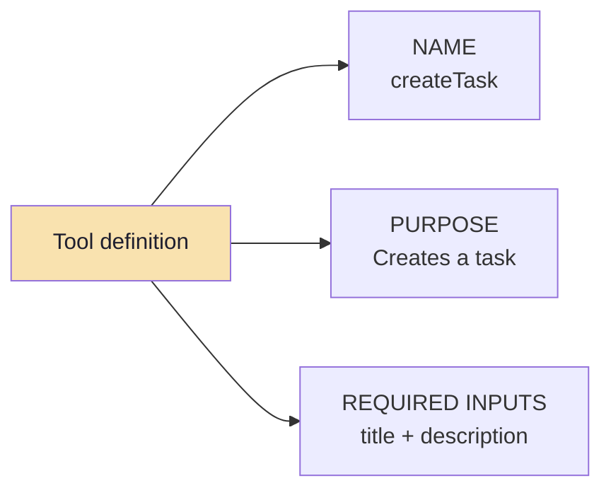

The client learns **name, purpose and required inputs** — then invokes it, and **the MCP Server executes the underlying business logic.**

### The three boundaries the lecture insists on

| Boundary | Statement | Why it matters |
|---|---|---|
| **Server ≠ LLM** | An MCP Server does not need an LLM. It does not need OpenAI, Claude, Gemini or a `ChatClient` | Servers are cheap, deterministic, testable and boring to secure |
| **MCP ≠ REST** | MCP does not make REST obsolete. REST exposes HTTP endpoints; MCP exposes **AI-oriented concepts**: tools, tool descriptions, input schemas, resources, prompts, capabilities | Keep REST inside; add a model-readable front door outside |
| **Server ≠ microservice** | An MCP server need not be a deployable with a port; it may be a thin, local, in-repo adapter | Avoid deployment sprawl |

### Why not just use REST?

| | REST API | MCP Server |
|---|---|---|
| Audience | **Programmers** | **Models and hosts** |
| Exposes | Endpoints, verbs, status codes | Tools, descriptions, schemas, resources, prompts |
| Discovery | Read the docs / OpenAPI | Ask at runtime (`tools/list`) |
| Unit of meaning | A resource + a verb | A **capability a model can read** |

> **REST and MCP solve different integration problems** — and they compose: MCP on the outside, REST on the inside, unchanged.

### One host, many servers

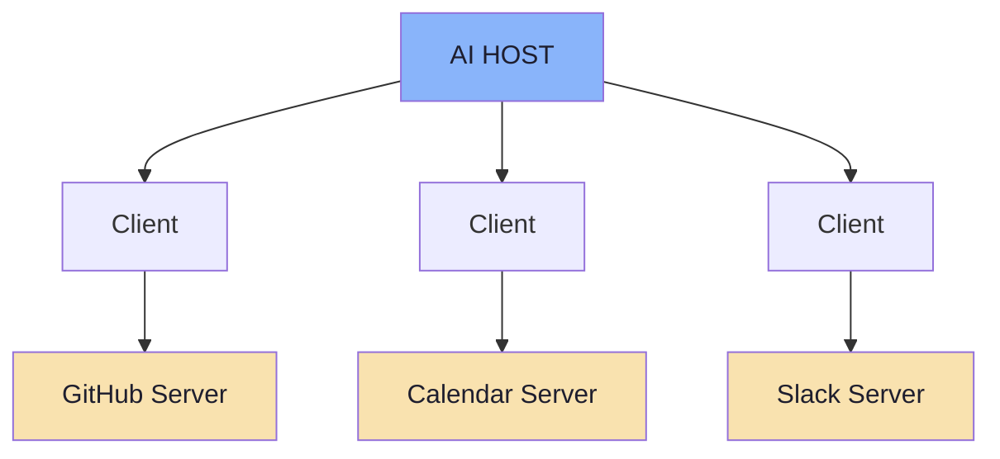

The model gains `createGitHubIssue()`, `scheduleMeeting()`, `sendSlackMessage()` — **without those implementations living inside the AI application**.

> **The catch:** the model sees a **flat, merged tool list**. It cannot tell a trusted internal server from a third-party one. That is a host responsibility — see Part 8.

### Underneath the concepts *(beyond the lecture)*

| Layer | Detail |
|---|---|
| Message format | **JSON-RPC 2.0**: request, response, notification, error |
| Message framing | **stdio**: newline-delimited; **HTTP**: one message per POST |
| Error codes | `-32601` method not found · `-32602` invalid params · `-32603` internal · `-32002` resource not found |
| Versioning | Date-based revisions: `2024-11-05` → `2025-03-26` → `2025-06-18` → `2025-11-25` → `2026-07-28` |

> **Crucial nuance:** a tool that **ran and failed** is *not* a JSON-RPC error. It is a normal result with `isError: true`. Protocol errors mean *the call never happened*; `isError` means *the call happened and failed*. Conflating them makes retries dangerous.

---

## Part 3 — MCP vs Tool Calling

> Full chapter: **[03_MCP_vs_Tool_Calling_Complementary_Layers.md](./03_MCP_vs_Tool_Calling_Complementary_Layers.md)**

### The two questions

> **Tool Calling answers:** *Which capability should the model use, and with what arguments?*
>
> **MCP answers:** *Where do those tools come from, and how does the application access them?*

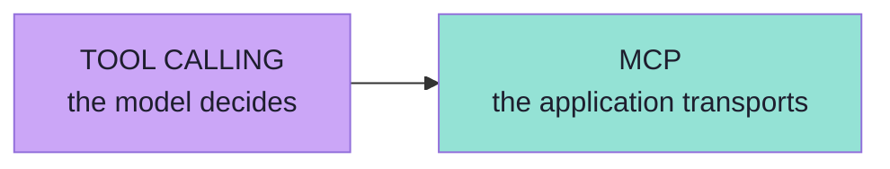

### The handoff

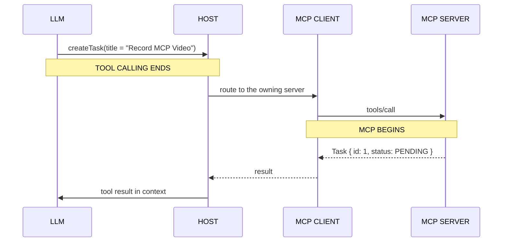

> **Before the handoff everything is probabilistic; after it, everything is deterministic and testable.** That single sentence tells you which engineering discipline to apply where.

### The combined flow (the lecture's reference sequence)

```text
MCP Server exposes tools
          |
MCP Client discovers tools
          |
AI application gives tools to LLM
          |
LLM chooses a tool              <-- TOOL CALLING (the only model step)
          |
Application invokes it through MCP
          |
MCP Server executes the operation
          |
Result goes back to LLM
          |
LLM generates final response
```

**Exactly one of the eight steps is tool calling.** That is the clearest proof the two are complementary.

### The connection with structured output

| | Structured output | Tool calling |
|---|---|---|
| Constrains | The **response shape** | The **arguments shape** |
| Provided by | A response schema | The tool's `inputSchema` |
| Buys | A parseable result | Parseable arguments |
| Cannot buy | Correct *values* | Correct *choice of tool* |

> **A tool's `inputSchema` is structured output applied to arguments.** Schema rules transfer directly to MCP tool design.

### The four combinations

| Combination | When it is right |
|---|---|
| **Tool calling only** | Tools are in-process; one consumer; no reuse |
| **Tool calling + MCP** | Tools are external, shared or third-party — the standard production shape |
| **Neither** | Pure generation; no tools at all |
| **MCP only** | The capability is also consumed by CLI, tests or other services |

### The responsibility matrix

| Decision | Owner |
|---|---|
| Which tool to use, and with what arguments | **The model** |
| Which tools are *visible* to the model | **The host** |
| Whether the call is permitted | **The host** |
| How the call is transported | **MCP** |
| Whether the arguments are sane | **The server** |
| What the call actually does | **The server** |
| Whether to retry after failure | **The host** |
| How the result is presented | **The host** |

> **Tool calling decides; MCP delivers.** A courier does not choose your order, and a customer cannot deliver it themselves.

---

## Part 4 — Host, Client and Server

> Full chapter: **[04_Host_Client_Server_Architecture.md](./04_Host_Client_Server_Architecture.md)**

### The three roles

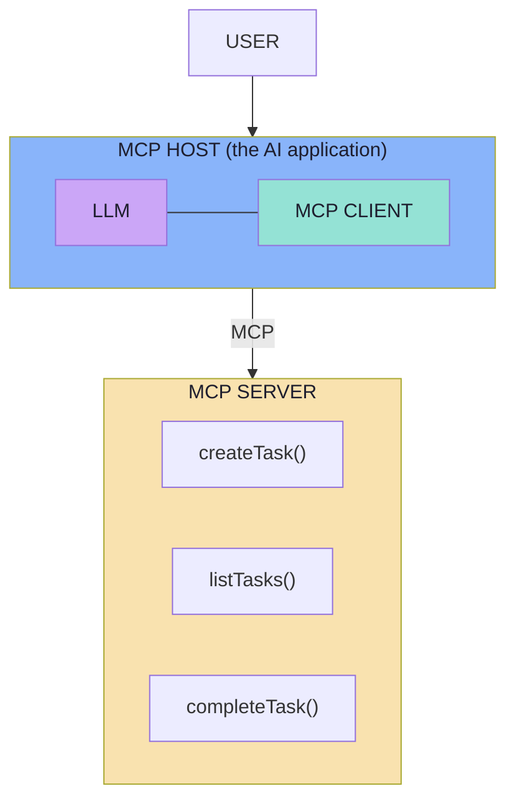

| Component | One-line job | Mental model |
|---|---|---|
| **Host** | Owns the user experience and orchestrates everything | The **conductor** |
| **Client** | Speaks the protocol to exactly one server | The **telephone** |
| **Server** | Provides the capability and does the work | The **workshop** |

### The Host

> **The Host is the main AI application the user interacts with.** Examples: Claude Code, Cursor, a VS Code AI application, a desktop AI application, our own Spring AI application.

```text
Receive user input
Send input + available tools to the LLM
Receive a tool request from the LLM
Use the MCP Client
Call the MCP Server
Receive the result
Send result back to the LLM
Display final response
```

**All policy lives here:** conversation history, which tools reach the model, consent and approval, credentials, cross-server composition, retries and timeouts, UI.

> **Rule of thumb:** if a behaviour is about the *user experience* or *policy*, it belongs to the host.

### The Client

> **The MCP Client is the software component inside the Host that knows how to communicate using MCP.**

The **JDBC analogy** makes it click:

| JDBC | MCP |
|---|---|
| One driver per database | One client per server |
| Hides the vendor's wire protocol | Hides the transport (stdio / HTTP) |
| Exposes a standard API | Exposes standard protocol methods |
| Connection and lifecycle management | Session and lifecycle management |

The client can **discover tools, invoke tools, read resources and retrieve prompts** — and contains **no reasoning**. If you are writing "if the user asks about weather…" inside a client, model logic has leaked into the transport layer.

### The Server

> **The MCP Server is the capability provider.**

Internally it may talk to a database, a REST API, the filesystem, GitHub, Google Calendar, Slack, internal services or files.

> **The MCP Server exposes only the capabilities and context it wants clients to access.**

That sentence is a **security control**: capability minimisation. If `deleteRepository` must never be callable, it must not exist in the server — not merely be hidden from the model.

| Server responsibility | Explanation |
|---|---|
| Expose capabilities | Advertise honestly via `tools/list` |
| Validate inputs | Never trust the model's arguments |
| Authorise the caller | Identity comes from the transport, not a tool argument |
| Execute deterministically | Same inputs, same effect |
| Minimise the surface | Only what is needed |
| Sanitise outputs | Results become model context |

> **The server is the last line of defence.**

### The 1:1 rule

> **A host application creates and manages multiple clients, with each client having a 1:1 relationship with a particular server.**

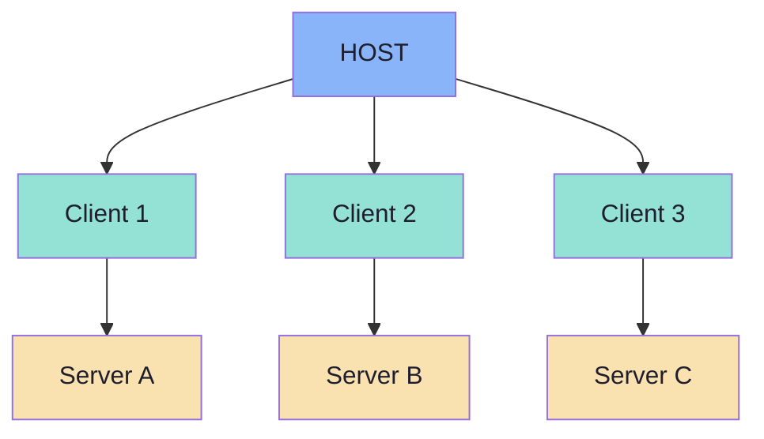

Why: isolation, independent lifecycle, independent permissions, independent capability negotiation, simpler state.

> **The host is the only component that composes.** Servers never talk to servers; cross-server workflows are orchestrated in the host by sequential tool calls.

### Isolation principles *(from the architecture specification)*

1. **Servers should be extremely easy to build** — the host handles orchestration.
2. **Servers should be highly composable** — focused functionality in isolation.
3. **Servers should not be able to read the whole conversation, nor "see into" other servers.**

> **Least context is as important as least privilege.** A server that can see the whole conversation can leak the whole conversation.

### Who owns what

| Responsibility | Host | Client | Server | Model |
|---|---|---|---|---|
| Conversation history, credentials, consent | **✔** | | | |
| Which tools reach the model | **✔** | | | |
| Choose a tool and arguments | | | | **✔** |
| One connection to one server | | **✔** | | |
| Version + capability negotiation | **✔** | **✔** | **✔** | |
| `tools/list` discovery | | **✔** | | |
| Validate arguments against `inputSchema` | | | **✔** | |
| Authorise the caller | **✔** | | **✔** | |
| Execute the operation | | | **✔** | |
| Sanitise outputs before the model | **✔** | | **✔** | |
| Timeouts and retries | **✔** | **✔** | | |

> **Authorisation and output sanitisation are deliberately shared.** The host is a policy layer; the server is a security boundary. Defence in depth is the design.

### Transports *(beyond the lecture)*

| | **stdio** | **Streamable HTTP** |
|---|---|---|
| Where it runs | Same machine, child process | Anywhere |
| Who starts it | The client | Independently |
| Multiple clients? | No — one process per client | **Yes** |
| Needs auth? | Rarely (local trust) | **Yes** — OAuth 2.1 |
| Framing | Newline-delimited JSON-RPC over stdin/stdout | One message per POST; optional SSE stream |
| Logging | `stderr` only — **never** `stdout` | HTTP request/response logs |
| Security | OS user privileges | Validate `Origin`; bind localhost when local; authenticate |

> **Practical rule:** start with **stdio** locally (removes auth, networking and CORS from the problem); move to **Streamable HTTP** when the server must be shared or hosted.

### The lifecycle *(beyond the lecture)*

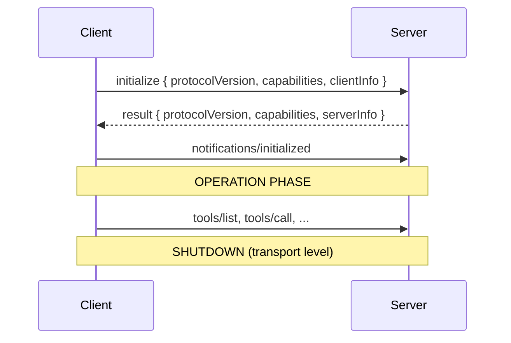

| Concern | Classic handshake | Stateless (2026-07-28+) |
|---|---|---|
| Version | Negotiated once | Sent per request in `_meta` |
| Capabilities | Negotiated once | Declared per request |
| Up-front discovery | `initialize` response | `server/discover` |
| HTTP session | `Mcp-Session-Id` | **Removed** |
| Cross-call state | Implicit session | Explicit server-minted handle as a **tool argument** |

> **Capabilities are permissions, not niceties.** Calling `tools/call` on a server that never declared `tools` is a protocol violation — the correct answer is an error, not a best-effort attempt.

---

## Part 5 — The Tools Primitive

> Full chapter: **[05_The_Tools_Primitive.md](./05_The_Tools_Primitive.md)**

### What a tool is

> **A Tool represents an executable capability.** It means: *here is an operation that can be invoked.*

A tool contains a **name**, a **description** and an **input schema** — and the model sees **only those three things**. Not your types, not your database, not your comments.

> **The description is not documentation. It is the prompt.**

### The tool definition

```json
{
  "name": "createTask",
  "description": "Creates a new task",
  "inputSchema": {
    "type": "object",
    "properties": {
      "title":   { "type": "string" },
      "dueDate": { "type": "string" }
    },
    "required": ["title"]
  }
}
```

> **This tells the client and model:** `title` → required string; `dueDate` → optional string.

| Field | Required | Purpose |
|---|---|---|
| `name` | **Yes** | Unique identifier the model will use |
| `title` | No | Human-readable label for consent UIs |
| `description` | Recommended | **When and why** to use it |
| `inputSchema` | **Yes** | JSON Schema for arguments |
| `outputSchema` | No | JSON Schema for the result *(2025-06-18+)* |
| `annotations` | No | Risk hints: read-only, destructive, idempotent, open-world |

### Discovery: `tools/list`

> The MCP Client asks: **"What tools do you have?"** The server responds with **definitions**, not just names.

| Element | Meaning | Why it matters |
|---|---|---|
| `tools[]` | The catalogue | One entry per callable capability |
| `name` | Identifier | Must be unique and stable |
| `description` | Natural-language purpose | **The model's only guidance** |
| `inputSchema` | JSON Schema for arguments | The contract; the server re-validates |
| `nextCursor` | Pagination token | Large catalogues must be paged |

A server that declares `tools.listChanged` may emit `notifications/tools/list_changed` when its catalogue changes.

### Invocation: `tools/call`

```json
{
  "jsonrpc": "2.0",
  "id": 2,
  "method": "tools/call",
  "params": {
    "name": "createTask",
    "arguments": { "title": "Record MCP Video" }
  }
}
```

The server executes and returns:

```json
{ "id": 42, "title": "Record MCP Video", "status": "PENDING" }
```

> **The server must validate `arguments` against the schema itself.** The schema is a contract, not a guarantee — the model can produce anything, and a hostile client can produce anything deliberately.

### What a tool returns

| Type | Shape | Use |
|---|---|---|
| `text` | `{ "type": "text", "text": "..." }` | Results the model reads |
| `image` | base64 + `mimeType` | Screenshots, charts |
| `audio` | base64 + `mimeType` | Speech, recordings |
| `resource_link` | `uri` + `name` | "Here is where the data is" |
| `resource` | embedded `uri` + `text`/`blob` | "Here is the data itself" |

Plus optional **`structuredContent`** validated by **`outputSchema`**.

> **`structuredContent` is server-produced result data — it is unrelated to "structured outputs" in the schema-constrained-generation sense.** Same word, opposite direction of flow.

### Error handling: two mechanisms

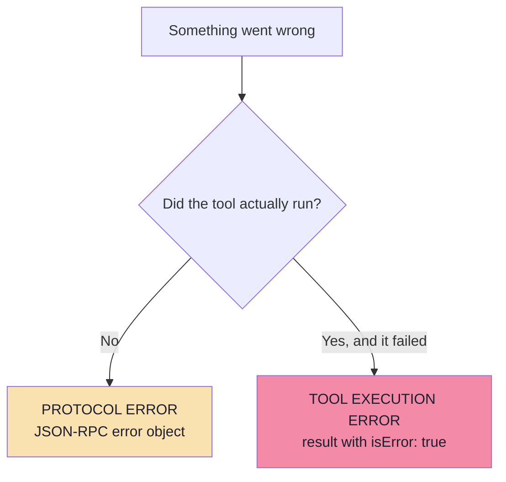

| | Protocol error | Tool execution error |
|---|---|---|
| Envelope | `error` object | Normal `result` |
| Signal | `{"code": -32602, ...}` | `{"isError": true, "content": [...]}` |
| Meaning | The call was never valid | The call ran and failed |
| Safe to retry? | Usually yes | **Only if idempotent** |
| Who sees it | Client / host | **The model** |

> **`isError: true` is not just an error channel — it is an instruction channel.** A good error message lets the model *recover*: change an argument, try another tool, or ask the user.

| Weak | Strong |
|---|---|
| `"Error"` | `"Task id 42 not found. Use listTasks to see valid ids."` |
| `"Invalid date"` | `"dueDate must be ISO-8601 (YYYY-MM-DD). Received: 'next friday'."` |

> **A weak error message turns a recoverable failure into a hallucinated success.**

### Tool annotations *(beyond the lecture)*

| Annotation | Meaning | Host behaviour it enables |
|---|---|---|
| `readOnlyHint` | Does not modify anything | Auto-approve; safe to retry |
| `destructiveHint` | May destroy or overwrite | Require explicit confirmation |
| `idempotentHint` | Repeating has the same effect | Retry safely on timeout |
| `openWorldHint` | Interacts with the outside world | Expect non-determinism; sandbox and limit |

> **Annotations are hints, not guarantees.** A malicious server can mislabel `deleteRepository` as read-only. Treat them as inputs to your policy, never as your policy.

### The tool-definition rules

| # | Rule | Why |
|---|---|---|
| 1 | Verb-first, consistent naming (`create_task`, `list_tasks`) | Predictable vocabulary |
| 2 | Description answers **what**, **when**, and **when not** | The disambiguation clause prevents wrong-tool choices |
| 3 | Prefer flat schemas | Nesting multiplies structural errors |
| 4 | Use `enum` instead of free strings | Constrains the legal value space |
| 5 | Add a `description` to every property | The only place to disambiguate similar fields |
| 6 | Mark `required` deliberately | Over-required fields force invention |
| 7 | Avoid interchangeable same-typed parameters (`num1`, `num2`) | Operand swaps on non-commutative operations |
| 8 | Keep parameter count small (≲ 8) | Beyond that, split the tool |
| 9 | Set `additionalProperties: false` | Blocks invented keys |
| 10 | One tool per **user-visible intent**, not per DB operation | Granularity determines usability |

### The board's calculator, fixed

| | Weak (on the board) | Strong |
|---|---|---|
| Names | `num1`, `num2` | `leftOperand`, `rightOperand` |
| Operator | `"type": "string"` | `"enum": ["add","subtract","multiply","divide"]` |
| Required | nothing | all three |
| Description | `"Does math"` | what it does, when to use it, when not to |

> **The measurable difference:** the weak schema has a large space of "almost right" answers; the strong one makes the model *correct by construction*.

### Security duties

| Duty | Owner |
|---|---|
| Validate all tool inputs | **Server** |
| Implement access controls | **Server** |
| Rate limit invocations | **Server** |
| Sanitise tool outputs | **Server** |
| Confirm sensitive operations | **Client** |
| Show inputs before calling | **Client** |
| Validate results before the LLM | **Client** |
| Timeouts on tool calls | **Client** |
| Log tool usage for audit | **Client** |

> **Tool output is untrusted user input**, exactly like a web form submission.

---

## Part 6 — Resources and Prompts

> Full chapter: **[06_Resources_and_Prompts.md](./06_Resources_and_Prompts.md)**

### The three primitives

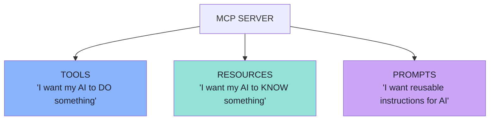

| | Tools | Resources | Prompts |
|---|---|---|---|
| Verb | **Do** | **Know** | **Reuse** |
| Driven by | The **model** | The **application** | The **user** |
| Side effects | Usually yes | No — read-only | No |
| Identified by | `name` | `uri` | `name` |
| Discovery | `tools/list` | `resources/list`, `resources/templates/list` | `prompts/list` |
| Retrieval | `tools/call` | `resources/read` | `prompts/get` |

### Resources: addressable context

> **A Resource is: addressable context or data exposed by an MCP Server.**

Examples: `company-policy.txt`, `employee-handbook.pdf`, application configuration, repository information, customer profile, database record.

> **They can be represented as Resources** — identified by a **URI**:

```text
company://policies/return-policy
file:///project/README.md
student://{studentId}/progress
```

| Scheme | Meaning | Guidance |
|---|---|---|
| `file://` | Filesystem-like | Need not map to a real disk |
| `https://` | Web resources | Use **only** if the client can fetch it directly |
| `git://` | Version control | Repositories, revisions |
| custom | Your domain | Must follow RFC 3986 |

| Method | Purpose |
|---|---|
| `resources/list` | Discover concrete resources (paginated) |
| `resources/templates/list` | Discover **parameterised** resources |
| `resources/read` | Retrieve contents by URI |
| `resources/subscribe` | Notify when one resource changes |
| `notifications/resources/list_changed` | The catalogue changed |

Content is either `text` or base64 `blob`, and may carry annotations:

| Annotation | Meaning |
|---|---|
| `audience` | `["user"]`, `["assistant"]`, or both |
| `priority` | `0.0`–`1.0` importance |
| `lastModified` | ISO 8601 freshness |

### Tool vs Resource

| | Tool | Resource |
|---|---|---|
| **Distinction** | *"What operation can I perform?"* | *"What information can I access?"* |
| Who decides when | The model | The application |
| Arguments | `inputSchema` | The URI *is* the argument |
| In the model's tool list? | Yes | No — costs no context until read |
| Cacheable? | Rarely | **Often** |

> **The deeper difference:** a tool **spends context** the moment it is advertised. A resource spends context only when the application decides to read it.

### Resources vs RAG

> **MCP Resources do not replace RAG.**

| Dimension | RAG | MCP Resources |
|---|---|---|
| Problem solved | *"Which of 50,000 chunks are relevant?"* | *"Where does this content live?"* |
| Selection | Similarity ranking | Exact addressing by URI |
| Scale | Very large, unstructured | Bounded, known |
| Who chooses | The retriever | The application |
| Failure mode | Missed the relevant chunk | Nothing to address |

**And they combine** — the pattern the lecture shows:

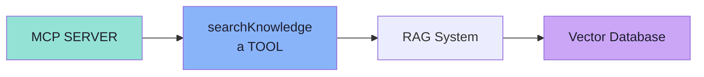

> **`searchKnowledge` could itself be an MCP Tool backed by a RAG pipeline.** RAG decides *what is relevant*; Resources give the result *a stable address* so it can be cited and re-fetched.

### Prompts: reusable instructions

> **An MCP Server can also expose reusable prompt templates or workflows.**

A GitHub MCP Server might provide `review_pull_request`, `summarize_issue`, `prepare_release_notes`:

```text
review_pull_request(prNumber)
             |
"You are reviewing pull request {prNumber}.
 Check for bugs, maintainability issues..."
```

| Benefit | Explanation |
|---|---|
| Server-owned wording | Fix a prompt in one place; every host improves |
| Parameterised | Arguments instead of copy-pasted instructions |
| Embedded resources | A prompt can carry live server content |
| Discovery | A shared library of workflows |
| Autocompletion | `completion/complete` suggests argument values |

> **A prompt is text that will be inserted into a model's context — treat it with the care you give a tool result.**

### The control model

| Primitive | Typically controlled by |
|---|---|
| **Tools** | **Model** — *"Create a task to record tomorrow"* → the model decides to call `createTask` |
| **Resources** | **Application** — `README.md` is open → the application attaches it |
| **Prompts** | **User** — the user types `/review-code` |

> **This is a useful conceptual model rather than a strict limitation on every implementation.**
>
> **The security reading is the useful one:** model-controlled = untrusted (validate, confirm); user-controlled = a deliberate human act; application-controlled = your own policy.

---

## Part 7 — The Tool Lifecycle

> Full chapter: **[07_Discovery_Invocation_and_Lifecycle.md](./07_Discovery_Invocation_and_Lifecycle.md)**

### The eight steps

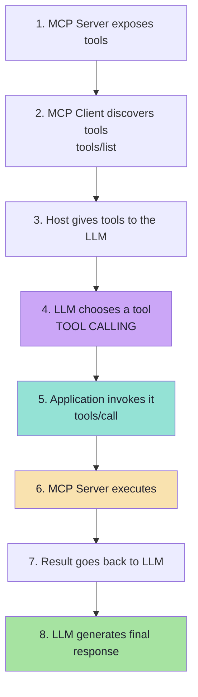

| Phase | Protocol call | Component | Deterministic? |
|---|---|---|---|
| Discovery | `tools/list` | Client ↔ Server | Yes |
| **Selection** | *a model decision* | LLM | **No** |
| Invocation | `tools/call` | Client → Server | Yes |
| Execution | business logic | Server | Yes |
| Response | generation | LLM + Host | **No** |

> **Two of the five phases are non-deterministic, and they are the first and the last.** Everything in the middle is ordinary, testable software.

### Discovery is a curated act

The server decides what appears in `tools/list`. "Hidden" tools are not merely invisible — they are **absent**, and an absent tool cannot be called by a model that was never told it exists. That is the cheapest capability control in the architecture.

### Selection is the fragile step

| Failure | Symptom | Where to fix |
|---|---|---|
| No tool selected | The model answers from memory | Tool descriptions |
| Wrong tool selected | Calls `update_task` instead of create | Disambiguation clauses |
| Right tool, wrong arguments | Missing or invented fields | `required`, `enum`, defaults, property descriptions |
| Wrong granularity | Calls `listTasks` and filters in prose | Provide `searchTasks(query)` |

> **This is the only phase where "it usually works" is the honest description.** Everything else either works or throws — which is why selection needs an *evaluation set*, not just unit tests.

### Invocation: the host does the routing

| Host responsibility at this step | Why |
|---|---|
| **Resolve** tool name → owning client | The model has no notion of servers |
| **Authorise** the call | The model cannot gate itself |
| **Confirm** if destructive | Needs UI and user identity |
| **Rate limit** | Prevents runaway agent loops |
| **Time out** | A hung server must not stall the conversation |
| **Normalise** the result | Different servers, one shape for the model |

### The response: the result becomes context

| Step | Why |
|---|---|
| **Validate** against `outputSchema` | A malformed result poisons the context |
| **Sanitise** | Untrusted text will be interpreted as instruction |
| **Delimit and label** | The model must know this is tool output, not the user |
| **Truncate or summarise** | A 200 KB result destroys the budget |
| **Attach provenance** | Which tool, which server, when |
| **Mark errors explicitly** | `isError: true` must arrive as a failure, not a fact |

### Dynamic tool discovery

> **The AI application does not necessarily need every remote capability hardcoded into its own codebase.**

| Aspect | Hardcoded | Discovered |
|---|---|---|
| Adding a capability | Client change + release | Server-side only |
| Model visibility | Requires redeploy | On the next refresh |
| Risk | Client and server drift | Single source of truth |

> **Dynamic discovery is also a dynamic attack surface.** A compromised server can add a tool *after* consent was given — the **rug pull**. Treat a changed definition as a **re-authorisation event**, not just a refresh.

### Caching: does `tools/list` run every message?

> **Not necessarily.** If the catalogue has not changed, the host or client can reuse previously discovered information.

```text
Discover tools → Cache available definitions → Reuse when appropriate
```

| Why cache | Why still refresh |
|---|---|
| A round trip on every message is wasteful | A stale catalogue hides new capabilities |
| Definitions are large | A **changed** definition is a security event |
| The answer rarely changes | Consent must be re-evaluated on change |

### The context-budget problem *(beyond the lecture)*

| Items | Assumption | Total |
|---|---|---|
| Tools advertised | 45 | — |
| Average schema + description | ~150 tokens | **≈ 6,750 tokens** |
| Cost | per input token | paid on **every** turn |

**Mitigations, in order:** connect fewer servers · filter by trust tier and task · prune duplicates · write tight descriptions · split large servers · two-stage tool selection · **prefer Resources for context**.

> **More discoverable tools make a system worse, not better.** Curate the catalogue the way you would curate a public API.

### The five-step diagnostic order

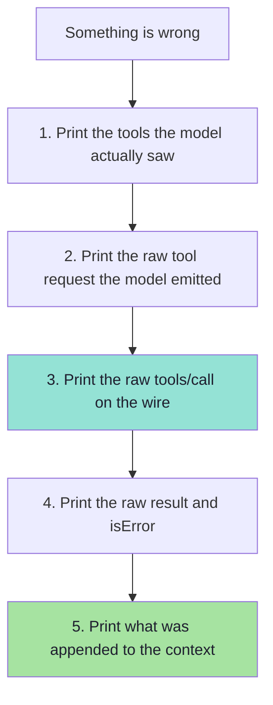

> **Almost every MCP bug is visible in one of those five print statements.** Teams struggle because they debug the *final answer* instead of the *handoff*.

---

## Part 8 — Security and Production

> Full chapter: **[08_Security_Production_and_Practical_Architecture.md](./08_Security_Production_and_Practical_Architecture.md)**

### The governing sentence

> **Discovering a tool does not mean the model should automatically be allowed to execute everything.**
>
> **MCP standardizes communication. It does not remove the application's responsibility for security and authorization.**

The host can apply: **permissions, user approval, tool filtering, authentication, security policies**.

| Tool | Risk class | Host behaviour |
|---|---|---|
| `readFile` | Read-only, bounded | **Might be allowed automatically** |
| `deleteRepository` | Destructive, irreversible | **Could require explicit user confirmation** |

### The threat model

| # | Threat | Mitigation |
|---|---|---|
| 1 | **Confused deputy** — a proxy with a static client ID grants access without proper user consent | Per-client consent; no shared static client ID; validate redirect URIs |
| 2 | **Token passthrough** — forwarding a token downstream or accepting a foreign token | Never accept tokens not issued for you; never forward the client's token; use your own credentials |
| 3 | **Prompt injection via tool output** | Sanitise, delimit, label tool output as untrusted |
| 4 | **Tool poisoning / rug pull** — a description hides instructions, or behaviour changes after approval | Show descriptions in consent; pin versions; re-consent on change |
| 5 | **Tool shadowing** — a malicious server impersonates a trusted tool name | Namespace by server; show the origin; filter by trust tier |
| 6 | **Session hijacking** | Treat session IDs as secrets; bind to the authenticated user |
| 7 | **SSRF** — the server fetches a model-supplied URL | Allow-list destinations; block private ranges |
| 8 | **Local server compromise** — XSS in the stdio proxy spawns arbitrary commands | Sandbox spawned servers; restrict filesystem; CSP |

> **Two of these are consequences of one design property:** the model sees a **flat, merged view** of capabilities from servers with different trust levels. Only the host knows the difference — so the host must enforce it.

### Authorization for remote servers *(beyond the lecture)*

A **remote** MCP server must be treated as an **OAuth 2.1 resource server**, not an authorization server:

| Rule | Prevents |
|---|---|
| Tokens **must** be audience-bound to the MCP server (Resource Indicators) | Token passthrough |
| The server **must not** accept tokens not issued for it | Audience confusion |
| The server **must not** forward the client's token downstream | Confused deputy |
| The client discovers the authorization server from **protected resource metadata** | Malicious AS redirection |
| Consent is **per client** | Confused deputy |

**Scope minimisation (progressive least privilege):** start with a minimal scope, elevate incrementally via `WWW-Authenticate` challenges, accept down-scoped tokens, log every elevation.

> **Never let the model see tokens.** Credentials are host-side infrastructure, not context.

### The practical demo architecture

> **To understand MCP clearly, build two separate applications.**

```text
1. TASK MCP SERVER          →  No LLM, no OpenAI. Exposes createTask, listTasks, completeTask.
2. AI APPLICATION           →  Contains the LLM and an MCP Client; connects, discovers, exposes to the model.
```

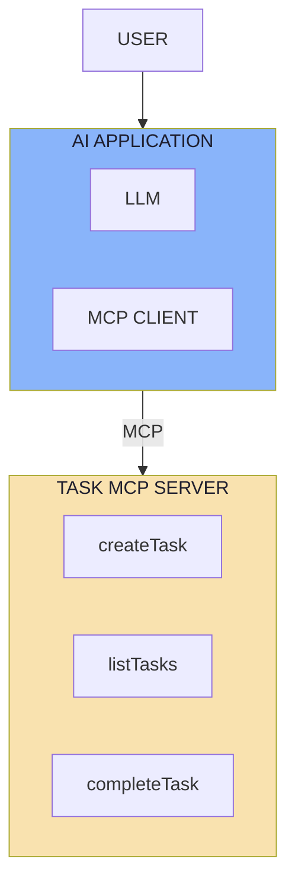

> **This separation makes one thing very clear:**
>
> ```text
> MCP SERVER  ≠  LLM Application
> ```
>
> **The MCP Server provides capabilities. The AI application contains the intelligence that decides when those capabilities should be used.**

**The most useful test in the lecture:** *if a capability cannot be exercised without an LLM, it is in the wrong component.*

### Production concerns *(beyond the lecture)*

| Concern | Key rule |
|---|---|
| **Observability** | Log every call with identity and catalogue version; never log raw arguments or tokens |
| **Versioning** | Add tools freely; never silently change an existing schema — a tool name + schema is a published contract |
| **Idempotency** | Side-effecting tools will be called twice; use idempotency keys |
| **Timeouts** | Per-call timeout, cancellation, maximum cap, circuit breaker |
| **Rate limits** | Server-side per tool/caller; host-side per-turn call budget (agent-loop guard) |
| **Testing** | Unit + protocol + security need **no model**; only selection evaluation does |
| **Multi-tenancy** | Identity from the transport, never a tool argument; tenant-scoped cache keys |
| **Topology** | stdio locally; Streamable HTTP when shared; a **gateway** for enterprise policy and audit |

### The build order

```text
1. Define the capability domain (user-visible intents)
2. Build the business logic + unit tests          ← no MCP yet
3. Wrap it in an MCP server (tools only, stdio)
4. Verify with an inspector / CLI                 ← NO model anywhere
5. Write descriptions and schemas for a model reader
6. Build the host (LLM + MCP client)
7. Add policy: filter, confirm, limit, timeout
8. Add observability: trace the lifecycle
9. Evaluate selection on a golden set of phrasings
10. Harden: auth, tenancy, versioning, rate limits
```

> **Steps 2 and 4 are the ones teams skip, and they are the two that make everything else cheap.**

---

# Cheat Sheets

## Cheat Sheet: The Three Roles

| | Host | MCP Client | MCP Server |
|---|---|---|---|
| **What it is** | The AI application | The protocol speaker | The capability provider |
| **Count** | One | One **per server** | Many |
| **Has the LLM?** | **Yes** | No | **No** |
| **Owns conversation** | **Yes** | No | No (must not see it) |
| **Owns credentials/consent** | **Yes** | No | Owns its **own** backend credentials |
| **Does** | Orchestrates, filters, confirms, presents | Discovers, invokes, reads, retrieves | Validates, authorises, executes, sanitises |
| **Analogy** | Conductor | Telephone line | Workshop |

## Cheat Sheet: The Three Primitives

| | Tools | Resources | Prompts |
|---|---|---|---|
| **Intent** | DO something | KNOW something | REUSE instructions |
| **Controlled by** | Model | Application | User |
| **Identified by** | `name` | `uri` | `name` |
| **List** | `tools/list` | `resources/list`, `resources/templates/list` | `prompts/list` |
| **Get** | `tools/call` | `resources/read` | `prompts/get` |
| **Costs context when?** | On advertisement | On read | On selection |

## Cheat Sheet: The Method Vocabulary

| Method | Purpose |
|---|---|
| `initialize` / `notifications/initialized` | Handshake (classic revisions) |
| `tools/list` | Discover tools |
| `tools/call` | Invoke a tool |
| `resources/list` | Discover resources |
| `resources/templates/list` | Discover parameterised resources |
| `resources/read` | Read a resource by URI |
| `resources/subscribe` | Watch a resource for changes |
| `prompts/list` | Discover prompt templates |
| `prompts/get` | Retrieve a prompt with arguments |
| `completion/complete` | Argument autocompletion |
| `notifications/tools/list_changed` | Tool catalogue changed |
| `notifications/resources/list_changed` | Resource catalogue changed |
| `notifications/resources/updated` | A subscribed resource changed |
| `notifications/prompts/list_changed` | Prompt catalogue changed |

## Cheat Sheet: The Eight-Step Lifecycle

```text
1. MCP Server exposes tools
2. MCP Client discovers tools          (tools/list)
3. AI application gives tools to LLM
4. LLM chooses a tool                  ← TOOL CALLING
5. Application invokes it through MCP  (tools/call)
6. MCP Server executes the operation
7. Result goes back to LLM
8. LLM generates final response
```

> **Exactly one step is a model decision.** Everything else is deterministic software.

## Cheat Sheet: The Tool Definition Rules

| # | Rule |
|---|---|
| 1 | Verb-first, consistent, stable names |
| 2 | Description answers **what**, **when**, and **when not** |
| 3 | Prefer flat schemas over nested |
| 4 | Use `enum` instead of free strings |
| 5 | Describe every property |
| 6 | Mark `required` deliberately; give defaults |
| 7 | Never use interchangeable same-typed parameters |
| 8 | Keep parameter count ≲ 8 |
| 9 | `additionalProperties: false` |
| 10 | One tool per **user-visible intent** |
| 11 | Error messages must tell the model how to fix the call |
| 12 | Never silently change a published schema — add a new name |

## Cheat Sheet: Which Primitive Should This Be?

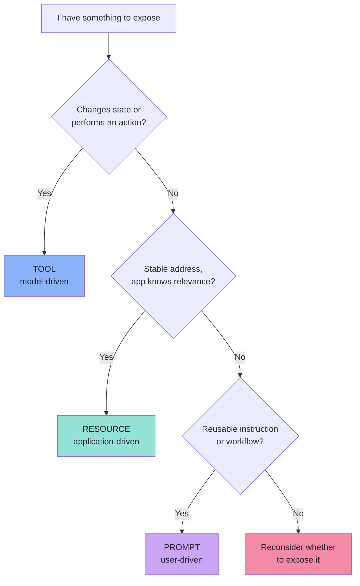

## Cheat Sheet: Decision Tables

### MCP vs Tool Calling

| Dimension | Tool Calling | MCP |
|---|---|---|
| Question | Which capability, with what arguments? | Where do tools come from, how are they accessed? |
| Nature | Model capability | Wire protocol |
| Decided by | The model | The application / host |
| Determinism | Probabilistic | Deterministic |
| Tool location | In-process | Out-of-process |
| Discovery | Local code registration | Runtime `tools/list` |
| Adding a tool | Code change + redeploy | Server change |
| Testing | Needs a model | Needs no model |

### MCP vs REST

| | REST API | MCP Server |
|---|---|---|
| Audience | Programmers | Models and hosts |
| Exposes | Endpoints, verbs, status codes | Tools, descriptions, schemas, resources, prompts |
| Discovery | Docs / OpenAPI | Runtime `tools/list` |
| Unit of meaning | Resource + verb | A readable capability |
| Relationship | — | **Composes**: MCP outside, REST inside |

### MCP Server vs Microservice

| Question | Microservice | MCP Server |
|---|---|---|
| Who calls it | Services, browsers, apps | AI hosts |
| Interface | HTTP routes / RPC | Tools, resources, prompts |
| Discovery | Registry, API docs | Runtime discovery |
| Needs a port? | Usually | **No** — stdio is a child process |
| Owns data? | Often | **Not necessarily** — may be a thin adapter |
| Deployment unit? | Usually | **Not necessarily** |

### stdio vs Streamable HTTP

| Question | stdio | Streamable HTTP |
|---|---|---|
| Server location | Same machine | Anywhere |
| Who starts it | The client | Independently |
| Multiple clients | No | **Yes** |
| Auth | Rarely | **Yes** — OAuth 2.1 |
| Latency | Lowest | One HTTP round trip |
| Failure mode | Process crash | Network, 5xx, session expiry |
| Best for | Local development, desktop tools | Shared, hosted, multi-tenant |

### Protocol Error vs Tool Execution Error

| | Protocol error | `isError: true` |
|---|---|---|
| Envelope | `error` object | Normal `result` |
| Meaning | The call never happened | The call ran and failed |
| Examples | Unknown tool, invalid params | API failure, business rule |
| Retry? | Usually safe | Only if idempotent |
| Seen by | Client / host | **The model** |

### Tool vs Resource

| Question | Tool | Resource |
|---|---|---|
| Operation or content? | Operation | Content |
| Who decides | Model | Application |
| Arguments | `inputSchema` | The URI |
| In the model's tool list | Yes | No |
| Cacheable | Rarely | Often |

### Cache or Refresh `tools/list`?

| Situation | Action |
|---|---|
| Catalogue unchanged | **Reuse the cache** |
| `list_changed` received | Re-query **and re-evaluate policy** |
| Connection restarted | Re-query |
| TTL expired | Re-query |
| Definition *changed* | Treat as a **re-authorisation event** |

### Which Policy for Which Tool?

| Tool signal | Host behaviour |
|---|---|
| `readOnlyHint: true` | Auto-approve, log |
| `destructiveHint: true` | Require explicit confirmation |
| `idempotentHint: true` | Safe to retry on transport failure |
| `openWorldHint: true` | Sandbox, rate-limit, expect non-determinism |
| No annotations | Treat as **unknown risk** — confirm |

---

# Glossary

| Term | Meaning |
|---|---|
| **MCP** | Model Context Protocol — a standard protocol through which AI applications connect to external tools and data |
| **Host** | The AI application the user interacts with; owns the LLM, the conversation, policy, consent and UI |
| **MCP Client** | The component inside the host that speaks MCP to exactly one server |
| **MCP Server** | A program that exposes capabilities (tools, resources, prompts) through MCP; needs no LLM |
| **Tool** | An executable capability, described by a name, description and input schema; model-controlled |
| **Resource** | Addressable context or data exposed by a server, identified by a URI; application-controlled |
| **Prompt** | A reusable prompt template or workflow; user-controlled |
| **Tool calling** | The model's decision of *which* capability to use and with what arguments |
| **`tools/list`** | The discovery operation returning tool definitions |
| **`tools/call`** | The invocation operation, carrying `name` + `arguments` |
| **`inputSchema`** | JSON Schema describing a tool's arguments |
| **`outputSchema`** | JSON Schema describing a tool's structured result *(2025-06-18+)* |
| **`structuredContent`** | Server-produced structured result data — unrelated to LLM structured output |
| **`isError`** | Flag on a tool result meaning the tool ran and failed (as opposed to a protocol error) |
| **Tool annotations** | `readOnlyHint`, `destructiveHint`, `idempotentHint`, `openWorldHint` — hints for host policy |
| **Resource URI** | The address of a resource, e.g. `company://policies/return-policy`, `file:///project/README.md` |
| **Resource template** | A parameterised resource pattern, e.g. `student://{studentId}/progress` |
| **stdio** | Transport where the client launches the server as a subprocess and speaks JSON-RPC over stdin/stdout |
| **Streamable HTTP** | Transport using a single HTTP endpoint supporting POST and GET, optionally with SSE |
| **Capability negotiation** | The exchange in which client and server declare which optional features are available |
| **JSON-RPC 2.0** | The message format MCP uses: request, response, notification, error |
| **N × M problem** | The integration matrix where N apps × M systems requires N × M bespoke integrations |
| **N + M** | The integration count with a shared protocol: N clients + M servers |
| **Confused deputy** | A proxy being tricked into granting access it should not, e.g. via a static shared client ID |
| **Token passthrough** | Forwarding a client's token downstream, or accepting a token not issued for the server |
| **Tool poisoning / rug pull** | A malicious or later-changed tool description/behaviour that misleads the host or model |
| **Tool shadowing** | A server exposing a tool that impersonates a trusted server's tool |
| **Progressive least privilege** | Requesting a minimal scope first and elevating incrementally when a privileged tool is invoked |
| **MCP gateway** | An enterprise proxy in front of many MCP servers, centralising policy, namespacing and audit |

---

# Common Misconceptions

| Misconception | Reality |
|---|---|
| "MCP replaces tool calling." | They are **two layers**: the model selects, the protocol delivers. Neither replaces the other. |
| "An MCP server needs an LLM." | It does **not**. A server is ordinary business logic behind a standard interface. |
| "MCP is a framework / SDK." | It is a **protocol** — a message format, a method vocabulary, a lifecycle and transports. |
| "MCP replaces REST." | It **composes** with REST: MCP outside for models, REST inside for services. |
| "An MCP server must be a microservice." | It may be a local stdio child process, in the same repo as the service it wraps. |
| "Discovery means permission." | Discovery is an **inventory**. The host decides what may actually run. |
| "A discovered tool is automatically safe." | A malicious server can add or change tools after consent — the rug pull. |
| "MCP makes the model smarter / more accurate." | MCP changes **access**, never reasoning. |
| "Tool output is trusted data." | Tool output is **untrusted user input**; it is a primary injection channel. |
| "A failed tool is a protocol error." | A failed tool is a **normal result with `isError: true`**. Protocol errors mean the call never happened. |
| "The model calls the MCP server." | The **host** calls the server. The model only emits a request. |
| "The model can route to the right server." | The model does not know servers exist. The host resolves names to clients. |
| "More tools is better." | Every advertised tool costs tokens on **every** turn and dilutes selection quality. |
| "`structuredContent` is the same as structured outputs." | Opposite directions: one is tool **output**, the other constrains model **generation**. |
| "Resources replace RAG." | Different problems — and they **combine**: a RAG pipeline behind an MCP tool. |
| "MCP standardises security too." | It standardises **communication**; security and authorization remain yours. |
| "`tools/list` must run on every message." | It is a **cache with an invalidation signal**, not a per-request call. |
| "Any tool can be retried safely." | Retry only read-only/idempotent tools; destructive calls need explicit intent. |

---

# Self-Check Questions

Answer these without looking. If any answer is unclear, follow the chapter link.

### Foundations

1. Why does tool calling work perfectly for one application and fail at six? → [Ch. 01](./01_The_Integration_Problem_and_Why_Standards_Win.md)
2. What are the six questions every integration must answer? → [Ch. 01](./01_The_Integration_Problem_and_Why_Standards_Win.md)
3. With 5 apps and 10 systems, how many integrations without a protocol, and with one? → [Ch. 01](./01_The_Integration_Problem_and_Why_Standards_Win.md)
4. Complete: *"A standard does not necessarily provide a new capability; it provides…"* → [Ch. 01](./01_The_Integration_Problem_and_Why_Standards_Win.md)
5. Which component depends on the LLM? (Trick question.) → [Ch. 01](./01_The_Integration_Problem_and_Why_Standards_Win.md)

### Definition

6. What does MCP stand for, and what is the one-sentence definition? → [Ch. 02](./02_What_MCP_Is_Protocol_Server_and_Standard_Interface.md)
7. Does an MCP server need an LLM? What does it need instead? → [Ch. 02](./02_What_MCP_Is_Protocol_Server_and_Standard_Interface.md)
8. Name three things a REST API exposes that an MCP server does not, and vice versa. → [Ch. 02](./02_What_MCP_Is_Protocol_Server_and_Standard_Interface.md)
9. Why is an MCP server not necessarily a microservice? → [Ch. 02](./02_What_MCP_Is_Protocol_Server_and_Standard_Interface.md)

### The distinction

10. State the two questions tool calling and MCP each answer. → [Ch. 03](./03_MCP_vs_Tool_Calling_Complementary_Layers.md)
11. In the eight-step flow, how many steps are tool calling? → [Ch. 03](./03_MCP_vs_Tool_Calling_Complementary_Layers.md)
12. What is the relationship between `inputSchema` and structured output? → [Ch. 03](./03_MCP_vs_Tool_Calling_Complementary_Layers.md)
13. Name the four combinations of tool calling and MCP, and when each is right. → [Ch. 03](./03_MCP_vs_Tool_Calling_Complementary_Layers.md)

### Architecture

14. What are the three components, and what is each one's job? → [Ch. 04](./04_Host_Client_Server_Architecture.md)
15. What is the JDBC analogy for the MCP client? → [Ch. 04](./04_Host_Client_Server_Architecture.md)
16. Why must each client hold a 1:1 relationship with a server? → [Ch. 04](./04_Host_Client_Server_Architecture.md)
17. Which two transports does the protocol define, and when do you choose each? → [Ch. 04](./04_Host_Client_Server_Architecture.md)
18. What is the hard rule about `stdout` for a stdio server? → [Ch. 04](./04_Host_Client_Server_Architecture.md)

### Tools

19. What three things does the model see about a tool? → [Ch. 05](./05_The_Tools_Primitive.md)
20. What is the difference between a protocol error and `isError: true`? → [Ch. 05](./05_The_Tools_Primitive.md)
21. Why is the board's `{ num1, num2, operator }` schema weak, and how would you fix it? → [Ch. 05](./05_The_Tools_Primitive.md)
22. What do `readOnlyHint` and `destructiveHint` change in host behaviour? → [Ch. 05](./05_The_Tools_Primitive.md)
23. Why are error messages described as an "instruction channel"? → [Ch. 05](./05_The_Tools_Primitive.md)

### Primitives

24. What is the one-line difference between a Tool and a Resource? → [Ch. 06](./06_Resources_and_Prompts.md)
25. Do MCP Resources replace RAG? Explain with the `searchKnowledge` pattern. → [Ch. 06](./06_Resources_and_Prompts.md)
26. Which primitive does the user control, and why does that matter for security? → [Ch. 06](./06_Resources_and_Prompts.md)
27. When should you use a resource template instead of listing resources? → [Ch. 06](./06_Resources_and_Prompts.md)

### Lifecycle

28. Walk the eight-step lifecycle from a user sentence to a final response. → [Ch. 07](./07_Discovery_Invocation_and_Lifecycle.md)
29. Which phase is the only probabilistic one, and how do you test it? → [Ch. 07](./07_Discovery_Invocation_and_Lifecycle.md)
30. Does `tools/list` run on every user message? Justify your answer. → [Ch. 07](./07_Discovery_Invocation_and_Lifecycle.md)
31. Why is a *changed* tool definition a security event? → [Ch. 07](./07_Discovery_Invocation_and_Lifecycle.md)
32. Name the five print statements in the diagnostic order. → [Ch. 07](./07_Discovery_Invocation_and_Lifecycle.md)

### Security

33. Why is discovery not authorisation? Give the lecture's `readFile` / `deleteRepository` example. → [Ch. 08](./08_Security_Production_and_Practical_Architecture.md)
34. Explain token passthrough and how audience binding prevents it. → [Ch. 08](./08_Security_Production_and_Practical_Architecture.md)
35. What is progressive least privilege, and what does it protect? → [Ch. 08](./08_Security_Production_and_Practical_Architecture.md)
36. Why must the demo be built as two separate applications? → [Ch. 08](./08_Security_Production_and_Practical_Architecture.md)
37. What is the single most useful test in the lecture, and what does it prove? → [Ch. 08](./08_Security_Production_and_Practical_Architecture.md)

---

# Go-Live Checklist

### Design

- [ ] Capabilities are named as **user-visible intents**, not database operations
- [ ] Each capability is exposed as the **right primitive** (Tool / Resource / Prompt)
- [ ] The catalogue is **curated** — nothing exposed "just in case"
- [ ] Tool names are unique, stable and namespaced across servers

### Definitions

- [ ] Every tool has a description covering **what**, **when**, and **when not**
- [ ] Every schema property has a description
- [ ] Enums used instead of free strings where the value space is finite
- [ ] `required` is deliberate; optional fields have defaults or omit-instructions
- [ ] `additionalProperties: false` where possible
- [ ] Annotations (`readOnlyHint` etc.) set honestly

### Implementation

- [ ] The server has **no LLM** and is unit-testable without one
- [ ] Every tool is exercised by a **model-free** harness (inspector / CLI)
- [ ] All inputs re-validated against `inputSchema` server-side
- [ ] Access control enforced server-side; identity from the transport, not arguments
- [ ] Rate limits per tool and per caller
- [ ] Outputs sanitised and size-bounded
- [ ] Side-effecting tools support idempotency keys
- [ ] Errors return `isError: true` with actionable text

### Host

- [ ] Tools filtered by trust tier **before** they enter the prompt
- [ ] Destructive tools require explicit confirmation
- [ ] Tool results are labelled, delimited and sanitised before the model sees them
- [ ] Per-call timeouts, cancellation and a maximum cap
- [ ] Per-turn call budget to guard against agent loops
- [ ] The model never sees credentials, tokens or raw session identifiers

### Discovery and caching

- [ ] `tools/list` cached with an invalidation signal
- [ ] `list_changed` handled — and treated as a **re-authorisation event**
- [ ] Catalogue version recorded per turn for reproducibility

### Security

- [ ] Remote servers use OAuth 2.1 with audience-bound tokens
- [ ] The server uses its **own** credentials downstream (no token passthrough)
- [ ] Progressive scopes — minimal initial set, incremental elevation
- [ ] Per-client consent; no shared static OAuth client ID
- [ ] SSRF protections on any outbound fetch
- [ ] Local (stdio) servers sandboxed where they spawn processes
- [ ] Threat model reviewed against all eight classes

### Operations

- [ ] Every call logged with tool, identity, outcome, duration and catalogue version
- [ ] No raw arguments or tokens in logs
- [ ] Versioning policy documented; breaking changes get a new tool name
- [ ] Circuit breaker and graceful degradation for unavailable servers
- [ ] Multi-tenant cache keys and resource authorisation
- [ ] Deployment topology chosen deliberately (stdio / HTTP / gateway)

### Evaluation

- [ ] A golden set of ~20–50 user phrasings exists
- [ ] Tool-selection accuracy is measured and tracked
- [ ] Argument-validity rate is measured
- [ ] Context cost of the tool catalogue is monitored

---

# The One-Page Recall Card

```text
──────────────────────────────────────────────────────────────
MCP = Model Context Protocol
A standard protocol through which AI applications connect
to external tools and data.
──────────────────────────────────────────────────────────────
THE TWO LAYERS
  Tool calling = WHICH capability, with WHAT arguments? (model)
  MCP          = WHERE tools come from, HOW they're accessed (protocol)
  → Complementary, not competing.

THE THREE ROLES
  HOST    = the AI application: LLM + policy + consent + UI
  CLIENT  = one per server; speaks MCP (the JDBC driver)
  SERVER  = the capability provider; needs NO LLM

THE THREE PRIMITIVES
  TOOLS      do     -> model-driven    tools/list, tools/call
  RESOURCES  know   -> app-driven      resources/read (URI-addressed)
  PROMPTS    reuse  -> user-driven     prompts/get

THE LIFECYCLE
  expose -> discover -> give to LLM -> MODEL CHOOSES
         -> tools/call -> execute -> result -> respond
  (exactly one probabilistic step)

THE TWO ERRORS
  JSON-RPC error = the call never happened
  isError: true  = the call ran and failed   <- reaches the model

THE ARITHMETIC
  No standard: N x M   (5 apps x 10 systems = 50)
  Protocol:    N + M   (15)

THE SCOPE SENTENCE
  "A standard does not provide a new capability;
   it provides a common way to access one."

THE SECURITY SENTENCE
  "MCP standardizes communication. It does not remove the
   application's responsibility for security and authorization."
──────────────────────────────────────────────────────────────
```

---

**Back to:** [Lecture 14 — Chapter Index](./README.md) · [Chapter 01](./01_The_Integration_Problem_and_Why_Standards_Win.md) · [Chapter 08](./08_Security_Production_and_Practical_Architecture.md)


