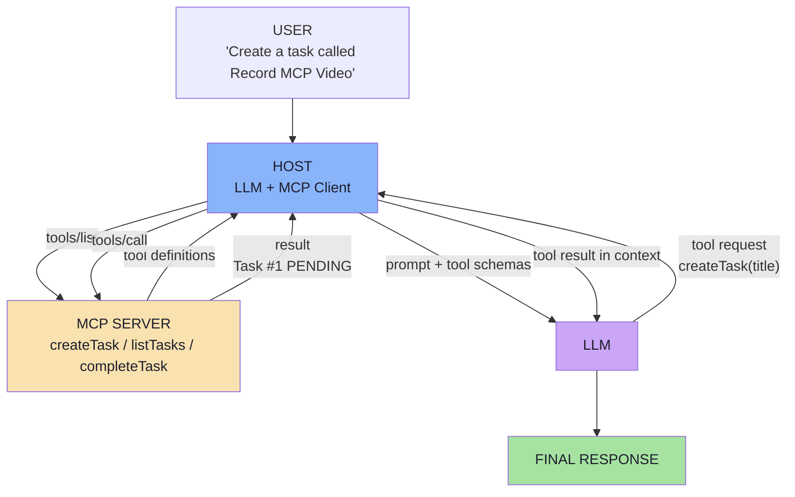

# Lecture 14 — MCP Server from First Principles

> **Lecture theme:** Lecture 05 taught the model to *ask* for a tool; Lecture 13 taught it to return *structured data*. This lecture asks the question neither answered: **when six AI applications need the same five capabilities, who owns the integration?** Starting from a single working `getWeather()` tool, it builds the case for a standard protocol — the **Model Context Protocol (MCP)** — and then dissects it completely: Host, Client, Server, the three primitives, the tool lifecycle, and the security boundary the protocol does **not** remove.
>
> The reference implementation in the source lecture is **Java / Spring AI**; these notes keep the architecture and express all snippets as **TypeScript-style pseudo-code**.

---

## Chapter Index

| # | Chapter | Core Question Answered |
|---|---|---|
| [01](./01_The_Integration_Problem_and_Why_Standards_Win.md) | The Integration Problem and Why Standards Win | Why does a tool that works in one app become N × M work across many? |
| [02](./02_What_MCP_Is_Protocol_Server_and_Standard_Interface.md) | What MCP Is: Protocol, Server and the Standard Interface | What exactly is MCP — and what is it *not*? |
| [03](./03_MCP_vs_Tool_Calling_Complementary_Layers.md) | MCP vs Tool Calling: Two Complementary Layers | Which layer decides *what* to do, and which layer *does* it? |
| [04](./04_Host_Client_Server_Architecture.md) | Host, Client and Server: The Three Roles | Who owns the conversation, the connection, and the capability? |
| [05](./05_The_Tools_Primitive.md) | The Tools Primitive: Executable Capability | How does a capability become something a model can call correctly? |
| [06](./06_Resources_and_Prompts.md) | Resources and Prompts: Context and Reusable Instructions | What if I want the AI to *know* something, or reuse an instruction? |
| [07](./07_Discovery_Invocation_and_Lifecycle.md) | The Tool Lifecycle: Discovery, Selection, Invocation | From *"what tools do you have?"* to a typed result in the prompt. |
| [08](./08_Security_Production_and_Practical_Architecture.md) | Security, Production and a Practical Architecture | Who is allowed to run this tool, on whose authority, and how do I prove it? |
| [**Complete**](./Lecture_14_Complete_Notes.md) | **Complete Consolidated Notes** | All eight chapters condensed: cheat sheet, decision tables, glossary, self-check |

> 📄 **Prefer a single document?** Read the **[Lecture 14 — Complete Consolidated Notes](./Lecture_14_Complete_Notes.md)**. It keeps the load-bearing ideas, decision tables and the full lifecycle, and links back to the chapters for full reasoning and pseudo-code.

---

## The Big Idea in One Diagram

Read it in two halves: **the model chooses, the protocol delivers.** Everything left of the model is a probabilistic decision; everything right of it is deterministic, testable software.

---

## How to Read These Notes

1. **Chapters 01–02 are the case.** Why bespoke integrations fail at N × M, and what MCP standardises (and deliberately does not).
2. **Chapter 03 is the distinction.** Tool calling and MCP are two layers — the lecture calls this "one of the most important distinctions".
3. **Chapter 04 is the architecture.** Host, Client, Server, the 1:1 rule, transports and the lifecycle.
4. **Chapters 05–06 are the primitives.** Tools (do), Resources (know), Prompts (reuse) — with schema and description craft.
5. **Chapter 07 is the machine.** The eight-step lifecycle, dynamic discovery, caching and a diagnostic runbook.
6. **Chapter 08 is the boundary.** The threat model, OAuth for remote servers, and the two-application demo architecture.

---

## Conventions Used in This Lecture

| Convention | Meaning |
|---|---|
| **Mermaid** | Every structural diagram is Mermaid (`flowchart`, `sequenceDiagram`, `stateDiagram-v2`). |
| **TypeScript-style pseudo-code** | Snippets describe data flow and contracts for a JS/TS environment. They are **not** runnable production code. |
| **JSON-RPC snippets** | Protocol messages are shown as real JSON-RPC shapes so you can recognise them on the wire. |
| **Framework references** | Spring AI calls (`@Tool`) appear as inline references and tables of meaning, not as code to copy. |
| **Beyond the lecture** | Sections marked *beyond the lecture* add material the script only gestures at (JSON-RPC, transports, lifecycle, annotations, OAuth, threat model, production). |
| **Board references** | Passages described as *from the board* reproduce the hand-drawn `Excalidraw-Notes.svg`. |
| **Protocol revisions** | The lecture teaches concepts; where the *mechanism* has changed across spec revisions (e.g. stateless requests in `2026-07-28`), it is flagged explicitly. |

---

## Sources

- 📄 [`Notes.pdf`](./Notes.pdf) — *MCP Server from First Principles* (38 pages): tool calling, the integration problem, why standards matter, what MCP is, what an MCP Server is, MCP vs tool calling, tool discovery, structured output, execution through MCP, why not just REST, the N × M problem, Host/Client/Server, MCP vs microservice, multiple servers per host, Tools/Resources/Prompts, Tool vs Resource, Resources vs RAG, prompts, the control model, the complete tool lifecycle, dynamic discovery, security in the host, and the practical demo architecture.
- 🖼️ [`Excalidraw-Notes.svg`](./Excalidraw-Notes.svg) — the lecture board: client/server/LLM with the weather API and calculator tools, the `{ num1, num2, operator }` payload, App1/App2/App3 with dependency arrows, Host with tools/resources/prompts, RAG with `refundPolicy`/`returnPolicy`/`payment` resources, `tools/list`, `tools/call`, and the **STDIO** / **Streamable HTTP** transports.
- 📚 Prior lectures — [Lecture 05](../../Lecture%2005/notes/README.md) (tool calling, agents, human-in-the-loop), [Lecture 13](../../Lecture%2013/notes/README.md) (structured outputs; MCP introduced in Chapter 08), [Lecture 11](../../Lecture%2011/notes/README.md) and [Lecture 12](../../Lecture%2012/notes/README.md) (RAG, for the Resources-vs-RAG comparison).

---

## One-Line Summaries

| Chapter | One-line summary |
|---|---|
| 01 | A standard does not provide a new capability — it provides a common way to access one. |
| 02 | An MCP Server is a capability provider behind a standard door; it needs no LLM. |
| 03 | Tool calling decides; MCP delivers. |
| 04 | The host orchestrates, each client speaks to exactly one server, and the server does the work. |
| 05 | A tool is a contract written for a reader who cannot read your code. |
| 06 | Tools do, Resources know, Prompts reuse — and the model, the app and the user each drive one. |
| 07 | The lifecycle is a relay race with exactly one probabilistic runner. |
| 08 | MCP standardizes communication; it does not remove your responsibility for security. |

---

**Back to:** [Lecture 14 — Chapter Index](./README.md) · [Complete Consolidated Notes](./Lecture_14_Complete_Notes.md)

