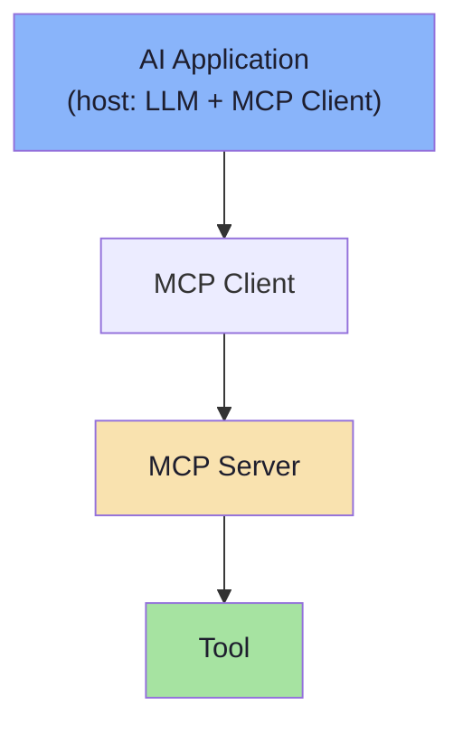
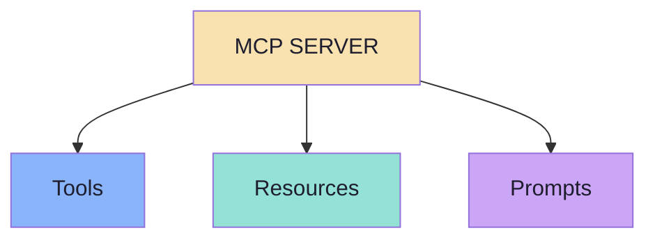
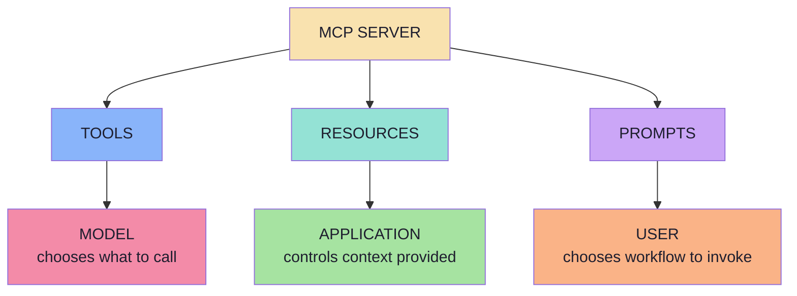
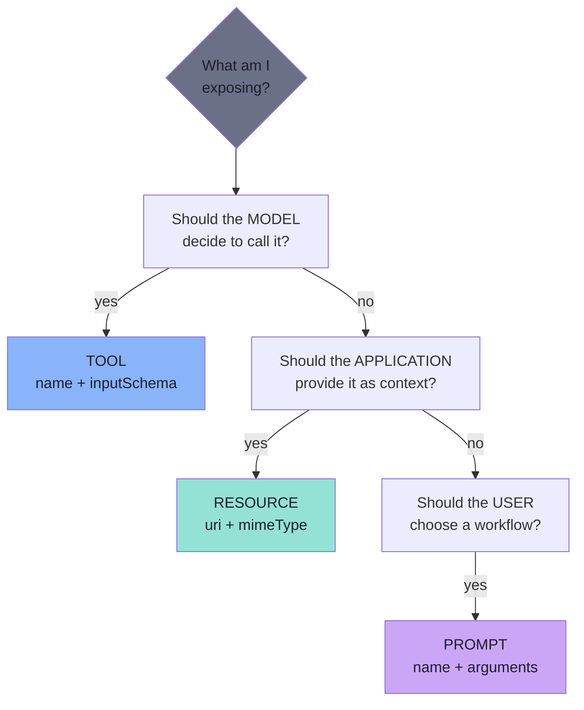
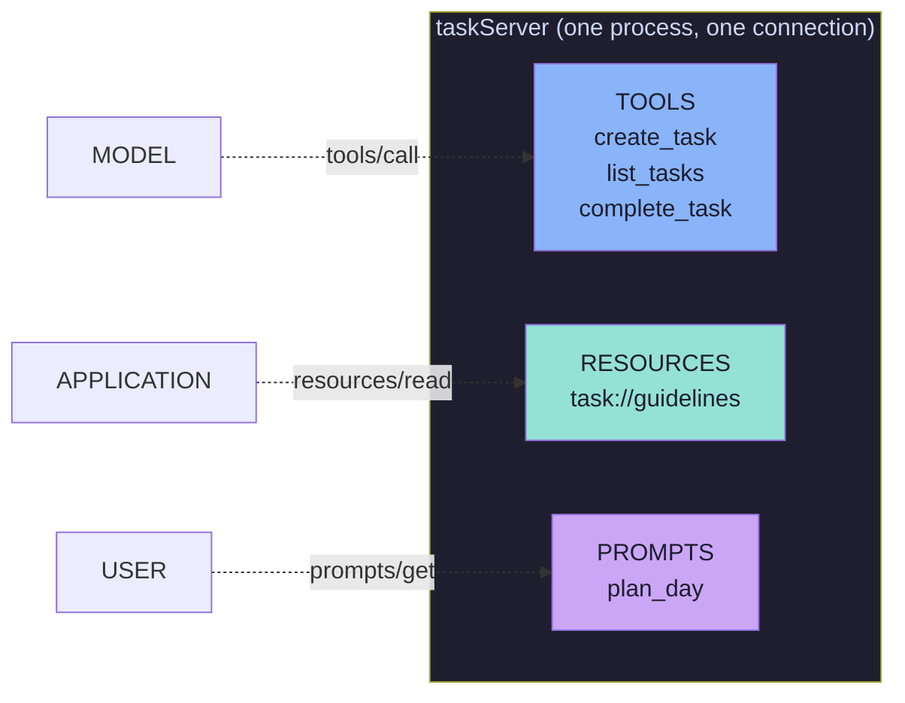

# Chapter 01: The Three Primitives and the Control Model

> **Chapter Goal:** Lecture 14 built an MCP Server that exposed exactly one kind of thing — a **Tool**. This chapter opens the whole surface: an MCP Server can expose **Tools**, **Resources** and **Prompts**. They are not three flavours of the same idea; they differ in *purpose* and, more importantly, in **who is allowed to decide when they run**.
>
> At the end of this chapter you should be able to answer: *I have something to expose to an AI application — which of the three primitives is it, and who should be holding the trigger?*

---

## 1.1 Where Lecture 14 Left Us

Lecture 14 started from a single working `getWeather()` tool and built the case for a standard protocol. It then dissected the **Tool** primitive completely.

The flow it produced looked like this:

```text
AI Application
      ↓
MCP Client
      ↓
MCP Server
      ↓
Tool
```



An MCP Server may expose tools such as:

```text
createTask()
getWeather()
sendEmail()
```

> **The model drives tools.** The LLM inspects the tool definitions, and *it* decides when one of them should be invoked.

```text
User
 ↓
LLM
 ↓
createTask(...)
 ↓
MCP Server
 ↓
Task created
```

That round trip — model asks, protocol delivers, result returns to context — is the loop Lecture 14 spent eight chapters on.

---

## 1.2 Tools Are Only One Third of the Server

> **Tools, however, are only one thing an MCP Server can expose.**
> An MCP Server can expose **three major primitives**.



The lecture's mental model is deliberately short:

| Primitive | It is about… |
|---|---|
| **Tools** | **Capabilities** |
| **Resources** | **Context** |
| **Prompts** | **Reusable AI workflows** |

```text
Tools       → Capabilities
Resources   → Context
Prompts     → Reusable AI workflows
```

Read that as three different user needs:

- *"I want my AI to **do** something."* → Tool
- *"I want my AI to **know** something."* → Resource
- *"I want a **reusable way** of asking my AI for something."* → Prompt

> **One server can expose any subset.** A server that only registers tools is legal and common — it is simply leaving two thirds of the protocol unused, and some capabilities genuinely fit the other primitives better (Chapters 02 and 06 make that case).

---

## 1.3 The Real Distinction: Who Controls It

Purpose is the friendly explanation. The load-bearing distinction is **control**:

```text
Tools       → Model controlled
Resources   → Application controlled
Prompts     → User controlled
```



*(From the board: `Tools --> LLM Controlled`, `Resources --> AI Application controlled`, `Prompts --> User Controlled`.)*

| | Tools | Resources | Prompts |
|---|---|---|---|
| Purpose | Capabilities | Context | Reusable workflows |
| **Controlled by** | **Model** | **Application** | **User** |
| Verb | **Do** | **Know** | **Reuse** |
| Side effects | Usually yes | No — read-only | No |
| Identified by | `name` | `uri` | `name` |
| Discovery call | `tools/list` | `resources/list` | `prompts/list` |
| Retrieval call | `tools/call` | `resources/read` | `prompts/get` |

> **Why control is the important axis, not purpose:** control decides **blast radius** and **who has to consent**. A model-invoked capability can change state on a whim; an application-read resource is a deliberate decision made by code you wrote; a user-invoked prompt is an explicit human act. Getting this wrong is how you end up with an LLM deleting rows because "it seemed relevant".

---

## 1.4 The Three Questions

The lecture ends with a set of questions that map one-to-one onto the primitives. They are the fastest classification tool you will get:

```text
TOOLS
"What should the MODEL be able to call?"

RESOURCES
"What context should the APPLICATION be able to provide?"

PROMPTS
"What reusable workflows should the USER be able to choose?"
```



Run them in order. The first `yes` wins, because the earlier question is the one with the larger blast radius.

---

## 1.5 One Server, Three Faces

The same task-management server used throughout this lecture exposes all three at once:

```text
taskServer
│
├── Tools
│    ├── create_task
│    ├── list_tasks
│    └── complete_task
│
├── Resources
│   └── task://guidelines
│
└── Prompts
    └── plan_day
```



Notice what has *not* changed: it is still **one** MCP Server behind **one** MCP Client on **one** connection. Adding primitives does not add processes, transports or hosts — the three primitives are three *namespaces* inside the same protocol conversation.

---

## 1.6 Beyond the Lecture: The Method Vocabulary

The lecture teaches the three primitives conceptually. The protocol underneath gives each of them its own small method namespace, and this is worth memorising because it is what you will see on the wire:

| Namespace | Methods | Capability flag |
|---|---|---|
| **Tools** | `tools/list`, `tools/call` | `capabilities.tools` |
| **Resources** | `resources/list`, `resources/read`, `resources/templates/list`, `resources/subscribe`, `resources/unsubscribe` | `capabilities.resources` |
| **Prompts** | `prompts/list`, `prompts/get` | `capabilities.prompts` |

Plus the change notifications:

```text
notifications/tools/list_changed
notifications/resources/list_changed
notifications/resources/updated
notifications/prompts/list_changed
```

### Capability negotiation

A server declares what it supports during `initialize`, and the client learns the surface before it ever calls anything:

```json
{
  "capabilities": {
    "tools":     { "listChanged": true },
    "resources": { "subscribe": true, "listChanged": true },
    "prompts":   { "listChanged": true }
  }
}
```

> **Engineering consequence:** "does this server have resources?" is not a guess — it is a negotiated fact. A well-behaved host hides primitives the server did not advertise instead of calling methods that will fail.

### The same conceptual shapes, in JS/TS terms

The lecture's reference implementation is **Java / Spring AI** (`@McpTool`, `@McpResource`, `@McpPrompt`). Throughout these notes, snippets are rewritten as **TypeScript-style pseudo-code** for a Node.js MCP server, because that is the environment the accompanying code uses. The concepts are identical; only the annotation syntax changes:

```ts
// Pseudocode — Spring annotation ↔ JS/TS registration
//   @McpTool      →  server.registerTool(name, { description, inputSchema }, handler)
//   @McpResource  →  server.registerResource(name, uriOrTemplate, { description, mimeType }, handler)
//   @McpPrompt    →  server.registerPrompt(name, { description, argsSchema }, handler)
```

---

## 1.7 Common Misconceptions

| Misconception | Reality |
|---|---|
| "A Resource is just a read-only Tool." | A Tool is *invoked by the model*; a Resource is *read by the application*. Different trigger, different owner. |
| "If a Tool can return data, Resources are redundant." | Tools can retrieve information — the lecture says so explicitly. The question is **intent**, not payload shape (Chapter 02). |
| "A Resource is automatically in the model's context." | It is not. Something in the application must choose to read it and place it in context. |
| "A Prompt is a system prompt." | A Prompt is a reusable **message template** the user chooses. It produces messages; the LLM produces the answer. |
| "Prompts are model-controlled because the LLM reads them." | The LLM reads the *output*. The **user** triggers `prompts/get`. |
| "One server = one primitive." | One server exposes any subset of the three, on one connection. |

---

## 1.8 Key Takeaways

1. An MCP Server can expose **Tools, Resources and Prompts** — not tools alone.
2. Tools are **capabilities**, Resources are **context**, Prompts are **reusable workflows**.
3. The deeper distinction is **control**: model, application, user.
4. Tools can *also* retrieve data — the deciding question is **"what is the intent of this capability?"**, not "does it return data?".
5. Ask the three questions in order: *model calls it? → app provides it? → user chooses it?*
6. The three primitives share one server, one client, one connection, one lifecycle.
7. Each primitive has its own method namespace and its own capability flag — a server advertises what it supports.

---

**Next:** [Chapter 02 — Why Resources: Context as a First-Class Primitive](./02_Why_Resources_Context_as_a_First_Class_Primitive.md)
