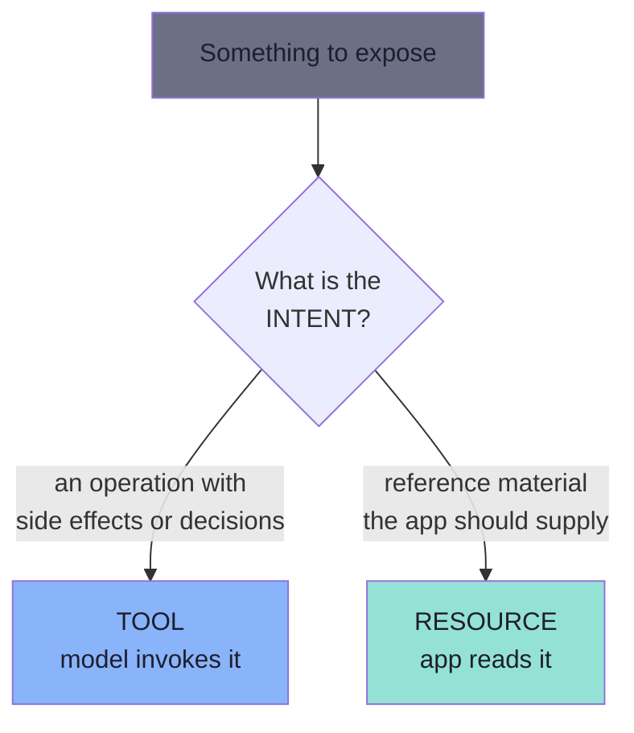
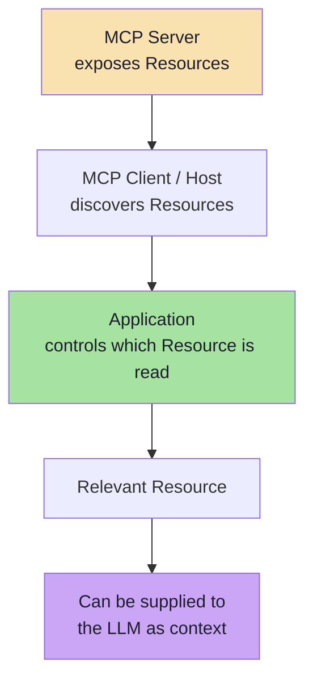
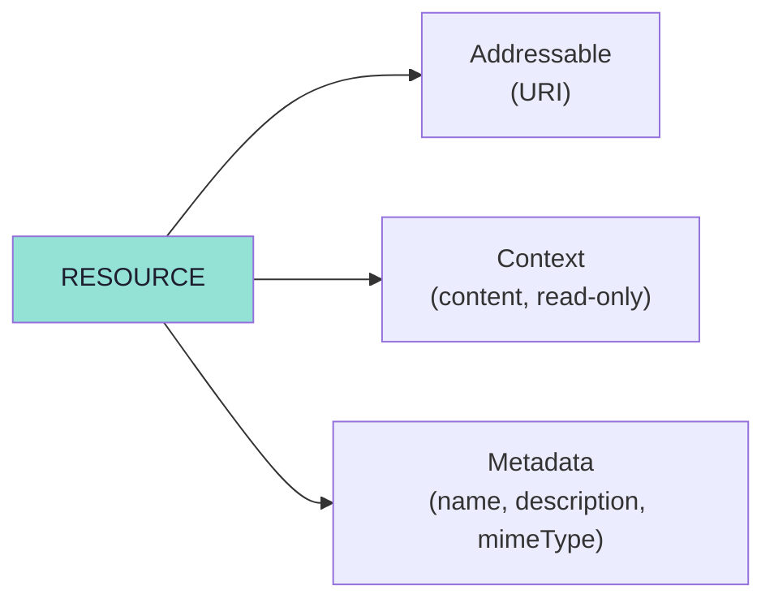
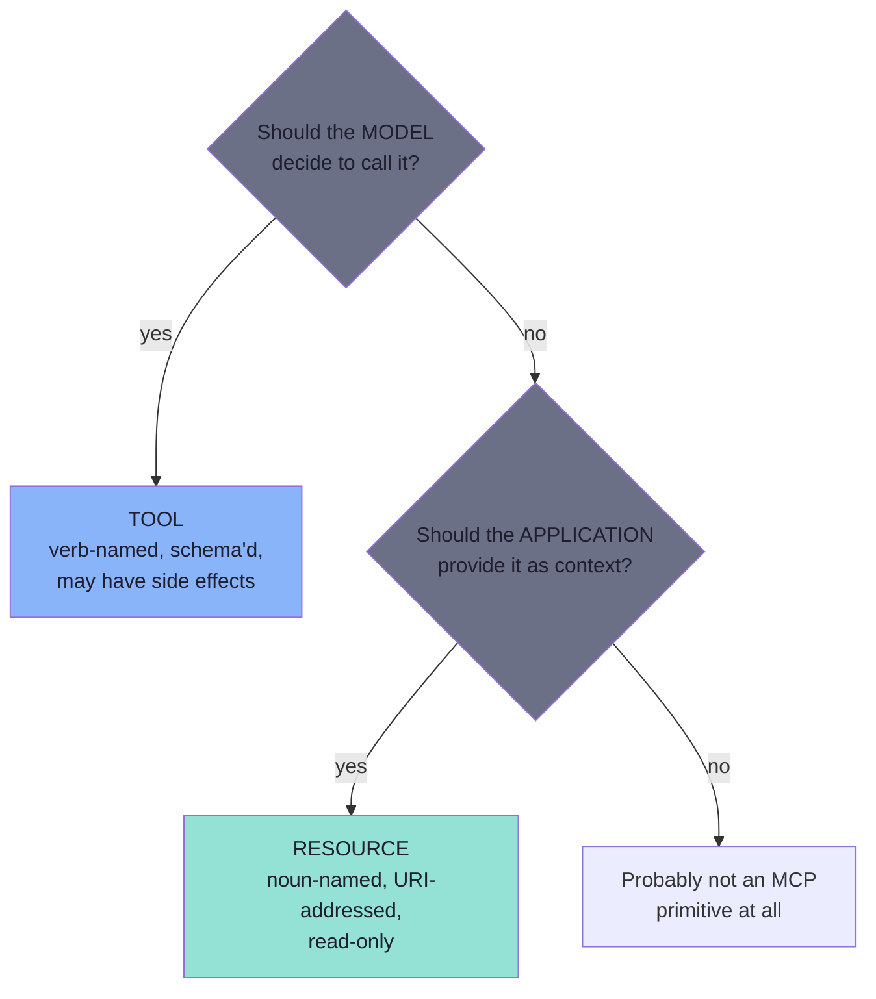

# Chapter 02: Why Resources — Context as a First-Class Primitive

> **Chapter Goal:** Tools can return data. So why does MCP need a second primitive for *information*? This chapter works through the lecture's coding-guidelines example, shows that the naive "just make it a Tool" answer *works* but is wrong, and derives the real distinction: **intent**, not payload.
>
> At the end of this chapter you should be able to answer: *This thing I want to expose returns data — is it a capability or is it context?*

---

## 2.1 The Setup: Knowledge Sitting Inside the Server

Suppose an MCP Server contains information such as:

```text
Coder Army Coding Guidelines

1. Use Java 21.
2. Prefer constructor injection.
3. Controllers should not contain business logic.
4. Services should contain business logic.
5. Use meaningful variable names.
```

This is *not* an action. Nobody "runs" a coding guideline. It is knowledge that a model would answer better with — a reference document.

---

## 2.2 The Tempting Answer: Expose It as a Tool

The lecture is explicit that this would work:

```java
// Reference implementation (Spring AI) — from the lecture
@McpTool(...)
public String getCodingGuidelines() {
    return "...";
}
```

> **"This would work. Tools are not limited to performing actions. They can also retrieve information."**

That is the trap. A tool *can* return a string of guidelines, the model *can* call it, and the user *can* get a grounded answer. Nothing breaks.

So the naive test — *"does this return data?"* — cannot distinguish the two primitives. It returns `yes` for `getWeather()`, `list_tasks()` **and** `getCodingGuidelines()`.

---

## 2.3 The Better Question: What Is the Intent?

> **The important question is therefore not:**
> `Does this return data?`
>
> **The better question is:**
> `What is the intent of this capability?`

Consider:

```text
createTask()
```

This represents something the model can **call or execute**. It is an *operation* with a verb, arguments and consequences.

Now compare it with:

```text
coding-guidelines.txt
```

This represents information that may be useful as **context**. It is a *document*: addressable, readable, replaceable, cacheable — and it has no side effects.

That gives the deeper distinction:

```text
Tool
→ A capability the model can invoke

Resource
→ Context/data the application can make available
```



### Why intent beats payload — the four consequences

| Consequence | As a Tool | As a Resource |
|---|---|---|
| **Who triggers it** | The model, whenever it likes | The application, deliberately |
| **Determinism** | Probabilistic — the model may or may not call it | Deterministic — your code decides |
| **Cost** | Every invocation is a model decision (tokens, latency, an extra round trip) | One read, placed directly into context |
| **Risk** | Model can be talked into calling it | Model cannot call it at all |

> **The headline:** putting reference material behind a Tool makes the *model* responsible for fetching it. Putting it behind a Resource makes *you* responsible. For context, you almost always want to be the one responsible.

---

## 2.4 What an MCP Resource Actually Is

> **An MCP Resource is data or content exposed by an MCP Server that a client can discover and read.**

The lecture's list of examples is worth keeping as a checklist of what belongs here:

```text
Company policies
README files
Project documentation
Git history
Database records
Application configuration
API documentation
Logs
Knowledge-base articles
Project architecture
```

Notice the shape: every one of them is *addressable reference material*. None of them is an action.

### The critical property: a Resource is NOT automatically in context

> **A Resource does not automatically become part of the LLM context.**

This is the single most misunderstood point about the primitive. The real flow is:

```text
MCP Server
   ↓
Exposes Resources

MCP Client / Host
   ↓
Discovers Resources

Application
   ↓
Controls which Resource is read

Relevant Resource
   ↓
Can be supplied to the LLM as context
```



Note the two verbs the lecture chooses with care:

- the server **exposes**;
- the application **controls which** resource is read.

> **This is why Resources are generally described as *application-controlled*.** The server publishes a catalogue; the application decides what the model gets to see. Discovery is not consumption.

---

## 2.5 The Definition to Memorise

The lecture gives one sentence that captures the whole primitive:

> **"A Resource is an addressable piece of context along with metadata describing it."**

Unpack it into three obligations:

| Obligation | Means | Fails when |
|---|---|---|
| **Addressable** | It has a stable URI a client can name | The client must guess which one to use |
| **Context** | It is material for the prompt, not an action | Someone adds side effects to a "read" |
| **Metadata** | Name, description, MIME type travel with it | The host cannot decide relevance or render it |



---

## 2.6 Tool vs Resource — the Working Comparison

The lecture keeps this comparison in two places, and it is the same idea both times:

| | **Tool** | **Resource** |
|---|---|---|
| Intent | A capability the model can invoke | Context/data the application can make available |
| Examples | `searchDocumentation(query)`, `getWeather(city)`, `lookupOrder(id)`, `createTask()` | `company://coding-guidelines`, `file://README.md`, `project://architecture`, `coding-guidelines.txt` |
| Invoked by | The **model** | The **application** |
| Has arguments? | Yes — typed `inputSchema` | Yes, but as part of the URI (see templates, Chapter 04) |
| Can change state? | Yes (annotations describe *how much*) | No — reads are expected to be side-effect free |
| Naming style | **Verb + noun** (`get`, `list`, `create`, `complete`) | **Noun / document** (`guidelines`, `leave-policy`, `architecture`) |

### The rule from the lecture

```text
Should the MODEL decide to call it?
→ Tool

Should the APPLICATION provide it as context?
→ Resource
```



> **A naming smell that catches most mistakes:** if you are about to write `@McpTool getXyzGuidelines()` and the handler is a `return "..."` with no arguments, you are almost certainly describing a Resource with Tool syntax.

---

## 2.7 Beyond the Lecture: What the Script Only Gestures At

The lecture establishes the primitive. The following are the engineering concerns that show up the moment you ship one — and they are *different* from the concerns you already solved for Tools in Lecture 14.

### Resources vs RAG (a preview)

Lecture 12 built retrieval-augmented generation. Chapter 05 of this lecture shows an application doing something conceptually similar to RAG — embedding a query and comparing it to Resource metadata. The two are related but not identical:

| | RAG pipeline | MCP Resources |
|---|---|---|
| Where the corpus lives | Your vector store | Behind the MCP Server, addressed by URI |
| Who owns the index | The application | The server (the application may still rank) |
| Transport | Internal function calls | `resources/list` / `resources/read` |
| Composition | One retrieval system | Many servers, each exposing its own context |

The practical consequence: **MCP Resources give RAG a standard source of truth**, but the *ranking* decision stays with the application (Chapter 05).

### Read-only is a contract, not an enforcement

Nothing in the protocol stops a `resources/read` handler from writing to a database. The primitive's contract says a read is a read. Two consequences:

1. **Never mutate in a read handler.** A host may cache, re-read, or subscribe to a resource; a write inside a read is an invisible side effect that will fire at unpredictable times.
2. **Do not put privileged data behind a URI the host can read freely.** Reading is application-controlled — but the application is code, and code has bugs.

### Size and token budget

A Resource is context, and context is finite. A 40 MB log file read into a prompt is not context, it is a denial-of-service against your own token budget.

```ts
// Pseudocode — resource size discipline
const MAX_RESOURCE_CHARS = 20_000;

function readResource(uri: string): string {
  const text = load(uri);
  if (text.length <= MAX_RESOURCE_CHARS) return text;

  // Truncate deliberately and TELL the model it was truncated
  return (
    text.slice(0, MAX_RESOURCE_CHARS) +
    `\n\n[truncated: showing first ${MAX_RESOURCE_CHARS} of ${text.length} characters]`
  );
}
```

### Freshness, caching and versioning

Resources are the primitive most likely to be *stale*, because they are read repeatedly and cached aggressively.

| Concern | Practical move |
|---|---|
| Freshness | Return a `lastModified` annotation; use `resources/subscribe` when the host supports it |
| Caching | Cache by URI **and** by a version/etag you control |
| Versioning | Put the version in the URI (`company://policies/return-policy@v2`) or in metadata, never in prose |
| Invalidation | If the catalogue changes, emit `notifications/resources/list_changed` |

### The three-way comparison you will actually use

| Question | Tool | Resource | Prompt |
|---|---|---|---|
| Does the model choose *when*? | ✅ | ❌ | ❌ |
| Does the user choose *when*? | ❌ | ❌ | ✅ |
| Can it have side effects? | Yes | No | No |
| Is it part of context by default? | Only after it runs | Only if the app reads it | Only after the user runs it |
| Typical size | Small result | Possibly large document | A few messages |

---

## 2.8 Key Takeaways

1. **Tools can retrieve information** — so "it returns data" does not make something a Resource.
2. The real question is **intent**: an *operation the model may invoke* vs *context the application supplies*.
3. A Resource is **data or content exposed by an MCP Server that a client can discover and read**.
4. A Resource is **not automatically in the LLM's context**; the application decides.
5. Resources are therefore **application-controlled** — the server exposes, the application chooses.
6. The definition to memorise: *an addressable piece of context along with metadata describing it*.
7. The classification rule: **model decides → Tool; application provides → Resource.**
8. Reads must stay **side-effect free**, and their **size is a budget you own**.

---

**Previous:** [Chapter 01 — The Three Primitives and the Control Model](./01_The_Three_Primitives_and_the_Control_Model.md) · **Next:** [Chapter 03 — Resource Discovery, Reading and Anatomy](./03_Resource_Discovery_Reading_and_Anatomy.md)
