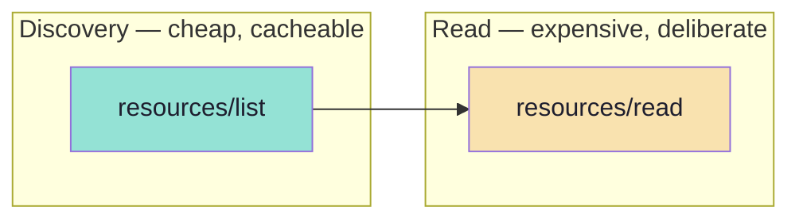
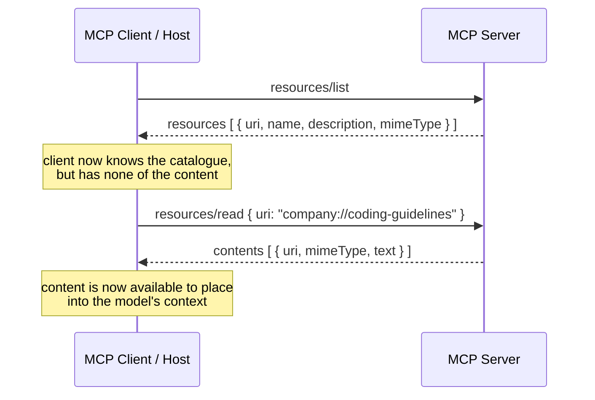
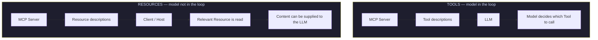
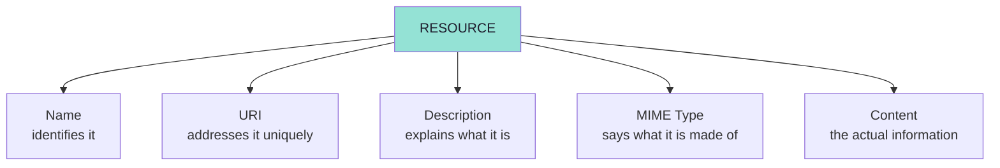
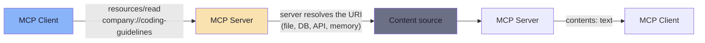
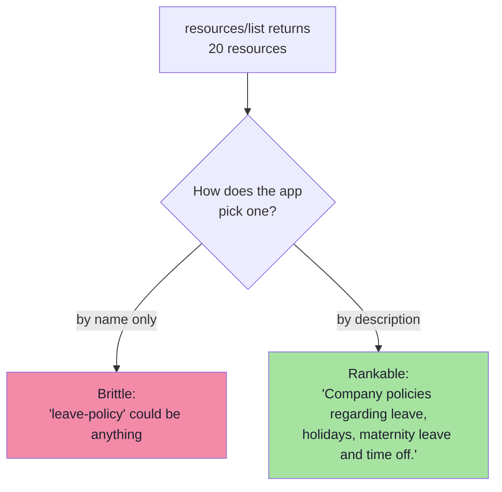
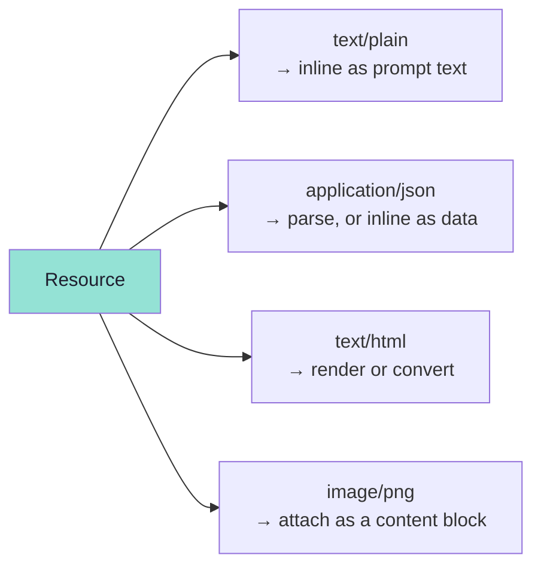
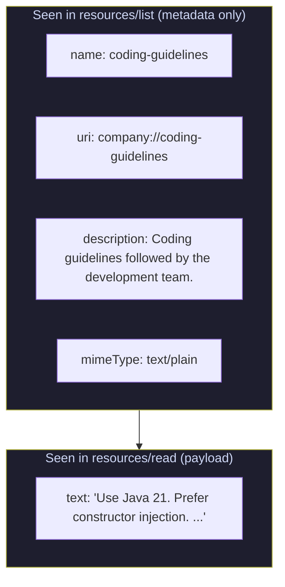

# Chapter 03: Resource Discovery, Reading and Anatomy

> **Chapter Goal:** A Resource is a catalogue entry before it is a document. This chapter covers the two operations that separate *knowing a Resource exists* from *having its content*, then dissects the five fields that make up a Resource definition — and why the URI is not a URL.
>
> At the end of this chapter you should be able to answer: *How does a client find out what context exists, how does it read one, and what does a well-formed Resource definition look like?*

---

## 3.1 Two Operations, Not One

> **MCP provides separate operations for discovering and reading Resources.**

This is a deliberate design choice, and it mirrors the Tool primitive: discovery is cheap, reading is expensive.



### Discover available Resources

Conceptually:

```text
resources/list
       ↓
"What Resources exist?"
```

The lecture's wire picture:

```text
CLIENT
    |
    |-------- resources/list -------->
    |
SERVER
   |
    | coding-guidelines
    | URI: company://coding-guidelines
    |
    <---------------------------------
```

> **At this point, the client knows the Resource exists.**

Nothing more. It has a name, a URI and metadata — not the content. This is exactly what a host needs to render a checklist of attachable context without paying to load any of it.

### Read a Resource

When the content is actually required:

```text
resources/read
       ↓
"Give me this Resource."
```

```text
CLIENT
    |
    | resources/read
    | company://coding-guidelines
    |
    |------------------------------->

SERVER
    |
    | Use Java 21.
    | Prefer constructor injection.
    | ...
    |
    <-------------------------------
```



---

## 3.2 The Distinction This Buys You

The lecture puts the two primitives side by side precisely because their control flows differ:

```text
TOOLS

MCP Server
   ↓
Tool descriptions
    ↓
LLM
   ↓
Model decides which Tool to call
```

```text
RESOURCES

MCP Server
    ↓
Resource descriptions
   ↓
Client / Host
   ↓
Relevant Resource is read
   ↓
Content can be supplied to the LLM
```



> **The one-line version:** in the Tools flow the **LLM makes a decision**; in the Resources flow the **application makes a decision** and the LLM merely receives the result.

That is the whole reason the two operations exist separately: `resources/list` feeds *your* selection logic, while `resources/read` produces *the model's* context.

---

## 3.3 Anatomy of an MCP Resource

> **A Resource usually contains metadata describing what it represents.**

```text
Resource
│
├── Name
├── URI
├── Description
├── MIME Type
└── Content
```



The first four are *metadata* — they travel in `resources/list` and cost almost nothing. The fifth is *payload* — it arrives only on `resources/read`.

---

## 3.4 Name

> **The name identifies the Resource.**

```text
coding-guidelines
```

Other examples from the lecture:

```text
project-info
company-policy
developer-guide
database-schema
```

### Naming rules that keep a catalogue usable

| Rule | Why |
|---|---|
| Stable, `kebab-case`, noun-shaped | It is an identifier — clients may key UI state on it |
| Unique inside the server | Duplicates make `resources/list` ambiguous |
| Not the URI | The name is for humans and UI labels; the URI is for addressing |
| Descriptive, not cute | `leave-policy`, not `policy-2-final` |

> **Note the relationship between Name and URI in the lecture's examples:** the name `coding-guidelines` and the URI `company://coding-guidelines` are *not* required to match — but when they do, the catalogue is dramatically easier to debug.

---

## 3.5 URI — the Address

> **A Resource needs an address through which the MCP client can uniquely identify it.**

```text
company://coding-guidelines
```

Other examples:

```text
company://leave-policy
project://architecture
docs://spring-boot-guide
config://application
```

> **The URI acts as the Resource's unique identifier.**

### URI does not necessarily mean URL

This is the point the lecture slows down for:

```text
company://coding-guidelines
```

> **This does not imply that the client performs:**
>
> `HTTP GET company://coding-guidelines`

Instead:

```text
The MCP client asks the MCP Server to read the Resource identified by that URI.

resources/read
URI = company://coding-guidelines
```

> **The server then resolves the URI and returns the associated content.**



### Why this matters

| If the URI were a URL | Because it is a URI |
|---|---|
| The client would need network access to `company://` | The client never fetches anything itself |
| The scheme would have to be resolvable | The scheme is a **namespace you define** |
| A host might leak an internal URL to a third party | Only the server knows where the bytes live |
| Content behind a firewall would be unreachable | The server can read anything *it* can reach |

> **Practical rule:** use an `https://`-style URI only when the client genuinely could fetch it itself. When the data lives behind the server (a database, an internal filesystem, a private API), a custom scheme is the honest choice — it says *"this is an address inside the server's world, not a link you can click."*

### Scheme conventions seen in this lecture

| Scheme | Meaning | Example |
|---|---|---|
| `company://` | Organisational documents | `company://coding-guidelines`, `company://leave-policy` |
| `project://` | Project/repo knowledge | `project://architecture`, `project://coder-army/status` |
| `docs://` | Documentation sources | `docs://spring-boot-guide` |
| `config://` | Configuration material | `config://application` |
| `task://` | The demo server's own domain | `task://guidelines` |
| `user://` | Per-user data (templated) | `user://123/profile`, `user://{username}` |
| `database://` | Database records | `database://customer/938` |
| `file://` | Files the host can also see | `file://project/src/OrderController.java` |

---

## 3.6 Description

> **Descriptions help clients understand what a Resource represents.**

```text
Name:
coding-guidelines

Description:
Coding standards used by our Java development team.
```

> **This becomes particularly useful when an MCP Server exposes many Resources.**



The description is not decoration. Chapter 05 shows the application comparing a **user query** against **Resource metadata** — which means the description is effectively *retrieval text*. Write it for a reader that is deciding relevance, not for a reader that already knows what the file is.

| Bad description | Better description |
|---|---|
| `"Leave policy"` | `"Company policies regarding leave, holidays, maternity leave and time off."` |
| `"Guidelines"` | `"Coding standards used by our Java development team."` |
| `"Config"` | `"Runtime configuration keys, defaults and environment overrides."` |

> **Same craft as tool descriptions in Lecture 14.** A description is the contract you write for a reader that cannot read your code — and for Resources that reader may be a ranking model.

---

## 3.7 MIME Type

> **The MIME type tells the client what kind of content the Resource contains.**

Examples from the lecture:

```text
text/plain
application/json
text/html
image/png
```

> **For simple textual Resources, we can use:** `text/plain`



### Why the client needs it

| Consumer | Uses MIME type to… |
|---|---|
| The **host UI** | Decide whether to render a text pane, a JSON viewer or an image |
| The **prompt builder** | Decide whether the content can be inlined as text at all |
| The **model** | Interpret structure (`application/json` invites structured reasoning) |
| **You, later** | Detect a mismatch — a `text/plain` resource that returns HTML is a bug |

> **Rule:** never lie about the MIME type to "make it work". If the content is JSON, say `application/json`; the host is allowed to render it differently, and a mismatched type is a silent corruption of your contract.

---

## 3.8 Content

> **The content is the actual information exposed by the Resource.**

```text
Use Java 21.

Prefer constructor injection.

Controllers should not contain business logic.

Services should contain application logic.
```

The lecture then assembles the whole thing:

```text
Name:
coding-guidelines

URI:
company://coding-guidelines

Description:
Coding guidelines followed by the development team.

MIME Type:
text/plain

Content:
Use Java 21.

Prefer constructor injection.
Keep business logic out of controllers.
```



> **The mental model, again:** *"A Resource is an addressable piece of context along with metadata describing it."* Metadata makes it findable; content makes it useful; the URI makes it addressable.

---

## 3.9 Beyond the Lecture: The Wire Shapes

The lecture describes the operations conceptually. These are the JSON-RPC messages a client actually sends and receives — useful when debugging with a raw probe (Lecture 14's technique).

### `resources/list`

```json
{ "jsonrpc": "2.0", "id": 1, "method": "resources/list", "params": {} }
```

```json
{
  "jsonrpc": "2.0",
  "id": 1,
  "result": {
    "resources": [
      {
        "uri": "company://coding-guidelines",
        "name": "coding-guidelines",
        "description": "Coding standards used by our Java development team.",
        "mimeType": "text/plain"
      }
    ],
    "nextCursor": "eyJvZmZzZXQiOjUwfQ=="
  }
}
```

| Field | Notes |
|---|---|
| `uri` | Required — the address |
| `name` | Required — the identifier |
| `description` | Optional, but treat as required for anything user-facing |
| `mimeType` | Optional, but treat as required for anything the host must render |
| `nextCursor` | **Pagination** — if present, call again with `params.cursor` |

> **Pagination is not optional at scale.** A server exposing 10,000 resources must paginate `resources/list`; a host that assumes one page will silently see a fraction of the catalogue.

### `resources/read`

```json
{
  "jsonrpc": "2.0",
  "id": 2,
  "method": "resources/read",
  "params": { "uri": "company://coding-guidelines" }
}
```

```json
{
  "jsonrpc": "2.0",
  "id": 2,
  "result": {
    "contents": [
      {
        "uri": "company://coding-guidelines",
        "mimeType": "text/plain",
        "text": "Use Java 21.\n\nPrefer constructor injection."
      }
    ]
  }
}
```

### Two content shapes

| Shape | Field | Use |
|---|---|---|
| **Text** | `text` | Markdown, source code, JSON, policies, logs |
| **Binary** | `blob` (base64) | Images, PDFs, archives |

```json
{ "uri": "file:///example.png", "mimeType": "image/png", "blob": "iVBORw0KGgo..." }
```

> **`contents` is an array, not a scalar.** One URI may resolve to several blocks (for example a document plus a rendered image). Code that reads `result.contents[0]` and assumes it is the whole story is a latent bug — the accompanying demo code does exactly that, and it is worth knowing why it is safe *there* and nowhere else.

### Resource annotations *(beyond the lecture)*

Content blocks may carry hints that tell the **host** how to treat them:

| Annotation | Meaning |
|---|---|
| `audience` | `["user"]`, `["assistant"]`, or both — who the content is for |
| `priority` | `0.0`–`1.0` — importance, `1` ≈ required, `0` ≈ optional |
| `lastModified` | ISO 8601 timestamp — enables staleness checks |

### Capabilities and subscriptions

```json
{
  "capabilities": {
    "resources": { "subscribe": true, "listChanged": true }
  }
}
```

| Method / notification | Purpose |
|---|---|
| `resources/templates/list` | Discover **parameterised** resources (Chapter 04) |
| `resources/subscribe` / `resources/unsubscribe` | Ask to be told when one resource changes |
| `notifications/resources/updated` | A subscribed resource changed |
| `notifications/resources/list_changed` | The catalogue itself changed |

### Failure modes to design for

| Failure | Symptom | Handling |
|---|---|---|
| Unknown URI | Error result on `resources/read` | Fail loudly; never return an empty string as if it were content |
| Oversized resource | Prompt blow-up, latency, cost | Truncate deliberately and say so (Chapter 02) |
| Stale content | Model answers from an old policy | `lastModified` + cache invalidation |
| Wrong MIME type | Host renders garbage | Validate content against the declared type |
| Missing `description` | Selection becomes guesswork | Treat as a bug, not a nit |

### The same shapes in JS/TS pseudo-code

```ts
// Pseudocode — what a registration looks like in a Node.js MCP server
server.registerResource(
  "coding-guidelines",                       // name
  "company://coding-guidelines",             // uri (or a template, Chapter 04)
  {
    description: "Coding standards used by our Java development team.",
    mimeType: "text/plain",
  },
  async (uri) => ({
    contents: [
      { uri: uri.href, mimeType: "text/plain", text: loadGuidelines() },
    ],
  }),
);
```

```ts
// Pseudocode — the client side: discover, then read
const { resources } = await mcpClient.listResources();          // metadata only
const target = pickResource(resources, userQuery);              // Chapter 05
const { contents } = await mcpClient.readResource({ uri: target.uri });
const contextText = contents.map((c) => c.text ?? "").join("\n\n");
```

---

## 3.10 Key Takeaways

1. Resources have **two operations**: `resources/list` (what exists) and `resources/read` (give me this one).
2. Discovery is **metadata-only** — it is cheap and cacheable; reading is deliberate and expensive.
3. In the Tools flow the **model decides**; in the Resources flow the **application decides** and the model receives.
4. A Resource definition is **Name, URI, Description, MIME Type, Content** — four metadata fields plus a payload.
5. The **URI is an identifier, not a URL**; the client never fetches it, the **server resolves** it.
6. Use a **custom scheme** when the bytes live behind the server; use `https://` only when the client could genuinely fetch them.
7. The **description is retrieval text** — write it for a ranker, not for someone who already knows the file.
8. **MIME type is a contract**; lying about it corrupts the host's rendering.
9. `contents` is an **array**; pagination is **`nextCursor`**; both are load-bearing at scale.

---

**Previous:** [Chapter 02 — Why Resources](./02_Why_Resources_Context_as_a_First_Class_Primitive.md) · **Next:** [Chapter 04 — Building Resources: Static, Dynamic and Templated](./04_Building_Resources_Static_Dynamic_and_Templated.md)
