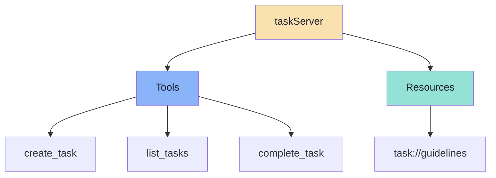
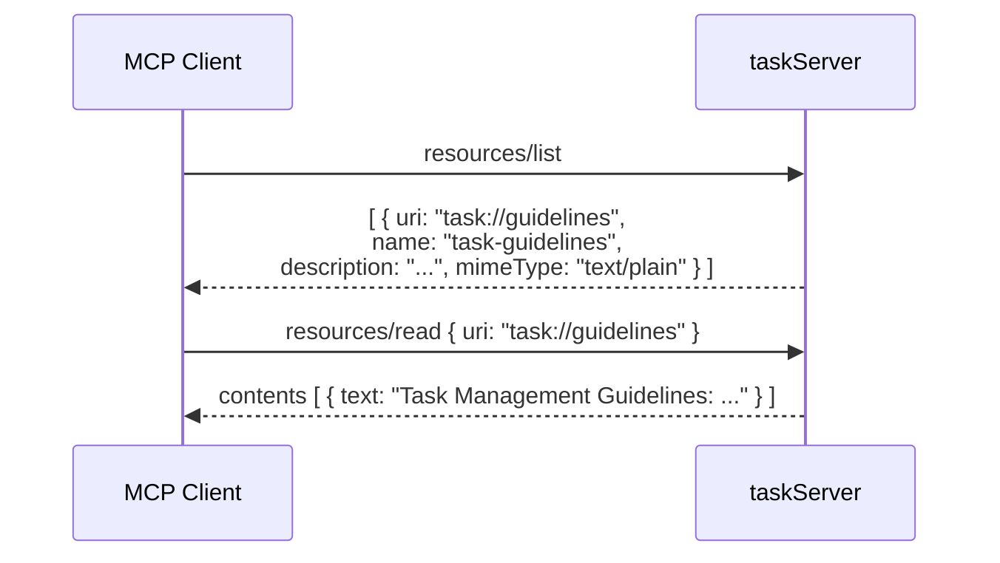
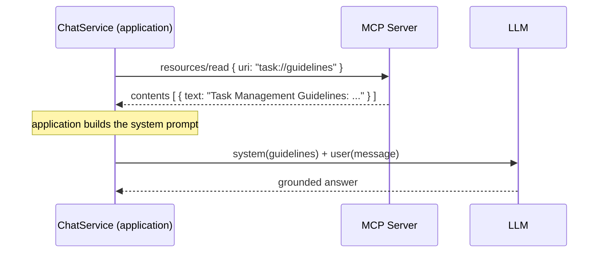
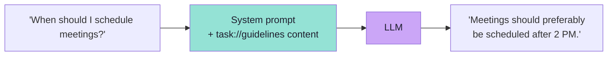
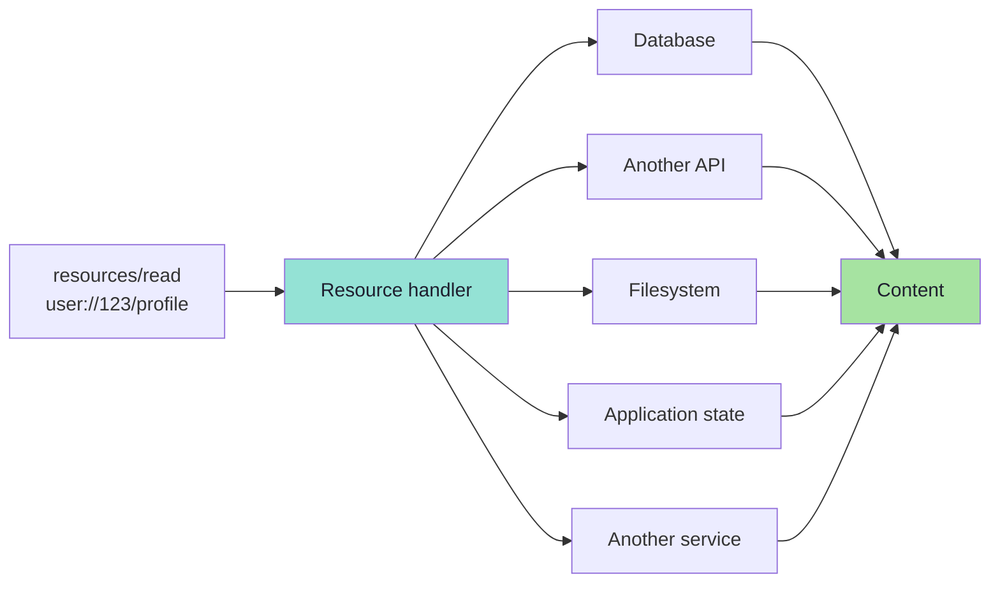
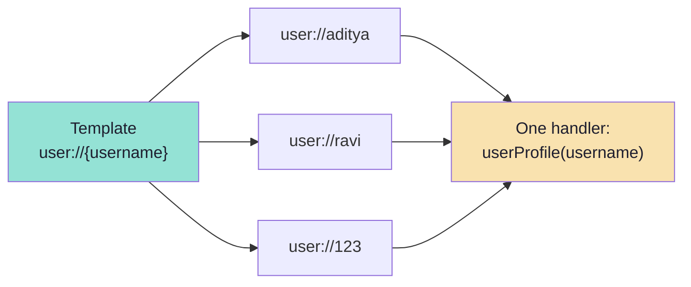

# Chapter 04: Building Resources — Static, Dynamic and Templated

> **Chapter Goal:** Chapter 03 described the shape of a Resource. This chapter builds one — first the trivial static case, then the client side that actually reads it, and finally the two forms that make Resources scale: **dynamic** resources backed by live data, and **templated** resources addressed by parameter.
>
> At the end of this chapter you should be able to answer: *How do I register a Resource, how does my application read it, and how do I expose ten thousand of them without writing ten thousand definitions?*

---

## 4.1 The Starting Point

> **Suppose our existing MCP Server already contains task-management Tools.**

That is the whole premise: Lecture 14's `taskServer` already works. We are *adding* a primitive to a running server, not building a new one.

```text
taskServer
├── Tools
│   ├── create_task
│    ├── list_tasks
│    └── complete_task
```

---

## 4.2 Registering a Static Resource

> **We can add another Spring component for Resources:**

```java
// Reference implementation (Spring AI) — from the lecture
@Component
public class TaskResources {

    @McpResource(
            uri = "task://guidelines",
            name = "task-guidelines",
            description = "Guidelines for managing and prioritizing tasks",
            mimeType = "text/plain"
    )
    public String taskGuidelines() {
        return """
                Task Management Guidelines:

                1. Deep work tasks should preferably be done before 12 PM.
                2. Meetings should preferably be scheduled after 2 PM.
                3. Urgent tasks should be completed on the same day.
                4. Keep a maximum of three high-priority tasks per day.
                5. Complete high-priority tasks before low-priority tasks.
                """;
    }
}
```

Read the annotation against Chapter 03's anatomy — it is a one-to-one mapping:

| Chapter 03 field | In the annotation | Value |
|---|---|---|
| URI | `uri` | `task://guidelines` |
| Name | `name` | `task-guidelines` |
| Description | `description` | `Guidelines for managing and prioritizing tasks` |
| MIME Type | `mimeType` | `text/plain` |
| Content | the method's return value | the guidelines string |

> **Notice what is absent:** there is no `inputSchema`, no argument list, no side effect. The method takes nothing and returns a constant. That is what a *static* Resource is.

---

## 4.3 The Server Now Exposes Two Primitives

> **The server now exposes:**

```text
taskServer
├── Tools
│   ├── create_task
│    ├── list_tasks
│    └── complete_task
│
└── Resources
    └── task://guidelines
```



> **When the application starts, Spring detects `@McpResource` and registers the Resource with the MCP Server.**

The registration is *declarative and automatic*. You did not write `resources/list` plumbing, you did not write a dispatcher, and you did not touch the transport. Framework detection is the whole integration cost.

A client can then discover it through:

```text
resources/list
```

and read it through:

```text
resources/read
task://guidelines
```



> **The JS/TS equivalent** (the same three fields, registered imperatively):

```ts
// Pseudocode — Node.js MCP server
server.registerResource(
  "task-guidelines",
  "task://guidelines",
  {
    description: "Guidelines for managing and prioritizing tasks",
    mimeType: "text/plain",
  },
  async (uri) => ({
    contents: [{ uri: uri.href, mimeType: "text/plain", text: getGuidelines() }],
  }),
);
```

---

## 4.4 Reading the Resource from the MCP Client

> **Unlike Tools, we do not expose the Resource to the model through `defaultTools(...)`.**
> **Instead, the application explicitly reads it.**

This is the sentence that separates the primitives in practice. A Tool is *registered with the model*; a Resource is *read by your code*.

A simplified example from the lecture:

```java
private String readTaskGuidelines() {

    var result = mcpClient.readResource(
            McpSchema.ReadResourceRequest
                    .builder("task://guidelines")
                    .build()
    );

    var content =
            (McpSchema.TextResourceContents)
                    result.contents().getFirst();

    return content.text();
}
```

Three things are happening, and each one is a design decision:

| Step | Code | Meaning |
|---|---|---|
| 1. Ask | `readResource(ReadResourceRequest.builder("task://guidelines"))` | The **application** names the URI — the model never sees this |
| 2. Unwrap | `result.contents().getFirst()` cast to `TextResourceContents` | `contents` is an array of blocks; this one is text |
| 3. Extract | `content.text()` | You now hold a plain string you can put anywhere in the prompt |

> **Why the cast matters:** a Resource may return `text` or `blob`. Casting to `TextResourceContents` is the code asserting *"I know this resource is textual"* — which is exactly the assumption the declared `mimeType: text/plain` promises. If the server ever changes that, the cast becomes the crash site. That is a *good* crash: it is loud and early.

---

## 4.5 Wiring the Resource into the Prompt

> **The flow becomes:**

```text
ChatService
    ↓
readResource("task://guidelines")
    ↓
MCP Server
      ↓
Task guidelines returned
    ↓
Application adds them to the prompt
    ↓
LLM
```



> **For example:**

```java
public String chat(String message) {

    String guidelines = readTaskGuidelines();

    return chatClient.prompt()
            .system("""
                      You are a task management assistant.

                      Use the following task management guidelines
                      whenever relevant:

                      %s
                      """.formatted(guidelines))
            .user(message)
            .call()
            .content();
}
```

> **Now a question such as `When should I schedule meetings?` can be answered using the MCP Resource:**
>
> `Meetings should preferably be scheduled after 2 PM.`



### Why this is better than the Tool version

Compare with Chapter 02's `@McpTool getCodingGuidelines()`:

| | Guidelines as a Tool | Guidelines as a Resource |
|---|---|---|
| Who fetches it | The model, if it decides to | `chat()` — deterministically, every time |
| Model round trips | 2 (call, then answer) | 1 |
| Failure mode | Model answers ungrounded and nobody notices | The read either succeeds or throws |
| Cost | Tool schema in every request | Zero until the read happens |

> **This is the payoff of the whole primitive.** The application knows the guidelines are relevant to *this* assistant. Making the model rediscover that fact on every request is wasted tokens and a new failure mode.

---

## 4.6 Static and Dynamic Resources

> **A Resource does not have to contain hardcoded text.**

```text
task://guidelines
```

> **is a simple static Resource.**
>
> **A Resource could also represent dynamic information:**

```text
user://123/profile

database://customer/938

project://coder-army/status
```

> **The Resource method could internally fetch data from:**
> - a database,
> - another API,
> - the filesystem,
> - application state,
> - or another service.

> **For example:**
>
> `return database.findById(...);`



### Static vs dynamic at a glance

| | Static | Dynamic |
|---|---|---|
| Content source | A constant in the handler | Database / API / filesystem / service |
| Changes over time | Never (until redeploy) | Every read |
| Caching | Cache aggressively, forever | Cache with a TTL or an etag |
| Failure modes | None | Timeouts, 404s, permissions |
| Example | `task://guidelines` | `user://123/profile`, `database://customer/938` |

> **The engineering consequence:** a dynamic Resource turns `resources/read` into a **network call with a failure mode**. From Chapter 03's rule that reads are side-effect free, we must add: reads are also **slow and can fail**, and the host must be given a way to tell the difference between *"empty"* and *"broken"*.

```ts
// Pseudocode — a dynamic resource handler that fails honestly
server.registerResource(
  "user-profile",
  "user://{username}",
  { description: "Profile of a user", mimeType: "application/json" },
  async (uri, { username }) => {
    const profile = await db.users.findByUsername(username);

    if (!profile) {
      // Do NOT return "{}" — an empty object is indistinguishable from a real empty profile
      throw new Error(`No profile for user '${username}'`);
    }

    return {
      contents: [
        { uri: uri.href, mimeType: "application/json", text: JSON.stringify(profile) },
      ],
    };
  },
);
```

---

## 4.7 Resource Templates — One Definition, Many Resources

> **Suppose an application exposes user profiles:**

```text
user://1
user://2
user://3
```

> **Creating a separate Resource definition for every user would not be practical.**
>
> **A URI template can instead be used:**

```text
user://{username}
```

> **Example:**

```java
@McpResource(
        uri = "user://{username}",
        name = "user-profile"
)
public String userProfile(String username) {

    return "Profile of " + username;
}
```

> **The server can now resolve `user://aditya` or `user://ravi` dynamically.**



### Templates vs enumerating resources

| | List every resource | Use a template |
|---|---|---|
| Definitions | One per instance | One for the family |
| `resources/list` size | Grows without bound | Constant |
| Discovery | The client sees every instance | The client learns the **pattern** |
| Client UI | A long, unusable list | A form field, or a host-driven URI |
| Wire method | `resources/list` | `resources/templates/list` |

```text
student://{studentId}/progress
company://policies/{policyName}
file:///{path}
```

> **The rule of thumb:** if the set of resources is *finite and small*, list them. If it is *parameterised or unbounded*, template it. A server that enumerates a million users in `resources/list` has turned discovery into a denial-of-service.

### Templates are discovered separately

| Method | Returns |
|---|---|
| `resources/list` | Concrete, readable URIs |
| `resources/templates/list` | `uriTemplate` patterns plus metadata |

A well-behaved host shows concrete resources as attachable items and templates as *"type a value"* inputs — and many hosts pair templates with **argument autocompletion** (`completion/complete`) so the user gets IDE-style suggestions while typing the parameter.

---

## 4.8 Beyond the Lecture: Production Concerns for Resources

The lecture builds the happy path. These are the concerns that appear once a Resource handler touches real systems.

### 1. Authorisation is on *you*, per URI

A Resource handler is an ordinary function with a URI argument. If the URI contains a user id, the handler must verify that the *caller* is allowed to read *that* user's data.

```ts
// Pseudocode — authorisation belongs inside the handler
async function readUserResource(uri, { username }, session) {
  if (session.user.username !== username && !session.user.isAdmin) {
    throw new Error("Not authorised for this resource");
  }
  return loadProfile(username);
}
```

> **The failure mode to avoid:** `database://customer/938` where `938` comes from the model or the user. Without a check, a template becomes an enumeration oracle — every customer record readable by incrementing a number.

### 2. Validate and constrain dynamic URIs

| Attack | Defence |
|---|---|
| Path traversal in `file://{path}` | Resolve and verify the real path stays inside an allow-listed root |
| Injection into a SQL-backed URI | Parameterise; never interpolate the URI into a query |
| Unbounded fan-out | Cap template expansion; require an exact match, not a glob |
| Cross-tenant leakage | Bind the tenant from the **session**, not from the URI |

### 3. Cache like a read-heavy system

| Content kind | Strategy |
|---|---|
| Static (guidelines, policies) | Cache for the process lifetime |
| Slowly changing (schemas, docs) | TTL + `lastModified` |
| Per-user, fast-moving | Short TTL, keyed by `uri + user`; never shared across users |
| Huge documents | Do not cache the whole thing — cache the *selected slice* |

### 4. Do not let Resources become a prompt-injection channel

A Resource is text that lands in a model's context. If its content comes from an untrusted source (a wiki, a user-supplied README, a log line), it is **untrusted text with system-level authority** once it is in the prompt.

> **The mitigation is the same one Lecture 13 taught for structured output:** keep untrusted content in a clearly delimited region, and never let it appear to be instructions from the operator.

### 5. Give the host enough to render

```ts
// Pseudocode — metadata that survives a real host
{
  uri: "project://architecture",
  name: "project-architecture",
  description: "Component diagram, module boundaries and deployment topology.",
  mimeType: "text/markdown",
  size: 18_442,           // lets the host warn before a large read
}
```

---

## 4.9 Key Takeaways

1. Registering a Resource is **declarative**: `@McpResource` (Spring AI) or `registerResource(...)` (JS/TS) — name, URI, description, MIME type, handler.
2. A **static** Resource returns a constant; a **dynamic** Resource fetches from a database, API, filesystem, service or application state.
3. The client reads a Resource **explicitly** — it is not registered with the model the way a Tool is.
4. `readResource(uri)` returns a `contents` **array**; unwrap and extract `text` (or handle `blob`).
5. Putting the content into the **system prompt** is what turns a Resource into grounded behaviour.
6. **Static vs dynamic is a caching and failure-mode decision**, not just a code-shape decision.
7. **Resource templates** (`user://{username}`) expose a family of resources with one definition; discovery uses `resources/templates/list`.
8. **Authorisation and validation live in the handler.** A template with an unchecked parameter is an enumeration oracle.
9. Resource content is **untrusted text with system-level authority** — treat it as an injection surface.

---

**Previous:** [Chapter 03 — Resource Discovery, Reading and Anatomy](./03_Resource_Discovery_Reading_and_Anatomy.md) · **Next:** [Chapter 05 — How the Application Chooses a Resource](./05_How_the_Application_Chooses_a_Resource.md)
