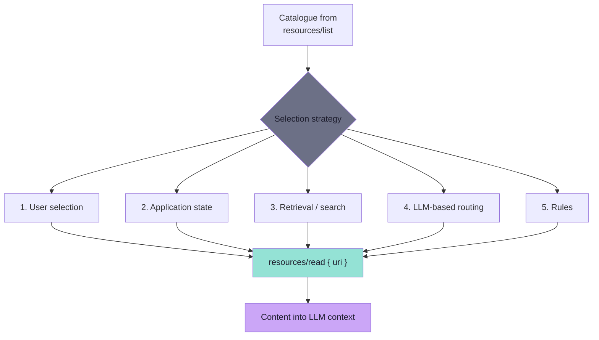
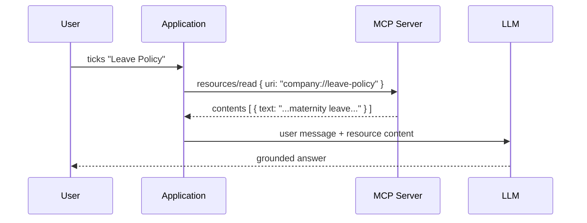
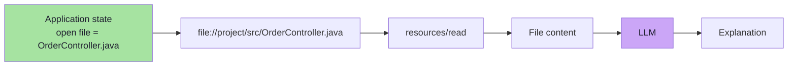
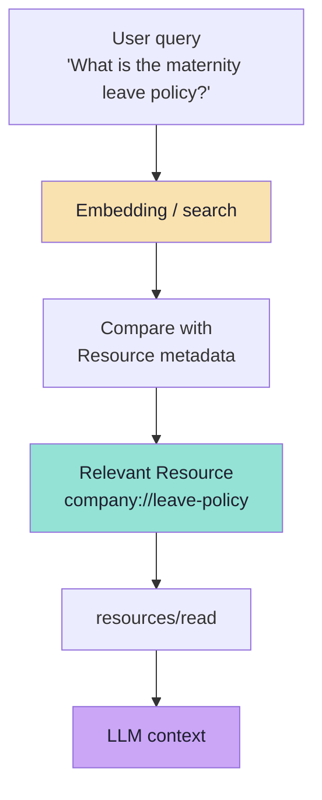
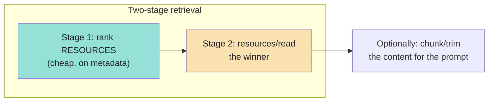
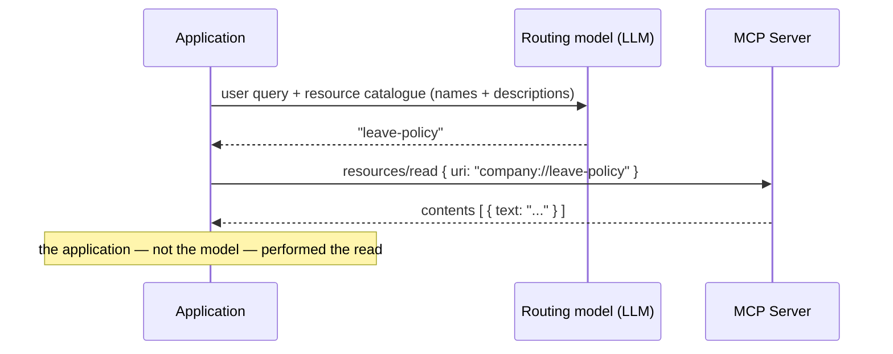
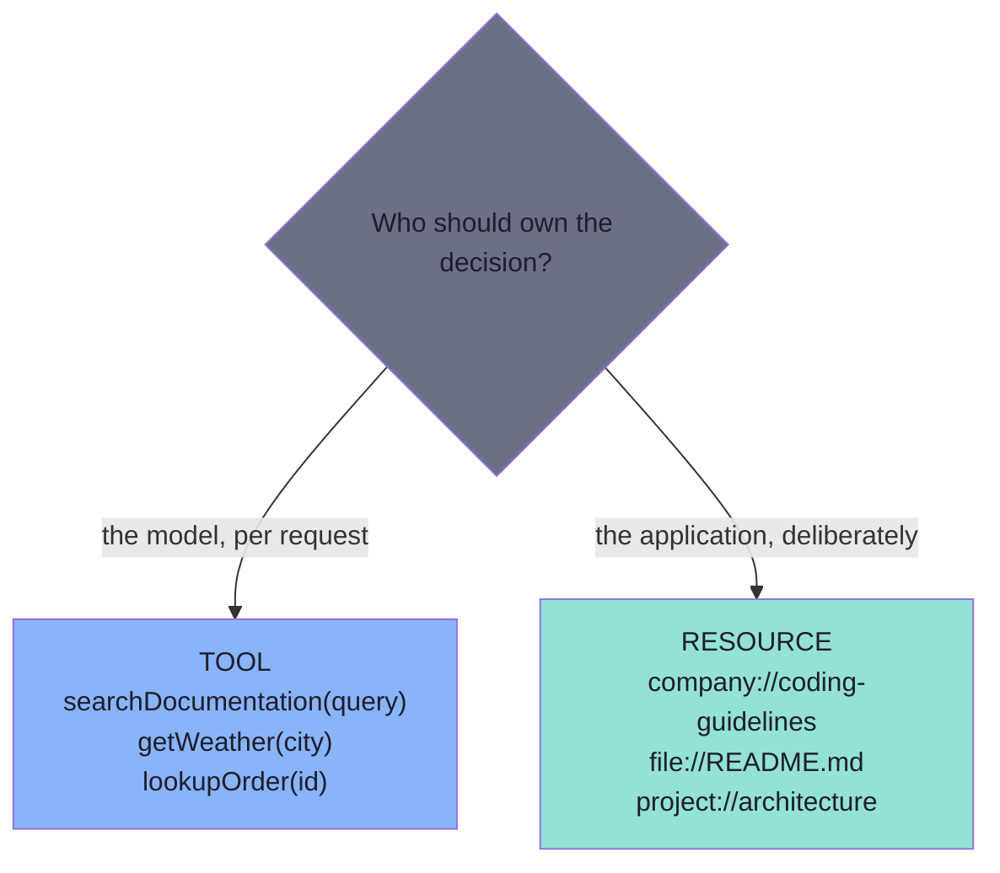
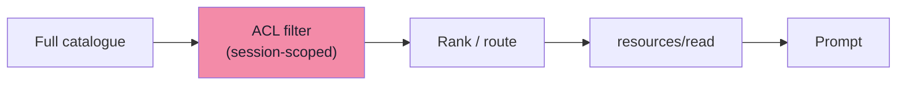

# Chapter 05: How the Application Chooses a Resource

> **Chapter Goal:** "Application-controlled" sounds like an answer. It is actually a **question**: which resource, out of the catalogue, does *my* application read for *this* request? MCP deliberately does not answer that. This chapter covers the four strategies the lecture names — user selection, application state, retrieval, and LLM-based routing — and ends with the Resources-vs-Tools rule that decides whether the choice should exist at all.
>
> At the end of this chapter you should be able to answer: *Given a user message and a catalogue of Resources, what code selects one — and how do I keep that selection honest?*

---

## 5.1 The Missing Piece

> **Calling Resources application-controlled does not mean the application automatically understands natural language.**
>
> **MCP does not prescribe how a host selects a Resource.**
>
> **The application can use several strategies.**

This is a deliberate gap in the protocol. MCP standardises *transport and shape*; it does not standardise *judgement*. Ranking, freshness policy and relevance belong to the application, because only the application knows its users, its risk appetite and its budget.



The strategies are not exclusive. Real hosts combine them — for example *"rules decide the shortlist, retrieval ranks it, and the user can always override by attaching a resource manually."*

---

## 5.2 Strategy 1 — User Selection

> **A client may allow users to explicitly attach a Resource.**

The lecture's UI:

```text
Attach Context

[ ] Coding Guidelines
[✓] Leave Policy
[ ] Architecture
[ ] Security Policy
```

> **Once the user selects `Leave Policy`, the application can perform:**

```text
resources/read
company://leave-policy
```

> **and add the content to the model context.**

```text
User selects Resource
        ↓
Application
        ↓
resources/read
        ↓
MCP Server
        ↓
Resource Content
             ↓
LLM Context
```



### Why this is the highest-quality strategy

| Property | Value |
|---|---|
| Precision | Perfect — the human chose it |
| Explainability | Perfect — "the user attached this" |
| Cost | Zero ranking cost |
| Failure mode | The user forgets, or the list is too long to scan |

> **Design note:** this is the strategy that makes `description` (Chapter 03) a *user-facing* field. A checkbox labelled `company://leave-policy` is unusable; a checkbox labelled *"Company policies regarding leave, holidays, maternity leave and time off."* is self-explanatory.

---

## 5.3 Strategy 2 — Application State

> **Sometimes the application already knows what context is relevant.**
>
> **Consider an IDE. The currently open file is:**

```text
OrderController.java
```

> **The user asks:**

```text
Explain this code.
```

> **The IDE already knows which file the user is referring to.**

```text
Current open file
       ↓
file://project/src/OrderController.java
       ↓
resources/read
       ↓
File content
        ↓
LLM
```

> **No additional AI decision is required.**



### Why this is the strategy people forget

The most valuable context is often *already known* by the application and needs no inference at all:

| Application | State it already has | Resource it implies |
|---|---|---|
| IDE | Open file, selection, cursor | `file://project/src/OrderController.java` |
| Support console | Open ticket | `ticket://48213` |
| Admin dashboard | Current tenant | `tenant://acme/config` |
| Chat with a task list | Today's date and tasks | `task://guidelines`, `user://me/profile` |

> **"No additional AI decision is required" is the punchline.** Every problem you solve with application state is a problem you do not have to solve with a ranking model — and a problem that cannot be hallucinated.

### The rule that follows

```text
If the application already knows the answer to "which resource?",
do not ask a model.
```

---

## 5.4 Strategy 3 — Retrieval or Search

> **If hundreds or thousands of Resources exist, the application can use retrieval.**

> **Example Resource metadata:**

```text
Resource:
leave-policy

Description:
Company policies regarding leave,
holidays, maternity leave and time off.
```

> **User asks:**

```text
What is the maternity leave policy?
```

> **The application could perform:**

```text
User Query
    ↓
Embedding / Search
    ↓
Compare with Resource metadata
    ↓
Relevant Resource
    ↓
company://leave-policy
    ↓
resources/read
    ↓
LLM Context
```

> **This is conceptually similar to RAG.**



### The important word: *metadata*

Notice **what is embedded**. The lecture does not say "embed every document and chunk it". It says *compare the query with **Resource metadata*** — name, description, MIME type, URI.

That is a much smaller and much more stable index:

| Indexing the metadata | Indexing the content |
|---|---|
| Index size | One vector per resource | Thousands of chunks |
| Freshness | Changes only when the catalogue changes | Changes whenever a document changes |
| Selection quality | Good enough to pick the *right document* | Better for picking the right *paragraph* |
| Then what? | `resources/read` fetches the full document | You already have the fragment |



> **MCP Resources and RAG are complements, not competitors.** MCP answers *"where does context come from and how do I fetch it?"*; RAG answers *"which slice of it fits in this prompt?"*. Chapter 02's comparison table is the short version; Lecture 12 is the long one.

### What retrieval buys and costs

| ✅ Buys | ⚠️ Costs |
|---|---|
| Scales to thousands of resources | Needs an index to build and refresh |
| Automatic selection, no user effort | Can pick the wrong resource confidently |
| Cheap compared with an LLM call | Embedding quality becomes a product concern |
| Explainable scores for debugging | Stale index = stale answers |

---

## 5.5 Strategy 4 — LLM-Based Routing

> **The application can also use an LLM to select a Resource.**

> **Suppose these Resources are available:**

```text
1. coding-guidelines
   Java development standards

2. leave-policy
   Employee leave and holiday policies

3. architecture
   System architecture documentation
```

> **User asks:**

```text
What is our maternity leave policy?
```

> **A routing model could choose:** `leave-policy`
>
> **The application then performs:** `resources/read(company://leave-policy)`



### The distinction the lecture refuses to let you miss

> **The important distinction remains:**
>
> **The MCP protocol did not make the Resource model-controlled. The application chose to use an LLM as part of its own routing strategy.**

This is a subtle but load-bearing sentence:

| | Model-controlled (Tool) | Application-controlled with LLM routing (Resource) |
|---|---|---|
| What the model receives | Tool **schemas** it may invoke | A **catalogue** it must classify |
| What the model returns | A tool call | A *label* the application may ignore |
| Who executes the read | The protocol, on the model's instruction | **Your code**, after your checks |
| Can you refuse? | Only by not registering the tool | Yes — validate, clamp, or override the choice |
| Audit story | "The model called `getSalary`" | "Our router chose `leave-policy`; our code read it" |

> **You are still the gatekeeper.** If the router picks `company://salary-bands` for a user without clearance, the *application* is what decides whether to honour that choice. Put the ACL check between the router's answer and `resources/read`.

```ts
// Pseudocode — routing is a suggestion, not an authorisation
const chosen = await routeWithLLM(userQuery, catalogue);   // e.g. "leave-policy"

if (!canRead(session.user, chosen.uri)) {                  // your rule, not the model's
  throw new Error("Resource not permitted for this user");
}

const { contents } = await mcpClient.readResource({ uri: chosen.uri });
```

### Choosing between retrieval and LLM routing

| | Embedding retrieval | LLM routing |
|---|---|---|
| Latency | Milliseconds | An extra model call |
| Cost | Index build + query | Tokens per request |
| Catalogue size | Thousands+ | Tens (the whole list must fit in the prompt) |
| Handles fuzzy intent | Reasonably | Better — it reads the question |
| Determinism | High (same query → same scores) | Low |
| Debuggability | Scores you can inspect | A label you must trust |

> **Practical default:** retrieval when the catalogue is large, LLM routing when the catalogue is small and the queries are ambiguous, and **both** when you need a shortlist plus a judgement call.

---

## 5.6 Strategy 5 — Rules

The lecture's key-takeaway list names one more option that gets no section of its own but deserves one:

> **Resource selection can be based on user selection, application state, retrieval, rules or LLM-based routing.**

**Rules** are the deterministic fallback: a small table of conditions that maps a situation to a resource.

```ts
// Pseudocode — a rule table is boring, testable and often correct
const RULES: Array<{ when: (ctx: Context) => boolean; uri: string }> = [
  { when: (c) => c.intent === "leave",      uri: "company://leave-policy" },
  { when: (c) => c.intent === "onboarding", uri: "company://onboarding-guide" },
  { when: (c) => c.repo === "checkout",     uri: "project://checkout/architecture" },
];
```

| Rule quality | Why it matters |
|---|---|
| **Deterministic** | The same input always selects the same resource — testable in a unit test |
| **Cheap** | No embedding, no extra model call |
| **Explainable** | "Rule 3 matched" is an audit line |
| **Composable** | Rules produce a shortlist; retrieval or an LLM can rank *within* it |

> **The layered pattern that works in production:** *rules narrow → retrieval ranks → the user may override.* Each layer is cheap, and each layer is independently debuggable.

---

## 5.7 Resources vs Tools — Deciding Whether Selection Should Exist

> **A common confusion is:**
> **"If a Tool can retrieve information, why not expose everything as a Tool?"**
>
> **The answer depends on how we want the information to be used.**

> **Use a Tool when the model should decide that something needs to be called.**

```text
searchDocumentation(query)
getWeather(city)
lookupOrder(id)
```

> **Use a Resource when the application should manage contextual/reference information.**

```text
company://coding-guidelines
file://README.md
project://architecture
```

> **A useful rule:**

```text
Should the MODEL decide to call it?
→ Tool

Should the APPLICATION provide it as context?
→ Resource
```



### The tie-breakers

| Situation | Primitive | Reason |
|---|---|---|
| The query is unpredictable and only the model knows when to search | Tool | The *when* is a judgement |
| The assistant always needs the guidelines | Resource | The *when* is "always" |
| The result is a big document | Resource | It is context, and it needs a token budget |
| The result is one small value | Tool | It is a lookup |
| The user should be able to attach it | Resource | It is a deliberate act |
| The user should be able to trigger a workflow | Prompt | It is an explicit act on a template |

> **The strongest anti-pattern:** exposing a *document* as a Tool. It works, the model sometimes calls it, and then you spend the next quarter wondering why answers are occasionally ungrounded with no error in the logs. Chapter 02 named this trap; this chapter is where you avoid it.

---

## 5.8 Beyond the Lecture: Selection Hygiene

### Context budget is the real constraint

Selection is not only *"which resource?"* but *"how much of it?"*. Three resources at 20,000 characters each is a prompt that costs more than the answer is worth.

```ts
// Pseudocode — select, then budget
const shortlist = rank(catalogue, userQuery);            // strategy 3 or 5
const chosen = shortlist.slice(0, MAX_RESOURCES);        // cap the count
const blocks = await Promise.all(chosen.map(read));      // then read
const context = fitToBudget(blocks, MAX_CONTEXT_CHARS);  // then trim
```

| Guard | Why |
|---|---|
| Cap the number of resources | Prevents accidental fan-out |
| Cap characters per resource | Prevents one huge document dominating |
| Cap total context | Protects latency, cost and answer quality |
| Prefer *fewer, better* resources | Retrieval quality beats recall here |

### Filter *before* ranking

If a user may not read a resource, it should not be in the candidate set at all — not ranked low, not filtered after the model sees it.



> **Why before:** ranking leaks. A model asked to choose between resources it should not see has been told they exist. Filtering afterwards is filtering after the decision — which is too late.

### Observability: log the *why*

Every selection should produce one line you can read at 2 a.m.:

```ts
// Pseudocode — a selection log line
logger.info("resource.selected", {
  strategy: "retrieval",        // user | state | retrieval | llm | rule
  query: userQuery,
  candidates: shortlist.length,
  chosen: chosen.map((r) => r.uri),
  scores: shortlist.slice(0, 3).map((r) => r.score),
  bytes: context.length,
  session: session.id,
});
```

| Question you will need answered | Field |
|---|---|
| Why did the model see this? | `strategy`, `chosen` |
| Was the catalogue even right? | `candidates` |
| Was the ranker close? | `scores` |
| Was it worth the tokens? | `bytes` |

### Evaluate selection like you evaluate retrieval

Lecture 12 built a golden set for retrieval. Do the same for selection: a small table of `(query → expected resource URI)` cases, run on every change. Without it, "the assistant got worse" is unfalsifiable.

---

## 5.9 Key Takeaways

1. **MCP does not prescribe selection.** Application-controlled means *your* code decides — that is a responsibility, not a feature.
2. Five strategies exist: **user selection, application state, retrieval, LLM-based routing, rules** — and they compose.
3. **User selection** is the most precise and the most explainable; it is why `description` is a user-facing field.
4. **Application state** is the cheapest win: *"no additional AI decision is required."*
5. **Retrieval** embeds **Resource metadata**, not the whole corpus — MCP and RAG are complements.
6. **LLM routing does not make a Resource model-controlled.** The application still performs the read, and can refuse.
7. The rule: **model decides → Tool; application provides → Resource.**
8. **Filter by ACL before ranking**, cap the count and the characters, and log the *why* of every selection.

---

**Previous:** [Chapter 04 — Building Resources](./04_Building_Resources_Static_Dynamic_and_Templated.md) · **Next:** [Chapter 06 — MCP Prompts: Reusable Interaction Templates](./06_MCP_Prompts_Reusable_Interaction_Templates.md)
