# Chapter 06: MCP Prompts — Reusable Interaction Templates

> **Chapter Goal:** Chapter 05 closed the loop on *context*. This chapter opens the third primitive and a different problem: **reusable ways of interacting with the AI**. A Prompt is a message template that lives on the server so that every client does not have to reinvent it — and, crucially, a Prompt does **not** produce the answer.
>
> At the end of this chapter you should be able to answer: *What is an MCP Prompt, why does it belong on the server rather than in my app, and what exactly does it return?*

---

## 6.1 The Second Reusability Problem

> **Resources solve the problem of reusable context.**
> **There is another problem: reusable ways of interacting with the AI.**

> **Suppose our task-management MCP Server wants to provide workflows such as:**

```text
Plan My Day
Prioritize My Tasks
Review My Workload
Create Weekly Plan
```

Look at that list carefully. These are not capabilities (Tools) and they are not documents (Resources). They are **recipes**: a fixed shape of request that a user repeats, with a couple of parameters that change.

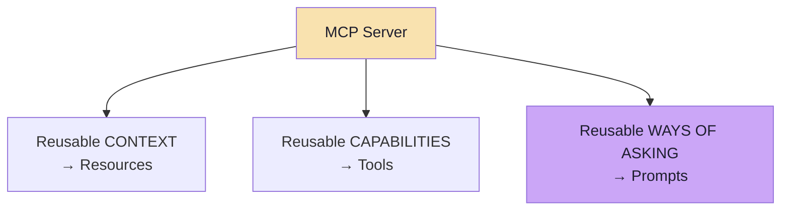

---

## 6.2 Why a Workflow Needs a Home

> **Consider: `Plan My Day`**
>
> **The workflow may require instructions such as:**

```text
Look at my pending tasks.

I have 4 hours available today.

Prioritize the tasks based on importance
and give me a concise ordered plan.
```

> **We could hardcode this inside every AI application.**

```java
String prompt = """
        Look at my pending tasks.

        I have %s hours available today.

        Prioritize the tasks based on importance
        and give me a concise ordered plan.
        """;
```

> **However, if multiple MCP clients consume the same server, each client would need to recreate the workflow.**
>
> **MCP solves this through Prompts.**

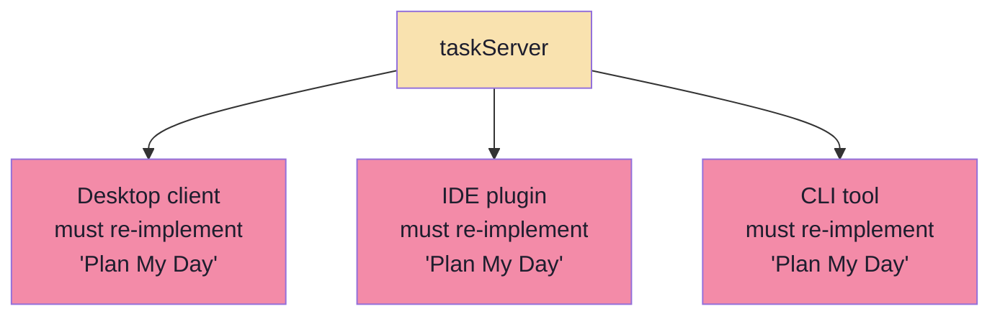

### The three costs of hardcoding

| Cost | Consequence |
|---|---|
| **Duplication** | N clients × M workflows = N × M copies to keep in sync (the same arithmetic as Lecture 14's integration problem) |
| **Drift** | One client improves the wording; the others keep the old behaviour |
| **No discoverability** | A new client has no way to learn that "Plan My Day" is the recommended way to use this server |

> **Prompts are the server's opinion about how it should be used — published, versioned and shared.** That is a *product* artefact, and it belongs next to the capabilities it describes.

---

## 6.3 What an MCP Prompt Is

> **An MCP Prompt is a reusable message template exposed by an MCP Server.**

> **Our server can now expose:**

```text
MCP SERVER

┌───────────────┐
│     TOOLS     │
│ create_task   │
│ list_tasks    │
└───────────────┘

┌───────────────┐
│   RESOURCES   │
│ task://       │
│ guidelines    │
└───────────────┘

┌───────────────┐
│    PROMPTS    │
│   plan_day    │
└───────────────┘
```

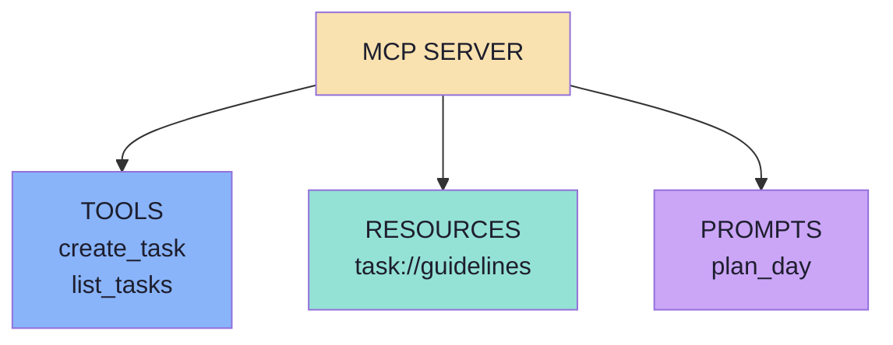

Read the template vocabulary against the other two primitives:

| | Tool | Resource | Prompt |
|---|---|---|---|
| What the server ships | A callable function | A document | A **message template** |
| Discovered with | `tools/list` | `resources/list` | `prompts/list` |
| Obtained with | `tools/call` | `resources/read` | `prompts/get` |
| Identified by | `name` | `uri` | `name` |
| Takes arguments? | Yes (schema) | Via URI template | Yes (argument list) |

---

## 6.4 Prompts Are User-Controlled

> **Prompts are generally user-controlled.**
>
> **A client may expose them through:**
> - Buttons
> - Menus
> - Slash commands
> - Forms
> - Other UI actions

> **Example:**

```text
Available Prompts

[ Plan My Day ]
[ Prioritize Tasks ]
[ Review Workload ]
```

> **The user explicitly chooses `Plan My Day`.**

> **The model does not independently decide to invoke `plan_day`.**

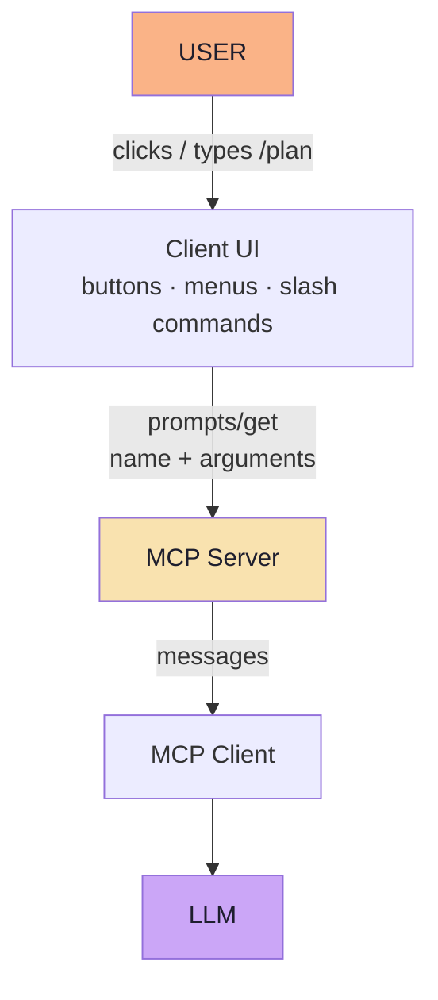

### Why user control is the right default here

| Property | Why it matters |
|---|---|
| **Predictable cost** | A prompt is a few messages the user asked for, not an unbounded model decision |
| **Explicit intent** | The user said "plan my day" — no inference required |
| **Discoverable** | A visible menu teaches the user what the system is *for* |
| **Safe** | Prompts are not side-effecting, so the blast radius of a click is small |

> **Contrast with Tools:** a Tool exists because the *model* must decide *when* to call it. A Prompt exists because the *user* wants to say *"do this now, this way."* Different trigger, different owner, different UI.

---

## 6.5 Prompt vs LLM Response — the Distinction That Matters Most

> **An MCP Prompt does not generate the final AI answer.**
>
> **It generates the messages or instructions that will later be sent to an LLM.**

```text
MCP Prompt
    ↓
Generates Messages
    ↓
MCP Client
      ↓
LLM
    ↓
Final Response
```

> **Therefore:**

```text
MCP Prompt ≠ LLM Response
```

> **The MCP Server defines a reusable interaction pattern.**
> **The LLM still produces the actual answer.**

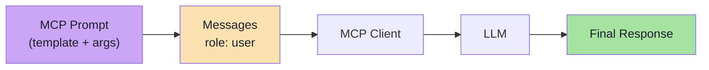

### The boundary, stated precisely

| | The MCP Server (Prompt) | The LLM |
|---|---|---|
| Produces | **Messages** — text, roles, arguments substituted | **The answer** |
| Deterministic? | Yes — same arguments, same messages | No |
| Testable? | Yes — compare the produced messages | Only statistically |
| Cost | Zero tokens (it is string templating) | Tokens, latency, money |
| Failure mode | A malformed template | A wrong or ungrounded answer |

> **Why this boundary is worth insisting on:** it keeps the server cheap, deterministic and testable, and it keeps the non-determinism in exactly one place. A server that "answers" would need an LLM — and then it would be a second AI system to evaluate, secure and pay for.

### The consequence for your architecture

```text
MCP Server  →  defines WHAT TO ASK (reusable, versioned, shared)
Application →  decides WHO ASKS and WHEN (user action, endpoint)
LLM         →  produces the ANSWER
```

---

## 6.6 Why Keep Prompts on the MCP Server?

> **A server can expose recommended workflows for using the capabilities and data it provides.**

> **A task-management server might expose:**

```text
plan_day
prioritize_tasks
review_workload
```

> **A GitHub MCP Server might expose:**

```text
review_pull_request
summarize_issue
prepare_release_notes
```

> **A database MCP Server might expose:**

```text
analyze_sales
explain_schema
investigate_anomaly
```

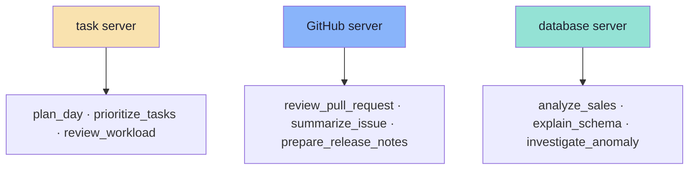

> **An MCP Server can therefore communicate both:**
>
> `"What can this system do?"` — through **Tools**
>
> and:
>
> `"What are useful ways to work with this system?"` — through **Prompts**.

### The two sentences a server publishes

| Question | Answered by | Example |
|---|---|---|
| *"What can this system do?"* | Tools | `create_task`, `list_tasks`, `complete_task` |
| *"What useful context does it hold?"* | Resources | `task://guidelines` |
| *"What are useful ways to work with it?"* | **Prompts** | `plan_day` |

> **This is domain knowledge that only the server author has.** The GitHub server's author knows that *"review this PR"* is a thing people do; the client's author does not. Prompts are how that knowledge crosses the boundary without every client rediscovering it.

---

## 6.7 Prompt Arguments

> **Prompts can accept arguments.**
>
> **Suppose our Prompt is `plan_day`. Different users may have different amounts of available time:**

```text
2 hours
4 hours
8 hours
```

> **Instead of creating:**

```text
plan_day_2_hours
plan_day_4_hours
plan_day_8_hours
```

> **we create one Prompt:**

```text
plan_day(availableHours)
```

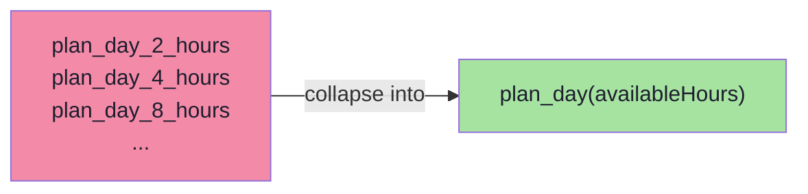

> **The client may display:**

```text
Plan My Day

Available Hours:
[ 4 ]

[ Run ]
```

> **The client then requests:**

```text
Prompt:
plan_day

Arguments:
availableHours = 4
```

> **The MCP Server can generate:**

```text
Plan my pending tasks for today.

First check my current pending tasks.

I have 4 hours available.

Give me a concise ordered plan.
```

> **The argument is substituted into the reusable Prompt template.**

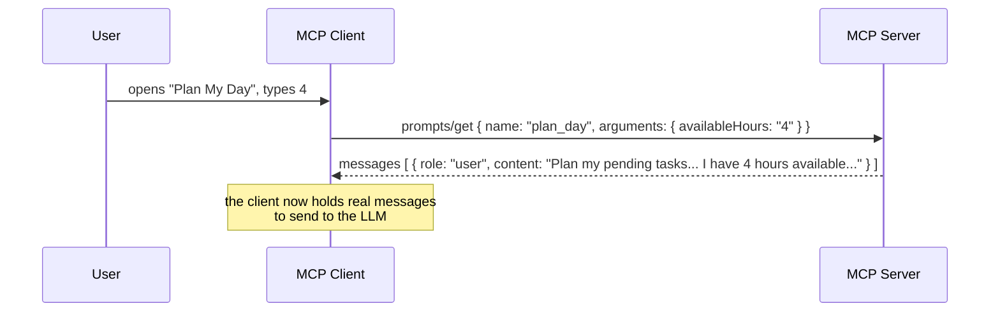

### The rule this encodes

```text
One prompt with arguments
   ≻
Many prompts with values baked into the name
```

| | N prompts for N values | One parameterised prompt |
|---|---|---|
| Menu size | Grows without bound | Constant |
| Server code | Duplicated templates | One template |
| Client UI | A long list | A form with a validated field |
| Discoverability | The client sees all variants | The client sees the **parameters** |

> **Arguments are the same idea as a Tool's `inputSchema` and a Resource's URI template** — a small, typed surface that keeps one definition serving many cases. Chapter 07 covers how the client declares and fills them.

---

## 6.8 Prompt Discovery

> **MCP provides two important operations conceptually:**

```text
prompts/list
prompts/get
```

### Discover Prompts

```text
CLIENT
    |
    |------ prompts/list ------>
    |
SERVER
   |
    | plan_day
    | availableHours required
    |
    <---------------------------
```

> **The client can then display `Plan My Day` to the user.**

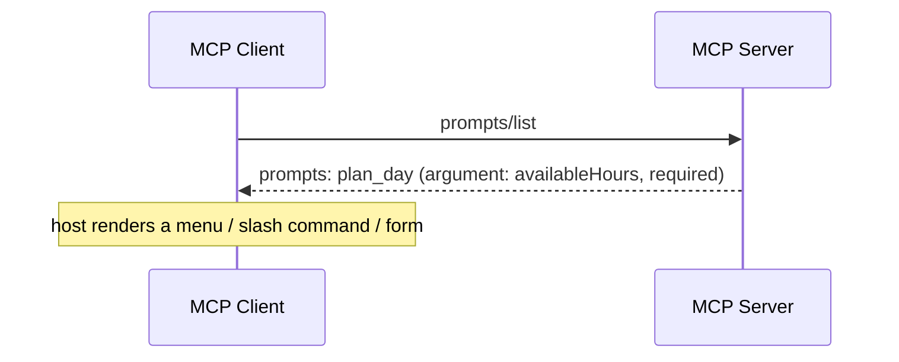

### Get a Prompt

> **After the user chooses it:**

```text
CLIENT
    |
    | prompts/get
    |
    | name = plan_day
    | availableHours = 4
    |
    |------------------------->

SERVER
    |
    | Prompt Messages
    |
    <--------------------------
```

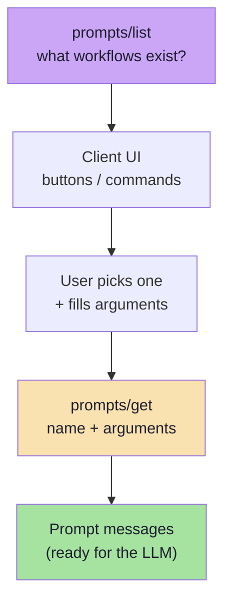

### Discovery is what makes prompts usable

| Without `prompts/list` | With `prompts/list` |
|---|---|
| A client must hardcode the workflow names | The client learns them at runtime |
| The server's recommended usage is invisible | It is published as a menu |
| A required argument is discovered by failing | `required: true` is advertised up front |

> **Same principle as `tools/list` and `resources/list`:** the server publishes its surface, the client renders it. Nothing about the workflow is negotiated out-of-band.

---

## 6.9 Practical: Creating an MCP Prompt

> **Our server can contain another component:**

```text
taskServer

├── TaskTools.java
├── TaskResources.java
└── TaskPrompts.java
```

The one-file-per-primitive layout is worth noting: **Tools, Resources and Prompts are three components, not three code paths inside one class.** Each is independently readable, testable and reviewable.

> **Example:**

```java
@Component
public class TaskPrompts {

    @McpPrompt(
            name = "plan_day",
             description = "Plan pending tasks for the available time"
    )
    public McpSchema.GetPromptResult planDay(

             @McpArg(
                        name = "availableHours",
                        description = "Number of hours available today",
                        required = true
             )
             String availableHours
    ) {

          String message = """
                  Help me plan my pending tasks for today.

                  First check my current pending tasks
                  using the available task tools.

                  I have %s hours available today.

                  Give me a concise and ordered plan.
                  """.formatted(availableHours);

          var promptMessage =
                  McpSchema.PromptMessage.builder(
                           McpSchema.Role.USER,
                           McpSchema.TextContent.builder(message).build()
                  ).build();

          return McpSchema.GetPromptResult
                  .builder(List.of(promptMessage))
                  .description("Plan pending tasks for the day")
                  .build();
    }
}
```

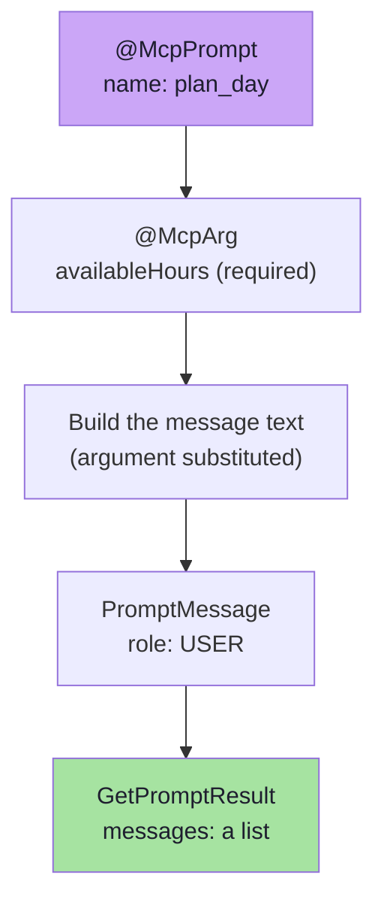

Read the return value carefully — it is the whole lesson of this chapter:

| Returned thing | What it is | What it is **not** |
|---|---|---|
| `PromptMessage(role = USER, content = TextContent(message))` | A **message** the client will send | An answer |
| `GetPromptResult(messages = [...], description = "...")` | A **bundle of messages** plus metadata | A completion |

> **The Prompt accepts `availableHours` and produces a message that will later be given to the LLM.**

### The JS/TS equivalent

```ts
// Pseudocode — Node.js MCP server
server.registerPrompt(
  "plan_day",
  {
    description: "Plan pending tasks for the available time",
    argsSchema: z.object({
      availableHours: z.string().describe("Number of hours available today"),
    }),
  },
  ({ availableHours }) => ({
    description: "Plan pending tasks for the day",
    messages: [
      { role: "user", content: { type: "text", text: planDay(availableHours) } },
    ],
  }),
);
```

```ts
// Pseudocode — the template itself is a pure function
export function planDay(availableHours) {
  return `Help me plan my pending tasks for today.

First check my current pending tasks
using the available task tools.

I have ${availableHours} hours available today.

Give me a concise and ordered plan.`;
}
```

> **Note the shape:** the template is a **pure function of its arguments**. That is what makes it testable — `planDay("4")` either contains "4 hours" or the test fails. There is no LLM in this file.

---

## 6.10 Beyond the Lecture: Prompt Engineering Concerns

The lecture establishes the primitive. These are the concerns that appear once Prompts are in production.

### The wire shapes

```json
{ "jsonrpc": "2.0", "id": 1, "method": "prompts/list", "params": {} }
```

```json
{
  "jsonrpc": "2.0",
  "id": 1,
  "result": {
    "prompts": [
      {
        "name": "plan_day",
        "description": "Plan pending tasks for the available time",
        "arguments": [
          {
            "name": "availableHours",
            "description": "Number of hours available today",
            "required": true
          }
        ]
      }
    ]
  }
}
```

```json
{
  "jsonrpc": "2.0",
  "id": 2,
  "method": "prompts/get",
  "params": {
    "name": "plan_day",
    "arguments": { "availableHours": "4" }
  }
}
```

```json
{
  "jsonrpc": "2.0",
  "id": 2,
  "result": {
    "description": "Plan pending tasks for the day",
    "messages": [
      {
        "role": "user",
        "content": {
          "type": "text",
          "text": "Help me plan my pending tasks for today... I have 4 hours available today..."
        }
      }
    ]
  }
}
```

| Field | Notes |
|---|---|
| `arguments[].required` | Lets the host validate before calling — and render a form field |
| `messages[]` | A **list**; a prompt may return several messages (a user message plus a pre-filled assistant turn) |
| `role` | `user` or `assistant` — this is where a prompt can seed a conversation shape |
| `description` | Travels both in `prompts/list` and in the result; keep them consistent |

### Multi-message prompts *(beyond the lecture)*

A prompt is not limited to one message. Two patterns are common:

| Pattern | Shape | Use |
|---|---|---|
| **Instruction + example** | `user` message, then an `assistant` message showing the desired format | Few-shot formatting |
| **System-like preamble** | A `user` message that establishes constraints | When the host has no separate system channel |

> **Caution:** whether an `assistant` message inside a prompt is *pre-filled* or *few-shot* depends on the host. If you rely on it, test against the hosts you actually support — this is the kind of thing that silently differs between clients.

### Argument completion

`completion/complete` lets a host offer suggestions while the user types an argument value — the same mechanism Resource templates use.

```json
{
  "method": "completion/complete",
  "params": {
    "ref": { "type": "ref/prompt", "name": "plan_day" },
    "argument": { "name": "availableHours", "value": "4" }
  }
}
```

### Prompt hygiene

| Concern | Practice |
|---|---|
| **Versioning** | Treat prompt text as a product artefact; changing it changes model behaviour. Keep the change reviewable. |
| **Arguments are strings** | The protocol passes strings; parse and validate on the server rather than trusting them |
| **Do not interpolate untrusted text** | An argument that comes from user input and is pasted into a prompt is an injection vector — delimit it |
| **No secrets** | A prompt is sent to a model. Never template credentials, tokens or personal data into it |
| **Test the template** | A pure function deserves a unit test: `planDay("4")` contains `"4 hours"` |
| **Name for the user, not the code** | `plan_day` renders as "Plan My Day"; the client has to make that leap for you |
| **Keep the count small** | Ten excellent workflows beat sixty mediocre ones — the menu is a product surface |

### Prompts vs application-side prompt templates

| | Prompt template in your app | MCP Prompt on the server |
|---|---|---|
| Who owns the wording | The client author | The server author (who knows the domain) |
| Shared across clients | No | Yes |
| Discoverable at runtime | No | Yes, via `prompts/list` |
| Versioned with the capability | Only by convention | Travels with the server it describes |
| Can take arguments | Yes | Yes, and advertises them |

> **The deciding question:** *would another client of this same server benefit from this workflow?* If yes, it is a Prompt. If it is specific to your application's UX, keep it in your application.

---

## 6.11 Key Takeaways

1. Resources solved **reusable context**; Prompts solve **reusable ways of interacting**.
2. An MCP Prompt is a **reusable message template exposed by an MCP Server**.
3. Prompts are **user-controlled** — surfaced as buttons, menus, slash commands or forms; the model does not decide to invoke `plan_day`.
4. **A Prompt does not generate the final AI answer.** It generates the messages that will be sent to an LLM: `MCP Prompt ≠ LLM Response`.
5. Prompts let a server say *"what are useful ways to work with this system?"*, complementing Tools' *"what can this system do?"*.
6. **Arguments beat name variants**: one `plan_day(availableHours)` instead of `plan_day_2_hours`, `plan_day_4_hours`, …
7. Discovery is `prompts/list`; retrieval is `prompts/get` with `name` + `arguments`.
8. A Prompt handler is a **pure function** returning messages — cheap, deterministic and unit-testable.
9. Keep prompts **versioned, delimited and secret-free**; a prompt is text that will be read by a model.

---

**Previous:** [Chapter 05 — How the Application Chooses a Resource](./05_How_the_Application_Chooses_a_Resource.md) · **Next:** [Chapter 07 — Prompt Arguments, Discovery and Client Wiring](./07_Prompt_Arguments_Discovery_and_Client_Wiring.md)
