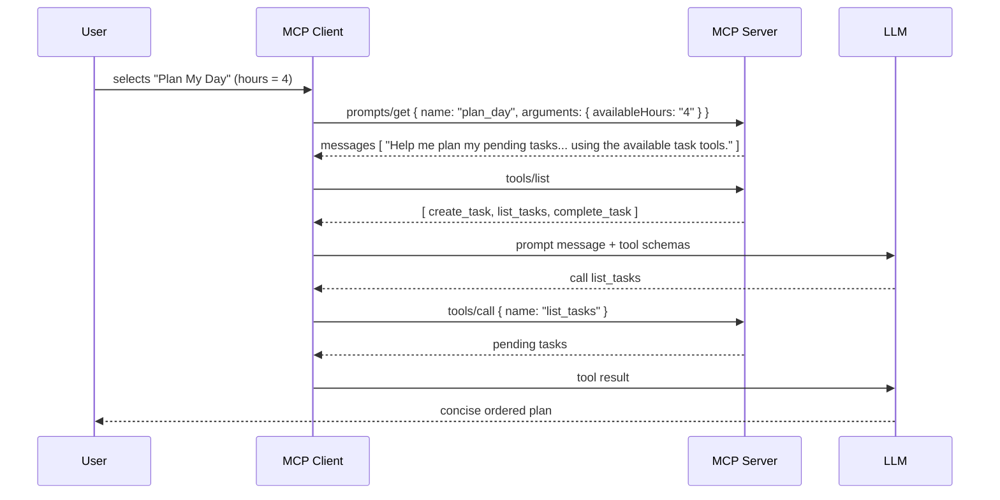
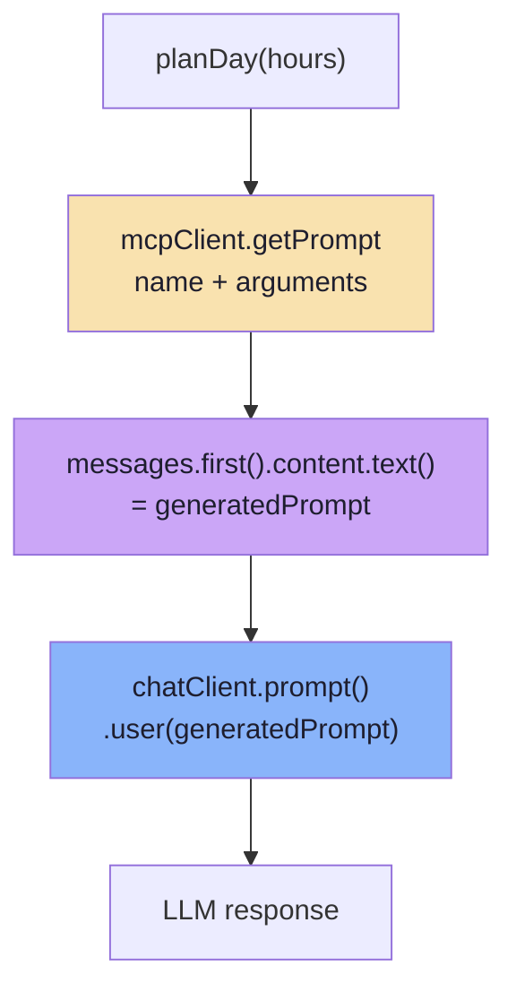
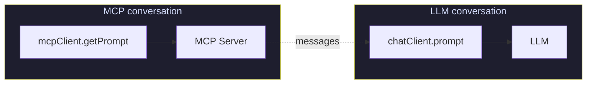
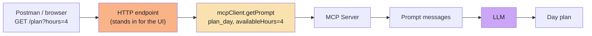

# Chapter 07: Prompt Arguments, Discovery and Client Wiring

> **Chapter Goal:** Chapter 06 built a Prompt on the server. This chapter wires it into a client — and shows the moment the three primitives stop being three separate features and start being **one workflow**: a Prompt that instructs the model to use a Tool.
>
> At the end of this chapter you should be able to answer: *How does a client fetch a Prompt with arguments, how do I avoid confusing the MCP call with the LLM call, and how do Prompts and Tools cooperate?*

---

## 7.1 Prompt and Tool Working Together

> **Notice this part of the Prompt:**

```text
First check my current pending tasks
using the available task tools.
```

> **The Prompt does not execute `list_tasks`.**

> **It only instructs the LLM.**

> **The LLM receives the Prompt and sees that `list_tasks` is one of its available Tools.**
> **It can then decide: `I need to know the current tasks.` and invoke `list_tasks`.**

> **The flow becomes:**

```text
User selects Prompt
       ↓
Prompt guides LLM
       ↓
LLM decides a Tool is needed
       ↓
Tool is executed
```

> **This demonstrates how different MCP primitives can work together.**



### The three-line division of labour

```text
Prompt    → says WHAT TO ASK      ("check my pending tasks, I have 4 hours")
Tool      → says WHAT CAN BE DONE ("list_tasks")
LLM       → decides to CONNECT them
```

| Who | Does what | Never does |
|---|---|---|
| **Prompt** | Provides the instruction | Execute anything |
| **Tool** | Provides the capability | Decide when to run |
| **LLM** | Chooses the tool for the instruction | Fetch the instruction or the capability |

> **The prompt is a *nudge*, not a *command*.** `"First check my current pending tasks using the available task tools"` works because the model *can* see `list_tasks`. If the server never registered the tool, the prompt would be asking for something impossible — and the model would either hallucinate the tasks or admit it cannot check.

### The design rule that follows

```text
A Prompt should only reference capabilities that its own server exposes.
```

That is what makes a Prompt a *recommended workflow for **this** server* rather than a generic wish.

---

## 7.2 Reading a Prompt from the MCP Client

> **The client can request the Prompt using the same MCP connection.**

> **Example:**

```java
public String planDay(String hours) {

     var result = mcpClient.getPrompt(
             McpSchema.GetPromptRequest
                        .builder("plan_day")
                        .arguments(
                                Map.of("availableHours", hours)
                        )
                        .build()
     );

     var content =
             (McpSchema.TextContent)
                        result.messages()
                                .getFirst()
                                .content();

     String generatedPrompt = content.text();

     return chatClient.prompt()
                .user(generatedPrompt)
                .call()
                .content();
}
```



### Read the method names as an architectural diagram

| Call | Talks to | Carries |
|---|---|---|
| `mcpClient.getPrompt(...)` | **The MCP Server** | `name` + `arguments` |
| `result.messages().getFirst().content()` | *(nothing — in-memory)* | The generated message |
| `chatClient.prompt(...).call()` | **The LLM** | The generated message |

> **The two operations should not be confused:**

```text
mcpClient.getPrompt(...)
        ↓
Communication with MCP Server

chatClient.prompt(...)
               ↓
Communication with LLM
```

> **`getPrompt()` only retrieves the reusable Prompt messages.**
> **The LLM call happens afterward.**



### Why this separation is the whole point

| If `getPrompt` also called the LLM | Because it does not |
|---|---|
| The server would need model credentials | The server needs none — it is templating |
| The server would be billable per request | `prompts/get` is free |
| The client could not choose the model | The client picks the model, temperature, tools |
| The server could not be tested offline | `prompts/get` is deterministic and testable |

> **This is the same boundary Lecture 14 drew for MCP servers generally:** *an MCP Server is a capability provider behind a standard interface; it needs no LLM.* A Prompt keeps that property intact.

---

## 7.3 Simulating User-Controlled Prompts with Postman

> **A real MCP client may display:**

```text
Prompts

[ Plan My Day ]
```

> **In a simple demo application, an endpoint can simulate that user selection.**

```java
@GetMapping("/plan")
public String plan(
           @RequestParam("hours") String hours) {

     return chatService.planDay(hours);
}
```

> **Calling:**

```text
GET /plan?hours=4
```

> **means that the user has effectively selected `Plan My Day` and provided `availableHours = 4`.**



### Why the demo uses an endpoint instead of a UI

| Reason | Explanation |
|---|---|
| **No UI to build** | The interesting part is the protocol, not the button |
| **Reproducible** | `curl`/Postman gives you the same request every time |
| **Faithful** | The endpoint performs *exactly* the work a button click would perform |
| **Testable** | It is an HTTP call, so it fits existing tooling |

> **Be explicit that it is a stand-in.** The lecture says *"an endpoint can simulate that user selection"* — the honesty matters, because it makes the difference between *"the user controls the prompt"* and *"the user controls the prompt in production"* clear.

### The same wiring in JS/TS pseudo-code

```ts
// Pseudocode — HTTP endpoints standing in for the client UI
const httpServer = createServer(async (req, res) => {
  const url = new URL(req.url, "http://127.0.0.1:8080");

  if (url.pathname === "/plan") {
    const hours = url.searchParams.get("hours");            // the "user input"
    if (!hours) return respond(res, 400, "hours is required");
    return respond(res, 200, await planDay(hours));
  }

  if (url.pathname === "/ask") {
    const message = url.searchParams.get("message");
    if (!message) return respond(res, 400, "message is required");
    return respond(res, 200, await chat(message));          // uses the RESOURCE
  }

  respond(res, 404, "Not found");
});
```

```ts
// Pseudocode — the Prompt path: MCP call, then LLM call
export async function planDay(hours) {
  const result = await mcpClient.getPrompt({
    name: "plan_day",
    arguments: { availableHours: hours },          // ← arguments, exactly as in the lecture
  });

  const generatedPrompt = result.messages[0].content.text;

  return askModel(generatedPrompt);                // ← the LLM call happens AFTER
}
```

---

## 7.4 Beyond the Lecture: Wiring Prompts in Production

### 1. Validate arguments before you send them

The protocol passes arguments as strings. A host that lets a user type `"four"` where a number is expected should not discover the problem from the model.

```ts
// Pseudocode — validate at the boundary
const argsSchema = z.object({
  availableHours: z.coerce.number().int().min(1).max(16),
});

const args = argsSchema.parse({ availableHours: hours });
const result = await mcpClient.getPrompt({ name: "plan_day", arguments: args });
```

| Layer | Responsibility |
|---|---|
| Host UI | Constrain the input (a number field, a select) |
| Client | Validate before `prompts/get` |
| Server | Re-validate inside the handler — never trust the caller |

### 2. Handle the four failure modes

| Failure | Symptom | Handling |
|---|---|---|
| Unknown prompt name | Error on `prompts/get` | Fail loudly; do not fall back to a hand-written prompt silently |
| Missing required argument | Error, or a template with a hole | Validate first; surface a form error to the user |
| Server unreachable | Transport error | Retry with backoff, or degrade to a client-side prompt **and log it** |
| Empty `messages` | Nothing to send | Treat as a server bug — an empty prompt is not a prompt |

```ts
// Pseudocode — a prompt fetch that fails honestly
async function getPromptOrThrow(name, args) {
  const result = await mcpClient.getPrompt({ name, arguments: args });
  if (!result.messages?.length) {
    throw new Error(`Prompt '${name}' returned no messages`);
  }
  return result.messages;
}
```

### 3. Compose prompt messages with your own context

A real host rarely sends *only* the prompt. It composes:

```ts
// Pseudocode — the assembled request
const promptMessages = await getPromptOrThrow("plan_day", { availableHours: "4" });
const guidelines = await readResourceText("task://guidelines");

const messages = [
  { role: "system",  content: `You are a task assistant.\n\n${guidelines}` },
  ...promptMessages,                       // the Prompt's messages, in order
  ...conversationHistory,                  // whatever the user already said
];
```

> **This is the composition the final chapter's end-to-end diagram shows:** the Prompt supplies the instruction, the Resource supplies the context, and the Tools supply the capability — all in one request.

### 4. Streaming, timeouts and cancellation

`prompts/get` is a small, fast, in-process template render — but the **LLM call that follows** is not. Give the two different budgets:

| Step | Typical budget | Failure behaviour |
|---|---|---|
| `prompts/get` | Tens of milliseconds | Fail the request; it is a local failure |
| `tools/list` / `resources/read` | Hundreds of milliseconds | Retry once, then fail |
| LLM call | Seconds | Stream tokens; allow cancel; never block the UI |

### 5. Test the prompt path without a model

Because the prompt path splits cleanly into two halves, you can test the first half deterministically:

```ts
// Pseudocode — a test that needs no API key
const messages = await getPromptOrThrow("plan_day", { availableHours: "4" });
expect(messages).toHaveLength(1);
expect(messages[0].role).toBe("user");
expect(messages[0].content.text).toContain("4 hours");
```

> **This is the practical payoff of `MCP Prompt ≠ LLM Response`:** half of your feature is ordinary, assertable software.

### 6. Anti-patterns

| Anti-pattern | Why it hurts |
|---|---|
| A prompt that tries to do the tool's job in prose | The model has a tool; instructions that re-implement it produce inconsistency |
| A prompt referencing a tool the server does not expose | The model either hallucinates the result or refuses |
| Baking values into prompt names | The menu grows without bound (Chapter 06) |
| Hiding the LLM call inside the MCP server | Breaks the "server needs no LLM" property and doubles your evaluation surface |
| Silent fallback to a client-side prompt | The server's recommended workflow silently stops being used |
| No versioning of prompt text | A wording change becomes an unexplained behaviour change |

---

## 7.5 Key Takeaways

1. A Prompt **instructs**; it does not execute. `"First check my current pending tasks using the available task tools"` is a nudge, and the **LLM** decides to call `list_tasks`.
2. The three primitives cooperate: **Prompt says what to ask, Tool says what can be done, the LLM connects them.**
3. A Prompt should only reference capabilities **its own server exposes**.
4. `mcpClient.getPrompt(...)` talks to the **MCP Server**; `chatClient.prompt(...)` talks to the **LLM**. Do not conflate them.
5. `getPrompt()` only retrieves reusable messages — **the LLM call happens afterward**.
6. An HTTP endpoint such as `GET /plan?hours=4` is a faithful **stand-in for a user clicking "Plan My Day"** with `availableHours = 4`.
7. **Validate arguments at every layer**, and fail loudly on an unknown prompt, a missing argument or an empty message list.
8. Because the two halves are separate, the prompt path is **testable without a model**.

---

**Previous:** [Chapter 06 — MCP Prompts: Reusable Interaction Templates](./06_MCP_Prompts_Reusable_Interaction_Templates.md) · **Next:** [Chapter 08 — Bringing Tools, Resources and Prompts Together](./08_Bringing_Tools_Resources_and_Prompts_Together.md)
