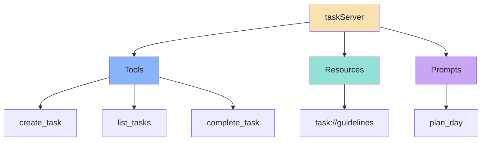
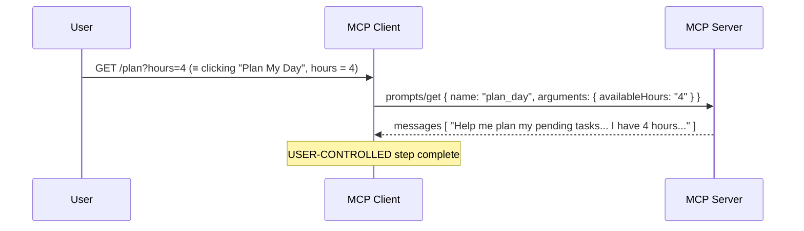
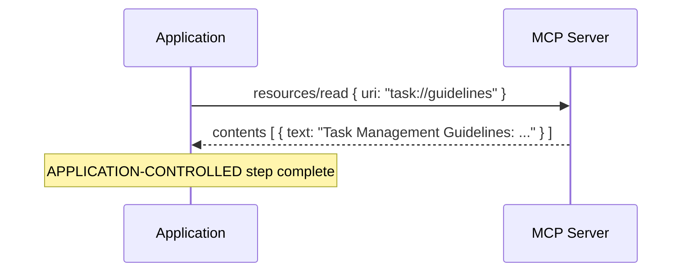
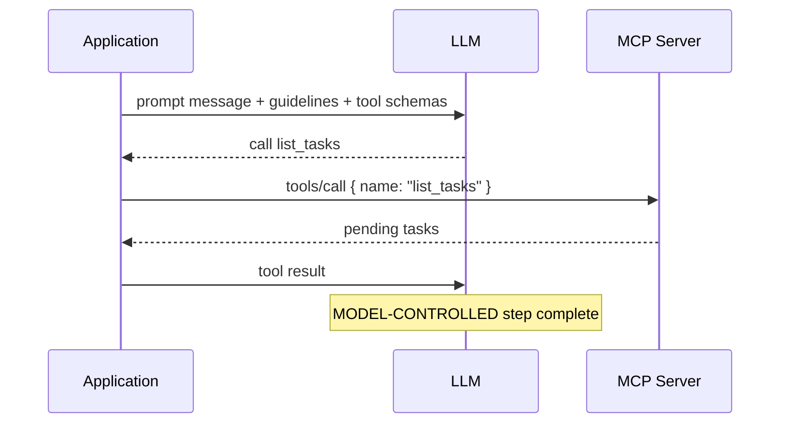
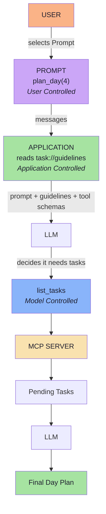
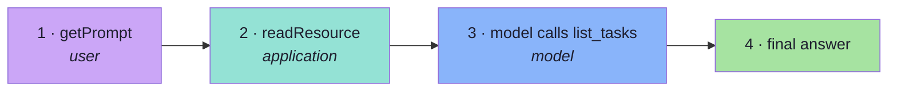
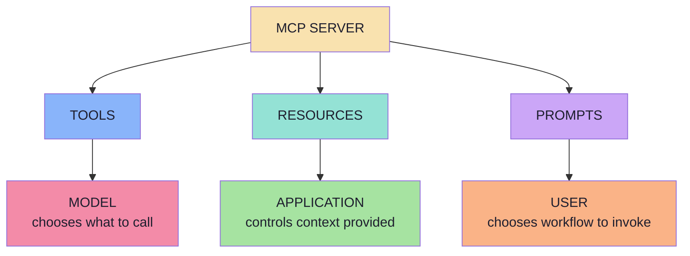
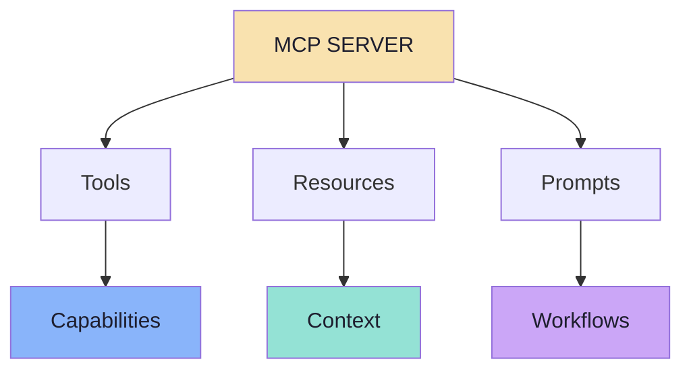
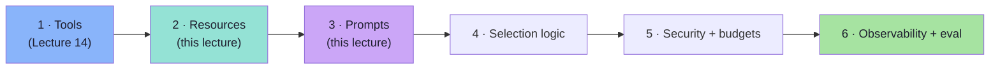

# Chapter 08: Bringing Tools, Resources and Prompts Together

> **Chapter Goal:** This chapter runs the whole thing once, end to end, on a single request — `GET /plan?hours=4` — and shows the three primitives firing in sequence, each controlled by a different actor. It closes with the final mental model, the key takeaways from the lecture, and the production checklist that turns a demo into a service.
>
> At the end of this chapter you should be able to answer: *In one request, who controls what — and what do I have to get right before this goes to production?*

---

## 8.1 The Finished Server

> **Our final task-management MCP Server can expose:**

```text
taskServer
│
├── Tools
│    ├── create_task
│    ├── list_tasks
│    └── complete_task
│
├── Resources
│   └── task://guidelines
│
└── Prompts
    └── plan_day
```



One process. One client. One connection. Three primitives.

---

## 8.2 The Request: `GET /plan?hours=4`

> **Now consider:**

```text
GET /plan?hours=4
```

The lecture walks it in three steps, one per actor.

### Step 1 — User Controls the Prompt

> **The user chooses `plan_day` with `availableHours = 4`.**
> **The MCP Server generates the reusable Prompt.**

```text
USER
 ↓
selects Plan My Day
 ↓
PROMPT
```



### Step 2 — Application Controls the Resource

> **The application reads `task://guidelines` and places the guidelines into the LLM context.**

```text
APPLICATION
     ↓
resources/read
     ↓
task://guidelines
       ↓
Context
```



### Step 3 — Model Controls the Tool

> **The Prompt asks the model to inspect pending tasks.**
> **The LLM sees `list_tasks` among its available Tools and decides to call it.**

```text
LLM
 ↓
list_tasks
 ↓
MCP Server
 ↓
Pending Tasks
```



---

## 8.3 The Complete Flow

> **The complete flow becomes:**

```text
                          USER
                           │
                 selects Prompt
                           │
                           ▼
                        PROMPT
                      plan_day(4)
                           │
                     User Controlled
                           │
                           ▼
                      APPLICATION
                           │
            reads task://guidelines
                           │
                  Application Controlled
                           │
                           ▼
                          LLM
                           │
               decides it needs tasks
                           │
                           ▼
                       list_tasks
                           │
                   Model Controlled
                           │
                           ▼
                      MCP SERVER
                           │
                           ▼
                     Pending Tasks
                           │
                           ▼
                          LLM
                           │
                           ▼
                     Final Day Plan
```



> **Three actors, three controls, one request.** The user chose *what to ask*; the application chose *what context to add*; the model chose *what to call*. Nothing in the protocol blurred those boundaries — and that is the design working.

### The same request in JS/TS pseudo-code

```ts
// Pseudocode — the whole request, in one function
async function planDay(hours, session) {
  // 1. USER CONTROLLED — the user's chosen workflow, with their argument
  const promptMessages = await mcpClient.getPrompt({
    name: "plan_day",
    arguments: { availableHours: hours },
  });

  // 2. APPLICATION CONTROLLED — we decide this context is always relevant
  const { contents } = await mcpClient.readResource({ uri: "task://guidelines" });
  const guidelines = contents[0].text;

  // 3. MODEL CONTROLLED — the model decides whether to call list_tasks
  const answer = await askModel({
    instructions: `You are a task management assistant.\n\n${guidelines}`,
    input: promptMessages,
    tools: await listToolsAsOpenAI(),          // list_tasks is in here
  });

  return answer;
}
```



---

## 8.4 The Summary Table

> **Tools vs Resources vs Prompts**

| MCP Primitive | Main Purpose | Primarily Controlled By | Example |
|---|---|---|---|
| **Tool** | Expose callable capabilities | **Model** | `list_tasks` |
| **Resource** | Expose context or reference data | **Application** | `task://guidelines` |
| **Prompt** | Expose reusable interaction templates | **User** | `plan_day` |

| | Tool | Resource | Prompt |
|---|---|---|---|
| Verb | Do | Know | Reuse |
| Discovery | `tools/list` | `resources/list` | `prompts/list` |
| Retrieval | `tools/call` | `resources/read` | `prompts/get` |
| Identified by | `name` | `uri` | `name` |
| Arguments | `inputSchema` | URI template | argument list |
| Side effects | Possible | None | None |
| Produces | A result | Content | Messages |

---

## 8.5 The Final Mental Model

> **A simplified explanation is:**

```text
Tools       → Capabilities
Resources   → Context
Prompts     → Reusable instructions
```

> **But the stronger distinction is based on control.**

```text
                     MCP SERVER

        ┌────────────┼────────────┐
        │            │            │
        ▼            ▼            ▼

      TOOLS      RESOURCES      PROMPTS

        │            │            │
        ▼            ▼            ▼

      MODEL     APPLICATION      USER

    chooses      controls       chooses
     what         context       workflow
    to call       provided     to invoke
```



> **A useful set of questions is:**

```text
TOOLS
"What should the MODEL be able to call?"

RESOURCES
"What context should the APPLICATION be able to provide?"

PROMPTS
"What reusable workflows should the USER be able to choose?"
```

### The closing diagram

> **This completes the core server-side MCP model:**

```text
                        MCP SERVER
                          │
               ┌──────────┼──────────┐
               │          │          │
               ▼          ▼          ▼

            Tools     Resources   Prompts

               │          │          │
               ▼          ▼          ▼

        Capabilities   Context   Workflows
```



---

## 8.6 Key Takeaways

> **The lecture's own list, verbatim in substance:**

1. An MCP Server can expose **Tools, Resources and Prompts**.
2. **Tools** provide callable capabilities to the model.
3. Tools can both **perform actions and retrieve information**.
4. **Resources** expose contextual or reference data.
5. Resources are identified using **URIs**.
6. Resources are **discovered and read separately**.
7. A Resource does **not automatically** become part of the LLM context.
8. The **host application controls** when Resources are read and supplied to the model.
9. Resource selection can be based on **user selection, application state, retrieval, rules or LLM-based routing**.
10. **Prompts** expose reusable ways of interacting with an AI system.
11. Prompts can accept **arguments** such as `availableHours`.
12. A Prompt generates **messages**; it does not generate the final LLM response.
13. Prompts are typically surfaced for **explicit user selection**.
14. Tools, Resources and Prompts can **work together in the same workflow**.

```text
Tools       → Model Controlled
Resources   → Application Controlled
Prompts     → User Controlled
```

### The one-sentence compression

> **A server publishes what can be *done* (Tools), what can be *known* (Resources) and what can be *asked* (Prompts) — and the protocol keeps the model, the application and the user in their own lanes.**

---

## 8.7 Beyond the Lecture: The Go-Live Checklist

The lecture builds a complete, working server-side model. Before any of it faces real users:

### Capability and contract

- [ ] The server **advertises** exactly the primitives it implements (`tools`, `resources`, `prompts` in `initialize`).
- [ ] Every Tool has a description written for a reader who cannot see the code.
- [ ] Every Resource has a **description that doubles as retrieval text** and an accurate **MIME type**.
- [ ] Every Prompt has a description, and every required argument is marked `required: true`.
- [ ] **Resource templates** are used for parameterised families; `resources/list` is paginated.

### Security

- [ ] **Authorisation is enforced inside every handler**, per URI and per argument — not only in the UI.
- [ ] The candidate catalogue is **ACL-filtered before ranking**, so a router can never see what a user may not read.
- [ ] Dynamic URIs are **validated** (path traversal, injection, fan-out).
- [ ] Resource and prompt content is treated as **untrusted text with system-level authority**; delimit it in the prompt.
- [ ] No secrets are ever templated into a Prompt.
- [ ] Tool calls with side effects require the same consent and audit trail you built in Lecture 14.

### Context and cost

- [ ] A **per-resource character cap** and a **total context cap** exist and are enforced.
- [ ] The number of resources attached per request is **bounded**.
- [ ] Truncation is **explicit** — the model is told that content was cut.
- [ ] Static resources are cached; dynamic ones have a TTL; per-user caches are never shared.

### Reliability

- [ ] Read handlers are **side-effect free** and can be retried safely.
- [ ] Unknown URIs and missing prompts **fail loudly** instead of returning empty content.
- [ ] Timeouts differ for `prompts/get` (local), `resources/read` (network) and the LLM call (seconds).
- [ ] The server starts and serves **without an LLM or an API key** — that property is worth defending.

### Observability and evaluation

- [ ] One log line per selection: strategy, candidates, chosen URIs, scores, bytes.
- [ ] One log line per tool call: name, argument hash, latency, outcome.
- [ ] One log line per prompt use: prompt name, argument shape (not values), latency.
- [ ] A **golden set** for resource selection (`query → expected URI`) and for prompts (`args → expected message content`), both runnable offline.

### The order to build in



> **Do not build all three primitives because the protocol has three.** Build a Tool when the *model* must decide; build a Resource when *you* know the context is needed; build a Prompt when *users* keep asking for the same workflow. The primitives are a vocabulary, not a checklist.

---

## 8.8 Where This Leaves You

| Chapter | The one idea to keep |
|---|---|
| [01](./01_The_Three_Primitives_and_the_Control_Model.md) | Three primitives; the difference that matters is **control**. |
| [02](./02_Why_Resources_Context_as_a_First_Class_Primitive.md) | Tools can return data — Resources exist because of **intent**, not payload. |
| [03](./03_Resource_Discovery_Reading_and_Anatomy.md) | Discovery and reading are **separate**; the URI is an identifier, **not a URL**. |
| [04](./04_Building_Resources_Static_Dynamic_and_Templated.md) | Static, dynamic and **templated** resources — with authorisation in the handler. |
| [05](./05_How_the_Application_Chooses_a_Resource.md) | **MCP does not choose.** User, state, retrieval, rules or a router — you decide. |
| [06](./06_MCP_Prompts_Reusable_Interaction_Templates.md) | A Prompt is a **message template**, and `MCP Prompt ≠ LLM Response`. |
| [07](./07_Prompt_Arguments_Discovery_and_Client_Wiring.md) | `getPrompt` talks to the server; the **LLM call happens afterward**. |
| [08](./08_Bringing_Tools_Resources_and_Prompts_Together.md) | One request, three controls: **user → prompt, application → resource, model → tool**. |

> **Continue with:** [`Lecture_15_Complete_Notes.md`](./Lecture_15_Complete_Notes.md) — all eight chapters condensed into a single reference.

---

**Previous:** [Chapter 07 — Prompt Arguments, Discovery and Client Wiring](./07_Prompt_Arguments_Discovery_and_Client_Wiring.md) · **Back to:** [Lecture 15 — Chapter Index](./README.md)
