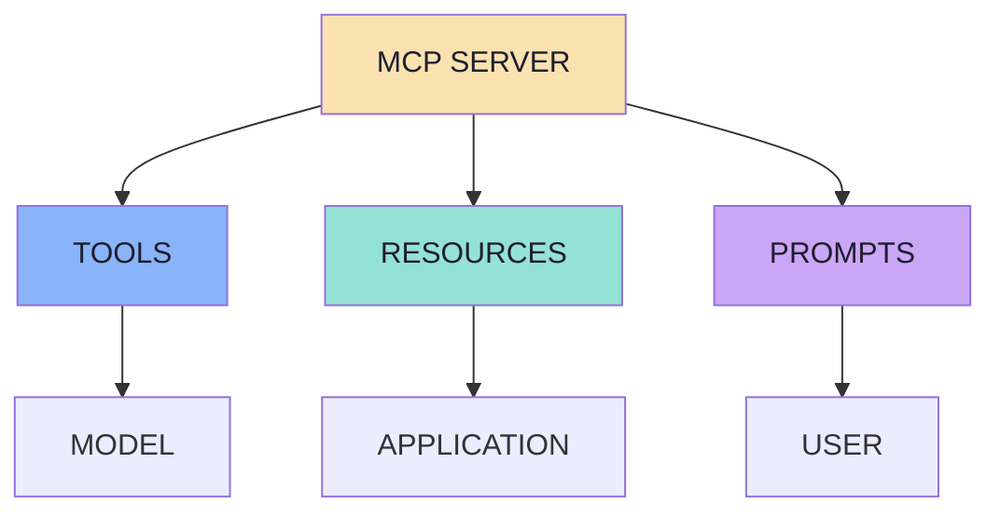
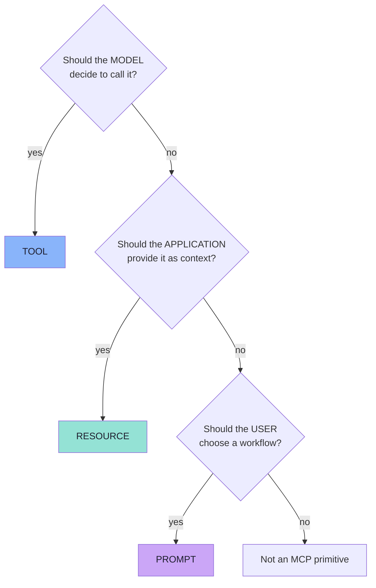
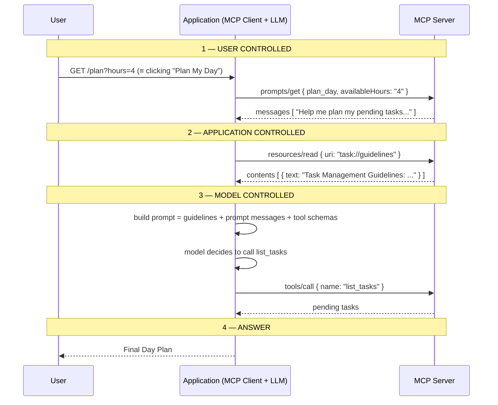

# Lecture 15 — Complete Consolidated Notes

## MCP Server: Resources and Prompts

> **Source material:** [`Notes.pdf`](./Notes.pdf) (35 pages) and [`Excalidraw-Notes.svg`](./Excalidraw-Notes.svg)
> **Snippet style:** TypeScript-style pseudo-code (Node.js runtime) — illustrative, not production code. The lecture's reference implementation is Java / Spring AI (`@McpTool`, `@McpResource`, `@McpPrompt`).
> **Diagram format:** Mermaid only
> **Consolidates:** Chapters [01](./01_The_Three_Primitives_and_the_Control_Model.md) → [08](./08_Bringing_Tools_Resources_and_Prompts_Together.md) of this folder

> 📖 **This document is a condensation, not a concatenation.** It keeps the load-bearing ideas, the cheat sheets and the decision tables, and links back to the chapters for full reasoning, diagrams and pseudo-code. When a line here feels too short, the chapter link is the answer.

---

## 1. The Thesis in One Page

Lecture 14 answered *"how does an AI application reach a capability that lives somewhere else?"* and answered it with one primitive: the **Tool**, invoked by the **model**.

Lecture 15 answers the two questions that leaves open:

| The question | The primitive | Who decides |
|---|---|---|
| *"How does the AI application get **context** it did not compute?"* | **Resource** | The **application** |
| *"How does a server publish **reusable ways of asking**?"* | **Prompt** | The **user** |

```text
Tools       → Capabilities         → Model controlled
Resources   → Context              → Application controlled
Prompts     → Reusable workflows   → User controlled
```

The lecture's sharpest contribution is not the two new primitives — it is the **control model**. Purpose explains what a primitive is *for*; control explains what can go wrong and who has to consent. Everything else in these notes follows from that axis.

> **The one request that shows it all:** `GET /plan?hours=4` — the **user** picks the prompt, the **application** reads the guideline resource, the **model** decides to call `list_tasks`.

---

## 2. The Ten-Sentence Summary

1. An MCP Server can expose **Tools, Resources and Prompts** — not tools alone.
2. Tools are **capabilities** the *model* invokes; Resources are **context** the *application* supplies; Prompts are **reusable instructions** the *user* chooses.
3. Tools can also return data, so the real test is **intent**, not payload.
4. A Resource is **addressable context plus metadata**: name, URI, description, MIME type, content.
5. The URI is an **identifier, not a URL** — the client never fetches it; the server resolves it.
6. Discovery (`resources/list`) and reading (`resources/read`) are **separate**, and reading is never automatic.
7. **MCP does not prescribe resource selection** — user, application state, retrieval, rules or an LLM router; your code decides.
8. A Prompt is a **message template** exposed by the server, and `MCP Prompt ≠ LLM Response`.
9. `prompts/get` talks to the **server**; the **LLM call happens afterward**, which keeps the server cheap, deterministic and LLM-free.
10. The three primitives compose in one request — and each keeps its own owner.

---

## 3. Where Each Idea Lives

| Idea | Chapter | Why there |
|---|---|---|
| Three primitives and the control model | [01](./01_The_Three_Primitives_and_the_Control_Model.md) | Establishes the vocabulary for the whole lecture |
| The three questions (*model? app? user?*) | [01](./01_The_Three_Primitives_and_the_Control_Model.md) | The classification tool you will use most |
| Method vocabulary and capability negotiation | [01](./01_The_Three_Primitives_and_the_Control_Model.md) | The wire-level view |
| Why "just make it a Tool" is wrong | [02](./02_Why_Resources_Context_as_a_First_Class_Primitive.md) | The intent-vs-payload argument |
| What a Resource *is* (and is not) | [02](./02_Why_Resources_Context_as_a_First_Class_Primitive.md) | The definition to memorise |
| Resource anatomy: name, URI, description, MIME, content | [03](./03_Resource_Discovery_Reading_and_Anatomy.md) | The definition you actually write |
| URI ≠ URL | [03](./03_Resource_Discovery_Reading_and_Anatomy.md) | The most-misread paragraph in the lecture |
| Discovery vs reading, with wire shapes | [03](./03_Resource_Discovery_Reading_and_Anatomy.md) | Includes pagination, `text` vs `blob`, annotations |
| Registering a static Resource | [04](./04_Building_Resources_Static_Dynamic_and_Templated.md) | `@McpResource` → `registerResource` |
| Reading a Resource from the client | [04](./04_Building_Resources_Static_Dynamic_and_Templated.md) | Where the application takes control |
| Static vs dynamic Resources | [04](./04_Building_Resources_Static_Dynamic_and_Templated.md) | Caching and failure modes |
| Resource templates | [04](./04_Building_Resources_Static_Dynamic_and_Templated.md) | `user://{username}` and why enumeration fails |
| Selection strategies (5 of them) | [05](./05_How_the_Application_Chooses_a_Resource.md) | The gap MCP deliberately leaves |
| Resources vs Tools — the rule | [05](./05_How_the_Application_Chooses_a_Resource.md) | The decision you will make most often |
| What a Prompt is; why it lives on the server | [06](./06_MCP_Prompts_Reusable_Interaction_Templates.md) | The second reusability problem |
| `MCP Prompt ≠ LLM Response` | [06](./06_MCP_Prompts_Reusable_Interaction_Templates.md) | The boundary that keeps servers LLM-free |
| Prompt arguments | [06](./06_MCP_Prompts_Reusable_Interaction_Templates.md) | One template, many values |
| Creating a Prompt | [06](./06_MCP_Prompts_Reusable_Interaction_Templates.md) | `@McpPrompt` + `@McpArg` → `registerPrompt` |
| Prompt + Tool cooperation | [07](./07_Prompt_Arguments_Discovery_and_Client_Wiring.md) | Where the three primitives meet |
| `getPrompt` vs `chatClient.prompt` | [07](./07_Prompt_Arguments_Discovery_and_Client_Wiring.md) | The two conversations, kept apart |
| Simulating user control with an endpoint | [07](./07_Prompt_Arguments_Discovery_and_Client_Wiring.md) | `GET /plan?hours=4` |
| The end-to-end flow and the go-live checklist | [08](./08_Bringing_Tools_Resources_and_Prompts_Together.md) | Everything in one request |

---

## 4. Cheat Sheets

### 4.1 The three primitives

| | **Tool** | **Resource** | **Prompt** |
|---|---|---|---|
| Verb | **Do** | **Know** | **Reuse** |
| Purpose | Callable capability | Context / reference data | Reusable interaction template |
| Controlled by | **Model** | **Application** | **User** |
| Identified by | `name` | `uri` | `name` |
| Discovery | `tools/list` | `resources/list`, `resources/templates/list` | `prompts/list` |
| Retrieval | `tools/call` | `resources/read` | `prompts/get` |
| Arguments | `inputSchema` | URI template | argument list |
| Side effects | Possible | **None** | **None** |
| Produces | A result | Content | **Messages** |
| Auto in context? | Only after it runs | **No** | Only after the user runs it |



### 4.2 The control model, stated three ways

```text
Tools       → Model controlled        (the model chooses what to call)
Resources   → Application controlled  (the app controls context provided)
Prompts     → User controlled         (the user chooses the workflow to invoke)
```

```text
TOOLS      "What should the MODEL be able to call?"
RESOURCES  "What context should the APPLICATION be able to provide?"
PROMPTS    "What reusable workflows should the USER be able to choose?"
```

```text
Tools → Capabilities · Resources → Context · Prompts → Workflows
```

### 4.3 Which primitive? (run in order)



### 4.4 Resource anatomy

```text
Resource
├── Name         identifies it            coding-guidelines
├── URI          addresses it uniquely    company://coding-guidelines
├── Description  explains what it is      "Coding standards used by our Java development team."
├── MIME Type    says what it is made of  text/plain
└── Content      the actual information   "Use Java 21. Prefer constructor injection. ..."
```

| Field | Required by the protocol? | Treat as required? |
|---|---|---|
| `uri` | Yes | Yes |
| `name` | Yes | Yes |
| `description` | No | **Yes** — it is retrieval text and UI text |
| `mimeType` | No | **Yes** — the host renders by it |
| `content` | Yes (on read) | Yes |

### 4.5 Method vocabulary

| Namespace | Methods | Capability flag |
|---|---|---|
| Tools | `tools/list`, `tools/call` | `capabilities.tools` |
| Resources | `resources/list`, `resources/read`, `resources/templates/list`, `resources/subscribe`, `resources/unsubscribe` | `capabilities.resources` |
| Prompts | `prompts/list`, `prompts/get` | `capabilities.prompts` |

Notifications: `notifications/{tools,resources,prompts}/list_changed`, `notifications/resources/updated`, plus `completion/complete` for argument autocompletion.

### 4.6 The five selection strategies

| # | Strategy | When to use it | Cost |
|---|---|---|---|
| 1 | **User selection** | Small catalogue; the user knows what they want | Zero |
| 2 | **Application state** | The app already knows (open file, current ticket, current tenant) | Zero — *"no additional AI decision is required"* |
| 3 | **Retrieval / search** | Hundreds or thousands of resources | An index |
| 4 | **LLM-based routing** | Small catalogue, ambiguous queries | One extra model call |
| 5 | **Rules** | Deterministic mappings you can unit-test | Zero |

> **They compose:** *rules narrow → retrieval ranks → the user may override.*

---

## 5. Decision Tables

### 5.1 Tool, Resource or Prompt?

| If… | Then | Because |
|---|---|---|
| The model must decide *when* to act | **Tool** | The trigger is a judgement |
| The application always needs the content | **Resource** | The trigger is "always" |
| The user must choose a workflow | **Prompt** | The trigger is an explicit human act |
| The result is a large document | **Resource** | It needs a context budget |
| The result is one small value | **Tool** | It is a lookup |
| The user should be able to attach it | **Resource** | Attaching is a deliberate act |
| The content is *reference material* | **Resource** | Reads are side-effect free |
| You are about to write `getXyzGuidelines()` with no arguments and a constant return | **Resource** | That is a document, not a capability |

### 5.2 MCP Resources vs RAG

| | RAG pipeline (Lecture 12) | MCP Resources |
|---|---|---|
| Where the corpus lives | Your vector store | Behind the MCP Server, addressed by URI |
| What is indexed | Documents and chunks | **Resource metadata** (name, description, …) |
| Who owns the index | The application | The server (the app may still rank) |
| Transport | Internal function calls | `resources/list` / `resources/read` |
| Composition | One retrieval system | Many servers, each exposing its own context |

> **Complements, not competitors:** MCP answers *"where does context come from and how do I fetch it?"*; RAG answers *"which slice of it fits in this prompt?"*

### 5.3 Static vs dynamic vs templated

| | Static | Dynamic | Templated |
|---|---|---|---|
| Example | `task://guidelines` | `user://123/profile` | `user://{username}` |
| Content source | A constant | DB / API / FS / service | Depends on the parameter |
| Changes | On redeploy | Every read | Every read |
| Cache | Forever | TTL / etag | Keyed by parameter |
| Discovery | `resources/list` | `resources/list` | `resources/templates/list` |
| Risk | None | Timeouts, 404s, permissions | **Enumeration** if unauthorised |

### 5.4 Retrieval vs LLM routing

| | Embedding retrieval | LLM routing |
|---|---|---|
| Latency | Milliseconds | An extra model call |
| Catalogue size | Thousands+ | Tens |
| Fuzzy intent | Reasonable | Better |
| Determinism | High | Low |
| Debuggability | Scores you can inspect | A label you must trust |
| **Still application-controlled?** | Yes | **Yes** — the app performs the read and can refuse |

### 5.5 Prompts on the server vs prompt templates in the app

| | In your app | On the MCP Server |
|---|---|---|
| Who owns the wording | The client author | The server author (domain expert) |
| Shared across clients | No | Yes |
| Discoverable at runtime | No | Yes, `prompts/list` |
| Versioned with the capability | By convention only | Yes |
| Deciding question | *"Is this specific to my UX?"* | *"Would another client of this server benefit?"* |

### 5.6 `getPrompt` vs the LLM call

| | `mcpClient.getPrompt(...)` | `chatClient.prompt(...).call()` |
|---|---|---|
| Talks to | The **MCP Server** | The **LLM** |
| Carries | `name` + `arguments` | Messages |
| Returns | Messages | An answer |
| Deterministic | Yes | No |
| Needs credentials | No | Yes |
| Cost | Zero tokens | Tokens |

---

## 6. The End-to-End Flow

### 6.1 The finished server

```text
taskServer
├── Tools       create_task · list_tasks · complete_task
├── Resources   task://guidelines
└── Prompts     plan_day
```

### 6.2 `GET /plan?hours=4`



### 6.3 The whole request, in pseudo-code

```ts
// Pseudocode — user → prompt, application → resource, model → tool
async function planDay(hours) {
  // 1. USER CONTROLLED
  const promptMessages = await mcpClient.getPrompt({
    name: "plan_day",
    arguments: { availableHours: hours },
  });

  // 2. APPLICATION CONTROLLED
  const { contents } = await mcpClient.readResource({ uri: "task://guidelines" });
  const guidelines = contents[0].text;

  // 3. MODEL CONTROLLED (the model chooses whether to call list_tasks)
  return askModel({
    instructions: `You are a task management assistant.\n\n${guidelines}`,
    input: promptMessages,
    tools: await listToolsAsOpenAI(),
  });
}
```

### 6.4 Why this shape is the takeaway

| Step | Owner | Deterministic? | Testable offline? |
|---|---|---|---|
| `prompts/get` | User | Yes | Yes |
| `resources/read` | Application | Yes | Yes |
| Tool selection | Model | No | No |
| Final answer | Model | No | No |

> **Half of this feature is ordinary software.** That is the payoff of keeping the three primitives — and their three owners — separate.

---

## 7. Glossary

| Term | Meaning |
|---|---|
| **MCP** | Model Context Protocol — the standard through which AI applications connect to external tools and data (Lecture 14) |
| **MCP Server** | A capability provider behind a standard interface; needs **no LLM** |
| **MCP Client** | The connection layer inside a host; one client speaks to exactly one server |
| **Host / Application** | The program that owns the conversation, the model and the selection logic |
| **Tool** | A callable capability exposed to the **model** (`tools/list`, `tools/call`) |
| **Resource** | Addressable context exposed to the **application** (`resources/list`, `resources/read`) |
| **Resource template** | A parameterised family of resources, e.g. `user://{username}` |
| **Prompt** | A reusable message template exposed to the **user** (`prompts/list`, `prompts/get`) |
| **URI** | A resource's unique identifier — an address inside the server's world, **not** a URL |
| **MIME type** | What the content is made of (`text/plain`, `application/json`, `image/png`) |
| **Capability negotiation** | The `initialize` exchange where a server declares which primitives it supports |
| **Annotation** | Metadata on content (`audience`, `priority`, `lastModified`) that guides the host |
| **`isError`** | The protocol's way of saying "the tool ran and failed" (Lecture 14) |
| **Application-controlled** | The application — not the model — decides when the thing happens |
| **Selection strategy** | The application's own rule for choosing a resource |

---

## 8. Common Misconceptions

| Misconception | Reality |
|---|---|
| "Resources are just read-only Tools." | A Tool is invoked by the **model**; a Resource is read by the **application**. |
| "If a Tool can return data, Resources are redundant." | Tools *can* retrieve information — the test is **intent**, not payload. |
| "A Resource automatically enters the model's context." | It does not. Something in the application must read it and place it there. |
| "The URI is a URL the client fetches." | The client never fetches it; the **server resolves** it. |
| "A Resource URI must be `https://`." | Use a custom scheme when the bytes live behind the server. |
| "MCP decides which resource to use." | **MCP does not prescribe selection.** That is your code. |
| "LLM routing makes Resources model-controlled." | The app performs the read and can refuse. Routing is a *suggestion*. |
| "A Prompt is a system prompt." | It is a reusable **message template** the user chooses. |
| "A Prompt produces the answer." | It produces **messages**. `MCP Prompt ≠ LLM Response`. |
| "Prompts must live on the server." | Only if other clients would benefit. Otherwise keep them in your app. |
| "A server must expose all three primitives." | Any subset is legal. A server with only tools is fine. |
| "Dynamic resources are just static ones with a DB call." | They add a **failure mode** and a **caching policy**. |

---

## 9. Self-Check Questions

Answer these without opening the chapters. If any answer feels thin, the chapter link is your next read.

**Primitives and control** — [Ch 01](./01_The_Three_Primitives_and_the_Control_Model.md)
1. Name the three primitives and the actor that primarily controls each.
2. Which single question distinguishes a Tool from a Resource?
3. Why does the lecture insist that purpose is *not* the strongest distinction?

**Why Resources** — [Ch 02](./02_Why_Resources_Context_as_a_First_Class_Primitive.md)
4. A tool `getCodingGuidelines()` works perfectly. Give two concrete costs of shipping it as a Tool.
5. State the one-sentence definition of a Resource.
6. Does a Resource automatically become part of the LLM's context? What must happen instead?

**Anatomy and operations** — [Ch 03](./03_Resource_Discovery_Reading_and_Anatomy.md)
7. What are the five parts of a Resource definition?
8. Why is a URI not a URL, and when *would* you use `https://`?
9. Which two fields are technically optional but should be treated as required — and why?

**Building** — [Ch 04](./04_Building_Resources_Static_Dynamic_and_Templated.md)
10. Why does the client call `readResource(...)` instead of registering the resource with the model?
11. What does `result.contents` return, and what is the risk of assuming it has one element?
12. When should you use a Resource **template** instead of listing resources?
13. Where does authorisation belong for a templated resource, and what happens if it is missing?

**Selection** — [Ch 05](./05_How_the_Application_Chooses_a_Resource.md)
14. Name the five selection strategies and give a one-line use case for each.
15. Why does LLM-based routing *not* make a Resource model-controlled?
16. What is indexed in the retrieval strategy — the documents or the metadata? Why does it matter?

**Prompts** — [Ch 06](./06_MCP_Prompts_Reusable_Interaction_Templates.md)
17. What problem do Prompts solve that Resources do not?
18. Complete the sentence: *an MCP Prompt generates ______, not ______.*
19. Why is `plan_day(availableHours)` better than `plan_day_4_hours`?

**Wiring** — [Ch 07](./07_Prompt_Arguments_Discovery_and_Client_Wiring.md)
20. What is the difference between `mcpClient.getPrompt(...)` and `chatClient.prompt(...)`?
21. Why does the demo use `GET /plan?hours=4` instead of a UI?
22. Why is the prompt path testable without an API key?

**Everything together** — [Ch 08](./08_Bringing_Tools_Resources_and_Prompts_Together.md)
23. In one request, who controls the prompt, the resource and the tool — and in what order?
24. What does the server publish through Tools, and what does it publish through Prompts?
25. Which property of an MCP Server does the Prompt primitive preserve, and why is it worth defending?

---

## 10. Go-Live Checklist

> Condensed from [Chapter 08 §8.7](./08_Bringing_Tools_Resources_and_Prompts_Together.md). The full version — with the reasoning — is there.

**Contract**
- [ ] The server advertises exactly the primitives it implements.
- [ ] Every resource has a **description that doubles as retrieval text** and a truthful **MIME type**.
- [ ] Every prompt marks its required arguments `required: true`.
- [ ] Parameterised families use **templates**, not enumeration; `resources/list` paginates.

**Security**
- [ ] Authorisation is enforced **inside every handler**, per URI and per argument.
- [ ] The candidate catalogue is **ACL-filtered before ranking**.
- [ ] Dynamic URIs are validated (traversal, injection, fan-out).
- [ ] Resource and prompt content is treated as untrusted text and delimited in the prompt.
- [ ] No secrets are templated into a prompt.

**Context and cost**
- [ ] Per-resource and total context caps exist and are enforced.
- [ ] The number of resources attached per request is bounded.
- [ ] Truncation is explicit and visible to the model.
- [ ] Static resources are cached; dynamic ones have a TTL; per-user caches are never shared.

**Reliability**
- [ ] Read handlers are side-effect free and safely retryable.
- [ ] Unknown URIs and missing prompts **fail loudly**.
- [ ] Timeouts differ for `prompts/get`, `resources/read` and the LLM call.
- [ ] The server runs with **no LLM and no API key**.

**Observability and evaluation**
- [ ] One log line per resource selection: strategy, candidates, chosen, scores, bytes.
- [ ] One log line per tool call and per prompt use.
- [ ] A golden set for selection (`query → expected URI`) and for prompts (`args → expected message`), runnable offline.

---

## 11. Chapter Map

| Chapter | Title | The one idea |
|---|---|---|
| [01](./01_The_Three_Primitives_and_the_Control_Model.md) | The Three Primitives and the Control Model | Three primitives, three owners |
| [02](./02_Why_Resources_Context_as_a_First_Class_Primitive.md) | Why Resources | Intent, not payload |
| [03](./03_Resource_Discovery_Reading_and_Anatomy.md) | Resource Discovery, Reading and Anatomy | Discovery is not consumption |
| [04](./04_Building_Resources_Static_Dynamic_and_Templated.md) | Building Resources | Register declaratively, read explicitly, template |
| [05](./05_How_the_Application_Chooses_a_Resource.md) | How the Application Chooses a Resource | MCP does not choose — you do |
| [06](./06_MCP_Prompts_Reusable_Interaction_Templates.md) | MCP Prompts | `MCP Prompt ≠ LLM Response` |
| [07](./07_Prompt_Arguments_Discovery_and_Client_Wiring.md) | Prompt Arguments and Client Wiring | `getPrompt` ≠ the LLM call |
| [08](./08_Bringing_Tools_Resources_and_Prompts_Together.md) | Bringing It All Together | User → prompt, app → resource, model → tool |

---

**Back to:** [Lecture 15 — Chapter Index](./README.md) · **Previous lecture:** [Lecture 14 — MCP Server from First Principles](../../Lecture%2014/notes/README.md)
