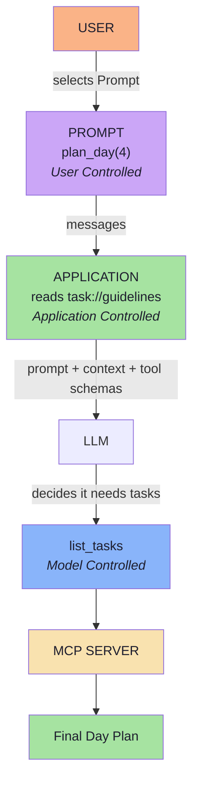

# Lecture 15 — MCP Server: Resources and Prompts

> **Lecture theme:** Lecture 14 built an MCP Server from first principles and used exactly one primitive — the **Tool**. This lecture opens the other two thirds: **Resources** (*what the AI can know*) and **Prompts** (*reusable ways of asking*). It builds them on the same task-management server, then runs one request — `GET /plan?hours=4` — in which the **user** controls the Prompt, the **application** controls the Resource and the **model** controls the Tool.
>
> The reference implementation in the source lecture is **Java / Spring AI** (`@McpTool`, `@McpResource`, `@McpPrompt`); these notes keep the architecture and express all snippets as **TypeScript-style pseudo-code**, because the accompanying code runs in a Node.js environment.

---

## Chapter Index

| # | Chapter | Core Question Answered |
|---|---|---|
| [01](./01_The_Three_Primitives_and_the_Control_Model.md) | The Three Primitives and the Control Model | What can a server expose — and who holds the trigger? |
| [02](./02_Why_Resources_Context_as_a_First_Class_Primitive.md) | Why Resources: Context as a First-Class Primitive | Tools can return data — so why is there a second primitive for information? |
| [03](./03_Resource_Discovery_Reading_and_Anatomy.md) | Resource Discovery, Reading and Anatomy | How does a client find context, read it, and what is a well-formed Resource? |
| [04](./04_Building_Resources_Static_Dynamic_and_Templated.md) | Building Resources: Static, Dynamic and Templated | How do I register a Resource, read it, and expose thousands without thousands of definitions? |
| [05](./05_How_the_Application_Chooses_a_Resource.md) | How the Application Chooses a Resource | Given a message and a catalogue, what code picks the context? |
| [06](./06_MCP_Prompts_Reusable_Interaction_Templates.md) | MCP Prompts: Reusable Interaction Templates | What is a Prompt, and what exactly does it return? |
| [07](./07_Prompt_Arguments_Discovery_and_Client_Wiring.md) | Prompt Arguments, Discovery and Client Wiring | How do I fetch a Prompt with arguments — and why is that not an LLM call? |
| [08](./08_Bringing_Tools_Resources_and_Prompts_Together.md) | Bringing Tools, Resources and Prompts Together | In one request, who controls what — and what must be true before go-live? |
| [**Complete**](./Lecture_15_Complete_Notes.md) | **Complete Consolidated Notes** | All eight chapters condensed: cheat sheets, decision tables, glossary, self-check |

> 📄 **Prefer a single document?** Read the **[Lecture 15 — Complete Consolidated Notes](./Lecture_15_Complete_Notes.md)**. It keeps the load-bearing ideas, the decision tables and the end-to-end flow, and links back to the chapters for full reasoning and pseudo-code.

---

## The Big Idea in One Diagram

Read it in three moves: **the user chooses the workflow, the application chooses the context, the model chooses the call.**

---

## How to Read These Notes

1. **Chapter 01 is the map.** Tools, Resources, Prompts — and the control model that tells them apart.
2. **Chapters 02–05 are Resources.** Why the primitive exists, what a definition looks like, how to build static/dynamic/templated ones, and how the application selects one.
3. **Chapters 06–07 are Prompts.** What a Prompt is, why it lives on the server, how arguments work, and how a client wires `prompts/get` to an LLM call.
4. **Chapter 08 is the whole machine.** One request end to end, plus the production checklist.

---

## Conventions Used in This Lecture

| Convention | Meaning |
|---|---|
| **Mermaid** | Every structural diagram is Mermaid (`flowchart`, `sequenceDiagram`). |
| **TypeScript-style pseudo-code** | Snippets describe data flow and contracts for a JS/TS environment. They are **not** runnable production code. |
| **JSON-RPC snippets** | Protocol messages are shown as real JSON-RPC shapes so you can recognise them on the wire. |
| **Framework references** | Spring AI annotations (`@McpResource`, `@McpPrompt`, `@McpArg`) appear as the lecture's reference implementation; the JS/TS equivalent follows each one. |
| **Beyond the lecture** | Sections marked *beyond the lecture* add material the script only gestures at (JSON-RPC, pagination, annotations, subscriptions, authorisation, budgets, observability). |
| **Board references** | Passages described as *from the board* reproduce the hand-drawn `Excalidraw-Notes.svg`. |

---

## Sources

- 📄 [`Notes.pdf`](./Notes.pdf) — *MCP Server: Resources and Prompts* (35 pages): the three primitives and the control model, why Resources exist, what an MCP Resource is, discovery and reading, Resource anatomy (name, URI, description, MIME type, content), URI ≠ URL, creating and reading a Resource, static vs dynamic Resources, Resource templates, how the application selects a Resource (user selection, application state, retrieval, LLM routing), Resources vs Tools, what an MCP Prompt is, why prompts belong on the server, Prompt vs LLM response, prompt arguments, `prompts/list` / `prompts/get`, creating a Prompt, Prompt + Tool cooperation, reading a Prompt from the client, simulating user-controlled prompts with Postman, and the combined end-to-end workflow.
- 🖼️ [`Excalidraw-Notes.svg`](./Excalidraw-Notes.svg) — the lecture board: the AI Application / MCP Client / MCP Server stack with Tools, Resources and Prompts; `tools/list`, `resources/list`, `tools/call`, `resources/read`; `company://coding-guidelines`; the Resource anatomy (name, description, URI, MIME type, content); the dynamic `user://123/profile` example with MySQL; `Tools → LLM Controlled`, `Resources → AI Application controlled`, `Prompts → User Controlled`; the `Order.java` / `createOrder()` IDE example; the RAG-style chunking path; the prompt menu (`Plan my day`, `Review my workload`); `prompts/list`, `prompts/get`; and `GET /plan?hours=4`.
- 📚 Prior lectures — [Lecture 14](../../Lecture%2014/notes/README.md) (MCP from first principles: Host/Client/Server, the Tools primitive, the tool lifecycle, security), [Lecture 12](../../Lecture%2012/notes/README.md) (advanced RAG — retrieval quality, reranking, context engineering), [Lecture 11](../../Lecture%2011/notes/README.md) (RAG foundations), [Lecture 13](../../Lecture%2013/notes/README.md) (structured outputs), [Lecture 05](../../Lecture%2005/notes/README.md) (tool calling and agents).

---

## One-Line Summaries

| Chapter | One-line summary |
|---|---|
| 01 | Three primitives, three owners: the model, the application, the user. |
| 02 | Tools can return data; Resources exist because of intent, not payload. |
| 03 | Discovery is not consumption — and a URI is an identifier, not a URL. |
| 04 | Register declaratively, read explicitly, and template instead of enumerating. |
| 05 | MCP does not choose the resource; your application does — so choose deliberately. |
| 06 | A Prompt is a message template: `MCP Prompt ≠ LLM Response`. |
| 07 | `getPrompt` talks to the server; the LLM call happens afterward. |
| 08 | User controls the prompt, application controls the context, model controls the tool. |

---

**Back to:** [Lecture 15 — Chapter Index](./README.md) · [Complete Consolidated Notes](./Lecture_15_Complete_Notes.md)
