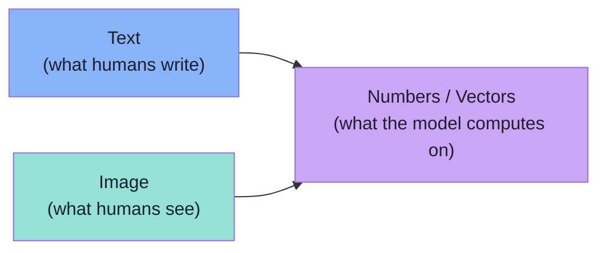
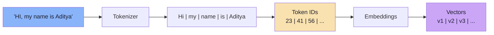
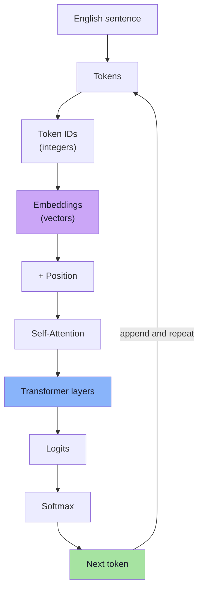

# Chapter 03: From Text to Numbers — The Text Pipeline

> **Chapter Goal:** Before we can explain how an image becomes something a model understands, we must state precisely how **text** becomes something a model understands. That pipeline — tokenize, look up an embedding, produce vectors — is the pattern the image pipeline will copy at every step. This chapter is the bridge: it is deliberately short, and it exists so that Chapter 04's "patches are the tokens of images" claim lands as an *analogy*, not a metaphor.
>
> At the end of this chapter you should be able to answer: *what are the exact stages from an English sentence to the numbers a transformer actually computes on — and which of those stages has an image analogue?*

---

## 3.1 Why We Start With Text

To understand images, start with something we already know: text.

> The lecture's logic: **the model has never "seen" a word or a picture. It only ever computes on numbers.** Once you accept that for text, images stop being mysterious — they are just a different route to the same kind of numbers.



---

## 3.2 How Text Reaches an LLM

Suppose we send:

> "Why is my payment failing?"

The model does **not** directly process the English sentence. First, a **tokenizer** converts the text into **tokens**:

```text
"Why"
"is"
"my"
"payment"
"failing"
"?"
```

The actual tokenization may be different (sub-words, byte-pairs, leading spaces) but conceptually we can think of it as:

```text
Token 1
Token 2
Token 3
Token 4
...
```

Each token is then mapped to an integer **token ID** and finally to a **vector**:

```text
Token
 ↓
Embedding
 ↓
Vector
```

### The board's worked example

From the board, the sentence *"HI, my name is Aditya"* is walked through the full path:

```text
"HI, my name is Aditya"
        ↓
      LLM / Tokenizer
        ↓
   Hi   my   name   is   Aditya      ← tokens (6 units)
        ↓
   23   41   56   ...               ← token IDs (integers)
        ↓
   v1   v2   v3   ...               ← embedding vectors
```



Three things to notice, because they recur for images:

1. **The unit is not the word.** "Aditya" is one token here, but a rare name would be split into several. A token is whatever the tokenizer's vocabulary contains.
2. **The ID is arbitrary.** `23` does not mean anything about `Hi`; it is a row index into a lookup table. IDs carry **no** semantic meaning (Lecture 02 calls these "roll numbers").
3. **The vector is learned.** The embedding for `Hi` is not hand-written; it was learned during training and encodes *relationships* (Chapter 06 makes the same point about visual embeddings).

### The tokenizer's job in one line

```text
Sentence  →  [ token, token, token, ... ]
```

### The embedding table's job in one line

```text
token_id  →  vector of length d_model
```

Both are lookups. Neither involves a neural network *at this stage* — the embedding is a giant trainable table indexed by token ID.

---

## 3.3 Why Numbers at All?

> Therefore, an LLM does not literally work with English words. It ultimately processes:

```text
numbers
and
vectors
```

The reason is arithmetic: every operation in a transformer — attention, matrix multiplies, layer norms — is defined on numbers. Words cannot be added, scaled or compared by dot product; vectors can. Turning language into vectors is not a stylistic choice; it is the **precondition** for the mathematics to run at all.

> **This is the key idea needed to understand image processing.** An image is not "somehow also converted" — it is converted by the *same kind of reasoning*: find a unit, index it, produce a learned vector.

---

## 3.4 Context and Position (Recap)

*brief — full treatment in [Lecture 02, Chapters 03–05](../../Lecture%2002/notes/README.md)*

Vectors alone are not enough. The model also needs to know **order** and **context**:

```text
"Dog bites man"   ≠   "Man bites dog"
```

The same token vector for `bank` must resolve differently in:

```text
I deposited money in the bank.        → financial institution
I sat by the river bank.              → river edge
```

Two mechanisms handle this:

- **Positional encoding** — where in the sequence a token sits.
- **Self-attention** — which other tokens each token should look at.

Hold both in mind: Chapters 04 and 05 show that images need **their own versions of exactly these two ideas** (patch position, and attention across patches).

| Text concept | Why it exists | Image analogue (Chapter) |
|---|---|---|
| Tokenization | Break a sequence into units | Patches (04) |
| Token ID | Index into a table | Patch index (04) |
| Embedding | Learned vector per unit | Visual embedding (04) |
| Positional encoding | Preserve order | Patch position (05) |
| Self-attention | Resolve relationships | Patch attention / cross-modal attention (05) |

---

## 3.5 The Key Mental Model So Far



> **One sentence to carry forward:** *the model never sees English; it sees vectors, and every modality must be turned into vectors before the model can do anything with it.*

---

## 3.6 Beyond the Lecture: The Details That Matter in Practice

*beyond the lecture*

### The embedding is a table, not a function

The embedding layer is a matrix of shape `vocab_size × d_model`. Looking up a token is `E[id]`. This is why:

- **Vocabulary size** drives memory (a 200k-token vocab at `d_model = 4096` is ~800M parameters, just for the table).
- **Rare words are expensive to learn** — a token seen five times in training gets a poorly-trained vector. This is why sub-word tokenization exists: it reuses pieces.

```ts
// PSEUDO-CODE — the shape of an embedding lookup.
const embeddingTable: Float32Array[] = /* vocab_size x d_model */;
function embed(tokenId: number): Float32Array {
  return embeddingTable[tokenId];   // pure lookup — no compute
}
```

### Sub-word tokenization, briefly

| Granularity | Unit | Trade-off |
|---|---|---|
| Word-level | Whole words | Tiny vocab that still explodes; unknown words are fatal |
| Character-level | Single characters | Small vocab, but very long sequences |
| **Sub-word** (BPE / SentencePiece) | Frequent pieces | Balances vocabulary size and sequence length — the modern default |

### Token count is the cost unit

Everything downstream is priced in tokens: context length, latency, money. A sentence of 12 words might be 15 tokens. Keep this in mind — Chapter 08 shows that **an image is priced in tokens too**, and that is where multimodal cost surprises come from.

### The bridge statement

> **Text → tokens → embeddings** and **image → patches → visual embeddings** are the *same architectural move*: replace an unstructured modality with a sequence of learned vectors. Once both are sequences of vectors, one transformer can process both.

---

## 3.7 Common Mistakes at This Stage

| Mistake | Why it hurts | Correct habit |
|---|---|---|
| Thinking the model "reads" English | Leads to expecting literal string behaviour | It computes on vectors; strings are an interface concern |
| Believing a token ID carries meaning | Misreading token IDs as scores or categories | IDs are table indices — arbitrary |
| Assuming one token = one word | Breaks length/cost estimates | Count tokens, not words |
| Treating embeddings as hand-crafted features | Misunderstanding why they generalise | They are **learned** representations |
| Forgetting position and attention | "Vectors alone" explains nothing about meaning | Vectors + position + attention together |
| Skipping this chapter to "get to images" | The image pipeline then feels magical | The image pipeline is this pipeline with a different front-end |

---

## 3.8 Chapter Summary

| Idea | Statement |
|---|---|
| The premise | The model only computes on numbers, never on words or pixels |
| The text pipeline | Sentence → tokens → token IDs → embeddings → vectors |
| The board's example | `"HI, my name is Aditya"` → tokens → IDs `23 41 56` → vectors `v1 v2 v3` |
| Token IDs | Arbitrary table indices; no semantic meaning |
| Embeddings | Learned vectors; the substrate of all downstream math |
| Why numbers | Attention and matrix operations are defined on vectors, not words |
| Position + attention | Needed for order and context — and images will need their own versions |
| The bridge | Text and images converge on the *same* representation: sequences of learned vectors |

> **Final mental model:** the model is a **vector machine**. Text is one way to feed it vectors; an image is another. This lecture is entirely about the second way.

---

## Where This Goes Next

- **[Chapter 04](./04_Images_Are_Numbers_Pixels_Patches_And_Visual_Embeddings.md)** — an image is already numbers; the work is turning a *grid* of numbers into *meaningful units*.
- **[Chapter 05](./05_Connecting_Vision_To_Language_Projection_Position_And_Attention.md)** — position and attention, image edition.
- Recap: [Lecture 02](../../Lecture%2002/notes/README.md) for tokenization, embeddings, positional encoding and self-attention in full.

---

**Back to:** [Lecture 16 — Chapter Index](./README.md) · [Complete Consolidated Notes](./Lecture_16_Complete_Notes.md)

