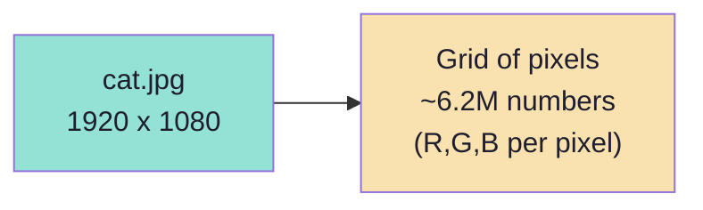
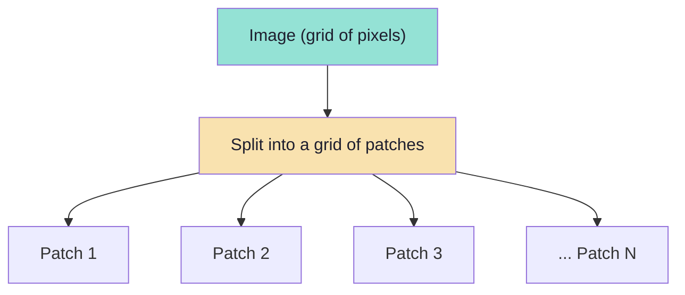
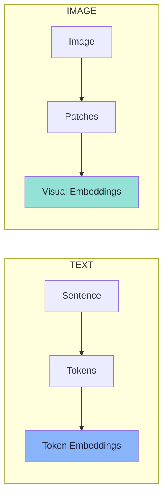
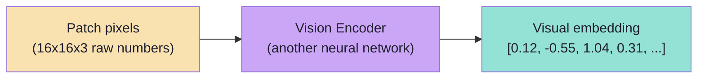
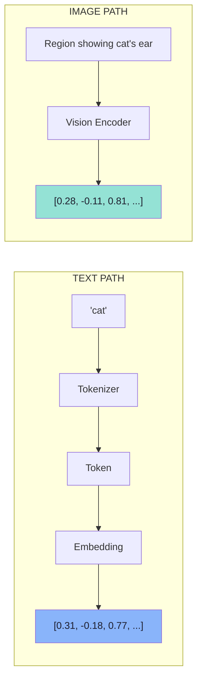

# Chapter 04: Images Are Numbers — Pixels, Patches and Visual Embeddings

> **Chapter Goal:** Chapter 03 ended with a promise: images follow the same architectural move as text — replace the modality with a sequence of learned vectors. This chapter delivers the first half of that promise. It shows that an image is *already* numbers, why those numbers are the wrong shape, and how the model reshapes them into **patches** and then into **visual embeddings**.
>
> At the end of this chapter you should be able to answer: *an image is a grid of two million pixels — why can't the model just read the pixels, and what does it do instead?*

---

## 4.1 An Image Is Already a Grid of Numbers

An image may look visual to us, but to a computer it is numerical data.

A normal RGB image contains **pixels**. Each pixel contains values for:

```text
Red
Green
Blue
```

For example:

```text
R = 255
G = 120
B = 30
```

That is one pixel — an orange-ish colour expressed as three integers.

### The board's example

From the board, `cat.jpg` is annotated with exactly this:

```text
cat.jpg
   R : Red   255
   G : Green 120
   B : Blue   30
   1920 * 1080
```

### The arithmetic that matters

A **1920 × 1080** image contains more than **two million** pixels:

```text
1920 × 1080 = 2,073,600 pixels
```

And each pixel has three channels, so the raw array holds:

```text
2,073,600 × 3 ≈ 6.2 million numbers
```

Conceptually, the raw image is a large numerical grid:

```text
[
  [pixel, pixel, pixel, ...],
  [pixel, pixel, pixel, ...],
  [pixel, pixel, pixel, ...],
  ...
]
```

Or, with the channels made explicit:

```text
[
  [ [255,120,30], [250,118,28], ... ],   ← row 1
  [ [248,116,25], [251,119,31], ... ],   ← row 2
  ...
]
```



> **So the image is already numbers.** The problem is not *whether* it is numerical — it is *what shape* those numbers are in.

---

## 4.2 Why We Cannot Just Feed the Pixels

Feeding millions of raw pixel values directly into a language model would be inefficient.

| Problem | Why it breaks |
|---|---|
| **Volume** | Six million numbers per image dwarfs a text prompt. Attention cost grows with sequence length — this is fatal. |
| **No units** | A language model operates on *discrete units* (tokens). Pixels are a continuous grid; there is no natural "unit". |
| **No abstraction** | A single pixel carries no meaning. Meaning emerges from *regions* (edges, textures, shapes). |
| **No locality structure** | A flat list destroys the 2-D neighbourhood relationships that define an image. |
| **Redundancy** | Neighbouring pixels are nearly identical; feeding all of them wastes capacity. |

> **So images are processed differently.** The model needs a way to turn a *continuous grid* into a *short sequence of meaningful units* — exactly the shape text already has.

---

## 4.3 Step 1 — Divide the Image Into Patches

A common approach used by modern vision models is to divide an image into smaller regions called **patches**.

Imagine an image:

```text
+-----------------------+
|                       |
|          CAT          |
|                       |
|                       |
+-----------------------+
```

It can be divided into smaller sections:

```text
+----+----+----+----+
| P1 | P2 | P3 | P4 |
+----+----+----+----+
| P5 | P6 | P7 | P8 |
+----+----+----+----+
| P9 |P10 |P11 |P12 |
+----+----+----+----+
```

Each section is an **image patch**.

Conceptually:

```text
Image
 ↓
Split Into Patches
 ↓
Patch 1
Patch 2
Patch 3
...
```



### The board's patch grid

From the board, `cat.jpg` is cut into a patch grid labelled `p1, p2, …` with the size annotated:

```text
cat.jpg  →  [ p1 ][ p2 ] ...  ,  each patch  16 * 16
```

The exact patch size depends on the architecture. A patch might, for example, represent a small region such as:

```text
16 × 16 pixels
```

> **The important idea is not the exact size.** The important idea is:
> **Instead of processing the entire image as one giant object, the model breaks it into smaller visual units.**

### Why this works

Cutting the grid into patches does three things at once:

1. **Turns a 2-D grid into a sequence.** `[P1, P2, P3, …, PN]` is a sequence — the data type transformers consume.
2. **Shrinks the problem.** Each patch is summarised by a single vector, not 16×16×3 raw numbers.
3. **Creates a meaningful unit.** A patch is a *region*: it can carry an edge, a texture, part of a letter, part of an object.

```text
Grid of pixels   →   sequence of patches
(continuous, 2-D)    (discrete, 1-D — like tokens)
```

---

## 4.4 Text Tokens vs Image Patches

This gives us a useful analogy.

```text
Text
   Sentence
    ↓
   Tokens
    ↓
   Token Embeddings
```

```text
Image
   Image
    ↓
   Patches
    ↓
   Visual Embeddings
```



> **Image patches are not exactly the same thing as text tokens, but they play a similar conceptual role.**

The honest version of the analogy:

| Text | Image | Same? |
|---|---|---|
| Sentence | Image | — |
| Tokenizer | Patch splitter | Similar role |
| Token | Patch | Similar role (a unit) |
| Token ID | Patch index / position | Similar role |
| Token embedding | Visual embedding | Similar role (a learned vector) |
| **Discrete, from a fixed vocabulary** | **Continuous pixels, from a fixed grid** | **Different** |
| **Vocabulary is learned from text** | **Regions are defined by geometry** | **Different** |
| **~1 word per few tokens** | **Each patch is a 16×16 region** | **Different scale of meaning** |

> **The nuance to remember:** a text token is a *symbol from a vocabulary*; an image patch is a *region of pixels*. They are analogous in **position in the architecture**, not in **nature**. Both exist so the transformer can treat the modality as a sequence.

---

## 4.5 Step 2 — The Vision Encoder

An image patch still contains raw pixel values. The LLM cannot directly reason over those pixels.

So the patches are processed by another neural network, commonly referred to conceptually as a:

```text
Vision Encoder
```

Flow:

```text
Image
 ↓
Patches
 ↓
Vision Encoder
 ↓
Visual Embeddings
```

The vision encoder converts image information into numerical **vectors**. For example:

```text
Patch Pixels
     ↓
Vision Encoder
        ↓
[0.12, -0.55, 1.04, 0.31, ...]
```

This vector is called a **visual embedding** or **visual representation**.

- It is **not human-readable.**
- It is a **learned numerical representation** of the visual information.



### The board's exact numbers

From the board, the encoder's output is drawn as:

```text
Vision Encoder  →  [0.12, -0.55, ....]
```

Note what this tells you: the output is a **dense vector of real numbers** — some positive, some negative, not a set of pixel values. The encoder has *compressed* and *abstracted* the patch. Its dimensions do not correspond to "red", "green", "blue"; they correspond to learned visual features.

> **Two-stage compression:** millions of pixels → a grid of patches → one vector per patch. The model has reduced an image to a sequence of a few hundred vectors.

---

## 4.6 Text Embeddings and Visual Embeddings

Now put the two pipelines side by side. They are deliberately the same shape.

### For text

```text
"cat"
 ↓
Tokenizer
 ↓
Token
 ↓
Embedding
 ↓
[0.31, -0.18, 0.77, ...]
```

### For an image

```text
Image region containing a cat's ear
 ↓
Vision Encoder
 ↓
Visual Embedding
 ↓
[0.28, -0.11, 0.81, ...]
```



Eventually both text and image information become:

```text
vectors
```

> **This is how the two worlds can eventually interact.** They are not "connected" by a rule — they are connected by being expressed in the **same kind of object**: a vector. Once both sides are vectors, a shared model can attend across them (Chapter 05).

### The board's side-by-side

From the board, the two paths are drawn literally in parallel, converging on a single label:

```text
"cat" ──Tokenizer──> Token ID ──> Embedding ──> [0.31, -0.18, 0.77, ...]
                                                          \
Region showing cat's ear ──Vision Encoder──> [0.28, -0.11, 0.81, ...]  ──> vectors
```

The word `vectors` at the convergence point is the whole chapter in one label: **different pipelines, same currency.**


---

## 4.7 Beyond the Lecture: Patch and Token Arithmetic

*beyond the lecture*

### How many tokens is an image?

This is the question that determines your bill (Chapter 08). Using the lecture's own numbers:

```text
Image: 1920 x 1080
Patch: 16 x 16

Patches across = 1920 / 16 = 120
Patches down   = 1080 / 16 = 67.5 → 68 (with padding)
Patches total  = 120 x 68 ≈ 8,160 patches
```

**≈ 8,000 visual tokens for one full-resolution image.** Compare that with a 500-word prompt at ~650 tokens. This single calculation explains why:

- providers **resize/tile** images (Chapter 07),
- long conversations with many images blow the context window,
- image-heavy agents are expensive.

> **Rule of thumb:** cost scales with **pixels ÷ patch area**. Doubling each side of an image quadruples its token count.

### Why 16 × 16?

| Patch size | Effect |
|---|---|
| Smaller (e.g. 8×8) | More patches → finer detail, more tokens, more cost |
| Larger (e.g. 32×32) | Fewer patches → cheaper, but small text becomes illegible |
| 14×14 / 16×16 | The common compromise in modern ViTs |

The patch size is a **fixed architectural constant** set at training time — you cannot change it per request. What you *can* change is the image resolution you send, which changes how many patches result.

### ViT: the Vision Transformer

The architecture that makes this work is the **Vision Transformer (ViT)**. Its trick is precisely the one in this chapter:

```text
1. Split the image into a grid of patches
2. Flatten each patch into a vector (pixels in a row)
3. Linearly project each patch vector to d_model
4. Add a POSITIONAL EMBEDDING to each patch vector
5. Feed the sequence into a standard transformer encoder
```

Steps 4 and 5 are why Chapter 05 exists: without position, the model would see a *bag* of patches and lose the layout entirely.

### CNN vs ViT — why the field moved

| Aspect | CNN (older) | ViT (modern, used in MLLMs) |
|---|---|---|
| Unit | Sliding convolution filters | Patches |
| Locality | Built in (small filters) | **Learned** via attention |
| Global context | Needs many layers / large receptive field | Immediate — every patch can attend to every patch |
| Scale | Good at small data | Needs large data, then scales very well |
| Fit with LLMs | Awkward (grid-shaped features) | **Natural** — output is already a token-like sequence |

> **The decisive advantage:** a ViT's output is a **sequence of vectors**, which is exactly the input a language transformer expects. That is why vision + language architectures converged on patches rather than convolution.

### What the encoder actually learns

The vision encoder is not a single "feature detector". Across its layers it builds a hierarchy:

```text
Early layers   → edges, colour gradients, corners
Middle layers  → textures, simple shapes, strokes
Late layers    → object parts (an ear, a wheel), then whole objects
```

This is why one patch containing "part of an ear" can still contribute to a global decision about "cat" (Chapter 05).

---

## 4.8 Common Mistakes at This Stage

| Mistake | Why it hurts | Correct habit |
|---|---|---|
| Thinking pixels are "not numbers" | Misses that the image is already numeric | The work is reshaping, not converting |
| Feeding full-resolution images by default | Thousands of tokens, high cost/latency | Understand the patch arithmetic; resize/tile deliberately |
| Believing patches = tokens in every respect | Wrong expectations about exactness | Same architectural role, different nature |
| Assuming the encoder output is human-readable | Misreading the `[0.12, -0.55, …]` vector | It is a learned feature vector, not RGB |
| Forgetting position (yet) | "Bag of patches" would lose all layout | Position is added — Chapter 05 |
| Thinking you can tune patch size per request | It is fixed at training time | Tune **resolution** instead |
| Treating the vision encoder as OCR | Conflates two very different mechanisms | Encoder = features; OCR = characters (Chapter 02) |

---

## 4.9 Chapter Summary

| Idea | Statement |
|---|---|
| Images are numbers | An RGB image is a grid of pixels; each pixel is (R, G, B) |
| The arithmetic | 1920×1080 ≈ 2.07M pixels ≈ 6.2M numbers |
| Why raw pixels fail | Too many, no units, no abstraction, no locality |
| Step 1 — Patches | Cut the grid into regions (e.g. 16×16); a grid becomes a **sequence** |
| The analogy | Sentence → tokens, Image → patches; same architectural role |
| The nuance | Tokens are symbols; patches are regions — analogous, not identical |
| Step 2 — Vision encoder | Another neural network; patches → **visual embeddings** |
| The output | A dense vector like `[0.12, -0.55, 1.04, 0.31, …]` |
| Convergence | Text embeddings and visual embeddings are the **same kind of object**: vectors |
| The board's label | Two paths, one word: **vectors** |

> **Final mental model:** an image is a grid of numbers; the model reshapes it into a **sequence of patches**, then compresses each patch into a **learned vector**. Once it is a sequence of vectors, it is indistinguishable in *type* from text.

---

## Where This Goes Next

- **[Chapter 05](./05_Connecting_Vision_To_Language_Projection_Position_And_Attention.md)** — the projection that makes visual vectors speak the LLM's language, and why position matters.
- **[Chapter 07](./07_The_End_To_End_Multimodal_Pipeline.md)** — preprocessing (resize, crop, tile) that decides how many patches you actually pay for.
- **[Chapter 08](./08_Production_Multimodal_Systems_Cost_Security_And_Evaluation.md)** — image token cost in detail.

---

**Back to:** [Lecture 16 — Chapter Index](./README.md) · [Complete Consolidated Notes](./Lecture_16_Complete_Notes.md)

