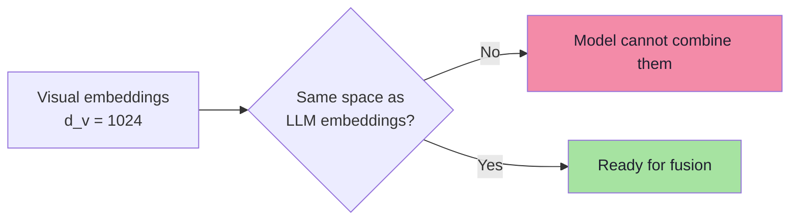
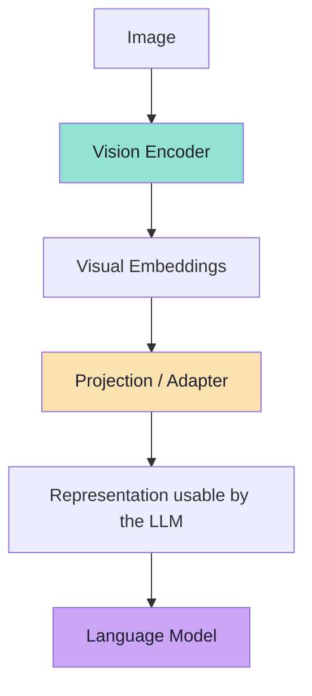
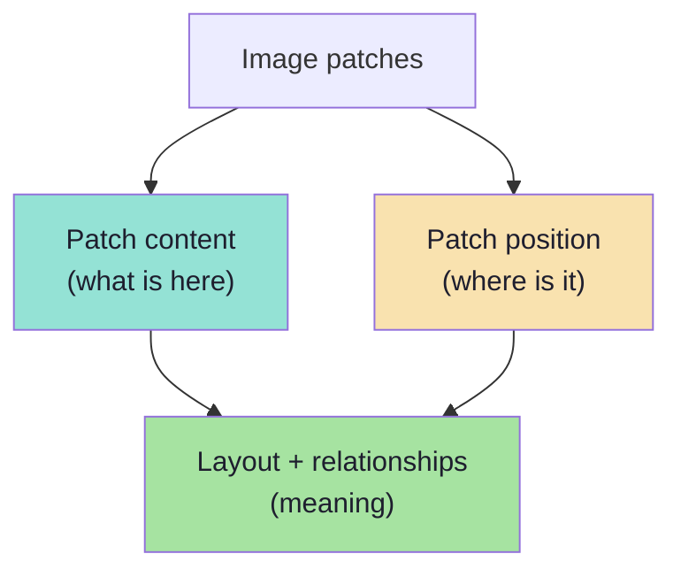
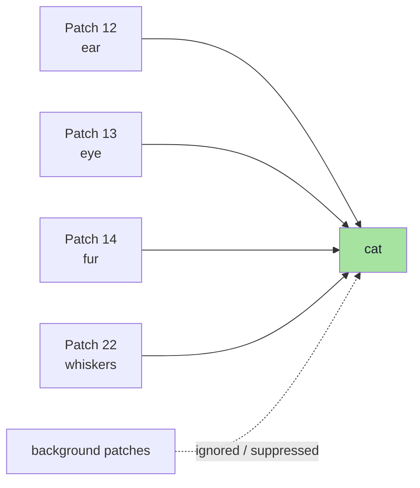
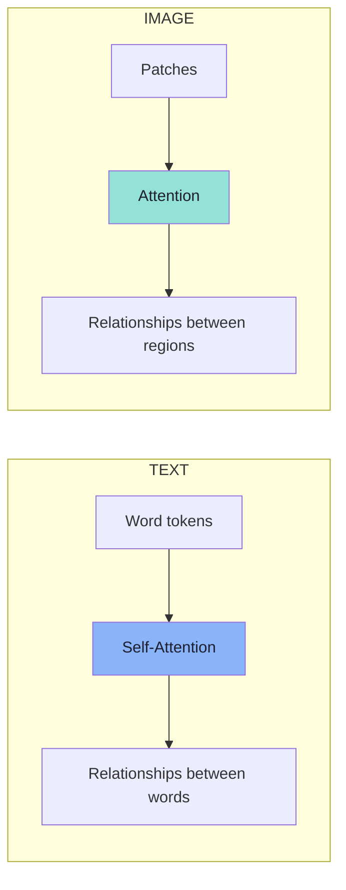
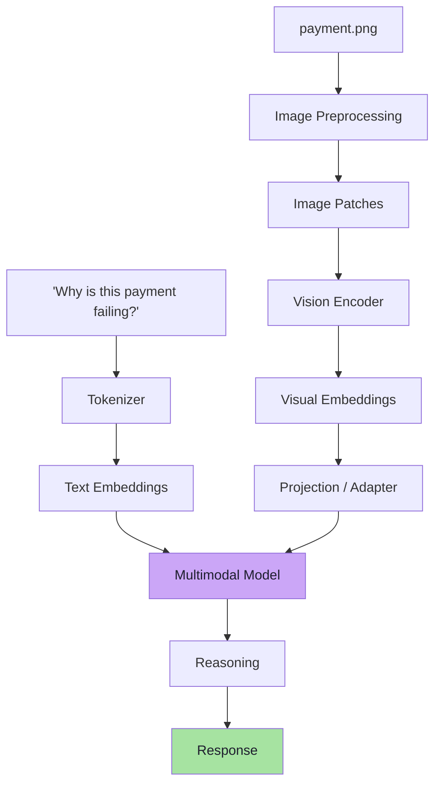
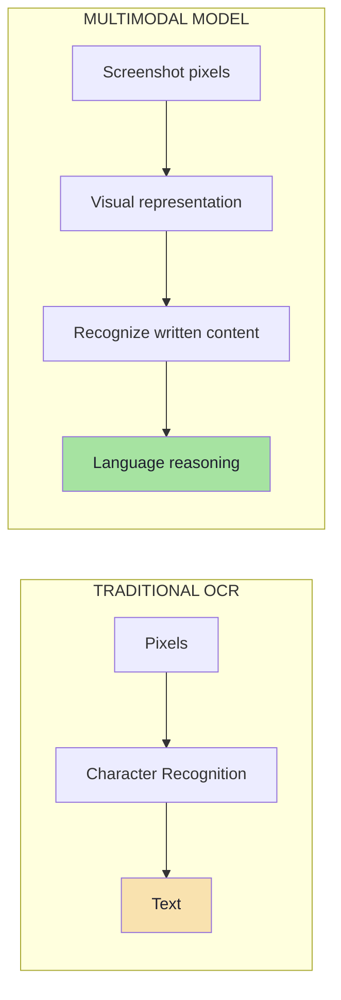
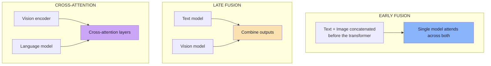

# Chapter 05: Connecting Vision to Language — Projection, Position and Attention

> **Chapter Goal:** Chapter 04 produced a sequence of **visual embeddings**. They are vectors — but they are *not necessarily* the vectors the language model expects. This chapter closes that gap with a **projection layer**, then explains the two ideas without which the whole pipeline would still be blind: **position** (where a patch is) and **attention** (which patches relate to which). Together these turn a bag of regions into a picture the model can reason about.
>
> At the end of this chapter you should be able to answer: *visual embeddings are vectors, token embeddings are vectors — so why is a projection needed at all, and what does position add that the pixels did not already contain?*

---

## 5.1 The Remaining Problem

There is still one problem.

> The visual embeddings produced by the vision encoder may **not be directly compatible** with the representation expected by the language model.

"Compatible" here means *literally the same vector space*. Two vectors can both be length-1024 and still be useless to each other if:

| Mismatch | Why it happens |
|---|---|
| **Different dimensionality** | The vision encoder may output `d_v = 1024`; the LLM expects `d_l = 4096`. |
| **Different training objective** | The encoder was trained for vision tasks; the LLM for next-token prediction. |
| **Different geometry** | Similar meanings are not in similar places across the two spaces. |



So multimodal architectures commonly contain some form of:

```text
Projection Layer
or
Adapter
```

---

## 5.2 Step 3 — The Projection Layer / Adapter

Conceptually:

```text
Image
 ↓
Vision Encoder
 ↓
Visual Embeddings
 ↓
Projection / Adapter
 ↓
Representation usable by the LLM
```

Its job is essentially:

> **Transform the visual representation into a form that the language model can work with.**



### The board's framing

From the board, the projection sits exactly where the two pipelines meet:

```text
   Text  ──> ... ──> Text Embeddings ──┐
                                        ├──> Projection / Adapter ──> [ shared space ]
 Image ──> ... ──> Visual Embeddings ──┘
```

The board labels it **`Projection / Adapter`** and places it *after* the vision encoder and *before* the shared model. That position is the point: the projection is a **translation layer between two languages of vectors**.

### What the projection is, mechanically

A projection is usually a small neural network — often just one or two linear layers:

```text
visual_vector (d_v)  →  Linear  →  projected_vector (d_l)
```

Three variants you will see named:

| Variant | What it does | Notes |
|---|---|---|
| **Linear projection** | One matrix: `d_v → d_l` | Cheapest; common baseline |
| **MLP projection** | Two layers + non-linearity | More expressive; handles a bigger gap |
| **Q-Former / resampler** | Compresses N visual vectors into a *fixed, smaller* number of query vectors | Reduces token count — a cost lever |

> **The resampler variant is worth remembering:** if a 1920×1080 image yields ~8,000 patch vectors (Chapter 04), a resampler can compress them to, say, 256 vectors before they ever reach the LLM. That is a **large reduction in image tokens** — and it is one reason different vendors charge so differently for the same picture.

### Pseudo-code: the shape of the adapter

```ts
// PSEUDO-CODE — the contract of a projection layer, not a real implementation.
type VisualEmbedding = number[];  // length d_v
type LlmEmbedding    = number[];  // length d_l

function project(v: VisualEmbedding): LlmEmbedding {
  // A learned (usually linear) map from the vision space to the language space.
  return learnedLinearMap(v);     // d_v -> d_l
}

// After projection, visual vectors can be concatenated with text vectors:
const sequence = [...textEmbeddings, ...visualEmbeddings.map(project)];
```

> **The key insight:** after projection, the visual vectors are *just embeddings* as far as the LLM is concerned. The model does not have a special "image pathway" for reasoning — it has a longer sequence of vectors, some of which originated as pixels.

---

## 5.3 Why Position Matters in an Image

> Images are not just collections of objects. **Their location matters.**

For example:

```text
Button below text box
```

has a different meaning from:

```text
Button above text box
```

Similarly:

```text
Error message next to payment field
```

contains important structural information.

So visual models also need to understand:

```text
Patch Content
 +
Patch Position
```

> This helps the model understand the **layout** and **relationships between objects**.

### The board's labelling

From the board, a patch grid is annotated with the two pieces of information that must both survive:

```text
patch content        patch position
     +                     +
                 ↓
  [ p1 ][ p2 ][ p3 ] ...
  top-left ......................... bottom-right
```

The board explicitly writes **`top-left`** and **`bottom-right`** as the extremes of the grid — a reminder that position is a **2-D coordinate**, not a single number.



### Why content alone is not enough

Consider two documents with identical words in a different arrangement:

```text
Invoice:        Total  ₹82,000
                Paid   ₹0

vs.

Invoice:        Paid   ₹82,000
                Total  ₹0
```

The *patches* contain the same characters. Only **position** distinguishes "you owe ₹82,000" from "you have paid ₹82,000". A model without position would treat these as the same document.

> **This is the image analogue of the positional encoding from Lecture 02.** A sentence is not a bag of words; an image is not a bag of patches.

### How position is injected

The mechanism mirrors text positional encodings, extended to two dimensions:

| Approach | Idea |
|---|---|
| **Learned positional embeddings** | A trainable vector per grid position, added to each patch vector |
| **2-D positional encodings** | Sinusoidal patterns indexed by `(row, col)` |
| **Interpolated positions** | Encodings scaled when the patch grid size changes with resolution |
| **Absolute coordinates** | Some models also supply explicit bounding-box coordinates as text |

> **Practical consequence:** because the grid size changes with resolution, positional encodings must be *interpolated* when you send an unusually large or small image. This is one reason extreme aspect ratios behave poorly (Chapter 07).


---

## 5.4 How Does the Model Recognize an Object?

Suppose an image contains a cat. Different patches may contain:

```text
fur
ear
eye
whiskers
background
```

One patch alone may not be enough to identify a cat. But the model can understand **relationships across patches**.

Conceptually:

```text
Patch 12 → ear
Patch 13 → eye
Patch 14 → fur
Patch 22 → whiskers
```

Together:

```text
ear + eye + fur + whiskers
              ↓
            cat
```



### The board's version

From the board, this is drawn as a set of regions feeding a single concept:

```text
cat fur
ear
eyes
background
      ↓
     cat
```

Note that `background` is included in the list — the model must learn which regions are **evidence** and which are **noise**. Recognising a cat is partly about ignoring the sofa.

### The language analogy: *bank*

This is similar to how context works in language. The word:

```text
bank
```

alone is **ambiguous**. But:

```text
I deposited money in the bank.
```

provides enough surrounding information to understand the intended meaning.

From the board, the pair is drawn literally:

```text
Bank
I deposited money in the bank
```

> Similarly, one image patch may not contain enough information, but **multiple related patches together form meaningful objects.**

| Text | Image |
|---|---|
| `bank` alone → ambiguous | one patch alone → ambiguous ("fur"?) |
| `I deposited money in the bank` → resolves | `ear + eye + fur + whiskers` → resolves to **cat** |
| Resolution mechanism: **self-attention** | Resolution mechanism: **patch attention** |

> **The unifying idea:** meaning is *relational*. In text, a token's meaning depends on its neighbours; in an image, a patch's meaning depends on the patches around it.

---

## 5.5 Vision Transformers and Attention

> Transformers are not limited to text. The same general **attention** idea can also be applied to image patches.

For text:

```text
Word Token
Word Token
Word Token
     ↓
Self-Attention
     ↓
Relationships Between Words
```

For images:

```text
Patch
Patch
Patch
  ↓
Attention
  ↓
Relationships Between Image Regions
```



Instead of asking:

```text
Which words are related?
```

the vision model can learn:

```text
Which visual regions are related?
```

> This allows the model to combine small pieces of visual information into larger meaningful concepts.

### Why attention is the right tool here

Attention solves exactly the problem Section 5.4 raised:

| Problem | How attention solves it |
|---|---|
| A patch alone is ambiguous | Each patch *looks at* other patches to gather context |
| Objects span many patches | Attention links distant patches (an ear in patch 12, a tail in patch 40) |
| Relevance varies | Attention weights let the model ignore background patches |
| Layout matters | Positional encodings + attention preserve spatial relations |

> **A useful sentence:** attention is how a *set of regions* becomes an *object*. It is the same mechanism that turns a *set of words* into a *sentence meaning* — just applied to a different sequence.


---

## 5.6 Combining Text and Image

Now consider an actual request:

```text
"Why is this payment failing?"
+
payment.png
```

Two processing pipelines are involved.

**Text side:**

```text
"Why is this payment failing?"
        ↓
     Tokenizer
        ↓
     Text Tokens
        ↓
     Text Embeddings
```

**Image side:**

```text
payment.png
    ↓
Image Preprocessing
    ↓
Image Patches
    ↓
Vision Encoder
    ↓
Visual Embeddings
    ↓
Projection / Adapter
```

The two representations are then brought together:

```text
Text Representations
        +
Visual Representations
           ↓
    Multimodal Model
           ↓
        Reasoning
           ↓
        Response
```



> **This is the central idea behind multimodal understanding:** the two representations are *not merged by a rule* — they are placed in **one sequence** and the model attends across the whole thing. Text tokens can attend to image patches; image patches can attend to text tokens. That is **cross-modal attention**.

### What cross-modal attention buys you

| Direction | What it enables |
|---|---|
| **Text → Image** | *"Which part of the image answers my question?"* — e.g. the phrase "payment failing" focuses on the error region. |
| **Image → Text** | *"Given what I see, what words are relevant?"* — the error region pulls in the vocabulary of payment failures. |
| **Image → Image** | Object formation: ear + eye + fur → cat (Section 5.4). |
| **Text → Text** | Ordinary language reasoning (Lecture 02). |

> **One sequence, four attention flows.** That is the entire trick of multimodal fusion.

---

## 5.7 Reading Text Inside Screenshots

Suppose a screenshot contains:

```text
Insufficient Balance
```

Traditional OCR explicitly follows:

```text
Pixels
 ↓
Character Recognition
 ↓
Text
```

Modern multimodal models can also learn visual patterns representing:

```text
Letters
Words
Numbers
Layout
UI elements
```

Conceptually:

```text
Screenshot Pixels
      ↓
Visual Representation
      ↓
Recognize Written Content
      ↓
Language Reasoning
```



> **This means we do not necessarily need to add a separate OCR system before sending a screenshot to a multimodal model.**

The decisive difference is the **final arrow**. OCR stops at "Text". A multimodal model continues into **Language Reasoning** — it does not just see the words `Insufficient Balance`, it understands that the payment failed and can say why.


---

## 5.8 Beyond the Lecture: The Mechanics Under the Hood

*beyond the lecture*

### Attention, stated precisely

Lecture 02 derived scaled dot-product attention for text:

```text
Attention(Q, K, V) = softmax( Q Kᵀ / √d_k ) V
```

The **same formula** applies to patches. Only the *meaning of the sequence* changes:

| Symbol | In text | In vision |
|---|---|---|
| `Q` (query) | "What am I looking for?" per token | "What is this patch looking for?" |
| `K` (key) | "What do I offer?" per token | "What does this patch offer?" |
| `V` (value) | The content to aggregate | The patch content to aggregate |
| `√d_k` | Prevents exploding dot products | Same |
| `softmax` | Weights sum to 1 | Same |

> **Nothing about the math is vision-specific.** A ViT is a text transformer whose "tokens" happen to be patches and whose positional encodings happen to be 2-D.

### Three fusion architectures

How the two modalities are joined is an architectural choice with real consequences:



| Architecture | How it works | Trade-off |
|---|---|---|
| **Early fusion** | Project visual vectors into the text sequence, then run one transformer | Strongest interaction; visual tokens consume context |
| **Late fusion** | Encode separately; combine at the end | Cheap; weak fine-grained interaction |
| **Cross-attention** | Language layers attend to visual features via dedicated cross-attention blocks | Efficient; used by several encoder-decoder multimodal models |

> **Modern instruction-following multimodal LLMs overwhelmingly use early fusion**: the visual vectors are projected into the same sequence as the text. This is exactly the pipeline in Section 5.6 — and it is why "how many image tokens" is a real question (Chapter 08).

### Token order and special tokens

The sequence the model actually sees looks roughly like:

```text
[ system ] [ text tokens... ] [ <image_start> ] [ v1 v2 v3 ... vN ] [ <image_end> ] [ text tokens... ]
```

Two practical consequences:

- **Where you place the image matters.** Putting the image *before* the question ("here is a screenshot; why did it fail?") versus after can change results — the same way ordering changes a text prompt.
- **Multiple images are numbered.** With two images, the model needs a way to reference "the first one" — usually through explicit text ("in the second screenshot…") and distinct delimiters.

### Spatial reasoning is genuinely weaker than it looks

Attention gives the model *access* to position, not *precision*. Known weaknesses:

| Task | Why it is hard |
|---|---|
| Counting many objects | Attention is soft; counts blur |
| Precise coordinates | Position is encoded coarsely at patch granularity |
| Fine spatial relations ("just left of") | Sub-patch relations are below resolution |
| Reading tiny text | Below the patch size, characters vanish |

> **FDE implication:** never build a workflow whose correctness depends on the model *counting* or *measuring*. Ask it to *identify and quote*; do the arithmetic in code.


---

## 5.9 Common Mistakes at This Stage

| Mistake | Why it hurts | Correct habit |
|---|---|---|
| Skipping the projection in your mental model | Vision vectors seem magically compatible | Name the step: encoder → **projection** → shared sequence |
| Assuming position is free | Layout-blind reading of invoices and UIs | Position is *added*; without it the image is a bag of patches |
| Believing attention makes the model see like a human | Over-trusting counting and coordinates | Attention = relational access, not measurement |
| Treating the visual tokens as free | Context budget silently consumed | Count image tokens (Chapter 08) |
| Putting the image in a fixed, arbitrary place | Ignores prompt-order effects | Place the image deliberately relative to the question |
| Confusing the encoder with OCR | Wrong expectations about exact text | Encoder = features; OCR = characters |
| Expecting "left of"/"just above" to be reliable | Sub-patch relations are below resolution | Ask for identification, verify in code |

---

## 5.10 Chapter Summary

| Idea | Statement |
|---|---|
| The gap | Visual embeddings may not match the LLM's vector space |
| Step 3 | A **projection layer / adapter** translates vision vectors into language vectors |
| Variants | Linear, MLP, or a resampler (which also *reduces* token count) |
| Position | Layout matters: `button below text box` ≠ `button above text box` |
| The board | **patch content + patch position**, from `top-left` to `bottom-right` |
| Object recognition | `ear + eye + fur + whiskers → cat`; background must be suppressed |
| The analogy | `bank` disambiguated by context = a patch disambiguated by neighbours |
| Attention | The same mechanism, applied to patches: which regions are related? |
| Fusion | One sequence, four attention flows: text→text, text→image, image→text, image→image |
| OCR-free reading | The model recognises letters, words, layout and UI elements, then *reasons* |
| The payoff | We do not necessarily need a separate OCR system in front of the model |

> **Final mental model:** the projection makes vision *speak the same language* as text; position makes the picture *make sense*; attention makes the regions *relate*. Remove any one of the three and multimodal understanding collapses.

---

## Where This Goes Next

- **[Chapter 06](./06_How_Models_Learn_Vision_Language_Alignment.md)** — how the model *learns* that `fur + ear + eyes` means `cat`.
- **[Chapter 07](./07_The_End_To_End_Multimodal_Pipeline.md)** — the full end-to-end flow and the application boundary.
- Recap: [Lecture 02, Chapter 04](../../Lecture%2002/notes/04_Self_Attention_Mechanism_and_QKV_Architecture.md) for the QKV derivation.

---

**Back to:** [Lecture 16 — Chapter Index](./README.md) · [Complete Consolidated Notes](./Lecture_16_Complete_Notes.md)

