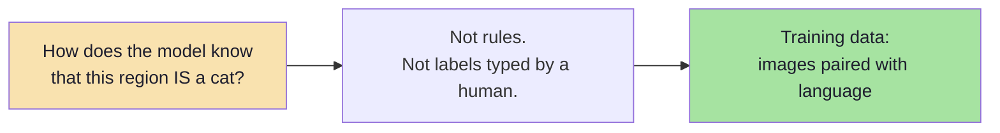
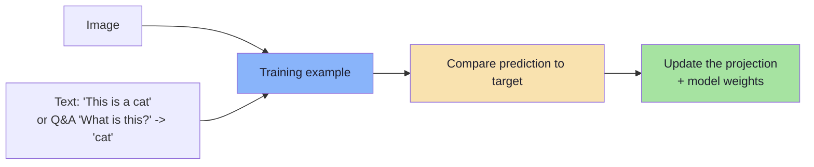
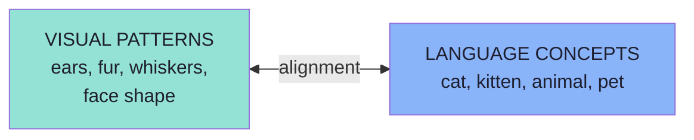
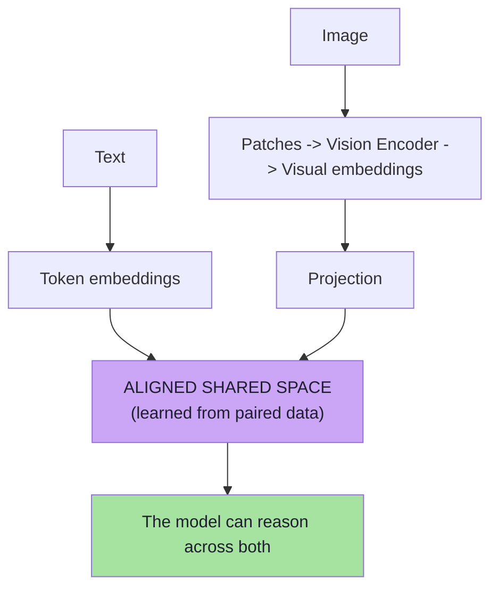
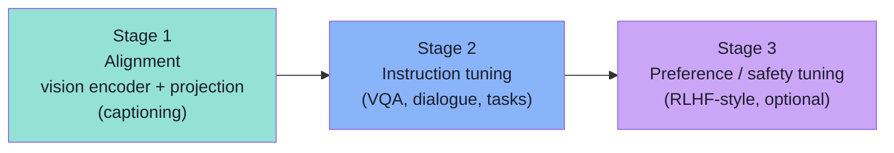

# Chapter 06: How Models Learn Vision-Language Alignment

> **Chapter Goal:** Chapters 04 and 05 described the *machinery*: patches, a vision encoder, a projection, position, attention. They never explained where the *knowledge* comes from. This chapter answers the question the lecture poses directly — **how does the model learn that a cat is a cat?** — and in doing so explains the term the whole field uses for the answer: **vision-language alignment**.
>
> At the end of this chapter you should be able to answer: *the model was never taught "cat" by a human — so what was it shown, millions of times, that made `fur + ear + eyes` mean the same thing as the word `cat`?*

---

## 6.1 The Question

Chapters 04–05 left the model with a projection layer that maps visual vectors into the language space. But a projection layer is just a matrix. **Where do the *values* come from?**



> **Multimodal models are trained using large amounts of visual and language information.**

That is the whole answer in one sentence. The rest of this chapter makes it concrete.

---

## 6.2 The Training Data

Conceptually, training data may contain examples such as:

```text
[Image of a cat]

"This is a cat."
```

or:

```text
[Image]

Question:
What animal is shown?

Answer:
Cat
```

From the board, this pairing is drawn as a labelled example:

```text
INput :
   [image]  +  "This is a cat"        (images + description)
   "What is this ?"  ->  cat
```



Three families of training signal matter:

| Signal type | Example | What it teaches |
|---|---|---|
| **Image–caption pairs** | A photo + "a cat on a sofa" | Basic alignment: these pixels ↔ these words |
| **Visual question answering (VQA)** | Image + "What animal?" → "Cat" | Instruction-following over images |
| **Interleaved documents** | A web page with images inline | Reference, layout and multi-image understanding |

> **The scale is the point.** Alignment is not learned from a thousand labelled cats; it is learned from hundreds of millions of loosely-paired images and sentences.

---

## 6.3 Learning the Relationship

Across huge amounts of training data, the model learns relationships between:

```text
Visual Patterns
       ↕
Language Concepts
```

From the board, this is drawn as two parallel outputs of the same training process:

```text
LLM  ──>  text   ──>  Language concepts
     ──>  Image  ──>  Visual patterns
```

For example:

```text
ears
fur
whiskers
face shape
```

become associated with concepts such as:

```text
cat
kitten
animal
pet
```



> **Note the arrows go both ways.** The association is not "pixels → label"; it is a *shared representation*. That is why the model can go from picture to word **and** from word to picture ("describe a cat", "find the cat").

### What "learned" means here

The model is not storing a rule like:

```text
if (has_whiskers && has_pointy_ears) => cat     ← NOT how it works
```

It is learning a **geometry** in vector space where the visual representation of a cat lands near the *text* representation of "cat". There are no discrete rules — only distances and directions.

> **This connection between visual information and language is often described broadly as vision-language alignment.**

---

## 6.4 Why This Is the Load-Bearing Idea

Put Chapters 04–06 together and the whole lecture collapses into one sentence:

```text
Text becomes tokens → embeddings.
Images become patches → visual embeddings → projection.
Training aligns the two spaces.
```



Without alignment, the projection is an arbitrary matrix and attention has nothing meaningful to attend to. **Alignment is what makes the architecture in Chapter 05 actually work.**

### Pseudo-code: the shape of an alignment objective

```ts
// PSEUDO-CODE — the SHAPE of contrastive alignment, not a real loss function.
// Positive pair: an image and its true caption.
// Negative pairs: the same image with other captions in the batch.
const sim = (a, b) => cosineSimilarity(a, b);

for (const { image, caption } of batch) {
  const v = project(visionEncoder(image));
  const t = embedText(caption);

  const positive = sim(v, t);                       // want HIGH
  const negatives = otherCaptions.map(c => sim(v, embedText(c))); // want LOW

  // Push positives together, push negatives apart.
  loss += contrastiveLoss(positive, negatives);
}
```

The only idea to take from the pseudo-code: **training pulls matching image–text pairs together and pushes mismatched pairs apart, until one space holds both.**

---

## 6.5 Beyond the Lecture: How Alignment Is Actually Trained

*beyond the lecture*

### Contrastive pre-training (the CLIP idea)

The dominant recipe for the *alignment* stage:

```text
1. Take a batch of N (image, caption) pairs.
2. Encode all N images -> N vectors. Encode all N captions -> N vectors.
3. Build an N x N similarity matrix.
4. The DIAGONAL should be high (true pairs). Off-diagonal should be low.
5. Train with a contrastive loss (e.g. InfoNCE) to make it so.
```

This is **self-supervised**: no human labels the cat. The caption *is* the label. That is how the scale becomes possible.

| Property | Why it matters |
|---|---|
| No manual labels | Web-scale data becomes usable |
| Symmetric objective | Enables image→text **and** text→image retrieval |
| Shared embedding space | This space is exactly what powers multimodal RAG (Chapter 02) |

### Two (or three) training stages

Real multimodal LLMs are usually built in stages:



| Stage | Goal | What is trained |
|---|---|---|
| **Alignment** | Make visual vectors land in language space | Projection (+ sometimes encoder) |
| **Instruction tuning** | Follow image-grounded instructions | Full model, on VQA/dialogue data |
| **Preference tuning** | Be helpful, harmless, honest | Full model, on preference data |

### Parameter freezing and LoRA

Because these models are enormous, training rarely touches everything:

| Technique | Idea |
|---|---|
| **Frozen encoder** | The vision encoder is often frozen; only the projection trains initially |
| **LoRA / adapters** | Train small low-rank matrices instead of all weights |
| **Unfrozen later** | Some models unfreeze the encoder in a later stage for better detail |

> **Why you should care as an FDE:** this explains why *fine-tuning vision behaviour* is hard. If the encoder was frozen, no amount of task-specific data will make it see tiny text it was never trained to resolve (Chapter 07).

### Data quality is the ceiling

| Problem in the data | Consequence in the model |
|---|---|
| Noisy, auto-scraped captions | Weak, generic alignment |
| Culturally narrow images | Bias; poor performance outside the training distribution |
| Rare languages under-represented | The model "forgets" to read them |
| Charts/diagrams rare | Poor chart reasoning even when text reasoning is strong |

> **Alignment inherits the biases and the gaps of its pairing data.** Evaluation (Chapter 08) exists to find exactly those gaps.

### Why "knowing" is statistical, not semantic

A useful framing to keep you honest:

| What the model has | What the model does **not** have |
|---|---|
| A geometry of visual features near language concepts | Grounded, verified knowledge of the world |
| Strong statistical association | Causal understanding |
| The ability to produce a plausible description | A guarantee that the description is true |

This is the same honesty that Lecture 04 demanded about text hallucinations — applied to pixels. **A confident caption can be wrong**, and it is *harder to notice* than a wrong sentence because the image "proves" it in the reader's mind.

---

## 6.6 Common Mistakes at This Stage

| Mistake | Why it hurts | Correct habit |
|---|---|---|
| Thinking a human labelled the training data | Wrong intuition about cost and scale | Alignment is learned from paired image–text data |
| Imagining hand-written visual rules | Misunderstands why the model generalises | It is a learned geometry, not a rule set |
| Assuming alignment means "understands" | Over-trusting confident descriptions | Association ≠ verified truth; evaluate |
| Believing fine-tuning fixes vision quality | Encoder may be frozen; resolution is fixed | Fix the *input* (resolution, crops) instead |
| Expecting symmetry in quality | Text reasoning is often stronger than chart/spatial reasoning | Test the exact visual capability you need |
| Ignoring data bias | Models inherit the distribution of their pairs | Evaluate across the populations you serve |

---

## 6.7 Chapter Summary

| Idea | Statement |
|---|---|
| The question | How does the model learn that a cat is a cat? |
| The answer | Training on **large amounts of visual + language information** |
| Training data | Image–caption pairs, VQA, interleaved documents |
| The relationship learned | `visual patterns ↕ language concepts` |
| The board | `Text → Language concepts` and `Image → Visual patterns`, plus *images + description* |
| The mechanism | Alignment: pull matching pairs together, push mismatches apart |
| The result | A **shared vector space** holding both modalities |
| The stages | Alignment → instruction tuning → preference tuning |
| The constraint | Data quality and breadth cap what the model can see |
| The honesty | Knowing is statistical; a confident caption can still be wrong |

> **Final mental model:** nobody wrote the rule "a cat has whiskers". The model was shown millions of pictures next to the word *cat* until the two landed in the same neighbourhood of vector space. **Alignment is that neighbourhood.**

---

## Where This Goes Next

- **[Chapter 07](./07_The_End_To_End_Multimodal_Pipeline.md)** — the complete end-to-end flow, image preprocessing, and how your application is wired to it.
- **[Chapter 08](./08_Production_Multimodal_Systems_Cost_Security_And_Evaluation.md)** — cost, security and how to test whether alignment holds for *your* data.
- Cross-lecture: [Lecture 07](../../Lecture%2007/notes/README.md) for embeddings from first principles.

---

**Back to:** [Lecture 16 — Chapter Index](./README.md) · [Complete Consolidated Notes](./Lecture_16_Complete_Notes.md)

