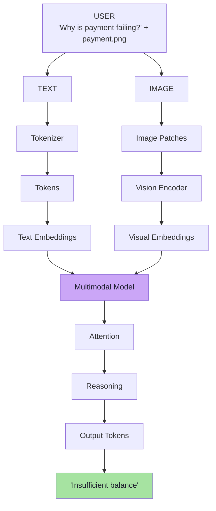
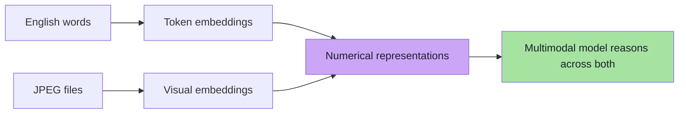
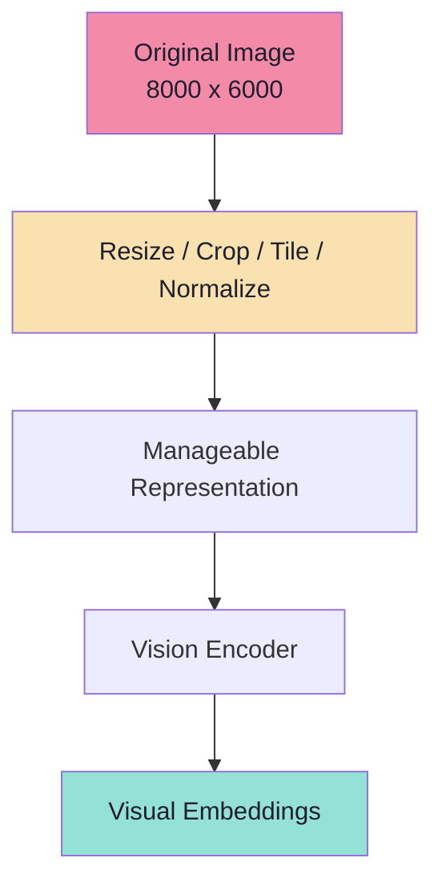
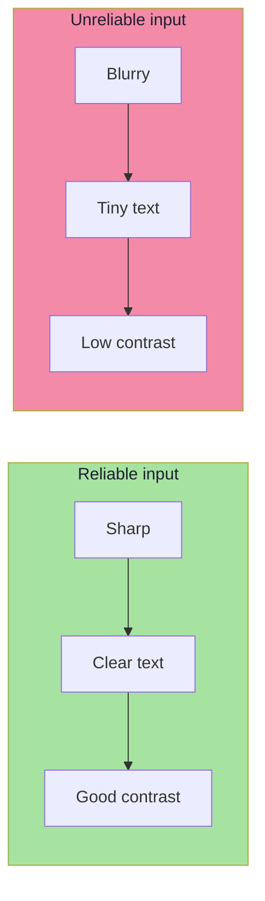
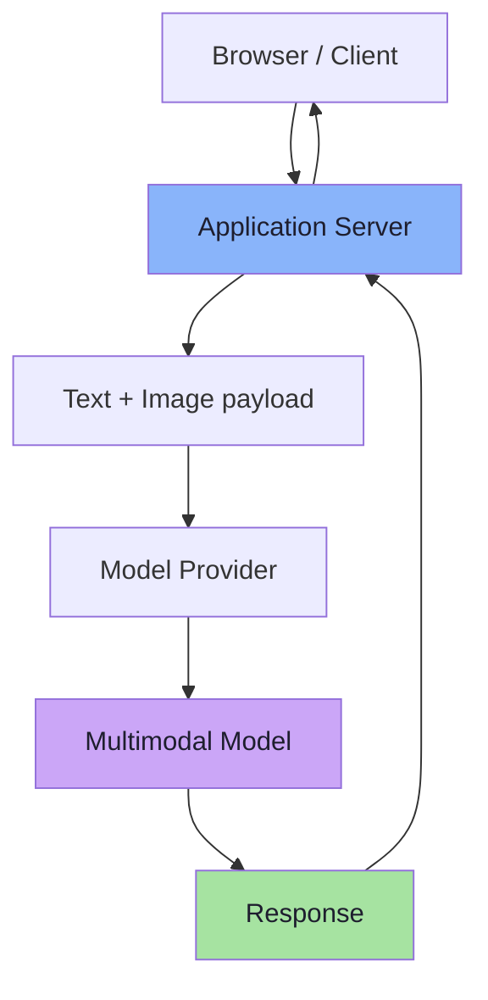
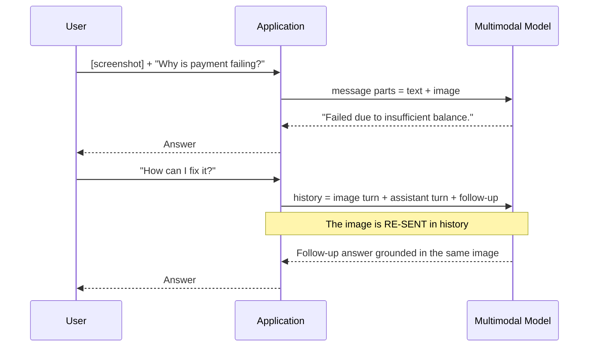
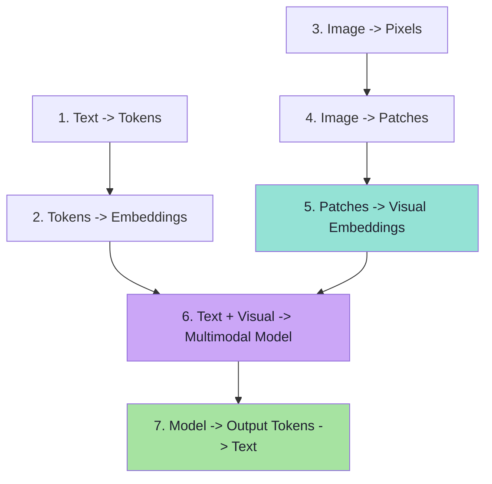

# Chapter 07: The End-to-End Multimodal Pipeline

> **Chapter Goal:** Chapters 03–06 built the model internals one stage at a time. This chapter assembles them into a single picture — the **end-to-end flow** — and then does the thing the lecture cares about most for an application engineer: it shows what *your* code has to do, and what it does **not** have to do. It also covers the two practical realities the internals chapters deferred: **preprocessing large images** and **conversation history with images**.
>
> At the end of this chapter you should be able to answer: *a user uploads a photo in my chat app — what exactly does my server send, what does the provider do with it, and what happens on the next turn when they ask a follow-up?*

---

## 7.1 The End-to-End Flow

A simplified architecture looks like this:

```text
                            USER

              "Why is payment failing?"
                          +
                     payment.png

              TEXT                       IMAGE

               ↓                           ↓

           Tokenizer                  Image Patches

               ↓                           ↓

            Tokens                  Vision Encoder

               ↓                           ↓

      Text Embeddings              Visual Embeddings

                  \                     /
                      \             /
                          \     /

                    Multimodal Model
                           ↓
                       Attention
                           ↓
                       Reasoning
                           ↓
                      Output Tokens
                           ↓
                  "Insufficient balance"
```



> **The two pipelines converge at the model, and the output is ordinary text tokens.** Everything to the left of "Multimodal Model" is modality-specific; everything to the right is the standard decoder loop from Lecture 02.

---

## 7.2 The Most Important Idea

> **An LLM does not really work with English words or JPEG files. It works with numerical representations.**

Text becomes:

```text
Token Embeddings
```

Images become:

```text
Visual Embeddings
```

> The multimodal model is **trained to reason across both**.



This is the sentence to remember from the entire lecture. **Two formats in, one numeric currency, one reasoning model, text out.**

---

## 7.3 Why Large Images May Be Preprocessed

Suppose someone uploads:

```text
8000 × 6000 image
```

Processing every pixel at full resolution would be expensive. Run the Chapter 04 arithmetic:

```text
8000 × 6000 = 48,000,000 pixels
Patches at 16 x 16 = 500 x 375 = 187,500 patches
```

That is **~187,500 visual tokens** for one photograph. It would not fit in any context window.

So before the vision encoder receives the image, the provider may perform preprocessing such as:

```text
Resize
Crop
Tile
Normalize
```

Conceptually:

```text
Original Image
      ↓
Resize / Tile
      ↓
Manageable Representation
      ↓
Vision Encoder
```



### What each step does

| Step | Purpose |
|---|---|
| **Resize** | Bring the long edge down to a maximum, cutting token count |
| **Crop** | Focus on a region, or fit an aspect ratio |
| **Tile** | Split a large image into several fixed-size tiles so small details survive at high resolution |
| **Normalize** | Scale pixel values to the range the encoder was trained on |

### The board's compression note

From the board, this is drawn as an explicit stage before the model:

```text
Raw Image  →  compress  →  compressed image  →  LLM
```

The word **compress** is doing a lot of work. It is not "make the file smaller" (JPEG compression). It is **reduce the number of visual tokens the model must process** — by resizing, tiling and (in some architectures) resampling the embeddings.

> **Very large images may also be divided into multiple regions so smaller details can still be preserved.** Tiling is the compromise: send several high-resolution crops rather than one giant downscaled image.

> **The exact implementation depends on the model and provider.** Treat it as *their* policy, not yours — but know that it exists, because it explains surprising behaviour (Chapter 08).

### Why this matters to you

| Consequence | Engineering response |
|---|---|
| Your 12 MP photo may arrive at the model as ~1 MP | Do not expect pixel-perfect reading of tiny text |
| Tiling changes the effective resolution | Pre-crop to the region of interest when you know it |
| Provider policy differs per vendor | Compare on *your* documents, not benchmarks |
| Cost is driven by the post-preprocessing token count | Understand the vendor's token formula (Chapter 08) |

---

## 7.4 Image Quality Still Matters

Multimodal models are powerful, but the quality of the input still affects the result.

Models may struggle with:

```text
Extremely small text
Blurry screenshots
Low-resolution images
Poor lighting
Cropped information
Very dense screenshots
Low contrast
```

> **If the visual information is unclear, the model has less reliable information to work with.**



> **This is a garbage-in-garbage-out problem that no prompt can fix.** If the character is four pixels tall, the information was destroyed before the model ever saw it.

### The practical response

| Failure | What to do |
|---|---|
| Tiny text | Crop to the region; send it enlarged |
| Blurry | Ask the user to re-upload, or state the limitation |
| Cropped information | Detect and warn — do not guess the missing part |
| Dense screenshots | Split into regions and ask targeted questions |
| Low contrast | Pre-process (contrast/binarise) if you can |

> **FDE habit:** make "image quality" an explicit, *measured* input to your pipeline (resolution, sharpness score, aspect ratio) and branch on it — exactly the way Lecture 13 made "schema validity" an explicit branch rather than a hope.

---

## 7.5 How This Connects to Our Application

From our application's point of view, we simply send:

```text
User Message

├── Text
└── Image
```

For example:

```text
Text:
"Why is my payment failing?"

Image:
payment.png
```

> **The application or framework does not itself understand the image.** It simply **packages the request and sends it to a multimodal model.**

Conceptually:

```text
Browser
 ↓
Application
 ↓
Text + Image
 ↓
Model Provider
 ↓
Multimodal Model
 ↓
Response
```



Under the hood:

```text
Text
 ↓
Tokenizer
 ↓
Text Representations
```

and:

```text
Image
 ↓
Vision Processing
 ↓
Visual Representations
```

> Both are then used by the model to generate an answer.

### The board's architecture

From the board, this is drawn as a **Client → LLM → Server** picture with a `/chat` endpoint carrying the mixed payload:

```text
Client  ──/chat──>  LLM  ──>  Server
         "Text / Image -----> Text"
         "Hi my name is Aditya"
```

Read the annotation literally: the `/chat` contract accepts **text or image** and returns **text**. That is the only interface change your application needs.

### What your application is responsible for

| Responsibility | Your code | The provider |
|---|---|---|
| Accept the upload | ✅ | |
| Validate type / size / dimensions | ✅ | |
| Authenticate and authorise the request | ✅ | |
| Redact / mask PII if required | ✅ | |
| Encode and attach the image part | ✅ | |
| Preprocess (resize / crop / tile) | ⚠️ sometimes you, sometimes them | ⚠️ |
| Patchify + encode + project | | ✅ |
| Reason and generate | | ✅ |
| Parse, validate, log, render | ✅ | |

> **The headline:** you build the *plumbing*, not the *vision*. The intelligence is behind the API; your job is to get the right bytes there and to handle the answer responsibly.

### Pseudo-code: the request handler shape

```ts
// PSEUDO-CODE — the SHAPE of a multimodal request handler, not runnable code.
async function handleChat(req) {
  const { text, files } = req.body;

  // 1. Validate what we are willing to send.
  const image = files?.[0];
  if (image && !isAllowedImage(image)) return reject("unsupported image");

  // 2. Optionally pre-process (crop to region of interest, downscale).
  const prepared = image ? await preprocess(image) : undefined;

  // 3. Build the multipart message: text + image as content PARTS.
  const content = [{ type: "text", text }];
  if (prepared) content.push({ type: "image", source: prepared });

  // 4. Send, then validate the answer before trusting it.
  const res = await model.chat({ messages: [{ role: "user", content }] });
  return validateAndRender(res);
}
```

Three things to notice: **validate before sending**, **preprocess deliberately**, and **validate the answer after receiving**. Those three lines are the difference between a demo and a system.


---

## 7.6 Conversation History With Images

Images can also become part of **conversation context**.

For example:

```text
USER:
[Payment Screenshot]

Why is payment failing?

Assistant:
The screenshot shows that the payment failed
because of insufficient balance.
```

Then the user asks:

```text
How can I fix it?
```

> **If the previous user message, including the image, is sent again as part of conversation history, the model can continue reasoning about that same screenshot.**

Conceptually:

```text
Conversation History

USER:
Image + Question

ASSISTANT:
Answer

USER:
Follow-up Question
```



> The multimodal model receives the relevant previous context again and can continue the conversation.

### The two things this reveals

**1. The image is context, not a one-off event.** Once it is in history, follow-ups work without re-uploading. This is the vision version of Lecture 04's conversation memory.

**2. History is *expensive*.** Every turn re-sends every image in the window:

```text
Turn 1: 1 image  ≈ 1,000 tokens
Turn 2: 1 image  (re-sent) + text
Turn 3: 1 image  (re-sent) + text
...
```

With several images, the context fills fast. Mitigations:

| Mitigation | Effect |
|---|---|
| Drop images from old turns, keep their **text summary** | Big saving; loses fine visual detail |
| Keep only the last N images | Bounded cost |
| Summarise the image once, reuse the summary | Cheap follow-ups |
| Cache provider-side if supported | Avoids re-encoding cost |

> **A common production pattern:** keep the image for the turn it arrived in plus one or two follow-ups, then replace it with a text digest produced by the model itself.

### Pseudo-code: history compaction

```ts
// PSEUDO-CODE — compacting image history to control context cost.
function compactHistory(turns, maxImages = 2) {
  const withImages = turns.filter(t => t.hasImage);
  const keep = new Set(withImages.slice(-maxImages).map(t => t.id));

  return turns.map(t =>
    t.hasImage && !keep.has(t.id)
      ? { role: t.role, content: t.summary }   // image replaced by a text digest
      : t
  );
}
```

---

## 7.7 The Seven-Step Mental Model

The entire process can be simplified into **seven steps**.

```text
1. Text is not directly understood by the model
      Text → Tokens

2. Tokens become numerical representations
      Tokens → Embeddings

3. Images are also numerical data
      Image → Pixels

4. Images are broken into manageable visual regions
      Image → Patches

5. A vision encoder converts those regions into vectors
      Patches → Visual Embeddings

6. Text and visual representations are processed together
      Text Embeddings + Visual Embeddings → Multimodal Model

7. The response is generated as normal text tokens
      Model → Output Tokens → Text Response
```



> **Memorise this ladder.** It is the answer to "how do LLMs understand images?" in any interview, and it is the map of Chapters 03–07.


---

## 7.8 Beyond the Lecture: Wiring Details That Bite

*beyond the lecture*

### How the image is actually transmitted

| Transport | How it works | Trade-off |
|---|---|---|
| **Base64 inline** | Image bytes encoded into the JSON payload | Simple; inflates payload ~33%; fine for small images |
| **URL reference** | Send a URL; provider fetches it | Small payload; needs a reachable, authenticated URL |
| **File / asset ID** | Upload first, reference the returned ID | Best for reuse and multi-turn; extra round trip |

> **Security note:** a URL reference means *someone else's server fetches a URL you provide*. This is a **server-side request forgery (SSRF)** risk if the URL is user-controlled. Prefer uploading to your own store and passing a signed URL, or base64 for small files.

### Streaming

Vision does **not** change streaming. The image is processed *before* the first token is produced, so the user experience is:

```text
[ upload ] → (silence: vision encoding) → first token → streamed text
```

That silence is measurable — often hundreds of milliseconds to a second or more. Show a "reading your image…" state; do not leave the UI blank (compare Lecture 06 on perceived latency).

### Latency and cost budget

```text
total = upload + validate + preprocess + (vision encode + prefill) + decode
```

| Stage | Typical shape |
|---|---|
| Upload | Network-bound; smaller image = faster |
| Vision encode + prefill | Grows with image token count |
| Decode | Grows with answer length |

> **The lever you control is the image.** Cropping to the region of interest before sending is usually the single biggest latency and cost win.

### Multiple images and multi-page documents

- **Number the images** and refer to them explicitly ("in image 2…") — the model cannot reliably guess your ordering.
- **Multi-page PDFs** are usually sent as **one image per page**; a 40-page PDF can consume an entire context window (Chapter 08).
- **Prefer the smallest crop** that contains the answer. A page-level image for a field-level question wastes tokens.

### Where multimodal RAG fits

*beyond the lecture — connects to [Lecture 11](../../Lecture%2011/notes/README.md) and [Lecture 12](../../Lecture%2012/notes/README.md)*

Two very different things get called "multimodal RAG":

| Pattern | What it does |
|---|---|
| **Text-RAG over image-derived text** | OCR/describe images offline, index the text, retrieve text, then optionally re-attach the source image |
| **True multimodal retrieval** | Embed images and text into one aligned space (Chapter 06); retrieve *pixels* directly |

The first is cheap and battle-tested. The second is what alignment makes possible — and is the right choice when the *visual detail itself* is the answer (a chart shape, a diagram topology).

---

## 7.9 Common Mistakes at This Stage

| Mistake | Why it hurts | Correct habit |
|---|---|---|
| Believing your app "understands" the image | Misplaces where logic lives | Your app **packages**; the provider **interprets** |
| Sending full-resolution images by default | Thousands of tokens; slow and costly | Crop / downscale to the region of interest |
| Ignoring preprocessing policy | Surprising failures on tiny text | Learn the provider's resize/tile behaviour |
| Leaving the UI blank during vision encoding | Users think it is broken | Show a "reading image" state |
| Re-sending every image on every turn | Context and cost explode | Compact history; replace old images with digests |
| Trusting the model's answer without validation | Silent errors enter your workflow | Validate and render (Lecture 13 discipline) |
| Assuming streaming changes | Wrong mental model of latency | Encoding happens before the first token |
| Using user-controlled URLs for image fetch | SSRF risk | Signed URLs or base64 |

---

## 7.10 Chapter Summary

| Idea | Statement |
|---|---|
| End-to-end flow | Text → tokens → embeddings; Image → patches → encoder → embeddings; converge at the model |
| The core idea | The model works with **numerical representations**, not words or JPEGs |
| Preprocessing | Resize, crop, tile, normalize — to make the token count manageable |
| The board | `Raw Image → compress → compressed image → LLM` |
| Tiling | Large images are split so small details survive |
| Quality matters | Small text, blur, low contrast, cropping all degrade reliability |
| The application boundary | The app **packages** text + image; it does not understand the image |
| The board's contract | `Client —/chat→ LLM`, "Text / Image → Text" |
| Conversation history | Images persist in context — and are **re-sent** every turn |
| Cost driver | Image tokens × turns; compaction is essential |
| The mental model | The seven-step ladder from text/image to output tokens |

> **Final mental model:** your application's job is unchanged — accept input, build a request, validate the answer. What changed is that one of the input *parts* is now a picture, and the pipeline behind the API has grown a vision front-end.

---

## Where This Goes Next

- **[Chapter 08](./08_Production_Multimodal_Systems_Cost_Security_And_Evaluation.md)** — cost, security, evaluation and a failure runbook for everything in this chapter.
- Cross-lecture: [Lecture 04](../../Lecture%2004/notes/README.md) (conversation memory), [Lecture 06](../../Lecture%2006/notes/README.md) (streaming), [Lecture 13](../../Lecture%2013/notes/README.md) (validating structured answers).

---

**Back to:** [Lecture 16 — Chapter Index](./README.md) · [Complete Consolidated Notes](./Lecture_16_Complete_Notes.md)

