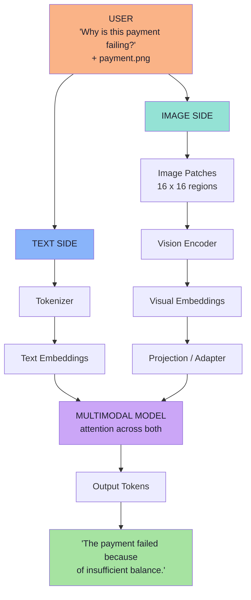

# Lecture 16 — Multimodal AI: How LLMs Understand Images

> **Lecture theme:** Every lecture so far has obeyed one quiet contract — **text in, text out**. Lecture 02 turned text into numbers; Lecture 11 and 12 turned documents into retrieved context; Lecture 13 turned answers into schemas; Lecture 14 and 15 turned capabilities into a protocol. This lecture breaks the contract itself: the user attaches a **screenshot**, and the information they actually care about lives *inside an image*. This lecture answers the question no earlier lecture had to: **what would have to change inside the model pipeline for a picture to become something an LLM can reason over?**
>
> The answer is not "a bigger model". It is a pipeline: **pixels → patches → visual embeddings → a projection into language space → attention across both modalities → text**. That pipeline is this lecture.
>
> The source lecture uses illustrative snippets; these notes keep the architecture and express any snippet as **TypeScript-style pseudo-code** for a JS/TS (Node.js) environment. **No runnable production code appears in these notes** — only pseudo-code that describes data flow and contracts.

---

## Chapter Index

| # | Chapter | Core Question Answered |
|---|---|---|
| [01](./01_Why_Text_Only_AI_Is_Not_Enough.md) | Why Text-Only AI Is Not Enough | Where exactly does *"String → LLM → String"* break? |
| [02](./02_What_Multimodal_Models_Understand_And_OCR_vs_MLLM.md) | What Multimodal Models Understand, and OCR vs MLLM | What can it understand beyond characters — and when is OCR still right? |
| [03](./03_From_Text_To_Numbers_The_Text_Pipeline.md) | From Text to Numbers: The Text Pipeline | How does text reach an LLM as numbers, and why is that the key to images? |
| [04](./04_Images_Are_Numbers_Pixels_Patches_And_Visual_Embeddings.md) | Images Are Numbers: Pixels, Patches and Visual Embeddings | How does an image become vectors a model can compute on? |
| [05](./05_Connecting_Vision_To_Language_Projection_Position_And_Attention.md) | Connecting Vision to Language: Projection, Position and Attention | How do the two worlds meet — and why does *where* a patch is matter? |
| [06](./06_How_Models_Learn_Vision_Language_Alignment.md) | How Models Learn Vision-Language Alignment | How does the model learn that a cat is a cat? |
| [07](./07_The_End_To_End_Multimodal_Pipeline.md) | The End-to-End Multimodal Pipeline | Preprocessing, application integration and images in conversation history |
| [08](./08_Production_Multimodal_Systems_Cost_Security_And_Evaluation.md) | Production Multimodal Systems: Cost, Security and Evaluation | What breaks in production, and how do I ship this safely? |
| [**Complete**](./Lecture_16_Complete_Notes.md) | **Complete Consolidated Notes** | All eight chapters condensed: cheat sheets, decision tables, glossary, self-check |

> 📄 **Prefer a single document?** Read the **[Lecture 16 — Complete Consolidated Notes](./Lecture_16_Complete_Notes.md)**. It keeps the load-bearing ideas, the decision tables and the full pipeline, and links back to the chapters for full reasoning and pseudo-code.

---

## The Big Idea in One Diagram

Read it as **two pipelines that converge**: text becomes token embeddings, an image becomes visual embeddings, a projection makes them speak the same language, and the model reasons across both. The output is ordinary text tokens — which is why *your application barely changes*.

---

## How to Read These Notes

1. **Chapters 01–02 are the case.** Where text-only breaks, what "multimodal" means precisely, and the OCR-vs-MLLM distinction.
2. **Chapter 03 is the bridge.** The text pipeline you already know (Lecture 02) restated as *the pattern images will follow*.
3. **Chapters 04–05 are the machine.** Pixels → patches → vision encoder → projection → position → attention.
4. **Chapter 06 is the learning.** How visual patterns get bound to language concepts (alignment).
5. **Chapter 07 is the wiring.** Preprocessing, the application boundary, the `/chat` upload path, and images in conversation history.
6. **Chapter 08 is the boundary of safety.** Image token cost, visual prompt injection, privacy, evaluation and a failure runbook.

---

## Conventions Used in This Lecture

| Convention | Meaning |
|---|---|
| **Mermaid** | Every structural diagram is Mermaid (`flowchart`, `sequenceDiagram`, `stateDiagram-v2`). |
| **TypeScript-style pseudo-code** | Snippets describe data flow and contracts for a JS/TS environment. They are **not runnable production code** and are always labelled. |
| **Board references** | Passages described as *from the board* reproduce the hand-drawn `Excalidraw-Notes.svg`. |
| **Beyond the lecture** | Sections marked *beyond the lecture* add material the script only gestures at (patch/token arithmetic, CLIP-style alignment, multimodal RAG, visual prompt injection, evaluation). |
| **Cross-lecture links** | Where a topic is really another lecture's subject, it is linked rather than repeated. |

---

## Sources

- 📄 [`Notes.pdf`](./Notes.pdf) — *Multimodal AI: How LLMs Understand Images* (28 pages): why text-only is not enough, what multimodality is, multimodal vs multi-model, the invoice example, what a multimodal model can understand, OCR vs multimodal LLM, how text reaches an LLM, images as numbers, patches, the vision encoder, text vs visual embeddings, projection/adapter, why position matters, object recognition, vision transformers and attention, reading text in screenshots, vision-language alignment, combining text and image, the end-to-end flow, preprocessing large images, image quality, application integration, conversation history with images, the seven-step mental model and the final takeaway.
- 🖼️ [`Excalidraw-Notes.svg`](./Excalidraw-Notes.svg) — the lecture board: a **Client → LLM → Server** picture with a `/chat` endpoint carrying *"Text / Image → Text"*; the **multi-modality vs multi-models** split; **OCR** (`error.png` → `func a() { int a; ... }` → `error.txt`); tokenisation of *"HI, my name is Aditya"* into tokens → **token IDs `23 41 56`** → vectors `v1 v2 v3`; `cat.jpg` with `R:255 G:120 B:30` and `1920 * 1080`; the **`p1 p2 … 16 * 16`** patch grid; the **Vision Encoder** producing `[0.12, -0.55, …]`; the parallel *"cat" → Tokenizer → Token ID → Embedding → [0.31, -0.18, 0.77, …]* path; **patch content + patch position** (`top-left` / `bottom-right`); the **bank** disambiguation example; `fur + ear + eyes + background → cat`; training data as *images + description*; **`Text → Language concepts`** and **`Image → Visual patterns`**; and **Raw Image → compress → compressed image → LLM**.
- 📚 Prior lectures — [Lecture 02](../../Lecture%2002/notes/README.md) (tokenisation, embeddings, attention, transformers), [Lecture 07](../../Lecture%2007/notes/README.md) (embeddings from first principles), [Lecture 11](../../Lecture%2011/notes/README.md) / [Lecture 12](../../Lecture%2012/notes/README.md) (RAG, for multimodal RAG), [Lecture 13](../../Lecture%2013/notes/README.md) (structured outputs, for schema-constrained extraction from images).

---

## One-Line Summaries

| Chapter | One-line summary |
|---|---|
| 01 | Text-only AI fails whenever the important information is *not text* — and no amount of prompt engineering fixes a missing modality. |
| 02 | OCR reads characters; a multimodal model *interprets* a document — and both still have a place. |
| 03 | The model never sees English: text becomes tokens, and tokens become vectors. |
| 04 | An image is a number grid; the model compresses it into patches and then into visual embeddings. |
| 05 | A projection makes vision speak the language model's language, and position makes the picture make sense. |
| 06 | The model learns *cat* by seeing millions of pictures paired with the word. |
| 07 | Two pipelines converge, the output is still text, and the application hardly changes. |
| 08 | Images cost tokens, carry prompt injection, contain PII and can lie — budget, gate and evaluate them. |

---

**Back to:** [Lecture 16 — Chapter Index](./README.md) · [Complete Consolidated Notes](./Lecture_16_Complete_Notes.md)

