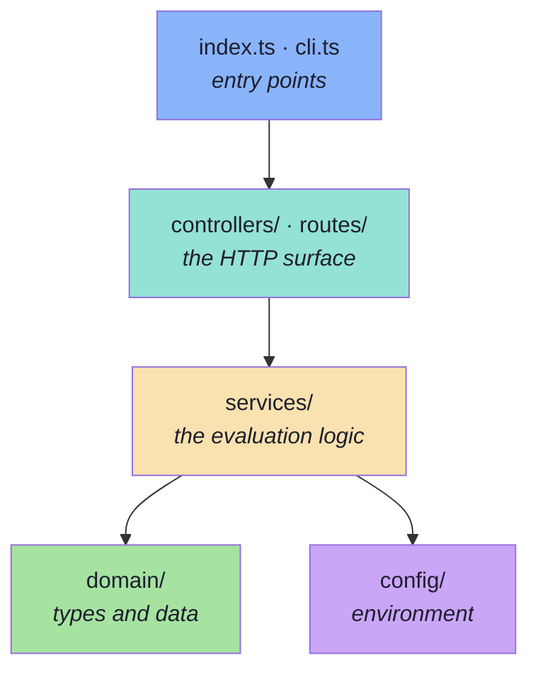

# Chapter 01 — Project Structure and File Map

> **Before a single line of logic:** what is in the project, what each file is *for*, and
> why the folders are named the way they are. Getting this right first is what makes the
> remaining nine chapters readable — every later chapter is "here is one file, and here is
> why it is shaped like that".

---

## Project details

| | |
| :--- | :--- |
| **Project** | `Lecture 17/code/Basic Code` |
| **Shape** | 13 TypeScript files, ~2,270 lines, one folder per concern |
| **Runtime** | Node ≥ 20, ESM, `tsx` executes TypeScript directly (no build step) |
| **Framework** | Express 5 for the HTTP surface |
| **Runs offline** | yes — the model call is a deterministic stand-in, so every number is reproducible |
| **Implements** | the nine chapters of [`../../notes`](../../notes/README.md) |

---

## Commands

```bash
cd "Lecture 17/code/Basic Code"
npm install
npm run typecheck     # tsc --noEmit — exit 0 before you start
npm run eval          # the offline evaluation, then the release gate
npm start             # the HTTP surface on :8080
```

---

## The tree

```text
Basic Code/
├── .env                            # local config (gitignored; see .env.example)
├── .env.example                    # the same keys, documented by chapter
├── package.json                    # scripts + dependencies
├── package-lock.json               # resolved versions
├── tsconfig.json                   # the compiler rules that make the rest safe
├── README.md                       # what the project is, and the two commands that show it
├── implementations guide/          # ← you are here
└── src/
    ├── index.ts                    # Ch10 — the HTTP entry point
    ├── cli.ts                      # Ch10 — `npm run eval`, and the exit code CI reads
    ├── config/
    │   └── config.ts               # Ch02 — env, thresholds, and the app version
    ├── domain/
    │   ├── types.ts                # Ch02 — the shapes an eval is made of
    │   └── dataset.ts              # Ch03 — the corpus, the fixed dataset, the coverage report
    ├── controllers/
    │   └── evalController.ts       # Ch10 — the HTTP handlers
    ├── routes/
    │   └── index.ts                # Ch10 — the route table
    └── services/
        ├── app.ts                  # Ch04 — the system under test
        ├── deterministic.ts        # Ch05 — code as the judge
        ├── judge.ts                # Ch06 — the judge, the metrics, the rubrics
        ├── retrieval.ts            # Ch07 — retrieval metrics + attribution
        ├── report.ts               # Ch08 — the loop, the report, the gate, pairwise
        └── online.ts               # Ch09 — the online half and the promotion loop
```

---

## What each file is for

| File | Layer | Its one job |
| :--- | :--- | :--- |
| `src/index.ts` | entry | bind a port and say so |
| `src/cli.ts` | entry | run the offline evaluation and exit non-zero when the gate blocks |
| `src/config/config.ts` | config | read the environment; own the thresholds; produce the `appVersion` string |
| `src/domain/types.ts` | domain | the *shapes*: `EvalCase`, `EvalResult`, `EvalReport`, `Check`, `Judge` |
| `src/domain/dataset.ts` | domain | the corpus, the nine cases, the coverage report |
| `src/controllers/evalController.ts` | HTTP | read a query string, call a service, shape the answer |
| `src/routes/index.ts` | HTTP | the route table, and the 404 |
| `src/services/app.ts` | services | the system under test: retrieve → decide → answer, with a trace |
| `src/services/deterministic.ts` | services | the twelve checks that code can decide |
| `src/services/judge.ts` | services | the five metrics, their rubrics, and pairwise preference |
| `src/services/retrieval.ts` | services | hit/recall/precision/MRR, and the attribution classifier |
| `src/services/report.ts` | services | the loop, aggregation, the gate, baseline diff, pairwise |
| `src/services/online.ts` | services | record real interactions; promote failures into candidate tests |

---

## Why the folders are named this way

The dependency direction is the design, and it only goes one way:



Three rules fall out of that picture, and each one buys something concrete:

| Rule | Enforced by | Buys you |
| :--- | :--- | :--- |
| `domain/` imports nothing from `services/` | `types.ts` has no imports at all | the data model can be read in isolation, and it never grows a dependency on how it is computed |
| `services/` never imports Express | no `express` import outside `routes/`, `controllers/` and `index.ts` | the whole evaluation runs with **no HTTP at all** — which is exactly what `npm run eval` does |
| `controllers/` contain no evaluation logic | each handler is a query read, a service call, a `response.json` | the same logic is reachable from two surfaces (CLI and HTTP) without being written twice |

That third rule is the one worth dwelling on. Chapter 09 §9.1 says the offline run is the
one that **gates the release** — so if the gate lived in an HTTP handler, CI would have to
start a server to evaluate a commit. It does not, and `cli.ts` is the proof.

---

## `package.json`

```json
{
  "name": "lecture-17-genai-evals-and-testing",
  "version": "1.0.0",
  "private": true,
  "description": "Lecture 17 — GenAI Evals & Testing. The minimal, runnable code behind the notes: a fixed evaluation dataset, deterministic checks, an LLM-as-a-judge with rubrics, pointwise and pairwise scoring, RAG retrieval and response evaluation with failure attribution, and the offline/online loop that turns production failures into regression tests.",
  "type": "module",
  "engines": {
    "node": ">=20.0.0"
  },
  "scripts": {
    "start": "tsx src/index.ts",
    "dev": "tsx watch src/index.ts",
    "eval": "tsx src/cli.ts",
    "typecheck": "tsc --noEmit"
  },
  "keywords": [
    "fde",
    "evals",
    "evaluation",
    "llm-as-a-judge",
    "rubrics",
    "rag-evaluation",
    "regression-testing",
    "typescript"
  ],
  "author": "Forward Deployed Engineering Team",
  "license": "MIT",
  "dependencies": {
    "dotenv": "^16.4.7",
    "express": "^5.3.0",
    "openai": "^6.0.0"
  },
  "devDependencies": {
    "@types/express": "^5.0.0",
    "@types/node": "^22.13.8",
    "tsx": "^4.23.15",
    "typescript": "^5.9.3"
  }
}
```

### Block-by-block

**`"type": "module"`.** The project is ESM. This is not cosmetic: with
`"module": "NodeNext"` in `tsconfig.json` it forces every relative import to carry a `.js`
extension (`./services/app.js`) even though the source file is `app.ts`. That looks wrong
the first time and is correct — it is how TypeScript types a Node ESM import. Forget one
and `npm run typecheck` fails with "cannot find module", which is the good outcome.

**`"engines": { "node": ">=20.0.0" }`.** Node 20 is where `fetch`, `AbortSignal.timeout`
and the `openai` SDK's defaults are dependable. It is a statement, not an enforcement —
npm only warns.

**The four scripts.**

| Script | Command | What it is for |
| :--- | :--- | :--- |
| `npm start` | `tsx src/index.ts` | the HTTP surface on `:8080` — the app under test and the eval API |
| `npm run dev` | `tsx watch src/index.ts` | the same, restarting on change |
| `npm run eval` | `tsx src/cli.ts` | **the offline evaluation and the release gate.** Exits non-zero when blocked, which is what makes it a test rather than a dashboard |
| `npm run typecheck` | `tsc --noEmit` | types only. Run it after every chapter |

**The dependency set.** Three runtime dependencies, and each is load-bearing:

| Package | Role | Where it appears |
| :--- | :--- | :--- |
| `express` | the HTTP surface | `routes/`, `controllers/`, `index.ts` |
| `dotenv` | loads `.env` | `config/config.ts` only |
| `openai` | **the judge**, when a key is present | `services/judge.ts` only, via dynamic `import()` |

Note what is *absent*: no test runner, no linter, no build step, and **no evaluation
library**. The whole point of the lecture is that evaluation is something you write, not
something you install — and a framework would hide the twelve checks, the rubric and the
attribution classifier, which are the things worth reading.

**Why `openai` is a runtime dependency even though the project runs offline.** Because
`services/judge.ts` imports it *dynamically*, inside the branch that runs only when
`OPENAI_API_KEY` is set. `npm install` installs it; the process never loads it without a
key. That is what lets `npm run eval` work on a machine with no credentials while still
being the real code path.

---

## `tsconfig.json`

```json
{
  "compilerOptions": {
    "target": "ES2022",
    "module": "NodeNext",
    "moduleResolution": "NodeNext",
    "lib": ["ES2022"],
    "outDir": "./dist",
    "rootDir": "./src",
    "strict": true,
    "esModuleInterop": true,
    "skipLibCheck": true,
    "forceConsistentCasingInFileNames": true,
    "declaration": true,
    "sourceMap": true,
    "resolveJsonModule": true
  },
  "include": ["src/**/*"],
  "exclude": ["node_modules", "dist"]
}
```

### Block-by-block

**`"target": "ES2022"`, `"lib": ["ES2022"]`.** Node 20+ runs ES2022 natively, so nothing is
down-levelled and nothing is polyfilled. `lib` is set explicitly rather than left to include
the DOM: if `fetch` or `AbortSignal` is available it is because Node provides it, and a file
that accidentally relies on a browser global fails at typecheck instead of at runtime.

**`"module": "NodeNext"`, `"moduleResolution": "NodeNext"`.** The strictest correct pairing
for ESM on Node. It is what makes the `.js` extensions on relative imports mandatory, and
it is why this project's imports look the way they do.

**`"strict": true`.** Worth calling out in *this* project specifically, because strictness
and evaluation have the same purpose: both turn a silent wrong answer into a loud failure.
A `strict` codebase is one where the compiler refuses to let you forget a case — which is
the same instinct as `mustNotClaim: ["restocking fee"]`.

**`outDir` / `declaration` / `sourceMap` are set, but the project never builds.** `tsx` runs
the TypeScript directly. They are there so `tsc --noEmit` and a hypothetical `tsc` build
agree on one configuration rather than two.

---

## `.env.example`

```text
# Lecture 17 — GenAI Evals & Testing
# Copy to `.env` and adjust if needed.

# Chapter 02 — the HTTP surface: the application under test, and the eval API.
PORT=8080
HOST=127.0.0.1

# Chapter 08 §8.2 — the retrieval lever the lecture keeps coming back to.
# `npm run eval -- --topk=1` reproduces the "topK 5 -> 3" regression from Chapter 01.
RETRIEVAL_TOPK=3

# Chapter 04 §4.8 / Chapter 09 §9.1 — the release gate, made explicit and reviewable.
# The build is blocked if any case regressed, or if the pass rate drops below this.
EVAL_MIN_PASS_RATE=0.95

# Chapter 07 §7.4 — the pointwise threshold: "faithfulness >= 4.2 -> ship".
EVAL_MIN_FAITHFULNESS=4.2

# Chapter 06 — the judge. Leave OPENAI_API_KEY empty and the judge still runs:
# it falls back to a rubric-anchored stand-in, so every score in this project is
# reproducible with no API key. With a key, the same rubric is sent to the model.
OPENAI_API_KEY=
OPENAI_MODEL=gpt-4o-mini
```

### Block-by-block

Every value here is a **lever on what is being measured**, which is why they are
environment variables rather than constants. Chapter 02 §2.8 records the configuration in
`appVersion`, so changing one changes the identity of the run — and two runs with different
identities are not comparable.

| Key | Notes section | What it controls |
| :--- | :--- | :--- |
| `PORT` / `HOST` | Ch02 | the HTTP surface |
| `RETRIEVAL_TOPK` | Ch08 §8.2 | **the lever the regression demo pulls.** `npm run eval -- --topk=1` reproduces Chapter 01's "topK 5 → 3" story |
| `EVAL_MIN_PASS_RATE` | Ch04 §4.8 | the deterministic gate threshold |
| `EVAL_MIN_FAITHFULNESS` | Ch07 §7.4 | the pointwise gate threshold ("faithfulness ≥ 4.2 → ship") |
| `OPENAI_API_KEY` | Ch06 | empty means the judge runs as a rubric-anchored stand-in |
| `OPENAI_MODEL` | Ch06 | which model judges, when a key is present |

**Leaving `OPENAI_API_KEY` empty is the default, and that is deliberate.** Every number
quoted in this guide was produced with no key, so you can reproduce all of them — which is
Chapter 09 §9.1's "controlled and reproducible" requirement, satisfied by construction
rather than by discipline.

---

## Checkpoint

1. **Why does `services/` not import Express?**
   Because the offline evaluation must run with no HTTP at all — `npm run eval` gates a
   commit in CI without starting a server. If the loop lived in a controller, CI would have
   to boot the app to test it.

2. **Why is there no evaluation library in `package.json`?**
   The lecture's subject is the mechanism: the check catalogue, the rubric, the attribution
   classifier. A framework would hide exactly the parts the notes ask you to understand.

3. **Why does `openai` appear as a dependency in a project that runs offline?**
   It is imported dynamically inside the branch that only runs with a key, so the process
   never loads it offline while the real code path stays identical.

4. **What makes two runs comparable?**
   `appVersion` — a description of the configuration (`topK`, model, prompt version). Change
   a threshold or a `topK` and you have changed what is being measured.

---

**[Chapter 02: Config and the Eval Data Model →](./02_Config_And_The_Eval_Data_Model.md)**
