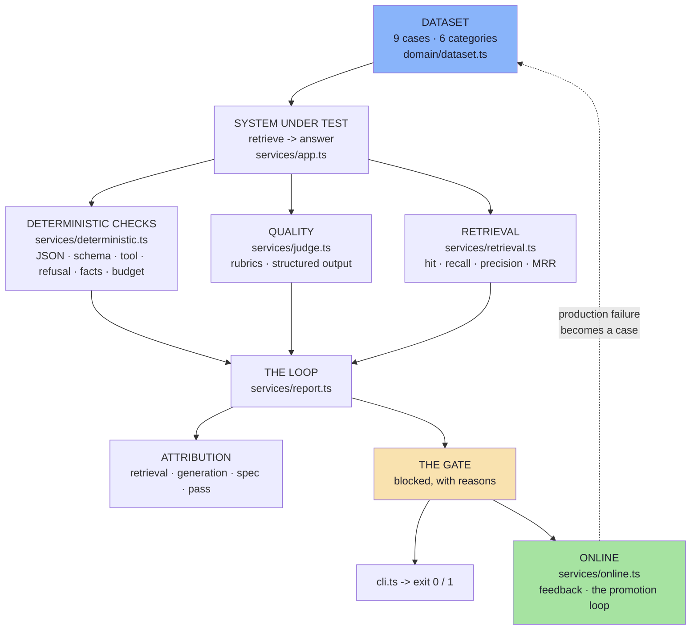

# Lecture 17 — Basic Code · Step-by-Step Implementation Guide

> **What this is.** Ten chapters that walk the whole project in order, one source file
> (or one tight group) per chapter: **file details → commands → the full file → a
> block-by-block explanation of what it does and why it is written that way.**
>
> Read it top to bottom and you will have read every line of the project, in the order it
> makes sense to read it. Every code block is the real file — the listings are not
> abridged.

---

## What the project is

One small AI application — a support chatbot with a retriever — plus the evaluation
system that tells you whether it still works.



The dashed arrow is Chapter 09's whole point: **production failures become future
regression tests**, and that is what turns the diagram into a loop rather than a line.

---

## How to read a chapter

Every chapter has the same five parts:

| Part | What it gives you |
|---|---|
| **File details** | the file, its layer, what it exports, which notes section it implements |
| **Commands** | how to see it working, and what to look for |
| **The full file** | the complete source, verbatim |
| **Block-by-block** | why each block is written that way — the design decisions, not the syntax |
| **Checkpoint** | questions you should be able to answer before moving on |

---

## Commands you will use throughout

```bash
cd "Lecture 17/code/Basic Code"
npm install
npm run typecheck     # tsc --noEmit — must exit 0 before you start
```

```bash
npm run eval                                      # the offline evaluation + the gate
npm run eval -- --topk=1 --baseline=3 --pairwise   # reproduce the regression
npm start                                         # the HTTP surface, on :8080
```

Runtime used for every output quoted in this guide:

```text
Node v24.22.0 · tsx 4.23.15 · tsc 5.9.3
express 5.3.0 · openai 6.49.0 · dotenv 16.6.1
```

---

## Chapter index

| # | Chapter | Source |
|---|---|---|
| [01](./01_Project_Structure_and_File_Map.md) | Project Structure and File Map | the whole tree, and why it is shaped that way |
| [02](./02_Config_And_The_Eval_Data_Model.md) | Config and the Eval Data Model | `config/config.ts`, `domain/types.ts` |
| [03](./03_The_Dataset.md) | The Dataset and the Corpus | `domain/dataset.ts` |
| [04](./04_The_System_Under_Test.md) | The System Under Test | `services/app.ts` |
| [05](./05_Deterministic_Evaluation.md) | Deterministic Evaluation — Code as the Judge | `services/deterministic.ts` |
| [06](./06_LLM_As_A_Judge_And_Rubrics.md) | LLM-as-a-Judge, Metrics and Rubrics | `services/judge.ts` |
| [07](./07_Retrieval_Metrics_And_Attribution.md) | Retrieval Metrics and Attribution | `services/retrieval.ts` |
| [08](./08_The_Eval_Loop_Report_And_Gate.md) | The Eval Loop, the Report and the Gate | `services/report.ts` |
| [09](./09_Online_Evaluation_And_The_Loop.md) | Online Evaluation and the Loop | `services/online.ts` |
| [10](./10_The_Surfaces_Controller_Routes_CLI.md) | The Surfaces — Controller, Routes, Entry, CLI | `controllers/`, `routes/`, `index.ts`, `cli.ts` |

---

**Back to:** [Lecture 17 Basic Code README](../README.md) · [Lecture 17 notes](../../notes/README.md)
