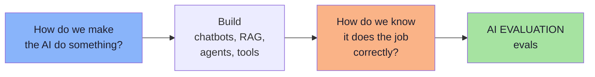
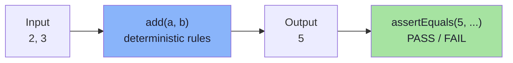
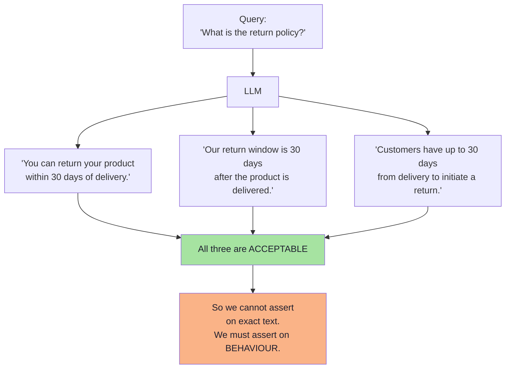
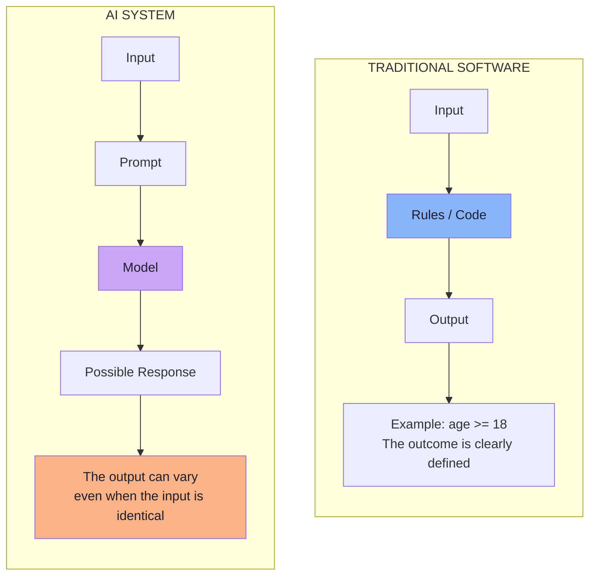
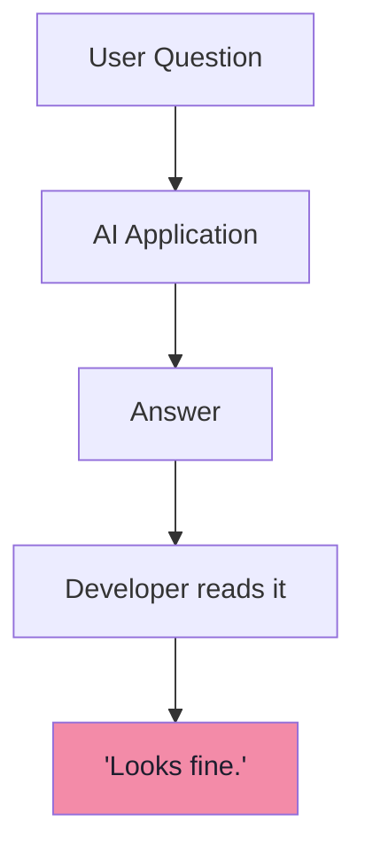
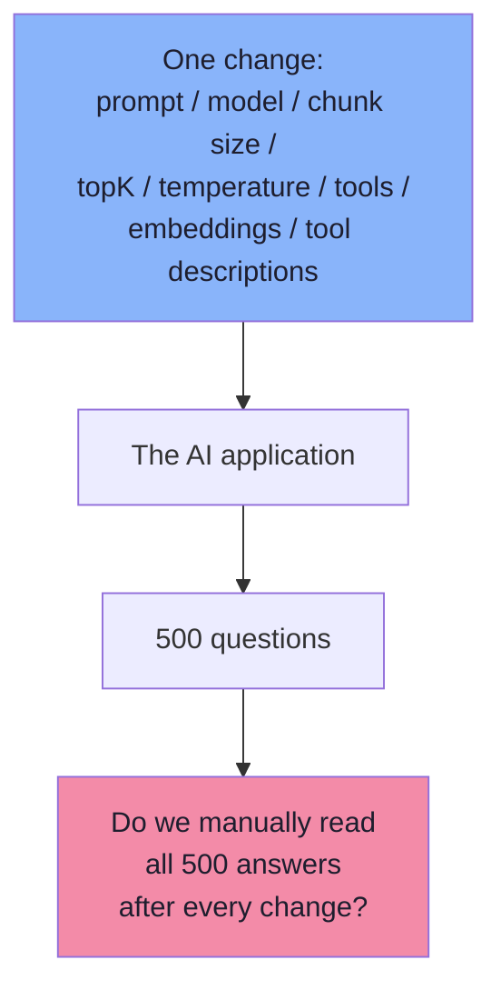
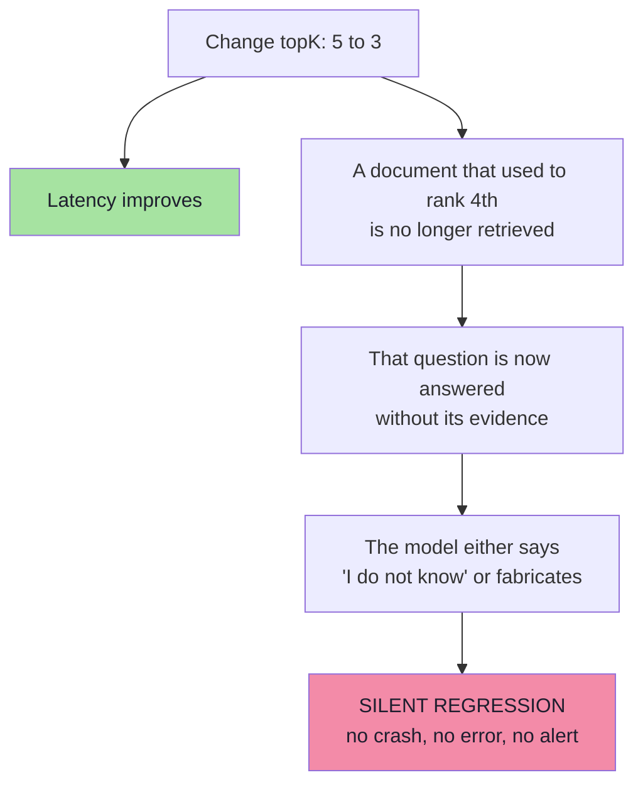

# Chapter 01: Why AI Needs Evals — The Testing Problem

> **Chapter Goal:** Every lecture before this one answered a *capability* question: how do we make the AI do something? Chatbots, RAG, agents, tool calling, structured output, MCP. This chapter introduces the question that every one of those projects eventually hits and almost none can answer: **how do we know the system is doing its job correctly?**
>
> It does that by showing exactly where traditional testing breaks. `assertEquals(5, add(2, 3))` works because software is **deterministic**. An LLM answering *"What is the return policy?"* is not. Once `Expected Output == Actual Output` stops holding, "I read five answers and they looked fine" becomes the only thing standing between you and production — and that is not testing.
>
> At the end of this chapter you should be able to answer: *my prompt change improved latency — how do I know it did not silently break 40 of my 500 questions?*

---

## 1.1 The Question Every Previous Lecture Deferred

Until now, most GenAI development focused on exactly one question:

> **How do we make the AI do something?**

We build:

```text
chatbots
RAG applications
agents
tool-calling systems
structured-output applications
MCP integrations
```

Every one of those is an act of *construction*. But there is a second question that arrives later, usually after the first production incident:

> **How do we know the system is doing its job correctly?**

That question is the subject of this lecture. The discipline that answers it is called **AI evaluation**, or **evals**.



> **Framing for this whole lecture:** evaluation is not a nice-to-have dashboard. It is the **regression-testing layer** of an AI application — the thing that lets you change a prompt on a Tuesday without gambling the product.

---

## 1.2 Traditional Software Is Testable Because It Is Deterministic

Testing normal software is usually straightforward. Suppose we have a function:

```text
int add(int a, int b) {
    return a + b;
}
```

Input:

```text
2, 3
```

Expected output:

```text
5
```

So we simply write:

```text
assertEquals(5, add(2, 3));
```

This works because the behaviour is **deterministic**:

```text
Same Input
   ↓
Same Logic
   ↓
Same Output
```

**Every time.**



The board captures the same idea with a slightly different function:

```text
int sum(int a, int b) {
    return a + b;
}

// Unit test cases  (deterministic)
sum(4, 5)  --->  9
sum(1, 4)  --->  5
```

Two things make this testable, and both are easy to take for granted:

| Property | Why it enables testing |
|---|---|
| **Determinism** | The same input always produces the same output |
| **Exactness** | The output has one canonical, comparable form (`5` — not "about five") |

Traditional testing rests entirely on those two properties. **AI removes both.**

---

## 1.3 Why LLMs Break the `Expected == Actual` Assumption

Suppose a customer asks:

```text
What is the return policy?
```

The knowledge base says:

```text
Products may be returned within 30 days of delivery.
```

The model may answer:

```text
You can return your product within 30 days of delivery.
```

or:

```text
Our return window is 30 days after the product is delivered.
```

or:

```text
Customers have up to 30 days from delivery to initiate a return.
```

**All three answers are acceptable.** This breaks one of the main assumptions of traditional software testing:

```text
Expected Output == Actual Output
```

With generative AI, there may not be **one exact correct sentence**. The board draws this as two different questions asked of the same system:

```text
"Exact Output"                       → Did the model produce
(does the string match?)               exactly the same result?

"Did the model exhibit              → Did the model exhibit
 the result we wanted?"                the behaviour we wanted?
```

The real question becomes:

> **Did the model exhibit the behaviour we wanted?**

That distinction is the foundation of AI evaluation.



> **The single most important sentence in this lecture:** traditional software asks *"does the output equal the expected output?"*; AI engineering asks *"does the system consistently exhibit the behaviour and quality we expect?"*

---

## 1.4 Deterministic Software vs AI Software

The two systems look similar at the edges and are completely different in the middle.



| Dimension | Traditional software | AI system |
|---|---|---|
| Same input, same output? | **Always** | **Not guaranteed** |
| Output form | One exact value | One of many acceptable texts |
| Test assertion | `expected == actual` | *property / behaviour* holds |
| Failure mode | Crash, exception, wrong value | Confident wrong answer, drift, silent regression |
| Source of change | Your code diff | Your code diff **+ prompt + model + data + retrieval** |
| Cost of a test | ~microseconds | Money, latency, tokens |

> **This variability does not automatically mean the system is wrong.** It is a natural property of generative models. It does mean, however, that *your test must be built differently.*

### Where the non-determinism actually comes from *(beyond the lecture)*

It is worth naming the sources, because each one is a place where a change can silently move quality:

| Source | Why the output can differ between runs |
|---|---|
| **Sampling / temperature** | The model samples from a probability distribution instead of always taking the top token |
| **Prompt phrasing & ordering** | Moving a paragraph or renaming a section changes attention over the context |
| **Retrieved context** | Different documents (or the same documents in a different order) reach the prompt |
| **Tool results** | Live APIs return different values, timings and errors |
| **Model version** | The provider updates the model behind the same name |
| **Context length / truncation** | Long conversations get summarised or truncated differently |
| **History shape** | Prior turns, including a stale summary, influence the next answer |

This is exactly why the answer is **not** "test harder". It is "measure behaviour, repeatedly, against a fixed benchmark".

---

## 1.5 The "Looks Good to Me" Anti-Pattern

During early development, we often test an AI application like this:

```text
User Question
   ↓
AI Application
   ↓
Answer
   ↓
Developer reads it
   ↓
"Looks fine."
```



For five questions, this may be acceptable. **Now imagine 500 test questions.**

And now suppose we change any one of the following — the board lists exactly this surface:

```text
1. System prompt
2. Switch the model
3. Chunk size
4. Number of retrieved documents (topK)
5. Temperature
6. Add a tool / remove a tool
7. Chunk overlap
8. Metadata filtering
9. Agent instructions
10. Embedding model
11. Tool descriptions
```



**Would we manually read all 500 answers after every change?** That does not scale — and worse, it does not even work at 5 questions, because a human reading an answer cannot reliably remember what the previous version said.

> **Core principle:** *"Looks good to me"* is an opinion, not a measurement. It has no baseline, no repeatability and no diff. The moment you change a prompt twice, you have lost the ability to compare.

The board compresses the scaling problem into one line:

```text
5 queries  --->  500 queries
```

---

## 1.6 AI Applications Can Have Regression Bugs

Suppose a RAG application uses:

```text
topK = 5
```

We change it to:

```text
topK = 3
```

Maybe latency improves. We manually test three questions and everything looks fine.

But some question may depend on a document that previously ranked **fourth**:

```text
Required document rank = 4
topK = 3
```

The document is **never retrieved**. The application now fails for that question — and nothing crashed, no exception was thrown, no log line was written.



This is essentially an **AI regression bug**: the system still "works", it just works *worse* for a subset of inputs that nobody happened to test.

So the engineering problem is larger than:

```text
"LLMs sometimes hallucinate."
```

The real problem is:

> **How can we systematically measure the behaviour of a probabilistic application?**

That is the question evals exist to answer.

| What people say | What the real problem is |
|---|---|
| "LLMs hallucinate." | We cannot say *which* inputs hallucinate, or whether it got better or worse |
| "The model is dumb." | The retrieval, prompt or chunking may be the failing component |
| "Let us try a better prompt." | Better *according to what measurement?* |
| "It worked in my test." | The test had five cases, no baseline and no thresholds |

---

## 1.7 Why This Is an Engineering Problem, Not a Model Problem

It is tempting to file all of this under "model quality" and wait for the next model release. That is a mistake, for three reasons:

1. **The model is one component of a system.** In a RAG application the answer depends on embedding, vector search, retrieval count, chunking, prompt construction, *and* the model. A regression can come from any of them (Chapter 02 decomposes this; Chapter 08 evaluates it).
2. **Quality is a property of a release, not of a vendor.** Your users experience *your* prompt, *your* retrieval and *your* guardrails. Two teams using the identical model get different quality.
3. **Every change is a release.** Prompt edits, tool descriptions and topK are code changes. If they are not measured, they are unversioned behaviour changes in production.

> **FDE framing:** a customer will eventually ask *"did the new version get better or worse?"* — and the only acceptable answer is a number with a baseline behind it. Chapter 09 turns that into a release gate.

---

## 1.8 What It Costs to Ship Without Evals *(beyond the lecture)*

The lecture's argument is technical, but the consequences are organisational. Without evals:

| Symptom | What is really happening |
|---|---|
| **Shipping fear** | Nobody wants to touch the prompt before a launch week, so quality improvement stalls |
| **Prompt thrash** | Each engineer "improves" the prompt using their own favourite examples; nobody can prove a net gain |
| **No rollback signal** | A model upgrade is announced; you cannot tell whether your application got better or worse |
| **Unattributable incidents** | A customer reports a wrong answer; you cannot reproduce it, so you patch the prompt and hope |
| **Post-mortems without evidence** | The incident review ends with "we should test more" — and then nothing changes |
| **Vendor lock-in by vibes** | A cheaper/faster model is rejected because "it feels worse", with no data either way |
| **Knowledge in one person's head** | Only one engineer can tell you which questions the system gets wrong |

> **Rule of thumb:** if a change to a prompt, model, chunk size or tool description cannot change a *number* in a report, that change is being shipped on trust.

---

## 1.9 The Vocabulary of Evaluation

The rest of this lecture uses these words precisely. Fix them now.

| Term | Meaning |
|---|---|
| **Eval** | A systematic measurement of whether an AI system behaves as intended |
| **Test case** | One input plus the expected behaviour for it |
| **Evaluation dataset** | A fixed, versioned collection of test cases |
| **Golden dataset** | A dataset that *also* carries high-quality reference answers or expected behaviours |
| **Metric** | The property being measured (relevance, correctness, faithfulness, …) |
| **Evaluator / judge** | The mechanism that decides the outcome: code, LLM, or human |
| **Deterministic eval** | Judged by code, with an objective pass/fail |
| **Quality eval** | Judged semantically, by a human or an LLM judge |
| **Score** | A number (1–5, 1–10, 1–100) or a pass/fail produced by an evaluator |
| **Aggregate** | The dataset-level result (e.g. average faithfulness = 4.2 / 5) |
| **Baseline** | The score of the last accepted version, used for comparison |
| **Regression** | A test case that used to pass and now fails |
| **Benchmark** | The dataset plus its thresholds, run repeatedly across versions |

---

## 1.10 Common Mistakes at This Stage

| Mistake | Why it hurts | Correct habit |
|---|---|---|
| Testing by reading a handful of answers | No baseline, no repeatability, no diff | Build a fixed dataset and score it |
| Expecting exact string equality | Fails on three perfectly correct phrasings | Assert on behaviour, not on text |
| Blaming the model for every failure | Retrieval, chunking and prompts fail too | Evaluate the whole system, component by component |
| Treating "the LLM hallucinates" as the problem | It is a symptom, not a measurable defect | Measure *which* cases fail and by how much |
| Changing a prompt with no eval run | Silent regression, discovered by a customer | Every change re-runs the same dataset |
| Testing only easy questions | You learn nothing about the difficult cases | Add edge, out-of-scope and adversarial cases (Chapter 03) |
| Assuming non-determinism makes testing impossible | It makes *exact-output* testing impossible | Measure properties and distributions instead |

---

## 1.11 Chapter Summary

| Idea | Statement |
|---|---|
| The deferred question | *How do we know the system is doing its job correctly?* |
| Why normal testing works | Software is **deterministic** and **exact**: same input → same output |
| Why AI breaks it | Many answers can be correct; `Expected Output == Actual Output` fails |
| The replacement question | *Did the model exhibit the behaviour we wanted?* |
| The anti-pattern | "Looks good to me" — an opinion with no baseline |
| The scaling wall | 5 queries → 500 queries after every prompt/model/retrieval change |
| The regression risk | `topK 5 → 3` silently drops a document that ranked #4 |
| The real problem | *How can we systematically measure the behaviour of a probabilistic application?* |
| Where quality lives | In the whole system — prompt, retrieval, tools and model |
| What evals are | The regression-testing layer of an AI application |

> **Final mental model:** traditional software engineering asks *"does the code produce the expected result?"* AI engineering asks *"does the system consistently exhibit the behaviour and quality we expect?"* Everything in the rest of this lecture is the machinery that makes the second question answerable — with a number.

---

## Where This Goes Next

- **[Chapter 02](./02_Anatomy_Of_An_Eval.md)** — the anatomy of an eval: test input, expected behaviour, evaluation mechanism, and why we evaluate the whole system.
- **[Chapter 03](./03_Evaluation_Datasets_And_Golden_Data.md)** — the dataset that makes comparison possible at all.
- **[Chapter 04](./04_Deterministic_Evaluation.md)** — the half of evaluation that ordinary code can do.
- Cross-lecture: [Lecture 12](../../Lecture%2012/notes/README.md) (chunking, hybrid retrieval, reranking — the levers that cause these regressions), [Lecture 04](../../Lecture%2004/notes/README.md) (hallucination and context), [Lecture 05](../../Lecture%2005/notes/README.md) (agents and their failure modes).

---

**Back to:** [Lecture 17 — Chapter Index](./README.md) · [Complete Consolidated Notes](./Lecture_17_Complete_Notes.md)


