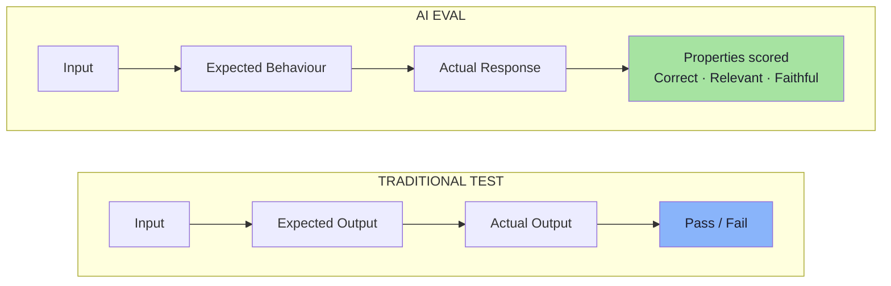
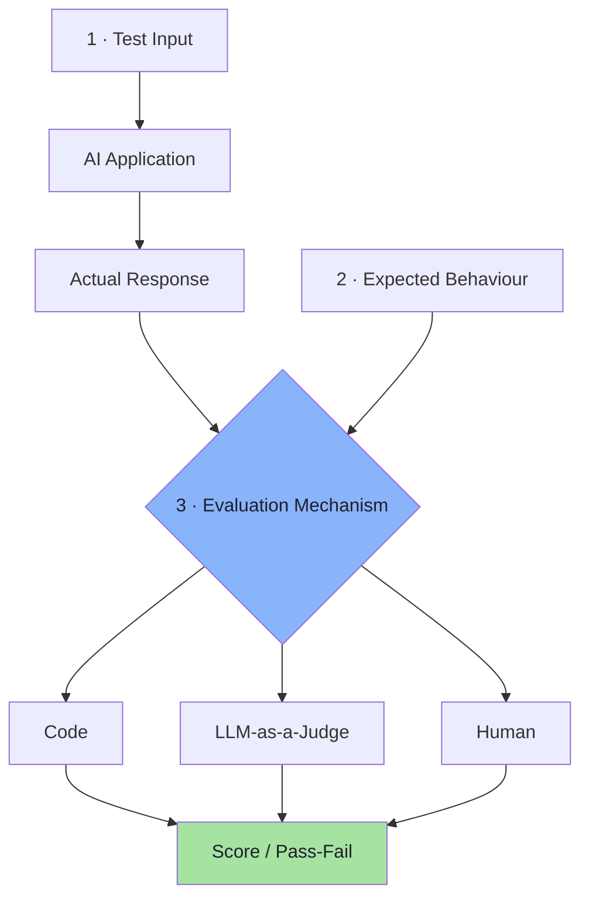
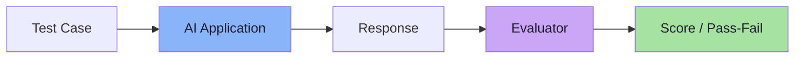
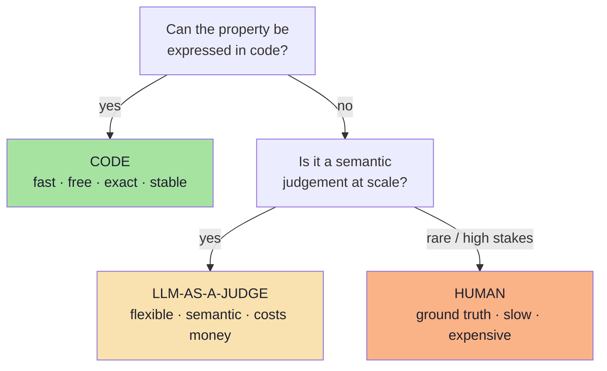
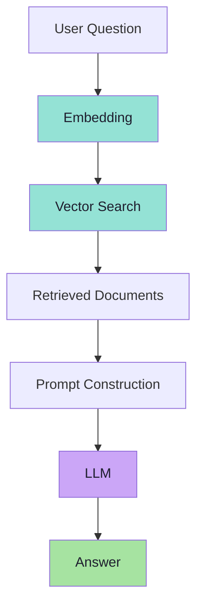
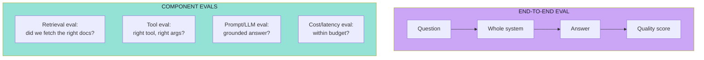

# Chapter 02: Anatomy of an Eval — Three Ingredients and One System

> **Chapter Goal:** Chapter 01 established that we cannot assert on exact text and must measure behaviour instead. This chapter builds the object that does the measuring. An eval looks simple — a test case goes in, a score comes out — but it has exactly **three ingredients** (test input, expected behaviour, evaluation mechanism) and one hard rule: **the thing being evaluated is the whole AI system, not the model.** Confusing those two is the most common cause of a useless eval suite.
>
> At the end of this chapter you should be able to answer: *given a failing answer in production, which of my six pipeline stages actually failed — and which evaluator should have caught it?*

---

## 2.1 What an AI Eval Is

> **An AI evaluation, or eval, is a systematic way of measuring whether an AI system behaves the way we want.**

Think of evals as something similar to **unit tests, but broader**. The board defines it the same way:

```text
"An AI evaluation or eval is a systematic way of
 measuring whether an AI system behaves the way we want."
```

The word doing the work is **systematic**. An eval is not "I tried it and it worked". It is a repeatable procedure that produces a comparable result.

---

## 2.2 Traditional Test vs AI Eval, Side by Side

**Traditional test:**

```text
Input            →  add(2, 3)
Expected Output  →  5
Actual Output    →  5
Result           →  PASS
```

**AI eval:**

```text
Input             →  "What is your return policy?"

Expected Behaviour →  Must communicate a 30-day return window.

Actual Response    →  "You may return products within 30 days of delivery."

Evaluation         →  Correct ✅   Relevant ✅   Faithful ✅
```



The important difference:

> **AI evals often measure *properties of an answer*, rather than *exact output text*.**

The board shows the same contrast with a unit test above an eval:

```text
Unit test cases        Input : What is the return policy ?
sum(1, 3) --> 4        Expected Behaviour : Must mention 30-day return window.
                       Actual Response : "You may return product within 30 days"
                       Evaluation : ...
```

---

## 2.3 Every Eval Needs Three Things

The board reduces the whole subject to three boxes:

```text
3 things:
  1. Test Input
  2. Expected Behaviour  -->  (what should be mentioned, proper tool calling, etc.)
  3. Evaluation Mechanism -->  Code ---> LLM-as-a-Judge ---> Human
```

### 1. Test Input

Something we give to the AI application. Example:

```text
Can I return my shoes after 20 days?
```

### 2. Expected Behaviour

What should a good system do? Example:

```text
It should explain that 20 days falls inside the 30-day return window.
```

Depending on the application, "expected behaviour" may take very different forms:

| Application | Expected behaviour means |
|---|---|
| Chatbot | The answer must mention the 30-day window |
| Tool calling | Expected **tool**: `weatherTool` |
| Structured output | Expected **output**: valid JSON matching a schema |
| RAG | Expected **documents** retrieved *and* an answer grounded in them |
| Agent | Expected **tool sequence** with expected arguments |

```text
Expected Tool:     weatherTool
Expected Argument: city = Delhi
Expected Output:   Valid JSON
```

### 3. Evaluation Mechanism

Something must determine whether the behaviour was correct. That evaluator could be:

```text
Code
  or
Human
  or
Another LLM
```



> **Note the asymmetry:** ingredient 1 and 2 are *data you write*; ingredient 3 is *machinery you choose*. Chapter 04 and 06 are entirely about choosing ingredient 3 well, and Chapter 07 is about ingredient 2 done rigorously (rubrics).

---

## 2.4 The Eval Loop Architecture

So the basic architecture becomes:

```text
Test Case
   │
   ▼
AI Application
   │
   ▼
Response
   │
   ▼
Evaluator
   │
   ▼
Score / Pass-Fail
```



Two responsibilities are being kept separate here, and this separation is the whole point:

| Role | Responsibility |
|---|---|
| **The AI application** | Produces the answer |
| **The evaluator** | Judges the answer |

> **Why this matters:** if the same component both produces and judges, you have no independent signal. The evaluator must be able to *disagree* with the application — and in a healthy eval suite, it does so on a measurable fraction of cases.

---

## 2.5 The Evaluator Ladder: Code → LLM → Human

The lecture's ordering is deliberate: **Code → LLM-as-a-Judge → Human**. It is ordered by cost, and you should always take the *cheapest rung that can judge correctly*.



| Evaluator | Strengths | Weaknesses | Use for |
|---|---|---|---|
| **Code** | Deterministic, instant, free, CI-friendly | Cannot judge meaning | JSON validity, tool choice, schema, HTTP status, latency, token cost, output constraints |
| **LLM-as-a-Judge** | Understands semantics, scales, cheap relative to humans | Variable, biased, costs tokens, needs a rubric | Relevance, correctness, faithfulness, helpfulness, tone |
| **Human** | True ground truth for nuance, intent, business fit | Slow, expensive, inconsistent without rubrics | Calibration, high-stakes decisions, ambiguous cases, safety |

> **Rule:** never spend an LLM call to check something a regular expression can check. Chapter 04 makes that a formal principle; Chapter 06 explains where the LLM judge is unavoidable.

---

## 2.6 We Evaluate the Entire AI System

This is the second hard rule of the chapter:

> **We evaluate the AI system, not only the underlying model.**

An AI application is usually much more than one model call. Consider a RAG application:

```text
User Question
   ↓
Embedding
   ↓
Vector Search
   ↓
Retrieved Documents
   ↓
Prompt Construction
   ↓
LLM
   ↓
Answer
```



If the final answer is wrong, **many different things could have failed**:

```text
• Poor embedding
• Wrong documents retrieved
• Correct documents retrieved, but the model ignored them
• Model hallucination
• Poor prompt
```

The board draws the same point as a chain from `Client → LLM → Server` with a `Vector DB` behind the server, labelled **AI Application** — the eval target is the whole box, not the LLM inside it.

| Stage that failed | What the user sees | What an eval must measure |
|---|---|---|
| **Embedding** | Wrong topic retrieved for a normal question | Retrieval relevance metrics (Chapter 08) |
| **Vector search / topK** | The right document exists but never arrives | Recall@k, hit rate |
| **Prompt construction** | Right documents in the prompt, ignored | Faithfulness, instruction-following |
| **Model** | Fabricated details with no support | Hallucination, faithfulness |
| **Guardrail / router** | Refuses a legitimate question | Refusal correctness (both directions) |

> **This distinction becomes especially important for RAG applications and agents**, where the failure may not come from the LLM at all.

---

## 2.7 Component Evals vs End-to-End Evals *(beyond the lecture)*

The lecture makes the point qualitatively; in practice you want **both layers**, and you should know which one you are writing.



| | Component eval | End-to-end eval |
|---|---|---|
| **Question answered** | *Which stage broke?* | *Is the product good?* |
| **Assertion style** | Deterministic where possible | Quality metrics / judge |
| **Cost** | Low (often no LLM judge needed) | Higher (judge calls) |
| **Fails when** | The system is good but a stage is merely suboptimal | A component is fine but the composition is bad |
| **Use in CI** | Every commit | Every release / nightly |

> **Diagnostic rule:** when an end-to-end case fails, *immediately* ask whether the component evals for that case also failed. If retrieval failed and the answer failed, the LLM is innocent. If retrieval passed and the answer failed, the prompt or the model is guilty.

---

## 2.8 What an Eval Record Looks Like *(pseudo-code)*

> **TypeScript-style pseudo-code for a JS/TS environment.** Illustrative only — it describes the *shape* of eval data and results. It is not runnable production code.

```ts
// ---------- The three ingredients, as types ----------
type ExpectedBehaviour = {
  // Ingredient 2 can be ANY of these (often several at once)
  mustMention?: string[];        // facts that must appear
  mustNotClaim?: string[];       // claims that must never appear
  expectedTool?: string;         // tool-calling apps
  expectedArgs?: Record<string, unknown>;
  expectedSchema?: unknown;      // structured output
  expectedDocs?: string[];       // RAG retrieval
  rubric?: string;               // semantic / judged properties
};

type EvalCase = {
  id: string;                    // stable id -> regression tracking
  category: "normal" | "reworded" | "edge" | "out_of_scope"
          | "missing_info" | "adversarial";
  input: string;                 // ingredient 1: test input
  context?: string[];            // RAG: the documents this case must retrieve
  goldenAnswer?: string;         // reference answer, when one exists
  expected: ExpectedBehaviour;   // ingredient 2: expected behaviour
  evaluators: EvaluatorSpec[];   // ingredient 3: how to judge
};

// ---------- The result of one run ----------
type EvalResult = {
  caseId: string;
  appVersion: string;            // which prompt/model/retrieval config
  response: string;              // what the system actually answered
  deterministic: {               // checks code can decide
    name: string;
    passed: boolean;
    detail?: string;
  }[];
  quality?: {                    // checks a judge/human decides
    metric: string;              // "faithfulness" | "relevance" | ...
    score: number;               // e.g. 1..5
    reason?: string;             // why the judge scored it
  }[];
  cost: { tokens: number; ms: number; usd: number };
};

// ---------- The dataset-level report ----------
type EvalReport = {
  appVersion: string;
  cases: number;
  deterministicPassRate: number;          // e.g. 0.97
  averages: Record<string, number>;       // { relevance: 4.6, faithfulness: 4.2 }
  regressions: string[];                  // caseIds that used to pass
  byCategory: Record<string, number>;     // where the failures cluster
};
```

Three design decisions are worth copying into any real implementation:

1. **`id` is stable.** Regression tracking is impossible if case ids are regenerated each run.
2. **`appVersion` is recorded.** A score without a version is not comparable to anything.
3. **Deterministic and quality results are stored separately.** You want to see *which half* moved when a score changes.

---

## 2.9 Common Mistakes at This Stage

| Mistake | Why it hurts | Correct habit |
|---|---|---|
| Writing an eval with no expected behaviour | You end up "judging vibes" | State the behaviour before writing the check |
| Evaluating only the model call | Half the failures live in retrieval or prompts | Evaluate the whole system, with component evals |
| Using an LLM judge for objective facts | Cost, latency and variance for no reason | Use code where code can decide |
| One eval per feature, run once | No baseline, no regression signal | Run the same dataset on every change |
| Expected behaviour phrased as exact text | Breaks on a correct rephrasing | Phrase as facts, constraints or rubric |
| No `appVersion` on results | Cannot compare two runs | Version every run |
| Judging and producing in the same call | The system grades its own homework | Keep the evaluator independent |

---

## 2.10 Chapter Summary

| Idea | Statement |
|---|---|
| Definition | An eval is a systematic way of measuring whether an AI system behaves as we want |
| Relationship to tests | Like unit tests, but broader — properties instead of exact values |
| Ingredient 1 | **Test input** — what we give the application |
| Ingredient 2 | **Expected behaviour** — facts, tool, schema, docs or rubric |
| Ingredient 3 | **Evaluation mechanism** — Code → LLM-as-a-Judge → Human |
| The loop | Test case → application → response → evaluator → score / pass-fail |
| The hard rule | We evaluate the **whole AI system**, not just the model |
| Failure attribution | Poor embedding · wrong docs · ignored docs · hallucination · poor prompt |
| Two layers | Component evals (which stage broke) + end-to-end evals (is it good) |
| Record design | Stable ids, recorded app version, separate deterministic vs quality results |

> **Final mental model:** an eval is a *contract* — "for this input, a good system exhibits this behaviour, and here is the mechanism that decides whether it did." If any of the three ingredients is missing, you do not have an eval; you have an opinion with a JSON file attached.

---

## Where This Goes Next

- **[Chapter 03](./03_Evaluation_Datasets_And_Golden_Data.md)** — where the inputs and expected behaviours come from, and how to build a dataset that actually finds bugs.
- **[Chapter 04](./04_Deterministic_Evaluation.md)** — the code rung of the evaluator ladder, in detail.
- **[Chapter 08](./08_RAG_And_System_Level_Evaluation.md)** — system-level decomposition for RAG and agents.
- Cross-lecture: [Lecture 11](../../Lecture%2011/notes/README.md) and [Lecture 12](../../Lecture%2012/notes/README.md) for the RAG pipeline being evaluated, [Lecture 13](../../Lecture%2013/notes/README.md) for the schemas that make deterministic evals possible, [Lecture 05](../../Lecture%2005/notes/README.md) for agent loops.

---

**Back to:** [Lecture 17 — Chapter Index](./README.md) · [Complete Consolidated Notes](./Lecture_17_Complete_Notes.md)


