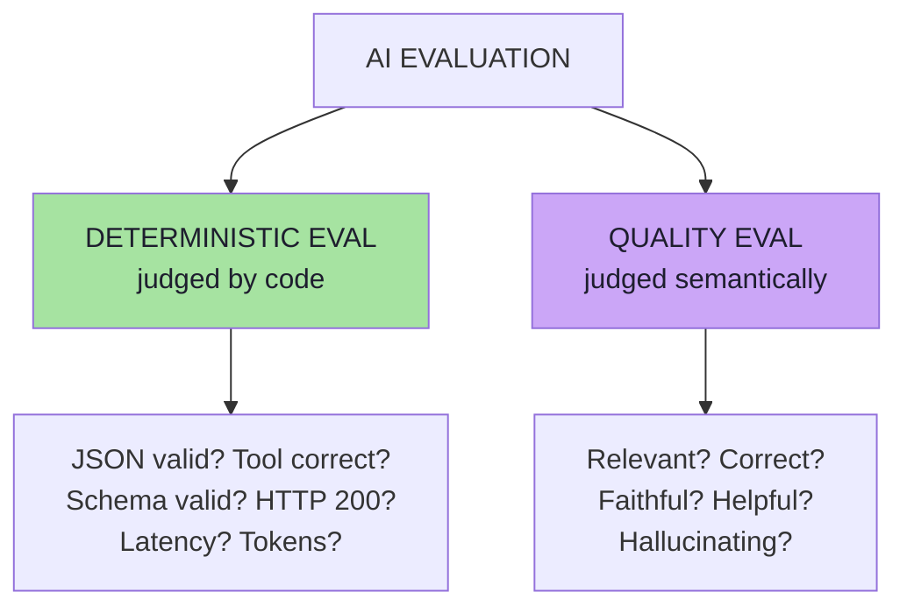
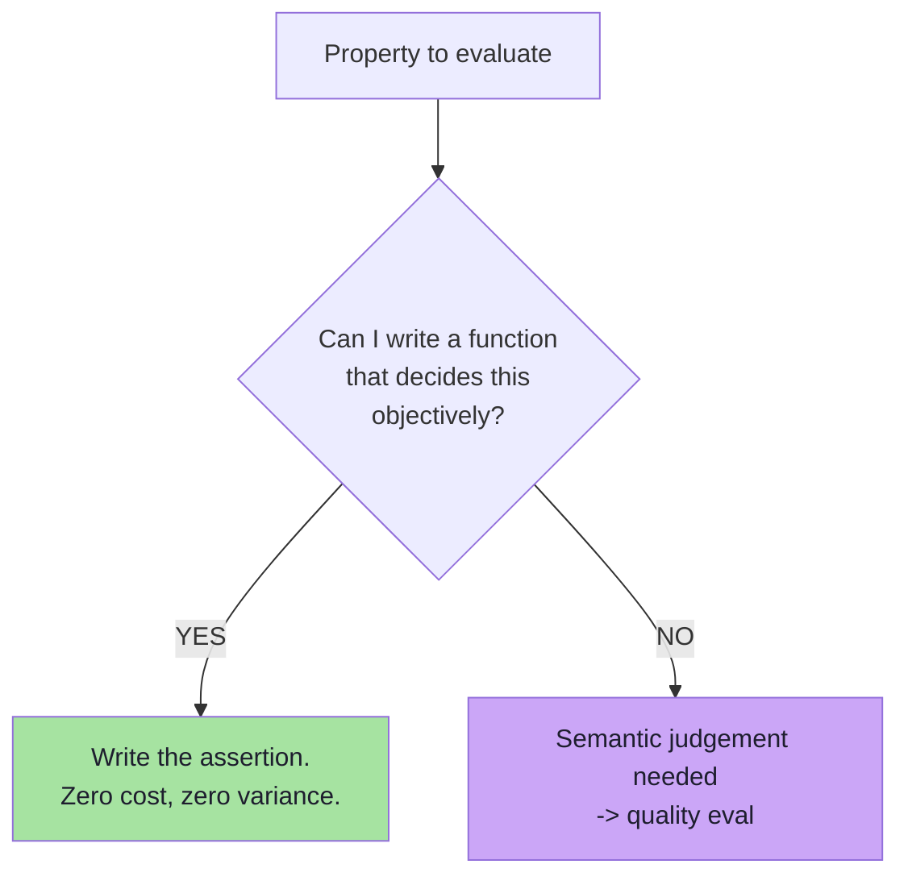
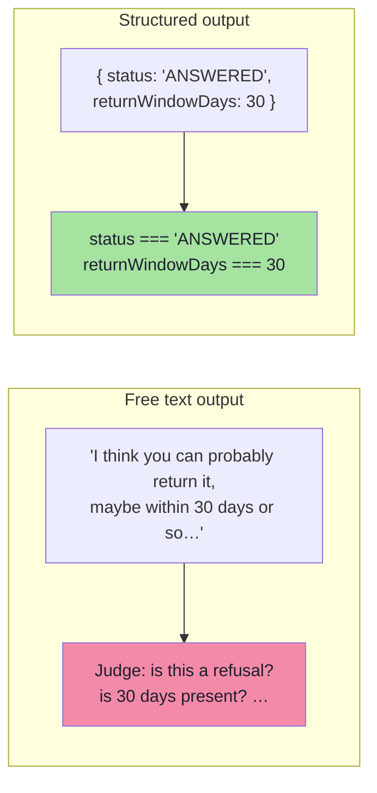
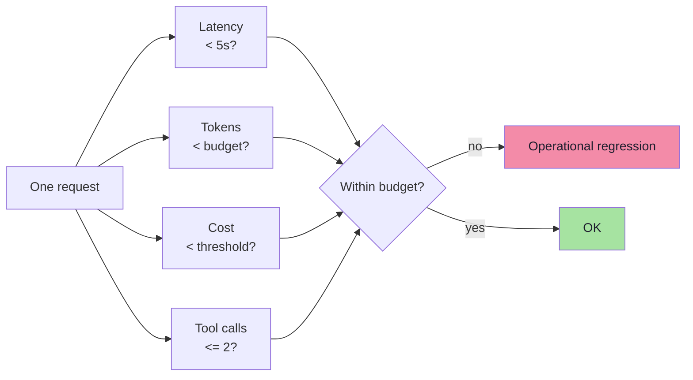
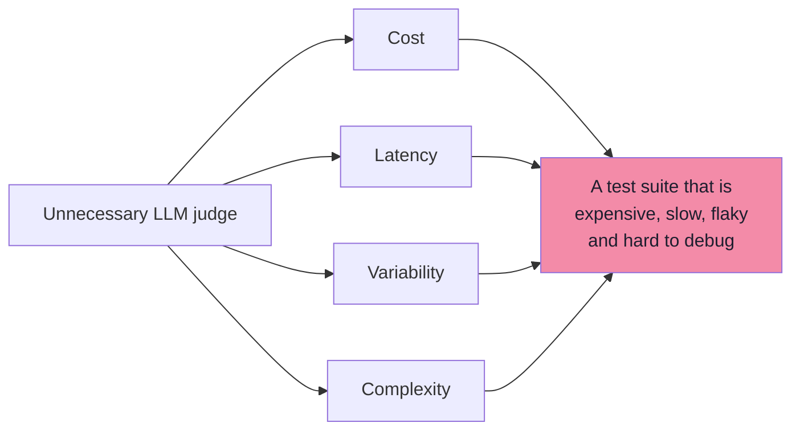

# Chapter 04: Deterministic Evaluation — When Code Is the Judge

> **Chapter Goal:** AI evaluation splits into exactly two families: **deterministic** (a program decides) and **quality-based** (a semantic judge decides). This chapter is the first family, and it is the one teams under-use. The rule is blunt: **if correctness can be expressed clearly in code, use code.** JSON validity, tool selection, schema conformance, refusal status, output constraints, HTTP results, latency and token budgets are all objectively decidable — and paying an LLM to decide them is waste.
>
> At the end of this chapter you should be able to answer: *which of my quality problems are actually just assertions I forgot to write?*

---

## 4.1 Two Broad Types of Evaluation

AI evaluation can broadly be divided into two:

```text
AI Evaluation
      │
   ┌──┴──┐
   │     │
Deterministic Eval    Quality Eval
```



The board labels the same split as **Deteministic Eval → COde** and **Quality Eval / Non Deteministic → LLM-as-a-Judge**, which is the mapping to remember:

| Family | Decided by | Nature of the result | Chapter |
|---|---|---|---|
| **Deterministic eval** | Code | Objective pass / fail (sometimes a number) | This chapter |
| **Quality eval** | LLM judge or human | Semantic score, often 1–5 | [Chapter 05](./05_AI_Quality_Metrics.md), [06](./06_LLM_As_A_Judge.md), [07](./07_Rubrics_Pointwise_Pairwise_And_Human_Evaluation.md) |

---

## 4.2 The Most Important Rule

> **If correctness can be expressed clearly in code, use code.**
>
> **Do not use another LLM for something that normal software can judge perfectly.**



This is not a stylistic preference. A deterministic check is:

| Property | Deterministic check | LLM judge |
|---|---|---|
| Cost per case | ~0 | tokens + latency |
| Variance between runs | none | real (judgement varies) |
| Debuggability | exact failing assertion | "the judge said 3, why?" |
| Runs in CI on every commit | yes | expensive and slow |
| Requires a rubric | no | yes |

> **Rule of thumb:** *use the simplest evaluator capable of judging the behaviour correctly.*

---

## 4.3 The Deterministic Check Catalogue

The lecture walks through a series of concrete examples. Together they form a catalogue you can apply to almost any GenAI application.

### 4.3.1 Valid JSON

Question: *Is the output valid JSON?* The answer is objective — **Valid** or **Invalid**. No LLM judge is required.

```text
parse(output) succeeds?  ->  valid / invalid
```

### 4.3.2 Tool Selection

Suppose the user asks:

```text
What's the weather in Delhi?
```

Expected:

```text
weatherTool
```

We can check directly:

```text
actualTool == weatherTool
```

The board draws the tool server with a `calculator` and a `Weather` tool — and the check is a string comparison on the *name*, plus a comparison on the *arguments*:

```text
expectedArgs.city == actualArgs.city      // "Delhi"
```

### 4.3.3 HTTP Result

```text
statusCode == 200
```

Again, completely deterministic. This covers the transport layer of your own API and of any tool call.

### 4.3.4 Structured Output

Suppose the model must return:

```text
{
  "name": "...",
  "date": "...",
  "time": "..."
}
```

We can test:

```text
Required fields present?
Correct data types?
Schema valid?
```

…using normal code. The board's version is the same idea with two questions stacked:

```text
{ name : "", age : "" }
1. Is JSON valid ?        <- deterministic
2. Is semantics correct ? <- NOT deterministic (quality eval)
```

> **Note the honesty of that second line:** the board deliberately shows that *shape* is deterministic while *meaning* is not. `{"age": "banana"}` is valid JSON; whether the value is right is a different question.

### 4.3.5 Refusal Behaviour

Suppose a customer-support application must reject unsafe or completely unrelated requests. If the application returns structured output:

```text
{ "status": "REFUSED" }
```

then we can test:

```text
status == REFUSED
```

> **This is one reason structured AI architectures are easier to evaluate.** A refusal expressed as an enum is testable; a refusal expressed as "I'm sorry, but I can't help with that" is a judgement call.

### 4.3.6 Output Constraints

Suppose the prompt says:

```text
Return a maximum of 3 recommendations.
```

We can test:

```text
recommendations.size() <= 3
```

**No AI evaluator needed.**

### 4.3.7 Retrieval / Memory Checks

The board adds a deterministic guard for empty retrieval:

```text
list topk

if (topk.size() == 0) {
    return "I dont have memory"
}
```

This is deterministic in two ways: (a) you can assert that the retrieval stage returned at least one document, and (b) you can assert that the *application* produced the fallback message rather than hallucinating.

### 4.3.8 Extending the Catalogue *(beyond the lecture)*

The lecture's examples generalise. Almost every "format contract" you already specify in a prompt is a deterministic check waiting to be written:

| Check | Assertion | Catches |
|---|---|---|
| JSON / XML parses | `parse(output)` succeeds | Format drift, truncation |
| Schema conformance | validator passes (e.g. Zod/JSON Schema) | Missing/extra/mistyped fields |
| Enum membership | `status ∈ {OK, REFUSED, NEEDS_INFO}` | Invented statuses |
| Tool name | `actualTool === expectedTool` | Wrong routing |
| Tool arguments | deep-equal on expected args | Right tool, wrong parameters |
| Tool call count | `calls.length <= 2` | Loops, thrash, cost blowups |
| HTTP status | `res.status === 200` | Transport/tool failures |
| Latency | `ms < 5000` | Slowness regressions |
| Token usage | `tokens < budget` | Cost regressions |
| Cost per request | `usd < threshold` | Margin erosion |
| Must-mention facts | `output.includes("30 days")` | Missing key information |
| Forbidden claims | `!output.includes("restocking fee")` | Known fabrication patterns |
| Refusal status | `status === "REFUSED"` | Policy violations *and* over-refusal |
| Output count limit | `items.length <= 3` | Ignored constraints |
| Citation presence | every claim has a `[doc#id]` | Ungrounded answers |
| Language | detected language === requested | Locale regressions |
| No PII echo | regex/entity scan on output | Data leakage |
| Retrieval non-empty | `retrieved.length > 0` | Silent memory/retrieval failure |
| Expected docs present | `retrieved ∩ expectedDocs ≠ ∅` | Retrieval regressions |
| Determinism/repeatability | same input twice → same classification | Unstable routing |

> **Design habit:** every time you write a constraint in a system prompt ("respond in JSON", "max 3 items", "always cite sources", "refuse off-topic"), write the matching assertion in the same commit. Constraints without assertions are wishes.

---

## 4.4 Structured Output Makes Evaluation Easy

The lecture returns to this point twice, and it is one of the most practical ideas in the whole subject:

> **Structured AI architectures are easier to evaluate.**



The trade is explicit:

| | Free text | Structured output |
|---|---|---|
| Evaluator needed | LLM judge / human | Code (mostly) |
| Cost of evaluation | Per-case tokens | ~0 |
| Failure mode | Ambiguity, hedging | Schema errors (easy to catch) |
| User experience | Natural | Needs rendering |

This is why [Lecture 13](../../Lecture%2013/notes/README.md) (structured outputs) is a prerequisite for cheap, reliable evals: **the schema is simultaneously your API contract and your test suite.**

---

## 4.5 Performance and Operational Evals

**Evaluation is not only about answer quality.** AI applications also have operational requirements. Examples from the lecture:

```text
Response time < 5 seconds
Token usage < threshold
Cost per request < threshold
Tool calls <= 2
```



> **This becomes particularly important with agents.** An agent may eventually produce the correct answer but make **12 unnecessary model calls**. That is still a poor system.

An agent that reaches the right answer in 12 steps is:
- slow for the user,
- expensive for the business,
- more likely to hit a rate limit,
- harder to debug when it fails,
- and more exposed to compounding errors.

**So the operational checks are quality checks.** They are simply expressed in code:

| Metric | Typical gate |
|---|---|
| End-to-end latency | p50 and p95 thresholds (not just the mean) |
| Model calls per request | `<= N` |
| Tool calls per request | `<= N` |
| Total tokens per request | `< budget` |
| Cost per request | `< threshold` |
| Retries / fallbacks used | `<= 1` |

---

## 4.6 Levels of Determinism *(beyond the lecture)*

Not every "code check" is equally strict. Choosing the strictest level that is still *correct* is the craft:

| Level | Assertion style | Example | Risk |
|---|---|---|---|
| **1. Exact match** | `output === expected` | Hash of a generated SQL string | Breaks on any valid variation |
| **2. Normalised match** | trim, case-fold, strip punctuation, sort | `"30 days."` vs `"30 Days"` | Still brittle for prose |
| **3. Containment** | must-include / must-not-include | `includes("30 days")` | Substring false positives |
| **4. Structural** | schema + types + enums | Zod parse of the JSON | Shape right, meaning wrong |
| **5. Set / relation** | membership, subset, ordering | `expectedDocs ⊆ retrieved` | Needs a reference list |
| **6. Threshold** | numeric comparison | `latency < 5000`, `calls <= 2` | Needs a justified number |
| **7. Invariant / property** | always true regardless of content | "every claim has a citation", "no PII", "same input → same route" | Harder to author |

> **Guidance:** prefer level 3–7 over level 1–2 for LLM output. Exact match on generative text is almost always a bug in the test, not in the system.

---

## 4.7 Why Prefer Deterministic Evals?

Using an LLM unnecessarily adds:

```text
cost
latency
variability
complexity
```



So the rule remains:

> **Use the simplest evaluator capable of judging the behaviour correctly.**

| Consequence | Why it matters at scale |
|---|---|
| **Cost** | 300 cases × 2 judge calls × every commit = real money, forever |
| **Latency** | A judge-based suite cannot run in a pre-commit hook |
| **Variability** | A flaky eval destroys trust in the whole report |
| **Complexity** | Judge prompts become another artefact to version and debug |

The right default posture: **deterministic checks everywhere they fit, judge calls only where meaning is genuinely required.**

---

## 4.8 A Deterministic Eval Harness *(pseudo-code)*

> **TypeScript-style pseudo-code for a JS/TS environment.** Illustrative only — it shows the shape of a check runner, not runnable production code.

```ts
type Check = {
  name: string;
  run: (ctx: RunContext) => { passed: boolean; detail?: string };
};

// ---- Individual checks: pure functions over the run's artefacts ----
const checks: Check[] = [
  {
    name: "json-valid",
    run: ({ raw }) => tryParse(raw)
      ? { passed: true }
      : { passed: false, detail: "output is not parseable JSON" },
  },
  {
    name: "schema-valid",
    run: ({ parsed }) => {
      const r = ContractSchema.safeParse(parsed);
      return { passed: r.success, detail: r.success ? undefined : r.error.issues[0].message };
    },
  },
  {
    name: "expected-tool",
    run: ({ calls }, expected) => ({
      passed: calls[0]?.name === expected.expectedTool,
      detail: `expected ${expected.expectedTool}, got ${calls[0]?.name ?? "none"}`,
    }),
  },
  {
    name: "refusal-status",
    run: ({ parsed }, expected) => ({
      passed: parsed?.status === expected.expectedStatus,   // e.g. "REFUSED"
    }),
  },
  {
    name: "output-constraints",
    run: ({ parsed }) => ({
      passed: (parsed?.recommendations?.length ?? 0) <= 3,
      detail: "prompt says: max 3 recommendations",
    }),
  },
  {
    name: "budget",
    run: ({ usage }) => ({
      passed: usage.ms < 5000 && usage.toolCalls <= 2 && usage.usd < 0.02,
      detail: `ms=${usage.ms} calls=${usage.toolCalls} usd=${usage.usd}`,
    }),
  },
];

// ---- The runner: one case -> many pass/fail results ----
function runDeterministic(caseDef: EvalCase, ctx: RunContext): EvalResult["deterministic"] {
  return checks
    .filter((c) => caseDef.evaluators.some((e) => e.kind === "code" && e.checks?.includes(c.name)))
    .map((c) => ({ name: c.name, ...c.run(ctx) }));
}

// ---- The dataset-level gate: fail the build on regressions, not on noise ----
function gate(results: EvalResult[], baseline: EvalReport) {
  const passRate = results.filter((r) => r.deterministic.every((d) => d.passed)).length / results.length;
  const regressions = results.filter((r) => baseline.passedIds.includes(r.caseId)
                                             && r.deterministic.some((d) => !d.passed));
  return {
    passRate,
    blocked: regressions.length > 0 || passRate < 0.95,   // explicit, reviewable thresholds
    regressions: regressions.map((r) => r.caseId),
  };
}
```

Three properties worth copying:

1. **Checks are pure functions over artefacts** (`raw`, `parsed`, `calls`, `usage`) — trivially unit-testable themselves.
2. **Failures carry a `detail`** — the report should say *what* differed, not just that something did.
3. **The gate distinguishes "a case regressed" from "the average dipped"** — a regression list is actionable; a floating average is not.

---

## 4.9 What Deterministic Evals Cannot Judge

Knowing the boundary is as important as knowing the catalogue. Code cannot decide:

| Property | Why code fails | Chapter that covers it |
|---|---|---|
| Relevance | "Does this answer the question?" is semantic | [05](./05_AI_Quality_Metrics.md) |
| Correctness vs a reference | Requires meaning comparison | [05](./05_AI_Quality_Metrics.md) |
| Faithfulness / groundedness | Requires claim-by-claim support checking | [05](./05_AI_Quality_Metrics.md) |
| Helpfulness | Judgement about usefulness and tone | [05](./05_AI_Quality_Metrics.md) |
| Hallucination | Needs to know what is *not* in the context | [05](./05_AI_Quality_Metrics.md) |
| Semantic equivalence of two phrasings | Embedding/judge territory | [06](./06_LLM_As_A_Judge.md) |

And a second, subtler limitation:

> **A passing deterministic check is not evidence of a good answer.** `{"status": "ANSWERED", "returnWindowDays": 30}` can pass every structural check while the *sentence* around it is unhelpful, or the retrieved document was the wrong one. Deterministic checks verify the **contract**, not the **value**.

| Deterministic evals are good at… | …and blind to |
|---|---|
| Shape, format, schema, enums | Whether the content is true |
| Tool/route selection | Whether the tool use was *useful* |
| Constraints and budgets | Whether the answer satisfies the user |
| Regressions in the above | Regressions in tone, nuance, helpfulness |

That is exactly why the next chapters exist.

---

## 4.10 Common Mistakes at This Stage

| Mistake | Why it hurts | Correct habit |
|---|---|---|
| Reaching for an LLM judge first | Cost, latency, flakiness for objective facts | Ask "can code decide this?" before anything else |
| Exact-matching generated prose | Test fails on correct variations | Use containment, structure, invariants |
| Checking JSON validity but not semantics | A valid object with wrong values passes | Add fact checks and quality metrics |
| No operational budgets | Agents get slow and expensive silently | Gate latency, tokens, calls, cost |
| Ignoring the refusal path | Over-refusal and unsafe compliance both ship | Assert `status == REFUSED` *and* its negative |
| Constraints in the prompt with no assertion | The prompt says "max 3", nothing checks it | Every constraint gets a check |
| Flaky deterministic checks | The report stops being trusted | Fix the check or make the field deterministic |
| Gating on an average only | One broken slice disappears into the mean | Report per case and per category |

---

## 4.11 Chapter Summary

| Idea | Statement |
|---|---|
| The split | Deterministic eval (code) vs quality eval (judge/human) |
| The rule | If correctness can be expressed in code, use code |
| Core checks | Valid JSON · tool selection · HTTP result · structured output · refusal status · output constraints |
| Extra checks | Retrieval non-empty, expected docs, citations, PII, language, counts |
| Structured output | Makes evaluation cheap and objective — schema = contract = test |
| Operational evals | Latency, tokens, cost, tool calls — *an agent that needs 12 calls is a poor system* |
| Why prefer code | No cost, no latency, no variance, easy to debug |
| The limit | Code verifies the contract, not the value |
| Levels | Exact → normalised → containment → structural → set → threshold → invariant |
| The gate | Fail on **regressions**, with explicit, reviewable thresholds |

> **Final mental model:** deterministic evaluation is the part of your eval suite you should be *bored* by. It runs in milliseconds, it never argues, and it catches every format, routing, budget and contract regression before a judge is ever invoked. Write it first; the judge handles what remains.

---

## Where This Goes Next

- **[Chapter 05](./05_AI_Quality_Metrics.md)** — the properties code cannot decide, and how to define them.
- **[Chapter 06](./06_LLM_As_A_Judge.md)** — the evaluator you use when semantics matter.
- **[Chapter 07](./07_Rubrics_Pointwise_Pairwise_And_Human_Evaluation.md)** — rubrics, pointwise vs pairwise, and human review.
- Cross-lecture: [Lecture 13](../../Lecture%2013/notes/README.md) (schemas, validation, action), [Lecture 05](../../Lecture%2005/notes/README.md) (tool calling and agent loops), [Lecture 06](../../Lecture%2006/notes/README.md) (streaming, where truncation shows up as invalid JSON).

---

**Back to:** [Lecture 17 — Chapter Index](./README.md) · [Complete Consolidated Notes](./Lecture_17_Complete_Notes.md)


