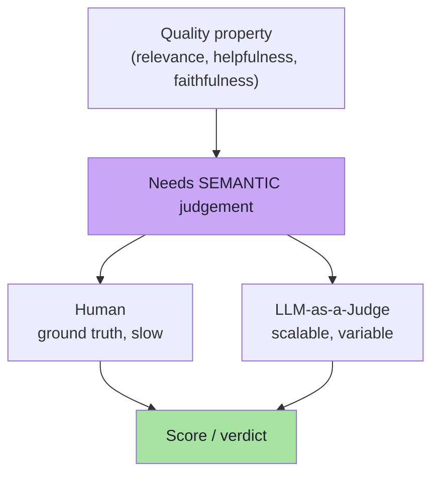
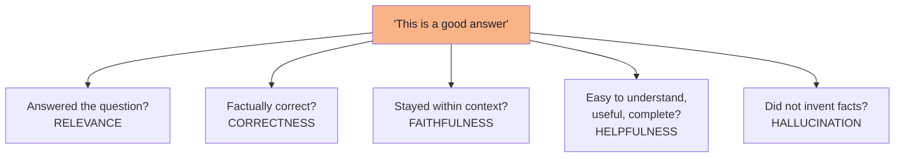
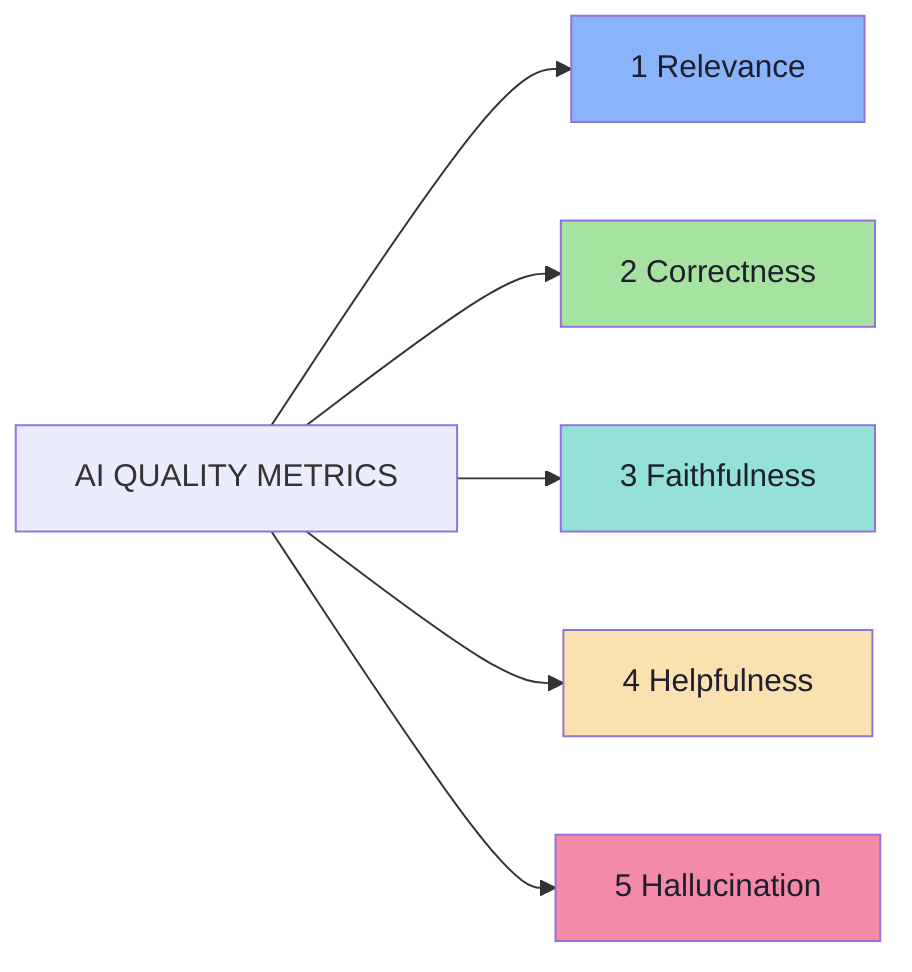
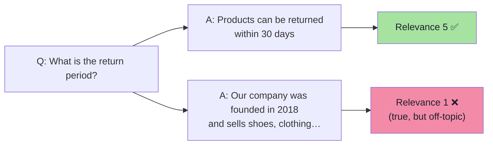
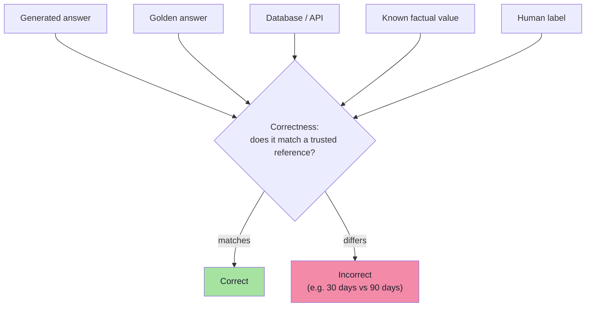
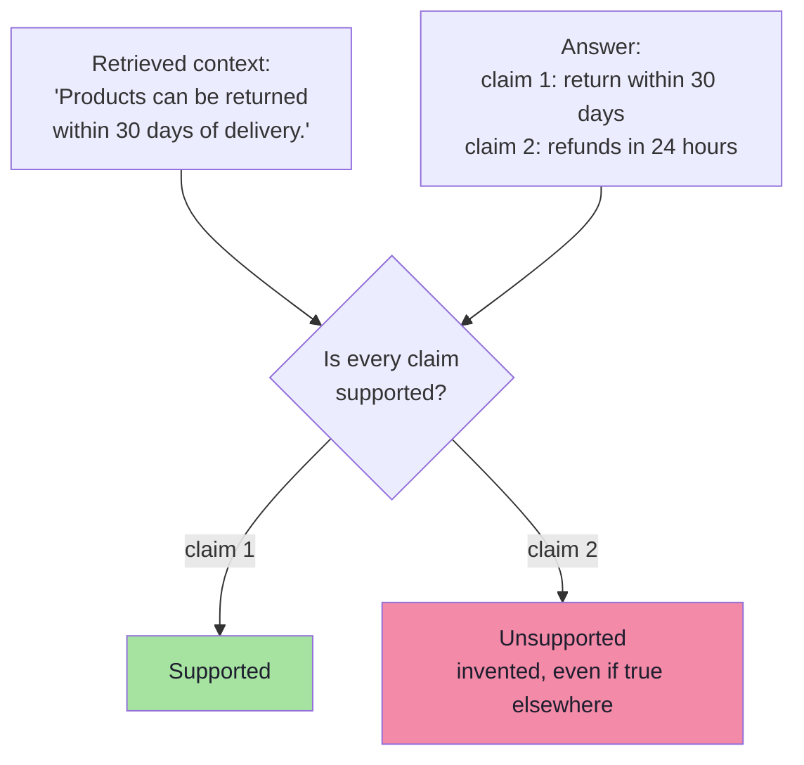
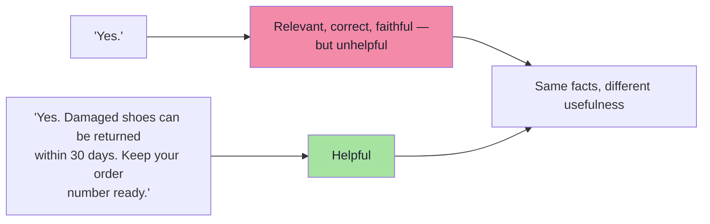
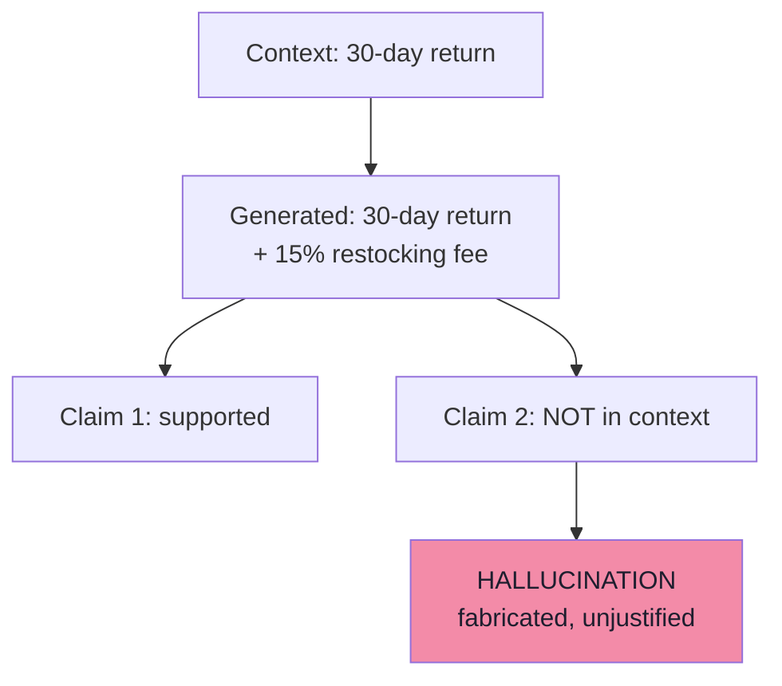
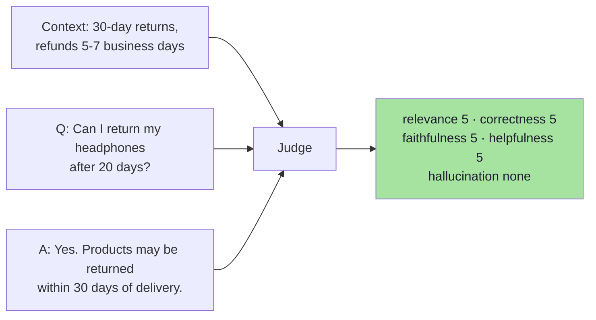
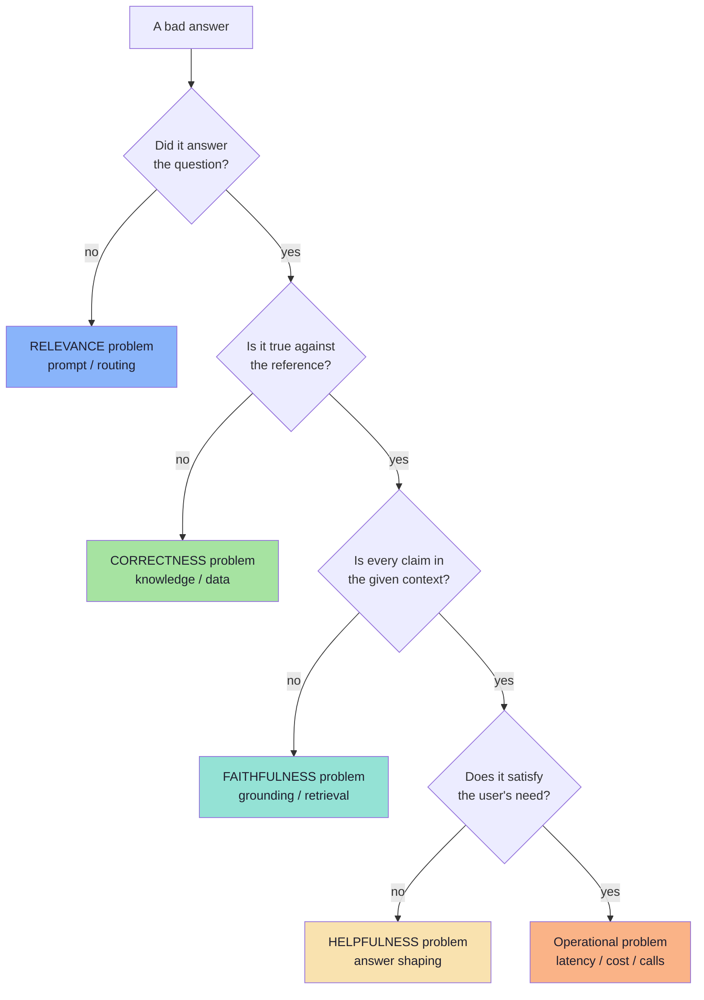

# Chapter 05: AI Quality Metrics — Measuring What Code Cannot

> **Chapter Goal:** Chapter 04 covered everything a program can decide. This chapter covers everything it cannot: **relevance, correctness, faithfulness, helpfulness and hallucination**. It defines each one precisely, shows the lecture's worked examples, and then does the part the lecture leaves implicit — it shows *how the metrics interact*, because the interesting production failures are combinations ("relevant but wrong", "correct but useless", "faithful but incomplete").
>
> At the end of this chapter you should be able to answer: *my answer scored 5/5 on relevance and 2/5 on faithfulness — what exactly went wrong, and what do I change?*

---

## 5.1 Quality-Based Evaluation

Some properties cannot easily be reduced to code. Examples:

```text
Is this answer relevant?
Is this answer helpful?
Is this answer faithful to the context?
```

These require **semantic judgement**. That evaluation may be performed by:

```text
Human
  or
LLM-as-a-Judge
```



> **The rule from Chapter 04 still applies:** code first, judge second. Quality evaluation is what remains after the deterministic checks have taken everything they can.

---

## 5.2 AI Quality Is Not One Thing

When we say:

```text
"This is a good answer."
```

…what exactly does *good* mean? Maybe:

```text
it answered the question
it was factually correct
it did not hallucinate
it was easy to understand
it gave enough useful detail
it stayed within the provided context
```

**These are different properties.** Therefore:

> **AI quality is multidimensional.**

A single value like:

```text
GOOD = true
```

usually does not tell us enough.



| Why this matters | Consequence |
|---|---|
| One boolean cannot drive a fix | "It's bad" tells you nothing to change |
| Different metrics fail for different reasons | Relevance fails in prompts; faithfulness fails in retrieval; helpfulness fails in formatting |
| Metrics trade off against each other | Making answers shorter improves conciseness and hurts helpfulness |
| Different stakeholders own different metrics | Support owns helpfulness, legal owns hallucination |

---

## 5.3 The Five Core Quality Metrics

For most applications, these five metrics provide a strong starting point:

```text
1. Relevance
2. Correctness
3. Faithfulness / Groundedness
4. Helpfulness
5. Hallucination
```



Each metric below answers **one** question, needs **specific inputs** to be judged, and fails in a **characteristic** way.

### 5.3.1 Relevance

> **Did the answer actually address what the user asked?**

Question:

```text
What is the return period?
```

Response:

```text
Products can be returned within 30 days.
```

**Highly relevant.**

Now consider:

```text
Our company was founded in 2018 and sells shoes,
clothing and accessories.
```

This information might be **correct**. But it does **not answer the user's question**. Therefore:

> **Correct Information ≠ Relevant Information**



A simple scoring scale could be:

```text
5 = Directly answers the question
4 = Mostly answers the question
3 = Partially answers the question
2 = Barely related
1 = Irrelevant
```

| What relevance needs as input | Question + generated answer |
|---|---|
| What it does **not** check | Whether the answer is true |
| Typical cause of failure | Prompt drift, wrong retrieved context, over-broad summarisation |
| Board example | `"Return policy is 30 days"` → relevance score 5 |

### 5.3.2 Correctness

> **Is the information actually true according to our reference?**

Relevance alone is not enough. Suppose the real policy says:

```text
Returns are allowed within 30 days.
```

Response:

```text
Products may be returned within 90 days.
```

But:

```text
Products may be returned within 30 days.     ← Correct
Products may be returned within 90 days.     ← highly relevant and completely wrong
```

Correctness therefore asks:

> **Is the information actually true according to our reference?**

The truth may come from:

```text
golden answer
database
known factual value
human-labelled answer
trusted reference data
```

The board draws the same three sources under `Correctness`: **golden dataset, database, known fact**.



| What correctness needs as input | Question + **reference answer** + generated answer |
|---|---|
| What it does **not** check | Whether the answer came from the provided context |
| Typical cause of failure | Stale knowledge, wrong document version, model confusion |
| Why a golden dataset matters | Without a reference, "correct" is undecidable |

> **Subtle but important:** correctness is *relative to a reference*. Two teams can both be "correct" against different references (policy v1 vs policy v2). Always version the reference.

### 5.3.3 Faithfulness / Groundedness

This is especially important in **RAG** applications.

Retrieved context:

```text
Return Policy:
Products can be returned within 30 days of delivery.
```

Generated answer:

```text
Products can be returned within 30 days.
Refunds are processed within 24 hours.
```

The first claim is **supported**. The second claim **was not present in the supplied context**.

Even if it happens to be true somewhere else, a grounded RAG system should **not invent unsupported information**. Faithfulness asks:

> **Are the claims in the response supported by the provided context?**



| What faithfulness needs as input | Question + **retrieved context** + generated answer |
|---|---|
| What it does **not** check | Whether the context itself is correct or current |
| Typical cause of failure | Weak grounding instructions, retrieved context too small, model world-knowledge leakage |
| Board example | Context says 30-day return; response adds "refunds within 24 hours" → unsupported claim |

> **Faithfulness vs correctness — the distinction that matters most:**
> an answer can be **faithful but incorrect** (the retrieved document was outdated), or **correct but unfaithful** (the fact is true, but it is not in the context the model was given). A RAG system is judged on **faithfulness**; a database-backed assistant is judged on **correctness**. Chapter 08 makes this operational.

### 5.3.4 Helpfulness

Question:

```text
Can I return damaged shoes?
```

Response:

```text
Yes.
```

It may be:

```text
Relevant ✅
Correct ✅
Faithful ✅
```

…but it is **not particularly useful**.

A more helpful answer might be:

```text
Yes. Damaged shoes can be returned within 30 days.
Keep your order number available when requesting the return.
```

…assuming those details are supported.

Helpfulness considers things such as:

```text
clarity
enough detail
actionable guidance
appropriate explanation
avoiding unnecessary verbosity
satisfying the user's actual need
```



| What helpfulness needs as input | Question + context/reference + generated answer (+ rubric) |
|---|---|
| What it does **not** check | Whether the extra detail is *true* — that is faithfulness/correctness |
| Typical cause of failure | Over-terse prompts, aggressive conciseness instructions, missing template |
| The tension | Helpfulness pulls toward *more*; conciseness pulls toward *less* |

### 5.3.5 Hallucination

> **Hallucination occurs when the model generates information that is unsupported, fabricated, or unjustified.**

Context:

```text
Products can be returned within 30 days.
```

Generated answer:

```text
Products can be returned within 30 days
and a 15% restocking fee applies.
```

**The restocking fee was invented.** The board's version of this example makes the fabrication even sharper — the context mentions nothing about fees, while the answer invents a *conditional* policy:

```text
Return policy:
User can retuern item within 30 days of delivery.
"If user is non-prime user 15% restocking fee."   ← invented
```



| What hallucination needs as input | Context (+ reference) + generated answer |
|---|---|
| Relationship to faithfulness | Hallucination is the *inverse signal*: faithfulness = "all claims supported"; hallucination = "unsupported claims exist" |
| Why it is listed separately | It is the metric business stakeholders care about most, and it can be reported as a rate |
| Typical cause of failure | No "say I don't know" instruction, over-eager completion, retrieved context missing the fact |

> **Note on scoring:** the board shows hallucination scored like the others (`halucination : 1`), but in practice teams usually report it as **a count/rate** ("3 of 100 answers contained an unsupported claim") *and* keep a severity field. A single hallucination in a medical or financial answer is not equivalent to one in a joke generator.

---

## 5.4 Putting the Metrics Together

The lecture's worked example. Context:

```text
Return Policy:
Products can be returned within 30 days of delivery.
Refunds take 5–7 business days.
```

Question:

```text
Can I return my headphones after 20 days?
```

Response:

```text
Yes. Products may be returned within 30 days of delivery.
```

Evaluation:

```text
Relevance:     High
Correctness:   High
Faithfulness:  High
Helpfulness:   High
Hallucination: None
```



This is what a **clean pass** looks like. Note that all five metrics agree — which is why a real eval suite needs examples where they *disagree*.

---

## 5.5 How the Metrics Interact

The five metrics are not independent. The most useful diagnostic skill in this chapter is recognising **which combination failed**:

| Combination | Example | Diagnosis | Fix |
|---|---|---|---|
| Relevant, incorrect | "Returns within **90** days" | Prompt/knowledge problem, not retrieval | Fix the fact source or add the fact to context |
| Correct, irrelevant | "Founded in 2018, sells shoes…" | Wrong intent handling, over-answering | Tighten the prompt, improve intent routing |
| Correct, unfaithful | True fact not present in the retrieved context | Grounding failure (RAG) | Strengthen "answer only from context" instruction |
| Faithful, incorrect | Context itself is outdated | **Data** problem, not model | Fix the corpus / document version |
| Relevant, correct, faithful, unhelpful | "Yes." | Answer-shaping problem | Add guidance: detail, next steps |
| Faithful, hallucinating | Self-contradiction between claims | Internal inconsistency | Claim-level faithfulness, lower temperature |
| All high, latency terrible | Perfect answer in 14 seconds | Operational failure | Cache, smaller model, pre-compute |



> **This decision tree is the practical payload of the chapter.** Each leaf points at a *different component of the system* — which is exactly why measuring one number ("quality = 3.4") is not actionable, while five numbers are.

---

## 5.6 Beyond the Five Metrics *(beyond the lecture)*

The five metrics are the lecture's "strong starting point". Real applications usually need a few more:

| Metric | Question it answers | Judged by |
|---|---|---|
| **Coherence / fluency** | Is the text well-formed and readable? | Judge |
| **Instruction-following** | Did it obey format, length, tone and constraints? | Code + judge |
| **Tone / brand voice** | Is the register right for this audience? | Judge / human |
| **Completeness / coverage** | Did it cover all parts of a multi-part question? | Judge |
| **Conciseness** | Is it free of padding and repetition? | Judge + length checks |
| **Safety / toxicity / bias** | Is the output harmful, discriminatory or unsafe? | Classifier + human |
| **Refusal correctness (both directions)** | Does it refuse what it should, and answer what it may? | Code + judge |
| **Context precision** | Of the retrieved chunks, how many were relevant? | Code / retrieval metrics |
| **Context recall** | Of the chunks needed, how many were retrieved? | Code / retrieval metrics |
| **Answer similarity** | How close to the reference (embedding, ROUGE/BLEU)? | Code |
| **Calibration / confidence** | Does the stated confidence match the accuracy? | Statistics |
| **Format compliance over turns** | Does the format hold across a conversation? | Code |
| **PII leakage** | Did personal data appear in the output? | Regex / entity scan |

### Which metrics to use, by application type

| Application | Primary metrics | Usually skip |
|---|---|---|
| **Customer-support chatbot** | Relevance, correctness, faithfulness, helpfulness, refusal correctness | Answer similarity |
| **RAG over policy docs** | Faithfulness, correctness, context precision/recall, hallucination rate | Tone |
| **Tool-calling agent** | Tool selection, argument correctness, step efficiency, task success, cost | Fluency |
| **Structured extraction** | Field-level accuracy, schema validity, "not present" correctness | Helpfulness |
| **Summarisation** | Faithfulness, coverage, conciseness | Refusal correctness |
| **Creative / marketing copy** | Tone, brand voice, safety, human preference | Correctness (against a single reference) |

> **Rule:** pick the *smallest* set of metrics that can (a) explain a production failure and (b) be gated in CI. A dashboard with fourteen metrics nobody reads is worse than four metrics with thresholds.

---

## 5.7 Operationalising a Metric *(beyond the lecture)*

A metric is only real when it has four things written down:

1. **A definition** — one sentence, in the form of a question ("Is every factual claim in the answer supported by the provided context?").
2. **An input contract** — exactly what the evaluator receives (question? context? reference? all three?).
3. **A scale with anchors** — e.g. 1–5 with a described behaviour per level (Chapter 07).
4. **A threshold** — the value that fails a release, and whether it is a *floor*, a *ceiling*, or a *trend*.

```ts
// Pseudo-code: a metric is a value object, not a vibe.
type MetricSpec = {
  name: "faithfulness" | "relevance" | "correctness" | "helpfulness" | "hallucination";
  question: string;              // the one-sentence definition
  inputs: ("question" | "context" | "reference" | "answer")[];
  scale: "1-5" | "1-10" | "1-100" | "binary";
  direction: "higher-is-better" | "lower-is-better";
  gate: { type: "floor" | "ceiling" | "trend"; value: number };
  owner: string;                 // who is accountable for this number
};

const faithfulness: MetricSpec = {
  name: "faithfulness",
  question: "Is every factual claim in the answer supported by the provided context?",
  inputs: ["question", "context", "answer"],
  scale: "1-5",
  direction: "higher-is-better",
  gate: { type: "floor", value: 4.2 },      // release blocked below this average
  owner: "ai-platform",
};
```

Scale choices (the board lists the common ones):

```text
1 - 5     ← recommended for judged metrics (fine enough, easy to agree on)
1 - 10    ← more resolution, more disagreement between raters
1 - 100   ← rarely justified; raters cannot distinguish 71 from 74
binary    ← best for gates ("faithful: yes/no") and for human review queues
```

> **Guidance:** use **binary** for gating decisions and **1–5** for trend analysis. Wide numeric scales create false precision and hurt rater agreement.

---

## 5.8 Common Mistakes at This Stage

| Mistake | Why it hurts | Correct habit |
|---|---|---|
| Collapsing quality into one number | "3.4/5" does not tell you what to fix | Report the five metrics separately |
| Confusing relevance with correctness | A confident wrong answer scores high on relevance | Measure both, and diff them |
| Treating faithfulness and correctness as one metric | They diagnose different components | Faithfulness → grounding; correctness → truth source |
| Ignoring helpfulness | Technically correct, practically useless answers ship | Include a helpfulness rubric |
| Using a 1–100 scale | Raters and judges disagree, precision is fake | Use 1–5 or binary |
| Measuring hallucination as an average only | One severe hallucination hides in the mean | Report rate **and** severity |
| No threshold on any metric | The number moves, nothing happens | Every metric has a gate |
| Judging metrics with different input sets | Scores are not comparable between runs | Fix the input contract per metric |
| Optimising one metric in isolation | Conciseness up → helpfulness down | Watch the trade-offs deliberately |

---

## 5.9 Chapter Summary

| Idea | Statement |
|---|---|
| Why quality eval exists | Some properties need semantic judgement, not code |
| Who judges | Human or LLM-as-a-Judge |
| Multidimensional | "Good" decomposes into several independent properties |
| **Relevance** | Did it address what the user asked? (Correct ≠ relevant) |
| **Correctness** | Is it true against a reference (golden, DB, known fact, label)? |
| **Faithfulness** | Is every claim supported by the provided context? |
| **Helpfulness** | Is it clear, detailed enough and actionable? |
| **Hallucination** | Are there unsupported, fabricated or unjustified claims? |
| Inputs matter | Each metric needs a specific input set (question / context / reference / answer) |
| Interaction | The failing *combination* points at the component to fix |
| Scales | 1–5 for trends, binary for gates |
| Beyond the five | Coherence, instruction-following, tone, safety, coverage, context precision/recall, cost |

> **Final mental model:** quality is a *vector*, not a scalar. Relevance tells you whether the system understood the user, correctness whether it knows the facts, faithfulness whether it stayed inside its evidence, helpfulness whether it served the need, and hallucination whether it invented anything. Each coordinate points at a different part of your architecture.

---

## Where This Goes Next

- **[Chapter 06](./06_LLM_As_A_Judge.md)** — how to actually compute these metrics at scale with a second model.
- **[Chapter 07](./07_Rubrics_Pointwise_Pairwise_And_Human_Evaluation.md)** — the rubrics that make the scores consistent, and human evaluation.
- **[Chapter 08](./08_RAG_And_System_Level_Evaluation.md)** — retrieval-side metrics (context precision/recall) in full.
- Cross-lecture: [Lecture 04](../../Lecture%2004/notes/README.md) (hallucination, memory), [Lecture 11](../../Lecture%2011/notes/README.md) (grounding in RAG).

---

**Back to:** [Lecture 17 — Chapter Index](./README.md) · [Complete Consolidated Notes](./Lecture_17_Complete_Notes.md)


