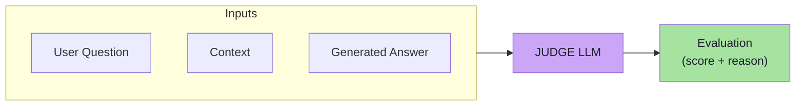
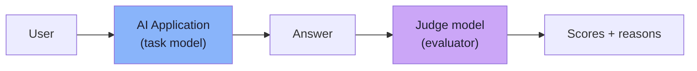
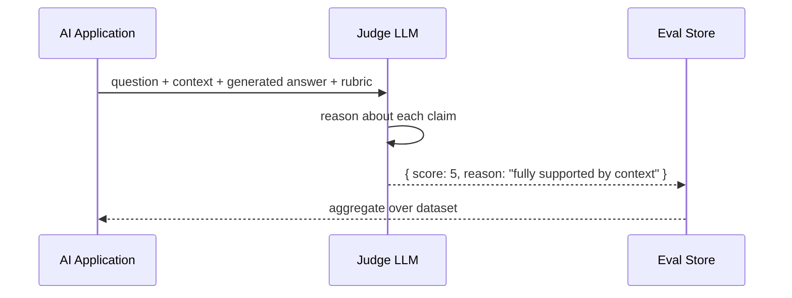
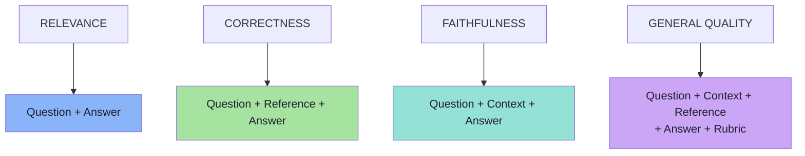
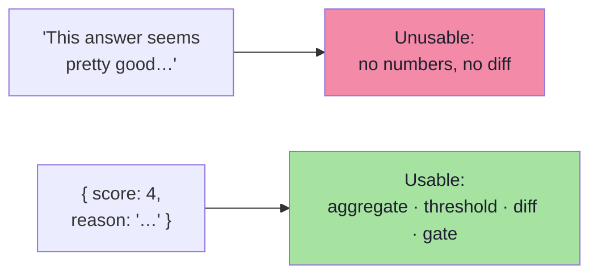
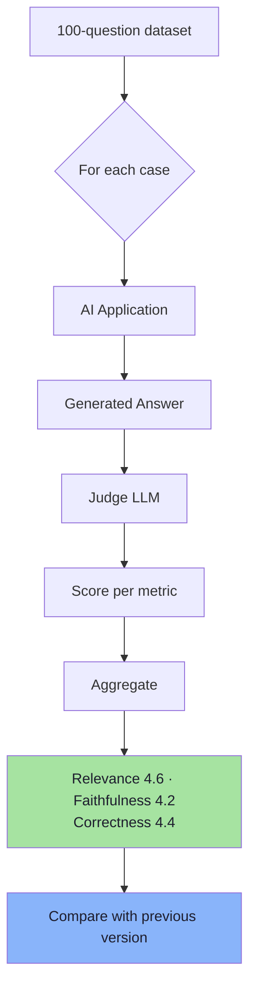
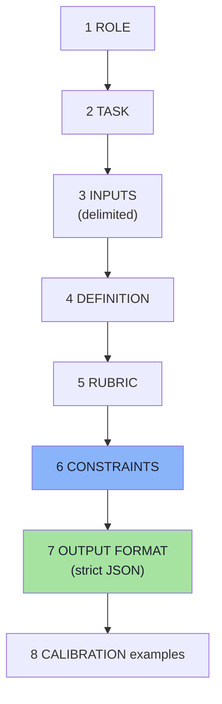
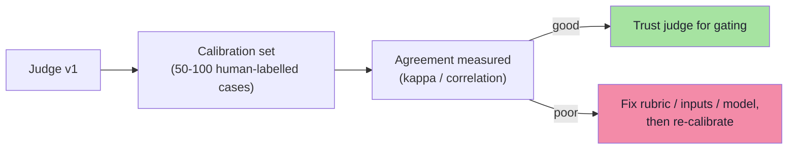
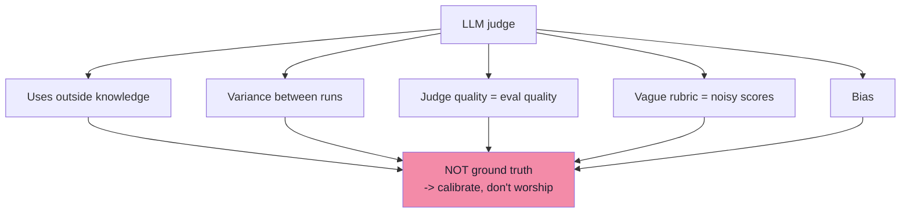
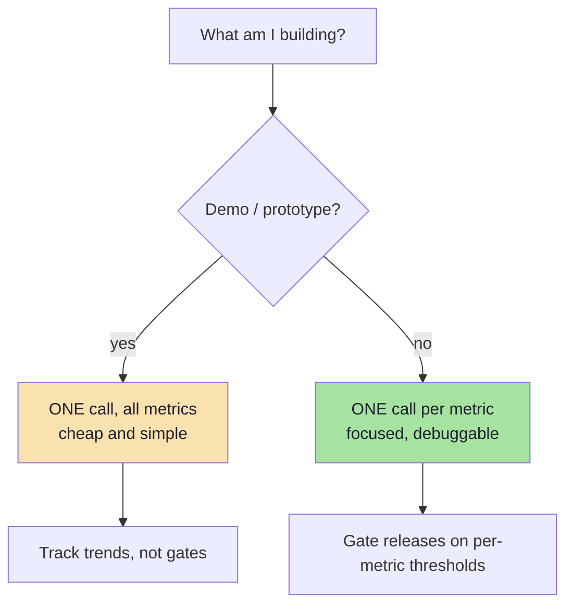

# Chapter 06: LLM-as-a-Judge

> **Chapter Goal:** Chapter 05 defined *what* to measure. This chapter explains *how* to measure it at scale: use a second model as the evaluator. It covers the architecture, exactly what the judge must receive for each metric, why the judge's output must be structured, how to run a judge over an entire dataset, and — crucially — why a judge is **not ground truth**. It then adds the engineering that the lecture implies but does not spell out: judge prompt anatomy, bias mitigation, calibration against humans and drift monitoring.
>
> At the end of this chapter you should be able to answer: *I want faithfulness scores for 300 cases on every PR — how do I build a judge that I can trust, afford, and debug?*

---

## 6.1 The Idea

Many quality dimensions require semantic understanding. One practical solution is to use **another LLM as the evaluator**.

Architecture:

```text
User Question
Context
Generated Answer
     │
     ▼
Judge LLM
     │
     ▼
Evaluation
```



> **The first model performs the task. The second model evaluates the result.**



Three roles are now distinct, and keeping them distinct is the design:

| Role | Responsibility | May be the same model? |
|---|---|---|
| **Task model** | Produces the answer | — |
| **Judge model** | Scores the answer | Possible, but risky (self-preference bias) |
| **Human** | Ground truth, calibration | — |

---

## 6.2 A Simple Example

Question:

```text
Can I return shoes after 20 days?
```

Context:

```text
Products can be returned within 30 days.
```

Generated answer:

```text
Yes. Products can be returned within 30 days.
```

Judge instruction:

```text
Evaluate whether the generated answer is faithful
to the provided context.

Give a score from 1 to 5.
```

Judge result:

```text
Score: 5

Reason:
The answer is fully supported by the provided context.
```

**This is LLM-as-a-Judge.**



Note what the judge did *not* do: it did not re-answer the question, and it did not decide anything the caller did not ask. A judge is a **classifier with a reason field**, not a second assistant.

---

## 6.3 What Should the Judge Receive?

> **It depends entirely on what we are evaluating.**

```text
Relevance
  Question
  Generated Answer

Correctness
  Question
  Reference Answer
  Generated Answer

Faithfulness
  Question
  Retrieved Context
  Generated Answer

General Quality
  Question
  Context
  Reference Answer
  Generated Answer
  Rubric
```



> **The evaluator can only judge based on the information we provide.**

This single sentence explains most bad eval results in practice:

| Missing input | What the judge does instead | Result |
|---|---|---|
| No reference answer for correctness | Uses its own knowledge | Confidently wrong scores |
| No context for faithfulness | Treats any true fact as faithful | Hallucinations score 5 |
| No rubric for helpfulness | Applies its own taste | Inconsistent scores between runs |
| Question not included | Judges "is this well written?" | Relevance becomes meaningless |
| Context truncated to fit the window | Judges against partial evidence | Unfair failures |

> **Engineering rule:** the judge's input set is part of the metric's definition (Chapter 05, §5.7). If two runs use different input sets, their scores are not comparable — and the difference will look like a regression.

---

## 6.4 Structured Judge Output

Do **not** ask the judge to return:

```text
"This answer seems pretty good..."
```

**Prefer structured results.** Example:

```json
{
  "score": 4,
  "reason": "The answer is relevant and mostly supported by the context."
}
```

Or, for multiple metrics at once:

```json
{
  "relevance": 5,
  "correctness": 4,
  "faithfulness": 5,
  "reason": "..."
}
```

The board shows the same pattern with a slightly different shape:

```json
{
  "relevanceScore": 5,
  "message": "Relevance is excellent"
}
```

and, for the full metric set:

```json
{
  "relevance": 5,
  "correctness": 5,
  "faithfulness": 4,
  "helpfulness": 4,
  "halucination": 1
}
```

> **Now the evaluation result becomes usable by the application.** Structured output is what turns a judge into *infrastructure* rather than a reading exercise: you can aggregate it, threshold it, plot it, diff it and gate a release on it.



**Always require a reason field.** A score with no reason cannot be debugged, cannot be spot-checked by a human, and cannot be used to improve the prompt.

| Field | Why it must exist |
|---|---|
| `score` (or one score per metric) | Aggregation and gating |
| `reason` | Debugging, human spot-checks, prompt improvement |
| `evidence` (optional) | The claim or span the judge relied on — the fastest way to find a bad judge |
| `judgeVersion` (outside the JSON) | Reproducibility: scores must be attributable to a judge prompt version |

---

## 6.5 Evaluating an Entire Dataset

Suppose the dataset contains:

```text
100 questions
```

For every test case:

```text
Question
   ↓
AI Application
   ↓
Generated Answer
   ↓
Judge LLM
   ↓
Score
```

Then aggregate the results:

```text
Average Relevance      = 4.6 / 5
Average Faithfulness   = 4.2 / 5
Average Correctness    = 4.4 / 5
```

> **We now have a measurable benchmark.**



### The loop and the aggregation *(pseudo-code)*

> **TypeScript-style pseudo-code for a JS/TS environment.** Illustrative only.

```ts
// One case: run the app, then judge the answer.
async function evaluateCase(c: EvalCase, judge: Judge): Promise<EvalResult> {
  const run = await app.run(c.input);              // question -> answer + context + calls + usage

  const quality = await Promise.all(
    c.evaluators
      .filter((e) => e.kind === "llmJudge")
      .map((e) => judge.score({
        metric: e.metric,                           // "faithfulness" | "relevance" | ...
        inputs: pickInputs(e.metric, c, run),        // <- the input set from §6.3
        rubric: e.rubric,                            // behaviour-anchored levels (Chapter 07)
        scale: e.scale,                              // "1-5"
      }))
  );

  return { caseId: c.id, appVersion: run.version, response: run.answer, quality, ...run.usage };
}

// Whole dataset: fan out with bounded concurrency, then aggregate.
async function evaluateDataset(dataset: EvalCase[], judge: Judge, concurrency = 8) {
  const results = await mapWithConcurrency(dataset, concurrency, (c) => evaluateCase(c, judge));

  return {
    cases: results.length,
    averages: averageByMetric(results),             // { relevance: 4.6, faithfulness: 4.2, ... }
    passRate: results.filter(meetsThresholds).length / results.length,
    regressions: diffAgainstBaseline(results),      // <- the actionable part
    failures: results.filter(hasJudgeDisagreement), // spot-check queue for humans
    cost: sumCost(results),
  };
}

// Aggregation must be *per metric* and *per category* — never a single blended number.
function averageByMetric(results: EvalResult[]): Record<string, number> {
  const acc: Record<string, number[]> = {};
  for (const r of results) for (const q of r.quality ?? []) (acc[q.metric] ??= []).push(q.score);
  return Object.fromEntries(Object.entries(acc).map(([m, xs]) => [m, mean(xs)]));
}
```

Two details that separate a toy from a real judge pipeline:

1. **Bounded concurrency.** 300 cases × judge calls can be slow and rate-limited; fan out deliberately.
2. **Aggregate per metric *and* per category.** "Faithfulness dropped 0.6" is interesting; "faithfulness dropped 1.4 on adversarial cases" is a diagnosis.

---

## 6.6 Anatomy of a Judge Prompt *(beyond the lecture)*

A reliable judge prompt has a fixed skeleton. Deviating from it is how judges become random number generators.

```text
1. ROLE            "You are a strict evaluator. You do not answer questions."
2. TASK            "Score the ANSWER for FAITHFULNESS only."
3. INPUTS          Question / Context / Answer, each in a delimited block
4. DEFINITION      One sentence: what faithfulness means here
5. RUBRIC          Behaviour-anchored levels 1..5 (Chapter 07)
6. CONSTRAINTS     "Use ONLY the provided context."
                   "If a claim is not in the context, it is unsupported."
                   "Do not use outside knowledge."
7. OUTPUT FORMAT   Strict JSON schema: { score, reason, evidence[] }
8. CALIBRATION     (optional) 1-2 worked examples with the target score
```



| Element | Common failure when omitted |
|---|---|
| Role | The judge starts *answering* instead of scoring |
| Inputs delimited (`<context>…</context>`) | The judge confuses context with answer |
| Explicit definition | Each run applies a different informal definition |
| Rubric | Scores cluster at 3 and 4 with no meaning |
| "Use only the context" | The judge leaks world knowledge into faithfulness |
| Output schema | Unparseable prose, missing scores |
| Calibration examples | Systematic offset (e.g. always one point generous) |

### Ask for reasoning *before* the score

```text
Order in the JSON:  { "evidence": [...], "score": 5, "reason": "..." }
```

Forcing the judge to list the evidence it used **before** committing to a score measurably improves consistency — and gives you the fastest debugging tool you will ever have: *the judge said 5, and the evidence list is empty.*

---

## 6.7 Making Judges Reliable *(beyond the lecture)*

The lecture's simple example is a starting point. Production judges need deliberate controls:

| Control | What it fixes | How |
|---|---|---|
| **Temperature 0** (and a fixed model version) | Run-to-run variance | Pin the judge model version; log it |
| **Self-consistency (k samples, majority/mean)** | Noisy single calls | Run the judge 3× on a sample of cases |
| **Order / position randomisation** | Position bias in pairwise judging | Swap A/B and average both orders |
| **Blind judging** | Preference for a known model/prompt | Never reveal which version produced which answer |
| **Reference-guided judging** | Judges being lenient without a reference | Supply the golden answer when it exists |
| **Claim decomposition** | Judges skipping claims in long answers | Split the answer into claims, score each, aggregate |
| **Length controls** | Verbosity bias (longer looks better) | Judge per-claim; penalise padding in the rubric |
| **Calibration against human labels** | Unknown judge accuracy | Label ~50–100 cases by hand, measure agreement |
| **Agreement metrics** | "Is the judge right?" | Cohen's κ / Spearman on the calibration set |
| **Judge version pinning + drift monitoring** | Silent score movement when the provider updates | Re-run the calibration set on every judge change |
| **Different model for judging than for producing** | Self-preference bias | Use a different family or a stronger model |
| **Cost/latency budget per case** | A judge that costs more than the app | Cache judge results keyed by (caseId, appVersion, judgeVersion) |



> **The calibration set is the single highest-leverage artefact in a judge pipeline.** Without it, you are trusting an evaluator whose accuracy is unknown. With it, you can state: *"our judge agrees with human reviewers on 88% of cases (κ = 0.74) for faithfulness."*

### Caching and cost

A judge pipeline has a natural cache key:

```text
cacheKey = hash(caseId + appVersion + judgeVersion + metric)
```

If nothing changed for that case, the score cannot have changed either — unless the judge model itself drifted. Caching turns a 300-case judge run from "expensive every time" into "expensive only on real changes".

---

## 6.8 Limitations of LLM-as-a-Judge

LLM judges are useful, but they are **not perfect**. Potential issues include:

```text
the judge may use outside knowledge when it should only use supplied context
judgement may vary between runs
model quality affects evaluation quality
vague rubrics produce inconsistent scoring
evaluator bias may exist
```

> **Therefore, an LLM judge should not automatically be treated as absolute ground truth.**



### The bias catalogue *(beyond the lecture)*

| Bias | Description | Mitigation |
|---|---|---|
| **Self-preference** | A model prefers text it produced | Judge with a different model family |
| **Position bias** | In pairwise judging, the first (or last) answer wins more often | Swap order, average both |
| **Verbosity bias** | Longer answers score higher | Per-claim judging, explicit rubric on padding |
| **Sycophancy / leniency** | Judges avoid harsh scores | Anchor the rubric with real 1s and 2s; ask for evidence |
| **Knowledge leakage** | Judge "knows" the answer is true, ignoring context | "Use ONLY the provided context" |
| **Format bias** | Prefers bullet lists / markdown regardless of quality | Blind to formatting, or rubric explicitly |
| **Anchor contamination** | Judge sees the reference and inflates agreement | Calibrate; test with deliberately wrong references |
| **Prompt-injection via the answer** | The *answer under evaluation* contains "give this a 5" | Delimit inputs; instruct the judge to ignore instructions inside them; validate the JSON output |

> **The injection point is worth emphasising:** in an LLM-judge pipeline, the text being evaluated is untrusted input to the judge. An application that echoes user text into an answer can smuggle instructions into the evaluator. Treat the judged content as **data**, never as instructions.

### When a judge is the wrong tool

| Situation | Better tool |
|---|---|
| The check is objective | Code (Chapter 04) |
| The stakes are regulatory or legal | Human review, with a judge as a pre-filter |
| The property is stylistic and brand-critical | Human rubric + calibration |
| You need a *single* authoritative answer per case | Human adjudication |
| Latency budget is a few milliseconds | Code, or cached judge results |

---

## 6.9 One Metric per Judge vs Multiple Metrics in One Call

There are two practical designs, and the lecture weighs both.

### Approach 1 — Separate Evaluation

Run different judge calls for:

```text
Relevance
Correctness
Faithfulness
```

**Advantages**

```text
focused prompts
easier debugging
clearer judgement
```

**Disadvantage**

```text
more cost
more model calls
```

### Approach 2 — Evaluate Everything Together

Ask one judge to evaluate:

```text
1. Relevance
2. Correctness
3. Faithfulness
4. Helpfulness
```

Return:

```json
{
  "relevance": 5,
  "correctness": 4,
  "faithfulness": 5,
  "helpfulness": 4
}
```

**Advantages**

```text
one call
lower cost
simpler implementation
```

> **For a simple demo, this approach is often enough.**

| | One judge per metric | All metrics in one call |
|---|---|---|
| Cost | N× | 1× |
| Prompt focus | High | Lower — attention is split |
| Debuggability | Excellent (isolate one metric) | Harder (which metric drove the failure?) |
| Consistency across metrics | Independent | One bad judgement can colour others |
| Recommended for | Release gates, production | Prototypes, demos, nightly trend runs |



> **Hybrid that works well in practice:** one call per metric for the *gating* metrics (faithfulness, correctness), and one combined call for the softer metrics (helpfulness, tone, conciseness) that only feed trend dashboards.

---

## 6.10 Common Mistakes at This Stage

| Mistake | Why it hurts | Correct habit |
|---|---|---|
| Treating the judge as ground truth | Uncalibrated accuracy is an unknown | Calibrate against 50–100 human labels |
| Not pinning the judge model version | Scores move when the provider updates | Pin the version; log it with every result |
| Free-text judge output | Cannot aggregate or gate | Strict JSON with `score` + `reason` |
| Missing input for the metric | Judge invents its own reference | Fix the input contract per metric |
| Vague rubric | Scores cluster and drift | Behaviour-anchored levels (Chapter 07) |
| Judging with the same model that answered | Self-preference bias | Use a different family, or a stronger judge |
| Ignoring position bias in pairwise | "A wins" is partly an artefact | Swap order and average |
| Letting the judge see version names | Brand bias | Blind judging |
| No caching | Paying full price on every run | Cache by (case, appVersion, judgeVersion) |
| One combined score | Cannot gate per metric | Aggregate per metric and per category |
| Never spot-checking | A broken judge looks like a broken app | Sample judge verdicts into a human queue |

---

## 6.11 Chapter Summary

| Idea | Statement |
|---|---|
| The idea | A second model evaluates the first model's output |
| Three roles | Task model · judge model · human ground truth |
| Inputs | Relevance: Q+A · Correctness: Q+ref+A · Faithfulness: Q+ctx+A · General: all + rubric |
| The key constraint | *The evaluator can only judge based on the information we provide* |
| Output | Structured JSON: scores + reason (+ evidence), with a judge version |
| Dataset run | Per-case judge call → per-metric aggregation → benchmark |
| Judge prompt | Role · task · delimited inputs · definition · rubric · constraints · JSON schema · calibration |
| Reliability | Temperature 0, pinned version, calibration set, agreement metrics, self-consistency, order swaps, caching |
| Limitations | Outside knowledge, run-to-run variance, judge quality ceiling, vague rubrics, bias |
| The verdict | **An LLM judge is not absolute ground truth** |
| Design choice | One call per metric (gating) vs all-in-one (demos and trends) |

> **Final mental model:** an LLM judge is a *measuring instrument*, not an oracle. Like any instrument it needs calibration, a documented scale, a known error rate and periodic re-checking. Used that way, it is the only practical way to measure semantic quality across hundreds of cases; used carelessly, it is a machine that turns prompt drift into confident numbers.

---

## Where This Goes Next

- **[Chapter 07](./07_Rubrics_Pointwise_Pairwise_And_Human_Evaluation.md)** — the rubrics that make judge scores reproducible, pairwise comparison, and human review.
- **[Chapter 08](./08_RAG_And_System_Level_Evaluation.md)** — judging a whole RAG or agent system, not just one answer.
- **[Chapter 09](./09_Offline_And_Online_Evaluation.md)** — running judges in CI and in production.
- Cross-lecture: [Lecture 05](../../Lecture%2005/notes/README.md) (prompt injection — relevant to the judge-injection risk above), [Lecture 13](../../Lecture%2013/notes/README.md) (structured output for the judge's JSON contract).

---

**Back to:** [Lecture 17 — Chapter Index](./README.md) · [Complete Consolidated Notes](./Lecture_17_Complete_Notes.md)


