# Chapter 07: Rubrics, Pointwise vs Pairwise, and Human Evaluation

> **Chapter Goal:** A score is meaningless until someone defines what it means. This chapter supplies that definition — the **rubric** — and then covers the three ways a score can be produced: **pointwise** (score one answer), **pairwise** (compare two answers), and **human** (a person judges). It closes with the part teams skip: human review as an *operation* (sampling, blinding, multiple raters, adjudication, agreement targets), and a decision matrix for choosing the right evaluator for a given property.
>
> At the end of this chapter you should be able to answer: *is "faithfulness 4" the same thing in January and in June, and would two reviewers agree?*

---

## 7.1 Why a Rubric Exists

> **A rubric clearly defines what each evaluation score means.**

A vague rubric:

```text
5 = Excellent
4 = Good
3 = Acceptable
2 = Poor
1 = Incorrect
```

…does **not provide enough guidance**. Nobody — human or model — can apply it consistently, because "good" is not a behaviour.

A better rubric defines **actual behaviour**.

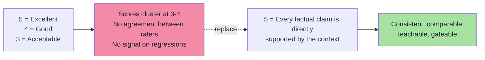

---

## 7.2 Example: Faithfulness Rubric

The lecture's rubric, verbatim — this is the canonical example to imitate:

```text
5 = Every factual claim is directly supported by the context.

4 = Almost every claim is supported.
    There may be one minor unsupported detail that does not
    materially affect the answer.

3 = The main answer is supported,
    but meaningful unsupported claims exist.

2 = Large portions of the response are unsupported.

1 = The response substantially contradicts
    or ignores the provided context.
```

The board writes the same rubric in slightly different words:

```text
1 to 5 : Faithfulness

Evaluate whether every factual claim in the answer
is supported by the provided context.

5 = Every claim is directly supported by the context.

4 = Almost all claims are supported, with only a minor
    unsupported detail that does not affect the answer.

3 = The main answer is supported, but there are
    meaningful unsupported claims.

2 = Large portions of the answer are unsupported.

1 = The answer substantially contradicts or ignores the
    context
```

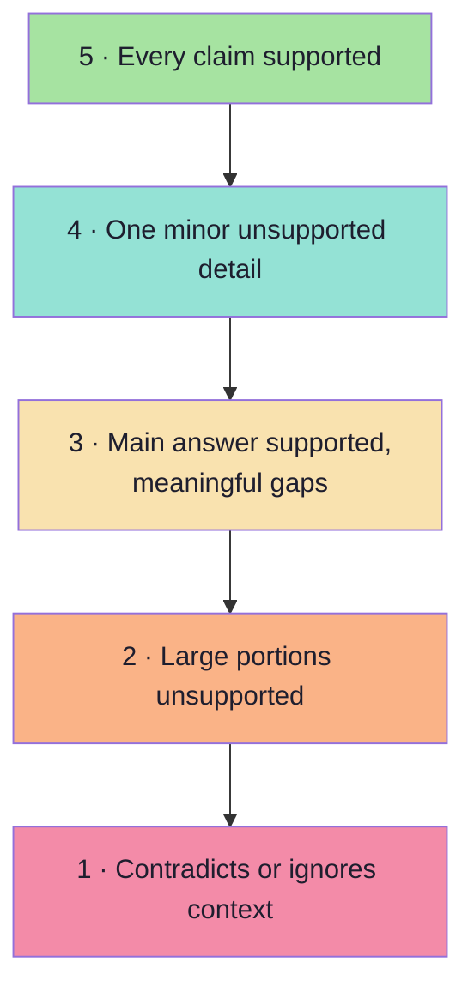

> **A strong rubric makes both human and LLM evaluation more consistent.**

Notice the engineering choices hidden in those five lines:

| Choice | Why it matters |
|---|---|
| Each level describes **observable behaviour**, not adjectives | Two raters can check the same thing |
| Levels are **monotone** (claim coverage decreases) | Score differences are interpretable |
| "**does not materially affect the answer**" | Handles the genuinely grey case explicitly |
| Level 1 names **contradiction *and* ignoring** | Two distinct failure modes, one score |
| The metric's definition is stated **above** the levels | The rubric is self-contained for the judge prompt |

---

## 7.3 Anatomy of a Good Rubric *(beyond the lecture)*

A production rubric has seven components. Missing any one of them shows up as score noise:

| Component | What it looks like | Failure if missing |
|---|---|---|
| **1. Metric definition** | "Is every factual claim supported by the context?" | Raters measure different things |
| **2. Input contract** | Which artefacts the rater receives (Q, context, reference, answer) | Raters judge with different evidence |
| **3. Level anchors** | A behaviour sentence per level | Scores cluster in the middle |
| **4. Boundary rules** | "A minor detail that does not change the answer caps the score at 4" | Adjacent levels blur |
| **5. Tie / uncertainty rule** | "If the answer is unjudgeable, return `NA` with a reason" | Forced guesses pollute the data |
| **6. Examples** | One real example per level (especially 1, 3 and 5) | Anchors are interpreted differently |
| **7. Scope statement** | "Judge faithfulness only; do not consider helpfulness or tone" | One metric leaks into another |

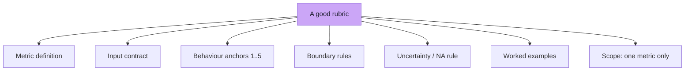

> **Test of a rubric:** hand it to two competent people with the same case and no discussion. If they differ by more than one level, the rubric is not finished — the *case* is not the problem.

### Rubric levels should be *decidable*

```text
Bad:   4 = Good answer with minor issues
Good:  4 = All required facts present; one unnecessary sentence;
            no unsupported claims
```

The second version can be checked mechanically *and* by a person, and it tells the judge exactly which behaviour to look for.

---

## 7.4 Pointwise Evaluation

**Evaluate one output independently.**

```text
Answer
   ↓
Judge
   ↓
4 / 5
```

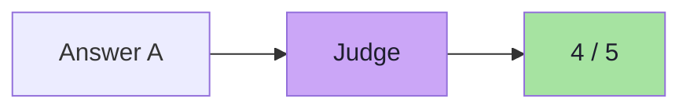

> **This is the easiest approach to understand.**

| Property | Pointwise |
|---|---|
| Output | Absolute score (1–5, 1–10, binary) |
| Needs | A rubric with anchors |
| Strengths | Simple, cheap, one call per answer, supports thresholds |
| Weaknesses | Scores drift over time ("score inflation"), absolute scale is arbitrary |
| Best for | **Release gates** ("faithfulness must be ≥ 4.2"), trend dashboards, per-metric reporting |
| Risk | Without calibration, a judge slowly becomes more generous |

**The gate pattern:** a pointwise metric becomes useful when paired with a threshold.

```text
faithfulness  ≥ 4.2   → ship
faithfulness  < 4.2   → investigate before shipping
hallucination rate     = 0 for the safety-critical category
```

---

## 7.5 Pairwise Evaluation

Instead of assigning an absolute score, **compare two outputs**.

```text
Answer A
Answer B
   ↓
Judge
   ↓
Which is better?
```

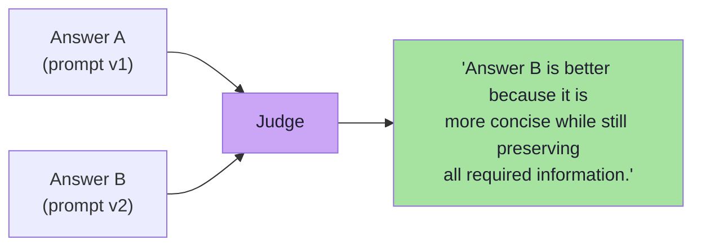

For example:

```text
Prompt V1 Response   vs   Prompt V2 Response
```

The judge may conclude:

```text
Answer B is better because it is more concise
while still preserving all required information.
```

**Pairwise evaluation is especially useful when comparing:**

```text
prompts
models
RAG configurations
agent versions
```

| Property | Pairwise |
|---|---|
| Output | Winner (A / B / tie) or a preference distribution |
| Needs | Both answers, a preference rubric, order randomisation |
| Strengths | **Easier judgements** — relative comparison is more reliable than absolute scoring; detects subtle improvements |
| Weaknesses | No absolute threshold; cannot say "is this good enough?"; cost doubles (two answers per comparison) |
| Best for | **Choosing between two candidates**: model A vs model B, prompt v1 vs v2, chunk size 500 vs 800 |
| Risk | Position bias, tie inflation, and "both are bad" ambiguity |

### Turning pairwise results into a number

```text
win rate(prompt v2)  =  wins / (wins + losses)      (ties excluded or half-counted)
```

Aggregated across the dataset (and across both orders), the win rate is the pairwise benchmark. With enough comparisons you can also rank more than two candidates (an Elo-style or Bradley–Terry model), which is how public model leaderboards are produced.

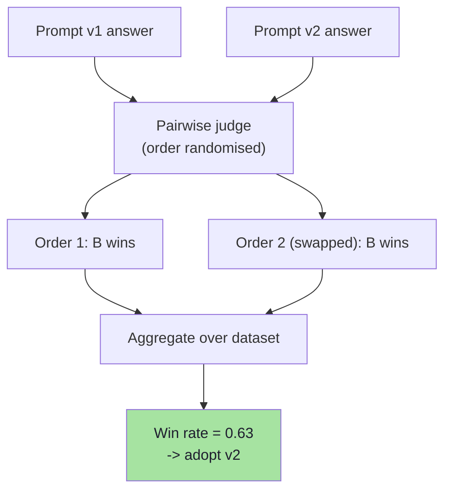

> **Always run both orders.** If a candidate wins in both orders, that is a real improvement. If it only wins when it appears first, you measured position bias.

---

## 7.6 Choosing Between Pointwise and Pairwise

The two are complementary, not competing:

| Question you are asking | Use |
|---|---|
| "Is this good enough to ship?" | **Pointwise** with thresholds |
| "Is v2 better than v1?" | **Pairwise** (win rate) |
| "Did quality regress on the adversarial slice?" | **Pointwise**, per category |
| "Which of five models should we adopt?" | **Pairwise** round-robin, then pointwise gates on the winner |
| "Is the trend improving week over week?" | **Pointwise** (pairwise needs a reference each time) |
| "Is the difference between two prompts real or noise?" | **Pairwise** (more sensitive to small differences) |

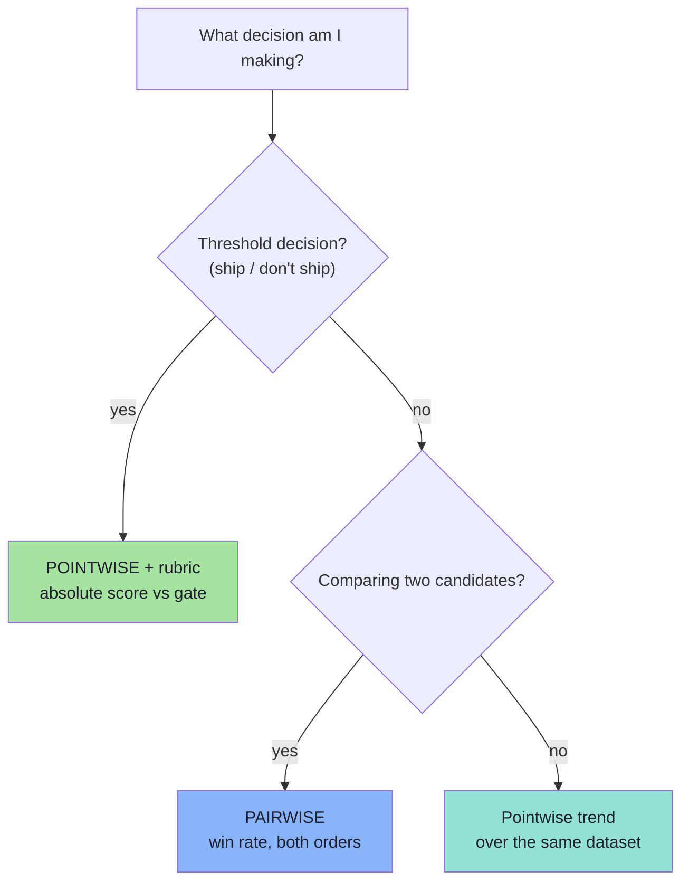

> **The hybrid that teams converge on:** use **pairwise to *choose*** and **pointwise to *gate***. Pairwise tells you v2 is better; pointwise tells you whether v2 is good enough.

---

## 7.7 Human Evaluation

Humans remain **extremely important** for AI evaluation.

Flow:

```text
AI Response
   ↓
Human Reviewer
        ↓
Correctness: 5
Helpfulness: 4
Comments: ...
```

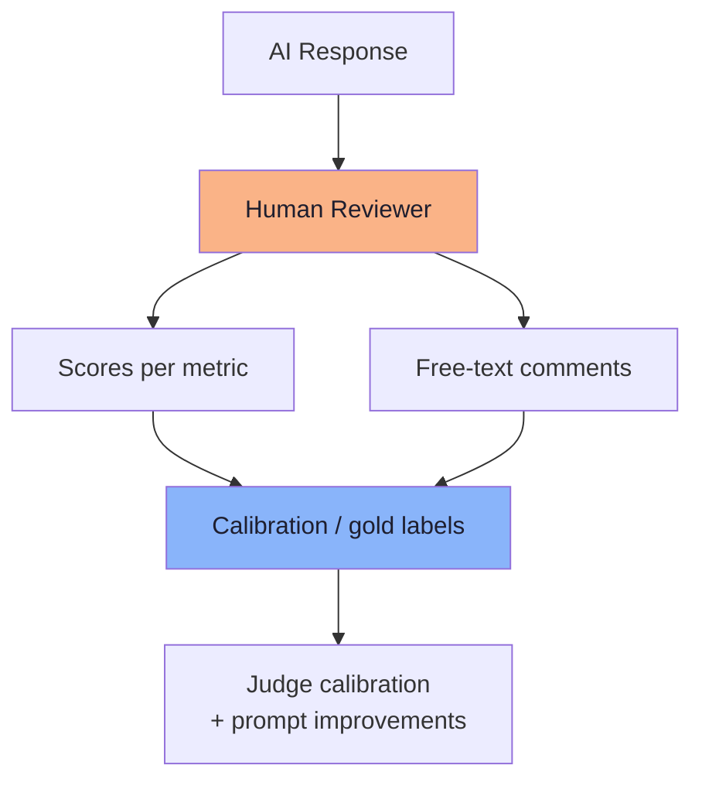

Humans are particularly good at understanding:

```text
subtle intent
business requirements
tone
style
nuance
usability
whether an answer genuinely helps
```

### Limitations of Human Evaluation

Human evaluation is:

```text
expensive
slow
difficult to scale
sometimes inconsistent
```

**Two reviewers may evaluate the same answer differently.**

```text
Reviewer A → 4/5

Reviewer B → 2/5
```

> **Therefore, humans also need good rubrics.** The rubric is not a constraint on human judgement; it is what makes human judgement *comparable*.

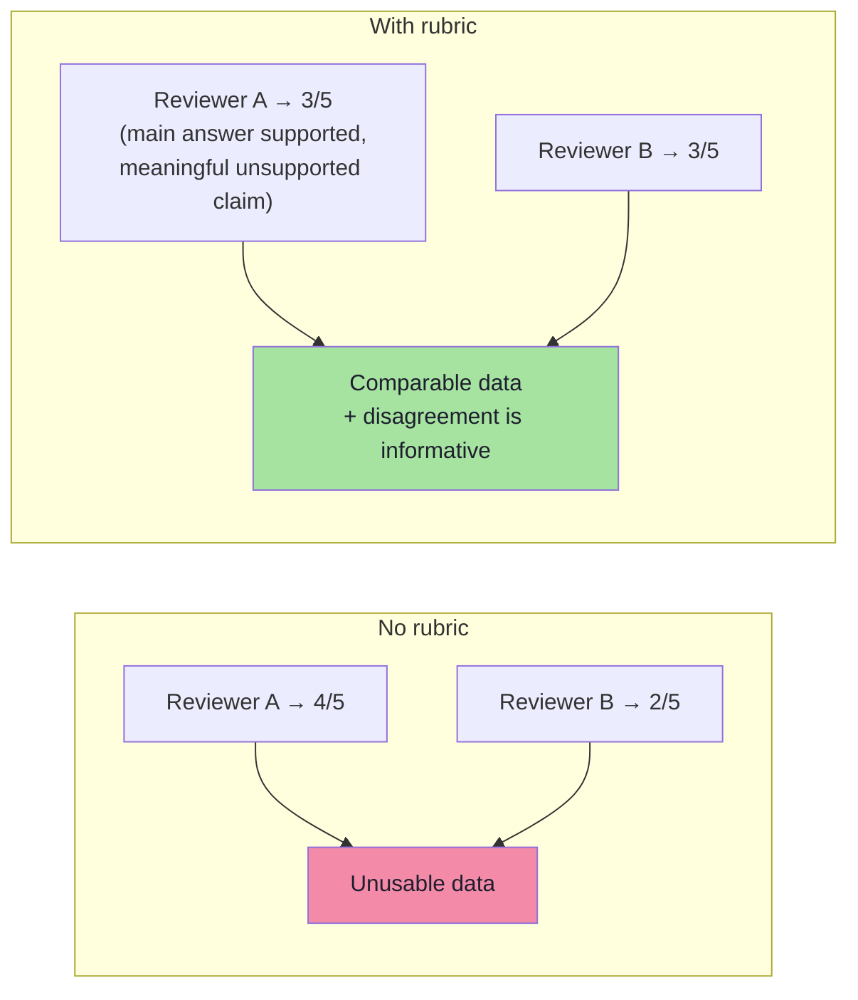

| Human strengths | Human weaknesses |
|---|---|
| Understands intent, tone, brand and nuance | Expensive per label |
| Catches "technically right, practically useless" | Slow: hours to days |
| Can reason about policy and edge cases | Does not scale to thousands of cases per release |
| Provides the labels that calibrate LLM judges | Inconsistent without a rubric; drifts with fatigue |
| Ultimate authority for high-stakes decisions | Reviewers disagree — needs adjudication |

---

## 7.8 Human Review as an Operation *(beyond the lecture)*

Human evaluation only produces trustworthy data when it is run like a process:

| Practice | Why |
|---|---|
| **Sample, don't review everything** | 5–20% of cases, stratified across categories, is usually enough |
| **Blind the reviewer** | Hide which version/model produced the answer |
| **Two raters on a subset** | Measure agreement before trusting single-rater scores |
| **Adjudication for disagreements** | A third reviewer resolves >1-level gaps |
| **Calibration sessions** | Raters score the same 10 cases and discuss — run weekly at first |
| **Golden cases inside the queue** | Pre-labelled cases with known answers detect rater drift |
| **Structured annotation UI** | One metric per screen, rubric visible, forced choice (no free-form scores) |
| **Fatigue controls** | Cap session length; randomise order; allow "cannot judge" |
| **Agreement target** | e.g. κ ≥ 0.6 or ≥ 80% within-one-level agreement, tracked over time |
| **Feedback loop** | Disagreements become rubric edits *or* new eval cases |

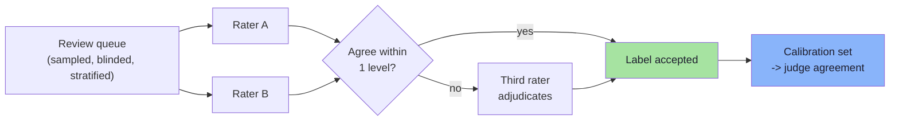

> **Human review is not a fallback; it is the source of truth that the judge is measured against.** Budget for it explicitly (a recurring cost line), or you will discover your judge's accuracy only during an incident.

---

## 7.9 Which Evaluator for Which Property?

The complete decision matrix, combining Chapters 04–07:

| Property | Code | LLM judge | Human | Primary choice |
|---|---|---|---|---|
| JSON / schema validity | ✅ exact | — | — | **Code** |
| Tool name & arguments | ✅ exact | — | — | **Code** |
| HTTP status, latency, tokens, cost | ✅ exact | — | — | **Code** |
| Output count / length constraints | ✅ exact | — | — | **Code** |
| Refusal status (structured) | ✅ exact | ✅ semantic | ✅ | **Code**, judge for free text |
| Expected documents retrieved | ✅ set ops | — | — | **Code** |
| Relevance | ~ keywords | ✅ | ✅ | **Judge** (human for calibration) |
| Correctness vs reference | ~ similarity | ✅ | ✅ | **Judge**, human for high stakes |
| Faithfulness / groundedness | ~ claim split | ✅ | ✅ | **Judge** |
| Helpfulness | — | ✅ | ✅ | **Judge + human** |
| Hallucination | ~ known patterns | ✅ | ✅ | **Judge**, human for severity |
| Tone / brand voice | — | ✅ | ✅ | **Human** (judge as pre-filter) |
| Safety / toxicity | ✅ classifier | ✅ | ✅ | **Classifier + human** |
| Nuanced intent, usability | — | ~ | ✅ | **Human** |

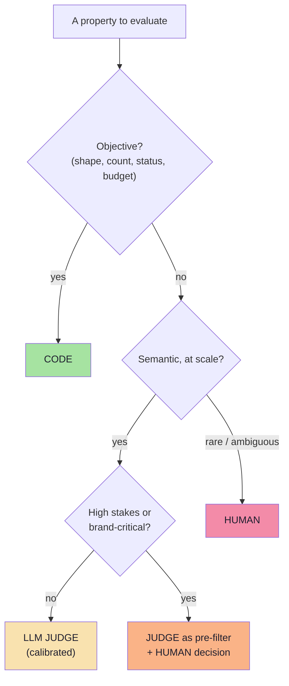

**The escalation ladder in one line:**

```text
code  →  LLM judge  →  human
(always try the cheapest rung that can judge correctly)
```

---

## 7.10 Common Mistakes at This Stage

| Mistake | Why it hurts | Correct habit |
|---|---|---|
| Adjective-only rubrics ("Good", "Excellent") | No agreement between raters or runs | Behaviour-anchored levels |
| One rubric for several metrics | Metrics leak into each other | One rubric per metric, with a scope line |
| No `NA` / uncertainty option | Raters guess and pollute the data | Allow "cannot judge" with a reason |
| Single-rater human labels | Disagreement is invisible | Two raters on a subset + adjudication |
| Reviewing everything by hand | Cost explodes, nobody keeps doing it | Stratified sampling of 5–20% |
| Unblinded reviews | Brand/version bias | Hide which version produced the answer |
| Pairwise without order swapping | Position bias masquerades as quality | Run both orders, average |
| Using only pairwise | No absolute gate exists | Add pointwise thresholds |
| Using only pointwise | Cannot see subtle improvements | Add pairwise for version decisions |
| Skipping calibration forever | The rubric rots as the product changes | Re-calibrate on every judge/rubric change |

---

## 7.11 Chapter Summary

| Idea | Statement |
|---|---|
| The rubric | Defines what each score *means*, in observable behaviour |
| Why it matters | It makes human **and** LLM evaluation consistent |
| Faithfulness rubric | 5 = every claim supported … 1 = contradicts or ignores context |
| Rubric anatomy | Definition · input contract · anchors · boundaries · NA rule · examples · scope |
| Pointwise | One answer → absolute score; used for gates and trends |
| Pairwise | Two answers → which is better; used for prompts, models, RAG configs, agents |
| Pairwise caveat | Always swap order; aggregate a win rate |
| Human evaluation | Excellent for intent, tone, nuance, usability; expensive, slow, inconsistent |
| Human needs rubrics too | Reviewer A 4/5 vs Reviewer B 2/5 is a rubric failure |
| Human as an operation | Sample, blind, double-rate, adjudicate, calibrate, track agreement |
| The ladder | code → LLM judge → human, cheapest rung that works |

> **Final mental model:** the rubric is the *measuring scale*; pointwise and pairwise are the *two ways to use it*; the human is the *reference standard the scale is checked against*. Without the rubric, scores are opinions; without humans, the scale is unverified; without a choice between pointwise and pairwise, you cannot answer the two different questions teams actually ask.

---

## Where This Goes Next

- **[Chapter 08](./08_RAG_And_System_Level_Evaluation.md)** — applying all of this to a whole RAG or agent system, and separating retrieval from generation.
- **[Chapter 09](./09_Offline_And_Online_Evaluation.md)** — running these evaluations in CI and in production.
- Cross-lecture: [Lecture 12](../../Lecture%2012/notes/README.md) (reranking and context engineering), [Lecture 15](../../Lecture%2015/notes/README.md) (MCP prompts as testable, deterministic templates).

---

**Back to:** [Lecture 17 — Chapter Index](./README.md) · [Complete Consolidated Notes](./Lecture_17_Complete_Notes.md)


