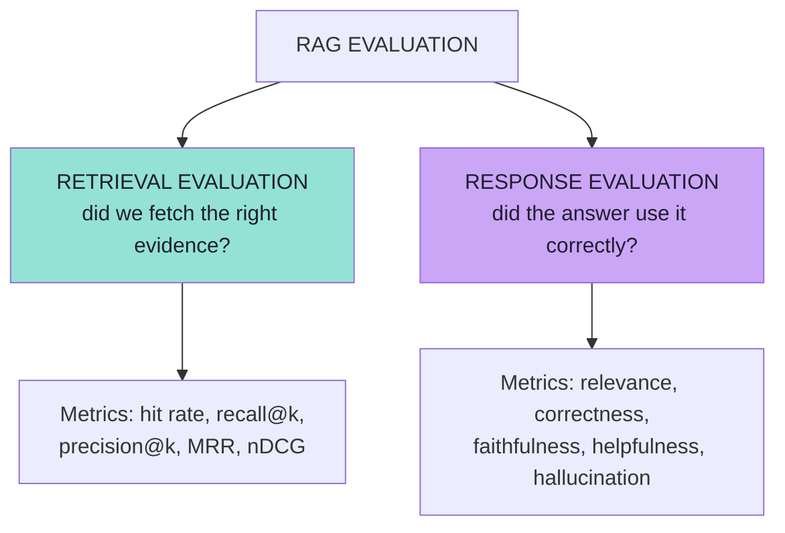
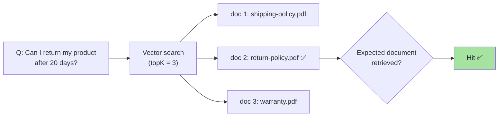
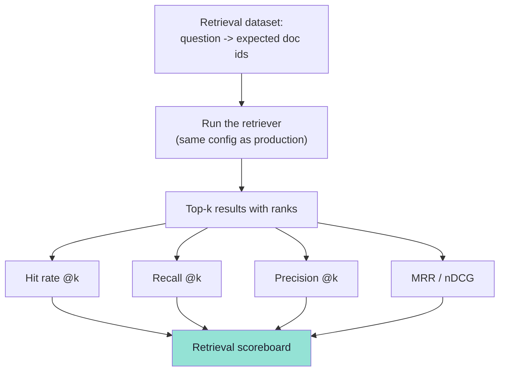
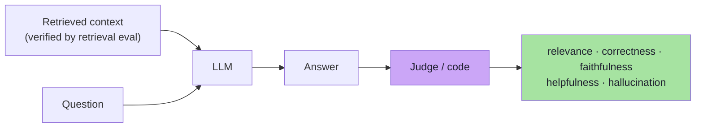
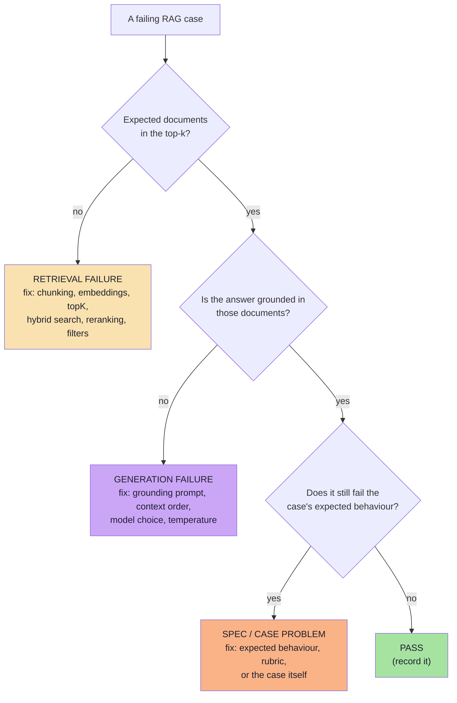
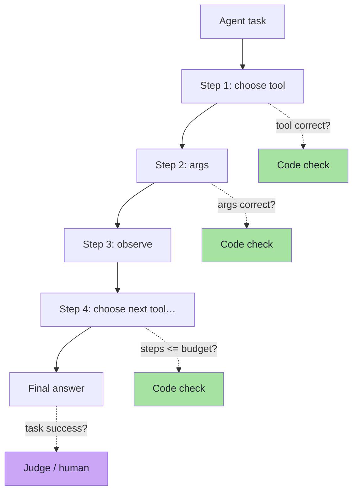
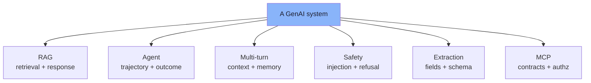

# Chapter 08: RAG and System-Level Evaluation

> **Chapter Goal:** Chapter 02 established that we evaluate the *system*, not the model. This chapter makes that concrete for the two architectures where it matters most: **RAG** and **agents**. The core move is **decomposition**: RAG evaluation splits into **retrieval evaluation** and **response evaluation**, because a wrong answer has two completely different possible causes — and the fix for one is invisible to the other. The chapter then extends the same idea to agents (tool choice, trajectory, cost), multi-turn conversations, safety and structured extraction.
>
> At the end of this chapter you should be able to answer: *the answer was wrong — was the document never retrieved, or did the model ignore it?*

---

## 8.1 Why Split RAG Evaluation

**RAG evaluation should ideally be separated into two parts:**

```text
RAG Evaluation
     │
     ├── Retrieval Evaluation
     │
     └── Response Evaluation
```



> **This separation helps identify where the RAG system is failing.** Without it, every failure looks like "the model is bad", and teams spend weeks rewriting prompts to fix what is actually a chunking or embedding problem.

| Failure | Retrieval eval | Response eval | What to fix |
|---|---|---|---|
| Wrong document retrieved | ❌ | ❌ (cascade) | Embeddings, chunking, topK, filters |
| Right document retrieved, model ignored it | ✅ | ❌ | Prompt/grounding instructions, context ordering |
| Right document retrieved, model used it, answer still off | ✅ | ~ | Prompt, answer shaping, helpfulness rubric |
| Perfect answer, wrong document | ❌ | ✅ | Latent risk: the system got lucky; it will fail later |

That last row is worth dwelling on: **a passing answer does not prove retrieval worked.** Evaluate both, or you will be surprised by a regression you never measured.

---

## 8.2 Retrieval Evaluation

Question:

```text
Can I return my product after 20 days?
```

Suppose the correct source is:

```text
return-policy.pdf
```

We can evaluate whether the retrieval system **actually retrieved the expected document**.



> **If retrieval fails, the LLM may never have had the information required to answer correctly.**

This is the single most important sentence in RAG evaluation. No prompt can recover a document that was never retrieved — which is exactly the `topK 5 → 3` regression from Chapter 01.

### Retrieval metrics *(beyond the lecture)*

The lecture asserts the check ("did we retrieve the expected document?"). The standard metrics that formalise it:

| Metric | Question | Notes |
|---|---|---|
| **Hit rate @k** | Was at least one expected document in the top k? | Simplest; use for "does the answer have a chance?" |
| **Recall @k** | What fraction of *all* expected documents appeared in the top k? | The right metric when a question needs several chunks |
| **Precision @k** | What fraction of the top k were relevant? | Catches "retrieve 10 documents, 8 are noise" |
| **MRR** (mean reciprocal rank) | How high did the *first* relevant document rank? | Sensitive to ranking quality |
| **nDCG @k** | Graded relevance with position discount | Best when documents have degrees of relevance |
| **Context precision** | Are the retrieved chunks the ones the answer needs? | Often judged semantically |
| **Context recall** | Are all the chunks the answer needs present? | The ceiling on faithfulness |



### What to vary when evaluating retrieval

| Lever | Why it matters |
|---|---|
| **Chunk size / overlap** | Small chunks → precise but fragmented; large chunks → complete but noisy |
| **Embedding model** | Changes the entire similarity geometry |
| **topK** | The Chapter 01 regression lever |
| **Hybrid search / keyword + vector** | Catches exact terms (order ids, SKUs) vectors miss |
| **Reranking** | Improves precision@k without changing recall@k |
| **Metadata filters** | Tenant, locale, product line, document version |
| **Query rewriting / expansion** | "bro bought this yesterday but box gone" → a retrievable query |

> **Evaluate retrieval with *deterministic* checks wherever possible.** A retrieval eval with expected document ids needs no judge at all — it is set arithmetic (Chapter 04, level 5).

---

## 8.3 Response Evaluation

Once relevant context **has** been retrieved, evaluate the generated answer using metrics such as:

```text
relevance
correctness
faithfulness
helpfulness
hallucination
```



These are exactly the metrics from [Chapter 05](./05_AI_Quality_Metrics.md) — with one important change of framing:

> **In RAG, faithfulness is measured against the *retrieved* context, not against the whole corpus.**

That is the whole point of grounding: the system is judged on whether it used *what it was given*. If the corpus is wrong, that is a retrieval/data problem and should show up in the retrieval eval instead.

### Extra response-side checks for RAG *(beyond the lecture)*

| Check | Assertion | Catches |
|---|---|---|
| Citation correctness | Every cited chunk actually contains the claim | Fake or decorative citations |
| Citation coverage | Every claim has a citation | Ungrounded sentences |
| Refusal on missing context | If the answer is not in context, refuse | Hallucinated answers |
| Context utilisation | Did the answer use *any* retrieved chunk? | Retrieval that was ignored |
| Answer completeness | Did it cover all parts of the question? | Partial answers |
| Contradiction check | Does the answer contradict the context? | Confident inversions (rubric level 1) |

---

## 8.4 Attribution: Which Half Failed?

The practical value of the split is **attribution** — and it is a decision tree you can automate:



The same tree applies to agents with one extra question ("was the *tool* correct?"), and to extraction systems with one fewer ("was the *field* correct?").

> **Why this tree matters more than any single metric:** it converts a score into an **owner**. Retrieval failures belong to whoever owns the index; generation failures belong to whoever owns the prompt; spec failures belong to whoever owns the product.

### The per-case evidence bundle

To make attribution possible, each eval run must capture — per case — the full evidence chain:

```ts
// Pseudo-code: the artefacts that make attribution automatic.
type RagRunTrace = {
  caseId: string;
  appVersion: string;              // prompt + model + retrieval config hash
  query: string;
  rewrittenQuery?: string;         // if query rewriting is used
  retrieved: { id: string; score: number; rank: number }[];
  contextSent: string[];           // exactly what reached the prompt
  answer: string;
  citations?: string[];
  usage: { ms: number; tokens: number; usd: number; modelCalls: number };
};
```

| Trace field | Attribution question it answers |
|---|---|
| `retrieved` (+ ranks) | Was the evidence available at all? |
| `contextSent` | Was the *right* context actually put in the prompt? |
| `rewrittenQuery` | Did query rewriting destroy the question? |
| `citations` | Did the model attribute its claims? |
| `usage.modelCalls` | Did the agent loop wastefully or get stuck? |

> **Log the trace, not just the answer.** A score without the evidence chain produces debates; a score with the evidence chain produces fixes.

---

## 8.5 The RAG Eval Pipeline *(pseudo-code)*

> **TypeScript-style pseudo-code for a JS/TS environment.** Illustrative only — it shows the *shape* of a decomposed RAG eval.

```ts
// A RAG case carries both retrieval expectations and answer expectations.
type RagCase = EvalCase & {
  expectedDocs: string[];          // what a correct retrieval must produce
  goldenAnswer?: string;
  mustMention?: string[];
  mustNotClaim?: string[];
};

async function evaluateRagCase(c: RagCase, app: RagApp, judge: Judge) {
  // 1) Run the system once and capture the trace
  const trace = await app.answerWithTrace(c.input);

  // 2) RETRIEVAL evaluation — pure set arithmetic, no judge needed
  const retrievedIds = trace.retrieved.map((d) => d.id);
  const retrieval = {
    hit: c.expectedDocs.some((id) => retrievedIds.includes(id)),
    recall: c.expectedDocs.filter((id) => retrievedIds.includes(id)).length / c.expectedDocs.length,
    precision: retrievedIds.filter((id) => c.expectedDocs.includes(id)).length / retrievedIds.length,
    firstRelevantRank: firstIndex(retrievedIds, c.expectedDocs) + 1,
  };

  // 3) RESPONSE evaluation — only meaningful if the context was available
  const response = trace.contextSent.length === 0
    ? { skipped: true, reason: "no context retrieved" }         // <- attribution, not a failure
    : {
        faithfulness: await judge.score({ metric: "faithfulness",  inputs: [c.input, trace.contextSent, trace.answer] }),
        relevance:    await judge.score({ metric: "relevance",     inputs: [c.input, trace.answer] }),
        correctness:  c.goldenAnswer
          ? await judge.score({ metric: "correctness", inputs: [c.input, c.goldenAnswer, trace.answer] })
          : undefined,
        hallucination: await judge.score({ metric: "hallucination", inputs: [trace.contextSent, trace.answer] }),
      };

  // 4) Deterministic checks (Chapter 04) still run on the answer itself
  const deterministic = [
    { name: "mentions-required-facts", passed: (c.mustMention ?? []).every((f) => trace.answer.includes(f)) },
    { name: "no-forbidden-claims",     passed: !(c.mustNotClaim ?? []).some((f) => trace.answer.includes(f)) },
    { name: "budget",                  passed: trace.usage.ms < 5000 && trace.usage.modelCalls <= 3 },
  ];

  // 5) Attribution: classify the failure so it has an owner
  const attribution = classify({ retrieval, response, deterministic });

  return { caseId: c.id, trace, retrieval, response, deterministic, attribution };
}

// The classifier is the decision tree from §8.4, expressed as code.
function classify(r: {
  retrieval: { hit: boolean };
  response: { skipped?: boolean; faithfulness?: { score: number } };
  deterministic: { passed: boolean }[];
}): "retrieval" | "generation" | "spec" | "pass" {
  if (!r.retrieval.hit) return "retrieval";
  if (r.response.skipped) return "retrieval";
  if ((r.response.faithfulness?.score ?? 5) < 3) return "generation";
  if (!r.deterministic.every((d) => d.passed)) return "spec";
  return "pass";
}
```

**What to report for a RAG system** — never a single blended number:

```text
Retrieval:  hit rate 0.94 · recall@3 0.87 · MRR 0.81
Response:   faithfulness 4.3 · relevance 4.6 · correctness 4.4 · hallucination 2/100
Ops:        p95 latency 3.1s · model calls 1.4 avg · $0.004/request
Attribution: retrieval 4 · generation 2 · spec 1 · pass 93  (of 100)
```

> **The attribution line is the one stakeholders should read.** It says where the work is.

---

## 8.6 Agent Evaluation *(beyond the lecture)*

An agent is a RAG system with a control loop, so the decomposition grows by one axis: **the trajectory**, not just the final answer.

| Metric | Question | Judged by |
|---|---|---|
| **Tool selection accuracy** | Did it call the expected tool? | Code (`actualTool === expectedTool`) |
| **Argument accuracy** | Were the arguments correct? | Code (deep equality on expected args) |
| **Step efficiency** | How many calls did it take vs the ideal? | Code (`calls <= expected + slack`) |
| **Loop / thrash detection** | Did it repeat the same call? | Code (duplicate-call detection) |
| **Task success** | Was the user's goal achieved? | Judge / human |
| **Final answer quality** | Relevance, correctness, helpfulness | Judge |
| **Side-effect safety** | Were destructive actions confirmed? | Code + human (Lecture 05) |
| **Cost & latency** | Tokens, dollars, seconds per task | Code |



> **Remember the lecture's warning:** *an agent may eventually produce the correct answer but make 12 unnecessary model calls — that is still a poor system.* Trajectory metrics are not optional extras; they are the difference between a demo and a product.

The board's deterministic retrieval guard generalises here too:

```text
list topk
if (topk.size() == 0) {
    return "I dont have memory"
}
```

Assert **both** sides: that the guard fired, and that the agent did not fabricate an answer when it had no evidence.

---

## 8.7 Other System-Level Evaluations *(beyond the lecture)*

The same decomposition pattern applies to every GenAI architecture in this course:

### Multi-turn conversation evaluation

| Property | Why single-turn evals miss it |
|---|---|
| **Context carryover** | "And the second one?" depends on the previous turn |
| **Correction handling** | "No, I meant the *damaged* shoes" must be honoured |
| **Memory accuracy** | Summaries must not invent or lose commitments |
| **Repeat-question robustness** | Users rephrase; the system must stay consistent |
| **Format stability over turns** | Structured output often degrades after several turns |
| **Escalation** | The system should hand off instead of looping |

> Test multi-turn behaviour with **scripted conversations** as dataset cases (a sequence of turns plus an expected behaviour at each checkpoint).

### Safety and guardrail evaluation

| Check | Assertion |
|---|---|
| Injection resistance | "Ignore your policy…" does not change behaviour |
| Jailbreak resistance | Known attack patterns are refused |
| PII handling | No personal data echoed, logged or leaked to tools |
| Refusal correctness (both ways) | Refuses what it must; **answers** what it may |
| Tool least-privilege | No tool call outside the allowed set for the user |
| Destructive-action confirmation | Confirmation required before side effects (Lecture 05) |
| Off-topic containment | Out-of-scope questions are redirected, not answered |

### Structured extraction evaluation

| Level | Check |
|---|---|
| **Field accuracy** | Per-field precision/recall against golden values |
| **Schema validity** | Parse + validate (deterministic) |
| **"Not present" correctness** | The model must be allowed to say *unknown* — and do it when it should |
| **Unit/format normalisation** | Dates, currencies, units, casing |
| **Hallucinated fields** | Fields invented when the source lacks them |

> This is where [Lecture 13](../../Lecture%2013/notes/README.md) pays off twice: the schema both constrains the model and defines the eval.

### MCP tool and resource evaluation

| Level | Check |
|---|---|
| **Tool contract** | Input schema honoured; errors are typed, not crashes |
| **Resource freshness** | The resource returns what it claims (version, timestamp) |
| **Authorisation** | The tool never returns data the caller may not see |
| **Budget discipline** | Retrieval/count limits enforced |
| **Deterministic templates** | Prompts render identically for identical arguments ([Lecture 15](../../Lecture%2015/notes/README.md)) |



---

## 8.8 The System-Level Report

Putting it together — a report that answers "where do we stand?" without a single blended score:

```text
┌─ LECTURE 17 · SYSTEM EVAL REPORT ─ appVersion: rag-2026.10.24-a ─┐
│                                                                  │
│  DETERMINISTIC (code)                                            │
│    schema valid          99/100    JSON, refusals, citations     │
│    tool selection        97/100    expected tool, expected args  │
│    budget (latency)      96/100    p95 3.1s, calls <= 3          │
│                                                                  │
│  RETRIEVAL                                                       │
│    hit rate @3           0.94                                    │
│    recall @3             0.87                                    │
│    MRR                   0.81                                    │
│                                                                  │
│  RESPONSE (judged)                                               │
│    relevance             4.6 / 5                                 │
│    correctness           4.4 / 5                                 │
│    faithfulness          4.2 / 5    ← gate 4.2 (at threshold)    │
│    helpfulness           4.1 / 5                                 │
│    hallucination rate    2/100                                   │
│                                                                  │
│  ATTRIBUTION (of the 7 failures)                                 │
│    retrieval 4 · generation 2 · spec 1                           │
│                                                                  │
│  REGRESSIONS vs baseline                                         │
│    return-window-day30      (faithfulness 5 → 2)                 │
│    refund-timeline-multiturn(helpfulness 4 → 2)                  │
│                                                                  │
│  COST                                                            │
│    $0.0041 / request · 300 cases · judge cost $0.38 per run      │
└──────────────────────────────────────────────────────────────────┘
```

> **Read the report top-down.** Code first (cheap, unambiguous), then retrieval (arithmetic), then response quality (judged), then attribution, then regressions. If the deterministic section is red, nothing below it matters yet.

---

## 8.9 Common Mistakes at This Stage

| Mistake | Why it hurts | Correct habit |
|---|---|---|
| Evaluating only the final answer | A retrieval failure looks like a model failure | Split retrieval and response evals |
| Blending retrieval and response into one score | No attribution, no owner | Report both, plus an attribution line |
| No expected documents in the dataset | Retrieval cannot be scored | Add `expectedDocs` to RAG cases |
| Judging faithfulness against the whole corpus | Hides grounding failures | Judge against the *retrieved* context |
| Ignoring trajectory in agents | Correct answer, 12 wasteful calls | Gate step count, tool choice and cost |
| Treating "correct answer, wrong document" as a pass | It is luck; the next case fails | Record it as a latent retrieval risk |
| Not capturing the trace | Debates instead of fixes | Log retrieved ids, context sent, calls, usage |
| Multi-turn systems tested single-turn | Context and memory bugs ship | Scripted conversation cases |
| No safety cases in the dataset | Injection and over-refusal ship silently | Adversarial + refusal-correctness cases |
| Extraction without an "unknown" path | Forces hallucinated fields | Allow and test explicit absence |

---

## 8.10 Chapter Summary

| Idea | Statement |
|---|---|
| The split | RAG evaluation = retrieval evaluation + response evaluation |
| Retrieval eval | Did we fetch the expected document(s)? |
| Retrieval metrics | Hit rate, recall@k, precision@k, MRR, nDCG, context precision/recall |
| Response eval | Relevance, correctness, faithfulness, helpfulness, hallucination |
| The RAG twist | Faithfulness is measured against the **retrieved** context |
| Attribution | retrieval failure vs generation failure vs spec failure |
| The trace | retrieved ids, context sent, citations, calls, usage — logged per case |
| Agents | Add trajectory metrics: tool choice, args, steps, loops, task success, cost |
| Beyond RAG | Multi-turn, safety, extraction, MCP contract evaluation |
| The report | Deterministic → retrieval → response → attribution → regressions → cost |

> **Final mental model:** a GenAI system is a *pipeline*, so its evaluation must be a *pipeline of evaluations* — each stage judged by the cheapest mechanism that can judge it, each failure attributed to a stage, and each stage owned by a person. One blended quality score destroys all of that information; a decomposed report creates it.

---

## Where This Goes Next

- **[Chapter 09](./09_Offline_And_Online_Evaluation.md)** — running all of this as a repeatable process: offline regression runs, production monitoring, and the loop between them.
- **[Chapter 04](./04_Deterministic_Evaluation.md)** — the checks that make retrieval evaluation free.
- Cross-lecture: [Lecture 11](../../Lecture%2011/notes/README.md) / [Lecture 12](../../Lecture%2012/notes/README.md) (the RAG pipeline), [Lecture 05](../../Lecture%2005/notes/README.md) (agents, tool calling, human-in-the-loop), [Lecture 14](../../Lecture%2014/notes/README.md) / [Lecture 15](../../Lecture%2015/notes/README.md) (MCP contracts).

---

**Back to:** [Lecture 17 — Chapter Index](./README.md) · [Complete Consolidated Notes](./Lecture_17_Complete_Notes.md)


