# Chapter 09: Offline and Online Evaluation

> **Chapter Goal:** Everything so far has been *what* to measure. This chapter is *when and where*. Evaluation has two homes: **offline**, where a fixed golden dataset is run against a candidate version before release, and **online**, where real production traffic is measured after release. The lecture's final argument is that these are not alternatives — they are a **loop**: production failures become tomorrow's regression tests. The chapter ends with the complete GenAI evaluation architecture, the nine-step practical workflow, and the shift in language from *"looks good to me"* to *"we measured it"*.
>
> At the end of this chapter you should be able to answer: *what exactly happens between "I changed the prompt" and "we shipped it" — and what happens after?*

---

## 9.1 Offline Evaluation

Most evaluation during development is **offline evaluation**:

```text
Golden Dataset
   ↓
AI Version
   ↓
Run Tests
   ↓
Scores
```

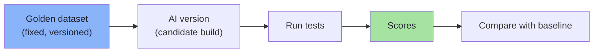

Examples include testing after:

```text
changing prompts
changing chunk size
changing retrieval count
switching models
modifying system instructions
changing embedding models
modifying tool descriptions
```

**It is called offline because real users are not involved in the evaluation.** We run stored test cases.

Example:

```text
100 known customer-support questions
```

Every time the system changes:

```text
Run those same 100 tests again
```

### Benefits of Offline Evaluation

Offline evaluation is:

```text
controlled
reproducible
safe
repeatable
useful for comparing versions
```

> **It is essentially the regression-testing layer for an AI application.**

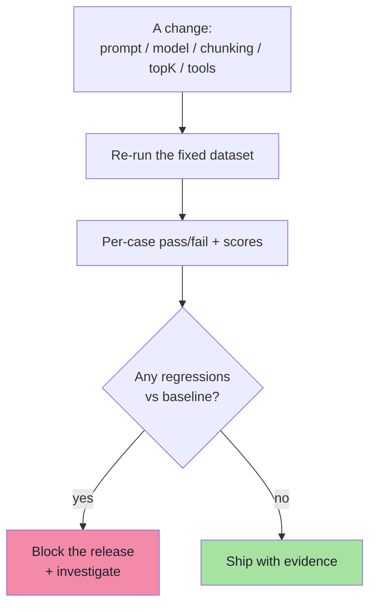

| Property | Why it matters |
|---|---|
| **Controlled** | Same cases, same config, no traffic noise |
| **Reproducible** | A failure can be re-run and debugged locally |
| **Safe** | No real users are exposed to a broken build |
| **Repeatable** | Runs in CI on every commit / PR |
| **Comparative** | Baseline vs candidate, per case and per metric |

---

## 9.2 The Limitation of Offline Evaluation

A prepared dataset **cannot perfectly represent real users**.

We might create:

```text
200 carefully written questions
```

Then a production user writes:

```text
bro bought this yesterday but box gone can return???
```

**Real-world users often communicate in unexpected ways.** That is where online evaluation becomes useful.

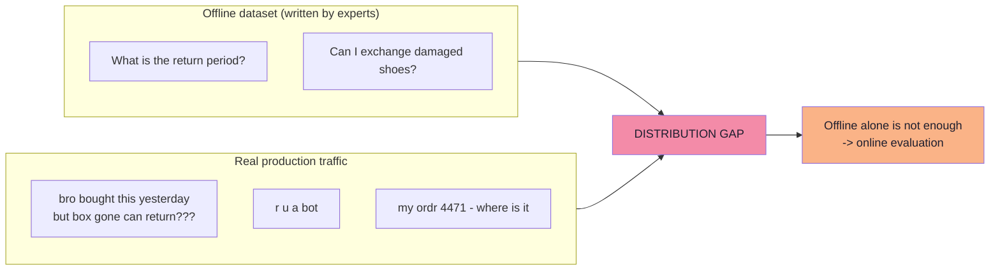

This is a **distribution gap**, and it has three consequences:

| Gap | Example | Why offline cannot catch it |
|---|---|---|
| **Phrasing** | Typos, slang, no punctuation | Nobody writes test cases that way |
| **Intent mix** | Requests you never imagined | Your taxonomy is incomplete by definition |
| **Context** | "it", "that one", mid-conversation references | Test cases are self-contained |
| **Volume/order** | Sudden spikes in one topic | Offline runs a fixed mixture |

> **The honest position:** offline evaluation tells you whether you *broke* something you already knew about. Online evaluation tells you what you *didn't* know about. You need both.

---

## 9.3 Online Evaluation

**Online evaluation measures the behaviour of the production system using real interactions.**

```text
Real Users
   ↓
Production AI
   ↓
Responses
   ↓
Feedback / Monitoring
```

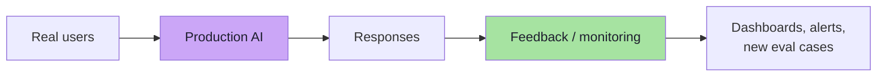

### Explicit Feedback

Examples:

```text
👍
👎
```

or:

```text
Was this helpful?
```

**This is direct evaluation from real users.** It is high-signal and low-volume: most users never click anything, and the ones who do are not a random sample (angry and delighted users are over-represented).

### Implicit Feedback

Sometimes user behaviour itself becomes a signal. For example:

```text
AI gives answer
   ↓
User asks the same question again
```

**This may indicate that the first answer was not useful.** Another example:

```text
AI answer
   ↓
User abandons task
```

> **These signals are noisier than explicit feedback, but they can still provide useful information.**

| Implicit signal | Interpretation | Caveat |
|---|---|---|
| Re-ask / rephrase | First answer failed | Could also be a new question |
| Abandonment | Answer not useful | Users leave for many reasons |
| Copy / export action | Answer was valuable | Silent most of the time |
| Follow-up depth | Engagement | Long chats can mean confusion |
| Escalation to human | System failed the task | Sometimes policy-required |
| Rapid re-submit | Likely error / retry | Could be a UI double-click |
| Session length | Weak proxy for value | Misleading without context |

> **Never gate a release on implicit signals alone.** They are *monitoring* signals: use them to find candidates for investigation, then confirm with a judge, a human, or a new eval case.

### Online LLM Evaluation

Production conversations can also be **sampled**. Example:

```text
1% of conversations
   ↓
Judge LLM
   ↓
Relevance / Faithfulness Scores
```

**This allows teams to monitor quality trends without evaluating every single interaction.**

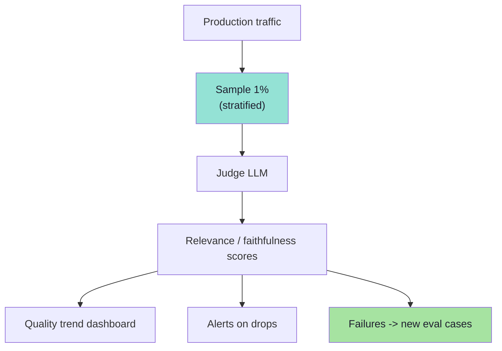

### Production Evaluation Considerations

Online evaluation introduces additional concerns:

```text
user privacy
sensitive information
evaluator cost
storage
latency
compliance
```

> **Therefore, production evaluation is often sampled rather than applied to every request.**

| Concern | Practical control |
|---|---|
| **Privacy** | Redact PII before judging; hash identifiers; judge on masked text |
| **Sensitive information** | Exclude regulated categories; keep an allow-list of what may be logged |
| **Evaluator cost** | Sample (0.5–2%), cache, and use a cheaper judge for monitoring than for gating |
| **Storage** | Bound retention; store scores and traces, not full raw payloads |
| **Latency** | Judge **asynchronously**, never in the user's request path |
| **Compliance** | Document lawful basis, data residency, retention and access controls |

> **Architectural rule:** production judging runs **out of band**. The user's response must never wait for the evaluator — evaluation observes the system, it does not sit inside it.

---

## 9.4 Online Techniques Beyond Sampling *(beyond the lecture)*

| Technique | What it does | When to use |
|---|---|---|
| **A/B test** | Randomly splits traffic between two versions and compares metrics | Confirming a real improvement on real users |
| **Canary release** | Sends 1–5% of traffic to the new version, watches for errors/quality | Every deploy, as a safety net |
| **Shadow mode** | Runs the new version alongside the old, compares outputs without showing users | High-risk changes (model swaps, prompt rewrites) |
| **Guardrail alerts** | Automatic alert when a metric crosses a threshold | Safety, hallucination spikes, cost anomalies |
| **Drift detection** | Detects shifts in input distribution (topics, languages, lengths) | Detecting a change you did not make |
| **Cost/latency dashboards** | Per-request, per-user, per-conversation cost and p95 latency | Any production system |
| **Human escalation queue** | Routes low-confidence / thumbs-down / safety-flagged cases to reviewers | High-stakes domains |
| **Feedback taxonomy** | Classify why users complained (wrong fact, too long, refused, unhelpful) | Turning complaints into dataset categories |

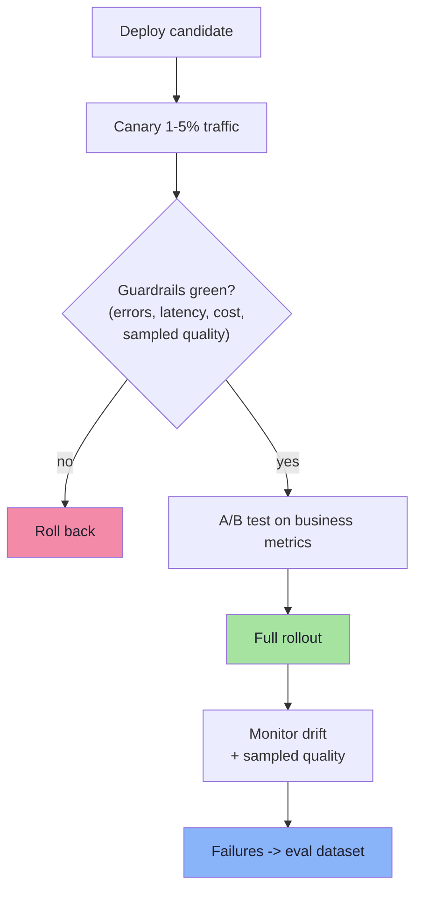

### A note on statistics

Two things make online comparisons lie:

1. **Sample size.** A 2% difference measured on 200 requests is noise. Decide the minimum detectable effect and required sample size *before* the test.
2. **Multiple comparisons.** Checking six metrics and reporting the one that "improved" guarantees false positives. Pre-register the primary metric; treat the rest as exploratory.

> **Online A/B tests are how you validate that an offline win is a real win.** Offline improvements sometimes do not transfer to production — this is the only way to find out.

---

## 9.5 Offline and Online Evals Work Together

**The strongest evaluation system combines both.**

```text
Offline Dataset
   ↓
Test
   ↓
Deploy
   ↓
Real Users
   ↓
Identify Failures
   ↓
Add Failures to Eval Dataset
   ↓
Run Offline Evals Again
```

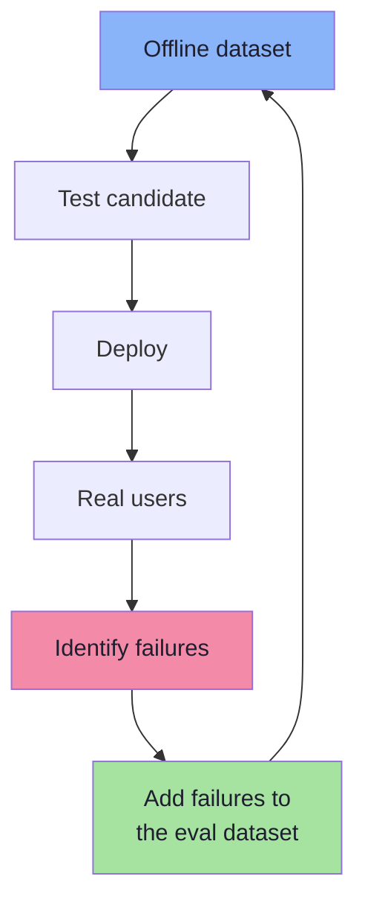

> **Production failures become future regression tests. This creates a continuous improvement loop.**

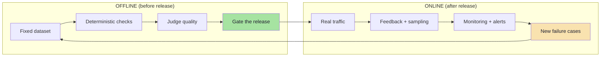

| | Offline | Online |
|---|---|---|
| Users involved | No | Yes |
| Cases | Fixed, versioned | Whatever arrives |
| Metrics | Deterministic + judged quality | Feedback, sampled judged quality, ops metrics |
| Cost per run | Predictable | Ongoing, sampled |
| Catches | Regressions you have seen | Failures you have never seen |
| Risk | Distribution gap | Privacy, cost, noise |
| Role | **Gate** | **Monitor + discover** |

> **The loop is the product.** A team with a small dataset and a tight loop beats a team with a huge dataset that never adds to it.

---

## 9.6 The Complete GenAI Evaluation Architecture

The lecture closes with the whole machine in one picture.

```text
Evaluation Dataset
   │
   ▼
AI Application
   │
   ▼
Generated Output
   │
   ├───────────────┐
   ▼               ▼
Deterministic    Quality
Checks           Evaluation
   │               │
   │        ┌──────┴──────┐
   │        ▼             ▼
   │     LLM Judge      Human
   │        │             │
   ▼        ▼             ▼
 Pass / Fail           Score
```

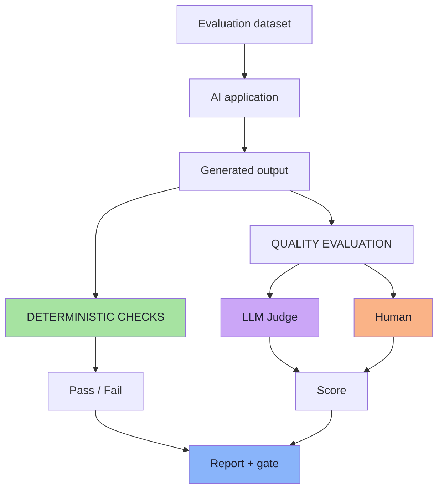

**Examples of deterministic checks:**

```text
JSON valid?
Correct tool?
Correct schema?
HTTP success?
Latency?
Token usage?
```

**Examples of quality checks:**

```text
Relevant?
Correct?
Faithful?
Helpful?
Hallucinating?
```

> Notice the shape of the architecture: **the same output flows down two independent paths.** Deterministic checks are cheap, exact and always run; quality evaluation is semantic, costs money and is sampled or scoped deliberately. A report merges both into a decision.

---

## 9.7 A Practical Evaluation Workflow

Whenever we modify an AI application:

```text
1. Keep a fixed evaluation dataset
2. Run the new application version
3. Evaluate deterministic behaviour with code
4. Evaluate semantic quality with an LLM judge
   or humans where required
5. Aggregate the results
6. Compare them against the previous version
7. Deploy only when quality remains acceptable
8. Monitor real production interactions
9. Add important failures back into the eval dataset
```

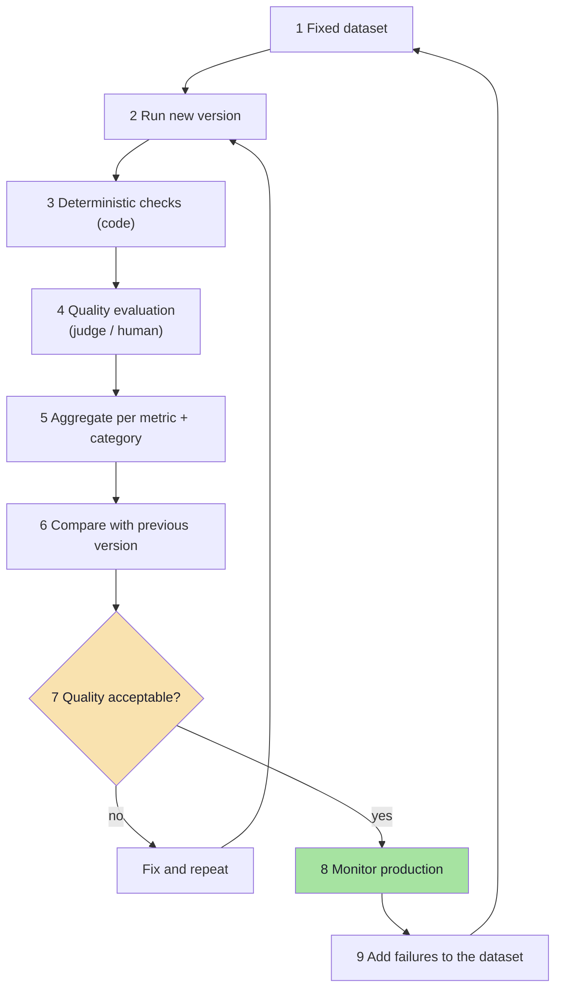

> **This turns AI development from "Looks good to me." into "We measured it."**

### Putting the workflow into CI/CD *(beyond the lecture)*

| Stage | What runs | Cost/time budget |
|---|---|---|
| **Pre-commit** | Deterministic checks on the smoke set (10–30 cases) | seconds, free |
| **Pull request** | Full deterministic set + judge on gating metrics | minutes, cents |
| **Nightly** | Whole dataset, all metrics, all categories | tens of minutes, dollars |
| **Pre-release** | Full run + human review of disagreements | hours, human cost |
| **Post-deploy** | Canary + sampled online judging | continuous |

```ts
// Pseudo-code: an eval gate that a CI pipeline can block on.
type GatePolicy = {
  requireDeterministicPassRate: number;        // e.g. 0.98
  floors: Record<string, number>;              // { faithfulness: 4.2, relevance: 4.3 }
  ceilings: Record<string, number>;            // { hallucinationRate: 0.02, p95LatencyMs: 5000 }
  allowRegressions: number;                    // e.g. 0 — no case may regress
  allowNewFailuresByCategory?: Record<string, number>;  // tolerances per slice
};

function evaluateGate(report: EvalReport, policy: GatePolicy) {
  const reasons: string[] = [];
  if (report.deterministicPassRate < policy.requireDeterministicPassRate)
    reasons.push(`deterministic pass rate ${report.deterministicPassRate} below ${policy.requireDeterministicPassRate}`);
  for (const [metric, floor] of Object.entries(policy.floors))
    if ((report.averages[metric] ?? 0) < floor) reasons.push(`${metric} ${report.averages[metric]} < floor ${floor}`);
  if (report.regressions.length > policy.allowRegressions)
    reasons.push(`regressions: ${report.regressions.join(", ")}`);
  return { pass: reasons.length === 0, reasons };
}
```

Two governance details that make gates work in practice:

1. **Thresholds are reviewable artefacts.** Changing a floor should require a code review, not a quiet edit.
2. **A ratchet.** When a metric improves, raise the floor. Otherwise quality drifts down to whatever the threshold allows.

---

## 9.8 From "Looks Good to Me" to "We Measured It"

The lecture's closing contrast:

```text
BEFORE                              AFTER
------                              -----
User question                       Evaluation dataset
   ↓                                   ↓
AI application                      AI application (new version)
   ↓                                   ↓
Answer                              Generated output
   ↓                                   ↓
Developer reads it                  Deterministic checks + judge
   ↓                                   ↓
"Looks fine."                       Scores, regressions, attribution
                                       ↓
                                    "Faithfulness 4.2 (floor 4.2),
                                     zero regressions, 3 fixed,
                                     attribution: 4 retrieval,
                                     2 generation — shipping."
```

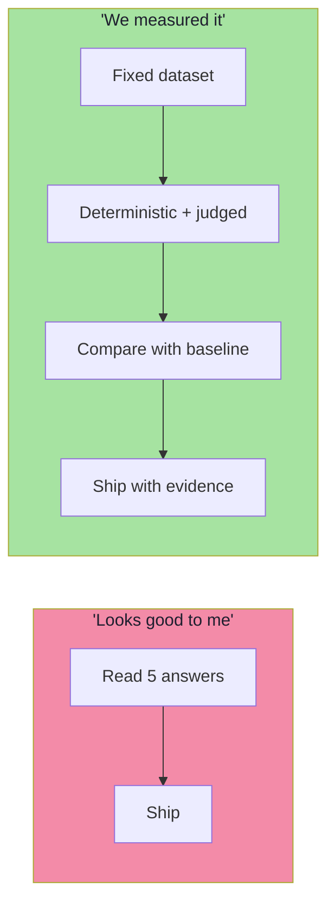

### Ownership: who owns what

Evaluation only survives if each artefact has an owner:

| Artefact | Owner | Responsibility |
|---|---|---|
| Evaluation dataset | Product + domain expert | Coverage, categories, freshness |
| Deterministic checks | Engineering | Keep them exact, fast and green |
| Judge prompts + rubrics | AI platform | Calibration, versioning, agreement |
| Thresholds / gate policy | Engineering + product | Reviewable, ratcheted, justified |
| Human review process | Product / support | Sampling, blinding, adjudication |
| Production monitoring | On-call / platform | Alerts, drift, cost |
| The feedback loop | Team | Every incident becomes a case |

> **If nobody owns the dataset, it will be three questions and a README.** Ownership is what turns the loop into a process.

---

## 9.9 Common Mistakes at This Stage

| Mistake | Why it hurts | Correct habit |
|---|---|---|
| Relying only on offline evals | Real users phrase things you never imagined | Add online sampling + the failure loop |
| Relying only on online evals | You learn about breakage from customers | Gate releases with an offline dataset |
| Judging production traffic synchronously | Adds latency and cost to every request | Judge out of band, sampled |
| Logging raw conversations for judging | Privacy and compliance incident | Redact, mask, bound retention |
| Gating on implicit signals alone | Noisy, ambiguous, easily misread | Confirm with a judge, human, or new case |
| Never adding production failures to the dataset | The same bug ships twice | Every incident becomes a case |
| Thresholds edited casually | The gate becomes decorative | Reviewable, ratcheted policy |
| No canary / shadow for model swaps | A silent quality drop reaches everyone | Canary first, A/B to confirm |
| Judging 100% of traffic "to be safe" | Cost explodes, nobody keeps it | Stratified sampling, cheaper monitoring judge |
| No baseline recorded | Scores have nothing to be compared with | Store the baseline report per version |

---

## 9.10 Chapter Summary

| Idea | Statement |
|---|---|
| Offline evaluation | Fixed golden dataset → candidate version → scores; controlled, reproducible, safe, repeatable |
| Offline triggers | Prompt, chunk size, retrieval count, model, instructions, embeddings, tool descriptions |
| Offline's limit | A prepared dataset cannot represent real users (*"bro bought this yesterday but box gone can return???"*) |
| Online evaluation | Real users → production AI → responses → feedback / monitoring |
| Explicit feedback | 👍 / 👎 / "Was this helpful?" |
| Implicit feedback | Re-asking, abandonment — noisier, but useful |
| Online judging | Sample ~1% of conversations → judge → relevance / faithfulness trends |
| Online concerns | Privacy, sensitive data, evaluator cost, storage, latency, compliance |
| The loop | Offline dataset → test → deploy → real users → failures → dataset → repeat |
| Complete architecture | Output → deterministic checks *and* quality evaluation → pass/fail + scores → report |
| The workflow | Nine steps from a fixed dataset to adding failures back |
| The transformation | From *"Looks good to me"* to *"We measured it"* |

> **Final mental model:** offline evaluation is your **safety net** and online evaluation is your **early-warning system**, and the loop between them is what makes an AI application improve over time instead of decaying. Ship behind the gate, watch production, and promote every real failure into a permanent test.

---

## Where This Goes Next

- **Back to the beginning:** [Chapter 01](./01_Why_AI_Needs_Evals.md) — reread the `topK 5 → 3` regression now that the full loop is known.
- **Consolidated:** [Lecture 17 — Complete Consolidated Notes](./Lecture_17_Complete_Notes.md) for the one-page version of the entire lecture.
- Cross-lecture: [Lecture 12](../../Lecture%2012/notes/README.md) (the levers you will be testing), [Lecture 13](../../Lecture%2013/notes/README.md) (structured outputs as testable contracts), [Lecture 05](../../Lecture%2005/notes/README.md) (agent safety and human-in-the-loop).

---

**Back to:** [Lecture 17 — Chapter Index](./README.md) · [Complete Consolidated Notes](./Lecture_17_Complete_Notes.md)


