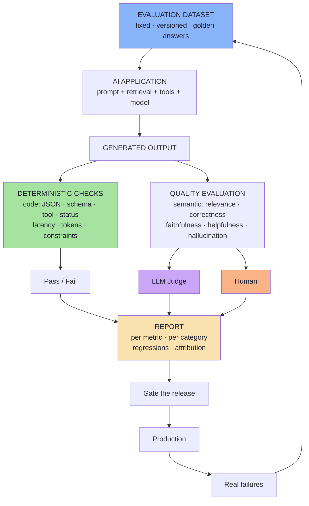

# Lecture 17 — GenAI Evals & Testing

> **Lecture theme:** Every lecture before this one answered a *capability* question — *how do we make the AI do something?* Chatbots (04), agents and tool calling (05), streaming (06), embeddings (07–10), RAG (11–12), structured outputs (13), MCP (14–15), multimodality (16). This lecture asks the question that arrives right after the first production incident: **how do we know the system is doing its job correctly?**
>
> The answer is not "test harder". Traditional testing rests on two properties AI does not have — **determinism** and **exactness**. `assertEquals(5, add(2, 3))` cannot be written for an answer that has three acceptable phrasings. So we replace it with something else: a **fixed dataset**, **expected behaviour** instead of expected text, and an **evaluator** that is code, an LLM judge, or a human.
>
> The lecture's arc is: **why testing breaks (01) → what an eval is (02) → what goes in the dataset (03) → what code can decide (04) → what only judgement can decide (05–07) → how to evaluate a whole RAG or agent system (08) → how to run all of it before and after release (09).**
>
> The source lecture uses illustrative snippets; these notes keep the architecture and express any snippet as **TypeScript-style pseudo-code** for a JS/TS (Node.js) environment. **No runnable production code appears in these notes** — only pseudo-code that describes data flow, contracts and data shapes.

---

## Chapter Index

| # | Chapter | Core Question Answered |
|---|---|---|
| [01](./01_Why_AI_Needs_Evals.md) | Why AI Needs Evals — The Testing Problem | Why does `Expected Output == Actual Output` fail for LLMs? |
| [02](./02_Anatomy_Of_An_Eval.md) | Anatomy of an Eval — Three Ingredients and One System | What is inside an eval, and what exactly are we evaluating? |
| [03](./03_Evaluation_Datasets_And_Golden_Data.md) | Evaluation Datasets and Golden Data | What must be *inside* the dataset for it to find bugs? |
| [04](./04_Deterministic_Evaluation.md) | Deterministic Evaluation — When Code Is the Judge | Which quality problems are just assertions I forgot to write? |
| [05](./05_AI_Quality_Metrics.md) | AI Quality Metrics — Measuring What Code Cannot | What does "good" actually mean, in five measurable parts? |
| [06](./06_LLM_As_A_Judge.md) | LLM-as-a-Judge | How do I score 300 cases on every PR — and trust the scores? |
| [07](./07_Rubrics_Pointwise_Pairwise_And_Human_Evaluation.md) | Rubrics, Pointwise vs Pairwise, and Human Evaluation | What makes a score reproducible, and when do humans decide? |
| [08](./08_RAG_And_System_Level_Evaluation.md) | RAG and System-Level Evaluation | The answer was wrong — was it retrieval, the prompt, or the spec? |
| [09](./09_Offline_And_Online_Evaluation.md) | Offline and Online Evaluation | What happens between "I changed the prompt" and "we shipped it"? |
| [**Complete**](./Lecture_17_Complete_Notes.md) | **Complete Consolidated Notes** | All nine chapters condensed: cheat sheets, decision tables, glossary, self-check |

> 📄 **Prefer a single document?** Read the **[Lecture 17 — Complete Consolidated Notes](./Lecture_17_Complete_Notes.md)**. It keeps the load-bearing ideas, the decision tables and the full architecture, and links back to the chapters for full reasoning and pseudo-code.

---

## The Big Idea in One Diagram

Read it in three parts: **a fixed dataset drives the system; every output is judged twice (code, then judgement); and production failures flow back into the dataset.** That last arrow is what makes the whole thing a loop rather than a report.

---

## How to Read These Notes

| Convention | Meaning |
|---|---|
| **Mermaid only** | Every diagram is Mermaid (`flowchart`, `sequenceDiagram`, `stateDiagram-v2`). |
| **TypeScript-style pseudo-code** | Snippets describe data flow and contracts for a JS/TS environment. They are **not runnable production code** and are always labelled. |
| **Board references** | Passages described as *from the board* reproduce the hand-drawn `Excalidraw-Notes.svg`. |
| **Beyond the lecture** | Sections marked *beyond the lecture* add material the script only gestures at (retrieval metrics, judge bias and calibration, agent trajectory metrics, CI gating, online A/B testing, statistical pitfalls). |
| **Cross-lecture links** | Where a topic is really another lecture's subject, it is linked rather than repeated. |

---

## Sources

- 📄 [`Notes.pdf`](./Notes.pdf) — *GenAI Evals & Testing* (44 pages): the fundamental problem of testing AI, why "looks good to me" is not testing, what an AI eval is, evaluating the entire AI system, evaluation datasets and golden datasets, what a good dataset contains, the two broad types of evaluation, deterministic evaluation, quality-based evaluation, the five core quality metrics, LLM-as-a-judge, pointwise vs pairwise, rubrics, human evaluation, RAG evaluation, offline evaluation, online evaluation, how offline and online work together, the complete evaluation architecture, the practical workflow, key takeaways and the final mental model.
- 🖼️ [`Excalidraw-Notes.svg`](./Excalidraw-Notes.svg) — the lecture board: the deterministic `int sum(int a, int b)` unit-test box (`sum(4,5) → 9`, `sum(1,4) → 5`, *"DEterministic"*), the return-policy query with three acceptable answers, the **"Exact Output"** vs **"Did the model exhibit the result we wanted"** split, **"5 queries → 500 queries"** with the change list (*system prompt · switch the model · chunk size · number of retrieval · temperature · add/remove tool*), the definition of an AI eval, the **3 things** (*test input · expected behaviour → proper tool calling · evaluation mechanism → Code → LLM-as-a-Judge → Human*), `Client → LLM → Server (Vector DB) = AI Application`, the dataset and **Golden Dataset** (chatbot · AI agents · exact schema), the dataset taxonomy (*normal · edge · out-of-scope · adverse*), the evaluation split (**Deterministic Eval / COde** vs **Quality Eval / Non-Deteministic / LLM-as-a-Judge**), deterministic checks (`Is JSON valid?` / `Is semantics correct?`, `topk.size() == 0 → "I dont have memory"`), the five **AI Quality Metrics** with worked examples, the judge's JSON output, score scales (**1–10 · 1–100 · 1–5**), **Pointwise / Pairwise / Rubrics**, the 1–5 faithfulness rubric, the `{ relevanceScore, message }` output shape, **Humans**, **prod**, **offline**, **online**.
- 📚 Prior lectures — [Lecture 02](../../Lecture%2002/notes/README.md) (tokens, attention, why generation varies), [Lecture 04](../../Lecture%2004/notes/README.md) (hallucination, memory, context), [Lecture 05](../../Lecture%2005/notes/README.md) (agents, tool calling, human-in-the-loop, prompt injection), [Lecture 11](../../Lecture%2011/notes/README.md) / [Lecture 12](../../Lecture%2012/notes/README.md) (RAG: chunking, hybrid retrieval, reranking), [Lecture 13](../../Lecture%2013/notes/README.md) (structured outputs — the schema that doubles as a test), [Lecture 14](../../Lecture%2014/notes/README.md) / [Lecture 15](../../Lecture%2015/notes/README.md) (MCP tools, resources, prompts), [Lecture 16](../../Lecture%2016/notes/README.md) (multimodal inputs — a new evaluation surface).

---

## One-Line Summaries

| Chapter | One-line summary |
|---|---|
| 01 | AI breaks `expected == actual`, so we measure behaviour — and "looks good to me" does not scale past five questions. |
| 02 | An eval is a test input, an expected behaviour and an evaluation mechanism — applied to the whole system, not the model. |
| 03 | If the dataset has no difficult cases, you know nothing about difficult cases. |
| 04 | If code can decide it, code decides it — JSON, tools, schema, refusals, constraints, latency, cost. |
| 05 | Quality is a vector, not a scalar: relevance, correctness, faithfulness, helpfulness, hallucination. |
| 06 | A second model can score meaning at scale — but it is a measuring instrument, not ground truth. |
| 07 | A rubric turns scores into behaviour; pointwise gates, pairwise chooses, humans calibrate. |
| 08 | A RAG or agent failure is never just "the model" — split retrieval from response and attribute the failure. |
| 09 | Offline evals gate the release; online evals discover what you never imagined; the loop is the product. |

---

## The Lecture in Ten Sentences

1. Traditional software is testable because it is **deterministic and exact**; LLMs are neither, so `Expected Output == Actual Output` stops working.
2. The replacement question is **"did the model exhibit the behaviour we wanted?"** — which is what an eval measures.
3. An eval needs three things: a **test input**, an **expected behaviour**, and an **evaluation mechanism** (code → LLM judge → human).
4. We evaluate the **entire AI system** — embedding, retrieval, prompt, model, tools — not just the model call.
5. Evaluation requires a **fixed dataset**; a **golden dataset** adds reference answers or expected behaviours.
6. A good dataset covers **normal, reworded, edge, out-of-scope, missing-information and adversarial** cases.
7. Evaluation splits into **deterministic** (code decides) and **quality** (semantics decide); use code wherever code can decide.
8. Quality has five core dimensions: **relevance, correctness, faithfulness, helpfulness, hallucination**.
9. **LLM-as-a-Judge** scales semantic evaluation — with rubrics, structured output, calibration and the knowledge that it is *not* ground truth.
10. **Offline and online evaluation form a loop**: production failures become future regression tests, turning *"looks good to me"* into *"we measured it"*.

---

**Back to:** [Lecture 17 — Chapter Index](./README.md) · [Complete Consolidated Notes](./Lecture_17_Complete_Notes.md)

