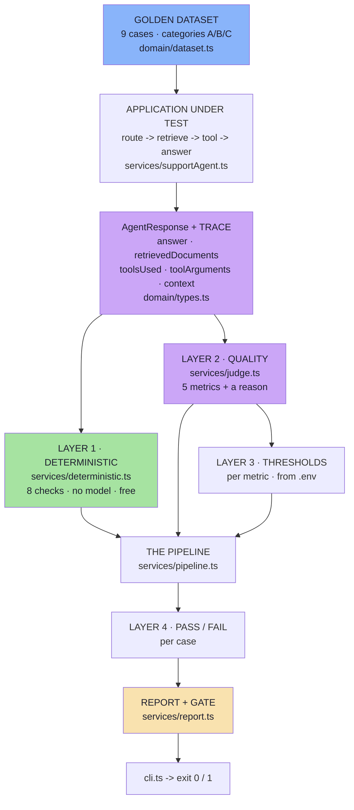

# Lecture 18 — Basic Code · Step-by-Step Implementation Guide

> **What this is.** Ten chapters that walk the whole project in order, one source file
> (or one tight group) per chapter: **file details → commands → the full file → a
> block-by-block explanation of what it does and why it is written that way.**
>
> Read it top to bottom and you will have read every line of the project, in the order
> it makes sense to read it. Every code block is the real file — the listings are not
> abridged.

---

## What the project is

One small AI application — an e-commerce support agent with retrieval and three tools —
plus the testing system that tells you whether it still works.



Read it top to bottom and you have the lecture. Read it left to right and you have the
argument: **the answer is a claim, the trace is the evidence, and only the trace can be
tested.**

---

## How to read a chapter

Every chapter has the same five parts:

| Part | What it gives you |
|---|---|
| **File details** | the file, its layer, what it exports, which notes section it implements |
| **Commands** | how to see it working, and what to look for |
| **The full file** | the complete source, verbatim |
| **Block-by-block** | why each block is written that way — the design decisions, not the syntax |
| **Checkpoint** | questions you should be able to answer before moving on |

---

## Commands you will use throughout

```bash
cd "Lecture 18/code/Basic Code"
npm install
npm run typecheck     # tsc --noEmit — must exit 0 before you start
```

```bash
npm run eval                        # the four-layer pipeline + the gate
RETRIEVAL_TOPK=2 npm run eval       # reproduce the retrieval regression
npm start                           # the HTTP surface, on :8080
```

Runtime used for every output quoted in this guide:

```text
Node v24.22.0 · tsx 4.23.15 · tsc 5.9.3
express 5.3.0 · openai 6.49.0 · dotenv 16.6.1
```

---

## Chapter index

| # | Chapter | Source files | Notes chapter |
|---|---|---|---|
| [01](./01_Project_Structure_and_File_Map.md) | Project Structure and File Map | the whole tree, `package.json`, `tsconfig.json`, `.env.example` | — |
| [02](./02_Config_And_The_Trace_Contract.md) | Config and the Trace Contract | `config/config.ts`, `domain/types.ts` | Ch 02, 03 |
| [03](./03_The_Application_Under_Test.md) | The Application Under Test | `domain/dataset.ts` (corpus), `services/knowledgeBase.ts`, `services/tools.ts` | Ch 02 |
| [04](./04_Observability_AgentResponse_And_Traces.md) | Observability — `AgentResponse` and Traces | `services/supportAgent.ts`, `middleware/requestContext.ts` | Ch 03 |
| [05](./05_The_Golden_Dataset.md) | The Golden Dataset | `domain/dataset.ts` (the nine cases) | Ch 04 |
| [06](./06_Deterministic_Evaluation.md) | Deterministic Evaluation — Code as the Judge | `services/text.ts`, `services/deterministic.ts` | Ch 05 |
| [07](./07_LLM_As_A_Judge.md) | LLM-as-a-Judge — Five Metrics and a Rubric | `services/judge.ts`, `services/model.ts` | Ch 06 |
| [08](./08_The_Four_Layer_Pipeline.md) | The Four-Layer Pipeline | `services/pipeline.ts` | Ch 07 |
| [09](./09_Thresholds_The_Report_And_The_Gate.md) | Thresholds, the Report and the Gate | `services/report.ts`, `cli.ts` | Ch 08 |
| [10](./10_The_Surfaces_Controller_Routes_And_Entry.md) | The Surfaces — Controllers, Routes, Entry | `controllers/`, `routes/`, `index.ts` | Ch 02 §2.4 |

---

**Back to:** [Lecture 18 Basic Code README](../README.md) · [Lecture 18 notes](../../../notes/README.md)
